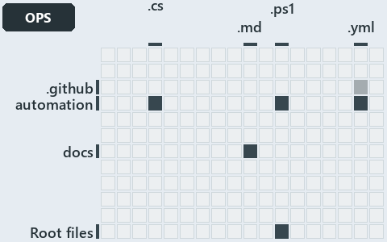

# docs/.assets/explanation/adr-auto-bundle--dot-source-one-entry-script--operations.grid.md

`Grid minimap: adr-auto-bundle--dot-source-one-entry-script--operations`

The grid minimap of the slide `adr-auto-bundle--dot-source-one-entry-script--operations` (operations lens). The slide supports
[ADR-AUTO-BUNDLE][1]; the highlight of those ADR codes selects what is lit, and each reason below names the code that selects it.

## What the minimap shows

The grid crosses the 12 tracks (rows) with the 18 file languages (columns) of the world map and lights 6 cells, filled in ink. A cell lit
only by passing mentions (citations in body comments, not in a file's header or text) is touched: a lighter ink. Every other cell is idle, a
grey box: it holds files the slide's ADR codes do not select, or no file at all (174 of the 216 cells hold none). The minimap shows where
the slide sits, not how many files a cell holds; the world-map PDFs show the counts.

- .github × yaml: 1 lit of 2 files, touched
- automation × csharp: 2 lit of 219 files
- automation × powershell: 9 lit of 1400 files
- automation × yaml: 2 lit of 95 files
- docs × markdown: 90 lit of 741 files
- Root files × powershell: 1 lit of 1 file

## Key

A lit row prints its track's name; a lit column prints a short code, the first extension of its file language:

- `.cs`: csharp
- `.md`: markdown
- `.ps1`: powershell
- `.yml`: yaml

## Why each cell is lit

### .github × yaml (1 lit file, touched)

Placed: the root folder `.github/` names the track .github ([ADR-DSGN-TRACK#1][2]); the extension `.yml` names the file language yaml
([ADR-DSGN-TRACK#6][3]). Lit ([ADR-DSGN-TRACK#12][4]) by:

- [.github/workflows/ci-automation.yml][5]: selected by [ADR-AUTO-BUNDLE][1]: the file cites it at line 48 (body comment) (a passing mention
  only).

### automation × csharp (2 lit files)

Placed: the root folder `automation/` names the track automation ([ADR-DSGN-TRACK#1][2]); the extension `.cs` names the file language csharp
([ADR-DSGN-TRACK#6][3]). Lit ([ADR-DSGN-TRACK#12][4]) by:

- [automation/Catzc.Base.Exporter/types/ExporterBundle.cs][6]: selected by [ADR-AUTO-BUNDLE][1]: the file cites it at line 3 (header).
- [automation/Catzc.Base.Exporter/types/ExporterConfig.cs][7]: selected by [ADR-AUTO-BUNDLE][1]: the file cites it at line 2 (header).

### automation × powershell (9 lit files)

Placed: the root folder `automation/` names the track automation ([ADR-DSGN-TRACK#1][2]); the extension `.ps1` names the file language
powershell ([ADR-DSGN-TRACK#6][3]). Lit ([ADR-DSGN-TRACK#12][4]) by:

- [automation/.internal/assets/Import-Catzc.ps1][8]: selected by [ADR-AUTO-BUNDLE][1]: the file cites it at line 6 (header).
- [automation/Catzc.Base.Contracts/Publish-ContractRelease.ps1][9]: selected by [ADR-AUTO-BUNDLE][1]: the file cites it at line 12 (header).
- [automation/Catzc.Base.Exporter/Assert-CatzcBundle.ps1][10]: selected by [ADR-AUTO-BUNDLE][1]: the file cites it at line 6 (header).
- [automation/Catzc.Base.Exporter/Build-Modules.ps1][11]: selected by [ADR-AUTO-BUNDLE][1]: the file cites it at line 5 (header) and line 54
  (text).
- [automation/Catzc.Base.Exporter/Export-Catzc.ps1][12]: selected by [ADR-AUTO-BUNDLE][1]: the file cites it at line 6 (header).
- [automation/Catzc.Base.Exporter/Install-Catzc.ps1][13]: selected by [ADR-AUTO-BUNDLE][1]: the file cites it at line 6 (header).
- [automation/Catzc.Base.Exporter/Resolve-CatzcBuildVersion.ps1][14]: selected by [ADR-AUTO-BUNDLE][1]: the file cites it at line 7
  (header).
- [automation/Catzc.Base.Exporter/private/Assert-BundleFootprint.ps1][15]: selected by [ADR-AUTO-BUNDLE][1]: the file cites it at line 6
  (header).
- [automation/Catzc.Base.Exporter/private/New-CatzcNuGetPackage.ps1][16]: selected by [ADR-AUTO-BUNDLE][1]: the file cites it at line 5
  (header).

### automation × yaml (2 lit files)

Placed: the root folder `automation/` names the track automation ([ADR-DSGN-TRACK#1][2]); the extension `.yml` names the file language yaml
([ADR-DSGN-TRACK#6][3]). Lit ([ADR-DSGN-TRACK#12][4]) by:

- [automation/Catzc.Base.Docs/configs/adrs.yml][17]: selected by [ADR-AUTO-BUNDLE][1]: the file cites it at line 162 (text).
- [automation/Catzc.Base.Exporter/configs/exporter.yml][18]: selected by [ADR-AUTO-BUNDLE][1]: the file cites it at line 7 (header).

### docs × markdown (90 lit files)

Placed: the root folder `docs/` names the track docs ([ADR-DSGN-TRACK#1][2]); the extension `.md` names the file language markdown
([ADR-DSGN-TRACK#6][3]). Lit ([ADR-DSGN-TRACK#12][4]) by:

- [docs/.assets/explanation/adr-auto-bundle--build-then-place-with-one-command--operations.chain.md][19]: selected by [ADR-AUTO-BUNDLE][1]:
  the file cites it at line 8 (text), line 25 (text), line 25 (text), line 33 (text) and line 33 (text).
- [docs/.assets/explanation/adr-auto-bundle--build-then-place-with-one-command--operations.drawio.md][20]: selected by [ADR-AUTO-BUNDLE][1]:
  the file cites it at line 72 (text).
- [docs/.assets/explanation/adr-auto-bundle--build-then-place-with-one-command--operations.grid.md][21]: selected by [ADR-AUTO-BUNDLE][1]:
  the file cites it at line 8 (text), line 29 (text), line 37 (text), line 38 (text), line 45 (text), line 46 (text), line 47 (text), line
  48 (text), line 50 (text), line 51 (text), line 52 (text), line 54 (text), line 62 (text), line 63 (text), line 70 (text), line 73 (text),
  line 74 (text), line 76 (text), line 78 (text), line 80 (text), line 82 (text), line 84 (text), line 86 (text), line 88 (text), line 90
  (text), line 92 (text), line 94 (text), line 96 (text), line 98 (text), line 100 (text), line 102 (text), line 104 (text), line 106
  (text), line 108 (text), line 110 (text), line 112 (text), line 114 (text), line 116 (text), line 118 (text), line 120 (text), line 122
  (text), line 124 (text), line 126 (text), line 128 (text), line 130 (text), line 132 (text), line 134 (text), line 136 (text), line 138
  (text), line 140 (text), line 142 (text), line 144 (text), line 146 (text), line 148 (text), line 150 (text), line 152 (text), line 154
  (text), line 156 (text), line 158 (text), line 160 (text), line 162 (text), line 164 (text), line 166 (text), line 168 (text), line 169
  (text), line 171 (text), line 173 (text), line 175 (text), line 177 (text), line 179 (text), line 181 (text), line 183 (text), line 185
  (text), line 187 (text) and line 195 (text).
- [docs/.assets/explanation/adr-auto-bundle--build-then-place-with-one-command--operations.tree.md][22]: selected by [ADR-AUTO-BUNDLE][1]:
  the file cites it at line 8 (text), line 31 (text), line 33 (text), line 35 (text), line 37 (text), line 39 (text), line 41 (text), line
  43 (text), line 45 (text), line 47 (text), line 49 (text), line 51 (text), line 53 (text), line 55 (text), line 57 (text), line 59 (text),
  line 61 (text), line 63 (text), line 65 (text), line 67 (text), line 69 (text), line 71 (text), line 73 (text), line 75 (text), line 77
  (text), line 79 (text), line 81 (text), line 83 (text), line 85 (text), line 87 (text), line 89 (text), line 91 (text), line 93 (text),
  line 95 (text), line 97 (text), line 99 (text), line 101 (text), line 103 (text), line 105 (text), line 107 (text), line 115 (text), line
  117 (text), line 119 (text), line 121 (text), line 123 (text), line 125 (text), line 127 (text), line 129 (text), line 131 (text), line
  133 (text), line 134 (text), line 136 (text), line 138 (text), line 140 (text), line 142 (text), line 144 (text), line 146 (text), line
  148 (text), line 150 (text), line 152 (text), line 160 (text), line 162 (text), line 164 (text), line 166 (text), line 168 (text), line
  170 (text), line 173 (text), line 174 (text), line 176 (text), line 183 (text), line 190 (text), line 197 (text), line 204 (text), line
  211 (text) and line 218 (text).
- [docs/.assets/explanation/adr-auto-bundle--build-verify-then-copy-the-folder--implementation.chain.md][23]: selected by
  [ADR-AUTO-BUNDLE][1]: the file cites it at line 8 (text), line 25 (text), line 25 (text), line 33 (text) and line 33 (text).
- [docs/.assets/explanation/adr-auto-bundle--build-verify-then-copy-the-folder--implementation.drawio.md][24]: selected by
  [ADR-AUTO-BUNDLE][1]: the file cites it at line 69 (text).
- [docs/.assets/explanation/adr-auto-bundle--build-verify-then-copy-the-folder--implementation.grid.md][25]: selected by
  [ADR-AUTO-BUNDLE][1]: the file cites it at line 8 (text), line 29 (text), line 37 (text), line 38 (text), line 45 (text), line 46 (text),
  line 47 (text), line 48 (text), line 50 (text), line 51 (text), line 52 (text), line 54 (text), line 62 (text), line 63 (text), line 70
  (text), line 73 (text), line 74 (text), line 76 (text), line 78 (text), line 80 (text), line 82 (text), line 84 (text), line 86 (text),
  line 88 (text), line 90 (text), line 92 (text), line 94 (text), line 96 (text), line 98 (text), line 100 (text), line 102 (text), line 104
  (text), line 106 (text), line 108 (text), line 110 (text), line 112 (text), line 114 (text), line 116 (text), line 118 (text), line 120
  (text), line 122 (text), line 124 (text), line 126 (text), line 128 (text), line 130 (text), line 132 (text), line 134 (text), line 136
  (text), line 138 (text), line 140 (text), line 142 (text), line 144 (text), line 146 (text), line 148 (text), line 150 (text), line 152
  (text), line 154 (text), line 156 (text), line 158 (text), line 160 (text), line 162 (text), line 164 (text), line 166 (text), line 168
  (text), line 169 (text), line 171 (text), line 173 (text), line 175 (text), line 177 (text), line 179 (text), line 181 (text), line 183
  (text), line 185 (text), line 187 (text) and line 195 (text).
- [docs/.assets/explanation/adr-auto-bundle--build-verify-then-copy-the-folder--implementation.tree.md][26]: selected by
  [ADR-AUTO-BUNDLE][1]: the file cites it at line 8 (text), line 31 (text), line 33 (text), line 35 (text), line 37 (text), line 39 (text),
  line 41 (text), line 43 (text), line 45 (text), line 47 (text), line 49 (text), line 51 (text), line 53 (text), line 55 (text), line 57
  (text), line 59 (text), line 61 (text), line 63 (text), line 65 (text), line 67 (text), line 69 (text), line 71 (text), line 73 (text),
  line 75 (text), line 77 (text), line 79 (text), line 81 (text), line 83 (text), line 85 (text), line 87 (text), line 89 (text), line 91
  (text), line 93 (text), line 95 (text), line 97 (text), line 99 (text), line 101 (text), line 103 (text), line 105 (text), line 107
  (text), line 115 (text), line 117 (text), line 119 (text), line 121 (text), line 123 (text), line 125 (text), line 127 (text), line 129
  (text), line 131 (text), line 133 (text), line 134 (text), line 136 (text), line 138 (text), line 140 (text), line 142 (text), line 144
  (text), line 146 (text), line 148 (text), line 150 (text), line 152 (text), line 160 (text), line 162 (text), line 164 (text), line 166
  (text), line 168 (text), line 170 (text), line 173 (text), line 174 (text), line 176 (text), line 183 (text), line 190 (text), line 197
  (text), line 204 (text), line 211 (text) and line 218 (text).
- [docs/.assets/explanation/adr-auto-bundle--dot-source-one-entry-script--operations.chain.md][27]: selected by [ADR-AUTO-BUNDLE][1]: the
  file cites it at line 8 (text), line 25 (text), line 25 (text), line 33 (text) and line 33 (text).
- [docs/.assets/explanation/adr-auto-bundle--dot-source-one-entry-script--operations.drawio.md][28]: selected by [ADR-AUTO-BUNDLE][1]: the
  file cites it at line 68 (text).
- [docs/.assets/explanation/adr-auto-bundle--dot-source-one-entry-script--operations.grid.md][29]: selected by [ADR-AUTO-BUNDLE][1]: the
  file cites it at line 8 (text), line 29 (text), line 37 (text), line 38 (text), line 45 (text), line 46 (text), line 47 (text), line 48
  (text), line 50 (text), line 51 (text), line 52 (text), line 54 (text), line 62 (text), line 63 (text), line 70 (text), line 73 (text),
  line 74 (text), line 76 (text), line 78 (text), line 80 (text), line 82 (text), line 84 (text), line 86 (text), line 88 (text), line 90
  (text), line 92 (text), line 94 (text), line 96 (text), line 98 (text), line 100 (text), line 102 (text), line 104 (text), line 106
  (text), line 108 (text), line 110 (text), line 112 (text), line 114 (text), line 116 (text), line 118 (text), line 120 (text), line 122
  (text), line 124 (text), line 126 (text), line 128 (text), line 130 (text), line 132 (text), line 134 (text), line 136 (text), line 138
  (text), line 140 (text), line 142 (text), line 144 (text), line 146 (text), line 148 (text), line 150 (text), line 152 (text), line 154
  (text), line 156 (text), line 158 (text), line 160 (text), line 162 (text), line 164 (text), line 166 (text), line 168 (text), line 169
  (text), line 171 (text), line 173 (text), line 175 (text), line 177 (text), line 179 (text), line 181 (text), line 183 (text), line 185
  (text), line 187 (text) and line 195 (text).
- [docs/.assets/explanation/adr-auto-bundle--dot-source-one-entry-script--operations.tree.md][30]: selected by [ADR-AUTO-BUNDLE][1]: the
  file cites it at line 8 (text), line 31 (text), line 33 (text), line 35 (text), line 37 (text), line 39 (text), line 41 (text), line 43
  (text), line 45 (text), line 47 (text), line 49 (text), line 51 (text), line 53 (text), line 55 (text), line 57 (text), line 59 (text),
  line 61 (text), line 63 (text), line 65 (text), line 67 (text), line 69 (text), line 71 (text), line 73 (text), line 75 (text), line 77
  (text), line 79 (text), line 81 (text), line 83 (text), line 85 (text), line 87 (text), line 89 (text), line 91 (text), line 93 (text),
  line 95 (text), line 97 (text), line 99 (text), line 101 (text), line 103 (text), line 105 (text), line 107 (text), line 115 (text), line
  117 (text), line 119 (text), line 121 (text), line 123 (text), line 125 (text), line 127 (text), line 129 (text), line 131 (text), line
  133 (text), line 134 (text), line 136 (text), line 138 (text), line 140 (text), line 142 (text), line 144 (text), line 146 (text), line
  148 (text), line 150 (text), line 152 (text), line 160 (text), line 162 (text), line 164 (text), line 166 (text), line 168 (text), line
  170 (text), line 173 (text), line 174 (text), line 176 (text), line 183 (text), line 190 (text), line 197 (text), line 204 (text), line
  211 (text) and line 218 (text).
- [docs/.assets/explanation/adr-auto-bundle--every-code-root-is-a-copy--architecture.chain.md][31]: selected by [ADR-AUTO-BUNDLE][1]: the
  file cites it at line 8 (text), line 44 (text), line 44 (text), line 52 (text) and line 52 (text).
- [docs/.assets/explanation/adr-auto-bundle--every-code-root-is-a-copy--architecture.drawio.md][32]: selected by [ADR-AUTO-BUNDLE][1]: the
  file cites it at line 70 (text).
- [docs/.assets/explanation/adr-auto-bundle--every-code-root-is-a-copy--architecture.grid.md][33]: selected by [ADR-AUTO-BUNDLE][1]: the
  file cites it at line 8 (text), line 31 (text), line 39 (text), line 40 (text), line 47 (text), line 52 (text), line 55 (text), line 56
  (text), line 58 (text), line 59 (text), line 60 (text), line 62 (text), line 105 (text), line 107 (text), line 115 (text), line 118
  (text), line 119 (text), line 121 (text), line 123 (text), line 125 (text), line 127 (text), line 129 (text), line 132 (text), line 134
  (text), line 147 (text), line 149 (text), line 151 (text), line 153 (text), line 155 (text), line 157 (text), line 159 (text), line 161
  (text), line 163 (text), line 165 (text), line 167 (text), line 169 (text), line 171 (text), line 173 (text), line 175 (text), line 177
  (text), line 179 (text), line 181 (text), line 183 (text), line 185 (text), line 187 (text), line 189 (text), line 191 (text), line 193
  (text), line 195 (text), line 197 (text), line 199 (text), line 201 (text), line 203 (text), line 205 (text), line 207 (text), line 209
  (text), line 211 (text), line 213 (text), line 215 (text), line 217 (text), line 219 (text), line 221 (text), line 223 (text), line 241
  (text), line 243 (text), line 245 (text), line 247 (text), line 249 (text), line 252 (text), line 254 (text), line 256 (text), line 259
  (text), line 262 (text), line 264 (text) and line 283 (text).
- [docs/.assets/explanation/adr-auto-bundle--every-code-root-is-a-copy--architecture.tree.md][34]: selected by [ADR-AUTO-BUNDLE][1]: the
  file cites it at line 8 (text), line 41 (text), line 43 (text), line 45 (text), line 47 (text), line 49 (text), line 51 (text), line 53
  (text), line 55 (text), line 57 (text), line 59 (text), line 61 (text), line 63 (text), line 65 (text), line 67 (text), line 69 (text),
  line 71 (text), line 73 (text), line 75 (text), line 77 (text), line 79 (text), line 81 (text), line 83 (text), line 85 (text), line 87
  (text), line 89 (text), line 91 (text), line 93 (text), line 95 (text), line 97 (text), line 99 (text), line 101 (text), line 103 (text),
  line 105 (text), line 107 (text), line 109 (text), line 111 (text), line 113 (text), line 115 (text), line 117 (text), line 125 (text),
  line 127 (text), line 129 (text), line 131 (text), line 133 (text), line 135 (text), line 137 (text), line 139 (text), line 142 (text),
  line 144 (text), line 156 (text), line 158 (text), line 160 (text), line 162 (text), line 165 (text), line 168 (text), line 170 (text),
  line 173 (text), line 176 (text), line 178 (text), line 198 (text), line 200 (text), line 202 (text), line 204 (text), line 206 (text),
  line 208 (text), line 211 (text), line 212 (text), line 214 (text), line 303 (text), line 324 (text), line 333 (text), line 351 (text),
  line 365 (text) and line 386 (text).
- [docs/.assets/explanation/adr-auto-bundle--every-entry-runs-one-load-sequence--meta.chain.md][35]: selected by [ADR-AUTO-BUNDLE][1]: the
  file cites it at line 8 (text), line 25 (text), line 25 (text), line 33 (text) and line 33 (text).
- [docs/.assets/explanation/adr-auto-bundle--every-entry-runs-one-load-sequence--meta.drawio.md][36]: selected by [ADR-AUTO-BUNDLE][1]: the
  file cites it at line 60 (text).
- [docs/.assets/explanation/adr-auto-bundle--every-entry-runs-one-load-sequence--meta.grid.md][37]: selected by [ADR-AUTO-BUNDLE][1]: the
  file cites it at line 8 (text), line 29 (text), line 37 (text), line 38 (text), line 45 (text), line 46 (text), line 47 (text), line 48
  (text), line 50 (text), line 51 (text), line 52 (text), line 54 (text), line 62 (text), line 63 (text), line 70 (text), line 73 (text),
  line 74 (text), line 76 (text), line 78 (text), line 80 (text), line 82 (text), line 84 (text), line 86 (text), line 88 (text), line 90
  (text), line 92 (text), line 94 (text), line 96 (text), line 98 (text), line 100 (text), line 102 (text), line 104 (text), line 106
  (text), line 108 (text), line 110 (text), line 112 (text), line 114 (text), line 116 (text), line 118 (text), line 120 (text), line 122
  (text), line 124 (text), line 126 (text), line 128 (text), line 130 (text), line 132 (text), line 134 (text), line 136 (text), line 138
  (text), line 140 (text), line 142 (text), line 144 (text), line 146 (text), line 148 (text), line 150 (text), line 152 (text), line 154
  (text), line 156 (text), line 158 (text), line 160 (text), line 162 (text), line 164 (text), line 166 (text), line 168 (text), line 169
  (text), line 171 (text), line 173 (text), line 175 (text), line 177 (text), line 179 (text), line 181 (text), line 183 (text), line 185
  (text), line 187 (text) and line 195 (text).
- [docs/.assets/explanation/adr-auto-bundle--every-entry-runs-one-load-sequence--meta.tree.md][38]: selected by [ADR-AUTO-BUNDLE][1]: the
  file cites it at line 8 (text), line 31 (text), line 33 (text), line 35 (text), line 37 (text), line 39 (text), line 41 (text), line 43
  (text), line 45 (text), line 47 (text), line 49 (text), line 51 (text), line 53 (text), line 55 (text), line 57 (text), line 59 (text),
  line 61 (text), line 63 (text), line 65 (text), line 67 (text), line 69 (text), line 71 (text), line 73 (text), line 75 (text), line 77
  (text), line 79 (text), line 81 (text), line 83 (text), line 85 (text), line 87 (text), line 89 (text), line 91 (text), line 93 (text),
  line 95 (text), line 97 (text), line 99 (text), line 101 (text), line 103 (text), line 105 (text), line 107 (text), line 115 (text), line
  117 (text), line 119 (text), line 121 (text), line 123 (text), line 125 (text), line 127 (text), line 129 (text), line 131 (text), line
  133 (text), line 134 (text), line 136 (text), line 138 (text), line 140 (text), line 142 (text), line 144 (text), line 146 (text), line
  148 (text), line 150 (text), line 152 (text), line 160 (text), line 162 (text), line 164 (text), line 166 (text), line 168 (text), line
  170 (text), line 173 (text), line 174 (text), line 176 (text), line 183 (text), line 190 (text), line 197 (text), line 204 (text), line
  211 (text) and line 218 (text).
- [docs/.assets/explanation/adr-auto-bundle--invoke-importer-in-code-order--implementation.chain.md][39]: selected by [ADR-AUTO-BUNDLE][1]:
  the file cites it at line 8 (text), line 25 (text), line 25 (text), line 33 (text) and line 33 (text).
- [docs/.assets/explanation/adr-auto-bundle--invoke-importer-in-code-order--implementation.drawio.md][40]: selected by [ADR-AUTO-BUNDLE][1]:
  the file cites it at line 61 (text).
- [docs/.assets/explanation/adr-auto-bundle--invoke-importer-in-code-order--implementation.grid.md][41]: selected by [ADR-AUTO-BUNDLE][1]:
  the file cites it at line 8 (text), line 29 (text), line 37 (text), line 38 (text), line 45 (text), line 46 (text), line 47 (text), line
  48 (text), line 50 (text), line 51 (text), line 52 (text), line 54 (text), line 62 (text), line 63 (text), line 70 (text), line 73 (text),
  line 74 (text), line 76 (text), line 78 (text), line 80 (text), line 82 (text), line 84 (text), line 86 (text), line 88 (text), line 90
  (text), line 92 (text), line 94 (text), line 96 (text), line 98 (text), line 100 (text), line 102 (text), line 104 (text), line 106
  (text), line 108 (text), line 110 (text), line 112 (text), line 114 (text), line 116 (text), line 118 (text), line 120 (text), line 122
  (text), line 124 (text), line 126 (text), line 128 (text), line 130 (text), line 132 (text), line 134 (text), line 136 (text), line 138
  (text), line 140 (text), line 142 (text), line 144 (text), line 146 (text), line 148 (text), line 150 (text), line 152 (text), line 154
  (text), line 156 (text), line 158 (text), line 160 (text), line 162 (text), line 164 (text), line 166 (text), line 168 (text), line 169
  (text), line 171 (text), line 173 (text), line 175 (text), line 177 (text), line 179 (text), line 181 (text), line 183 (text), line 185
  (text), line 187 (text) and line 195 (text).
- [docs/.assets/explanation/adr-auto-bundle--invoke-importer-in-code-order--implementation.tree.md][42]: selected by [ADR-AUTO-BUNDLE][1]:
  the file cites it at line 8 (text), line 31 (text), line 33 (text), line 35 (text), line 37 (text), line 39 (text), line 41 (text), line
  43 (text), line 45 (text), line 47 (text), line 49 (text), line 51 (text), line 53 (text), line 55 (text), line 57 (text), line 59 (text),
  line 61 (text), line 63 (text), line 65 (text), line 67 (text), line 69 (text), line 71 (text), line 73 (text), line 75 (text), line 77
  (text), line 79 (text), line 81 (text), line 83 (text), line 85 (text), line 87 (text), line 89 (text), line 91 (text), line 93 (text),
  line 95 (text), line 97 (text), line 99 (text), line 101 (text), line 103 (text), line 105 (text), line 107 (text), line 115 (text), line
  117 (text), line 119 (text), line 121 (text), line 123 (text), line 125 (text), line 127 (text), line 129 (text), line 131 (text), line
  133 (text), line 134 (text), line 136 (text), line 138 (text), line 140 (text), line 142 (text), line 144 (text), line 146 (text), line
  148 (text), line 150 (text), line 152 (text), line 160 (text), line 162 (text), line 164 (text), line 166 (text), line 168 (text), line
  170 (text), line 173 (text), line 174 (text), line 176 (text), line 183 (text), line 190 (text), line 197 (text), line 204 (text), line
  211 (text) and line 218 (text).
- [docs/.assets/explanation/adr-auto-bundle--one-commit-one-immutable-package--meta.chain.md][43]: selected by [ADR-AUTO-BUNDLE][1]: the
  file cites it at line 8 (text), line 44 (text), line 44 (text), line 52 (text) and line 52 (text).
- [docs/.assets/explanation/adr-auto-bundle--one-commit-one-immutable-package--meta.drawio.md][44]: selected by [ADR-AUTO-BUNDLE][1]: the
  file cites it at line 69 (text).
- [docs/.assets/explanation/adr-auto-bundle--one-commit-one-immutable-package--meta.grid.md][45]: selected by [ADR-AUTO-BUNDLE][1]: the file
  cites it at line 7 (text), line 30 (text), line 38 (text), line 39 (text), line 46 (text), line 51 (text), line 54 (text), line 55 (text),
  line 57 (text), line 58 (text), line 59 (text), line 61 (text), line 104 (text), line 106 (text), line 114 (text), line 117 (text), line
  118 (text), line 120 (text), line 122 (text), line 124 (text), line 126 (text), line 128 (text), line 131 (text), line 133 (text), line
  146 (text), line 148 (text), line 150 (text), line 152 (text), line 154 (text), line 156 (text), line 158 (text), line 160 (text), line
  162 (text), line 164 (text), line 166 (text), line 168 (text), line 170 (text), line 172 (text), line 174 (text), line 176 (text), line
  178 (text), line 180 (text), line 182 (text), line 184 (text), line 186 (text), line 188 (text), line 190 (text), line 192 (text), line
  194 (text), line 196 (text), line 198 (text), line 200 (text), line 202 (text), line 204 (text), line 206 (text), line 208 (text), line
  210 (text), line 212 (text), line 214 (text), line 216 (text), line 218 (text), line 220 (text), line 222 (text), line 240 (text), line
  242 (text), line 244 (text), line 246 (text), line 248 (text), line 251 (text), line 253 (text), line 255 (text), line 258 (text), line
  261 (text), line 263 (text) and line 282 (text).
- [docs/.assets/explanation/adr-auto-bundle--one-commit-one-immutable-package--meta.tree.md][46]: selected by [ADR-AUTO-BUNDLE][1]: the file
  cites it at line 7 (text), line 40 (text), line 42 (text), line 44 (text), line 46 (text), line 48 (text), line 50 (text), line 52 (text),
  line 54 (text), line 56 (text), line 58 (text), line 60 (text), line 62 (text), line 64 (text), line 66 (text), line 68 (text), line 70
  (text), line 72 (text), line 74 (text), line 76 (text), line 78 (text), line 80 (text), line 82 (text), line 84 (text), line 86 (text),
  line 88 (text), line 90 (text), line 92 (text), line 94 (text), line 96 (text), line 98 (text), line 100 (text), line 102 (text), line 104
  (text), line 106 (text), line 108 (text), line 110 (text), line 112 (text), line 114 (text), line 116 (text), line 124 (text), line 126
  (text), line 128 (text), line 130 (text), line 132 (text), line 134 (text), line 136 (text), line 138 (text), line 141 (text), line 143
  (text), line 155 (text), line 157 (text), line 159 (text), line 161 (text), line 164 (text), line 167 (text), line 169 (text), line 172
  (text), line 175 (text), line 177 (text), line 197 (text), line 199 (text), line 201 (text), line 203 (text), line 205 (text), line 207
  (text), line 210 (text), line 211 (text), line 213 (text), line 302 (text), line 323 (text), line 332 (text), line 350 (text), line 364
  (text) and line 385 (text).
- [docs/.assets/explanation/adr-auto-bundle--rule-and-gate-per-load-stage--governance.chain.md][47]: selected by [ADR-AUTO-BUNDLE][1]: the
  file cites it at line 8 (text), line 68 (text), line 68 (text), line 79 (text) and line 79 (text).
- [docs/.assets/explanation/adr-auto-bundle--rule-and-gate-per-load-stage--governance.drawio.md][48]: selected by [ADR-AUTO-BUNDLE][1]: the
  file cites it at line 56 (text) and line 63 (text).
- [docs/.assets/explanation/adr-auto-bundle--rule-and-gate-per-load-stage--governance.grid.md][49]: selected by [ADR-AUTO-BUNDLE][1]: the
  file cites it at line 8 (text), line 41 (text), line 90 (text), line 92 (text), line 178 (text), line 192 (text), line 205 (text), line
  206 (text), line 208 (text), line 209 (text), line 210 (text), line 212 (text), line 309 (text), line 313 (text), line 334 (text), line
  336 (text), line 337 (text), line 339 (text), line 341 (text), line 344 (text), line 345 (text), line 347 (text), line 352 (text), line
  354 (text), line 369 (text), line 371 (text), line 373 (text), line 375 (text), line 377 (text), line 379 (text), line 381 (text), line
  384 (text), line 386 (text), line 388 (text), line 390 (text), line 392 (text), line 394 (text), line 396 (text), line 398 (text), line
  400 (text), line 402 (text), line 404 (text), line 406 (text), line 408 (text), line 410 (text), line 412 (text), line 414 (text), line
  416 (text), line 418 (text), line 420 (text), line 422 (text), line 424 (text), line 426 (text), line 428 (text), line 430 (text), line
  432 (text), line 435 (text), line 437 (text), line 439 (text), line 441 (text), line 443 (text), line 445 (text), line 447 (text), line
  465 (text), line 560 (text), line 562 (text), line 564 (text), line 566 (text), line 569 (text), line 571 (text), line 573 (text), line
  576 (text), line 582 (text), line 584 (text) and line 616 (text).
- [docs/.assets/explanation/adr-auto-bundle--rule-and-gate-per-load-stage--governance.tree.md][50]: selected by [ADR-AUTO-BUNDLE][1]: the
  file cites it at line 8 (text), line 62 (text), line 65 (text), line 68 (text), line 71 (text), line 74 (text), line 77 (text), line 80
  (text), line 83 (text), line 86 (text), line 89 (text), line 92 (text), line 95 (text), line 98 (text), line 101 (text), line 104 (text),
  line 107 (text), line 110 (text), line 113 (text), line 116 (text), line 119 (text), line 122 (text), line 125 (text), line 128 (text),
  line 131 (text), line 134 (text), line 137 (text), line 140 (text), line 143 (text), line 146 (text), line 149 (text), line 152 (text),
  line 155 (text), line 158 (text), line 161 (text), line 164 (text), line 167 (text), line 170 (text), line 173 (text), line 176 (text),
  line 185 (text), line 187 (text), line 189 (text), line 191 (text), line 193 (text), line 195 (text), line 197 (text), line 199 (text),
  line 204 (text), line 206 (text), line 220 (text), line 222 (text), line 224 (text), line 226 (text), line 229 (text), line 232 (text),
  line 234 (text), line 237 (text), line 243 (text), line 245 (text), line 344 (text), line 603 (text), line 605 (text), line 607 (text),
  line 609 (text), line 612 (text), line 613 (text), line 616 (text), line 617 (text), line 619 (text), line 737 (text), line 784 (text),
  line 822 (text), line 933 (text) and line 975 (text).
- [docs/.assets/explanation/adr-auto-bundle--two-entries-feed-one-importer--architecture.chain.md][51]: selected by [ADR-AUTO-BUNDLE][1]:
  the file cites it at line 8 (text), line 25 (text), line 25 (text), line 33 (text) and line 33 (text).
- [docs/.assets/explanation/adr-auto-bundle--two-entries-feed-one-importer--architecture.drawio.md][52]: selected by [ADR-AUTO-BUNDLE][1]:
  the file cites it at line 66 (text).
- [docs/.assets/explanation/adr-auto-bundle--two-entries-feed-one-importer--architecture.grid.md][53]: selected by [ADR-AUTO-BUNDLE][1]: the
  file cites it at line 8 (text), line 29 (text), line 37 (text), line 38 (text), line 45 (text), line 46 (text), line 47 (text), line 48
  (text), line 50 (text), line 51 (text), line 52 (text), line 54 (text), line 62 (text), line 63 (text), line 70 (text), line 73 (text),
  line 74 (text), line 76 (text), line 78 (text), line 80 (text), line 82 (text), line 84 (text), line 86 (text), line 88 (text), line 90
  (text), line 92 (text), line 94 (text), line 96 (text), line 98 (text), line 100 (text), line 102 (text), line 104 (text), line 106
  (text), line 108 (text), line 110 (text), line 112 (text), line 114 (text), line 116 (text), line 118 (text), line 120 (text), line 122
  (text), line 124 (text), line 126 (text), line 128 (text), line 130 (text), line 132 (text), line 134 (text), line 136 (text), line 138
  (text), line 140 (text), line 142 (text), line 144 (text), line 146 (text), line 148 (text), line 150 (text), line 152 (text), line 154
  (text), line 156 (text), line 158 (text), line 160 (text), line 162 (text), line 164 (text), line 166 (text), line 168 (text), line 169
  (text), line 171 (text), line 173 (text), line 175 (text), line 177 (text), line 179 (text), line 181 (text), line 183 (text), line 185
  (text), line 187 (text) and line 195 (text).
- [docs/.assets/explanation/adr-auto-bundle--two-entries-feed-one-importer--architecture.tree.md][54]: selected by [ADR-AUTO-BUNDLE][1]: the
  file cites it at line 8 (text), line 31 (text), line 33 (text), line 35 (text), line 37 (text), line 39 (text), line 41 (text), line 43
  (text), line 45 (text), line 47 (text), line 49 (text), line 51 (text), line 53 (text), line 55 (text), line 57 (text), line 59 (text),
  line 61 (text), line 63 (text), line 65 (text), line 67 (text), line 69 (text), line 71 (text), line 73 (text), line 75 (text), line 77
  (text), line 79 (text), line 81 (text), line 83 (text), line 85 (text), line 87 (text), line 89 (text), line 91 (text), line 93 (text),
  line 95 (text), line 97 (text), line 99 (text), line 101 (text), line 103 (text), line 105 (text), line 107 (text), line 115 (text), line
  117 (text), line 119 (text), line 121 (text), line 123 (text), line 125 (text), line 127 (text), line 129 (text), line 131 (text), line
  133 (text), line 134 (text), line 136 (text), line 138 (text), line 140 (text), line 142 (text), line 144 (text), line 146 (text), line
  148 (text), line 150 (text), line 152 (text), line 160 (text), line 162 (text), line 164 (text), line 166 (text), line 168 (text), line
  170 (text), line 173 (text), line 174 (text), line 176 (text), line 183 (text), line 190 (text), line 197 (text), line 204 (text), line
  211 (text) and line 218 (text).
- [docs/.assets/explanation/adr-auto-bundle--what-gates-each-bundle-stage--governance.chain.md][55]: selected by [ADR-AUTO-BUNDLE][1]: the
  file cites it at line 8 (text), line 57 (text), line 57 (text), line 73 (text) and line 73 (text).
- [docs/.assets/explanation/adr-auto-bundle--what-gates-each-bundle-stage--governance.drawio.md][56]: selected by [ADR-AUTO-BUNDLE][1]: the
  file cites it at line 67 (text) and line 74 (text).
- [docs/.assets/explanation/adr-auto-bundle--what-gates-each-bundle-stage--governance.grid.md][57]: selected by [ADR-AUTO-BUNDLE][1]: the
  file cites it at line 8 (text), line 44 (text), line 54 (text), line 55 (text), line 71 (text), line 181 (text), line 278 (text), line 279
  (text), line 281 (text), line 282 (text), line 283 (text), line 285 (text), line 763 (text), line 773 (text), line 794 (text), line 796
  (text), line 797 (text), line 799 (text), line 801 (text), line 804 (text), line 805 (text), line 807 (text), line 810 (text), line 812
  (text), line 836 (text), line 839 (text), line 842 (text), line 845 (text), line 848 (text), line 851 (text), line 854 (text), line 857
  (text), line 860 (text), line 863 (text), line 866 (text), line 869 (text), line 872 (text), line 875 (text), line 878 (text), line 881
  (text), line 884 (text), line 887 (text), line 890 (text), line 893 (text), line 896 (text), line 899 (text), line 902 (text), line 905
  (text), line 908 (text), line 911 (text), line 914 (text), line 917 (text), line 920 (text), line 923 (text), line 926 (text), line 929
  (text), line 932 (text), line 935 (text), line 938 (text), line 941 (text), line 944 (text), line 947 (text), line 950 (text), line 971
  (text), line 974 (text), line 977 (text), line 979 (text), line 981 (text), line 984 (text), line 986 (text), line 988 (text), line 991
  (text), line 994 (text), line 999 (text) and line 1050 (text).
- [docs/.assets/explanation/adr-auto-bundle--what-gates-each-bundle-stage--governance.tree.md][58]: selected by [ADR-AUTO-BUNDLE][1]: the
  file cites it at line 8 (text), line 352 (text), line 354 (text), line 356 (text), line 358 (text), line 360 (text), line 362 (text), line
  364 (text), line 366 (text), line 369 (text), line 371 (text), line 393 (text), line 396 (text), line 398 (text), line 400 (text), line
  403 (text), line 406 (text), line 408 (text), line 411 (text), line 414 (text), line 419 (text), line 480 (text), line 558 (text), line
  561 (text), line 564 (text), line 567 (text), line 570 (text), line 573 (text), line 576 (text), line 580 (text), line 583 (text), line
  586 (text), line 589 (text), line 592 (text), line 595 (text), line 598 (text), line 601 (text), line 604 (text), line 607 (text), line
  610 (text), line 613 (text), line 616 (text), line 619 (text), line 622 (text), line 625 (text), line 628 (text), line 631 (text), line
  634 (text), line 637 (text), line 640 (text), line 643 (text), line 646 (text), line 649 (text), line 652 (text), line 656 (text), line
  659 (text), line 662 (text), line 665 (text), line 668 (text), line 671 (text), line 674 (text), line 849 (text), line 851 (text), line
  853 (text), line 855 (text), line 858 (text), line 859 (text), line 862 (text), line 869 (text), line 871 (text), line 1079 (text), line
  1120 (text), line 1239 (text), line 1317 (text) and line 1324 (text).
- [docs/adr/automation/BCL/index.md][59]: selected by [ADR-AUTO-BUNDLE][1]: an ADR file of the `automation` ADR domain, the ADR domain of
  that code.
- [docs/adr/automation/BCL/native-csharp-types.md][60]: selected by [ADR-AUTO-BUNDLE][1]: an ADR file of the `automation` ADR domain, the
  ADR domain of that code.
- [docs/adr/automation/avoid-deep-nesting.md][61]: selected by [ADR-AUTO-BUNDLE][1]: an ADR file of the `automation` ADR domain, the ADR
  domain of that code.
- [docs/adr/automation/bash/bash-test-artifacts.md][62]: selected by [ADR-AUTO-BUNDLE][1]: an ADR file of the `automation` ADR domain, the
  ADR domain of that code.
- [docs/adr/automation/caching.md][63]: selected by [ADR-AUTO-BUNDLE][1]: an ADR file of the `automation` ADR domain, the ADR domain of that
  code.
- [docs/adr/automation/console-output-matters.md][64]: selected by [ADR-AUTO-BUNDLE][1]: an ADR file of the `automation` ADR domain, the ADR
  domain of that code.
- [docs/adr/automation/controlling-module-dependencies.md][65]: selected by [ADR-AUTO-BUNDLE][1]: an ADR file of the `automation` ADR
  domain, the ADR domain of that code.
- [docs/adr/automation/controlling-systemwide-deps.md][66]: selected by [ADR-AUTO-BUNDLE][1]: an ADR file of the `automation` ADR domain,
  the ADR domain of that code.
- [docs/adr/automation/cross-platform.md][67]: selected by [ADR-AUTO-BUNDLE][1]: an ADR file of the `automation` ADR domain, the ADR domain
  of that code.
- [docs/adr/automation/devbox-pipeline-parity.md][68]: selected by [ADR-AUTO-BUNDLE][1]: an ADR file of the `automation` ADR domain, the ADR
  domain of that code.
- [docs/adr/automation/dora-explains.md][69]: selected by [ADR-AUTO-BUNDLE][1]: an ADR file of the `automation` ADR domain, the ADR domain
  of that code.
- [docs/adr/automation/dry-run.md][70]: selected by [ADR-AUTO-BUNDLE][1]: an ADR file of the `automation` ADR domain, the ADR domain of that
  code.
- [docs/adr/automation/effective-in-enterprises.md][71]: selected by [ADR-AUTO-BUNDLE][1]: an ADR file of the `automation` ADR domain, the
  ADR domain of that code.
- [docs/adr/automation/environment-variables.md][72]: selected by [ADR-AUTO-BUNDLE][1]: an ADR file of the `automation` ADR domain, the ADR
  domain of that code.
- [docs/adr/automation/execution-engines.md][73]: selected by [ADR-AUTO-BUNDLE][1]: an ADR file of the `automation` ADR domain, the ADR
  domain of that code.
- [docs/adr/automation/fail-fast-with-asserts.md][74]: selected by [ADR-AUTO-BUNDLE][1]: an ADR file of the `automation` ADR domain, the ADR
  domain of that code.
- [docs/adr/automation/go/index.md][75]: selected by [ADR-AUTO-BUNDLE][1]: an ADR file of the `automation` ADR domain, the ADR domain of
  that code.
- [docs/adr/automation/go/test-artifacts.md][76]: selected by [ADR-AUTO-BUNDLE][1]: an ADR file of the `automation` ADR domain, the ADR
  domain of that code.
- [docs/adr/automation/idempotent-state-functions.md][77]: selected by [ADR-AUTO-BUNDLE][1]: an ADR file of the `automation` ADR domain, the
  ADR domain of that code.
- [docs/adr/automation/internal-asset-dependencies.md][78]: selected by [ADR-AUTO-BUNDLE][1]: an ADR file of the `automation` ADR domain,
  the ADR domain of that code.
- [docs/adr/automation/log-before-invoke.md][79]: selected by [ADR-AUTO-BUNDLE][1]: an ADR file of the `automation` ADR domain, the ADR
  domain of that code.
- [docs/adr/automation/managed-guids.md][80]: selected by [ADR-AUTO-BUNDLE][1]: an ADR file of the `automation` ADR domain, the ADR domain
  of that code.
- [docs/adr/automation/never-depend-on-pwd.md][81]: selected by [ADR-AUTO-BUNDLE][1]: an ADR file of the `automation` ADR domain, the ADR
  domain of that code.
- [docs/adr/automation/open-closed-architecture.md][82]: selected by [ADR-AUTO-BUNDLE][1]: an ADR file of the `automation` ADR domain, the
  ADR domain of that code.
- [docs/adr/automation/path-representation.md][83]: selected by [ADR-AUTO-BUNDLE][1]: an ADR file of the `automation` ADR domain, the ADR
  domain of that code.
- [docs/adr/automation/platform-bundle.md][1]: selected by [ADR-AUTO-BUNDLE][1]: an ADR file of the `automation` ADR domain, the ADR domain
  of that code.
- [docs/adr/automation/protected-globs.md][84]: selected by [ADR-AUTO-BUNDLE][1]: an ADR file of the `automation` ADR domain, the ADR domain
  of that code.
- [docs/adr/automation/python/index.md][85]: selected by [ADR-AUTO-BUNDLE][1]: an ADR file of the `automation` ADR domain, the ADR domain of
  that code.
- [docs/adr/automation/python/python-test-artifacts.md][86]: selected by [ADR-AUTO-BUNDLE][1]: an ADR file of the `automation` ADR domain,
  the ADR domain of that code.
- [docs/adr/automation/retry-as-last-resort.md][87]: selected by [ADR-AUTO-BUNDLE][1]: an ADR file of the `automation` ADR domain, the ADR
  domain of that code.
- [docs/adr/automation/sensible-defaults.md][88]: selected by [ADR-AUTO-BUNDLE][1]: an ADR file of the `automation` ADR domain, the ADR
  domain of that code.
- [docs/adr/automation/single-responsibility-functions.md][89]: selected by [ADR-AUTO-BUNDLE][1]: an ADR file of the `automation` ADR
  domain, the ADR domain of that code.
- [docs/adr/automation/spell-out-names.md][90]: selected by [ADR-AUTO-BUNDLE][1]: an ADR file of the `automation` ADR domain, the ADR domain
  of that code.
- [docs/adr/automation/test-automation.md][91]: selected by [ADR-AUTO-BUNDLE][1]: an ADR file of the `automation` ADR domain, the ADR domain
  of that code.
- [docs/adr/automation/tool-removal-lifecycle.md][92]: selected by [ADR-AUTO-BUNDLE][1]: an ADR file of the `automation` ADR domain, the ADR
  domain of that code.
- [docs/adr/automation/tracked-files-from-the-index.md][93]: selected by [ADR-AUTO-BUNDLE][1]: an ADR file of the `automation` ADR domain,
  the ADR domain of that code.
- [docs/adr/automation/use-proper-package-managers.md][94]: selected by [ADR-AUTO-BUNDLE][1]: an ADR file of the `automation` ADR domain,
  the ADR domain of that code.
- [docs/adr/automation/uv-python-handler.md][95]: selected by [ADR-AUTO-BUNDLE][1]: an ADR file of the `automation` ADR domain, the ADR
  domain of that code.
- [docs/adr/automation/zero-ceremony-poka-yoke.md][96]: selected by [ADR-AUTO-BUNDLE][1]: an ADR file of the `automation` ADR domain, the
  ADR domain of that code.
- [docs/adr/index.md][97]: selected by [ADR-AUTO-BUNDLE][1]: the file cites it at line 150 (text).
- [docs/explanation/automation/build-then-place-with-one-command.md][98]: selected by [ADR-AUTO-BUNDLE][1]: the file cites it at line 17
  (text), line 52 (text), line 54 (text) and line 56 (text).
- [docs/explanation/automation/build-verify-then-copy-the-folder.md][99]: selected by [ADR-AUTO-BUNDLE][1]: the file cites it at line 17
  (text), line 58 (text), line 60 (text), line 61 (text), line 63 (text), line 67 (text) and line 69 (text).
- [docs/explanation/automation/dot-source-one-entry-script.md][100]: selected by [ADR-AUTO-BUNDLE][1]: the file cites it at line 17 (text),
  line 54 (text) and line 56 (text).
- [docs/explanation/automation/every-code-root-is-a-copy.md][101]: selected by [ADR-AUTO-BUNDLE][1]: the file cites it at line 17 (text),
  line 51 (text), line 53 (text), line 54 (text), line 55 (text) and line 63 (text).
- [docs/explanation/automation/every-entry-runs-one-load-sequence.md][102]: selected by [ADR-AUTO-BUNDLE][1]: the file cites it at line 14
  (text), line 44 (text) and line 46 (text).
- [docs/explanation/automation/invoke-importer-in-code-order.md][103]: selected by [ADR-AUTO-BUNDLE][1]: the file cites it at line 18
  (text), line 62 (text), line 63 (text) and line 64 (text).
- [docs/explanation/automation/one-commit-one-immutable-package.md][104]: selected by [ADR-AUTO-BUNDLE][1]: the file cites it at line 15
  (text), line 45 (text), line 47 (text) and line 49 (text).
- [docs/explanation/automation/rule-and-gate-per-load-stage.md][105]: selected by [ADR-AUTO-BUNDLE][1]: the file cites it at line 17 (text),
  line 36 (text), line 36 (text), line 39 (text), line 62 (text), line 63 (text) and line 64 (text).
- [docs/explanation/automation/two-entries-feed-one-importer.md][106]: selected by [ADR-AUTO-BUNDLE][1]: the file cites it at line 18
  (text), line 59 (text) and line 61 (text).
- [docs/explanation/automation/what-gates-each-bundle-stage.md][107]: selected by [ADR-AUTO-BUNDLE][1]: the file cites it at line 16 (text),
  line 19 (text), line 31 (text), line 33 (text), line 49 (text), line 52 (text), line 53 (text), line 54 (text) and line 61 (text).

### Root files × powershell (1 lit file)

Placed: each file sits directly in the repository root, so it is a root file ([ADR-DSGN-TRACK#7][108]); the extension `.ps1` names the file
language powershell ([ADR-DSGN-TRACK#6][3]). Lit ([ADR-DSGN-TRACK#12][4]) by:

- [importer.ps1][109]: selected by [ADR-AUTO-BUNDLE][1]: a root file carries the citations of its owner module's files (files.yml), which
  cite it at `automation/.internal/assets/Import-Catzc.ps1` line 6 (header).

## Keywords

- [world map][110]
- [track][111]
- [file language][112]
- [cell][113]
- [lit cell][114]
- [root file][115]
- [.github][116]: a track
- [automation][116]: a track
- [docs][116]: a track
- [csharp][117]: a file language
- [markdown][117]: a file language
- [powershell][117]: a file language
- [yaml][117]: a file language

[1]: ../../adr/automation/platform-bundle.md
[2]: ../../adr/design/tracks.md#rule-adr-dsgn-track1
[3]: ../../adr/design/tracks.md#rule-adr-dsgn-track6
[4]: ../../adr/design/tracks.md#rule-adr-dsgn-track12
[5]: ../../../.github/workflows/ci-automation.yml
[6]: ../../../automation/Catzc.Base.Exporter/types/ExporterBundle.cs
[7]: ../../../automation/Catzc.Base.Exporter/types/ExporterConfig.cs
[8]: ../../../automation/.internal/assets/Import-Catzc.ps1
[9]: ../../../automation/Catzc.Base.Contracts/Publish-ContractRelease.ps1
[10]: ../../../automation/Catzc.Base.Exporter/Assert-CatzcBundle.ps1
[11]: ../../../automation/Catzc.Base.Exporter/Build-Modules.ps1
[12]: ../../../automation/Catzc.Base.Exporter/Export-Catzc.ps1
[13]: ../../../automation/Catzc.Base.Exporter/Install-Catzc.ps1
[14]: ../../../automation/Catzc.Base.Exporter/Resolve-CatzcBuildVersion.ps1
[15]: ../../../automation/Catzc.Base.Exporter/private/Assert-BundleFootprint.ps1
[16]: ../../../automation/Catzc.Base.Exporter/private/New-CatzcNuGetPackage.ps1
[17]: ../../../automation/Catzc.Base.Docs/configs/adrs.yml
[18]: ../../../automation/Catzc.Base.Exporter/configs/exporter.yml
[19]: adr-auto-bundle--build-then-place-with-one-command--operations.chain.md
[20]: adr-auto-bundle--build-then-place-with-one-command--operations.drawio.md
[21]: adr-auto-bundle--build-then-place-with-one-command--operations.grid.md
[22]: adr-auto-bundle--build-then-place-with-one-command--operations.tree.md
[23]: adr-auto-bundle--build-verify-then-copy-the-folder--implementation.chain.md
[24]: adr-auto-bundle--build-verify-then-copy-the-folder--implementation.drawio.md
[25]: adr-auto-bundle--build-verify-then-copy-the-folder--implementation.grid.md
[26]: adr-auto-bundle--build-verify-then-copy-the-folder--implementation.tree.md
[27]: adr-auto-bundle--dot-source-one-entry-script--operations.chain.md
[28]: adr-auto-bundle--dot-source-one-entry-script--operations.drawio.md
[29]: adr-auto-bundle--dot-source-one-entry-script--operations.grid.md
[30]: adr-auto-bundle--dot-source-one-entry-script--operations.tree.md
[31]: adr-auto-bundle--every-code-root-is-a-copy--architecture.chain.md
[32]: adr-auto-bundle--every-code-root-is-a-copy--architecture.drawio.md
[33]: adr-auto-bundle--every-code-root-is-a-copy--architecture.grid.md
[34]: adr-auto-bundle--every-code-root-is-a-copy--architecture.tree.md
[35]: adr-auto-bundle--every-entry-runs-one-load-sequence--meta.chain.md
[36]: adr-auto-bundle--every-entry-runs-one-load-sequence--meta.drawio.md
[37]: adr-auto-bundle--every-entry-runs-one-load-sequence--meta.grid.md
[38]: adr-auto-bundle--every-entry-runs-one-load-sequence--meta.tree.md
[39]: adr-auto-bundle--invoke-importer-in-code-order--implementation.chain.md
[40]: adr-auto-bundle--invoke-importer-in-code-order--implementation.drawio.md
[41]: adr-auto-bundle--invoke-importer-in-code-order--implementation.grid.md
[42]: adr-auto-bundle--invoke-importer-in-code-order--implementation.tree.md
[43]: adr-auto-bundle--one-commit-one-immutable-package--meta.chain.md
[44]: adr-auto-bundle--one-commit-one-immutable-package--meta.drawio.md
[45]: adr-auto-bundle--one-commit-one-immutable-package--meta.grid.md
[46]: adr-auto-bundle--one-commit-one-immutable-package--meta.tree.md
[47]: adr-auto-bundle--rule-and-gate-per-load-stage--governance.chain.md
[48]: adr-auto-bundle--rule-and-gate-per-load-stage--governance.drawio.md
[49]: adr-auto-bundle--rule-and-gate-per-load-stage--governance.grid.md
[50]: adr-auto-bundle--rule-and-gate-per-load-stage--governance.tree.md
[51]: adr-auto-bundle--two-entries-feed-one-importer--architecture.chain.md
[52]: adr-auto-bundle--two-entries-feed-one-importer--architecture.drawio.md
[53]: adr-auto-bundle--two-entries-feed-one-importer--architecture.grid.md
[54]: adr-auto-bundle--two-entries-feed-one-importer--architecture.tree.md
[55]: adr-auto-bundle--what-gates-each-bundle-stage--governance.chain.md
[56]: adr-auto-bundle--what-gates-each-bundle-stage--governance.drawio.md
[57]: adr-auto-bundle--what-gates-each-bundle-stage--governance.grid.md
[58]: adr-auto-bundle--what-gates-each-bundle-stage--governance.tree.md
[59]: ../../adr/automation/BCL/index.md
[60]: ../../adr/automation/BCL/native-csharp-types.md
[61]: ../../adr/automation/avoid-deep-nesting.md
[62]: ../../adr/automation/bash/bash-test-artifacts.md
[63]: ../../adr/automation/caching.md
[64]: ../../adr/automation/console-output-matters.md
[65]: ../../adr/automation/controlling-module-dependencies.md
[66]: ../../adr/automation/controlling-systemwide-deps.md
[67]: ../../adr/automation/cross-platform.md
[68]: ../../adr/automation/devbox-pipeline-parity.md
[69]: ../../adr/automation/dora-explains.md
[70]: ../../adr/automation/dry-run.md
[71]: ../../adr/automation/effective-in-enterprises.md
[72]: ../../adr/automation/environment-variables.md
[73]: ../../adr/automation/execution-engines.md
[74]: ../../adr/automation/fail-fast-with-asserts.md
[75]: ../../adr/automation/go/index.md
[76]: ../../adr/automation/go/test-artifacts.md
[77]: ../../adr/automation/idempotent-state-functions.md
[78]: ../../adr/automation/internal-asset-dependencies.md
[79]: ../../adr/automation/log-before-invoke.md
[80]: ../../adr/automation/managed-guids.md
[81]: ../../adr/automation/never-depend-on-pwd.md
[82]: ../../adr/automation/open-closed-architecture.md
[83]: ../../adr/automation/path-representation.md
[84]: ../../adr/automation/protected-globs.md
[85]: ../../adr/automation/python/index.md
[86]: ../../adr/automation/python/python-test-artifacts.md
[87]: ../../adr/automation/retry-as-last-resort.md
[88]: ../../adr/automation/sensible-defaults.md
[89]: ../../adr/automation/single-responsibility-functions.md
[90]: ../../adr/automation/spell-out-names.md
[91]: ../../adr/automation/test-automation.md
[92]: ../../adr/automation/tool-removal-lifecycle.md
[93]: ../../adr/automation/tracked-files-from-the-index.md
[94]: ../../adr/automation/use-proper-package-managers.md
[95]: ../../adr/automation/uv-python-handler.md
[96]: ../../adr/automation/zero-ceremony-poka-yoke.md
[97]: ../../adr/index.md
[98]: ../../explanation/automation/build-then-place-with-one-command.md
[99]: ../../explanation/automation/build-verify-then-copy-the-folder.md
[100]: ../../explanation/automation/dot-source-one-entry-script.md
[101]: ../../explanation/automation/every-code-root-is-a-copy.md
[102]: ../../explanation/automation/every-entry-runs-one-load-sequence.md
[103]: ../../explanation/automation/invoke-importer-in-code-order.md
[104]: ../../explanation/automation/one-commit-one-immutable-package.md
[105]: ../../explanation/automation/rule-and-gate-per-load-stage.md
[106]: ../../explanation/automation/two-entries-feed-one-importer.md
[107]: ../../explanation/automation/what-gates-each-bundle-stage.md
[108]: ../../adr/design/tracks.md#rule-adr-dsgn-track7
[109]: ../../../importer.ps1
[110]: ../../adr/glossary.md#world-map
[111]: ../../adr/glossary.md#track
[112]: ../../adr/glossary.md#file-language
[113]: ../../adr/glossary.md#cell
[114]: ../../adr/glossary.md#lit-cell
[115]: ../../adr/glossary.md#root-file
[116]: ../../../automation/Catzc.Base.Variants/configs/variants.yml
[117]: ../../../automation/Catzc.Base.Languages/configs/languages.yml
