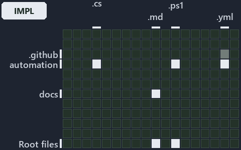

# docs/.assets/explanation/adr-auto-bundle--invoke-importer-in-code-order--implementation.grid.md

`Grid minimap: adr-auto-bundle--invoke-importer-in-code-order--implementation`

The grid minimap of the slide `adr-auto-bundle--invoke-importer-in-code-order--implementation` (implementation lens). The slide supports
[ADR-AUTO-BUNDLE][1]; the highlight of those ADR codes selects what is lit, and each reason below names the code that selects it.

## What the minimap shows

The grid crosses the 12 tracks (rows) with the 18 file languages (columns) of the world map and lights 7 cells, filled in ink. A cell lit
only by passing mentions (citations in body comments, not in a file's header or text) is touched: a lighter ink. Every other cell is idle, a
grey box: it holds files the slide's ADR codes do not select, or no file at all (172 of the 216 cells hold none). The minimap shows where
the slide sits, not how many files a cell holds; the world-map PDFs show the counts.

- .github × yaml: 1 lit of 2 files, touched
- automation × csharp: 2 lit of 240 files
- automation × powershell: 9 lit of 1456 files
- automation × yaml: 2 lit of 98 files
- docs × markdown: 14 lit of 1855 files
- Root files × markdown: 4 lit of 20 files
- Root files × powershell: 1 lit of 1 file

## Key

A lit row prints its track's name; a lit column prints a short code, the first extension of its file language:

- `.cs`: csharp
- `.md`: markdown
- `.ps1`: powershell
- `.yml`: yaml

## Why each cell is lit

### .github × yaml (1 lit file, touched)

Placed: the root folder `.github/` names the track .github ([ADR-DSGN-TRACK#1][2]); the extension `.yml` names the file language yaml
([ADR-DSGN-TRACK#6][3]). Lit ([ADR-DSGN-TRACK#12][4]) by:

- [.github/workflows/ci-automation.yml][5]: selected by [ADR-AUTO-BUNDLE][1]: the file cites it at line 48 (body comment) (a passing mention
  only).

### automation × csharp (2 lit files)

Placed: the root folder `automation/` names the track automation ([ADR-DSGN-TRACK#1][2]); the extension `.cs` names the file language csharp
([ADR-DSGN-TRACK#6][3]). Lit ([ADR-DSGN-TRACK#12][4]) by:

- [automation/Catzc.Base.Exporter/types/ExporterBundle.cs][6]: selected by [ADR-AUTO-BUNDLE][1]: the file cites it at line 2 (header).
- [automation/Catzc.Base.Exporter/types/ExporterConfig.cs][7]: selected by [ADR-AUTO-BUNDLE][1]: the file cites it at line 2 (header).

### automation × powershell (9 lit files)

Placed: the root folder `automation/` names the track automation ([ADR-DSGN-TRACK#1][2]); the extension `.ps1` names the file language
powershell ([ADR-DSGN-TRACK#6][3]). Lit ([ADR-DSGN-TRACK#12][4]) by:

- [automation/.internal/assets/Import-Catzc.ps1][8]: selected by [ADR-AUTO-BUNDLE][1]: the file cites it at line 6 (header).
- [automation/Catzc.Base.Contracts/Publish-ContractRelease.ps1][9]: selected by [ADR-AUTO-BUNDLE][1]: the file cites it at line 7 (header).
- [automation/Catzc.Base.Exporter/Assert-CatzcBundle.ps1][10]: selected by [ADR-AUTO-BUNDLE][1]: the file cites it at line 7 (header).
- [automation/Catzc.Base.Exporter/Build-Modules.ps1][11]: selected by [ADR-AUTO-BUNDLE][1]: the file cites it at line 6 (header) and line 38
  (text).
- [automation/Catzc.Base.Exporter/Export-Catzc.ps1][12]: selected by [ADR-AUTO-BUNDLE][1]: the file cites it at line 7 (header).
- [automation/Catzc.Base.Exporter/Install-Catzc.ps1][13]: selected by [ADR-AUTO-BUNDLE][1]: the file cites it at line 6 (header).
- [automation/Catzc.Base.Exporter/Resolve-CatzcBuildVersion.ps1][14]: selected by [ADR-AUTO-BUNDLE][1]: the file cites it at line 7
  (header).
- [automation/Catzc.Base.Exporter/private/Assert-BundleFootprint.ps1][15]: selected by [ADR-AUTO-BUNDLE][1]: the file cites it at line 6
  (header).
- [automation/Catzc.Base.Exporter/private/New-CatzcNuGetPackage.ps1][16]: selected by [ADR-AUTO-BUNDLE][1]: the file cites it at line 6
  (header).

### automation × yaml (2 lit files)

Placed: the root folder `automation/` names the track automation ([ADR-DSGN-TRACK#1][2]); the extension `.yml` names the file language yaml
([ADR-DSGN-TRACK#6][3]). Lit ([ADR-DSGN-TRACK#12][4]) by:

- [automation/Catzc.Base.Docs/configs/adrs.yml][17]: selected by [ADR-AUTO-BUNDLE][1]: the file cites it at line 145 (text).
- [automation/Catzc.Base.Exporter/configs/exporter.yml][18]: selected by [ADR-AUTO-BUNDLE][1]: the file cites it at line 2 (header).

### docs × markdown (14 lit files)

Placed: the root folder `docs/` names the track docs ([ADR-DSGN-TRACK#1][2]); the extension `.md` names the file language markdown
([ADR-DSGN-TRACK#6][3]). Lit ([ADR-DSGN-TRACK#12][4]) by:

- [docs/adr/automation/dora-explains.md][19]: selected by [ADR-AUTO-BUNDLE][1]: the file cites it at line 421 (text).
- [docs/adr/automation/platform-bundle.md][1]: selected by [ADR-AUTO-BUNDLE][1]: the ADR's own file.
- [docs/adr/index.md][20]: selected by [ADR-AUTO-BUNDLE][1]: the file cites it at line 151 (text).
- [docs/references/automation/catzc-base-contracts/Publish-ContractRelease.ps1.md][21]: selected by [ADR-AUTO-BUNDLE][1]: the file cites it
  at line 20 (text).
- [docs/references/automation/catzc-base-exporter/Assert-CatzcBundle.ps1.md][22]: selected by [ADR-AUTO-BUNDLE][1]: the file cites it at
  line 13 (text).
- [docs/references/automation/catzc-base-exporter/Build-Modules.ps1.md][23]: selected by [ADR-AUTO-BUNDLE][1]: the file cites it at line 13
  (text).
- [docs/references/automation/catzc-base-exporter/Export-Catzc.ps1.md][24]: selected by [ADR-AUTO-BUNDLE][1]: the file cites it at line 13
  (text).
- [docs/references/automation/catzc-base-exporter/Install-Catzc.ps1.md][25]: selected by [ADR-AUTO-BUNDLE][1]: the file cites it at line 14
  (text).
- [docs/references/automation/catzc-base-exporter/Resolve-CatzcBuildVersion.ps1.md][26]: selected by [ADR-AUTO-BUNDLE][1]: the file cites it
  at line 14 (text).
- [docs/references/automation/catzc-base-exporter/configs/exporter.yml.md][27]: selected by [ADR-AUTO-BUNDLE][1]: the file cites it at line
  19 (text).
- [docs/references/automation/catzc-base-exporter/private/Assert-BundleFootprint.ps1.md][28]: selected by [ADR-AUTO-BUNDLE][1]: the file
  cites it at line 14 (text).
- [docs/references/automation/catzc-base-exporter/private/New-CatzcNuGetPackage.ps1.md][29]: selected by [ADR-AUTO-BUNDLE][1]: the file
  cites it at line 13 (text).
- [docs/references/automation/catzc-base-exporter/types/ExporterBundle.cs.md][30]: selected by [ADR-AUTO-BUNDLE][1]: the file cites it at
  line 15 (text).
- [docs/references/automation/catzc-base-exporter/types/ExporterConfig.cs.md][31]: selected by [ADR-AUTO-BUNDLE][1]: the file cites it at
  line 14 (text).

### Root files × markdown (4 lit files)

Placed: each file sits directly in the repository root, so it is a root file ([ADR-DSGN-TRACK#7][32]); the extension `.md` names the file
language markdown ([ADR-DSGN-TRACK#6][3]). Lit ([ADR-DSGN-TRACK#12][4]) by:

- [.unordered/15-10-2026/plan-built-bundle.md][33]: selected by [ADR-AUTO-BUNDLE][1]: the file cites it at line 12 (text), line 41 (text),
  line 271 (text), line 306 (text), line 309 (text) and line 312 (text).
- [.unordered/15-10-2026/plan-concern-axis.md][34]: selected by [ADR-AUTO-BUNDLE][1]: the file cites it at line 104 (text).
- [.unordered/15-10-2026/plan-contracts.md][35]: selected by [ADR-AUTO-BUNDLE][1]: the file cites it at line 99 (text).
- [.unordered/15-10-2026/plan-explanation-drift.md][36]: selected by [ADR-AUTO-BUNDLE][1]: the file cites it at line 70 (text) and line 71
  (text).

### Root files × powershell (1 lit file)

Placed: each file sits directly in the repository root, so it is a root file ([ADR-DSGN-TRACK#7][32]); the extension `.ps1` names the file
language powershell ([ADR-DSGN-TRACK#6][3]). Lit ([ADR-DSGN-TRACK#12][4]) by:

- [importer.ps1][37]: selected by [ADR-AUTO-BUNDLE][1]: a root file carries the citations of its owner module's files (files.yml), which
  cite it at `automation/.internal/assets/Import-Catzc.ps1` line 6 (header).

## Keywords

- [world map][38]
- [track][39]
- [file language][40]
- [cell][41]
- [lit cell][42]
- [root file][43]
- [.github][44]: a track
- [automation][44]: a track
- [docs][44]: a track
- [csharp][45]: a file language
- [markdown][45]: a file language
- [powershell][45]: a file language
- [yaml][45]: a file language

[1]: ../../adr/automation/platform-bundle.md
[2]: ../../adr/design/tracks.md#rule-adr-dsgn-track1
[3]: ../../adr/design/tracks.md#rule-adr-dsgn-track6
[4]: ../../adr/design/tracks.md#rule-adr-dsgn-track12
[5]: ../../../.github/workflows/ci-automation.yml
[6]: ../../../automation/Catzc.Base.Exporter/types/ExporterBundle.cs
[7]: ../../../automation/Catzc.Base.Exporter/types/ExporterConfig.cs
[8]: ../../../automation/.internal/assets/Import-Catzc.ps1
[9]: ../../../automation/Catzc.Base.Contracts/Publish-ContractRelease.ps1
[10]: ../../../automation/Catzc.Base.Exporter/Assert-CatzcBundle.ps1
[11]: ../../../automation/Catzc.Base.Exporter/Build-Modules.ps1
[12]: ../../../automation/Catzc.Base.Exporter/Export-Catzc.ps1
[13]: ../../../automation/Catzc.Base.Exporter/Install-Catzc.ps1
[14]: ../../../automation/Catzc.Base.Exporter/Resolve-CatzcBuildVersion.ps1
[15]: ../../../automation/Catzc.Base.Exporter/private/Assert-BundleFootprint.ps1
[16]: ../../../automation/Catzc.Base.Exporter/private/New-CatzcNuGetPackage.ps1
[17]: ../../../automation/Catzc.Base.Docs/configs/adrs.yml
[18]: ../../../automation/Catzc.Base.Exporter/configs/exporter.yml
[19]: ../../adr/automation/dora-explains.md
[20]: ../../adr/index.md
[21]: ../../references/automation/catzc-base-contracts/Publish-ContractRelease.ps1.md
[22]: ../../references/automation/catzc-base-exporter/Assert-CatzcBundle.ps1.md
[23]: ../../references/automation/catzc-base-exporter/Build-Modules.ps1.md
[24]: ../../references/automation/catzc-base-exporter/Export-Catzc.ps1.md
[25]: ../../references/automation/catzc-base-exporter/Install-Catzc.ps1.md
[26]: ../../references/automation/catzc-base-exporter/Resolve-CatzcBuildVersion.ps1.md
[27]: ../../references/automation/catzc-base-exporter/configs/exporter.yml.md
[28]: ../../references/automation/catzc-base-exporter/private/Assert-BundleFootprint.ps1.md
[29]: ../../references/automation/catzc-base-exporter/private/New-CatzcNuGetPackage.ps1.md
[30]: ../../references/automation/catzc-base-exporter/types/ExporterBundle.cs.md
[31]: ../../references/automation/catzc-base-exporter/types/ExporterConfig.cs.md
[32]: ../../adr/design/tracks.md#rule-adr-dsgn-track7
[33]: ../../../.unordered/15-10-2026/plan-built-bundle.md
[34]: ../../../.unordered/15-10-2026/plan-concern-axis.md
[35]: ../../../.unordered/15-10-2026/plan-contracts.md
[36]: ../../../.unordered/15-10-2026/plan-explanation-drift.md
[37]: ../../../importer.ps1
[38]: ../../adr/glossary.md#world-map
[39]: ../../adr/glossary.md#track
[40]: ../../adr/glossary.md#file-language
[41]: ../../adr/glossary.md#cell
[42]: ../../adr/glossary.md#lit-cell
[43]: ../../adr/glossary.md#root-file
[44]: ../../../automation/Catzc.Base.Variants/configs/variants.yml
[45]: ../../../automation/Catzc.Base.Languages/configs/languages.yml
