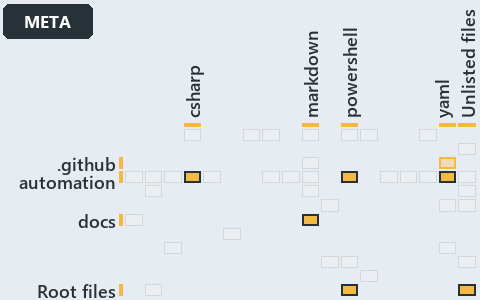

# docs/.assets/explanation/adr-auto-bundle--one-commit-one-immutable-package--meta.grid.md

`Grid minimap: adr-auto-bundle--one-commit-one-immutable-package--meta`

The grid minimap of the slide `adr-auto-bundle--one-commit-one-immutable-package--meta` (meta lens). The slide supports [ADR-AUTO-BUNDLE][1]
and [ADR-DSGN-RUNMODE][2]; the highlight of those ADR codes selects what is lit, and each reason below names the code that selects it.

## What the minimap shows

The grid crosses the 12 tracks with the 18 file languages of the world map and lights 7 cells. A cell lit only by passing mentions
(citations in body comments, not in a file's header or text) is touched: drawn pale.

- .github × yaml: 1 lit of 2 files, touched
- automation × csharp: 2 lit of 219 files
- automation × powershell: 35 lit of 1398 files
- automation × yaml: 3 lit of 95 files
- docs × markdown: 79 lit of 469 files
- Root files × powershell: 1 lit of 1 file
- Root files × Unlisted files: 2 lit of 4 files

## Why each cell is lit

### .github × yaml (1 lit file, touched)

Placed: the root folder `.github/` names the track .github ([ADR-DSGN-TRACK#1][3]); the extension `.yml` names the file language yaml
([ADR-DSGN-TRACK#6][4]). Lit ([ADR-DSGN-TRACK#12][5]) by:

- [.github/workflows/ci-automation.yml][6]: selected by [ADR-AUTO-BUNDLE][1]: the file cites it at line 48 (body comment) (a passing mention
  only).

### automation × csharp (2 lit files)

Placed: the root folder `automation/` names the track automation ([ADR-DSGN-TRACK#1][3]); the extension `.cs` names the file language csharp
([ADR-DSGN-TRACK#6][4]). Lit ([ADR-DSGN-TRACK#12][5]) by:

- [automation/Catzc.Base.Exporter/types/ExporterBundle.cs][7]: selected by [ADR-AUTO-BUNDLE][1]: the file cites it at line 3 (header).
- [automation/Catzc.Base.Exporter/types/ExporterConfig.cs][8]: selected by [ADR-AUTO-BUNDLE][1]: the file cites it at line 2 (header).

### automation × powershell (35 lit files)

Placed: the root folder `automation/` names the track automation ([ADR-DSGN-TRACK#1][3]); the extension `.ps1` names the file language
powershell ([ADR-DSGN-TRACK#6][4]). Lit ([ADR-DSGN-TRACK#12][5]) by:

- [automation/.internal/assets/Import-Catzc.ps1][9]: selected by [ADR-AUTO-BUNDLE][1]: the file cites it at line 6 (header); selected by
  [ADR-DSGN-RUNMODE][2]: the file cites it at line 5 (header).
- [automation/.internal/tests/New-FakeRepositoryRoot.Tests.ps1][10]: selected by [ADR-DSGN-RUNMODE][2]: the file cites it at line 1 (text).
- [automation/Catzc.Base.ConfigExtensions/Test-ConfigValidators.ps1][11]: selected by [ADR-DSGN-RUNMODE][2]: the file cites it at line 12
  (header).
- [automation/Catzc.Base.Contracts/Publish-ContractRelease.ps1][12]: selected by [ADR-AUTO-BUNDLE][1]: the file cites it at line 12
  (header).
- [automation/Catzc.Base.Docs/private/Get-CatsModules.ps1][13]: selected by [ADR-DSGN-RUNMODE][2]: the file cites it at line 11 (header).
- [automation/Catzc.Base.Exporter/Assert-CatzcBundle.ps1][14]: selected by [ADR-AUTO-BUNDLE][1]: the file cites it at line 6 (header).
- [automation/Catzc.Base.Exporter/Build-Modules.ps1][15]: selected by [ADR-AUTO-BUNDLE][1]: the file cites it at line 5 (header) and line 52
  (text).
- [automation/Catzc.Base.Exporter/Export-Catzc.ps1][16]: selected by [ADR-AUTO-BUNDLE][1]: the file cites it at line 6 (header).
- [automation/Catzc.Base.Exporter/Install-Catzc.ps1][17]: selected by [ADR-AUTO-BUNDLE][1]: the file cites it at line 6 (header).
- [automation/Catzc.Base.Exporter/Resolve-CatzcBuildVersion.ps1][18]: selected by [ADR-AUTO-BUNDLE][1]: the file cites it at line 7
  (header).
- [automation/Catzc.Base.Exporter/private/New-CatzcNuGetPackage.ps1][19]: selected by [ADR-AUTO-BUNDLE][1]: the file cites it at line 5
  (header).
- [automation/Catzc.Base.Globs/Get-ModuleGlobSet.ps1][20]: selected by [ADR-DSGN-RUNMODE][2]: the file cites it at line 29 (header).
- [automation/Catzc.Base.ModuleSystem/Copy-Automation.ps1][21]: selected by [ADR-DSGN-RUNMODE][2]: the file cites it at line 26 (header).
- [automation/Catzc.Base.ModuleSystem/Get-AutomationFunctions.ps1][22]: selected by [ADR-DSGN-RUNMODE][2]: the file cites it at line 12
  (header).
- [automation/Catzc.Base.ModuleSystem/Get-BaseModule.ps1][23]: selected by [ADR-DSGN-RUNMODE][2]: the file cites it at line 22 (header).
- [automation/Catzc.Base.ModuleSystem/Get-FunctionDependency.ps1][24]: selected by [ADR-DSGN-RUNMODE][2]: the file cites it at line 10
  (header).
- [automation/Catzc.Base.ModuleSystem/Get-InternalAssetDependency.ps1][25]: selected by [ADR-DSGN-RUNMODE][2]: the file cites it at line 28
  (header).
- [automation/Catzc.Base.ModuleSystem/New-Importer.ps1][26]: selected by [ADR-DSGN-RUNMODE][2]: the file cites it at line 16 (header).
- [automation/Catzc.Base.ModuleSystem/Sync-GeneratedFile.ps1][27]: selected by [ADR-DSGN-RUNMODE][2]: the file cites it at line 17 (header).
- [automation/Catzc.Base.ModuleSystem/Test-FunctionDependency.ps1][28]: selected by [ADR-DSGN-RUNMODE][2]: the file cites it at line 21
  (header).
- [automation/Catzc.Base.QualityGates/Test-BuildArtifact.ps1][29]: selected by [ADR-DSGN-RUNMODE][2]: the file cites it at line 25 (header).
- [automation/Catzc.Base.QualityGates/Test-CatzcBuild.ps1][30]: selected by [ADR-DSGN-RUNMODE][2]: the file cites it at line 7 (header).
- [automation/Catzc.Base.QualityGates/tests/Test-CatzcBuild.Parity.Tests.ps1][31]: selected by [ADR-DSGN-RUNMODE][2]: the file cites it at
  line 1 (header) and line 7 (text).
- [automation/Catzc.Base.QualityGates/tests/Test-CatzcBuild.ScopeIsolation.Tests.ps1][32]: selected by [ADR-DSGN-RUNMODE][2]: the file cites
  it at line 1 (header) and line 6 (text).
- [automation/Catzc.Base.Repository/Assert-SourceTree.ps1][33]: selected by [ADR-DSGN-RUNMODE][2]: the file cites it at line 8 (header).
- [automation/Catzc.Base.Repository/Get-CatzcModuleRoot.ps1][34]: selected by [ADR-DSGN-RUNMODE][2]: the file cites it at line 10 (header).
- [automation/Catzc.Base.Repository/Get-CatzcRunMode.ps1][35]: selected by [ADR-DSGN-RUNMODE][2]: the file cites it at line 6 (header).
- [automation/Catzc.Base.RootConfig/Build-RootConfig.ps1][36]: selected by [ADR-DSGN-RUNMODE][2]: the file cites it at line 24 (header).
- [automation/Catzc.Base.TypesSystem/Build-BashTimeoutHook.ps1][37]: selected by [ADR-DSGN-RUNMODE][2]: the file cites it at line 15
  (header).
- [automation/Catzc.Base.TypesSystem/Clear-ModuleTypeCache.ps1][38]: selected by [ADR-DSGN-RUNMODE][2]: the file cites it at line 30
  (header).
- [automation/Catzc.Base.TypesSystem/Get-AutomationModules.ps1][39]: selected by [ADR-DSGN-RUNMODE][2]: the file cites it at line 8
  (header).
- [automation/Catzc.Base.TypesSystem/Get-CSharpTypeDependency.ps1][40]: selected by [ADR-DSGN-RUNMODE][2]: the file cites it at line 24
  (header).
- [automation/Catzc.Base.TypesSystem/Invoke-BuildForVSCode.ps1][41]: selected by [ADR-DSGN-RUNMODE][2]: the file cites it at line 22
  (header).
- [automation/Catzc.Base.Vendor/Install-VendorModule.ps1][42]: selected by [ADR-DSGN-RUNMODE][2]: the file cites it at line 11 (header).
- [automation/Catzc.Base.Vendor/Remove-VendorModules.ps1][43]: selected by [ADR-DSGN-RUNMODE][2]: the file cites it at line 18 (header).

### automation × yaml (3 lit files)

Placed: the root folder `automation/` names the track automation ([ADR-DSGN-TRACK#1][3]); the extension `.yml` names the file language yaml
([ADR-DSGN-TRACK#6][4]). Lit ([ADR-DSGN-TRACK#12][5]) by:

- [automation/Catzc.Base.Docs/configs/adrs.yml][44]: selected by [ADR-AUTO-BUNDLE][1]: the file cites it at line 162 (text); selected by
  [ADR-DSGN-RUNMODE][2]: the file cites it at line 101 (text).
- [automation/Catzc.Base.Exporter/configs/exporter.yml][45]: selected by [ADR-AUTO-BUNDLE][1]: the file cites it at line 7 (header).
- [automation/Catzc.Base.QualityGates/configs/terminology.yml][46]: selected by [ADR-DSGN-RUNMODE][2]: the file cites it at line 588 (text).

### docs × markdown (79 lit files)

Placed: the root folder `docs/` names the track docs ([ADR-DSGN-TRACK#1][3]); the extension `.md` names the file language markdown
([ADR-DSGN-TRACK#6][4]). Lit ([ADR-DSGN-TRACK#12][5]) by:

- [docs/.assets/explanation/adr-auto-bundle--build-then-place-with-one-command--operations.drawio.md][47]: selected by [ADR-AUTO-BUNDLE][1]:
  the file cites it at line 72 (text).
- [docs/.assets/explanation/adr-auto-bundle--build-verify-then-copy-the-folder--implementation.drawio.md][48]: selected by
  [ADR-AUTO-BUNDLE][1]: the file cites it at line 69 (text).
- [docs/.assets/explanation/adr-auto-bundle--dot-source-one-entry-script--operations.drawio.md][49]: selected by [ADR-AUTO-BUNDLE][1]: the
  file cites it at line 68 (text).
- [docs/.assets/explanation/adr-auto-bundle--every-code-root-is-a-copy--architecture.drawio.md][50]: selected by [ADR-AUTO-BUNDLE][1]: the
  file cites it at line 70 (text); selected by [ADR-DSGN-RUNMODE][2]: the file cites it at line 70 (text).
- [docs/.assets/explanation/adr-auto-bundle--every-entry-runs-one-load-sequence--meta.drawio.md][51]: selected by [ADR-AUTO-BUNDLE][1]: the
  file cites it at line 60 (text).
- [docs/.assets/explanation/adr-auto-bundle--invoke-importer-in-code-order--implementation.drawio.md][52]: selected by [ADR-AUTO-BUNDLE][1]:
  the file cites it at line 61 (text).
- [docs/.assets/explanation/adr-auto-bundle--one-commit-one-immutable-package--meta.drawio.md][53]: selected by [ADR-AUTO-BUNDLE][1]: the
  file cites it at line 69 (text); selected by [ADR-DSGN-RUNMODE][2]: the file cites it at line 69 (text).
- [docs/.assets/explanation/adr-auto-bundle--rule-and-gate-per-load-stage--governance.drawio.md][54]: selected by [ADR-AUTO-BUNDLE][1]: the
  file cites it at line 56 (text) and line 63 (text); selected by [ADR-DSGN-RUNMODE][2]: the file cites it at line 56 (text) and line 64
  (text).
- [docs/.assets/explanation/adr-auto-bundle--two-entries-feed-one-importer--architecture.drawio.md][55]: selected by [ADR-AUTO-BUNDLE][1]:
  the file cites it at line 66 (text).
- [docs/.assets/explanation/adr-auto-bundle--what-gates-each-bundle-stage--governance.drawio.md][56]: selected by [ADR-AUTO-BUNDLE][1]: the
  file cites it at line 67 (text) and line 74 (text); selected by [ADR-DSGN-RUNMODE][2]: the file cites it at line 67 (text) and line 74
  (text).
- [docs/.assets/explanation/adr-dsgn-runmode--one-entry-script-per-mode--operations.drawio.md][57]: selected by [ADR-DSGN-RUNMODE][2]: the
  file cites it at line 71 (text).
- [docs/.assets/explanation/adr-dsgn-runmode--shims-set-roots-mode-read-back--implementation.drawio.md][58]: selected by
  [ADR-DSGN-RUNMODE][2]: the file cites it at line 74 (text).
- [docs/.assets/explanation/adr-dsgn-runmode--two-roots-one-importer-same-modules--architecture.drawio.md][59]: selected by
  [ADR-DSGN-RUNMODE][2]: the file cites it at line 68 (text).
- [docs/.assets/explanation/adr-dsgn-runmode--where-code-loads-from-decides-the-mode--meta.drawio.md][60]: selected by
  [ADR-DSGN-RUNMODE][2]: the file cites it at line 67 (text).
- [docs/.assets/explanation/adr-dsgn-runmode--which-run-mode-rules-have-a-gate--governance.drawio.md][61]: selected by
  [ADR-DSGN-RUNMODE][2]: the file cites it at line 63 (text) and line 73 (text).
- [docs/adr/automation/BCL/index.md][62]: selected by [ADR-AUTO-BUNDLE][1]: an ADR file of the `automation` ADR domain, the ADR domain of
  that code.
- [docs/adr/automation/BCL/native-csharp-types.md][63]: selected by [ADR-AUTO-BUNDLE][1]: an ADR file of the `automation` ADR domain, the
  ADR domain of that code.
- [docs/adr/automation/avoid-deep-nesting.md][64]: selected by [ADR-AUTO-BUNDLE][1]: an ADR file of the `automation` ADR domain, the ADR
  domain of that code.
- [docs/adr/automation/bash/bash-test-artifacts.md][65]: selected by [ADR-AUTO-BUNDLE][1]: an ADR file of the `automation` ADR domain, the
  ADR domain of that code.
- [docs/adr/automation/caching.md][66]: selected by [ADR-AUTO-BUNDLE][1]: an ADR file of the `automation` ADR domain, the ADR domain of that
  code.
- [docs/adr/automation/console-output-matters.md][67]: selected by [ADR-AUTO-BUNDLE][1]: an ADR file of the `automation` ADR domain, the ADR
  domain of that code.
- [docs/adr/automation/controlling-module-dependencies.md][68]: selected by [ADR-AUTO-BUNDLE][1]: an ADR file of the `automation` ADR
  domain, the ADR domain of that code.
- [docs/adr/automation/controlling-systemwide-deps.md][69]: selected by [ADR-AUTO-BUNDLE][1]: an ADR file of the `automation` ADR domain,
  the ADR domain of that code.
- [docs/adr/automation/cross-platform.md][70]: selected by [ADR-AUTO-BUNDLE][1]: an ADR file of the `automation` ADR domain, the ADR domain
  of that code.
- [docs/adr/automation/devbox-pipeline-parity.md][71]: selected by [ADR-AUTO-BUNDLE][1]: an ADR file of the `automation` ADR domain, the ADR
  domain of that code.
- [docs/adr/automation/dora-explains.md][72]: selected by [ADR-AUTO-BUNDLE][1]: an ADR file of the `automation` ADR domain, the ADR domain
  of that code.
- [docs/adr/automation/dry-run.md][73]: selected by [ADR-AUTO-BUNDLE][1]: an ADR file of the `automation` ADR domain, the ADR domain of that
  code.
- [docs/adr/automation/effective-in-enterprises.md][74]: selected by [ADR-AUTO-BUNDLE][1]: an ADR file of the `automation` ADR domain, the
  ADR domain of that code.
- [docs/adr/automation/environment-variables.md][75]: selected by [ADR-AUTO-BUNDLE][1]: an ADR file of the `automation` ADR domain, the ADR
  domain of that code.
- [docs/adr/automation/execution-engines.md][76]: selected by [ADR-AUTO-BUNDLE][1]: an ADR file of the `automation` ADR domain, the ADR
  domain of that code.
- [docs/adr/automation/fail-fast-with-asserts.md][77]: selected by [ADR-AUTO-BUNDLE][1]: an ADR file of the `automation` ADR domain, the ADR
  domain of that code.
- [docs/adr/automation/go/index.md][78]: selected by [ADR-AUTO-BUNDLE][1]: an ADR file of the `automation` ADR domain, the ADR domain of
  that code.
- [docs/adr/automation/go/test-artifacts.md][79]: selected by [ADR-AUTO-BUNDLE][1]: an ADR file of the `automation` ADR domain, the ADR
  domain of that code.
- [docs/adr/automation/idempotent-state-functions.md][80]: selected by [ADR-AUTO-BUNDLE][1]: an ADR file of the `automation` ADR domain, the
  ADR domain of that code.
- [docs/adr/automation/internal-asset-dependencies.md][81]: selected by [ADR-AUTO-BUNDLE][1]: an ADR file of the `automation` ADR domain,
  the ADR domain of that code.
- [docs/adr/automation/log-before-invoke.md][82]: selected by [ADR-AUTO-BUNDLE][1]: an ADR file of the `automation` ADR domain, the ADR
  domain of that code.
- [docs/adr/automation/managed-guids.md][83]: selected by [ADR-AUTO-BUNDLE][1]: an ADR file of the `automation` ADR domain, the ADR domain
  of that code.
- [docs/adr/automation/never-depend-on-pwd.md][84]: selected by [ADR-AUTO-BUNDLE][1]: an ADR file of the `automation` ADR domain, the ADR
  domain of that code.
- [docs/adr/automation/open-closed-architecture.md][85]: selected by [ADR-AUTO-BUNDLE][1]: an ADR file of the `automation` ADR domain, the
  ADR domain of that code.
- [docs/adr/automation/path-representation.md][86]: selected by [ADR-AUTO-BUNDLE][1]: an ADR file of the `automation` ADR domain, the ADR
  domain of that code.
- [docs/adr/automation/platform-bundle.md][1]: selected by [ADR-AUTO-BUNDLE][1]: an ADR file of the `automation` ADR domain, the ADR domain
  of that code.
- [docs/adr/automation/protected-globs.md][87]: selected by [ADR-AUTO-BUNDLE][1]: an ADR file of the `automation` ADR domain, the ADR domain
  of that code.
- [docs/adr/automation/python/index.md][88]: selected by [ADR-AUTO-BUNDLE][1]: an ADR file of the `automation` ADR domain, the ADR domain of
  that code.
- [docs/adr/automation/python/python-test-artifacts.md][89]: selected by [ADR-AUTO-BUNDLE][1]: an ADR file of the `automation` ADR domain,
  the ADR domain of that code.
- [docs/adr/automation/retry-as-last-resort.md][90]: selected by [ADR-AUTO-BUNDLE][1]: an ADR file of the `automation` ADR domain, the ADR
  domain of that code.
- [docs/adr/automation/sensible-defaults.md][91]: selected by [ADR-AUTO-BUNDLE][1]: an ADR file of the `automation` ADR domain, the ADR
  domain of that code.
- [docs/adr/automation/single-responsibility-functions.md][92]: selected by [ADR-AUTO-BUNDLE][1]: an ADR file of the `automation` ADR
  domain, the ADR domain of that code.
- [docs/adr/automation/spell-out-names.md][93]: selected by [ADR-AUTO-BUNDLE][1]: an ADR file of the `automation` ADR domain, the ADR domain
  of that code.
- [docs/adr/automation/test-automation.md][94]: selected by [ADR-AUTO-BUNDLE][1]: an ADR file of the `automation` ADR domain, the ADR domain
  of that code.
- [docs/adr/automation/tool-removal-lifecycle.md][95]: selected by [ADR-AUTO-BUNDLE][1]: an ADR file of the `automation` ADR domain, the ADR
  domain of that code.
- [docs/adr/automation/tracked-files-from-the-index.md][96]: selected by [ADR-AUTO-BUNDLE][1]: an ADR file of the `automation` ADR domain,
  the ADR domain of that code.
- [docs/adr/automation/use-proper-package-managers.md][97]: selected by [ADR-AUTO-BUNDLE][1]: an ADR file of the `automation` ADR domain,
  the ADR domain of that code.
- [docs/adr/automation/uv-python-handler.md][98]: selected by [ADR-AUTO-BUNDLE][1]: an ADR file of the `automation` ADR domain, the ADR
  domain of that code.
- [docs/adr/automation/zero-ceremony-poka-yoke.md][99]: selected by [ADR-AUTO-BUNDLE][1]: an ADR file of the `automation` ADR domain, the
  ADR domain of that code.
- [docs/adr/design/commit-lifecycle.md][100]: selected by [ADR-DSGN-RUNMODE][2]: an ADR file of the `design` ADR domain, the ADR domain of
  that code.
- [docs/adr/design/dora-explains.md][101]: selected by [ADR-DSGN-RUNMODE][2]: an ADR file of the `design` ADR domain, the ADR domain of that
  code.
- [docs/adr/design/module-aspects.md][102]: selected by [ADR-DSGN-RUNMODE][2]: an ADR file of the `design` ADR domain, the ADR domain of
  that code.
- [docs/adr/design/run-modes.md][2]: selected by [ADR-DSGN-RUNMODE][2]: an ADR file of the `design` ADR domain, the ADR domain of that code.
- [docs/adr/design/self-service.md][103]: selected by [ADR-DSGN-RUNMODE][2]: an ADR file of the `design` ADR domain, the ADR domain of that
  code.
- [docs/adr/design/server-remote-integration.md][104]: selected by [ADR-DSGN-RUNMODE][2]: an ADR file of the `design` ADR domain, the ADR
  domain of that code.
- [docs/adr/design/thin-platforms.md][105]: selected by [ADR-DSGN-RUNMODE][2]: an ADR file of the `design` ADR domain, the ADR domain of
  that code.
- [docs/adr/design/tracks.md][106]: selected by [ADR-DSGN-RUNMODE][2]: an ADR file of the `design` ADR domain, the ADR domain of that code.
- [docs/adr/design/visual-design.md][107]: selected by [ADR-DSGN-RUNMODE][2]: an ADR file of the `design` ADR domain, the ADR domain of that
  code.
- [docs/adr/index.md][108]: selected by [ADR-AUTO-BUNDLE][1]: the file cites it at line 150 (text); selected by [ADR-DSGN-RUNMODE][2]: the
  file cites it at line 94 (text).
- [docs/explanation/automation/build-then-place-with-one-command.md][109]: selected by [ADR-AUTO-BUNDLE][1]: the file cites it at line 17
  (text), line 52 (text), line 54 (text) and line 56 (text).
- [docs/explanation/automation/build-verify-then-copy-the-folder.md][110]: selected by [ADR-AUTO-BUNDLE][1]: the file cites it at line 17
  (text), line 58 (text), line 60 (text), line 61 (text), line 63 (text), line 67 (text) and line 69 (text).
- [docs/explanation/automation/dot-source-one-entry-script.md][111]: selected by [ADR-AUTO-BUNDLE][1]: the file cites it at line 17 (text),
  line 54 (text) and line 56 (text).
- [docs/explanation/automation/every-code-root-is-a-copy.md][112]: selected by [ADR-AUTO-BUNDLE][1]: the file cites it at line 17 (text),
  line 51 (text), line 53 (text), line 54 (text), line 55 (text) and line 63 (text); selected by [ADR-DSGN-RUNMODE][2]: the file cites it at
  line 17 (text), line 62 (text) and line 63 (text).
- [docs/explanation/automation/every-entry-runs-one-load-sequence.md][113]: selected by [ADR-AUTO-BUNDLE][1]: the file cites it at line 14
  (text), line 44 (text) and line 46 (text); selected by [ADR-DSGN-RUNMODE][2]: the file cites it at line 47 (text).
- [docs/explanation/automation/invoke-importer-in-code-order.md][114]: selected by [ADR-AUTO-BUNDLE][1]: the file cites it at line 18
  (text), line 62 (text), line 63 (text) and line 64 (text).
- [docs/explanation/automation/one-commit-one-immutable-package.md][115]: selected by [ADR-AUTO-BUNDLE][1]: the file cites it at line 15
  (text), line 45 (text), line 47 (text) and line 49 (text); selected by [ADR-DSGN-RUNMODE][2]: the file cites it at line 15 (text), line 50
  (text) and line 54 (text).
- [docs/explanation/automation/rule-and-gate-per-load-stage.md][116]: selected by [ADR-AUTO-BUNDLE][1]: the file cites it at line 17 (text),
  line 36 (text), line 36 (text), line 39 (text), line 62 (text), line 63 (text) and line 64 (text); selected by [ADR-DSGN-RUNMODE][2]: the
  file cites it at line 41 (text), line 51 (text), line 66 (text), line 69 (text) and line 73 (text).
- [docs/explanation/automation/two-entries-feed-one-importer.md][117]: selected by [ADR-AUTO-BUNDLE][1]: the file cites it at line 18
  (text), line 59 (text) and line 61 (text).
- [docs/explanation/automation/what-gates-each-bundle-stage.md][118]: selected by [ADR-AUTO-BUNDLE][1]: the file cites it at line 16 (text),
  line 19 (text), line 31 (text), line 33 (text), line 49 (text), line 52 (text), line 53 (text), line 54 (text) and line 61 (text);
  selected by [ADR-DSGN-RUNMODE][2]: the file cites it at line 16 (text), line 42 (text), line 57 (text), line 63 (text) and line 64 (text).
- [docs/explanation/design/one-entry-script-per-mode.md][119]: selected by [ADR-DSGN-RUNMODE][2]: the file cites it at line 17 (text), line
  60 (text), line 61 (text), line 62 (text) and line 63 (text).
- [docs/explanation/design/shims-set-roots-mode-read-back.md][120]: selected by [ADR-DSGN-RUNMODE][2]: the file cites it at line 19 (text),
  line 58 (text), line 59 (text), line 61 (text) and line 62 (text).
- [docs/explanation/design/two-roots-one-importer-same-modules.md][121]: selected by [ADR-DSGN-RUNMODE][2]: the file cites it at line 17
  (text), line 56 (text), line 57 (text), line 58 (text) and line 60 (text).
- [docs/explanation/design/where-code-loads-from-decides-the-mode.md][122]: selected by [ADR-DSGN-RUNMODE][2]: the file cites it at line 14
  (text), line 40 (text), line 41 (text), line 42 (text) and line 43 (text).
- [docs/explanation/design/which-run-mode-rules-have-a-gate.md][123]: selected by [ADR-DSGN-RUNMODE][2]: the file cites it at line 17
  (text), line 53 (text), line 55 (text), line 57 (text), line 58 (text), line 59 (text), line 60 (text) and line 61 (text).

### Root files × powershell (1 lit file)

Placed: each file sits directly in the repository root, so it is a root file ([ADR-DSGN-TRACK#7][124]); the extension `.ps1` names the file
language powershell ([ADR-DSGN-TRACK#6][4]). Lit ([ADR-DSGN-TRACK#12][5]) by:

- [importer.ps1][125]: selected by [ADR-AUTO-BUNDLE][1]: a root file carries the citations of its owner module's files (files.yml), which
  cite it at `automation/.internal/assets/Import-Catzc.ps1` line 6 (header); selected by [ADR-DSGN-RUNMODE][2]: a root file carries the
  citations of its owner module's files (files.yml), which cite it at `automation/.internal/assets/Import-Catzc.ps1` line 5 (header) and
  `automation/.internal/tests/New-FakeRepositoryRoot.Tests.ps1` line 1 (text).

### Root files × Unlisted files (2 lit files)

Placed: each file sits directly in the repository root, so it is a root file ([ADR-DSGN-TRACK#7][124]); no extension names no file language,
so each is an unlisted file ([ADR-DSGN-TRACK#8][126]). Lit ([ADR-DSGN-TRACK#12][5]) by:

- [.gitattributes][127]: selected by [ADR-DSGN-RUNMODE][2]: a root file carries the citations of its owner module's files (files.yml), which
  cite it at `automation/Catzc.Base.Repository/Assert-SourceTree.ps1` line 8 (header),
  `automation/Catzc.Base.Repository/Get-CatzcModuleRoot.ps1` line 10 (header) and `automation/Catzc.Base.Repository/Get-CatzcRunMode.ps1`
  line 6 (header).
- [.gitignore][128]: selected by [ADR-DSGN-RUNMODE][2]: a root file carries the citations of its owner module's files (files.yml), which
  cite it at `automation/Catzc.Base.Repository/Assert-SourceTree.ps1` line 8 (header),
  `automation/Catzc.Base.Repository/Get-CatzcModuleRoot.ps1` line 10 (header) and `automation/Catzc.Base.Repository/Get-CatzcRunMode.ps1`
  line 6 (header).

## Keywords

- [world map][129]
- [track][130]
- [file language][131]
- [cell][132]
- [lit cell][133]
- [root file][134]
- [unlisted file][135]
- [.github][136]: a track
- [automation][136]: a track
- [docs][136]: a track
- [csharp][137]: a file language
- [markdown][137]: a file language
- [powershell][137]: a file language
- [yaml][137]: a file language

[1]: ../../adr/automation/platform-bundle.md
[2]: ../../adr/design/run-modes.md
[3]: ../../adr/design/tracks.md#rule-adr-dsgn-track1
[4]: ../../adr/design/tracks.md#rule-adr-dsgn-track6
[5]: ../../adr/design/tracks.md#rule-adr-dsgn-track12
[6]: ../../../.github/workflows/ci-automation.yml
[7]: ../../../automation/Catzc.Base.Exporter/types/ExporterBundle.cs
[8]: ../../../automation/Catzc.Base.Exporter/types/ExporterConfig.cs
[9]: ../../../automation/.internal/assets/Import-Catzc.ps1
[10]: ../../../automation/.internal/tests/New-FakeRepositoryRoot.Tests.ps1
[11]: ../../../automation/Catzc.Base.ConfigExtensions/Test-ConfigValidators.ps1
[12]: ../../../automation/Catzc.Base.Contracts/Publish-ContractRelease.ps1
[13]: ../../../automation/Catzc.Base.Docs/private/Get-CatsModules.ps1
[14]: ../../../automation/Catzc.Base.Exporter/Assert-CatzcBundle.ps1
[15]: ../../../automation/Catzc.Base.Exporter/Build-Modules.ps1
[16]: ../../../automation/Catzc.Base.Exporter/Export-Catzc.ps1
[17]: ../../../automation/Catzc.Base.Exporter/Install-Catzc.ps1
[18]: ../../../automation/Catzc.Base.Exporter/Resolve-CatzcBuildVersion.ps1
[19]: ../../../automation/Catzc.Base.Exporter/private/New-CatzcNuGetPackage.ps1
[20]: ../../../automation/Catzc.Base.Globs/Get-ModuleGlobSet.ps1
[21]: ../../../automation/Catzc.Base.ModuleSystem/Copy-Automation.ps1
[22]: ../../../automation/Catzc.Base.ModuleSystem/Get-AutomationFunctions.ps1
[23]: ../../../automation/Catzc.Base.ModuleSystem/Get-BaseModule.ps1
[24]: ../../../automation/Catzc.Base.ModuleSystem/Get-FunctionDependency.ps1
[25]: ../../../automation/Catzc.Base.ModuleSystem/Get-InternalAssetDependency.ps1
[26]: ../../../automation/Catzc.Base.ModuleSystem/New-Importer.ps1
[27]: ../../../automation/Catzc.Base.ModuleSystem/Sync-GeneratedFile.ps1
[28]: ../../../automation/Catzc.Base.ModuleSystem/Test-FunctionDependency.ps1
[29]: ../../../automation/Catzc.Base.QualityGates/Test-BuildArtifact.ps1
[30]: ../../../automation/Catzc.Base.QualityGates/Test-CatzcBuild.ps1
[31]: ../../../automation/Catzc.Base.QualityGates/tests/Test-CatzcBuild.Parity.Tests.ps1
[32]: ../../../automation/Catzc.Base.QualityGates/tests/Test-CatzcBuild.ScopeIsolation.Tests.ps1
[33]: ../../../automation/Catzc.Base.Repository/Assert-SourceTree.ps1
[34]: ../../../automation/Catzc.Base.Repository/Get-CatzcModuleRoot.ps1
[35]: ../../../automation/Catzc.Base.Repository/Get-CatzcRunMode.ps1
[36]: ../../../automation/Catzc.Base.RootConfig/Build-RootConfig.ps1
[37]: ../../../automation/Catzc.Base.TypesSystem/Build-BashTimeoutHook.ps1
[38]: ../../../automation/Catzc.Base.TypesSystem/Clear-ModuleTypeCache.ps1
[39]: ../../../automation/Catzc.Base.TypesSystem/Get-AutomationModules.ps1
[40]: ../../../automation/Catzc.Base.TypesSystem/Get-CSharpTypeDependency.ps1
[41]: ../../../automation/Catzc.Base.TypesSystem/Invoke-BuildForVSCode.ps1
[42]: ../../../automation/Catzc.Base.Vendor/Install-VendorModule.ps1
[43]: ../../../automation/Catzc.Base.Vendor/Remove-VendorModules.ps1
[44]: ../../../automation/Catzc.Base.Docs/configs/adrs.yml
[45]: ../../../automation/Catzc.Base.Exporter/configs/exporter.yml
[46]: ../../../automation/Catzc.Base.QualityGates/configs/terminology.yml
[47]: adr-auto-bundle--build-then-place-with-one-command--operations.drawio.md
[48]: adr-auto-bundle--build-verify-then-copy-the-folder--implementation.drawio.md
[49]: adr-auto-bundle--dot-source-one-entry-script--operations.drawio.md
[50]: adr-auto-bundle--every-code-root-is-a-copy--architecture.drawio.md
[51]: adr-auto-bundle--every-entry-runs-one-load-sequence--meta.drawio.md
[52]: adr-auto-bundle--invoke-importer-in-code-order--implementation.drawio.md
[53]: adr-auto-bundle--one-commit-one-immutable-package--meta.drawio.md
[54]: adr-auto-bundle--rule-and-gate-per-load-stage--governance.drawio.md
[55]: adr-auto-bundle--two-entries-feed-one-importer--architecture.drawio.md
[56]: adr-auto-bundle--what-gates-each-bundle-stage--governance.drawio.md
[57]: adr-dsgn-runmode--one-entry-script-per-mode--operations.drawio.md
[58]: adr-dsgn-runmode--shims-set-roots-mode-read-back--implementation.drawio.md
[59]: adr-dsgn-runmode--two-roots-one-importer-same-modules--architecture.drawio.md
[60]: adr-dsgn-runmode--where-code-loads-from-decides-the-mode--meta.drawio.md
[61]: adr-dsgn-runmode--which-run-mode-rules-have-a-gate--governance.drawio.md
[62]: ../../adr/automation/BCL/index.md
[63]: ../../adr/automation/BCL/native-csharp-types.md
[64]: ../../adr/automation/avoid-deep-nesting.md
[65]: ../../adr/automation/bash/bash-test-artifacts.md
[66]: ../../adr/automation/caching.md
[67]: ../../adr/automation/console-output-matters.md
[68]: ../../adr/automation/controlling-module-dependencies.md
[69]: ../../adr/automation/controlling-systemwide-deps.md
[70]: ../../adr/automation/cross-platform.md
[71]: ../../adr/automation/devbox-pipeline-parity.md
[72]: ../../adr/automation/dora-explains.md
[73]: ../../adr/automation/dry-run.md
[74]: ../../adr/automation/effective-in-enterprises.md
[75]: ../../adr/automation/environment-variables.md
[76]: ../../adr/automation/execution-engines.md
[77]: ../../adr/automation/fail-fast-with-asserts.md
[78]: ../../adr/automation/go/index.md
[79]: ../../adr/automation/go/test-artifacts.md
[80]: ../../adr/automation/idempotent-state-functions.md
[81]: ../../adr/automation/internal-asset-dependencies.md
[82]: ../../adr/automation/log-before-invoke.md
[83]: ../../adr/automation/managed-guids.md
[84]: ../../adr/automation/never-depend-on-pwd.md
[85]: ../../adr/automation/open-closed-architecture.md
[86]: ../../adr/automation/path-representation.md
[87]: ../../adr/automation/protected-globs.md
[88]: ../../adr/automation/python/index.md
[89]: ../../adr/automation/python/python-test-artifacts.md
[90]: ../../adr/automation/retry-as-last-resort.md
[91]: ../../adr/automation/sensible-defaults.md
[92]: ../../adr/automation/single-responsibility-functions.md
[93]: ../../adr/automation/spell-out-names.md
[94]: ../../adr/automation/test-automation.md
[95]: ../../adr/automation/tool-removal-lifecycle.md
[96]: ../../adr/automation/tracked-files-from-the-index.md
[97]: ../../adr/automation/use-proper-package-managers.md
[98]: ../../adr/automation/uv-python-handler.md
[99]: ../../adr/automation/zero-ceremony-poka-yoke.md
[100]: ../../adr/design/commit-lifecycle.md
[101]: ../../adr/design/dora-explains.md
[102]: ../../adr/design/module-aspects.md
[103]: ../../adr/design/self-service.md
[104]: ../../adr/design/server-remote-integration.md
[105]: ../../adr/design/thin-platforms.md
[106]: ../../adr/design/tracks.md
[107]: ../../adr/design/visual-design.md
[108]: ../../adr/index.md
[109]: ../../explanation/automation/build-then-place-with-one-command.md
[110]: ../../explanation/automation/build-verify-then-copy-the-folder.md
[111]: ../../explanation/automation/dot-source-one-entry-script.md
[112]: ../../explanation/automation/every-code-root-is-a-copy.md
[113]: ../../explanation/automation/every-entry-runs-one-load-sequence.md
[114]: ../../explanation/automation/invoke-importer-in-code-order.md
[115]: ../../explanation/automation/one-commit-one-immutable-package.md
[116]: ../../explanation/automation/rule-and-gate-per-load-stage.md
[117]: ../../explanation/automation/two-entries-feed-one-importer.md
[118]: ../../explanation/automation/what-gates-each-bundle-stage.md
[119]: ../../explanation/design/one-entry-script-per-mode.md
[120]: ../../explanation/design/shims-set-roots-mode-read-back.md
[121]: ../../explanation/design/two-roots-one-importer-same-modules.md
[122]: ../../explanation/design/where-code-loads-from-decides-the-mode.md
[123]: ../../explanation/design/which-run-mode-rules-have-a-gate.md
[124]: ../../adr/design/tracks.md#rule-adr-dsgn-track7
[125]: ../../../importer.ps1
[126]: ../../adr/design/tracks.md#rule-adr-dsgn-track8
[127]: ../../../.gitattributes
[128]: ../../../.gitignore
[129]: ../../adr/glossary.md#world-map
[130]: ../../adr/glossary.md#track
[131]: ../../adr/glossary.md#file-language
[132]: ../../adr/glossary.md#cell
[133]: ../../adr/glossary.md#lit-cell
[134]: ../../adr/glossary.md#root-file
[135]: ../../adr/glossary.md#unlisted-file
[136]: ../../../automation/Catzc.Base.Variants/configs/variants.yml
[137]: ../../../automation/Catzc.Base.Languages/configs/languages.yml
