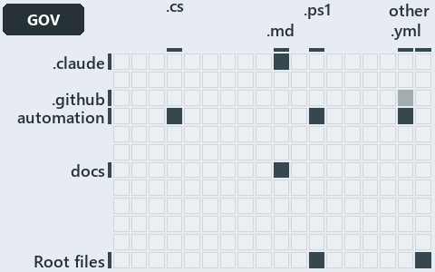

# docs/.assets/explanation/adr-auto-bundle--rule-and-gate-per-load-stage--governance.grid.md

`Grid minimap: adr-auto-bundle--rule-and-gate-per-load-stage--governance`

The grid minimap of the slide `adr-auto-bundle--rule-and-gate-per-load-stage--governance` (governance lens). The slide supports
[ADR-AUTO-BUNDLE][1], [ADR-AUTO-TYPES][2], [ADR-DSGN-RUNMODE][3], [ADR-PRIN-ONELIVE][4], [ADR-PWSH-ERROR][5] and [ADR-REPO-ROOTCFG][6]; the
highlight of those ADR codes selects what is lit, and each reason below names the code that selects it.

## What the minimap shows

The grid crosses the 12 tracks (rows) with the 18 file languages (columns) of the world map and lights 8 cells, filled in ink. A cell lit
only by passing mentions (citations in body comments, not in a file's header or text) is touched: a lighter ink. Every other cell is idle, a
grey box: it holds files the slide's ADR codes do not select, or no file at all (173 of the 216 cells hold none). The minimap shows where
the slide sits, not how many files a cell holds; the world-map PDFs show the counts.

- .claude × markdown: 2 lit of 9 files
- .github × yaml: 1 lit of 2 files, touched
- automation × csharp: 108 lit of 229 files
- automation × powershell: 75 lit of 1443 files
- automation × yaml: 10 lit of 97 files
- docs × markdown: 19 lit of 744 files
- Root files × powershell: 1 lit of 1 file
- Root files × Unlisted files: 2 lit of 4 files

## Key

A lit row prints its track's name; a lit column prints a short code, the first extension of its file language:

- `.cs`: csharp
- `.md`: markdown
- `.ps1`: powershell
- `.yml`: yaml
- `other`: Unlisted files

## Why each cell is lit

### .claude × markdown (2 lit files)

Placed: the root folder `.claude/` names the track .claude ([ADR-DSGN-TRACK#1][7]); the extension `.md` names the file language markdown
([ADR-DSGN-TRACK#6][8]). Lit ([ADR-DSGN-TRACK#12][9]) by:

- [.claude/CLAUDE.md][10]: selected by [ADR-PRIN-ONELIVE][4]: the file cites it at line 57 (text) and line 122 (text); selected by
  [ADR-PWSH-ERROR][5]: the file cites it at line 30 (text).
- [.claude/agents/build-inspiration-module.md][11]: selected by [ADR-AUTO-TYPES][2]: the file cites it at line 25 (text).

### .github × yaml (1 lit file, touched)

Placed: the root folder `.github/` names the track .github ([ADR-DSGN-TRACK#1][7]); the extension `.yml` names the file language yaml
([ADR-DSGN-TRACK#6][8]). Lit ([ADR-DSGN-TRACK#12][9]) by:

- [.github/workflows/ci-automation.yml][12]: selected by [ADR-AUTO-BUNDLE][1]: the file cites it at line 48 (body comment) (a passing
  mention only).

### automation × csharp (108 lit files)

Placed: the root folder `automation/` names the track automation ([ADR-DSGN-TRACK#1][7]); the extension `.cs` names the file language csharp
([ADR-DSGN-TRACK#6][8]). Lit ([ADR-DSGN-TRACK#12][9]) by:

- [automation/Catzc.Azure.DevOps.BuildValidation/types/BuildValidationConfig.cs][13]: selected by [ADR-AUTO-TYPES][2]: the file cites it at
  line 6 (header).
- [automation/Catzc.Azure.DevOps.BuildValidation/types/BuildValidationEntry.cs][14]: selected by [ADR-AUTO-TYPES][2]: the file cites it at
  line 3 (header).
- [automation/Catzc.Azure.DevOps/types/AdoConfig.cs][15]: selected by [ADR-AUTO-TYPES][2]: the file cites it at line 5 (header).
- [automation/Catzc.Azure.Templates/types/BicepParameter.cs][16]: selected by [ADR-AUTO-TYPES][2]: the file cites it at line 7 (header) and
  line 8 (header).
- [automation/Catzc.Azure.Templates/types/BicepParameterModel.cs][17]: selected by [ADR-AUTO-TYPES][2]: the file cites it at line 6
  (header).
- [automation/Catzc.Azure.Templates/types/BicepShortName.cs][18]: selected by [ADR-AUTO-TYPES][2]: the file cites it at line 11 (header).
- [automation/Catzc.Azure/types/AzureConfig.cs][19]: selected by [ADR-AUTO-TYPES][2]: the file cites it at line 5 (header).
- [automation/Catzc.Azure/types/AzureCustomer.cs][20]: selected by [ADR-AUTO-TYPES][2]: the file cites it at line 5 (header).
- [automation/Catzc.Azure/types/AzureEnvironmentRecord.cs][21]: selected by [ADR-AUTO-TYPES][2]: the file cites it at line 3 (header).
- [automation/Catzc.Azure/types/AzureSubscriptionRecord.cs][22]: selected by [ADR-AUTO-TYPES][2]: the file cites it at line 4 (header).
- [automation/Catzc.Azure/types/AzureTenantRecord.cs][23]: selected by [ADR-AUTO-TYPES][2]: the file cites it at line 3 (header).
- [automation/Catzc.Azure/types/CustomerConfig.cs][24]: selected by [ADR-AUTO-TYPES][2]: the file cites it at line 5 (header).
- [automation/Catzc.Azure/types/NetworkConfig.cs][25]: selected by [ADR-AUTO-TYPES][2]: the file cites it at line 6 (header).
- [automation/Catzc.Azure/types/NetworkEnvironment.cs][26]: selected by [ADR-AUTO-TYPES][2]: the file cites it at line 3 (header).
- [automation/Catzc.Azure/types/NetworkSubscription.cs][27]: selected by [ADR-AUTO-TYPES][2]: the file cites it at line 3 (header).
- [automation/Catzc.Base.Contracts/types/ContractAsset.cs][28]: selected by [ADR-AUTO-TYPES][2]: the file cites it at line 5 (header).
- [automation/Catzc.Base.Contracts/types/ContractCheckResult.cs][29]: selected by [ADR-AUTO-TYPES][2]: the file cites it at line 5 (header).
- [automation/Catzc.Base.Contracts/types/ContractManifest.cs][30]: selected by [ADR-AUTO-TYPES][2]: the file cites it at line 4 (header).
- [automation/Catzc.Base.Contracts/types/ContractsConfig.cs][31]: selected by [ADR-AUTO-TYPES][2]: the file cites it at line 20 (header).
- [automation/Catzc.Base.Docs/types/AdrCheck.cs][32]: selected by [ADR-AUTO-TYPES][2]: the file cites it at line 3 (header).
- [automation/Catzc.Base.Docs/types/AdrChecksConfig.cs][33]: selected by [ADR-AUTO-TYPES][2]: the file cites it at line 7 (header).
- [automation/Catzc.Base.Docs/types/AdrCitationChange.cs][34]: selected by [ADR-AUTO-TYPES][2]: the file cites it at line 3 (header).
- [automation/Catzc.Base.Docs/types/AdrCitationChangeKind.cs][35]: selected by [ADR-AUTO-TYPES][2]: the file cites it at line 3 (header).
- [automation/Catzc.Base.Docs/types/AdrCitationMap.cs][36]: selected by [ADR-PWSH-ERROR][5]: the file cites it at line 60 (body comment) (a
  passing mention only).
- [automation/Catzc.Base.Docs/types/AdrCitationRewrite.cs][37]: selected by [ADR-AUTO-TYPES][2]: the file cites it at line 3 (header).
- [automation/Catzc.Base.Docs/types/AdrDomain.cs][38]: selected by [ADR-AUTO-TYPES][2]: the file cites it at line 5 (header).
- [automation/Catzc.Base.Docs/types/AdrDomainEdge.cs][39]: selected by [ADR-AUTO-TYPES][2]: the file cites it at line 4 (header).
- [automation/Catzc.Base.Docs/types/AdrDoraCheck.cs][40]: selected by [ADR-AUTO-TYPES][2]: the file cites it at line 3 (header).
- [automation/Catzc.Base.Docs/types/AdrNeutralityCheck.cs][41]: selected by [ADR-AUTO-TYPES][2]: the file cites it at line 4 (header).
- [automation/Catzc.Base.Docs/types/AdrNeutralityToken.cs][42]: selected by [ADR-AUTO-TYPES][2]: the file cites it at line 3 (header).
- [automation/Catzc.Base.Docs/types/AdrRuleSet.cs][43]: selected by [ADR-AUTO-TYPES][2]: the file cites it at line 6 (header) and line 7
  (header).
- [automation/Catzc.Base.Docs/types/AdrsConfig.cs][44]: selected by [ADR-AUTO-TYPES][2]: the file cites it at line 6 (header).
- [automation/Catzc.Base.Docs/types/AgentEntry.cs][45]: selected by [ADR-AUTO-TYPES][2]: the file cites it at line 4 (header).
- [automation/Catzc.Base.Docs/types/AgentsConfig.cs][46]: selected by [ADR-AUTO-TYPES][2]: the file cites it at line 8 (header).
- [automation/Catzc.Base.Docs/types/CheckModes.cs][47]: selected by [ADR-PRIN-ONELIVE][4]: the file cites it at line 3 (header).
- [automation/Catzc.Base.Docs/types/GlossaryAvoid.cs][48]: selected by [ADR-AUTO-TYPES][2]: the file cites it at line 3 (header).
- [automation/Catzc.Base.Docs/types/GlossaryConcept.cs][49]: selected by [ADR-AUTO-TYPES][2]: the file cites it at line 9 (header).
- [automation/Catzc.Base.Docs/types/GlossaryEntry.cs][50]: selected by [ADR-AUTO-TYPES][2]: the file cites it at line 5 (header).
- [automation/Catzc.Base.Docs/types/GlossaryOptions.cs][51]: selected by [ADR-AUTO-TYPES][2]: the file cites it at line 8 (header).
- [automation/Catzc.Base.Docs/types/GlossaryRealization.cs][52]: selected by [ADR-AUTO-TYPES][2]: the file cites it at line 8 (header).
- [automation/Catzc.Base.Engines/types/ExecutionEngine.cs][53]: selected by [ADR-AUTO-TYPES][2]: the file cites it at line 9 (header).
- [automation/Catzc.Base.Exporter/types/ExporterBundle.cs][54]: selected by [ADR-AUTO-BUNDLE][1]: the file cites it at line 3 (header);
  selected by [ADR-AUTO-TYPES][2]: the file cites it at line 5 (header).
- [automation/Catzc.Base.Exporter/types/ExporterConfig.cs][55]: selected by [ADR-AUTO-BUNDLE][1]: the file cites it at line 2 (header);
  selected by [ADR-AUTO-TYPES][2]: the file cites it at line 5 (header).
- [automation/Catzc.Base.Exporter/types/ExporterPackage.cs][56]: selected by [ADR-AUTO-TYPES][2]: the file cites it at line 4 (header).
- [automation/Catzc.Base.Git/types/GitIgnoreConfig.cs][57]: selected by [ADR-REPO-ROOTCFG][6]: the file cites it at line 6 (header).
- [automation/Catzc.Base.Languages/types/BashConfig.cs][58]: selected by [ADR-AUTO-TYPES][2]: the file cites it at line 5 (header).
- [automation/Catzc.Base.Languages/types/BashTestResult.cs][59]: selected by [ADR-AUTO-TYPES][2]: the file cites it at line 4 (header).
- [automation/Catzc.Base.Languages/types/FileLanguage.cs][60]: selected by [ADR-AUTO-TYPES][2]: the file cites it at line 4 (header).
- [automation/Catzc.Base.Languages/types/FormatterEngine.cs][61]: selected by [ADR-AUTO-TYPES][2]: the file cites it at line 6 (header).
- [automation/Catzc.Base.Languages/types/GoConfig.cs][62]: selected by [ADR-AUTO-TYPES][2]: the file cites it at line 7 (header).
- [automation/Catzc.Base.Languages/types/GoTestResult.cs][63]: selected by [ADR-AUTO-TYPES][2]: the file cites it at line 4 (header).
- [automation/Catzc.Base.Languages/types/GoWorkspaceFile.cs][64]: selected by [ADR-AUTO-TYPES][2]: the file cites it at line 2 (header);
  selected by [ADR-REPO-ROOTCFG][6]: the file cites it at line 4 (header).
- [automation/Catzc.Base.Languages/types/LanguagesConfig.cs][65]: selected by [ADR-AUTO-TYPES][2]: the file cites it at line 6 (header).
- [automation/Catzc.Base.Languages/types/PythonConfig.cs][66]: selected by [ADR-AUTO-TYPES][2]: the file cites it at line 6 (header).
- [automation/Catzc.Base.Languages/types/PythonTestResult.cs][67]: selected by [ADR-AUTO-TYPES][2]: the file cites it at line 5 (header).
- [automation/Catzc.Base.Languages/types/PythonWorkspaceFile.cs][68]: selected by [ADR-AUTO-TYPES][2]: the file cites it at line 3 (header);
  selected by [ADR-REPO-ROOTCFG][6]: the file cites it at line 4 (header).
- [automation/Catzc.Base.Maps/types/CitationSite.cs][69]: selected by [ADR-AUTO-TYPES][2]: the file cites it at line 4 (header).
- [automation/Catzc.Base.Maps/types/HighlightReason.cs][70]: selected by [ADR-AUTO-TYPES][2]: the file cites it at line 6 (header).
- [automation/Catzc.Base.Maps/types/HighlightedCell.cs][71]: selected by [ADR-AUTO-TYPES][2]: the file cites it at line 4 (header).
- [automation/Catzc.Base.Maps/types/MapCell.cs][72]: selected by [ADR-AUTO-TYPES][2]: the file cites it at line 7 (header).
- [automation/Catzc.Base.Maps/types/MapPlacement.cs][73]: selected by [ADR-AUTO-TYPES][2]: the file cites it at line 5 (header).
- [automation/Catzc.Base.Maps/types/MapsConfig.cs][74]: selected by [ADR-AUTO-TYPES][2]: the file cites it at line 6 (header).
- [automation/Catzc.Base.Maps/types/MapsHighlight.cs][75]: selected by [ADR-AUTO-TYPES][2]: the file cites it at line 9 (header).
- [automation/Catzc.Base.Maps/types/MapsLabels.cs][76]: selected by [ADR-AUTO-TYPES][2]: the file cites it at line 14 (header).
- [automation/Catzc.Base.Maps/types/MapsLimits.cs][77]: selected by [ADR-AUTO-TYPES][2]: the file cites it at line 4 (header).
- [automation/Catzc.Base.Maps/types/MapsPalette.cs][78]: selected by [ADR-AUTO-TYPES][2]: the file cites it at line 4 (header).
- [automation/Catzc.Base.Maps/types/MapsPin.cs][79]: selected by [ADR-AUTO-TYPES][2]: the file cites it at line 5 (header).
- [automation/Catzc.Base.Maps/types/TreemapRect.cs][80]: selected by [ADR-AUTO-TYPES][2]: the file cites it at line 3 (header).
- [automation/Catzc.Base.Maps/types/ValueChainCell.cs][81]: selected by [ADR-AUTO-TYPES][2]: the file cites it at line 5 (header).
- [automation/Catzc.Base.Maps/types/ValueChainReason.cs][82]: selected by [ADR-AUTO-TYPES][2]: the file cites it at line 6 (header).
- [automation/Catzc.Base.Maps/types/WorldMapBuilder.cs][83]: selected by [ADR-AUTO-TYPES][2]: the file cites it at line 28 (header).
- [automation/Catzc.Base.Maps/types/WorldMapGridLayout.cs][84]: selected by [ADR-AUTO-TYPES][2]: the file cites it at line 10 (header).
- [automation/Catzc.Base.ModuleSystem/types/ArtifactsConfig.cs][85]: selected by [ADR-AUTO-TYPES][2]: the file cites it at line 8 (header).
- [automation/Catzc.Base.ModuleSystem/types/ArtifactsTarget.cs][86]: selected by [ADR-AUTO-TYPES][2]: the file cites it at line 10 (header).
- [automation/Catzc.Base.ModuleSystem/types/BaseModule.cs][87]: selected by [ADR-AUTO-TYPES][2]: the file cites it at line 2 (header).
- [automation/Catzc.Base.ModuleSystem/types/DependenciesConfig.cs][88]: selected by [ADR-AUTO-TYPES][2]: the file cites it at line 6
  (header).
- [automation/Catzc.Base.ModuleSystem/types/FilesConfig.cs][89]: selected by [ADR-AUTO-TYPES][2]: the file cites it at line 6 (header).
- [automation/Catzc.Base.ModuleSystem/types/ModuleFiles.cs][90]: selected by [ADR-AUTO-TYPES][2]: the file cites it at line 9 (header).
- [automation/Catzc.Base.ModuleSystem/types/ProfilesConfig.cs][91]: selected by [ADR-AUTO-TYPES][2]: the file cites it at line 7 (header).
- [automation/Catzc.Base.QualityGates/types/AnalyzerAdrMapConfig.cs][92]: selected by [ADR-AUTO-TYPES][2]: the file cites it at line 7
  (header); selected by [ADR-PWSH-ERROR][5]: the file cites it at line 81 (text).
- [automation/Catzc.Base.QualityGates/types/EngineSetCheck.cs][93]: selected by [ADR-AUTO-TYPES][2]: the file cites it at line 14 (header).
- [automation/Catzc.Base.QualityGates/types/GuidsConfig.cs][94]: selected by [ADR-AUTO-TYPES][2]: the file cites it at line 6 (header).
- [automation/Catzc.Base.QualityGates/types/LinksConfig.cs][95]: selected by [ADR-AUTO-TYPES][2]: the file cites it at line 16 (header).
- [automation/Catzc.Base.QualityGates/types/ManagedGuidEntry.cs][96]: selected by [ADR-AUTO-TYPES][2]: the file cites it at line 11
  (header).
- [automation/Catzc.Base.QualityGates/types/ParameterConsistencyConfig.cs][97]: selected by [ADR-AUTO-TYPES][2]: the file cites it at line 7
  (header).
- [automation/Catzc.Base.QualityGates/types/SourceCheck.cs][98]: selected by [ADR-AUTO-TYPES][2]: the file cites it at line 13 (header).
- [automation/Catzc.Base.QualityGates/types/SourceConventionsConfig.cs][99]: selected by [ADR-AUTO-TYPES][2]: the file cites it at line 10
  (header).
- [automation/Catzc.Base.QualityGates/types/SpellingOracle.cs][100]: selected by [ADR-AUTO-TYPES][2]: the file cites it at line 20 (header).
- [automation/Catzc.Base.QualityGates/types/TestPolicyConfig.cs][101]: selected by [ADR-AUTO-TYPES][2]: the file cites it at line 8
  (header).
- [automation/Catzc.Base.Reports/types/OutputFormat.cs][102]: selected by [ADR-AUTO-TYPES][2]: the file cites it at line 15 (header).
- [automation/Catzc.Base.Reports/types/OutputFormatsConfig.cs][103]: selected by [ADR-AUTO-TYPES][2]: the file cites it at line 6 (header).
- [automation/Catzc.Base.Reports/types/OutputPattern.cs][104]: selected by [ADR-AUTO-TYPES][2]: the file cites it at line 67 (body comment)
  (a passing mention only).
- [automation/Catzc.Base.Reports/types/ReportsConfig.cs][105]: selected by [ADR-AUTO-TYPES][2]: the file cites it at line 6 (header).
- [automation/Catzc.Base.RootConfig/types/RootConfigFiles.cs][106]: selected by [ADR-REPO-ROOTCFG][6]: the file cites it at line 6 (header).
- [automation/Catzc.Base.Timeouts/types/TimeoutExemptionsConfig.cs][107]: selected by [ADR-AUTO-TYPES][2]: the file cites it at line 5
  (header).
- [automation/Catzc.Base.Timeouts/types/TimeoutsConfig.cs][108]: selected by [ADR-AUTO-TYPES][2]: the file cites it at line 4 (header).
- [automation/Catzc.Base.VSCode/types/VscodeExtensionsConfig.cs][109]: selected by [ADR-AUTO-TYPES][2]: the file cites it at line 7
  (header); selected by [ADR-REPO-ROOTCFG][6]: the file cites it at line 3 (header).
- [automation/Catzc.Base.VSCode/types/VscodeLaunchConfig.cs][110]: selected by [ADR-AUTO-TYPES][2]: the file cites it at line 6 (header);
  selected by [ADR-REPO-ROOTCFG][6]: the file cites it at line 2 (header).
- [automation/Catzc.Base.VSCode/types/VscodePipelineSchemaConfig.cs][111]: selected by [ADR-REPO-ROOTCFG][6]: the file cites it at line 3
  (header).
- [automation/Catzc.Base.VSCode/types/VscodeSettingsConfig.cs][112]: selected by [ADR-AUTO-TYPES][2]: the file cites it at line 9 (header);
  selected by [ADR-REPO-ROOTCFG][6]: the file cites it at line 3 (header).
- [automation/Catzc.Base.Variants/types/VariantAspect.cs][113]: selected by [ADR-AUTO-TYPES][2]: the file cites it at line 4 (header).
- [automation/Catzc.Base.Variants/types/VariantTrack.cs][114]: selected by [ADR-AUTO-TYPES][2]: the file cites it at line 5 (header).
- [automation/Catzc.Base.Variants/types/VariantsConfig.cs][115]: selected by [ADR-AUTO-TYPES][2]: the file cites it at line 6 (header).
- [automation/Catzc.Base.Vendor/types/VendorConfig.cs][116]: selected by [ADR-AUTO-TYPES][2]: the file cites it at line 5 (header).
- [automation/Catzc.Tooling.Inspiration/types/InspirationConfig.cs][117]: selected by [ADR-AUTO-TYPES][2]: the file cites it at line 5
  (header).
- [automation/Catzc.Tooling.Inspiration/types/InspirationEntry.cs][118]: selected by [ADR-AUTO-TYPES][2]: the file cites it at line 4
  (header).
- [automation/Catzc.Tooling.KeyHandler/types/KeyHandlerBinding.cs][119]: selected by [ADR-AUTO-TYPES][2]: the file cites it at line 5
  (header).
- [automation/Catzc.Tooling.KeyHandler/types/KeyHandlerSupportedConfig.cs][120]: selected by [ADR-AUTO-TYPES][2]: the file cites it at line
  6 (header).

### automation × powershell (75 lit files)

Placed: the root folder `automation/` names the track automation ([ADR-DSGN-TRACK#1][7]); the extension `.ps1` names the file language
powershell ([ADR-DSGN-TRACK#6][8]). Lit ([ADR-DSGN-TRACK#12][9]) by:

- [automation/.internal/assets/Import-Catzc.ps1][121]: selected by [ADR-AUTO-BUNDLE][1]: the file cites it at line 6 (header); selected by
  [ADR-DSGN-RUNMODE][3]: the file cites it at line 5 (header).
- [automation/.internal/tests/Get-LoadedTypeDrift.Tests.ps1][122]: selected by [ADR-AUTO-TYPES][2]: the file cites it at line 4 (header) and
  line 9 (text).
- [automation/.internal/tests/New-FakeRepositoryRoot.Tests.ps1][123]: selected by [ADR-DSGN-RUNMODE][3]: the file cites it at line 1 (text).
- [automation/.internal/tests/Restart-ImporterSession.Tests.ps1][124]: selected by [ADR-AUTO-TYPES][2]: the file cites it at line 2
  (header), line 17 (text), line 38 (text) and line 75 (text).
- [automation/.scriptanalyzer/tests/NoUnsafeFirstIndex.Tests.ps1][125]: selected by [ADR-PWSH-ERROR][5]: the file cites it at line 3 (text).
- [automation/Catzc.Azure.Templates/Build-Bicep.ps1][126]: selected by [ADR-PWSH-ERROR][5]: the file cites it at line 103 (body comment) (a
  passing mention only).
- [automation/Catzc.Azure.Templates/Deploy-Bicep.ps1][127]: selected by [ADR-PWSH-ERROR][5]: the file cites it at line 133 (body comment) (a
  passing mention only).
- [automation/Catzc.Base.ConfigExtensions/Test-ConfigValidators.ps1][128]: selected by [ADR-DSGN-RUNMODE][3]: the file cites it at line 12
  (header).
- [automation/Catzc.Base.Contracts/Publish-ContractRelease.ps1][129]: selected by [ADR-AUTO-BUNDLE][1]: the file cites it at line 12
  (header).
- [automation/Catzc.Base.Contracts/tests/types/ContractCheckResult.Tests.ps1][130]: selected by [ADR-AUTO-TYPES][2]: the file cites it at
  line 3 (header) and line 23 (text).
- [automation/Catzc.Base.Docs/Build-AdrIndex.ps1][131]: selected by [ADR-PWSH-ERROR][5]: the file cites it at line 60 (body comment) (a
  passing mention only).
- [automation/Catzc.Base.Docs/Get-AdrCitationMap.ps1][132]: selected by [ADR-PWSH-ERROR][5]: the file cites it at line 21 (header).
- [automation/Catzc.Base.Docs/Get-CatsAdrRuleIds.ps1][133]: selected by [ADR-PWSH-ERROR][5]: the file cites it at line 3 (header) and line
  24 (header).
- [automation/Catzc.Base.Docs/private/Get-CatsModules.ps1][134]: selected by [ADR-DSGN-RUNMODE][3]: the file cites it at line 11 (header).
- [automation/Catzc.Base.Docs/tests/types/AdrChecksConfig.Tests.ps1][135]: selected by [ADR-AUTO-TYPES][2]: the file cites it at line 3
  (text).
- [automation/Catzc.Base.Docs/tests/types/AdrDomainEdge.Tests.ps1][136]: selected by [ADR-AUTO-TYPES][2]: the file cites it at line 3
  (text).
- [automation/Catzc.Base.Docs/tests/types/AdrsConfig.Tests.ps1][137]: selected by [ADR-AUTO-TYPES][2]: the file cites it at line 1 (text).
- [automation/Catzc.Base.Docs/tests/types/CheckModes.Tests.ps1][138]: selected by [ADR-PRIN-ONELIVE][4]: the file cites it at line 4 (text).
- [automation/Catzc.Base.Exporter/Assert-CatzcBundle.ps1][139]: selected by [ADR-AUTO-BUNDLE][1]: the file cites it at line 6 (header).
- [automation/Catzc.Base.Exporter/Build-Modules.ps1][140]: selected by [ADR-AUTO-BUNDLE][1]: the file cites it at line 5 (header) and line
  54 (text).
- [automation/Catzc.Base.Exporter/Export-Catzc.ps1][141]: selected by [ADR-AUTO-BUNDLE][1]: the file cites it at line 6 (header).
- [automation/Catzc.Base.Exporter/Install-Catzc.ps1][142]: selected by [ADR-AUTO-BUNDLE][1]: the file cites it at line 6 (header).
- [automation/Catzc.Base.Exporter/Resolve-CatzcBuildVersion.ps1][143]: selected by [ADR-AUTO-BUNDLE][1]: the file cites it at line 7
  (header); selected by [ADR-PWSH-ERROR][5]: the file cites it at line 14 (header).
- [automation/Catzc.Base.Exporter/private/Assert-BundleFootprint.ps1][144]: selected by [ADR-AUTO-BUNDLE][1]: the file cites it at line 6
  (header).
- [automation/Catzc.Base.Exporter/private/New-CatzcNuGetPackage.ps1][145]: selected by [ADR-AUTO-BUNDLE][1]: the file cites it at line 5
  (header).
- [automation/Catzc.Base.Files/Set-FileLink.ps1][146]: selected by [ADR-REPO-ROOTCFG][6]: the file cites it at line 17 (header).
- [automation/Catzc.Base.Files/Write-FileIfChanged.ps1][147]: selected by [ADR-PRIN-ONELIVE][4]: the file cites it at line 20 (header).
- [automation/Catzc.Base.Git/New-GitIgnore.ps1][148]: selected by [ADR-REPO-ROOTCFG][6]: the file cites it at line 17 (header).
- [automation/Catzc.Base.Globs/Get-ModuleGlobSet.ps1][149]: selected by [ADR-DSGN-RUNMODE][3]: the file cites it at line 29 (header).
- [automation/Catzc.Base.Languages/New-GoWorkspace.ps1][150]: selected by [ADR-REPO-ROOTCFG][6]: the file cites it at line 25 (header).
- [automation/Catzc.Base.ModuleSystem/Copy-Automation.ps1][151]: selected by [ADR-AUTO-TYPES][2]: the file cites it at line 29 (header);
  selected by [ADR-DSGN-RUNMODE][3]: the file cites it at line 26 (header).
- [automation/Catzc.Base.ModuleSystem/Get-AutomationFunctions.ps1][152]: selected by [ADR-DSGN-RUNMODE][3]: the file cites it at line 12
  (header).
- [automation/Catzc.Base.ModuleSystem/Get-BaseModule.ps1][153]: selected by [ADR-AUTO-TYPES][2]: the file cites it at line 4 (header);
  selected by [ADR-DSGN-RUNMODE][3]: the file cites it at line 22 (header).
- [automation/Catzc.Base.ModuleSystem/Get-FunctionDependency.ps1][154]: selected by [ADR-DSGN-RUNMODE][3]: the file cites it at line 10
  (header).
- [automation/Catzc.Base.ModuleSystem/Get-InternalAssetDependency.ps1][155]: selected by [ADR-DSGN-RUNMODE][3]: the file cites it at line 28
  (header).
- [automation/Catzc.Base.ModuleSystem/New-Importer.ps1][156]: selected by [ADR-DSGN-RUNMODE][3]: the file cites it at line 16 (header).
- [automation/Catzc.Base.ModuleSystem/Sync-GeneratedFile.ps1][157]: selected by [ADR-AUTO-TYPES][2]: the file cites it at line 23 (header)
  and line 109 (body comment); selected by [ADR-DSGN-RUNMODE][3]: the file cites it at line 17 (header).
- [automation/Catzc.Base.ModuleSystem/Test-FunctionDependency.ps1][158]: selected by [ADR-DSGN-RUNMODE][3]: the file cites it at line 21
  (header).
- [automation/Catzc.Base.ModuleSystem/tests/Sync-GeneratedFile.Tests.ps1][159]: selected by [ADR-AUTO-TYPES][2]: the file cites it at line
  35 (text) and line 113 (text).
- [automation/Catzc.Base.Objects/tests/types/ConsoleText.Tests.ps1][160]: selected by [ADR-AUTO-TYPES][2]: the file cites it at line 5
  (text).
- [automation/Catzc.Base.Objects/tests/types/DictionaryRecord.Tests.ps1][161]: selected by [ADR-AUTO-TYPES][2]: the file cites it at line 6
  (text).
- [automation/Catzc.Base.QualityGates/Test-Automation.ps1][162]: selected by [ADR-PWSH-ERROR][5]: the file cites it at line 65 (header),
  line 117 (header) and line 117 (header).
- [automation/Catzc.Base.QualityGates/Test-BuildArtifact.ps1][163]: selected by [ADR-DSGN-RUNMODE][3]: the file cites it at line 25
  (header).
- [automation/Catzc.Base.QualityGates/Test-CatzcBuild.ps1][164]: selected by [ADR-DSGN-RUNMODE][3]: the file cites it at line 7 (header).
- [automation/Catzc.Base.QualityGates/private/Get-ContentExemptPath.ps1][165]: selected by [ADR-REPO-ROOTCFG][6]: the file cites it at line
  12 (header).
- [automation/Catzc.Base.QualityGates/private/Get-TestRuleTags.ps1][166]: selected by [ADR-PWSH-ERROR][5]: the file cites it at line 7
  (header) and line 19 (header).
- [automation/Catzc.Base.QualityGates/private/Get-TestTagViolations.ps1][167]: selected by [ADR-PWSH-ERROR][5]: the file cites it at line 81
  (body comment) (a passing mention only).
- [automation/Catzc.Base.QualityGates/tests/Test-CatzcBuild.Parity.Tests.ps1][168]: selected by [ADR-DSGN-RUNMODE][3]: the file cites it at
  line 1 (header) and line 7 (text).
- [automation/Catzc.Base.QualityGates/tests/Test-CatzcBuild.ScopeIsolation.Tests.ps1][169]: selected by [ADR-DSGN-RUNMODE][3]: the file
  cites it at line 1 (header) and line 6 (text).
- [automation/Catzc.Base.Repository/Assert-SourceTree.ps1][170]: selected by [ADR-DSGN-RUNMODE][3]: the file cites it at line 8 (header).
- [automation/Catzc.Base.Repository/Get-CatzcModuleRoot.ps1][171]: selected by [ADR-DSGN-RUNMODE][3]: the file cites it at line 10 (header).
- [automation/Catzc.Base.Repository/Get-CatzcRunMode.ps1][172]: selected by [ADR-DSGN-RUNMODE][3]: the file cites it at line 6 (header).
- [automation/Catzc.Base.Repository/Get-SessionActor.ps1][173]: selected by [ADR-AUTO-TYPES][2]: the file cites it at line 6 (header).
- [automation/Catzc.Base.Repository/tests/Get-SessionActor.Tests.ps1][174]: selected by [ADR-AUTO-TYPES][2]: the file cites it at line 1
  (text).
- [automation/Catzc.Base.RootConfig/Build-RootConfig.ps1][175]: selected by [ADR-DSGN-RUNMODE][3]: the file cites it at line 24 (header);
  selected by [ADR-REPO-ROOTCFG][6]: the file cites it at line 21 (header).
- [automation/Catzc.Base.RootConfig/Test-RootAnalyzerSettings.ps1][176]: selected by [ADR-REPO-ROOTCFG][6]: the file cites it at line 6
  (header).
- [automation/Catzc.Base.RootConfig/Test-RootConfigFiles.ps1][177]: selected by [ADR-REPO-ROOTCFG][6]: the file cites it at line 7 (header).
- [automation/Catzc.Base.RootConfig/private/Get-RootConfigRenderedFile.ps1][178]: selected by [ADR-REPO-ROOTCFG][6]: the file cites it at
  line 16 (header).
- [automation/Catzc.Base.RootConfig/private/Get-RootConfigTargets.ps1][179]: selected by [ADR-REPO-ROOTCFG][6]: the file cites it at line 8
  (header).
- [automation/Catzc.Base.RootConfig/tests/Test-RootConfigIntegrity.Tests.ps1][180]: selected by [ADR-REPO-ROOTCFG][6]: the file cites it at
  line 12 (header).
- [automation/Catzc.Base.TypesSystem/Assert-LoadedTypesCurrent.ps1][181]: selected by [ADR-AUTO-TYPES][2]: the file cites it at line 9
  (header).
- [automation/Catzc.Base.TypesSystem/Build-BashTimeoutHook.ps1][182]: selected by [ADR-DSGN-RUNMODE][3]: the file cites it at line 15
  (header).
- [automation/Catzc.Base.TypesSystem/Clear-ModuleTypeCache.ps1][183]: selected by [ADR-AUTO-TYPES][2]: the file cites it at line 12
  (header); selected by [ADR-DSGN-RUNMODE][3]: the file cites it at line 30 (header).
- [automation/Catzc.Base.TypesSystem/Get-AutomationModules.ps1][184]: selected by [ADR-DSGN-RUNMODE][3]: the file cites it at line 8
  (header).
- [automation/Catzc.Base.TypesSystem/Get-CSharpTypeDependency.ps1][185]: selected by [ADR-DSGN-RUNMODE][3]: the file cites it at line 24
  (header).
- [automation/Catzc.Base.TypesSystem/Invoke-BuildForVSCode.ps1][186]: selected by [ADR-AUTO-TYPES][2]: the file cites it at line 19
  (header); selected by [ADR-DSGN-RUNMODE][3]: the file cites it at line 22 (header).
- [automation/Catzc.Base.TypesSystem/Test-LoadedTypesCurrent.ps1][187]: selected by [ADR-AUTO-TYPES][2]: the file cites it at line 7
  (header).
- [automation/Catzc.Base.TypesSystem/tests/Assert-LoadedTypesCurrent.Tests.ps1][188]: selected by [ADR-AUTO-TYPES][2]: the file cites it at
  line 4 (text).
- [automation/Catzc.Base.TypesSystem/tests/Test-LoadedTypesCurrent.Tests.ps1][189]: selected by [ADR-AUTO-TYPES][2]: the file cites it at
  line 5 (text).
- [automation/Catzc.Base.VSCode/New-VSCodeExtensions.ps1][190]: selected by [ADR-REPO-ROOTCFG][6]: the file cites it at line 14 (header).
- [automation/Catzc.Base.VSCode/New-VSCodeLaunch.ps1][191]: selected by [ADR-REPO-ROOTCFG][6]: the file cites it at line 14 (header).
- [automation/Catzc.Base.VSCode/New-VSCodePipelineSchema.ps1][192]: selected by [ADR-REPO-ROOTCFG][6]: the file cites it at line 18
  (header).
- [automation/Catzc.Base.VSCode/New-VSCodeSettings.ps1][193]: selected by [ADR-REPO-ROOTCFG][6]: the file cites it at line 20 (header).
- [automation/Catzc.Base.Vendor/Install-VendorModule.ps1][194]: selected by [ADR-DSGN-RUNMODE][3]: the file cites it at line 11 (header).
- [automation/Catzc.Base.Vendor/Remove-VendorModules.ps1][195]: selected by [ADR-DSGN-RUNMODE][3]: the file cites it at line 18 (header).

### automation × yaml (10 lit files)

Placed: the root folder `automation/` names the track automation ([ADR-DSGN-TRACK#1][7]); the extension `.yml` names the file language yaml
([ADR-DSGN-TRACK#6][8]). Lit ([ADR-DSGN-TRACK#12][9]) by:

- [automation/Catzc.Base.Docs/configs/adrs.yml][196]: selected by [ADR-AUTO-BUNDLE][1]: the file cites it at line 161 (text); selected by
  [ADR-AUTO-TYPES][2]: the file cites it at line 167 (text); selected by [ADR-DSGN-RUNMODE][3]: the file cites it at line 101 (text);
  selected by [ADR-PRIN-ONELIVE][4]: the file cites it at line 56 (text); selected by [ADR-PWSH-ERROR][5]: the file cites it at line 192
  (text); selected by [ADR-REPO-ROOTCFG][6]: the file cites it at line 314 (text).
- [automation/Catzc.Base.Exporter/configs/exporter.yml][197]: selected by [ADR-AUTO-BUNDLE][1]: the file cites it at line 7 (header).
- [automation/Catzc.Base.Git/configs/gitignore.yml][198]: selected by [ADR-REPO-ROOTCFG][6]: the file cites it at line 3 (header).
- [automation/Catzc.Base.QualityGates/configs/analyzer-adr-map.yml][199]: selected by [ADR-PWSH-ERROR][5]: the file cites it at line 18
  (text), line 18 (body comment) and line 35 (text).
- [automation/Catzc.Base.QualityGates/configs/terminology.yml][200]: selected by [ADR-DSGN-RUNMODE][3]: the file cites it at line 596
  (text); selected by [ADR-PRIN-ONELIVE][4]: the file cites it at line 576 (text); selected by [ADR-REPO-ROOTCFG][6]: the file cites it at
  line 616 (text).
- [automation/Catzc.Base.RootConfig/configs/rootconfig.yml][201]: selected by [ADR-REPO-ROOTCFG][6]: the file cites it at line 20 (header).
- [automation/Catzc.Base.VSCode/configs/vscode-extensions.yml][202]: selected by [ADR-REPO-ROOTCFG][6]: the file cites it at line 3
  (header).
- [automation/Catzc.Base.VSCode/configs/vscode-launch.yml][203]: selected by [ADR-REPO-ROOTCFG][6]: the file cites it at line 3 (header).
- [automation/Catzc.Base.VSCode/configs/vscode-pipeline-schema.yml][204]: selected by [ADR-REPO-ROOTCFG][6]: the file cites it at line 5
  (header).
- [automation/Catzc.Base.VSCode/configs/vscode-settings.yml][205]: selected by [ADR-REPO-ROOTCFG][6]: the file cites it at line 3 (header).

### docs × markdown (19 lit files)

Placed: the root folder `docs/` names the track docs ([ADR-DSGN-TRACK#1][7]); the extension `.md` names the file language markdown
([ADR-DSGN-TRACK#6][8]). Lit ([ADR-DSGN-TRACK#12][9]) by:

- [docs/adr/automation/BCL/native-csharp-types.md][2]: selected by [ADR-AUTO-TYPES][2]: the ADR's own file.
- [docs/adr/automation/dora-explains.md][206]: selected by [ADR-AUTO-BUNDLE][1]: the file cites it at line 421 (text); selected by
  [ADR-AUTO-TYPES][2]: the file cites it at line 529 (text).
- [docs/adr/automation/platform-bundle.md][1]: selected by [ADR-AUTO-BUNDLE][1]: the ADR's own file.
- [docs/adr/design/dora-explains.md][207]: selected by [ADR-DSGN-RUNMODE][3]: the file cites it at line 125 (text).
- [docs/adr/design/run-modes.md][3]: selected by [ADR-DSGN-RUNMODE][3]: the ADR's own file.
- [docs/adr/index.md][208]: selected by [ADR-AUTO-BUNDLE][1]: the file cites it at line 149 (text); selected by [ADR-AUTO-TYPES][2]: the
  file cites it at line 155 (text); selected by [ADR-DSGN-RUNMODE][3]: the file cites it at line 94 (text); selected by
  [ADR-PRIN-ONELIVE][4]: the file cites it at line 53 (text); selected by [ADR-PWSH-ERROR][5]: the file cites it at line 15 (text) and line
  178 (text); selected by [ADR-REPO-ROOTCFG][6]: the file cites it at line 292 (text).
- [docs/adr/principles/dora-explains.md][209]: selected by [ADR-PRIN-ONELIVE][4]: the file cites it at line 86 (text).
- [docs/adr/principles/one-living-version.md][4]: selected by [ADR-PRIN-ONELIVE][4]: the ADR's own file.
- [docs/adr/pwsh/dora-explains.md][210]: selected by [ADR-PWSH-ERROR][5]: the file cites it at line 128 (text).
- [docs/adr/pwsh/error-handling.md][5]: selected by [ADR-PWSH-ERROR][5]: the ADR's own file.
- [docs/adr/repository/dora-explains.md][211]: selected by [ADR-REPO-ROOTCFG][6]: the file cites it at line 115 (text).
- [docs/adr/repository/generated-root-configs.md][6]: selected by [ADR-REPO-ROOTCFG][6]: the ADR's own file.
- [docs/how-to/getting-started/automation/BCL/add-a-dotnet-type.md][212]: selected by [ADR-AUTO-TYPES][2]: the file cites it at line 30
  (text).
- [docs/how-to/getting-started/automation/add-a-doc-chapter.md][213]: selected by [ADR-PWSH-ERROR][5]: the file cites it at line 72 (text).
- [docs/how-to/getting-started/automation/powershell/add-a-function.md][214]: selected by [ADR-PWSH-ERROR][5]: the file cites it at line 111
  (text), line 114 (text), line 120 (text) and line 121 (text).
- [docs/references/automation/catzc-base-languages.md][215]: selected by [ADR-REPO-ROOTCFG][6]: the file cites it at line 10 (text).
- [docs/references/automation/catzc-base-rootconfig.md][216]: selected by [ADR-REPO-ROOTCFG][6]: the file cites it at line 43 (text) and
  line 52 (text).
- [docs/references/automation/catzc-base-typessystem.md][217]: selected by [ADR-AUTO-TYPES][2]: the file cites it at line 37 (text).
- [docs/references/automation/internal/catzc-internal-importer.md][218]: selected by [ADR-AUTO-TYPES][2]: the file cites it at line 36
  (text).

### Root files × powershell (1 lit file)

Placed: each file sits directly in the repository root, so it is a root file ([ADR-DSGN-TRACK#7][219]); the extension `.ps1` names the file
language powershell ([ADR-DSGN-TRACK#6][8]). Lit ([ADR-DSGN-TRACK#12][9]) by:

- [importer.ps1][220]: selected by [ADR-AUTO-BUNDLE][1]: a root file carries the citations of its owner module's files (files.yml), which
  cite it at `automation/.internal/assets/Import-Catzc.ps1` line 6 (header); selected by [ADR-AUTO-TYPES][2]: a root file carries the
  citations of its owner module's files (files.yml), which cite it at `automation/.internal/tests/Get-LoadedTypeDrift.Tests.ps1` line 4
  (header), `automation/.internal/tests/Get-LoadedTypeDrift.Tests.ps1` line 9 (text),
  `automation/.internal/tests/Restart-ImporterSession.Tests.ps1` line 2 (header),
  `automation/.internal/tests/Restart-ImporterSession.Tests.ps1` line 17 (text),
  `automation/.internal/tests/Restart-ImporterSession.Tests.ps1` line 38 (text) and
  `automation/.internal/tests/Restart-ImporterSession.Tests.ps1` line 75 (text); selected by [ADR-DSGN-RUNMODE][3]: a root file carries the
  citations of its owner module's files (files.yml), which cite it at `automation/.internal/assets/Import-Catzc.ps1` line 5 (header) and
  `automation/.internal/tests/New-FakeRepositoryRoot.Tests.ps1` line 1 (text).

### Root files × Unlisted files (2 lit files)

Placed: each file sits directly in the repository root, so it is a root file ([ADR-DSGN-TRACK#7][219]); no extension names no file language,
so each is an unlisted file ([ADR-DSGN-TRACK#8][221]). Lit ([ADR-DSGN-TRACK#12][9]) by:

- [.gitattributes][222]: selected by [ADR-AUTO-TYPES][2]: a root file carries the citations of its owner module's files (files.yml), which
  cite it at `automation/Catzc.Base.Repository/Get-SessionActor.ps1` line 6 (header) and
  `automation/Catzc.Base.Repository/tests/Get-SessionActor.Tests.ps1` line 1 (text); selected by [ADR-DSGN-RUNMODE][3]: a root file carries
  the citations of its owner module's files (files.yml), which cite it at `automation/Catzc.Base.Repository/Assert-SourceTree.ps1` line 8
  (header), `automation/Catzc.Base.Repository/Get-CatzcModuleRoot.ps1` line 10 (header) and
  `automation/Catzc.Base.Repository/Get-CatzcRunMode.ps1` line 6 (header).
- [.gitignore][223]: selected by [ADR-AUTO-TYPES][2]: a root file carries the citations of its owner module's files (files.yml), which cite
  it at `automation/Catzc.Base.Repository/Get-SessionActor.ps1` line 6 (header) and
  `automation/Catzc.Base.Repository/tests/Get-SessionActor.Tests.ps1` line 1 (text); selected by [ADR-DSGN-RUNMODE][3]: a root file carries
  the citations of its owner module's files (files.yml), which cite it at `automation/Catzc.Base.Repository/Assert-SourceTree.ps1` line 8
  (header), `automation/Catzc.Base.Repository/Get-CatzcModuleRoot.ps1` line 10 (header) and
  `automation/Catzc.Base.Repository/Get-CatzcRunMode.ps1` line 6 (header).

## Keywords

- [world map][224]
- [track][225]
- [file language][226]
- [cell][227]
- [lit cell][228]
- [root file][229]
- [unlisted file][230]
- [.claude][231]: a track
- [.github][231]: a track
- [automation][231]: a track
- [docs][231]: a track
- [csharp][232]: a file language
- [markdown][232]: a file language
- [powershell][232]: a file language
- [yaml][232]: a file language

[1]: ../../adr/automation/platform-bundle.md
[2]: ../../adr/automation/BCL/native-csharp-types.md
[3]: ../../adr/design/run-modes.md
[4]: ../../adr/principles/one-living-version.md
[5]: ../../adr/pwsh/error-handling.md
[6]: ../../adr/repository/generated-root-configs.md
[7]: ../../adr/design/tracks.md#rule-adr-dsgn-track1
[8]: ../../adr/design/tracks.md#rule-adr-dsgn-track6
[9]: ../../adr/design/tracks.md#rule-adr-dsgn-track12
[10]: ../../../.claude/CLAUDE.md
[11]: ../../../.claude/agents/build-inspiration-module.md
[12]: ../../../.github/workflows/ci-automation.yml
[13]: ../../../automation/Catzc.Azure.DevOps.BuildValidation/types/BuildValidationConfig.cs
[14]: ../../../automation/Catzc.Azure.DevOps.BuildValidation/types/BuildValidationEntry.cs
[15]: ../../../automation/Catzc.Azure.DevOps/types/AdoConfig.cs
[16]: ../../../automation/Catzc.Azure.Templates/types/BicepParameter.cs
[17]: ../../../automation/Catzc.Azure.Templates/types/BicepParameterModel.cs
[18]: ../../../automation/Catzc.Azure.Templates/types/BicepShortName.cs
[19]: ../../../automation/Catzc.Azure/types/AzureConfig.cs
[20]: ../../../automation/Catzc.Azure/types/AzureCustomer.cs
[21]: ../../../automation/Catzc.Azure/types/AzureEnvironmentRecord.cs
[22]: ../../../automation/Catzc.Azure/types/AzureSubscriptionRecord.cs
[23]: ../../../automation/Catzc.Azure/types/AzureTenantRecord.cs
[24]: ../../../automation/Catzc.Azure/types/CustomerConfig.cs
[25]: ../../../automation/Catzc.Azure/types/NetworkConfig.cs
[26]: ../../../automation/Catzc.Azure/types/NetworkEnvironment.cs
[27]: ../../../automation/Catzc.Azure/types/NetworkSubscription.cs
[28]: ../../../automation/Catzc.Base.Contracts/types/ContractAsset.cs
[29]: ../../../automation/Catzc.Base.Contracts/types/ContractCheckResult.cs
[30]: ../../../automation/Catzc.Base.Contracts/types/ContractManifest.cs
[31]: ../../../automation/Catzc.Base.Contracts/types/ContractsConfig.cs
[32]: ../../../automation/Catzc.Base.Docs/types/AdrCheck.cs
[33]: ../../../automation/Catzc.Base.Docs/types/AdrChecksConfig.cs
[34]: ../../../automation/Catzc.Base.Docs/types/AdrCitationChange.cs
[35]: ../../../automation/Catzc.Base.Docs/types/AdrCitationChangeKind.cs
[36]: ../../../automation/Catzc.Base.Docs/types/AdrCitationMap.cs
[37]: ../../../automation/Catzc.Base.Docs/types/AdrCitationRewrite.cs
[38]: ../../../automation/Catzc.Base.Docs/types/AdrDomain.cs
[39]: ../../../automation/Catzc.Base.Docs/types/AdrDomainEdge.cs
[40]: ../../../automation/Catzc.Base.Docs/types/AdrDoraCheck.cs
[41]: ../../../automation/Catzc.Base.Docs/types/AdrNeutralityCheck.cs
[42]: ../../../automation/Catzc.Base.Docs/types/AdrNeutralityToken.cs
[43]: ../../../automation/Catzc.Base.Docs/types/AdrRuleSet.cs
[44]: ../../../automation/Catzc.Base.Docs/types/AdrsConfig.cs
[45]: ../../../automation/Catzc.Base.Docs/types/AgentEntry.cs
[46]: ../../../automation/Catzc.Base.Docs/types/AgentsConfig.cs
[47]: ../../../automation/Catzc.Base.Docs/types/CheckModes.cs
[48]: ../../../automation/Catzc.Base.Docs/types/GlossaryAvoid.cs
[49]: ../../../automation/Catzc.Base.Docs/types/GlossaryConcept.cs
[50]: ../../../automation/Catzc.Base.Docs/types/GlossaryEntry.cs
[51]: ../../../automation/Catzc.Base.Docs/types/GlossaryOptions.cs
[52]: ../../../automation/Catzc.Base.Docs/types/GlossaryRealization.cs
[53]: ../../../automation/Catzc.Base.Engines/types/ExecutionEngine.cs
[54]: ../../../automation/Catzc.Base.Exporter/types/ExporterBundle.cs
[55]: ../../../automation/Catzc.Base.Exporter/types/ExporterConfig.cs
[56]: ../../../automation/Catzc.Base.Exporter/types/ExporterPackage.cs
[57]: ../../../automation/Catzc.Base.Git/types/GitIgnoreConfig.cs
[58]: ../../../automation/Catzc.Base.Languages/types/BashConfig.cs
[59]: ../../../automation/Catzc.Base.Languages/types/BashTestResult.cs
[60]: ../../../automation/Catzc.Base.Languages/types/FileLanguage.cs
[61]: ../../../automation/Catzc.Base.Languages/types/FormatterEngine.cs
[62]: ../../../automation/Catzc.Base.Languages/types/GoConfig.cs
[63]: ../../../automation/Catzc.Base.Languages/types/GoTestResult.cs
[64]: ../../../automation/Catzc.Base.Languages/types/GoWorkspaceFile.cs
[65]: ../../../automation/Catzc.Base.Languages/types/LanguagesConfig.cs
[66]: ../../../automation/Catzc.Base.Languages/types/PythonConfig.cs
[67]: ../../../automation/Catzc.Base.Languages/types/PythonTestResult.cs
[68]: ../../../automation/Catzc.Base.Languages/types/PythonWorkspaceFile.cs
[69]: ../../../automation/Catzc.Base.Maps/types/CitationSite.cs
[70]: ../../../automation/Catzc.Base.Maps/types/HighlightReason.cs
[71]: ../../../automation/Catzc.Base.Maps/types/HighlightedCell.cs
[72]: ../../../automation/Catzc.Base.Maps/types/MapCell.cs
[73]: ../../../automation/Catzc.Base.Maps/types/MapPlacement.cs
[74]: ../../../automation/Catzc.Base.Maps/types/MapsConfig.cs
[75]: ../../../automation/Catzc.Base.Maps/types/MapsHighlight.cs
[76]: ../../../automation/Catzc.Base.Maps/types/MapsLabels.cs
[77]: ../../../automation/Catzc.Base.Maps/types/MapsLimits.cs
[78]: ../../../automation/Catzc.Base.Maps/types/MapsPalette.cs
[79]: ../../../automation/Catzc.Base.Maps/types/MapsPin.cs
[80]: ../../../automation/Catzc.Base.Maps/types/TreemapRect.cs
[81]: ../../../automation/Catzc.Base.Maps/types/ValueChainCell.cs
[82]: ../../../automation/Catzc.Base.Maps/types/ValueChainReason.cs
[83]: ../../../automation/Catzc.Base.Maps/types/WorldMapBuilder.cs
[84]: ../../../automation/Catzc.Base.Maps/types/WorldMapGridLayout.cs
[85]: ../../../automation/Catzc.Base.ModuleSystem/types/ArtifactsConfig.cs
[86]: ../../../automation/Catzc.Base.ModuleSystem/types/ArtifactsTarget.cs
[87]: ../../../automation/Catzc.Base.ModuleSystem/types/BaseModule.cs
[88]: ../../../automation/Catzc.Base.ModuleSystem/types/DependenciesConfig.cs
[89]: ../../../automation/Catzc.Base.ModuleSystem/types/FilesConfig.cs
[90]: ../../../automation/Catzc.Base.ModuleSystem/types/ModuleFiles.cs
[91]: ../../../automation/Catzc.Base.ModuleSystem/types/ProfilesConfig.cs
[92]: ../../../automation/Catzc.Base.QualityGates/types/AnalyzerAdrMapConfig.cs
[93]: ../../../automation/Catzc.Base.QualityGates/types/EngineSetCheck.cs
[94]: ../../../automation/Catzc.Base.QualityGates/types/GuidsConfig.cs
[95]: ../../../automation/Catzc.Base.QualityGates/types/LinksConfig.cs
[96]: ../../../automation/Catzc.Base.QualityGates/types/ManagedGuidEntry.cs
[97]: ../../../automation/Catzc.Base.QualityGates/types/ParameterConsistencyConfig.cs
[98]: ../../../automation/Catzc.Base.QualityGates/types/SourceCheck.cs
[99]: ../../../automation/Catzc.Base.QualityGates/types/SourceConventionsConfig.cs
[100]: ../../../automation/Catzc.Base.QualityGates/types/SpellingOracle.cs
[101]: ../../../automation/Catzc.Base.QualityGates/types/TestPolicyConfig.cs
[102]: ../../../automation/Catzc.Base.Reports/types/OutputFormat.cs
[103]: ../../../automation/Catzc.Base.Reports/types/OutputFormatsConfig.cs
[104]: ../../../automation/Catzc.Base.Reports/types/OutputPattern.cs
[105]: ../../../automation/Catzc.Base.Reports/types/ReportsConfig.cs
[106]: ../../../automation/Catzc.Base.RootConfig/types/RootConfigFiles.cs
[107]: ../../../automation/Catzc.Base.Timeouts/types/TimeoutExemptionsConfig.cs
[108]: ../../../automation/Catzc.Base.Timeouts/types/TimeoutsConfig.cs
[109]: ../../../automation/Catzc.Base.VSCode/types/VscodeExtensionsConfig.cs
[110]: ../../../automation/Catzc.Base.VSCode/types/VscodeLaunchConfig.cs
[111]: ../../../automation/Catzc.Base.VSCode/types/VscodePipelineSchemaConfig.cs
[112]: ../../../automation/Catzc.Base.VSCode/types/VscodeSettingsConfig.cs
[113]: ../../../automation/Catzc.Base.Variants/types/VariantAspect.cs
[114]: ../../../automation/Catzc.Base.Variants/types/VariantTrack.cs
[115]: ../../../automation/Catzc.Base.Variants/types/VariantsConfig.cs
[116]: ../../../automation/Catzc.Base.Vendor/types/VendorConfig.cs
[117]: ../../../automation/Catzc.Tooling.Inspiration/types/InspirationConfig.cs
[118]: ../../../automation/Catzc.Tooling.Inspiration/types/InspirationEntry.cs
[119]: ../../../automation/Catzc.Tooling.KeyHandler/types/KeyHandlerBinding.cs
[120]: ../../../automation/Catzc.Tooling.KeyHandler/types/KeyHandlerSupportedConfig.cs
[121]: ../../../automation/.internal/assets/Import-Catzc.ps1
[122]: ../../../automation/.internal/tests/Get-LoadedTypeDrift.Tests.ps1
[123]: ../../../automation/.internal/tests/New-FakeRepositoryRoot.Tests.ps1
[124]: ../../../automation/.internal/tests/Restart-ImporterSession.Tests.ps1
[125]: ../../../automation/.scriptanalyzer/tests/NoUnsafeFirstIndex.Tests.ps1
[126]: ../../../automation/Catzc.Azure.Templates/Build-Bicep.ps1
[127]: ../../../automation/Catzc.Azure.Templates/Deploy-Bicep.ps1
[128]: ../../../automation/Catzc.Base.ConfigExtensions/Test-ConfigValidators.ps1
[129]: ../../../automation/Catzc.Base.Contracts/Publish-ContractRelease.ps1
[130]: ../../../automation/Catzc.Base.Contracts/tests/types/ContractCheckResult.Tests.ps1
[131]: ../../../automation/Catzc.Base.Docs/Build-AdrIndex.ps1
[132]: ../../../automation/Catzc.Base.Docs/Get-AdrCitationMap.ps1
[133]: ../../../automation/Catzc.Base.Docs/Get-CatsAdrRuleIds.ps1
[134]: ../../../automation/Catzc.Base.Docs/private/Get-CatsModules.ps1
[135]: ../../../automation/Catzc.Base.Docs/tests/types/AdrChecksConfig.Tests.ps1
[136]: ../../../automation/Catzc.Base.Docs/tests/types/AdrDomainEdge.Tests.ps1
[137]: ../../../automation/Catzc.Base.Docs/tests/types/AdrsConfig.Tests.ps1
[138]: ../../../automation/Catzc.Base.Docs/tests/types/CheckModes.Tests.ps1
[139]: ../../../automation/Catzc.Base.Exporter/Assert-CatzcBundle.ps1
[140]: ../../../automation/Catzc.Base.Exporter/Build-Modules.ps1
[141]: ../../../automation/Catzc.Base.Exporter/Export-Catzc.ps1
[142]: ../../../automation/Catzc.Base.Exporter/Install-Catzc.ps1
[143]: ../../../automation/Catzc.Base.Exporter/Resolve-CatzcBuildVersion.ps1
[144]: ../../../automation/Catzc.Base.Exporter/private/Assert-BundleFootprint.ps1
[145]: ../../../automation/Catzc.Base.Exporter/private/New-CatzcNuGetPackage.ps1
[146]: ../../../automation/Catzc.Base.Files/Set-FileLink.ps1
[147]: ../../../automation/Catzc.Base.Files/Write-FileIfChanged.ps1
[148]: ../../../automation/Catzc.Base.Git/New-GitIgnore.ps1
[149]: ../../../automation/Catzc.Base.Globs/Get-ModuleGlobSet.ps1
[150]: ../../../automation/Catzc.Base.Languages/New-GoWorkspace.ps1
[151]: ../../../automation/Catzc.Base.ModuleSystem/Copy-Automation.ps1
[152]: ../../../automation/Catzc.Base.ModuleSystem/Get-AutomationFunctions.ps1
[153]: ../../../automation/Catzc.Base.ModuleSystem/Get-BaseModule.ps1
[154]: ../../../automation/Catzc.Base.ModuleSystem/Get-FunctionDependency.ps1
[155]: ../../../automation/Catzc.Base.ModuleSystem/Get-InternalAssetDependency.ps1
[156]: ../../../automation/Catzc.Base.ModuleSystem/New-Importer.ps1
[157]: ../../../automation/Catzc.Base.ModuleSystem/Sync-GeneratedFile.ps1
[158]: ../../../automation/Catzc.Base.ModuleSystem/Test-FunctionDependency.ps1
[159]: ../../../automation/Catzc.Base.ModuleSystem/tests/Sync-GeneratedFile.Tests.ps1
[160]: ../../../automation/Catzc.Base.Objects/tests/types/ConsoleText.Tests.ps1
[161]: ../../../automation/Catzc.Base.Objects/tests/types/DictionaryRecord.Tests.ps1
[162]: ../../../automation/Catzc.Base.QualityGates/Test-Automation.ps1
[163]: ../../../automation/Catzc.Base.QualityGates/Test-BuildArtifact.ps1
[164]: ../../../automation/Catzc.Base.QualityGates/Test-CatzcBuild.ps1
[165]: ../../../automation/Catzc.Base.QualityGates/private/Get-ContentExemptPath.ps1
[166]: ../../../automation/Catzc.Base.QualityGates/private/Get-TestRuleTags.ps1
[167]: ../../../automation/Catzc.Base.QualityGates/private/Get-TestTagViolations.ps1
[168]: ../../../automation/Catzc.Base.QualityGates/tests/Test-CatzcBuild.Parity.Tests.ps1
[169]: ../../../automation/Catzc.Base.QualityGates/tests/Test-CatzcBuild.ScopeIsolation.Tests.ps1
[170]: ../../../automation/Catzc.Base.Repository/Assert-SourceTree.ps1
[171]: ../../../automation/Catzc.Base.Repository/Get-CatzcModuleRoot.ps1
[172]: ../../../automation/Catzc.Base.Repository/Get-CatzcRunMode.ps1
[173]: ../../../automation/Catzc.Base.Repository/Get-SessionActor.ps1
[174]: ../../../automation/Catzc.Base.Repository/tests/Get-SessionActor.Tests.ps1
[175]: ../../../automation/Catzc.Base.RootConfig/Build-RootConfig.ps1
[176]: ../../../automation/Catzc.Base.RootConfig/Test-RootAnalyzerSettings.ps1
[177]: ../../../automation/Catzc.Base.RootConfig/Test-RootConfigFiles.ps1
[178]: ../../../automation/Catzc.Base.RootConfig/private/Get-RootConfigRenderedFile.ps1
[179]: ../../../automation/Catzc.Base.RootConfig/private/Get-RootConfigTargets.ps1
[180]: ../../../automation/Catzc.Base.RootConfig/tests/Test-RootConfigIntegrity.Tests.ps1
[181]: ../../../automation/Catzc.Base.TypesSystem/Assert-LoadedTypesCurrent.ps1
[182]: ../../../automation/Catzc.Base.TypesSystem/Build-BashTimeoutHook.ps1
[183]: ../../../automation/Catzc.Base.TypesSystem/Clear-ModuleTypeCache.ps1
[184]: ../../../automation/Catzc.Base.TypesSystem/Get-AutomationModules.ps1
[185]: ../../../automation/Catzc.Base.TypesSystem/Get-CSharpTypeDependency.ps1
[186]: ../../../automation/Catzc.Base.TypesSystem/Invoke-BuildForVSCode.ps1
[187]: ../../../automation/Catzc.Base.TypesSystem/Test-LoadedTypesCurrent.ps1
[188]: ../../../automation/Catzc.Base.TypesSystem/tests/Assert-LoadedTypesCurrent.Tests.ps1
[189]: ../../../automation/Catzc.Base.TypesSystem/tests/Test-LoadedTypesCurrent.Tests.ps1
[190]: ../../../automation/Catzc.Base.VSCode/New-VSCodeExtensions.ps1
[191]: ../../../automation/Catzc.Base.VSCode/New-VSCodeLaunch.ps1
[192]: ../../../automation/Catzc.Base.VSCode/New-VSCodePipelineSchema.ps1
[193]: ../../../automation/Catzc.Base.VSCode/New-VSCodeSettings.ps1
[194]: ../../../automation/Catzc.Base.Vendor/Install-VendorModule.ps1
[195]: ../../../automation/Catzc.Base.Vendor/Remove-VendorModules.ps1
[196]: ../../../automation/Catzc.Base.Docs/configs/adrs.yml
[197]: ../../../automation/Catzc.Base.Exporter/configs/exporter.yml
[198]: ../../../automation/Catzc.Base.Git/configs/gitignore.yml
[199]: ../../../automation/Catzc.Base.QualityGates/configs/analyzer-adr-map.yml
[200]: ../../../automation/Catzc.Base.QualityGates/configs/terminology.yml
[201]: ../../../automation/Catzc.Base.RootConfig/configs/rootconfig.yml
[202]: ../../../automation/Catzc.Base.VSCode/configs/vscode-extensions.yml
[203]: ../../../automation/Catzc.Base.VSCode/configs/vscode-launch.yml
[204]: ../../../automation/Catzc.Base.VSCode/configs/vscode-pipeline-schema.yml
[205]: ../../../automation/Catzc.Base.VSCode/configs/vscode-settings.yml
[206]: ../../adr/automation/dora-explains.md
[207]: ../../adr/design/dora-explains.md
[208]: ../../adr/index.md
[209]: ../../adr/principles/dora-explains.md
[210]: ../../adr/pwsh/dora-explains.md
[211]: ../../adr/repository/dora-explains.md
[212]: ../../how-to/getting-started/automation/BCL/add-a-dotnet-type.md
[213]: ../../how-to/getting-started/automation/add-a-doc-chapter.md
[214]: ../../how-to/getting-started/automation/powershell/add-a-function.md
[215]: ../../references/automation/catzc-base-languages.md
[216]: ../../references/automation/catzc-base-rootconfig.md
[217]: ../../references/automation/catzc-base-typessystem.md
[218]: ../../references/automation/internal/catzc-internal-importer.md
[219]: ../../adr/design/tracks.md#rule-adr-dsgn-track7
[220]: ../../../importer.ps1
[221]: ../../adr/design/tracks.md#rule-adr-dsgn-track8
[222]: ../../../.gitattributes
[223]: ../../../.gitignore
[224]: ../../adr/glossary.md#world-map
[225]: ../../adr/glossary.md#track
[226]: ../../adr/glossary.md#file-language
[227]: ../../adr/glossary.md#cell
[228]: ../../adr/glossary.md#lit-cell
[229]: ../../adr/glossary.md#root-file
[230]: ../../adr/glossary.md#unlisted-file
[231]: ../../../automation/Catzc.Base.Variants/configs/variants.yml
[232]: ../../../automation/Catzc.Base.Languages/configs/languages.yml
