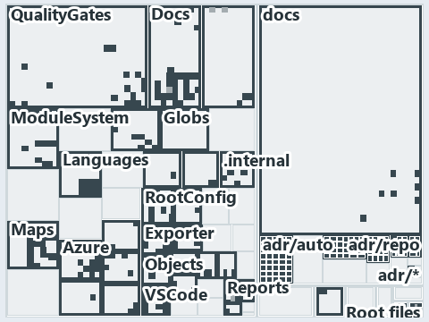

# docs/.assets/explanation/adr-auto-bundle--rule-and-gate-per-load-stage--governance.tree.md

`Tree minimap: adr-auto-bundle--rule-and-gate-per-load-stage--governance`

The tree minimap of the slide `adr-auto-bundle--rule-and-gate-per-load-stage--governance` (governance lens). The slide supports
[ADR-AUTO-BUNDLE][1], [ADR-AUTO-TYPES][2], [ADR-DSGN-RUNMODE][3], [ADR-PRIN-ONELIVE][4], [ADR-PWSH-ERROR][5] and [ADR-REPO-ROOTCFG][6]; the
highlight of those ADR codes selects what is lit, and each reason below names the code that selects it.

## What the minimap shows

The tree draws every file of the world map as a tile, grouped by top-level folder (under `automation/` by module, under `docs/adr/` by ADR
domain), and lights 311 files in 39 groups, filled in ink. A lit ADR file has a white rim; a file lit only by passing mentions is a lighter
ink. Every other tile is idle, a grey box: a file the slide's ADR codes do not select.

- adr/auto (docs/adr/automation): 39 lit files
- adr/pwsh (docs/adr/pwsh): 26 lit files
- docs (docs/ outside docs/adr/): 23 lit files
- Docs (automation/Catzc.Base.Docs): 22 lit files
- QualityGates (automation/Catzc.Base.QualityGates): 20 lit files
- Maps (automation/Catzc.Base.Maps): 16 lit files
- ModuleSystem (automation/Catzc.Base.ModuleSystem): 16 lit files
- adr/repo (docs/adr/repository): 15 lit files
- Languages (automation/Catzc.Base.Languages): 12 lit files
- VSCode (automation/Catzc.Base.VSCode): 12 lit files
- Exporter (automation/Catzc.Base.Exporter): 11 lit files
- Azure (automation/Catzc.Azure): 9 lit files
- TypesSystem (automation/Catzc.Base.TypesSystem): 9 lit files
- adr/dsgn (docs/adr/design): 9 lit files
- RootConfig (automation/Catzc.Base.RootConfig): 8 lit files
- adr/prin (docs/adr/principles): 7 lit files
- Contracts (automation/Catzc.Base.Contracts): 6 lit files
- Az.Templates (automation/Catzc.Azure.Templates): 5 lit files
- Repository (automation/Catzc.Base.Repository): 5 lit files
- .internal (automation/.internal): 4 lit files
- Reports (automation/Catzc.Base.Reports): 4 lit files
- Root files: 3 lit files
- Git (automation/Catzc.Base.Git): 3 lit files
- Variants (automation/Catzc.Base.Variants): 3 lit files
- Vendor (automation/Catzc.Base.Vendor): 3 lit files
- .claude: 2 lit files
- Az.DevOps.BuildValidation (automation/Catzc.Azure.DevOps.BuildValidation): 2 lit files
- Files (automation/Catzc.Base.Files): 2 lit files
- Objects (automation/Catzc.Base.Objects): 2 lit files
- Timeouts (automation/Catzc.Base.Timeouts): 2 lit files
- Tool.Inspiration (automation/Catzc.Tooling.Inspiration): 2 lit files
- Tool.KeyHandler (automation/Catzc.Tooling.KeyHandler): 2 lit files
- .github: 1 lit file
- .scriptanalyzer (automation/.scriptanalyzer): 1 lit file
- Az.DevOps (automation/Catzc.Azure.DevOps): 1 lit file
- ConfigExtensions (automation/Catzc.Base.ConfigExtensions): 1 lit file
- Engines (automation/Catzc.Base.Engines): 1 lit file
- Globs (automation/Catzc.Base.Globs): 1 lit file
- adr/* (the files directly in docs/adr/): 1 lit file

## Why each group is lit

### adr/auto (39 lit files)

The group holds the files of docs/adr/automation; each sits in its world-map cell and is lit by:

- [docs/adr/automation/BCL/index.md][7], in the cell docs × markdown: selected by [ADR-AUTO-BUNDLE][1]: an ADR file of the `automation` ADR
  domain, the ADR domain of that code; selected by [ADR-AUTO-TYPES][2]: an ADR file of the `automation` ADR domain, the ADR domain of that
  code.
- [docs/adr/automation/BCL/native-csharp-types.md][2], in the cell docs × markdown: selected by [ADR-AUTO-BUNDLE][1]: an ADR file of the
  `automation` ADR domain, the ADR domain of that code; selected by [ADR-AUTO-TYPES][2]: an ADR file of the `automation` ADR domain, the ADR
  domain of that code.
- [docs/adr/automation/avoid-deep-nesting.md][8], in the cell docs × markdown: selected by [ADR-AUTO-BUNDLE][1]: an ADR file of the
  `automation` ADR domain, the ADR domain of that code; selected by [ADR-AUTO-TYPES][2]: an ADR file of the `automation` ADR domain, the ADR
  domain of that code.
- [docs/adr/automation/bash/bash-test-artifacts.md][9], in the cell docs × markdown: selected by [ADR-AUTO-BUNDLE][1]: an ADR file of the
  `automation` ADR domain, the ADR domain of that code; selected by [ADR-AUTO-TYPES][2]: an ADR file of the `automation` ADR domain, the ADR
  domain of that code.
- [docs/adr/automation/caching.md][10], in the cell docs × markdown: selected by [ADR-AUTO-BUNDLE][1]: an ADR file of the `automation` ADR
  domain, the ADR domain of that code; selected by [ADR-AUTO-TYPES][2]: an ADR file of the `automation` ADR domain, the ADR domain of that
  code.
- [docs/adr/automation/console-output-matters.md][11], in the cell docs × markdown: selected by [ADR-AUTO-BUNDLE][1]: an ADR file of the
  `automation` ADR domain, the ADR domain of that code; selected by [ADR-AUTO-TYPES][2]: an ADR file of the `automation` ADR domain, the ADR
  domain of that code.
- [docs/adr/automation/controlling-module-dependencies.md][12], in the cell docs × markdown: selected by [ADR-AUTO-BUNDLE][1]: an ADR file
  of the `automation` ADR domain, the ADR domain of that code; selected by [ADR-AUTO-TYPES][2]: an ADR file of the `automation` ADR domain,
  the ADR domain of that code.
- [docs/adr/automation/controlling-systemwide-deps.md][13], in the cell docs × markdown: selected by [ADR-AUTO-BUNDLE][1]: an ADR file of
  the `automation` ADR domain, the ADR domain of that code; selected by [ADR-AUTO-TYPES][2]: an ADR file of the `automation` ADR domain, the
  ADR domain of that code.
- [docs/adr/automation/cross-platform.md][14], in the cell docs × markdown: selected by [ADR-AUTO-BUNDLE][1]: an ADR file of the
  `automation` ADR domain, the ADR domain of that code; selected by [ADR-AUTO-TYPES][2]: an ADR file of the `automation` ADR domain, the ADR
  domain of that code.
- [docs/adr/automation/devbox-pipeline-parity.md][15], in the cell docs × markdown: selected by [ADR-AUTO-BUNDLE][1]: an ADR file of the
  `automation` ADR domain, the ADR domain of that code; selected by [ADR-AUTO-TYPES][2]: an ADR file of the `automation` ADR domain, the ADR
  domain of that code.
- [docs/adr/automation/dora-explains.md][16], in the cell docs × markdown: selected by [ADR-AUTO-BUNDLE][1]: an ADR file of the `automation`
  ADR domain, the ADR domain of that code; selected by [ADR-AUTO-TYPES][2]: an ADR file of the `automation` ADR domain, the ADR domain of
  that code.
- [docs/adr/automation/dry-run.md][17], in the cell docs × markdown: selected by [ADR-AUTO-BUNDLE][1]: an ADR file of the `automation` ADR
  domain, the ADR domain of that code; selected by [ADR-AUTO-TYPES][2]: an ADR file of the `automation` ADR domain, the ADR domain of that
  code.
- [docs/adr/automation/effective-in-enterprises.md][18], in the cell docs × markdown: selected by [ADR-AUTO-BUNDLE][1]: an ADR file of the
  `automation` ADR domain, the ADR domain of that code; selected by [ADR-AUTO-TYPES][2]: an ADR file of the `automation` ADR domain, the ADR
  domain of that code.
- [docs/adr/automation/environment-variables.md][19], in the cell docs × markdown: selected by [ADR-AUTO-BUNDLE][1]: an ADR file of the
  `automation` ADR domain, the ADR domain of that code; selected by [ADR-AUTO-TYPES][2]: an ADR file of the `automation` ADR domain, the ADR
  domain of that code.
- [docs/adr/automation/execution-engines.md][20], in the cell docs × markdown: selected by [ADR-AUTO-BUNDLE][1]: an ADR file of the
  `automation` ADR domain, the ADR domain of that code; selected by [ADR-AUTO-TYPES][2]: an ADR file of the `automation` ADR domain, the ADR
  domain of that code.
- [docs/adr/automation/fail-fast-with-asserts.md][21], in the cell docs × markdown: selected by [ADR-AUTO-BUNDLE][1]: an ADR file of the
  `automation` ADR domain, the ADR domain of that code; selected by [ADR-AUTO-TYPES][2]: an ADR file of the `automation` ADR domain, the ADR
  domain of that code.
- [docs/adr/automation/go/index.md][22], in the cell docs × markdown: selected by [ADR-AUTO-BUNDLE][1]: an ADR file of the `automation` ADR
  domain, the ADR domain of that code; selected by [ADR-AUTO-TYPES][2]: an ADR file of the `automation` ADR domain, the ADR domain of that
  code.
- [docs/adr/automation/go/go-test-artifacts.md][23], in the cell docs × markdown: selected by [ADR-AUTO-BUNDLE][1]: an ADR file of the
  `automation` ADR domain, the ADR domain of that code; selected by [ADR-AUTO-TYPES][2]: an ADR file of the `automation` ADR domain, the ADR
  domain of that code.
- [docs/adr/automation/idempotent-state-functions.md][24], in the cell docs × markdown: selected by [ADR-AUTO-BUNDLE][1]: an ADR file of the
  `automation` ADR domain, the ADR domain of that code; selected by [ADR-AUTO-TYPES][2]: an ADR file of the `automation` ADR domain, the ADR
  domain of that code.
- [docs/adr/automation/internal-asset-dependencies.md][25], in the cell docs × markdown: selected by [ADR-AUTO-BUNDLE][1]: an ADR file of
  the `automation` ADR domain, the ADR domain of that code; selected by [ADR-AUTO-TYPES][2]: an ADR file of the `automation` ADR domain, the
  ADR domain of that code.
- [docs/adr/automation/log-before-invoke.md][26], in the cell docs × markdown: selected by [ADR-AUTO-BUNDLE][1]: an ADR file of the
  `automation` ADR domain, the ADR domain of that code; selected by [ADR-AUTO-TYPES][2]: an ADR file of the `automation` ADR domain, the ADR
  domain of that code.
- [docs/adr/automation/managed-guids.md][27], in the cell docs × markdown: selected by [ADR-AUTO-BUNDLE][1]: an ADR file of the `automation`
  ADR domain, the ADR domain of that code; selected by [ADR-AUTO-TYPES][2]: an ADR file of the `automation` ADR domain, the ADR domain of
  that code.
- [docs/adr/automation/never-depend-on-pwd.md][28], in the cell docs × markdown: selected by [ADR-AUTO-BUNDLE][1]: an ADR file of the
  `automation` ADR domain, the ADR domain of that code; selected by [ADR-AUTO-TYPES][2]: an ADR file of the `automation` ADR domain, the ADR
  domain of that code.
- [docs/adr/automation/open-closed-architecture.md][29], in the cell docs × markdown: selected by [ADR-AUTO-BUNDLE][1]: an ADR file of the
  `automation` ADR domain, the ADR domain of that code; selected by [ADR-AUTO-TYPES][2]: an ADR file of the `automation` ADR domain, the ADR
  domain of that code.
- [docs/adr/automation/path-representation.md][30], in the cell docs × markdown: selected by [ADR-AUTO-BUNDLE][1]: an ADR file of the
  `automation` ADR domain, the ADR domain of that code; selected by [ADR-AUTO-TYPES][2]: an ADR file of the `automation` ADR domain, the ADR
  domain of that code.
- [docs/adr/automation/platform-bundle.md][1], in the cell docs × markdown: selected by [ADR-AUTO-BUNDLE][1]: an ADR file of the
  `automation` ADR domain, the ADR domain of that code; selected by [ADR-AUTO-TYPES][2]: an ADR file of the `automation` ADR domain, the ADR
  domain of that code.
- [docs/adr/repository/protected-globs.md][31], in the cell docs × markdown: selected by [ADR-AUTO-BUNDLE][1]: an ADR file of the
  `automation` ADR domain, the ADR domain of that code; selected by [ADR-AUTO-TYPES][2]: an ADR file of the `automation` ADR domain, the ADR
  domain of that code.
- [docs/adr/automation/python/index.md][32], in the cell docs × markdown: selected by [ADR-AUTO-BUNDLE][1]: an ADR file of the `automation`
  ADR domain, the ADR domain of that code; selected by [ADR-AUTO-TYPES][2]: an ADR file of the `automation` ADR domain, the ADR domain of
  that code.
- [docs/adr/automation/python/python-test-artifacts.md][33], in the cell docs × markdown: selected by [ADR-AUTO-BUNDLE][1]: an ADR file of
  the `automation` ADR domain, the ADR domain of that code; selected by [ADR-AUTO-TYPES][2]: an ADR file of the `automation` ADR domain, the
  ADR domain of that code.
- [docs/adr/automation/retry-as-last-resort.md][34], in the cell docs × markdown: selected by [ADR-AUTO-BUNDLE][1]: an ADR file of the
  `automation` ADR domain, the ADR domain of that code; selected by [ADR-AUTO-TYPES][2]: an ADR file of the `automation` ADR domain, the ADR
  domain of that code.
- [docs/adr/automation/sensible-defaults.md][35], in the cell docs × markdown: selected by [ADR-AUTO-BUNDLE][1]: an ADR file of the
  `automation` ADR domain, the ADR domain of that code; selected by [ADR-AUTO-TYPES][2]: an ADR file of the `automation` ADR domain, the ADR
  domain of that code.
- [docs/adr/automation/single-responsibility-functions.md][36], in the cell docs × markdown: selected by [ADR-AUTO-BUNDLE][1]: an ADR file
  of the `automation` ADR domain, the ADR domain of that code; selected by [ADR-AUTO-TYPES][2]: an ADR file of the `automation` ADR domain,
  the ADR domain of that code.
- [docs/adr/automation/spell-out-names.md][37], in the cell docs × markdown: selected by [ADR-AUTO-BUNDLE][1]: an ADR file of the
  `automation` ADR domain, the ADR domain of that code; selected by [ADR-AUTO-TYPES][2]: an ADR file of the `automation` ADR domain, the ADR
  domain of that code.
- [docs/adr/automation/test-automation.md][38], in the cell docs × markdown: selected by [ADR-AUTO-BUNDLE][1]: an ADR file of the
  `automation` ADR domain, the ADR domain of that code; selected by [ADR-AUTO-TYPES][2]: an ADR file of the `automation` ADR domain, the ADR
  domain of that code.
- [docs/adr/automation/tool-removal-lifecycle.md][39], in the cell docs × markdown: selected by [ADR-AUTO-BUNDLE][1]: an ADR file of the
  `automation` ADR domain, the ADR domain of that code; selected by [ADR-AUTO-TYPES][2]: an ADR file of the `automation` ADR domain, the ADR
  domain of that code.
- [docs/adr/automation/tracked-files-from-the-index.md][40], in the cell docs × markdown: selected by [ADR-AUTO-BUNDLE][1]: an ADR file of
  the `automation` ADR domain, the ADR domain of that code; selected by [ADR-AUTO-TYPES][2]: an ADR file of the `automation` ADR domain, the
  ADR domain of that code.
- [docs/adr/automation/use-proper-package-managers.md][41], in the cell docs × markdown: selected by [ADR-AUTO-BUNDLE][1]: an ADR file of
  the `automation` ADR domain, the ADR domain of that code; selected by [ADR-AUTO-TYPES][2]: an ADR file of the `automation` ADR domain, the
  ADR domain of that code.
- [docs/adr/automation/uv-python-handler.md][42], in the cell docs × markdown: selected by [ADR-AUTO-BUNDLE][1]: an ADR file of the
  `automation` ADR domain, the ADR domain of that code; selected by [ADR-AUTO-TYPES][2]: an ADR file of the `automation` ADR domain, the ADR
  domain of that code.
- [docs/adr/automation/zero-ceremony-poka-yoke.md][43], in the cell docs × markdown: selected by [ADR-AUTO-BUNDLE][1]: an ADR file of the
  `automation` ADR domain, the ADR domain of that code; selected by [ADR-AUTO-TYPES][2]: an ADR file of the `automation` ADR domain, the ADR
  domain of that code.

### adr/pwsh (26 lit files)

The group holds the files of docs/adr/pwsh; each sits in its world-map cell and is lit by:

- [docs/adr/pwsh/announce-state-changes.md][44], in the cell docs × markdown: selected by [ADR-PWSH-ERROR][5]: an ADR file of the `pwsh` ADR
  domain, the ADR domain of that code.
- [docs/adr/pwsh/assert-idioms.md][45], in the cell docs × markdown: selected by [ADR-PWSH-ERROR][5]: an ADR file of the `pwsh` ADR domain,
  the ADR domain of that code.
- [docs/adr/pwsh/automatic-variable-pitfalls.md][46], in the cell docs × markdown: selected by [ADR-PWSH-ERROR][5]: an ADR file of the
  `pwsh` ADR domain, the ADR domain of that code.
- [docs/adr/pwsh/avoid-using-semicolons.md][47], in the cell docs × markdown: selected by [ADR-PWSH-ERROR][5]: an ADR file of the `pwsh` ADR
  domain, the ADR domain of that code.
- [docs/adr/pwsh/cross-platform-powershell.md][48], in the cell docs × markdown: selected by [ADR-PWSH-ERROR][5]: an ADR file of the `pwsh`
  ADR domain, the ADR domain of that code.
- [docs/adr/pwsh/dora-explains.md][49], in the cell docs × markdown: selected by [ADR-PWSH-ERROR][5]: an ADR file of the `pwsh` ADR domain,
  the ADR domain of that code.
- [docs/adr/pwsh/dynamic-module-manifests.md][50], in the cell docs × markdown: selected by [ADR-PWSH-ERROR][5]: an ADR file of the `pwsh`
  ADR domain, the ADR domain of that code.
- [docs/adr/pwsh/environment-variable-mechanics.md][51], in the cell docs × markdown: selected by [ADR-PWSH-ERROR][5]: an ADR file of the
  `pwsh` ADR domain, the ADR domain of that code.
- [docs/adr/pwsh/error-handling.md][5], in the cell docs × markdown: selected by [ADR-PWSH-ERROR][5]: an ADR file of the `pwsh` ADR domain,
  the ADR domain of that code.
- [docs/adr/pwsh/hosting-csharp-types.md][52], in the cell docs × markdown: selected by [ADR-PWSH-ERROR][5]: an ADR file of the `pwsh` ADR
  domain, the ADR domain of that code.
- [docs/adr/pwsh/identifier-names.md][53], in the cell docs × markdown: selected by [ADR-PWSH-ERROR][5]: an ADR file of the `pwsh` ADR
  domain, the ADR domain of that code.
- [docs/adr/pwsh/index.md][54], in the cell docs × markdown: selected by [ADR-PWSH-ERROR][5]: an ADR file of the `pwsh` ADR domain, the ADR
  domain of that code.
- [docs/adr/pwsh/module-path-hygiene.md][55], in the cell docs × markdown: selected by [ADR-PWSH-ERROR][5]: an ADR file of the `pwsh` ADR
  domain, the ADR domain of that code.
- [docs/adr/pwsh/one-function-per-file.md][56], in the cell docs × markdown: selected by [ADR-PWSH-ERROR][5]: an ADR file of the `pwsh` ADR
  domain, the ADR domain of that code.
- [docs/adr/pwsh/parameter-design.md][57], in the cell docs × markdown: selected by [ADR-PWSH-ERROR][5]: an ADR file of the `pwsh` ADR
  domain, the ADR domain of that code.
- [docs/adr/pwsh/pester-testing.md][58], in the cell docs × markdown: selected by [ADR-PWSH-ERROR][5]: an ADR file of the `pwsh` ADR domain,
  the ADR domain of that code.
- [docs/adr/pwsh/powershell-formatting.md][59], in the cell docs × markdown: selected by [ADR-PWSH-ERROR][5]: an ADR file of the `pwsh` ADR
  domain, the ADR domain of that code.
- [docs/adr/pwsh/prefer-dryrun-over-shouldprocess.md][60], in the cell docs × markdown: selected by [ADR-PWSH-ERROR][5]: an ADR file of the
  `pwsh` ADR domain, the ADR domain of that code.
- [docs/adr/pwsh/prefer-foreach-over-foreach-object.md][61], in the cell docs × markdown: selected by [ADR-PWSH-ERROR][5]: an ADR file of
  the `pwsh` ADR domain, the ADR domain of that code.
- [docs/adr/pwsh/prepost-extension-modules.md][62], in the cell docs × markdown: selected by [ADR-PWSH-ERROR][5]: an ADR file of the `pwsh`
  ADR domain, the ADR domain of that code.
- [docs/adr/pwsh/pwsh-engine.md][63], in the cell docs × markdown: selected by [ADR-PWSH-ERROR][5]: an ADR file of the `pwsh` ADR domain,
  the ADR domain of that code.
- [docs/adr/pwsh/respect-pwsh-verb-rules.md][64], in the cell docs × markdown: selected by [ADR-PWSH-ERROR][5]: an ADR file of the `pwsh`
  ADR domain, the ADR domain of that code.
- [docs/adr/pwsh/script-scope-caching.md][65], in the cell docs × markdown: selected by [ADR-PWSH-ERROR][5]: an ADR file of the `pwsh` ADR
  domain, the ADR domain of that code.
- [docs/adr/pwsh/use-ps1-not-psm1.md][66], in the cell docs × markdown: selected by [ADR-PWSH-ERROR][5]: an ADR file of the `pwsh` ADR
  domain, the ADR domain of that code.
- [docs/adr/pwsh/vendor-toolset-dependencies.md][67], in the cell docs × markdown: selected by [ADR-PWSH-ERROR][5]: an ADR file of the
  `pwsh` ADR domain, the ADR domain of that code.
- [docs/adr/pwsh/working-directory-mechanics.md][68], in the cell docs × markdown: selected by [ADR-PWSH-ERROR][5]: an ADR file of the
  `pwsh` ADR domain, the ADR domain of that code.

### docs (23 lit files)

The group holds the files of docs/ outside docs/adr/; each sits in its world-map cell and is lit by:

- [docs/explanation/automation/build-then-place-with-one-command.md][69], in the cell docs × markdown: selected by [ADR-AUTO-BUNDLE][1]: the
  file cites it at line 17 (text), line 52 (text), line 54 (text) and line 56 (text).
- [docs/explanation/automation/build-verify-then-copy-the-folder.md][70], in the cell docs × markdown: selected by [ADR-AUTO-BUNDLE][1]: the
  file cites it at line 17 (text), line 58 (text), line 60 (text), line 61 (text), line 63 (text), line 67 (text) and line 69 (text).
- [docs/explanation/automation/dot-source-one-entry-script.md][71], in the cell docs × markdown: selected by [ADR-AUTO-BUNDLE][1]: the file
  cites it at line 17 (text), line 54 (text) and line 56 (text).
- [docs/explanation/automation/every-code-root-is-a-copy.md][72], in the cell docs × markdown: selected by [ADR-AUTO-BUNDLE][1]: the file
  cites it at line 17 (text), line 51 (text), line 53 (text), line 54 (text), line 55 (text) and line 63 (text); selected by
  [ADR-DSGN-RUNMODE][3]: the file cites it at line 17 (text), line 62 (text) and line 63 (text).
- [docs/explanation/automation/every-entry-runs-one-load-sequence.md][73], in the cell docs × markdown: selected by [ADR-AUTO-BUNDLE][1]:
  the file cites it at line 14 (text), line 44 (text) and line 46 (text); selected by [ADR-DSGN-RUNMODE][3]: the file cites it at line 47
  (text).
- [docs/explanation/automation/invoke-importer-in-code-order.md][74], in the cell docs × markdown: selected by [ADR-AUTO-BUNDLE][1]: the
  file cites it at line 18 (text), line 62 (text), line 63 (text) and line 64 (text).
- [docs/explanation/automation/one-commit-one-immutable-package.md][75], in the cell docs × markdown: selected by [ADR-AUTO-BUNDLE][1]: the
  file cites it at line 15 (text), line 45 (text), line 47 (text) and line 49 (text); selected by [ADR-DSGN-RUNMODE][3]: the file cites it
  at line 15 (text), line 50 (text) and line 54 (text).
- [docs/explanation/automation/rule-and-gate-per-load-stage.md][76], in the cell docs × markdown: selected by [ADR-AUTO-BUNDLE][1]: the file
  cites it at line 17 (text), line 36 (text), line 36 (text), line 39 (text), line 62 (text), line 63 (text) and line 64 (text); selected by
  [ADR-AUTO-TYPES][2]: the file cites it at line 45 (text) and line 68 (text); selected by [ADR-DSGN-RUNMODE][3]: the file cites it at line
  41 (text), line 51 (text), line 66 (text), line 69 (text) and line 73 (text); selected by [ADR-PRIN-ONELIVE][4]: the file cites it at line
  33 (text) and line 61 (text); selected by [ADR-PWSH-ERROR][5]: the file cites it at line 35 (text) and line 62 (text); selected by
  [ADR-REPO-ROOTCFG][6]: the file cites it at line 33 (text), line 44 (text), line 60 (text) and line 67 (text).
- [docs/explanation/automation/two-entries-feed-one-importer.md][77], in the cell docs × markdown: selected by [ADR-AUTO-BUNDLE][1]: the
  file cites it at line 18 (text), line 59 (text) and line 61 (text).
- [docs/explanation/automation/what-gates-each-bundle-stage.md][78], in the cell docs × markdown: selected by [ADR-AUTO-BUNDLE][1]: the file
  cites it at line 16 (text), line 19 (text), line 31 (text), line 33 (text), line 49 (text), line 52 (text), line 53 (text), line 54 (text)
  and line 61 (text); selected by [ADR-DSGN-RUNMODE][3]: the file cites it at line 16 (text), line 42 (text), line 57 (text), line 63 (text)
  and line 64 (text).
- [docs/explanation/design/one-entry-script-per-mode.md][79], in the cell docs × markdown: selected by [ADR-DSGN-RUNMODE][3]: the file cites
  it at line 17 (text), line 60 (text), line 61 (text), line 62 (text) and line 63 (text).
- [docs/explanation/design/shims-set-roots-mode-read-back.md][80], in the cell docs × markdown: selected by [ADR-DSGN-RUNMODE][3]: the file
  cites it at line 19 (text), line 58 (text), line 59 (text), line 61 (text) and line 62 (text).
- [docs/explanation/design/two-roots-one-importer-same-modules.md][81], in the cell docs × markdown: selected by [ADR-DSGN-RUNMODE][3]: the
  file cites it at line 17 (text), line 56 (text), line 57 (text), line 58 (text) and line 60 (text).
- [docs/explanation/design/where-code-loads-from-decides-the-mode.md][82], in the cell docs × markdown: selected by [ADR-DSGN-RUNMODE][3]:
  the file cites it at line 14 (text), line 40 (text), line 41 (text), line 42 (text) and line 43 (text).
- [docs/explanation/design/which-run-mode-rules-have-a-gate.md][83], in the cell docs × markdown: selected by [ADR-DSGN-RUNMODE][3]: the
  file cites it at line 17 (text), line 53 (text), line 55 (text), line 57 (text), line 58 (text), line 59 (text), line 60 (text) and line
  61 (text).
- [docs/explanation/flow/overlap-gated-for-units-and-modules.md][84], in the cell docs × markdown: selected by [ADR-PRIN-ONELIVE][4]: the
  file cites it at line 32 (text).
- [docs/how-to/getting-started/automation/BCL/add-a-dotnet-type.md][85], in the cell docs × markdown: selected by [ADR-AUTO-TYPES][2]: the
  file cites it at line 30 (text).
- [docs/how-to/getting-started/automation/add-a-doc-chapter.md][86], in the cell docs × markdown: selected by [ADR-PWSH-ERROR][5]: the file
  cites it at line 72 (text).
- [docs/how-to/getting-started/automation/powershell/add-a-function.md][87], in the cell docs × markdown: selected by [ADR-PWSH-ERROR][5]:
  the file cites it at line 111 (text), line 114 (text), line 120 (text) and line 121 (text).
- [docs/references/automation/catzc-base-languages.md][88], in the cell docs × markdown: selected by [ADR-REPO-ROOTCFG][6]: the file cites
  it at line 10 (text).
- [docs/references/automation/catzc-base-rootconfig.md][89], in the cell docs × markdown: selected by [ADR-REPO-ROOTCFG][6]: the file cites
  it at line 43 (text) and line 52 (text).
- [docs/references/automation/catzc-base-typessystem.md][90], in the cell docs × markdown: selected by [ADR-AUTO-TYPES][2]: the file cites
  it at line 37 (text).
- [docs/references/automation/internal/catzc-internal-importer.md][91], in the cell docs × markdown: selected by [ADR-AUTO-TYPES][2]: the
  file cites it at line 36 (text).

### Docs (22 lit files)

The group holds the files of automation/Catzc.Base.Docs; each sits in its world-map cell and is lit by:

- [automation/Catzc.Base.Docs/Build-AdrIndex.ps1][92], in the cell automation × powershell: selected by [ADR-PWSH-ERROR][5]: the file cites
  it at line 60 (body comment) (a passing mention only).
- [automation/Catzc.Base.Docs/Get-AdrCitationMap.ps1][93], in the cell automation × powershell: selected by [ADR-PWSH-ERROR][5]: the file
  cites it at line 21 (header).
- [automation/Catzc.Base.Docs/Get-CatsAdrRuleIds.ps1][94], in the cell automation × powershell: selected by [ADR-PWSH-ERROR][5]: the file
  cites it at line 3 (header) and line 24 (header).
- [automation/Catzc.Base.Docs/configs/adrs.yml][95], in the cell automation × yaml: selected by [ADR-AUTO-BUNDLE][1]: the file cites it at
  line 162 (text); selected by [ADR-AUTO-TYPES][2]: the file cites it at line 168 (text); selected by [ADR-DSGN-RUNMODE][3]: the file cites
  it at line 101 (text); selected by [ADR-PRIN-ONELIVE][4]: the file cites it at line 56 (text); selected by [ADR-PWSH-ERROR][5]: the file
  cites it at line 193 (text); selected by [ADR-REPO-ROOTCFG][6]: the file cites it at line 314 (text).
- [automation/Catzc.Base.Docs/private/Get-CatsModules.ps1][96], in the cell automation × powershell: selected by [ADR-DSGN-RUNMODE][3]: the
  file cites it at line 11 (header).
- [automation/Catzc.Base.Docs/tests/types/AdrDomainEdge.Tests.ps1][97], in the cell automation × powershell: selected by
  [ADR-AUTO-TYPES][2]: the file cites it at line 3 (text).
- [automation/Catzc.Base.Docs/tests/types/AdrsConfig.Tests.ps1][98], in the cell automation × powershell: selected by [ADR-AUTO-TYPES][2]:
  the file cites it at line 1 (text).
- [automation/Catzc.Base.Docs/types/AdrCitationChange.cs][99], in the cell automation × csharp: selected by [ADR-AUTO-TYPES][2]: the file
  cites it at line 3 (header).
- [automation/Catzc.Base.Docs/types/AdrCitationChangeKind.cs][100], in the cell automation × csharp: selected by [ADR-AUTO-TYPES][2]: the
  file cites it at line 3 (header).
- [automation/Catzc.Base.Docs/types/AdrCitationMap.cs][101], in the cell automation × csharp: selected by [ADR-PWSH-ERROR][5]: the file
  cites it at line 60 (body comment) (a passing mention only).
- [automation/Catzc.Base.Docs/types/AdrCitationRewrite.cs][102], in the cell automation × csharp: selected by [ADR-AUTO-TYPES][2]: the file
  cites it at line 3 (header).
- [automation/Catzc.Base.Docs/types/AdrDomain.cs][103], in the cell automation × csharp: selected by [ADR-AUTO-TYPES][2]: the file cites it
  at line 5 (header).
- [automation/Catzc.Base.Docs/types/AdrDomainEdge.cs][104], in the cell automation × csharp: selected by [ADR-AUTO-TYPES][2]: the file cites
  it at line 4 (header).
- [automation/Catzc.Base.Docs/types/AdrRuleSet.cs][105], in the cell automation × csharp: selected by [ADR-AUTO-TYPES][2]: the file cites it
  at line 6 (header) and line 7 (header).
- [automation/Catzc.Base.Docs/types/AdrsConfig.cs][106], in the cell automation × csharp: selected by [ADR-AUTO-TYPES][2]: the file cites it
  at line 6 (header).
- [automation/Catzc.Base.Docs/types/AgentEntry.cs][107], in the cell automation × csharp: selected by [ADR-AUTO-TYPES][2]: the file cites it
  at line 4 (header).
- [automation/Catzc.Base.Docs/types/AgentsConfig.cs][108], in the cell automation × csharp: selected by [ADR-AUTO-TYPES][2]: the file cites
  it at line 8 (header).
- [automation/Catzc.Base.Docs/types/GlossaryAvoid.cs][109], in the cell automation × csharp: selected by [ADR-AUTO-TYPES][2]: the file cites
  it at line 3 (header).
- [automation/Catzc.Base.Docs/types/GlossaryConcept.cs][110], in the cell automation × csharp: selected by [ADR-AUTO-TYPES][2]: the file
  cites it at line 9 (header).
- [automation/Catzc.Base.Docs/types/GlossaryEntry.cs][111], in the cell automation × csharp: selected by [ADR-AUTO-TYPES][2]: the file cites
  it at line 5 (header).
- [automation/Catzc.Base.Docs/types/GlossaryOptions.cs][112], in the cell automation × csharp: selected by [ADR-AUTO-TYPES][2]: the file
  cites it at line 8 (header).
- [automation/Catzc.Base.Docs/types/GlossaryRealization.cs][113], in the cell automation × csharp: selected by [ADR-AUTO-TYPES][2]: the file
  cites it at line 8 (header).

### QualityGates (20 lit files)

The group holds the files of automation/Catzc.Base.QualityGates; each sits in its world-map cell and is lit by:

- [automation/Catzc.Base.QualityGates/Test-Automation.ps1][114], in the cell automation × powershell: selected by [ADR-PWSH-ERROR][5]: the
  file cites it at line 65 (header), line 117 (header) and line 117 (header).
- [automation/Catzc.Base.QualityGates/Test-BuildArtifact.ps1][115], in the cell automation × powershell: selected by [ADR-DSGN-RUNMODE][3]:
  the file cites it at line 25 (header).
- [automation/Catzc.Base.QualityGates/Test-CatzcBuild.ps1][116], in the cell automation × powershell: selected by [ADR-DSGN-RUNMODE][3]: the
  file cites it at line 7 (header).
- [automation/Catzc.Base.QualityGates/configs/analyzer-adr-map.yml][117], in the cell automation × yaml: selected by [ADR-PWSH-ERROR][5]:
  the file cites it at line 18 (text), line 18 (body comment) and line 35 (text).
- [automation/Catzc.Base.QualityGates/configs/terminology.yml][118], in the cell automation × yaml: selected by [ADR-DSGN-RUNMODE][3]: the
  file cites it at line 596 (text); selected by [ADR-PRIN-ONELIVE][4]: the file cites it at line 576 (text); selected by
  [ADR-REPO-ROOTCFG][6]: the file cites it at line 616 (text).
- [automation/Catzc.Base.QualityGates/private/Get-ContentExemptPath.ps1][119], in the cell automation × powershell: selected by
  [ADR-REPO-ROOTCFG][6]: the file cites it at line 12 (header).
- [automation/Catzc.Base.QualityGates/private/Get-TestRuleTags.ps1][120], in the cell automation × powershell: selected by
  [ADR-PWSH-ERROR][5]: the file cites it at line 7 (header) and line 19 (header).
- [automation/Catzc.Base.QualityGates/private/Get-TestTagViolations.ps1][121], in the cell automation × powershell: selected by
  [ADR-PWSH-ERROR][5]: the file cites it at line 81 (body comment) (a passing mention only).
- [automation/Catzc.Base.QualityGates/tests/Get-TestRuleTags.Tests.ps1][122], in the cell automation × powershell: selected by
  [ADR-PWSH-ERROR][5]: the file cites it at line 37 (text) and line 37 (text).
- [automation/Catzc.Base.QualityGates/tests/Test-CatzcBuild.Parity.Tests.ps1][123], in the cell automation × powershell: selected by
  [ADR-DSGN-RUNMODE][3]: the file cites it at line 1 (header) and line 7 (text).
- [automation/Catzc.Base.QualityGates/tests/Test-CatzcBuild.ScopeIsolation.Tests.ps1][124], in the cell automation × powershell: selected by
  [ADR-DSGN-RUNMODE][3]: the file cites it at line 1 (header) and line 6 (text).
- [automation/Catzc.Base.QualityGates/tests/Write-TestAutomationReport.Tests.ps1][125], in the cell automation × powershell: selected by
  [ADR-PWSH-ERROR][5]: the file cites it at line 29 (text) and line 80 (text).
- [automation/Catzc.Base.QualityGates/tests/types/AnalyzerAdrMapConfig.Tests.ps1][126], in the cell automation × powershell: selected by
  [ADR-PWSH-ERROR][5]: the file cites it at line 35 (text) and line 36 (text).
- [automation/Catzc.Base.QualityGates/types/AnalyzerAdrMapConfig.cs][127], in the cell automation × csharp: selected by [ADR-AUTO-TYPES][2]:
  the file cites it at line 7 (header); selected by [ADR-PWSH-ERROR][5]: the file cites it at line 81 (text).
- [automation/Catzc.Base.QualityGates/types/GuidsConfig.cs][128], in the cell automation × csharp: selected by [ADR-AUTO-TYPES][2]: the file
  cites it at line 6 (header).
- [automation/Catzc.Base.QualityGates/types/LinksConfig.cs][129], in the cell automation × csharp: selected by [ADR-AUTO-TYPES][2]: the file
  cites it at line 12 (header).
- [automation/Catzc.Base.QualityGates/types/ManagedGuidEntry.cs][130], in the cell automation × csharp: selected by [ADR-AUTO-TYPES][2]: the
  file cites it at line 11 (header).
- [automation/Catzc.Base.QualityGates/types/ParameterConsistencyConfig.cs][131], in the cell automation × csharp: selected by
  [ADR-AUTO-TYPES][2]: the file cites it at line 7 (header).
- [automation/Catzc.Base.QualityGates/types/SpellingOracle.cs][132], in the cell automation × csharp: selected by [ADR-AUTO-TYPES][2]: the
  file cites it at line 20 (header).
- [automation/Catzc.Base.QualityGates/types/TestPolicyConfig.cs][133], in the cell automation × csharp: selected by [ADR-AUTO-TYPES][2]: the
  file cites it at line 8 (header).

### Maps (16 lit files)

The group holds the files of automation/Catzc.Base.Maps; each sits in its world-map cell and is lit by:

- [automation/Catzc.Base.Maps/types/CitationSite.cs][134], in the cell automation × csharp: selected by [ADR-AUTO-TYPES][2]: the file cites
  it at line 4 (header).
- [automation/Catzc.Base.Maps/types/HighlightReason.cs][135], in the cell automation × csharp: selected by [ADR-AUTO-TYPES][2]: the file
  cites it at line 6 (header).
- [automation/Catzc.Base.Maps/types/HighlightedCell.cs][136], in the cell automation × csharp: selected by [ADR-AUTO-TYPES][2]: the file
  cites it at line 4 (header).
- [automation/Catzc.Base.Maps/types/MapCell.cs][137], in the cell automation × csharp: selected by [ADR-AUTO-TYPES][2]: the file cites it at
  line 7 (header).
- [automation/Catzc.Base.Maps/types/MapPlacement.cs][138], in the cell automation × csharp: selected by [ADR-AUTO-TYPES][2]: the file cites
  it at line 5 (header).
- [automation/Catzc.Base.Maps/types/MapsConfig.cs][139], in the cell automation × csharp: selected by [ADR-AUTO-TYPES][2]: the file cites it
  at line 6 (header).
- [automation/Catzc.Base.Maps/types/MapsHighlight.cs][140], in the cell automation × csharp: selected by [ADR-AUTO-TYPES][2]: the file cites
  it at line 8 (header).
- [automation/Catzc.Base.Maps/types/MapsLabels.cs][141], in the cell automation × csharp: selected by [ADR-AUTO-TYPES][2]: the file cites it
  at line 14 (header).
- [automation/Catzc.Base.Maps/types/MapsLimits.cs][142], in the cell automation × csharp: selected by [ADR-AUTO-TYPES][2]: the file cites it
  at line 4 (header).
- [automation/Catzc.Base.Maps/types/MapsPalette.cs][143], in the cell automation × csharp: selected by [ADR-AUTO-TYPES][2]: the file cites
  it at line 4 (header).
- [automation/Catzc.Base.Maps/types/MapsPin.cs][144], in the cell automation × csharp: selected by [ADR-AUTO-TYPES][2]: the file cites it at
  line 5 (header).
- [automation/Catzc.Base.Maps/types/TreemapRect.cs][145], in the cell automation × csharp: selected by [ADR-AUTO-TYPES][2]: the file cites
  it at line 3 (header).
- [automation/Catzc.Base.Maps/types/ValueChainCell.cs][146], in the cell automation × csharp: selected by [ADR-AUTO-TYPES][2]: the file
  cites it at line 5 (header).
- [automation/Catzc.Base.Maps/types/ValueChainReason.cs][147], in the cell automation × csharp: selected by [ADR-AUTO-TYPES][2]: the file
  cites it at line 6 (header).
- [automation/Catzc.Base.Maps/types/WorldMapBuilder.cs][148], in the cell automation × csharp: selected by [ADR-AUTO-TYPES][2]: the file
  cites it at line 27 (header).
- [automation/Catzc.Base.Maps/types/WorldMapGridLayout.cs][149], in the cell automation × csharp: selected by [ADR-AUTO-TYPES][2]: the file
  cites it at line 10 (header).

### ModuleSystem (16 lit files)

The group holds the files of automation/Catzc.Base.ModuleSystem; each sits in its world-map cell and is lit by:

- [automation/Catzc.Base.ModuleSystem/Copy-Automation.ps1][150], in the cell automation × powershell: selected by [ADR-AUTO-TYPES][2]: the
  file cites it at line 29 (header); selected by [ADR-DSGN-RUNMODE][3]: the file cites it at line 26 (header).
- [automation/Catzc.Base.ModuleSystem/Get-AutomationFunctions.ps1][151], in the cell automation × powershell: selected by
  [ADR-DSGN-RUNMODE][3]: the file cites it at line 12 (header).
- [automation/Catzc.Base.ModuleSystem/Get-BaseModule.ps1][152], in the cell automation × powershell: selected by [ADR-AUTO-TYPES][2]: the
  file cites it at line 4 (header); selected by [ADR-DSGN-RUNMODE][3]: the file cites it at line 22 (header).
- [automation/Catzc.Base.ModuleSystem/Get-FunctionDependency.ps1][153], in the cell automation × powershell: selected by
  [ADR-DSGN-RUNMODE][3]: the file cites it at line 10 (header).
- [automation/Catzc.Base.ModuleSystem/Get-InternalAssetDependency.ps1][154], in the cell automation × powershell: selected by
  [ADR-DSGN-RUNMODE][3]: the file cites it at line 28 (header).
- [automation/Catzc.Base.ModuleSystem/New-Importer.ps1][155], in the cell automation × powershell: selected by [ADR-DSGN-RUNMODE][3]: the
  file cites it at line 16 (header).
- [automation/Catzc.Base.ModuleSystem/Sync-GeneratedFile.ps1][156], in the cell automation × powershell: selected by [ADR-AUTO-TYPES][2]:
  the file cites it at line 23 (header) and line 109 (body comment); selected by [ADR-DSGN-RUNMODE][3]: the file cites it at line 17
  (header).
- [automation/Catzc.Base.ModuleSystem/Test-FunctionDependency.ps1][157], in the cell automation × powershell: selected by
  [ADR-DSGN-RUNMODE][3]: the file cites it at line 21 (header).
- [automation/Catzc.Base.ModuleSystem/tests/Sync-GeneratedFile.Tests.ps1][158], in the cell automation × powershell: selected by
  [ADR-AUTO-TYPES][2]: the file cites it at line 35 (text) and line 113 (text).
- [automation/Catzc.Base.ModuleSystem/types/ArtifactsConfig.cs][159], in the cell automation × csharp: selected by [ADR-AUTO-TYPES][2]: the
  file cites it at line 8 (header).
- [automation/Catzc.Base.ModuleSystem/types/ArtifactsTarget.cs][160], in the cell automation × csharp: selected by [ADR-AUTO-TYPES][2]: the
  file cites it at line 10 (header).
- [automation/Catzc.Base.ModuleSystem/types/BaseModule.cs][161], in the cell automation × csharp: selected by [ADR-AUTO-TYPES][2]: the file
  cites it at line 2 (header).
- [automation/Catzc.Base.ModuleSystem/types/DependenciesConfig.cs][162], in the cell automation × csharp: selected by [ADR-AUTO-TYPES][2]:
  the file cites it at line 6 (header).
- [automation/Catzc.Base.ModuleSystem/types/FilesConfig.cs][163], in the cell automation × csharp: selected by [ADR-AUTO-TYPES][2]: the file
  cites it at line 6 (header).
- [automation/Catzc.Base.ModuleSystem/types/ModuleFiles.cs][164], in the cell automation × csharp: selected by [ADR-AUTO-TYPES][2]: the file
  cites it at line 9 (header).
- [automation/Catzc.Base.ModuleSystem/types/ProfilesConfig.cs][165], in the cell automation × csharp: selected by [ADR-AUTO-TYPES][2]: the
  file cites it at line 7 (header).

### adr/repo (15 lit files)

The group holds the files of docs/adr/repository; each sits in its world-map cell and is lit by:

- [docs/adr/repository/agent-definitions.md][166], in the cell docs × markdown: selected by [ADR-REPO-ROOTCFG][6]: an ADR file of the
  `repository` ADR domain, the ADR domain of that code.
- [docs/adr/repository/api-contracts.md][167], in the cell docs × markdown: selected by [ADR-REPO-ROOTCFG][6]: an ADR file of the
  `repository` ADR domain, the ADR domain of that code.
- [docs/adr/repository/controlled-vocabulary.md][168], in the cell docs × markdown: selected by [ADR-REPO-ROOTCFG][6]: an ADR file of the
  `repository` ADR domain, the ADR domain of that code.
- [docs/adr/repository/conventional-folders.md][169], in the cell docs × markdown: selected by [ADR-REPO-ROOTCFG][6]: an ADR file of the
  `repository` ADR domain, the ADR domain of that code.
- [docs/adr/repository/dedicated-output-directory.md][170], in the cell docs × markdown: selected by [ADR-REPO-ROOTCFG][6]: an ADR file of
  the `repository` ADR domain, the ADR domain of that code.
- [docs/adr/repository/documentation-examples.md][171], in the cell docs × markdown: selected by [ADR-REPO-ROOTCFG][6]: an ADR file of the
  `repository` ADR domain, the ADR domain of that code.
- [docs/adr/repository/domain-language-separation.md][172], in the cell docs × markdown: selected by [ADR-REPO-ROOTCFG][6]: an ADR file of
  the `repository` ADR domain, the ADR domain of that code.
- [docs/adr/repository/dora-explains.md][173], in the cell docs × markdown: selected by [ADR-REPO-ROOTCFG][6]: an ADR file of the
  `repository` ADR domain, the ADR domain of that code.
- [docs/adr/repository/generated-readmes.md][174], in the cell docs × markdown: selected by [ADR-REPO-ROOTCFG][6]: an ADR file of the
  `repository` ADR domain, the ADR domain of that code.
- [docs/adr/repository/generated-root-configs.md][6], in the cell docs × markdown: selected by [ADR-REPO-ROOTCFG][6]: an ADR file of the
  `repository` ADR domain, the ADR domain of that code.
- [docs/adr/repository/inspiration.md][175], in the cell docs × markdown: selected by [ADR-REPO-ROOTCFG][6]: an ADR file of the `repository`
  ADR domain, the ADR domain of that code.
- [docs/adr/repository/markdown-links.md][176], in the cell docs × markdown: selected by [ADR-REPO-ROOTCFG][6]: an ADR file of the
  `repository` ADR domain, the ADR domain of that code.
- [docs/adr/repository/output-formats.md][177], in the cell docs × markdown: selected by [ADR-REPO-ROOTCFG][6]: an ADR file of the
  `repository` ADR domain, the ADR domain of that code.
- [docs/adr/repository/repo-variants.md][178], in the cell docs × markdown: selected by [ADR-REPO-ROOTCFG][6]: an ADR file of the
  `repository` ADR domain, the ADR domain of that code.
- [docs/adr/repository/uniform-formatting.md][179], in the cell docs × markdown: selected by [ADR-REPO-ROOTCFG][6]: an ADR file of the
  `repository` ADR domain, the ADR domain of that code.

### Languages (12 lit files)

The group holds the files of automation/Catzc.Base.Languages; each sits in its world-map cell and is lit by:

- [automation/Catzc.Base.Languages/New-GoWorkspace.ps1][180], in the cell automation × powershell: selected by [ADR-REPO-ROOTCFG][6]: the
  file cites it at line 25 (header).
- [automation/Catzc.Base.Languages/types/BashConfig.cs][181], in the cell automation × csharp: selected by [ADR-AUTO-TYPES][2]: the file
  cites it at line 5 (header).
- [automation/Catzc.Base.Languages/types/BashTestResult.cs][182], in the cell automation × csharp: selected by [ADR-AUTO-TYPES][2]: the file
  cites it at line 4 (header).
- [automation/Catzc.Base.Languages/types/FileLanguage.cs][183], in the cell automation × csharp: selected by [ADR-AUTO-TYPES][2]: the file
  cites it at line 4 (header).
- [automation/Catzc.Base.Languages/types/FormatterEngine.cs][184], in the cell automation × csharp: selected by [ADR-AUTO-TYPES][2]: the
  file cites it at line 6 (header).
- [automation/Catzc.Base.Languages/types/GoConfig.cs][185], in the cell automation × csharp: selected by [ADR-AUTO-TYPES][2]: the file cites
  it at line 7 (header).
- [automation/Catzc.Base.Languages/types/GoTestResult.cs][186], in the cell automation × csharp: selected by [ADR-AUTO-TYPES][2]: the file
  cites it at line 4 (header).
- [automation/Catzc.Base.Languages/types/GoWorkspaceFile.cs][187], in the cell automation × csharp: selected by [ADR-AUTO-TYPES][2]: the
  file cites it at line 2 (header); selected by [ADR-REPO-ROOTCFG][6]: the file cites it at line 4 (header).
- [automation/Catzc.Base.Languages/types/LanguagesConfig.cs][188], in the cell automation × csharp: selected by [ADR-AUTO-TYPES][2]: the
  file cites it at line 6 (header).
- [automation/Catzc.Base.Languages/types/PythonConfig.cs][189], in the cell automation × csharp: selected by [ADR-AUTO-TYPES][2]: the file
  cites it at line 6 (header).
- [automation/Catzc.Base.Languages/types/PythonTestResult.cs][190], in the cell automation × csharp: selected by [ADR-AUTO-TYPES][2]: the
  file cites it at line 5 (header).
- [automation/Catzc.Base.Languages/types/PythonWorkspaceFile.cs][191], in the cell automation × csharp: selected by [ADR-AUTO-TYPES][2]: the
  file cites it at line 3 (header); selected by [ADR-REPO-ROOTCFG][6]: the file cites it at line 4 (header).

### VSCode (12 lit files)

The group holds the files of automation/Catzc.Base.VSCode; each sits in its world-map cell and is lit by:

- [automation/Catzc.Base.VSCode/New-VSCodeExtensions.ps1][192], in the cell automation × powershell: selected by [ADR-REPO-ROOTCFG][6]: the
  file cites it at line 14 (header).
- [automation/Catzc.Base.VSCode/New-VSCodeLaunch.ps1][193], in the cell automation × powershell: selected by [ADR-REPO-ROOTCFG][6]: the file
  cites it at line 14 (header).
- [automation/Catzc.Base.VSCode/New-VSCodePipelineSchema.ps1][194], in the cell automation × powershell: selected by [ADR-REPO-ROOTCFG][6]:
  the file cites it at line 18 (header).
- [automation/Catzc.Base.VSCode/New-VSCodeSettings.ps1][195], in the cell automation × powershell: selected by [ADR-REPO-ROOTCFG][6]: the
  file cites it at line 20 (header).
- [automation/Catzc.Base.VSCode/configs/vscode-extensions.yml][196], in the cell automation × yaml: selected by [ADR-REPO-ROOTCFG][6]: the
  file cites it at line 3 (header).
- [automation/Catzc.Base.VSCode/configs/vscode-launch.yml][197], in the cell automation × yaml: selected by [ADR-REPO-ROOTCFG][6]: the file
  cites it at line 3 (header).
- [automation/Catzc.Base.VSCode/configs/vscode-pipeline-schema.yml][198], in the cell automation × yaml: selected by [ADR-REPO-ROOTCFG][6]:
  the file cites it at line 5 (header).
- [automation/Catzc.Base.VSCode/configs/vscode-settings.yml][199], in the cell automation × yaml: selected by [ADR-REPO-ROOTCFG][6]: the
  file cites it at line 3 (header).
- [automation/Catzc.Base.VSCode/types/VscodeExtensionsConfig.cs][200], in the cell automation × csharp: selected by [ADR-AUTO-TYPES][2]: the
  file cites it at line 7 (header); selected by [ADR-REPO-ROOTCFG][6]: the file cites it at line 3 (header).
- [automation/Catzc.Base.VSCode/types/VscodeLaunchConfig.cs][201], in the cell automation × csharp: selected by [ADR-AUTO-TYPES][2]: the
  file cites it at line 6 (header); selected by [ADR-REPO-ROOTCFG][6]: the file cites it at line 2 (header).
- [automation/Catzc.Base.VSCode/types/VscodePipelineSchemaConfig.cs][202], in the cell automation × csharp: selected by
  [ADR-REPO-ROOTCFG][6]: the file cites it at line 3 (header).
- [automation/Catzc.Base.VSCode/types/VscodeSettingsConfig.cs][203], in the cell automation × csharp: selected by [ADR-AUTO-TYPES][2]: the
  file cites it at line 9 (header); selected by [ADR-REPO-ROOTCFG][6]: the file cites it at line 3 (header).

### Exporter (11 lit files)

The group holds the files of automation/Catzc.Base.Exporter; each sits in its world-map cell and is lit by:

- [automation/Catzc.Base.Exporter/Assert-CatzcBundle.ps1][204], in the cell automation × powershell: selected by [ADR-AUTO-BUNDLE][1]: the
  file cites it at line 6 (header).
- [automation/Catzc.Base.Exporter/Build-Modules.ps1][205], in the cell automation × powershell: selected by [ADR-AUTO-BUNDLE][1]: the file
  cites it at line 5 (header) and line 54 (text).
- [automation/Catzc.Base.Exporter/Export-Catzc.ps1][206], in the cell automation × powershell: selected by [ADR-AUTO-BUNDLE][1]: the file
  cites it at line 6 (header).
- [automation/Catzc.Base.Exporter/Install-Catzc.ps1][207], in the cell automation × powershell: selected by [ADR-AUTO-BUNDLE][1]: the file
  cites it at line 6 (header).
- [automation/Catzc.Base.Exporter/Resolve-CatzcBuildVersion.ps1][208], in the cell automation × powershell: selected by
  [ADR-AUTO-BUNDLE][1]: the file cites it at line 7 (header); selected by [ADR-PWSH-ERROR][5]: the file cites it at line 14 (header).
- [automation/Catzc.Base.Exporter/configs/exporter.yml][209], in the cell automation × yaml: selected by [ADR-AUTO-BUNDLE][1]: the file
  cites it at line 7 (header).
- [automation/Catzc.Base.Exporter/private/Assert-BundleFootprint.ps1][210], in the cell automation × powershell: selected by
  [ADR-AUTO-BUNDLE][1]: the file cites it at line 6 (header).
- [automation/Catzc.Base.Exporter/private/New-CatzcNuGetPackage.ps1][211], in the cell automation × powershell: selected by
  [ADR-AUTO-BUNDLE][1]: the file cites it at line 5 (header).
- [automation/Catzc.Base.Exporter/types/ExporterBundle.cs][212], in the cell automation × csharp: selected by [ADR-AUTO-BUNDLE][1]: the file
  cites it at line 3 (header); selected by [ADR-AUTO-TYPES][2]: the file cites it at line 5 (header).
- [automation/Catzc.Base.Exporter/types/ExporterConfig.cs][213], in the cell automation × csharp: selected by [ADR-AUTO-BUNDLE][1]: the file
  cites it at line 2 (header); selected by [ADR-AUTO-TYPES][2]: the file cites it at line 5 (header).
- [automation/Catzc.Base.Exporter/types/ExporterPackage.cs][214], in the cell automation × csharp: selected by [ADR-AUTO-TYPES][2]: the file
  cites it at line 4 (header).

### Azure (9 lit files)

The group holds the files of automation/Catzc.Azure; each sits in its world-map cell and is lit by:

- [automation/Catzc.Azure/types/AzureConfig.cs][215], in the cell automation × csharp: selected by [ADR-AUTO-TYPES][2]: the file cites it at
  line 5 (header).
- [automation/Catzc.Azure/types/AzureCustomer.cs][216], in the cell automation × csharp: selected by [ADR-AUTO-TYPES][2]: the file cites it
  at line 5 (header).
- [automation/Catzc.Azure/types/AzureEnvironmentRecord.cs][217], in the cell automation × csharp: selected by [ADR-AUTO-TYPES][2]: the file
  cites it at line 3 (header).
- [automation/Catzc.Azure/types/AzureSubscriptionRecord.cs][218], in the cell automation × csharp: selected by [ADR-AUTO-TYPES][2]: the file
  cites it at line 4 (header).
- [automation/Catzc.Azure/types/AzureTenantRecord.cs][219], in the cell automation × csharp: selected by [ADR-AUTO-TYPES][2]: the file cites
  it at line 3 (header).
- [automation/Catzc.Azure/types/CustomerConfig.cs][220], in the cell automation × csharp: selected by [ADR-AUTO-TYPES][2]: the file cites it
  at line 5 (header).
- [automation/Catzc.Azure/types/NetworkConfig.cs][221], in the cell automation × csharp: selected by [ADR-AUTO-TYPES][2]: the file cites it
  at line 6 (header).
- [automation/Catzc.Azure/types/NetworkEnvironment.cs][222], in the cell automation × csharp: selected by [ADR-AUTO-TYPES][2]: the file
  cites it at line 3 (header).
- [automation/Catzc.Azure/types/NetworkSubscription.cs][223], in the cell automation × csharp: selected by [ADR-AUTO-TYPES][2]: the file
  cites it at line 3 (header).

### TypesSystem (9 lit files)

The group holds the files of automation/Catzc.Base.TypesSystem; each sits in its world-map cell and is lit by:

- [automation/Catzc.Base.TypesSystem/Assert-LoadedTypesCurrent.ps1][224], in the cell automation × powershell: selected by
  [ADR-AUTO-TYPES][2]: the file cites it at line 9 (header).
- [automation/Catzc.Base.TypesSystem/Build-BashTimeoutHook.ps1][225], in the cell automation × powershell: selected by
  [ADR-DSGN-RUNMODE][3]: the file cites it at line 15 (header).
- [automation/Catzc.Base.TypesSystem/Clear-ModuleTypeCache.ps1][226], in the cell automation × powershell: selected by [ADR-AUTO-TYPES][2]:
  the file cites it at line 12 (header); selected by [ADR-DSGN-RUNMODE][3]: the file cites it at line 30 (header).
- [automation/Catzc.Base.TypesSystem/Get-AutomationModules.ps1][227], in the cell automation × powershell: selected by
  [ADR-DSGN-RUNMODE][3]: the file cites it at line 8 (header).
- [automation/Catzc.Base.TypesSystem/Get-CSharpTypeDependency.ps1][228], in the cell automation × powershell: selected by
  [ADR-DSGN-RUNMODE][3]: the file cites it at line 24 (header).
- [automation/Catzc.Base.TypesSystem/Invoke-BuildForVSCode.ps1][229], in the cell automation × powershell: selected by [ADR-AUTO-TYPES][2]:
  the file cites it at line 19 (header); selected by [ADR-DSGN-RUNMODE][3]: the file cites it at line 22 (header).
- [automation/Catzc.Base.TypesSystem/Test-LoadedTypesCurrent.ps1][230], in the cell automation × powershell: selected by
  [ADR-AUTO-TYPES][2]: the file cites it at line 7 (header).
- [automation/Catzc.Base.TypesSystem/tests/Assert-LoadedTypesCurrent.Tests.ps1][231], in the cell automation × powershell: selected by
  [ADR-AUTO-TYPES][2]: the file cites it at line 4 (text).
- [automation/Catzc.Base.TypesSystem/tests/Test-LoadedTypesCurrent.Tests.ps1][232], in the cell automation × powershell: selected by
  [ADR-AUTO-TYPES][2]: the file cites it at line 5 (text).

### adr/dsgn (9 lit files)

The group holds the files of docs/adr/design; each sits in its world-map cell and is lit by:

- [docs/adr/design/commit-lifecycle.md][233], in the cell docs × markdown: selected by [ADR-DSGN-RUNMODE][3]: an ADR file of the `design`
  ADR domain, the ADR domain of that code.
- [docs/adr/design/dora-explains.md][234], in the cell docs × markdown: selected by [ADR-DSGN-RUNMODE][3]: an ADR file of the `design` ADR
  domain, the ADR domain of that code.
- [docs/adr/design/module-aspects.md][235], in the cell docs × markdown: selected by [ADR-DSGN-RUNMODE][3]: an ADR file of the `design` ADR
  domain, the ADR domain of that code.
- [docs/adr/design/run-modes.md][3], in the cell docs × markdown: selected by [ADR-DSGN-RUNMODE][3]: an ADR file of the `design` ADR domain,
  the ADR domain of that code.
- [docs/adr/design/self-service.md][236], in the cell docs × markdown: selected by [ADR-DSGN-RUNMODE][3]: an ADR file of the `design` ADR
  domain, the ADR domain of that code.
- [docs/adr/design/server-remote-integration.md][237], in the cell docs × markdown: selected by [ADR-DSGN-RUNMODE][3]: an ADR file of the
  `design` ADR domain, the ADR domain of that code.
- [docs/adr/design/thin-platforms.md][238], in the cell docs × markdown: selected by [ADR-DSGN-RUNMODE][3]: an ADR file of the `design` ADR
  domain, the ADR domain of that code.
- [docs/adr/design/tracks.md][239], in the cell docs × markdown: selected by [ADR-DSGN-RUNMODE][3]: an ADR file of the `design` ADR domain,
  the ADR domain of that code.
- [docs/adr/design/visual-design.md][240], in the cell docs × markdown: selected by [ADR-DSGN-RUNMODE][3]: an ADR file of the `design` ADR
  domain, the ADR domain of that code.

### RootConfig (8 lit files)

The group holds the files of automation/Catzc.Base.RootConfig; each sits in its world-map cell and is lit by:

- [automation/Catzc.Base.RootConfig/Build-RootConfig.ps1][241], in the cell automation × powershell: selected by [ADR-DSGN-RUNMODE][3]: the
  file cites it at line 24 (header); selected by [ADR-REPO-ROOTCFG][6]: the file cites it at line 21 (header).
- [automation/Catzc.Base.RootConfig/Test-RootAnalyzerSettings.ps1][242], in the cell automation × powershell: selected by
  [ADR-REPO-ROOTCFG][6]: the file cites it at line 6 (header).
- [automation/Catzc.Base.RootConfig/Test-RootConfigFiles.ps1][243], in the cell automation × powershell: selected by [ADR-REPO-ROOTCFG][6]:
  the file cites it at line 7 (header).
- [automation/Catzc.Base.RootConfig/configs/rootconfig.yml][244], in the cell automation × yaml: selected by [ADR-REPO-ROOTCFG][6]: the file
  cites it at line 20 (header).
- [automation/Catzc.Base.RootConfig/private/Get-RootConfigRenderedFile.ps1][245], in the cell automation × powershell: selected by
  [ADR-REPO-ROOTCFG][6]: the file cites it at line 16 (header).
- [automation/Catzc.Base.RootConfig/private/Get-RootConfigTargets.ps1][246], in the cell automation × powershell: selected by
  [ADR-REPO-ROOTCFG][6]: the file cites it at line 8 (header).
- [automation/Catzc.Base.RootConfig/tests/Test-RootConfigIntegrity.Tests.ps1][247], in the cell automation × powershell: selected by
  [ADR-REPO-ROOTCFG][6]: the file cites it at line 12 (header).
- [automation/Catzc.Base.RootConfig/types/RootConfigFiles.cs][248], in the cell automation × csharp: selected by [ADR-REPO-ROOTCFG][6]: the
  file cites it at line 6 (header).

### adr/prin (7 lit files)

The group holds the files of docs/adr/principles; each sits in its world-map cell and is lit by:

- [docs/adr/principles/configure-not-program.md][249], in the cell docs × markdown: selected by [ADR-PRIN-ONELIVE][4]: an ADR file of the
  `principles` ADR domain, the ADR domain of that code.
- [docs/adr/principles/dora-explains.md][250], in the cell docs × markdown: selected by [ADR-PRIN-ONELIVE][4]: an ADR file of the
  `principles` ADR domain, the ADR domain of that code.
- [docs/adr/principles/everything-as-code.md][251], in the cell docs × markdown: selected by [ADR-PRIN-ONELIVE][4]: an ADR file of the
  `principles` ADR domain, the ADR domain of that code.
- [docs/adr/principles/one-living-version.md][4], in the cell docs × markdown: selected by [ADR-PRIN-ONELIVE][4]: an ADR file of the
  `principles` ADR domain, the ADR domain of that code.
- [docs/adr/principles/poka-yoke.md][252], in the cell docs × markdown: selected by [ADR-PRIN-ONELIVE][4]: an ADR file of the `principles`
  ADR domain, the ADR domain of that code.
- [docs/adr/principles/reduce-variability.md][253], in the cell docs × markdown: selected by [ADR-PRIN-ONELIVE][4]: an ADR file of the
  `principles` ADR domain, the ADR domain of that code.
- [docs/adr/principles/reduce-waste.md][254], in the cell docs × markdown: selected by [ADR-PRIN-ONELIVE][4]: an ADR file of the
  `principles` ADR domain, the ADR domain of that code.

### Contracts (6 lit files)

The group holds the files of automation/Catzc.Base.Contracts; each sits in its world-map cell and is lit by:

- [automation/Catzc.Base.Contracts/Publish-ContractRelease.ps1][255], in the cell automation × powershell: selected by [ADR-AUTO-BUNDLE][1]:
  the file cites it at line 12 (header).
- [automation/Catzc.Base.Contracts/tests/types/ContractCheckResult.Tests.ps1][256], in the cell automation × powershell: selected by
  [ADR-AUTO-TYPES][2]: the file cites it at line 3 (header) and line 23 (text).
- [automation/Catzc.Base.Contracts/types/ContractAsset.cs][257], in the cell automation × csharp: selected by [ADR-AUTO-TYPES][2]: the file
  cites it at line 5 (header).
- [automation/Catzc.Base.Contracts/types/ContractCheckResult.cs][258], in the cell automation × csharp: selected by [ADR-AUTO-TYPES][2]: the
  file cites it at line 5 (header).
- [automation/Catzc.Base.Contracts/types/ContractManifest.cs][259], in the cell automation × csharp: selected by [ADR-AUTO-TYPES][2]: the
  file cites it at line 4 (header).
- [automation/Catzc.Base.Contracts/types/ContractsConfig.cs][260], in the cell automation × csharp: selected by [ADR-AUTO-TYPES][2]: the
  file cites it at line 12 (header).

### Az.Templates (5 lit files)

The group holds the files of automation/Catzc.Azure.Templates; each sits in its world-map cell and is lit by:

- [automation/Catzc.Azure.Templates/Build-Bicep.ps1][261], in the cell automation × powershell: selected by [ADR-PWSH-ERROR][5]: the file
  cites it at line 103 (body comment) (a passing mention only).
- [automation/Catzc.Azure.Templates/Deploy-Bicep.ps1][262], in the cell automation × powershell: selected by [ADR-PWSH-ERROR][5]: the file
  cites it at line 133 (body comment) (a passing mention only).
- [automation/Catzc.Azure.Templates/types/BicepParameter.cs][263], in the cell automation × csharp: selected by [ADR-AUTO-TYPES][2]: the
  file cites it at line 7 (header) and line 8 (header).
- [automation/Catzc.Azure.Templates/types/BicepParameterModel.cs][264], in the cell automation × csharp: selected by [ADR-AUTO-TYPES][2]:
  the file cites it at line 6 (header).
- [automation/Catzc.Azure.Templates/types/BicepShortName.cs][265], in the cell automation × csharp: selected by [ADR-AUTO-TYPES][2]: the
  file cites it at line 11 (header).

### Repository (5 lit files)

The group holds the files of automation/Catzc.Base.Repository; each sits in its world-map cell and is lit by:

- [automation/Catzc.Base.Repository/Assert-SourceTree.ps1][266], in the cell automation × powershell: selected by [ADR-DSGN-RUNMODE][3]: the
  file cites it at line 8 (header).
- [automation/Catzc.Base.Repository/Get-CatzcModuleRoot.ps1][267], in the cell automation × powershell: selected by [ADR-DSGN-RUNMODE][3]:
  the file cites it at line 10 (header).
- [automation/Catzc.Base.Repository/Get-CatzcRunMode.ps1][268], in the cell automation × powershell: selected by [ADR-DSGN-RUNMODE][3]: the
  file cites it at line 6 (header).
- [automation/Catzc.Base.Repository/Get-SessionActor.ps1][269], in the cell automation × powershell: selected by [ADR-AUTO-TYPES][2]: the
  file cites it at line 6 (header).
- [automation/Catzc.Base.Repository/tests/Get-SessionActor.Tests.ps1][270], in the cell automation × powershell: selected by
  [ADR-AUTO-TYPES][2]: the file cites it at line 1 (text).

### .internal (4 lit files)

The group holds the files of automation/.internal; each sits in its world-map cell and is lit by:

- [automation/.internal/assets/Import-Catzc.ps1][271], in the cell automation × powershell: selected by [ADR-AUTO-BUNDLE][1]: the file cites
  it at line 6 (header); selected by [ADR-DSGN-RUNMODE][3]: the file cites it at line 5 (header).
- [automation/.internal/tests/Get-LoadedTypeDrift.Tests.ps1][272], in the cell automation × powershell: selected by [ADR-AUTO-TYPES][2]: the
  file cites it at line 4 (header) and line 9 (text).
- [automation/.internal/tests/New-FakeRepositoryRoot.Tests.ps1][273], in the cell automation × powershell: selected by
  [ADR-DSGN-RUNMODE][3]: the file cites it at line 1 (text).
- [automation/.internal/tests/Restart-ImporterSession.Tests.ps1][274], in the cell automation × powershell: selected by [ADR-AUTO-TYPES][2]:
  the file cites it at line 2 (header), line 17 (text), line 38 (text) and line 75 (text).

### Reports (4 lit files)

The group holds the files of automation/Catzc.Base.Reports; each sits in its world-map cell and is lit by:

- [automation/Catzc.Base.Reports/types/OutputFormat.cs][275], in the cell automation × csharp: selected by [ADR-AUTO-TYPES][2]: the file
  cites it at line 15 (header).
- [automation/Catzc.Base.Reports/types/OutputFormatsConfig.cs][276], in the cell automation × csharp: selected by [ADR-AUTO-TYPES][2]: the
  file cites it at line 6 (header).
- [automation/Catzc.Base.Reports/types/OutputPattern.cs][277], in the cell automation × csharp: selected by [ADR-AUTO-TYPES][2]: the file
  cites it at line 67 (body comment) (a passing mention only).
- [automation/Catzc.Base.Reports/types/ReportsConfig.cs][278], in the cell automation × csharp: selected by [ADR-AUTO-TYPES][2]: the file
  cites it at line 6 (header).

### Root files (3 lit files)

The group holds the files of Root files; each sits in its world-map cell and is lit by:

- [.gitattributes][279], in the cell Root files × Unlisted files: selected by [ADR-AUTO-TYPES][2]: a root file carries the citations of its
  owner module's files (files.yml), which cite it at `automation/Catzc.Base.Repository/Get-SessionActor.ps1` line 6 (header) and
  `automation/Catzc.Base.Repository/tests/Get-SessionActor.Tests.ps1` line 1 (text); selected by [ADR-DSGN-RUNMODE][3]: a root file carries
  the citations of its owner module's files (files.yml), which cite it at `automation/Catzc.Base.Repository/Assert-SourceTree.ps1` line 8
  (header), `automation/Catzc.Base.Repository/Get-CatzcModuleRoot.ps1` line 10 (header) and
  `automation/Catzc.Base.Repository/Get-CatzcRunMode.ps1` line 6 (header).
- [.gitignore][280], in the cell Root files × Unlisted files: selected by [ADR-AUTO-TYPES][2]: a root file carries the citations of its
  owner module's files (files.yml), which cite it at `automation/Catzc.Base.Repository/Get-SessionActor.ps1` line 6 (header) and
  `automation/Catzc.Base.Repository/tests/Get-SessionActor.Tests.ps1` line 1 (text); selected by [ADR-DSGN-RUNMODE][3]: a root file carries
  the citations of its owner module's files (files.yml), which cite it at `automation/Catzc.Base.Repository/Assert-SourceTree.ps1` line 8
  (header), `automation/Catzc.Base.Repository/Get-CatzcModuleRoot.ps1` line 10 (header) and
  `automation/Catzc.Base.Repository/Get-CatzcRunMode.ps1` line 6 (header).
- [importer.ps1][281], in the cell Root files × powershell: selected by [ADR-AUTO-BUNDLE][1]: a root file carries the citations of its owner
  module's files (files.yml), which cite it at `automation/.internal/assets/Import-Catzc.ps1` line 6 (header); selected by
  [ADR-AUTO-TYPES][2]: a root file carries the citations of its owner module's files (files.yml), which cite it at
  `automation/.internal/tests/Get-LoadedTypeDrift.Tests.ps1` line 4 (header), `automation/.internal/tests/Get-LoadedTypeDrift.Tests.ps1`
  line 9 (text), `automation/.internal/tests/Restart-ImporterSession.Tests.ps1` line 2 (header),
  `automation/.internal/tests/Restart-ImporterSession.Tests.ps1` line 17 (text),
  `automation/.internal/tests/Restart-ImporterSession.Tests.ps1` line 38 (text) and
  `automation/.internal/tests/Restart-ImporterSession.Tests.ps1` line 75 (text); selected by [ADR-DSGN-RUNMODE][3]: a root file carries the
  citations of its owner module's files (files.yml), which cite it at `automation/.internal/assets/Import-Catzc.ps1` line 5 (header) and
  `automation/.internal/tests/New-FakeRepositoryRoot.Tests.ps1` line 1 (text).

### Git (3 lit files)

The group holds the files of automation/Catzc.Base.Git; each sits in its world-map cell and is lit by:

- [automation/Catzc.Base.Git/New-GitIgnore.ps1][282], in the cell automation × powershell: selected by [ADR-REPO-ROOTCFG][6]: the file cites
  it at line 17 (header).
- [automation/Catzc.Base.Git/configs/gitignore.yml][283], in the cell automation × yaml: selected by [ADR-REPO-ROOTCFG][6]: the file cites
  it at line 3 (header).
- [automation/Catzc.Base.Git/types/GitIgnoreConfig.cs][284], in the cell automation × csharp: selected by [ADR-REPO-ROOTCFG][6]: the file
  cites it at line 6 (header).

### Variants (3 lit files)

The group holds the files of automation/Catzc.Base.Variants; each sits in its world-map cell and is lit by:

- [automation/Catzc.Base.Variants/types/VariantAspect.cs][285], in the cell automation × csharp: selected by [ADR-AUTO-TYPES][2]: the file
  cites it at line 4 (header).
- [automation/Catzc.Base.Variants/types/VariantTrack.cs][286], in the cell automation × csharp: selected by [ADR-AUTO-TYPES][2]: the file
  cites it at line 5 (header).
- [automation/Catzc.Base.Variants/types/VariantsConfig.cs][287], in the cell automation × csharp: selected by [ADR-AUTO-TYPES][2]: the file
  cites it at line 6 (header).

### Vendor (3 lit files)

The group holds the files of automation/Catzc.Base.Vendor; each sits in its world-map cell and is lit by:

- [automation/Catzc.Base.Vendor/Install-VendorModule.ps1][288], in the cell automation × powershell: selected by [ADR-DSGN-RUNMODE][3]: the
  file cites it at line 11 (header).
- [automation/Catzc.Base.Vendor/Remove-VendorModules.ps1][289], in the cell automation × powershell: selected by [ADR-DSGN-RUNMODE][3]: the
  file cites it at line 18 (header).
- [automation/Catzc.Base.Vendor/types/VendorConfig.cs][290], in the cell automation × csharp: selected by [ADR-AUTO-TYPES][2]: the file
  cites it at line 5 (header).

### .claude (2 lit files)

The group holds the files of .claude; each sits in its world-map cell and is lit by:

- [.claude/CLAUDE.md][291], in the cell .claude × markdown: selected by [ADR-PRIN-ONELIVE][4]: the file cites it at line 57 (text) and line
  122 (text); selected by [ADR-PWSH-ERROR][5]: the file cites it at line 30 (text).
- [.claude/agents/build-inspiration-module.md][292], in the cell .claude × markdown: selected by [ADR-AUTO-TYPES][2]: the file cites it at
  line 25 (text).

### Az.DevOps.BuildValidation (2 lit files)

The group holds the files of automation/Catzc.Azure.DevOps.BuildValidation; each sits in its world-map cell and is lit by:

- [automation/Catzc.Azure.DevOps.BuildValidation/types/BuildValidationConfig.cs][293], in the cell automation × csharp: selected by
  [ADR-AUTO-TYPES][2]: the file cites it at line 6 (header).
- [automation/Catzc.Azure.DevOps.BuildValidation/types/BuildValidationEntry.cs][294], in the cell automation × csharp: selected by
  [ADR-AUTO-TYPES][2]: the file cites it at line 3 (header).

### Files (2 lit files)

The group holds the files of automation/Catzc.Base.Files; each sits in its world-map cell and is lit by:

- [automation/Catzc.Base.Files/Set-FileLink.ps1][295], in the cell automation × powershell: selected by [ADR-REPO-ROOTCFG][6]: the file
  cites it at line 17 (header).
- [automation/Catzc.Base.Files/Write-FileIfChanged.ps1][296], in the cell automation × powershell: selected by [ADR-PRIN-ONELIVE][4]: the
  file cites it at line 20 (header).

### Objects (2 lit files)

The group holds the files of automation/Catzc.Base.Objects; each sits in its world-map cell and is lit by:

- [automation/Catzc.Base.Objects/tests/types/ConsoleText.Tests.ps1][297], in the cell automation × powershell: selected by
  [ADR-AUTO-TYPES][2]: the file cites it at line 5 (text).
- [automation/Catzc.Base.Objects/tests/types/DictionaryRecord.Tests.ps1][298], in the cell automation × powershell: selected by
  [ADR-AUTO-TYPES][2]: the file cites it at line 6 (text).

### Timeouts (2 lit files)

The group holds the files of automation/Catzc.Base.Timeouts; each sits in its world-map cell and is lit by:

- [automation/Catzc.Base.Timeouts/types/TimeoutExemptionsConfig.cs][299], in the cell automation × csharp: selected by [ADR-AUTO-TYPES][2]:
  the file cites it at line 5 (header).
- [automation/Catzc.Base.Timeouts/types/TimeoutsConfig.cs][300], in the cell automation × csharp: selected by [ADR-AUTO-TYPES][2]: the file
  cites it at line 4 (header).

### Tool.Inspiration (2 lit files)

The group holds the files of automation/Catzc.Tooling.Inspiration; each sits in its world-map cell and is lit by:

- [automation/Catzc.Tooling.Inspiration/types/InspirationConfig.cs][301], in the cell automation × csharp: selected by [ADR-AUTO-TYPES][2]:
  the file cites it at line 5 (header).
- [automation/Catzc.Tooling.Inspiration/types/InspirationEntry.cs][302], in the cell automation × csharp: selected by [ADR-AUTO-TYPES][2]:
  the file cites it at line 4 (header).

### Tool.KeyHandler (2 lit files)

The group holds the files of automation/Catzc.Tooling.KeyHandler; each sits in its world-map cell and is lit by:

- [automation/Catzc.Tooling.KeyHandler/types/KeyHandlerBinding.cs][303], in the cell automation × csharp: selected by [ADR-AUTO-TYPES][2]:
  the file cites it at line 5 (header).
- [automation/Catzc.Tooling.KeyHandler/types/KeyHandlerSupportedConfig.cs][304], in the cell automation × csharp: selected by
  [ADR-AUTO-TYPES][2]: the file cites it at line 6 (header).

### .github (1 lit file)

The group holds the files of .github; each sits in its world-map cell and is lit by:

- [.github/workflows/ci-automation.yml][305], in the cell .github × yaml: selected by [ADR-AUTO-BUNDLE][1]: the file cites it at line 48
  (body comment) (a passing mention only).

### .scriptanalyzer (1 lit file)

The group holds the files of automation/.scriptanalyzer; each sits in its world-map cell and is lit by:

- [automation/.scriptanalyzer/tests/NoUnsafeFirstIndex.Tests.ps1][306], in the cell automation × powershell: selected by
  [ADR-PWSH-ERROR][5]: the file cites it at line 3 (text).

### Az.DevOps (1 lit file)

The group holds the files of automation/Catzc.Azure.DevOps; each sits in its world-map cell and is lit by:

- [automation/Catzc.Azure.DevOps/types/AdoConfig.cs][307], in the cell automation × csharp: selected by [ADR-AUTO-TYPES][2]: the file cites
  it at line 5 (header).

### ConfigExtensions (1 lit file)

The group holds the files of automation/Catzc.Base.ConfigExtensions; each sits in its world-map cell and is lit by:

- [automation/Catzc.Base.ConfigExtensions/Test-ConfigValidators.ps1][308], in the cell automation × powershell: selected by
  [ADR-DSGN-RUNMODE][3]: the file cites it at line 12 (header).

### Engines (1 lit file)

The group holds the files of automation/Catzc.Base.Engines; each sits in its world-map cell and is lit by:

- [automation/Catzc.Base.Engines/types/ExecutionEngine.cs][309], in the cell automation × csharp: selected by [ADR-AUTO-TYPES][2]: the file
  cites it at line 9 (header).

### Globs (1 lit file)

The group holds the files of automation/Catzc.Base.Globs; each sits in its world-map cell and is lit by:

- [automation/Catzc.Base.Globs/Get-ModuleGlobSet.ps1][310], in the cell automation × powershell: selected by [ADR-DSGN-RUNMODE][3]: the file
  cites it at line 29 (header).

### adr/* (1 lit file)

The group holds the files of the files directly in docs/adr/; each sits in its world-map cell and is lit by:

- [docs/adr/index.md][311], in the cell docs × markdown: selected by [ADR-AUTO-BUNDLE][1]: the file cites it at line 150 (text); selected by
  [ADR-AUTO-TYPES][2]: the file cites it at line 156 (text); selected by [ADR-DSGN-RUNMODE][3]: the file cites it at line 94 (text);
  selected by [ADR-PRIN-ONELIVE][4]: the file cites it at line 53 (text); selected by [ADR-PWSH-ERROR][5]: the file cites it at line 15
  (text) and line 179 (text); selected by [ADR-REPO-ROOTCFG][6]: the file cites it at line 293 (text).

## Keywords

- [world map][312]
- [track][313]
- [file language][314]
- [cell][315]
- [lit cell][316]
- [root file][317]
- [unlisted file][318]
- [.claude][319]: a track
- [.github][319]: a track
- [automation][319]: a track
- [docs][319]: a track
- [csharp][320]: a file language
- [markdown][320]: a file language
- [powershell][320]: a file language
- [yaml][320]: a file language

[1]: ../../adr/automation/platform-bundle.md
[2]: ../../adr/automation/BCL/native-csharp-types.md
[3]: ../../adr/design/run-modes.md
[4]: ../../adr/principles/one-living-version.md
[5]: ../../adr/pwsh/error-handling.md
[6]: ../../adr/repository/generated-root-configs.md
[7]: ../../adr/automation/BCL/index.md
[8]: ../../adr/automation/avoid-deep-nesting.md
[9]: ../../adr/automation/bash/bash-test-artifacts.md
[10]: ../../adr/automation/caching.md
[11]: ../../adr/automation/console-output-matters.md
[12]: ../../adr/automation/controlling-module-dependencies.md
[13]: ../../adr/automation/controlling-systemwide-deps.md
[14]: ../../adr/automation/cross-platform.md
[15]: ../../adr/automation/devbox-pipeline-parity.md
[16]: ../../adr/automation/dora-explains.md
[17]: ../../adr/automation/dry-run.md
[18]: ../../adr/automation/effective-in-enterprises.md
[19]: ../../adr/automation/environment-variables.md
[20]: ../../adr/automation/execution-engines.md
[21]: ../../adr/automation/fail-fast-with-asserts.md
[22]: ../../adr/automation/go/index.md
[23]: ../../adr/automation/go/go-test-artifacts.md
[24]: ../../adr/automation/idempotent-state-functions.md
[25]: ../../adr/automation/internal-asset-dependencies.md
[26]: ../../adr/automation/log-before-invoke.md
[27]: ../../adr/automation/managed-guids.md
[28]: ../../adr/automation/never-depend-on-pwd.md
[29]: ../../adr/automation/open-closed-architecture.md
[30]: ../../adr/automation/path-representation.md
[31]: ../../adr/repository/protected-globs.md
[32]: ../../adr/automation/python/index.md
[33]: ../../adr/automation/python/python-test-artifacts.md
[34]: ../../adr/automation/retry-as-last-resort.md
[35]: ../../adr/automation/sensible-defaults.md
[36]: ../../adr/automation/single-responsibility-functions.md
[37]: ../../adr/automation/spell-out-names.md
[38]: ../../adr/automation/test-automation.md
[39]: ../../adr/automation/tool-removal-lifecycle.md
[40]: ../../adr/automation/tracked-files-from-the-index.md
[41]: ../../adr/automation/use-proper-package-managers.md
[42]: ../../adr/automation/uv-python-handler.md
[43]: ../../adr/automation/zero-ceremony-poka-yoke.md
[44]: ../../adr/pwsh/announce-state-changes.md
[45]: ../../adr/pwsh/assert-idioms.md
[46]: ../../adr/pwsh/automatic-variable-pitfalls.md
[47]: ../../adr/pwsh/avoid-using-semicolons.md
[48]: ../../adr/pwsh/cross-platform-powershell.md
[49]: ../../adr/pwsh/dora-explains.md
[50]: ../../adr/pwsh/dynamic-module-manifests.md
[51]: ../../adr/pwsh/environment-variable-mechanics.md
[52]: ../../adr/pwsh/hosting-csharp-types.md
[53]: ../../adr/pwsh/identifier-names.md
[54]: ../../adr/pwsh/index.md
[55]: ../../adr/pwsh/module-path-hygiene.md
[56]: ../../adr/pwsh/one-function-per-file.md
[57]: ../../adr/pwsh/parameter-design.md
[58]: ../../adr/pwsh/pester-testing.md
[59]: ../../adr/pwsh/powershell-formatting.md
[60]: ../../adr/pwsh/prefer-dryrun-over-shouldprocess.md
[61]: ../../adr/pwsh/prefer-foreach-over-foreach-object.md
[62]: ../../adr/pwsh/prepost-extension-modules.md
[63]: ../../adr/pwsh/pwsh-engine.md
[64]: ../../adr/pwsh/respect-pwsh-verb-rules.md
[65]: ../../adr/pwsh/script-scope-caching.md
[66]: ../../adr/pwsh/use-ps1-not-psm1.md
[67]: ../../adr/pwsh/vendor-toolset-dependencies.md
[68]: ../../adr/pwsh/working-directory-mechanics.md
[69]: ../../explanation/automation/build-then-place-with-one-command.md
[70]: ../../explanation/automation/build-verify-then-copy-the-folder.md
[71]: ../../explanation/automation/dot-source-one-entry-script.md
[72]: ../../explanation/automation/every-code-root-is-a-copy.md
[73]: ../../explanation/automation/every-entry-runs-one-load-sequence.md
[74]: ../../explanation/automation/invoke-importer-in-code-order.md
[75]: ../../explanation/automation/one-commit-one-immutable-package.md
[76]: ../../explanation/automation/rule-and-gate-per-load-stage.md
[77]: ../../explanation/automation/two-entries-feed-one-importer.md
[78]: ../../explanation/automation/what-gates-each-bundle-stage.md
[79]: ../../explanation/design/one-entry-script-per-mode.md
[80]: ../../explanation/design/shims-set-roots-mode-read-back.md
[81]: ../../explanation/design/two-roots-one-importer-same-modules.md
[82]: ../../explanation/design/where-code-loads-from-decides-the-mode.md
[83]: ../../explanation/design/which-run-mode-rules-have-a-gate.md
[84]: ../../explanation/flow/overlap-gated-for-units-and-modules.md
[85]: ../../how-to/getting-started/automation/BCL/add-a-dotnet-type.md
[86]: ../../how-to/getting-started/automation/add-a-doc-chapter.md
[87]: ../../how-to/getting-started/automation/powershell/add-a-function.md
[88]: ../../references/automation/catzc-base-languages.md
[89]: ../../references/automation/catzc-base-rootconfig.md
[90]: ../../references/automation/catzc-base-typessystem.md
[91]: ../../references/automation/internal/catzc-internal-importer.md
[92]: ../../../automation/Catzc.Base.Docs/Build-AdrIndex.ps1
[93]: ../../../automation/Catzc.Base.Docs/Get-AdrCitationMap.ps1
[94]: ../../../automation/Catzc.Base.Docs/Get-CatsAdrRuleIds.ps1
[95]: ../../../automation/Catzc.Base.Docs/configs/adrs.yml
[96]: ../../../automation/Catzc.Base.Docs/private/Get-CatsModules.ps1
[97]: ../../../automation/Catzc.Base.Docs/tests/types/AdrDomainEdge.Tests.ps1
[98]: ../../../automation/Catzc.Base.Docs/tests/types/AdrsConfig.Tests.ps1
[99]: ../../../automation/Catzc.Base.Docs/types/AdrCitationChange.cs
[100]: ../../../automation/Catzc.Base.Docs/types/AdrCitationChangeKind.cs
[101]: ../../../automation/Catzc.Base.Docs/types/AdrCitationMap.cs
[102]: ../../../automation/Catzc.Base.Docs/types/AdrCitationRewrite.cs
[103]: ../../../automation/Catzc.Base.Docs/types/AdrDomain.cs
[104]: ../../../automation/Catzc.Base.Docs/types/AdrDomainEdge.cs
[105]: ../../../automation/Catzc.Base.Docs/types/AdrRuleSet.cs
[106]: ../../../automation/Catzc.Base.Docs/types/AdrsConfig.cs
[107]: ../../../automation/Catzc.Base.Docs/types/AgentEntry.cs
[108]: ../../../automation/Catzc.Base.Docs/types/AgentsConfig.cs
[109]: ../../../automation/Catzc.Base.Docs/types/GlossaryAvoid.cs
[110]: ../../../automation/Catzc.Base.Docs/types/GlossaryConcept.cs
[111]: ../../../automation/Catzc.Base.Docs/types/GlossaryEntry.cs
[112]: ../../../automation/Catzc.Base.Docs/types/GlossaryOptions.cs
[113]: ../../../automation/Catzc.Base.Docs/types/GlossaryRealization.cs
[114]: ../../../automation/Catzc.Base.QualityGates/Test-Automation.ps1
[115]: ../../../automation/Catzc.Base.QualityGates/Test-BuildArtifact.ps1
[116]: ../../../automation/Catzc.Base.QualityGates/Test-CatzcBuild.ps1
[117]: ../../../automation/Catzc.Base.QualityGates/configs/analyzer-adr-map.yml
[118]: ../../../automation/Catzc.Base.QualityGates/configs/terminology.yml
[119]: ../../../automation/Catzc.Base.QualityGates/private/Get-ContentExemptPath.ps1
[120]: ../../../automation/Catzc.Base.QualityGates/private/Get-TestRuleTags.ps1
[121]: ../../../automation/Catzc.Base.QualityGates/private/Get-TestTagViolations.ps1
[122]: ../../../automation/Catzc.Base.QualityGates/tests/Get-TestRuleTags.Tests.ps1
[123]: ../../../automation/Catzc.Base.QualityGates/tests/Test-CatzcBuild.Parity.Tests.ps1
[124]: ../../../automation/Catzc.Base.QualityGates/tests/Test-CatzcBuild.ScopeIsolation.Tests.ps1
[125]: ../../../automation/Catzc.Base.QualityGates/tests/Write-TestAutomationReport.Tests.ps1
[126]: ../../../automation/Catzc.Base.QualityGates/tests/types/AnalyzerAdrMapConfig.Tests.ps1
[127]: ../../../automation/Catzc.Base.QualityGates/types/AnalyzerAdrMapConfig.cs
[128]: ../../../automation/Catzc.Base.QualityGates/types/GuidsConfig.cs
[129]: ../../../automation/Catzc.Base.QualityGates/types/LinksConfig.cs
[130]: ../../../automation/Catzc.Base.QualityGates/types/ManagedGuidEntry.cs
[131]: ../../../automation/Catzc.Base.QualityGates/types/ParameterConsistencyConfig.cs
[132]: ../../../automation/Catzc.Base.QualityGates/types/SpellingOracle.cs
[133]: ../../../automation/Catzc.Base.QualityGates/types/TestPolicyConfig.cs
[134]: ../../../automation/Catzc.Base.Maps/types/CitationSite.cs
[135]: ../../../automation/Catzc.Base.Maps/types/HighlightReason.cs
[136]: ../../../automation/Catzc.Base.Maps/types/HighlightedCell.cs
[137]: ../../../automation/Catzc.Base.Maps/types/MapCell.cs
[138]: ../../../automation/Catzc.Base.Maps/types/MapPlacement.cs
[139]: ../../../automation/Catzc.Base.Maps/types/MapsConfig.cs
[140]: ../../../automation/Catzc.Base.Maps/types/MapsHighlight.cs
[141]: ../../../automation/Catzc.Base.Maps/types/MapsLabels.cs
[142]: ../../../automation/Catzc.Base.Maps/types/MapsLimits.cs
[143]: ../../../automation/Catzc.Base.Maps/types/MapsPalette.cs
[144]: ../../../automation/Catzc.Base.Maps/types/MapsPin.cs
[145]: ../../../automation/Catzc.Base.Maps/types/TreemapRect.cs
[146]: ../../../automation/Catzc.Base.Maps/types/ValueChainCell.cs
[147]: ../../../automation/Catzc.Base.Maps/types/ValueChainReason.cs
[148]: ../../../automation/Catzc.Base.Maps/types/WorldMapBuilder.cs
[149]: ../../../automation/Catzc.Base.Maps/types/WorldMapGridLayout.cs
[150]: ../../../automation/Catzc.Base.ModuleSystem/Copy-Automation.ps1
[151]: ../../../automation/Catzc.Base.ModuleSystem/Get-AutomationFunctions.ps1
[152]: ../../../automation/Catzc.Base.ModuleSystem/Get-BaseModule.ps1
[153]: ../../../automation/Catzc.Base.ModuleSystem/Get-FunctionDependency.ps1
[154]: ../../../automation/Catzc.Base.ModuleSystem/Get-InternalAssetDependency.ps1
[155]: ../../../automation/Catzc.Base.ModuleSystem/New-Importer.ps1
[156]: ../../../automation/Catzc.Base.ModuleSystem/Sync-GeneratedFile.ps1
[157]: ../../../automation/Catzc.Base.ModuleSystem/Test-FunctionDependency.ps1
[158]: ../../../automation/Catzc.Base.ModuleSystem/tests/Sync-GeneratedFile.Tests.ps1
[159]: ../../../automation/Catzc.Base.ModuleSystem/types/ArtifactsConfig.cs
[160]: ../../../automation/Catzc.Base.ModuleSystem/types/ArtifactsTarget.cs
[161]: ../../../automation/Catzc.Base.ModuleSystem/types/BaseModule.cs
[162]: ../../../automation/Catzc.Base.ModuleSystem/types/DependenciesConfig.cs
[163]: ../../../automation/Catzc.Base.ModuleSystem/types/FilesConfig.cs
[164]: ../../../automation/Catzc.Base.ModuleSystem/types/ModuleFiles.cs
[165]: ../../../automation/Catzc.Base.ModuleSystem/types/ProfilesConfig.cs
[166]: ../../adr/repository/agent-definitions.md
[167]: ../../adr/repository/api-contracts.md
[168]: ../../adr/repository/controlled-vocabulary.md
[169]: ../../adr/repository/conventional-folders.md
[170]: ../../adr/repository/dedicated-output-directory.md
[171]: ../../adr/repository/documentation-examples.md
[172]: ../../adr/repository/domain-language-separation.md
[173]: ../../adr/repository/dora-explains.md
[174]: ../../adr/repository/generated-readmes.md
[175]: ../../adr/repository/inspiration.md
[176]: ../../adr/repository/markdown-links.md
[177]: ../../adr/repository/output-formats.md
[178]: ../../adr/repository/repo-variants.md
[179]: ../../adr/repository/uniform-formatting.md
[180]: ../../../automation/Catzc.Base.Languages/New-GoWorkspace.ps1
[181]: ../../../automation/Catzc.Base.Languages/types/BashConfig.cs
[182]: ../../../automation/Catzc.Base.Languages/types/BashTestResult.cs
[183]: ../../../automation/Catzc.Base.Languages/types/FileLanguage.cs
[184]: ../../../automation/Catzc.Base.Languages/types/FormatterEngine.cs
[185]: ../../../automation/Catzc.Base.Languages/types/GoConfig.cs
[186]: ../../../automation/Catzc.Base.Languages/types/GoTestResult.cs
[187]: ../../../automation/Catzc.Base.Languages/types/GoWorkspaceFile.cs
[188]: ../../../automation/Catzc.Base.Languages/types/LanguagesConfig.cs
[189]: ../../../automation/Catzc.Base.Languages/types/PythonConfig.cs
[190]: ../../../automation/Catzc.Base.Languages/types/PythonTestResult.cs
[191]: ../../../automation/Catzc.Base.Languages/types/PythonWorkspaceFile.cs
[192]: ../../../automation/Catzc.Base.VSCode/New-VSCodeExtensions.ps1
[193]: ../../../automation/Catzc.Base.VSCode/New-VSCodeLaunch.ps1
[194]: ../../../automation/Catzc.Base.VSCode/New-VSCodePipelineSchema.ps1
[195]: ../../../automation/Catzc.Base.VSCode/New-VSCodeSettings.ps1
[196]: ../../../automation/Catzc.Base.VSCode/configs/vscode-extensions.yml
[197]: ../../../automation/Catzc.Base.VSCode/configs/vscode-launch.yml
[198]: ../../../automation/Catzc.Base.VSCode/configs/vscode-pipeline-schema.yml
[199]: ../../../automation/Catzc.Base.VSCode/configs/vscode-settings.yml
[200]: ../../../automation/Catzc.Base.VSCode/types/VscodeExtensionsConfig.cs
[201]: ../../../automation/Catzc.Base.VSCode/types/VscodeLaunchConfig.cs
[202]: ../../../automation/Catzc.Base.VSCode/types/VscodePipelineSchemaConfig.cs
[203]: ../../../automation/Catzc.Base.VSCode/types/VscodeSettingsConfig.cs
[204]: ../../../automation/Catzc.Base.Exporter/Assert-CatzcBundle.ps1
[205]: ../../../automation/Catzc.Base.Exporter/Build-Modules.ps1
[206]: ../../../automation/Catzc.Base.Exporter/Export-Catzc.ps1
[207]: ../../../automation/Catzc.Base.Exporter/Install-Catzc.ps1
[208]: ../../../automation/Catzc.Base.Exporter/Resolve-CatzcBuildVersion.ps1
[209]: ../../../automation/Catzc.Base.Exporter/configs/exporter.yml
[210]: ../../../automation/Catzc.Base.Exporter/private/Assert-BundleFootprint.ps1
[211]: ../../../automation/Catzc.Base.Exporter/private/New-CatzcNuGetPackage.ps1
[212]: ../../../automation/Catzc.Base.Exporter/types/ExporterBundle.cs
[213]: ../../../automation/Catzc.Base.Exporter/types/ExporterConfig.cs
[214]: ../../../automation/Catzc.Base.Exporter/types/ExporterPackage.cs
[215]: ../../../automation/Catzc.Azure/types/AzureConfig.cs
[216]: ../../../automation/Catzc.Azure/types/AzureCustomer.cs
[217]: ../../../automation/Catzc.Azure/types/AzureEnvironmentRecord.cs
[218]: ../../../automation/Catzc.Azure/types/AzureSubscriptionRecord.cs
[219]: ../../../automation/Catzc.Azure/types/AzureTenantRecord.cs
[220]: ../../../automation/Catzc.Azure/types/CustomerConfig.cs
[221]: ../../../automation/Catzc.Azure/types/NetworkConfig.cs
[222]: ../../../automation/Catzc.Azure/types/NetworkEnvironment.cs
[223]: ../../../automation/Catzc.Azure/types/NetworkSubscription.cs
[224]: ../../../automation/Catzc.Base.TypesSystem/Assert-LoadedTypesCurrent.ps1
[225]: ../../../automation/Catzc.Base.TypesSystem/Build-BashTimeoutHook.ps1
[226]: ../../../automation/Catzc.Base.TypesSystem/Clear-ModuleTypeCache.ps1
[227]: ../../../automation/Catzc.Base.TypesSystem/Get-AutomationModules.ps1
[228]: ../../../automation/Catzc.Base.TypesSystem/Get-CSharpTypeDependency.ps1
[229]: ../../../automation/Catzc.Base.TypesSystem/Invoke-BuildForVSCode.ps1
[230]: ../../../automation/Catzc.Base.TypesSystem/Test-LoadedTypesCurrent.ps1
[231]: ../../../automation/Catzc.Base.TypesSystem/tests/Assert-LoadedTypesCurrent.Tests.ps1
[232]: ../../../automation/Catzc.Base.TypesSystem/tests/Test-LoadedTypesCurrent.Tests.ps1
[233]: ../../adr/design/commit-lifecycle.md
[234]: ../../adr/design/dora-explains.md
[235]: ../../adr/design/module-aspects.md
[236]: ../../adr/design/self-service.md
[237]: ../../adr/design/server-remote-integration.md
[238]: ../../adr/design/thin-platforms.md
[239]: ../../adr/design/tracks.md
[240]: ../../adr/design/visual-design.md
[241]: ../../../automation/Catzc.Base.RootConfig/Build-RootConfig.ps1
[242]: ../../../automation/Catzc.Base.RootConfig/Test-RootAnalyzerSettings.ps1
[243]: ../../../automation/Catzc.Base.RootConfig/Test-RootConfigFiles.ps1
[244]: ../../../automation/Catzc.Base.RootConfig/configs/rootconfig.yml
[245]: ../../../automation/Catzc.Base.RootConfig/private/Get-RootConfigRenderedFile.ps1
[246]: ../../../automation/Catzc.Base.RootConfig/private/Get-RootConfigTargets.ps1
[247]: ../../../automation/Catzc.Base.RootConfig/tests/Test-RootConfigIntegrity.Tests.ps1
[248]: ../../../automation/Catzc.Base.RootConfig/types/RootConfigFiles.cs
[249]: ../../adr/principles/configure-not-program.md
[250]: ../../adr/principles/dora-explains.md
[251]: ../../adr/principles/everything-as-code.md
[252]: ../../adr/principles/poka-yoke.md
[253]: ../../adr/principles/reduce-variability.md
[254]: ../../adr/principles/reduce-waste.md
[255]: ../../../automation/Catzc.Base.Contracts/Publish-ContractRelease.ps1
[256]: ../../../automation/Catzc.Base.Contracts/tests/types/ContractCheckResult.Tests.ps1
[257]: ../../../automation/Catzc.Base.Contracts/types/ContractAsset.cs
[258]: ../../../automation/Catzc.Base.Contracts/types/ContractCheckResult.cs
[259]: ../../../automation/Catzc.Base.Contracts/types/ContractManifest.cs
[260]: ../../../automation/Catzc.Base.Contracts/types/ContractsConfig.cs
[261]: ../../../automation/Catzc.Azure.Templates/Build-Bicep.ps1
[262]: ../../../automation/Catzc.Azure.Templates/Deploy-Bicep.ps1
[263]: ../../../automation/Catzc.Azure.Templates/types/BicepParameter.cs
[264]: ../../../automation/Catzc.Azure.Templates/types/BicepParameterModel.cs
[265]: ../../../automation/Catzc.Azure.Templates/types/BicepShortName.cs
[266]: ../../../automation/Catzc.Base.Repository/Assert-SourceTree.ps1
[267]: ../../../automation/Catzc.Base.Repository/Get-CatzcModuleRoot.ps1
[268]: ../../../automation/Catzc.Base.Repository/Get-CatzcRunMode.ps1
[269]: ../../../automation/Catzc.Base.Repository/Get-SessionActor.ps1
[270]: ../../../automation/Catzc.Base.Repository/tests/Get-SessionActor.Tests.ps1
[271]: ../../../automation/.internal/assets/Import-Catzc.ps1
[272]: ../../../automation/.internal/tests/Get-LoadedTypeDrift.Tests.ps1
[273]: ../../../automation/.internal/tests/New-FakeRepositoryRoot.Tests.ps1
[274]: ../../../automation/.internal/tests/Restart-ImporterSession.Tests.ps1
[275]: ../../../automation/Catzc.Base.Reports/types/OutputFormat.cs
[276]: ../../../automation/Catzc.Base.Reports/types/OutputFormatsConfig.cs
[277]: ../../../automation/Catzc.Base.Reports/types/OutputPattern.cs
[278]: ../../../automation/Catzc.Base.Reports/types/ReportsConfig.cs
[279]: ../../../.gitattributes
[280]: ../../../.gitignore
[281]: ../../../importer.ps1
[282]: ../../../automation/Catzc.Base.Git/New-GitIgnore.ps1
[283]: ../../../automation/Catzc.Base.Git/configs/gitignore.yml
[284]: ../../../automation/Catzc.Base.Git/types/GitIgnoreConfig.cs
[285]: ../../../automation/Catzc.Base.Variants/types/VariantAspect.cs
[286]: ../../../automation/Catzc.Base.Variants/types/VariantTrack.cs
[287]: ../../../automation/Catzc.Base.Variants/types/VariantsConfig.cs
[288]: ../../../automation/Catzc.Base.Vendor/Install-VendorModule.ps1
[289]: ../../../automation/Catzc.Base.Vendor/Remove-VendorModules.ps1
[290]: ../../../automation/Catzc.Base.Vendor/types/VendorConfig.cs
[291]: ../../../.claude/CLAUDE.md
[292]: ../../../.claude/agents/build-inspiration-module.md
[293]: ../../../automation/Catzc.Azure.DevOps.BuildValidation/types/BuildValidationConfig.cs
[294]: ../../../automation/Catzc.Azure.DevOps.BuildValidation/types/BuildValidationEntry.cs
[295]: ../../../automation/Catzc.Base.Files/Set-FileLink.ps1
[296]: ../../../automation/Catzc.Base.Files/Write-FileIfChanged.ps1
[297]: ../../../automation/Catzc.Base.Objects/tests/types/ConsoleText.Tests.ps1
[298]: ../../../automation/Catzc.Base.Objects/tests/types/DictionaryRecord.Tests.ps1
[299]: ../../../automation/Catzc.Base.Timeouts/types/TimeoutExemptionsConfig.cs
[300]: ../../../automation/Catzc.Base.Timeouts/types/TimeoutsConfig.cs
[301]: ../../../automation/Catzc.Tooling.Inspiration/types/InspirationConfig.cs
[302]: ../../../automation/Catzc.Tooling.Inspiration/types/InspirationEntry.cs
[303]: ../../../automation/Catzc.Tooling.KeyHandler/types/KeyHandlerBinding.cs
[304]: ../../../automation/Catzc.Tooling.KeyHandler/types/KeyHandlerSupportedConfig.cs
[305]: ../../../.github/workflows/ci-automation.yml
[306]: ../../../automation/.scriptanalyzer/tests/NoUnsafeFirstIndex.Tests.ps1
[307]: ../../../automation/Catzc.Azure.DevOps/types/AdoConfig.cs
[308]: ../../../automation/Catzc.Base.ConfigExtensions/Test-ConfigValidators.ps1
[309]: ../../../automation/Catzc.Base.Engines/types/ExecutionEngine.cs
[310]: ../../../automation/Catzc.Base.Globs/Get-ModuleGlobSet.ps1
[311]: ../../adr/index.md
[312]: ../../adr/glossary.md#world-map
[313]: ../../adr/glossary.md#track
[314]: ../../adr/glossary.md#file-language
[315]: ../../adr/glossary.md#cell
[316]: ../../adr/glossary.md#lit-cell
[317]: ../../adr/glossary.md#root-file
[318]: ../../adr/glossary.md#unlisted-file
[319]: ../../../automation/Catzc.Base.Variants/configs/variants.yml
[320]: ../../../automation/Catzc.Base.Languages/configs/languages.yml
