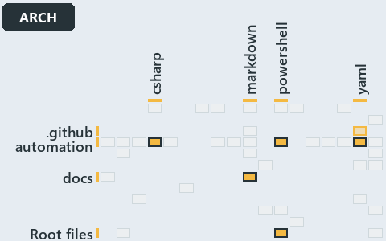

# docs/.assets/explanation/adr-auto-bundle--two-entries-feed-one-importer--architecture.grid.md

`Grid minimap: adr-auto-bundle--two-entries-feed-one-importer--architecture`

The grid minimap of the slide `adr-auto-bundle--two-entries-feed-one-importer--architecture` (architecture lens). The slide supports
[ADR-AUTO-BUNDLE][1]; the highlight of those ADR codes selects what is lit, and each reason below names the code that selects it.

## What the minimap shows

The grid crosses the 12 tracks (rows) with the 18 file languages (columns) of the world map and lights 6 cells, filled in ink. A cell lit
only by passing mentions (citations in body comments, not in a file's header or text) is touched: a lighter ink. Every other cell is idle, a
grey box: it holds files the slide's ADR codes do not select, or no file at all (173 of the 216 cells hold none). The minimap shows where
the slide sits, not how many files a cell holds; the world-map PDFs show the counts.

- .github × yaml: 1 lit of 2 files, touched
- automation × csharp: 2 lit of 229 files
- automation × powershell: 9 lit of 1443 files
- automation × yaml: 2 lit of 97 files
- docs × markdown: 3 lit of 744 files
- Root files × powershell: 1 lit of 1 file

## Key

A lit row prints its track's name; a lit column prints a short code, the first extension of its file language:

- `.cs`: csharp
- `.md`: markdown
- `.ps1`: powershell
- `.yml`: yaml

## Why each cell is lit

### .github × yaml (1 lit file, touched)

Placed: the root folder `.github/` names the track .github ([ADR-DSGN-TRACK#1][2]); the extension `.yml` names the file language yaml
([ADR-DSGN-TRACK#6][3]). Lit ([ADR-DSGN-TRACK#12][4]) by:

- [.github/workflows/ci-automation.yml][5]: selected by [ADR-AUTO-BUNDLE][1]: the file cites it at line 48 (body comment) (a passing mention
  only).

### automation × csharp (2 lit files)

Placed: the root folder `automation/` names the track automation ([ADR-DSGN-TRACK#1][2]); the extension `.cs` names the file language csharp
([ADR-DSGN-TRACK#6][3]). Lit ([ADR-DSGN-TRACK#12][4]) by:

- [automation/Catzc.Base.Exporter/types/ExporterBundle.cs][6]: selected by [ADR-AUTO-BUNDLE][1]: the file cites it at line 3 (header).
- [automation/Catzc.Base.Exporter/types/ExporterConfig.cs][7]: selected by [ADR-AUTO-BUNDLE][1]: the file cites it at line 2 (header).

### automation × powershell (9 lit files)

Placed: the root folder `automation/` names the track automation ([ADR-DSGN-TRACK#1][2]); the extension `.ps1` names the file language
powershell ([ADR-DSGN-TRACK#6][3]). Lit ([ADR-DSGN-TRACK#12][4]) by:

- [automation/.internal/assets/Import-Catzc.ps1][8]: selected by [ADR-AUTO-BUNDLE][1]: the file cites it at line 6 (header).
- [automation/Catzc.Base.Contracts/Publish-ContractRelease.ps1][9]: selected by [ADR-AUTO-BUNDLE][1]: the file cites it at line 12 (header).
- [automation/Catzc.Base.Exporter/Assert-CatzcBundle.ps1][10]: selected by [ADR-AUTO-BUNDLE][1]: the file cites it at line 6 (header).
- [automation/Catzc.Base.Exporter/Build-Modules.ps1][11]: selected by [ADR-AUTO-BUNDLE][1]: the file cites it at line 5 (header) and line 54
  (text).
- [automation/Catzc.Base.Exporter/Export-Catzc.ps1][12]: selected by [ADR-AUTO-BUNDLE][1]: the file cites it at line 6 (header).
- [automation/Catzc.Base.Exporter/Install-Catzc.ps1][13]: selected by [ADR-AUTO-BUNDLE][1]: the file cites it at line 6 (header).
- [automation/Catzc.Base.Exporter/Resolve-CatzcBuildVersion.ps1][14]: selected by [ADR-AUTO-BUNDLE][1]: the file cites it at line 7
  (header).
- [automation/Catzc.Base.Exporter/private/Assert-BundleFootprint.ps1][15]: selected by [ADR-AUTO-BUNDLE][1]: the file cites it at line 6
  (header).
- [automation/Catzc.Base.Exporter/private/New-CatzcNuGetPackage.ps1][16]: selected by [ADR-AUTO-BUNDLE][1]: the file cites it at line 5
  (header).

### automation × yaml (2 lit files)

Placed: the root folder `automation/` names the track automation ([ADR-DSGN-TRACK#1][2]); the extension `.yml` names the file language yaml
([ADR-DSGN-TRACK#6][3]). Lit ([ADR-DSGN-TRACK#12][4]) by:

- [automation/Catzc.Base.Docs/configs/adrs.yml][17]: selected by [ADR-AUTO-BUNDLE][1]: the file cites it at line 161 (text).
- [automation/Catzc.Base.Exporter/configs/exporter.yml][18]: selected by [ADR-AUTO-BUNDLE][1]: the file cites it at line 7 (header).

### docs × markdown (3 lit files)

Placed: the root folder `docs/` names the track docs ([ADR-DSGN-TRACK#1][2]); the extension `.md` names the file language markdown
([ADR-DSGN-TRACK#6][3]). Lit ([ADR-DSGN-TRACK#12][4]) by:

- [docs/adr/automation/dora-explains.md][19]: selected by [ADR-AUTO-BUNDLE][1]: the file cites it at line 421 (text).
- [docs/adr/automation/platform-bundle.md][1]: selected by [ADR-AUTO-BUNDLE][1]: the ADR's own file.
- [docs/adr/index.md][20]: selected by [ADR-AUTO-BUNDLE][1]: the file cites it at line 149 (text).

### Root files × powershell (1 lit file)

Placed: each file sits directly in the repository root, so it is a root file ([ADR-DSGN-TRACK#7][21]); the extension `.ps1` names the file
language powershell ([ADR-DSGN-TRACK#6][3]). Lit ([ADR-DSGN-TRACK#12][4]) by:

- [importer.ps1][22]: selected by [ADR-AUTO-BUNDLE][1]: a root file carries the citations of its owner module's files (files.yml), which
  cite it at `automation/.internal/assets/Import-Catzc.ps1` line 6 (header).

## Keywords

- [world map][23]
- [track][24]
- [file language][25]
- [cell][26]
- [lit cell][27]
- [root file][28]
- [.github][29]: a track
- [automation][29]: a track
- [docs][29]: a track
- [csharp][30]: a file language
- [markdown][30]: a file language
- [powershell][30]: a file language
- [yaml][30]: a file language

[1]: ../../adr/automation/platform-bundle.md
[2]: ../../adr/design/tracks.md#rule-adr-dsgn-track1
[3]: ../../adr/design/tracks.md#rule-adr-dsgn-track6
[4]: ../../adr/design/tracks.md#rule-adr-dsgn-track12
[5]: ../../../.github/workflows/ci-automation.yml
[6]: ../../../automation/Catzc.Base.Exporter/types/ExporterBundle.cs
[7]: ../../../automation/Catzc.Base.Exporter/types/ExporterConfig.cs
[8]: ../../../automation/.internal/assets/Import-Catzc.ps1
[9]: ../../../automation/Catzc.Base.Contracts/Publish-ContractRelease.ps1
[10]: ../../../automation/Catzc.Base.Exporter/Assert-CatzcBundle.ps1
[11]: ../../../automation/Catzc.Base.Exporter/Build-Modules.ps1
[12]: ../../../automation/Catzc.Base.Exporter/Export-Catzc.ps1
[13]: ../../../automation/Catzc.Base.Exporter/Install-Catzc.ps1
[14]: ../../../automation/Catzc.Base.Exporter/Resolve-CatzcBuildVersion.ps1
[15]: ../../../automation/Catzc.Base.Exporter/private/Assert-BundleFootprint.ps1
[16]: ../../../automation/Catzc.Base.Exporter/private/New-CatzcNuGetPackage.ps1
[17]: ../../../automation/Catzc.Base.Docs/configs/adrs.yml
[18]: ../../../automation/Catzc.Base.Exporter/configs/exporter.yml
[19]: ../../adr/automation/dora-explains.md
[20]: ../../adr/index.md
[21]: ../../adr/design/tracks.md#rule-adr-dsgn-track7
[22]: ../../../importer.ps1
[23]: ../../adr/glossary.md#world-map
[24]: ../../adr/glossary.md#track
[25]: ../../adr/glossary.md#file-language
[26]: ../../adr/glossary.md#cell
[27]: ../../adr/glossary.md#lit-cell
[28]: ../../adr/glossary.md#root-file
[29]: ../../../automation/Catzc.Base.Variants/configs/variants.yml
[30]: ../../../automation/Catzc.Base.Languages/configs/languages.yml
