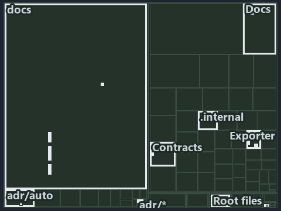

# docs/.assets/explanation/adr-auto-bundle--two-entries-feed-one-importer--architecture.tree.md

`Tree minimap: adr-auto-bundle--two-entries-feed-one-importer--architecture`

The tree minimap of the slide `adr-auto-bundle--two-entries-feed-one-importer--architecture` (architecture lens). The slide supports
[ADR-AUTO-BUNDLE][1]; the highlight of those ADR codes selects what is lit, and each reason below names the code that selects it.

## What the minimap shows

The tree draws every file of the world map as a tile, grouped by top-level folder (under `automation/` by module, under `docs/adr/` by ADR
domain), and lights 33 files in 9 groups, filled in ink. A lit ADR file has a white rim; a file lit only by passing mentions is a lighter
ink. Every other tile is idle, a grey box: a file the slide's ADR codes do not select.

- docs (docs/ outside docs/adr/): 11 lit files
- Exporter (automation/Catzc.Base.Exporter): 10 lit files
- Root files: 5 lit files
- adr/auto (docs/adr/automation): 2 lit files
- .github: 1 lit file
- .internal (automation/.internal): 1 lit file
- Contracts (automation/Catzc.Base.Contracts): 1 lit file
- Docs (automation/Catzc.Base.Docs): 1 lit file
- adr/* (the files directly in docs/adr/): 1 lit file

## Why each group is lit

### docs (docs/ outside docs/adr/, 11 lit files)

The group holds the files of docs/ outside docs/adr/; each sits in its world-map cell and is lit by:

- [docs/references/automation/catzc-base-contracts/Publish-ContractRelease.ps1.md][2], in the cell docs × markdown: selected by
  [ADR-AUTO-BUNDLE][1]: the file cites it at line 20 (text).
- [docs/references/automation/catzc-base-exporter/Assert-CatzcBundle.ps1.md][3], in the cell docs × markdown: selected by
  [ADR-AUTO-BUNDLE][1]: the file cites it at line 13 (text).
- [docs/references/automation/catzc-base-exporter/Build-Modules.ps1.md][4], in the cell docs × markdown: selected by [ADR-AUTO-BUNDLE][1]:
  the file cites it at line 13 (text).
- [docs/references/automation/catzc-base-exporter/Export-Catzc.ps1.md][5], in the cell docs × markdown: selected by [ADR-AUTO-BUNDLE][1]:
  the file cites it at line 13 (text).
- [docs/references/automation/catzc-base-exporter/Install-Catzc.ps1.md][6], in the cell docs × markdown: selected by [ADR-AUTO-BUNDLE][1]:
  the file cites it at line 14 (text).
- [docs/references/automation/catzc-base-exporter/Resolve-CatzcBuildVersion.ps1.md][7], in the cell docs × markdown: selected by
  [ADR-AUTO-BUNDLE][1]: the file cites it at line 14 (text).
- [docs/references/automation/catzc-base-exporter/configs/exporter.yml.md][8], in the cell docs × markdown: selected by
  [ADR-AUTO-BUNDLE][1]: the file cites it at line 19 (text).
- [docs/references/automation/catzc-base-exporter/private/Assert-BundleFootprint.ps1.md][9], in the cell docs × markdown: selected by
  [ADR-AUTO-BUNDLE][1]: the file cites it at line 14 (text).
- [docs/references/automation/catzc-base-exporter/private/New-CatzcNuGetPackage.ps1.md][10], in the cell docs × markdown: selected by
  [ADR-AUTO-BUNDLE][1]: the file cites it at line 13 (text).
- [docs/references/automation/catzc-base-exporter/types/ExporterBundle.cs.md][11], in the cell docs × markdown: selected by
  [ADR-AUTO-BUNDLE][1]: the file cites it at line 15 (text).
- [docs/references/automation/catzc-base-exporter/types/ExporterConfig.cs.md][12], in the cell docs × markdown: selected by
  [ADR-AUTO-BUNDLE][1]: the file cites it at line 14 (text).

### Exporter (automation/Catzc.Base.Exporter, 10 lit files)

The group holds the files of automation/Catzc.Base.Exporter; each sits in its world-map cell and is lit by:

- [automation/Catzc.Base.Exporter/Assert-CatzcBundle.ps1][13], in the cell automation × powershell: selected by [ADR-AUTO-BUNDLE][1]: the
  file cites it at line 7 (header).
- [automation/Catzc.Base.Exporter/Build-Modules.ps1][14], in the cell automation × powershell: selected by [ADR-AUTO-BUNDLE][1]: the file
  cites it at line 6 (header) and line 38 (text).
- [automation/Catzc.Base.Exporter/Export-Catzc.ps1][15], in the cell automation × powershell: selected by [ADR-AUTO-BUNDLE][1]: the file
  cites it at line 7 (header).
- [automation/Catzc.Base.Exporter/Install-Catzc.ps1][16], in the cell automation × powershell: selected by [ADR-AUTO-BUNDLE][1]: the file
  cites it at line 6 (header).
- [automation/Catzc.Base.Exporter/Resolve-CatzcBuildVersion.ps1][17], in the cell automation × powershell: selected by [ADR-AUTO-BUNDLE][1]:
  the file cites it at line 7 (header).
- [automation/Catzc.Base.Exporter/configs/exporter.yml][18], in the cell automation × yaml: selected by [ADR-AUTO-BUNDLE][1]: the file cites
  it at line 2 (header).
- [automation/Catzc.Base.Exporter/private/Assert-BundleFootprint.ps1][19], in the cell automation × powershell: selected by
  [ADR-AUTO-BUNDLE][1]: the file cites it at line 6 (header).
- [automation/Catzc.Base.Exporter/private/New-CatzcNuGetPackage.ps1][20], in the cell automation × powershell: selected by
  [ADR-AUTO-BUNDLE][1]: the file cites it at line 6 (header).
- [automation/Catzc.Base.Exporter/types/ExporterBundle.cs][21], in the cell automation × csharp: selected by [ADR-AUTO-BUNDLE][1]: the file
  cites it at line 2 (header).
- [automation/Catzc.Base.Exporter/types/ExporterConfig.cs][22], in the cell automation × csharp: selected by [ADR-AUTO-BUNDLE][1]: the file
  cites it at line 2 (header).

### Root files (5 lit files)

The group holds the files of Root files; each sits in its world-map cell and is lit by:

- [.unordered/15-10-2026/plan-built-bundle.md][23], in the cell Root files × markdown: selected by [ADR-AUTO-BUNDLE][1]: the file cites it
  at line 12 (text), line 41 (text), line 271 (text), line 306 (text), line 309 (text) and line 312 (text).
- [.unordered/15-10-2026/plan-concern-axis.md][24], in the cell Root files × markdown: selected by [ADR-AUTO-BUNDLE][1]: the file cites it
  at line 104 (text).
- [.unordered/15-10-2026/plan-contracts.md][25], in the cell Root files × markdown: selected by [ADR-AUTO-BUNDLE][1]: the file cites it at
  line 99 (text).
- [.unordered/15-10-2026/plan-explanation-drift.md][26], in the cell Root files × markdown: selected by [ADR-AUTO-BUNDLE][1]: the file cites
  it at line 70 (text) and line 71 (text).
- [importer.ps1][27], in the cell Root files × powershell: selected by [ADR-AUTO-BUNDLE][1]: a root file carries the citations of its owner
  module's files (files.yml), which cite it at `automation/.internal/assets/Import-Catzc.ps1` line 6 (header).

### adr/auto (docs/adr/automation, 2 lit files)

The group holds the files of docs/adr/automation; each sits in its world-map cell and is lit by:

- [docs/adr/automation/dora-explains.md][28], in the cell docs × markdown: selected by [ADR-AUTO-BUNDLE][1]: the file cites it at line 421
  (text).
- [docs/adr/automation/platform-bundle.md][1], in the cell docs × markdown: selected by [ADR-AUTO-BUNDLE][1]: the ADR's own file.

### .github (1 lit file)

The group holds the files of .github; each sits in its world-map cell and is lit by:

- [.github/workflows/ci-automation.yml][29], in the cell .github × yaml: selected by [ADR-AUTO-BUNDLE][1]: the file cites it at line 48
  (body comment) (a passing mention only).

### .internal (automation/.internal, 1 lit file)

The group holds the files of automation/.internal; each sits in its world-map cell and is lit by:

- [automation/.internal/assets/Import-Catzc.ps1][30], in the cell automation × powershell: selected by [ADR-AUTO-BUNDLE][1]: the file cites
  it at line 6 (header).

### Contracts (automation/Catzc.Base.Contracts, 1 lit file)

The group holds the files of automation/Catzc.Base.Contracts; each sits in its world-map cell and is lit by:

- [automation/Catzc.Base.Contracts/Publish-ContractRelease.ps1][31], in the cell automation × powershell: selected by [ADR-AUTO-BUNDLE][1]:
  the file cites it at line 7 (header).

### Docs (automation/Catzc.Base.Docs, 1 lit file)

The group holds the files of automation/Catzc.Base.Docs; each sits in its world-map cell and is lit by:

- [automation/Catzc.Base.Docs/configs/adrs.yml][32], in the cell automation × yaml: selected by [ADR-AUTO-BUNDLE][1]: the file cites it at
  line 145 (text).

### adr/* (the files directly in docs/adr/, 1 lit file)

The group holds the files of the files directly in docs/adr/; each sits in its world-map cell and is lit by:

- [docs/adr/index.md][33], in the cell docs × markdown: selected by [ADR-AUTO-BUNDLE][1]: the file cites it at line 151 (text).

## Keywords

- [world map][34]
- [track][35]
- [file language][36]
- [cell][37]
- [lit cell][38]
- [root file][39]
- [.github][40]: a track
- [automation][40]: a track
- [docs][40]: a track
- [csharp][41]: a file language
- [markdown][41]: a file language
- [powershell][41]: a file language
- [yaml][41]: a file language

[1]: ../../adr/automation/platform-bundle.md
[2]: ../../references/automation/catzc-base-contracts/Publish-ContractRelease.ps1.md
[3]: ../../references/automation/catzc-base-exporter/Assert-CatzcBundle.ps1.md
[4]: ../../references/automation/catzc-base-exporter/Build-Modules.ps1.md
[5]: ../../references/automation/catzc-base-exporter/Export-Catzc.ps1.md
[6]: ../../references/automation/catzc-base-exporter/Install-Catzc.ps1.md
[7]: ../../references/automation/catzc-base-exporter/Resolve-CatzcBuildVersion.ps1.md
[8]: ../../references/automation/catzc-base-exporter/configs/exporter.yml.md
[9]: ../../references/automation/catzc-base-exporter/private/Assert-BundleFootprint.ps1.md
[10]: ../../references/automation/catzc-base-exporter/private/New-CatzcNuGetPackage.ps1.md
[11]: ../../references/automation/catzc-base-exporter/types/ExporterBundle.cs.md
[12]: ../../references/automation/catzc-base-exporter/types/ExporterConfig.cs.md
[13]: ../../../automation/Catzc.Base.Exporter/Assert-CatzcBundle.ps1
[14]: ../../../automation/Catzc.Base.Exporter/Build-Modules.ps1
[15]: ../../../automation/Catzc.Base.Exporter/Export-Catzc.ps1
[16]: ../../../automation/Catzc.Base.Exporter/Install-Catzc.ps1
[17]: ../../../automation/Catzc.Base.Exporter/Resolve-CatzcBuildVersion.ps1
[18]: ../../../automation/Catzc.Base.Exporter/configs/exporter.yml
[19]: ../../../automation/Catzc.Base.Exporter/private/Assert-BundleFootprint.ps1
[20]: ../../../automation/Catzc.Base.Exporter/private/New-CatzcNuGetPackage.ps1
[21]: ../../../automation/Catzc.Base.Exporter/types/ExporterBundle.cs
[22]: ../../../automation/Catzc.Base.Exporter/types/ExporterConfig.cs
[23]: ../../../.unordered/15-10-2026/plan-built-bundle.md
[24]: ../../../.unordered/15-10-2026/plan-concern-axis.md
[25]: ../../../.unordered/15-10-2026/plan-contracts.md
[26]: ../../../.unordered/15-10-2026/plan-explanation-drift.md
[27]: ../../../importer.ps1
[28]: ../../adr/automation/dora-explains.md
[29]: ../../../.github/workflows/ci-automation.yml
[30]: ../../../automation/.internal/assets/Import-Catzc.ps1
[31]: ../../../automation/Catzc.Base.Contracts/Publish-ContractRelease.ps1
[32]: ../../../automation/Catzc.Base.Docs/configs/adrs.yml
[33]: ../../adr/index.md
[34]: ../../adr/glossary.md#world-map
[35]: ../../adr/glossary.md#track
[36]: ../../adr/glossary.md#file-language
[37]: ../../adr/glossary.md#cell
[38]: ../../adr/glossary.md#lit-cell
[39]: ../../adr/glossary.md#root-file
[40]: ../../../automation/Catzc.Base.Variants/configs/variants.yml
[41]: ../../../automation/Catzc.Base.Languages/configs/languages.yml
