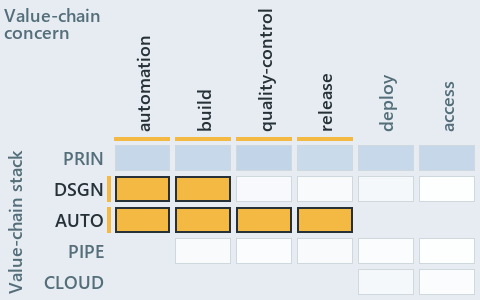

# docs/.assets/explanation/adr-auto-bundle--what-gates-each-bundle-stage--governance.chain.md

`Value-chain minimap: adr-auto-bundle--what-gates-each-bundle-stage--governance`

The value-chain minimap of the slide `adr-auto-bundle--what-gates-each-bundle-stage--governance` (governance lens). The slide supports
[ADR-AUTO-ASSETDEP][1], [ADR-AUTO-BUNDLE][2], [ADR-AUTO-TEST][3] and [ADR-DSGN-RUNMODE][4]; the highlight of those ADR codes selects what is
lit, and each reason below names the code that selects it.

## What the minimap shows

Value-chain map: value-chain stack × value-chain concerns. The grid crosses the 5 rows of the value-chain stack (PRIN, DSGN, AUTO, PIPE,
CLOUD) with the 6 value-chain concerns (automation, build, quality-control, release, deploy, access), shades each cell by the ADRs it holds,
and lights 6 cells.

- DSGN × automation: 1 lit of 7 ADRs
- DSGN × build: 1 lit of 5 ADRs
- AUTO × automation: 1 lit of 63 ADRs
- AUTO × build: 2 lit of 4 ADRs
- AUTO × quality-control: 1 lit of 10 ADRs
- AUTO × release: 1 lit of 2 ADRs

## Why each cell is lit

### DSGN × automation (1 ADR)

Lit ([ADR-DSGN-TRACK#12][5]) by:

- [ADR-DSGN-RUNMODE][4]: selected by [ADR-DSGN-RUNMODE][4]; its ADR domain `design` sits on the DSGN row of the value-chain stack
  ([ADR-DSGN-TRACK#14][6]); its own value-chain concerns (automation and build) override its ADR domain's default (automation), so it lights
  the automation column ([ADR-DSGN-TRACK#15][7]).

### DSGN × build (1 ADR)

Lit ([ADR-DSGN-TRACK#12][5]) by:

- [ADR-DSGN-RUNMODE][4]: selected by [ADR-DSGN-RUNMODE][4]; its ADR domain `design` sits on the DSGN row of the value-chain stack
  ([ADR-DSGN-TRACK#14][6]); its own value-chain concerns (automation and build) override its ADR domain's default (automation), so it lights
  the build column ([ADR-DSGN-TRACK#15][7]).

### AUTO × automation (1 ADR)

Lit ([ADR-DSGN-TRACK#12][5]) by:

- [ADR-AUTO-ASSETDEP][1]: selected by [ADR-AUTO-ASSETDEP][1]; its ADR domain `automation` sits on the AUTO row of the value-chain stack
  ([ADR-DSGN-TRACK#14][6]); its own value-chain concerns (automation and build) override its ADR domain's default (automation), so it lights
  the automation column ([ADR-DSGN-TRACK#15][7]).

### AUTO × build (2 ADRs)

Lit ([ADR-DSGN-TRACK#12][5]) by:

- [ADR-AUTO-ASSETDEP][1]: selected by [ADR-AUTO-ASSETDEP][1]; its ADR domain `automation` sits on the AUTO row of the value-chain stack
  ([ADR-DSGN-TRACK#14][6]); its own value-chain concerns (automation and build) override its ADR domain's default (automation), so it lights
  the build column ([ADR-DSGN-TRACK#15][7]).
- [ADR-AUTO-BUNDLE][2]: selected by [ADR-AUTO-BUNDLE][2]; its ADR domain `automation` sits on the AUTO row of the value-chain stack
  ([ADR-DSGN-TRACK#14][6]); its own value-chain concerns (build and release) override its ADR domain's default (automation), so it lights
  the build column ([ADR-DSGN-TRACK#15][7]).

### AUTO × quality-control (1 ADR)

Lit ([ADR-DSGN-TRACK#12][5]) by:

- [ADR-AUTO-TEST][3]: selected by [ADR-AUTO-TEST][3]; its ADR domain `automation` sits on the AUTO row of the value-chain stack
  ([ADR-DSGN-TRACK#14][6]); its own value-chain concerns (quality-control) override its ADR domain's default (automation), so it lights the
  quality-control column ([ADR-DSGN-TRACK#15][7]).

### AUTO × release (1 ADR)

Lit ([ADR-DSGN-TRACK#12][5]) by:

- [ADR-AUTO-BUNDLE][2]: selected by [ADR-AUTO-BUNDLE][2]; its ADR domain `automation` sits on the AUTO row of the value-chain stack
  ([ADR-DSGN-TRACK#14][6]); its own value-chain concerns (build and release) override its ADR domain's default (automation), so it lights
  the release column ([ADR-DSGN-TRACK#15][7]).

## Keywords

- [value-chain map][8]
- [value-chain stack][9]
- [value-chain concern][10]
- [cell][11]
- [lit cell][12]

Terms the cited ADRs define:

- [all tests][13], defined by [ADR-AUTO-TEST#36][14]
- [build verification test][15], defined by [ADR-AUTO-TEST#24][16]
- [category][17], defined by [ADR-AUTO-TEST#1][18]
- [phase][19], defined by [ADR-AUTO-TEST#26][20]
- [quality gate][21], defined by [ADR-AUTO-TEST#35][22]
- [test][23], defined by [ADR-AUTO-TEST#42][24]
- [test file][25], defined by [ADR-AUTO-TEST#43][26]
- [test run][27], defined by [ADR-AUTO-TEST#34][28]
- [test suite][29], defined by [ADR-AUTO-TEST#37][30]
- [testing in production][31], defined by [ADR-AUTO-TEST#41][32]
- [tier][33], defined by [ADR-AUTO-TEST#13][34]
- [vertical test][35], defined by [ADR-AUTO-TEST#38][36]

[1]: ../../adr/automation/internal-asset-dependencies.md
[2]: ../../adr/automation/platform-bundle.md
[3]: ../../adr/automation/test-automation.md
[4]: ../../adr/design/run-modes.md
[5]: ../../adr/design/tracks.md#rule-adr-dsgn-track12
[6]: ../../adr/design/tracks.md#rule-adr-dsgn-track14
[7]: ../../adr/design/tracks.md#rule-adr-dsgn-track15
[8]: ../../adr/glossary.md#value-chain-map
[9]: ../../adr/glossary.md#value-chain-stack
[10]: ../../adr/glossary.md#value-chain-concern
[11]: ../../adr/glossary.md#cell
[12]: ../../adr/glossary.md#lit-cell
[13]: ../../adr/glossary.md#all-tests
[14]: ../../adr/automation/test-automation.md#rule-adr-auto-test36
[15]: ../../adr/glossary.md#build-verification-test
[16]: ../../adr/automation/test-automation.md#rule-adr-auto-test24
[17]: ../../adr/glossary.md#category
[18]: ../../adr/automation/test-automation.md#rule-adr-auto-test1
[19]: ../../adr/glossary.md#phase
[20]: ../../adr/automation/test-automation.md#rule-adr-auto-test26
[21]: ../../adr/glossary.md#quality-gate
[22]: ../../adr/automation/test-automation.md#rule-adr-auto-test35
[23]: ../../adr/glossary.md#test
[24]: ../../adr/automation/test-automation.md#rule-adr-auto-test42
[25]: ../../adr/glossary.md#test-file
[26]: ../../adr/automation/test-automation.md#rule-adr-auto-test43
[27]: ../../adr/glossary.md#test-run
[28]: ../../adr/automation/test-automation.md#rule-adr-auto-test34
[29]: ../../adr/glossary.md#test-suite
[30]: ../../adr/automation/test-automation.md#rule-adr-auto-test37
[31]: ../../adr/glossary.md#testing-in-production
[32]: ../../adr/automation/test-automation.md#rule-adr-auto-test41
[33]: ../../adr/glossary.md#tier
[34]: ../../adr/automation/test-automation.md#rule-adr-auto-test13
[35]: ../../adr/glossary.md#vertical-test
[36]: ../../adr/automation/test-automation.md#rule-adr-auto-test38
