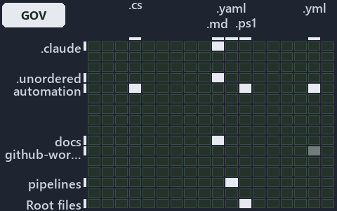

# docs/.assets/explanation/adr-auto-bundle--what-gates-each-bundle-stage--governance.grid.md

`Grid minimap: adr-auto-bundle--what-gates-each-bundle-stage--governance`

The grid minimap of the slide `adr-auto-bundle--what-gates-each-bundle-stage--governance` (governance lens). The slide supports
[ADR-AUTO-BUNDLE][1] and [ADR-PWSH-MANIFEST][2]; the highlight of those ADR codes selects what is lit, and each reason below names the code
that selects it.

## What the minimap shows

The grid crosses the 16 tracks (rows) with the 18 file languages (columns) of the world map and lights 9 cells, filled in ink. A cell lit
only by passing mentions (citations in body comments, not in a file's header or text) is touched: a lighter ink. Every other cell is idle, a
grey box: it holds files the slide's ADR codes do not select, or no file at all (237 of the 288 cells hold none). The minimap shows where
the slide sits, not how many files a cell holds; the world-map PDFs show the counts.

- .claude × markdown: 4 lit of 51 files
- .unordered × markdown: 5 lit of 20 files
- automation × csharp: 2 lit of 272 files
- automation × powershell: 11 lit of 1563 files
- automation × yaml: 2 lit of 107 files
- docs × markdown: 10 lit of 1985 files
- github-workflows × yaml: 1 lit of 2 files, touched
- pipelines × pipeline-yaml: 1 lit of 9 files
- Root files × powershell: 1 lit of 1 file

## Key

A lit row prints its track's name; a lit column prints a short code, the first extension of its file language:

- `.cs`: csharp
- `.md`: markdown
- `.yaml`: pipeline-yaml
- `.ps1`: powershell
- `.yml`: yaml

## Why each cell is lit

### .claude × markdown (4 lit files)

Placed: the root folder `.claude/` names the track .claude ([ADR-DSGN-TRACK#1][3]); the extension `.md` names the file language markdown
([ADR-DSGN-TRACK#6][4]). Lit ([ADR-DSGN-TRACK#12][5]) by:

- [.claude/plans/plan-format-step-moves-comments.md][6]: selected by [ADR-AUTO-BUNDLE][1]: the file cites it at line 94 (text).
- [.claude/plans/plan-layers-vocabulary-rename-contracts.md][7]: selected by [ADR-AUTO-BUNDLE][1]: the file cites it at line 401 (text),
  line 458 (text) and line 797 (text).
- [.claude/plans/plan-module-kinds-tracks.md][8]: selected by [ADR-AUTO-BUNDLE][1]: the file cites it at line 241 (text); selected by
  [ADR-PWSH-MANIFEST][2]: the file cites it at line 180 (text), line 238 (text), line 250 (text) and line 290 (text).
- [.claude/plans/prompt-module-model-1-prepare.md][9]: selected by [ADR-AUTO-BUNDLE][1]: the file cites it at line 19 (text); selected by
  [ADR-PWSH-MANIFEST][2]: the file cites it at line 20 (text).

### .unordered × markdown (5 lit files)

Placed: the root folder `.unordered/` names the track .unordered ([ADR-DSGN-TRACK#1][3]); the extension `.md` names the file language
markdown ([ADR-DSGN-TRACK#6][4]). Lit ([ADR-DSGN-TRACK#12][5]) by:

- [.unordered/15-10-2026/plan-built-bundle.md][10]: selected by [ADR-AUTO-BUNDLE][1]: the file cites it at line 12 (text), line 41 (text),
  line 271 (text), line 306 (text), line 309 (text) and line 312 (text).
- [.unordered/15-10-2026/plan-concern-axis.md][11]: selected by [ADR-AUTO-BUNDLE][1]: the file cites it at line 104 (text).
- [.unordered/15-10-2026/plan-contracts.md][12]: selected by [ADR-AUTO-BUNDLE][1]: the file cites it at line 99 (text).
- [.unordered/15-10-2026/plan-explanation-drift.md][13]: selected by [ADR-AUTO-BUNDLE][1]: the file cites it at line 70 (text) and line 71
  (text); selected by [ADR-PWSH-MANIFEST][2]: the file cites it at line 75 (text).
- [.unordered/15-10-2026/plan-test-runtime.md][14]: selected by [ADR-PWSH-MANIFEST][2]: the file cites it at line 163 (text) and line 163
  (text).

### automation × csharp (2 lit files)

Placed: the root folder `automation/` names the track automation ([ADR-DSGN-TRACK#1][3]); the extension `.cs` names the file language csharp
([ADR-DSGN-TRACK#6][4]). Lit ([ADR-DSGN-TRACK#12][5]) by:

- [automation/Catzc.Base.Exporter/types/ExporterBundle.cs][15]: selected by [ADR-AUTO-BUNDLE][1]: the file cites it at line 19 (text).
- [automation/Catzc.Base.Exporter/types/ExporterConfig.cs][16]: selected by [ADR-AUTO-BUNDLE][1]: the file cites it at line 20 (text).

### automation × powershell (11 lit files)

Placed: the root folder `automation/` names the track automation ([ADR-DSGN-TRACK#1][3]); the extension `.ps1` names the file language
powershell ([ADR-DSGN-TRACK#6][4]). Lit ([ADR-DSGN-TRACK#12][5]) by:

- [automation/.internal/assets/Import-Catzc.ps1][17]: selected by [ADR-AUTO-BUNDLE][1]: the file cites it at line 19 (header).
- [automation/.internal/assets/Import-ModuleFiles.ps1][18]: selected by [ADR-PWSH-MANIFEST][2]: the file cites it at line 18 (header).
- [automation/Catzc.Base.Contracts/Publish-ContractRelease.ps1][19]: selected by [ADR-AUTO-BUNDLE][1]: the file cites it at line 20 (header)
  and line 35 (header).
- [automation/Catzc.Base.Exporter/Assert-CatzcBundle.ps1][20]: selected by [ADR-AUTO-BUNDLE][1]: the file cites it at line 21 (header) and
  line 28 (header).
- [automation/Catzc.Base.Exporter/Build-Modules.ps1][21]: selected by [ADR-AUTO-BUNDLE][1]: the file cites it at line 21 (header), line 26
  (header) and line 72 (text).
- [automation/Catzc.Base.Exporter/Export-Catzc.ps1][22]: selected by [ADR-AUTO-BUNDLE][1]: the file cites it at line 19 (header) and line 25
  (header).
- [automation/Catzc.Base.Exporter/Install-Catzc.ps1][23]: selected by [ADR-AUTO-BUNDLE][1]: the file cites it at line 20 (header) and line
  28 (header).
- [automation/Catzc.Base.Exporter/Resolve-CatzcBuildVersion.ps1][24]: selected by [ADR-AUTO-BUNDLE][1]: the file cites it at line 19
  (header) and line 27 (header).
- [automation/Catzc.Base.Exporter/private/Assert-BundleFootprint.ps1][25]: selected by [ADR-AUTO-BUNDLE][1]: the file cites it at line 21
  (header) and line 27 (header).
- [automation/Catzc.Base.Exporter/private/New-CatzcNuGetPackage.ps1][26]: selected by [ADR-AUTO-BUNDLE][1]: the file cites it at line 20
  (header) and line 25 (header).
- [automation/Catzc.Base.Overlay/Get-FunctionFileViolation.ps1][27]: selected by [ADR-PWSH-MANIFEST][2]: the file cites it at line 21
  (header) and line 28 (header).

### automation × yaml (2 lit files)

Placed: the root folder `automation/` names the track automation ([ADR-DSGN-TRACK#1][3]); the extension `.yml` names the file language yaml
([ADR-DSGN-TRACK#6][4]). Lit ([ADR-DSGN-TRACK#12][5]) by:

- [automation/Catzc.Base.Docs/configs/adrs.yml][28]: selected by [ADR-AUTO-BUNDLE][1]: the file cites it at line 157 (text); selected by
  [ADR-PWSH-MANIFEST][2]: the file cites it at line 184 (text).
- [automation/Catzc.Base.Docs/configs/glossary.yml][29]: selected by [ADR-AUTO-BUNDLE][1]: the file cites it at line 464 (text).

### docs × markdown (10 lit files)

Placed: the root folder `docs/` names the track docs ([ADR-DSGN-TRACK#1][3]); the extension `.md` names the file language markdown
([ADR-DSGN-TRACK#6][4]). Lit ([ADR-DSGN-TRACK#12][5]) by:

- [docs/adr/automation/dora-explains.md][30]: selected by [ADR-AUTO-BUNDLE][1]: the file cites it at line 485 (text).
- [docs/adr/automation/platform-bundle.md][1]: selected by [ADR-AUTO-BUNDLE][1]: the ADR's own file.
- [docs/adr/glossary.md][31]: selected by [ADR-AUTO-BUNDLE][1]: the file cites it at line 483 (text).
- [docs/adr/index.md][32]: selected by [ADR-AUTO-BUNDLE][1]: the file cites it at line 166 (text); selected by [ADR-PWSH-MANIFEST][2]: the
  file cites it at line 191 (text).
- [docs/adr/pwsh/dora-explains.md][33]: selected by [ADR-PWSH-MANIFEST][2]: the file cites it at line 115 (text).
- [docs/adr/pwsh/dynamic-module-manifests.md][2]: selected by [ADR-PWSH-MANIFEST][2]: the ADR's own file.
- [docs/references/automation/catzc-base-exporter/configs/exporter.yml.md][34]: selected by [ADR-AUTO-BUNDLE][1]: the file cites it at line
  32 (text).
- [docs/references/automation/catzc-base-exporter/types/ExporterBundle.cs.md][35]: selected by [ADR-AUTO-BUNDLE][1]: the file cites it at
  line 31 (text).
- [docs/references/automation/catzc-base-exporter/types/ExporterConfig.cs.md][36]: selected by [ADR-AUTO-BUNDLE][1]: the file cites it at
  line 30 (text).
- [docs/references/automation/internal/Catzc.Internal.Builder.psm1.md][37]: selected by [ADR-AUTO-BUNDLE][1]: the file cites it at line 33
  (text).

### github-workflows × yaml (1 lit file, touched)

Placed: the root folder `.github/` names the track github-workflows ([ADR-DSGN-TRACK#1][3]); the extension `.yml` names the file language
yaml ([ADR-DSGN-TRACK#6][4]). Lit ([ADR-DSGN-TRACK#12][5]) by:

- [.github/workflows/ci-automation.yml][38]: selected by [ADR-AUTO-BUNDLE][1]: the file cites it at line 63 (body comment) (a passing
  mention only).

### pipelines × pipeline-yaml (1 lit file)

Placed: the root folder `pipelines/` names the track pipelines ([ADR-DSGN-TRACK#1][3]); the extension `.yaml` names the file language
pipeline-yaml ([ADR-DSGN-TRACK#6][4]). Lit ([ADR-DSGN-TRACK#12][5]) by:

- [pipelines/ci-automation.yaml][39]: selected by [ADR-AUTO-BUNDLE][1]: a pipeline that cites nothing itself carries its globset's
  citations, which cite it at `automation/.internal/assets/Import-Catzc.ps1` line 19 (header),
  `automation/Catzc.Base.Contracts/Publish-ContractRelease.ps1` line 20 (header),
  `automation/Catzc.Base.Contracts/Publish-ContractRelease.ps1` line 35 (header), `automation/Catzc.Base.Docs/configs/adrs.yml` line 157
  (text), `automation/Catzc.Base.Docs/configs/glossary.yml` line 464 (text), `automation/Catzc.Base.Exporter/Assert-CatzcBundle.ps1` line 21
  (header), `automation/Catzc.Base.Exporter/Assert-CatzcBundle.ps1` line 28 (header), `automation/Catzc.Base.Exporter/Build-Modules.ps1`
  line 21 (header), `automation/Catzc.Base.Exporter/Build-Modules.ps1` line 26 (header), `automation/Catzc.Base.Exporter/Build-Modules.ps1`
  line 72 (text), `automation/Catzc.Base.Exporter/Export-Catzc.ps1` line 19 (header), `automation/Catzc.Base.Exporter/Export-Catzc.ps1` line
  25 (header), `automation/Catzc.Base.Exporter/Install-Catzc.ps1` line 20 (header), `automation/Catzc.Base.Exporter/Install-Catzc.ps1` line
  28 (header), `automation/Catzc.Base.Exporter/Resolve-CatzcBuildVersion.ps1` line 19 (header),
  `automation/Catzc.Base.Exporter/Resolve-CatzcBuildVersion.ps1` line 27 (header),
  `automation/Catzc.Base.Exporter/private/Assert-BundleFootprint.ps1` line 21 (header),
  `automation/Catzc.Base.Exporter/private/Assert-BundleFootprint.ps1` line 27 (header),
  `automation/Catzc.Base.Exporter/private/New-CatzcNuGetPackage.ps1` line 20 (header),
  `automation/Catzc.Base.Exporter/private/New-CatzcNuGetPackage.ps1` line 25 (header),
  `automation/Catzc.Base.Exporter/types/ExporterBundle.cs` line 19 (text) and `automation/Catzc.Base.Exporter/types/ExporterConfig.cs` line
  20 (text); selected by [ADR-PWSH-MANIFEST][2]: a pipeline that cites nothing itself carries its globset's citations, which cite it at
  `automation/.internal/assets/Import-ModuleFiles.ps1` line 18 (header), `automation/Catzc.Base.Docs/configs/adrs.yml` line 184 (text),
  `automation/Catzc.Base.Overlay/Get-FunctionFileViolation.ps1` line 21 (header) and
  `automation/Catzc.Base.Overlay/Get-FunctionFileViolation.ps1` line 28 (header).

### Root files × powershell (1 lit file)

Placed: each file sits directly in the repository root, so it is a root file ([ADR-DSGN-TRACK#7][40]); the extension `.ps1` names the file
language powershell ([ADR-DSGN-TRACK#6][4]). Lit ([ADR-DSGN-TRACK#12][5]) by:

- [importer.ps1][41]: selected by [ADR-AUTO-BUNDLE][1]: a root file carries the citations of its owner module's files (files.yml), which
  cite it at `automation/.internal/assets/Import-Catzc.ps1` line 19 (header); selected by [ADR-PWSH-MANIFEST][2]: a root file carries the
  citations of its owner module's files (files.yml), which cite it at `automation/.internal/assets/Import-ModuleFiles.ps1` line 18 (header).

## Keywords

- [world map][42]
- [track][43]
- [file language][44]
- [cell][45]
- [lit cell][46]
- [root file][47]
- [.claude][48]: a track
- [.unordered][48]: a track
- [automation][48]: a track
- [docs][48]: a track
- [github-workflows][48]: a track
- [pipelines][48]: a track
- [csharp][49]: a file language
- [markdown][49]: a file language
- [pipeline-yaml][49]: a file language
- [powershell][49]: a file language
- [yaml][49]: a file language

Terms the cited ADRs define:

- [bundle][50], defined by [ADR-AUTO-BUNDLE#1][51]

[1]: ../../adr/automation/platform-bundle.md
[2]: ../../adr/pwsh/dynamic-module-manifests.md
[3]: ../../adr/design/tracks.md#rule-adr-dsgn-track1
[4]: ../../adr/design/tracks.md#rule-adr-dsgn-track6
[5]: ../../adr/design/tracks.md#rule-adr-dsgn-track12
[6]: ../../../.claude/plans/plan-format-step-moves-comments.md
[7]: ../../../.claude/plans/plan-layers-vocabulary-rename-contracts.md
[8]: ../../../.claude/plans/plan-module-kinds-tracks.md
[9]: ../../../.claude/plans/prompt-module-model-1-prepare.md
[10]: ../../../.unordered/15-10-2026/plan-built-bundle.md
[11]: ../../../.unordered/15-10-2026/plan-concern-axis.md
[12]: ../../../.unordered/15-10-2026/plan-contracts.md
[13]: ../../../.unordered/15-10-2026/plan-explanation-drift.md
[14]: ../../../.unordered/15-10-2026/plan-test-runtime.md
[15]: ../../../automation/Catzc.Base.Exporter/types/ExporterBundle.cs
[16]: ../../../automation/Catzc.Base.Exporter/types/ExporterConfig.cs
[17]: ../../../automation/.internal/assets/Import-Catzc.ps1
[18]: ../../../automation/.internal/assets/Import-ModuleFiles.ps1
[19]: ../../../automation/Catzc.Base.Contracts/Publish-ContractRelease.ps1
[20]: ../../../automation/Catzc.Base.Exporter/Assert-CatzcBundle.ps1
[21]: ../../../automation/Catzc.Base.Exporter/Build-Modules.ps1
[22]: ../../../automation/Catzc.Base.Exporter/Export-Catzc.ps1
[23]: ../../../automation/Catzc.Base.Exporter/Install-Catzc.ps1
[24]: ../../../automation/Catzc.Base.Exporter/Resolve-CatzcBuildVersion.ps1
[25]: ../../../automation/Catzc.Base.Exporter/private/Assert-BundleFootprint.ps1
[26]: ../../../automation/Catzc.Base.Exporter/private/New-CatzcNuGetPackage.ps1
[27]: ../../../automation/Catzc.Base.Overlay/Get-FunctionFileViolation.ps1
[28]: ../../../automation/Catzc.Base.Docs/configs/adrs.yml
[29]: ../../../automation/Catzc.Base.Docs/configs/glossary.yml
[30]: ../../adr/automation/dora-explains.md
[31]: ../../adr/glossary.md
[32]: ../../adr/index.md
[33]: ../../adr/pwsh/dora-explains.md
[34]: ../../references/automation/catzc-base-exporter/configs/exporter.yml.md
[35]: ../../references/automation/catzc-base-exporter/types/ExporterBundle.cs.md
[36]: ../../references/automation/catzc-base-exporter/types/ExporterConfig.cs.md
[37]: ../../references/automation/internal/Catzc.Internal.Builder.psm1.md
[38]: ../../../.github/workflows/ci-automation.yml
[39]: ../../../pipelines/ci-automation.yaml
[40]: ../../adr/design/tracks.md#rule-adr-dsgn-track7
[41]: ../../../importer.ps1
[42]: ../../adr/glossary.md#world-map
[43]: ../../adr/glossary.md#track
[44]: ../../adr/glossary.md#file-language
[45]: ../../adr/glossary.md#cell
[46]: ../../adr/glossary.md#lit-cell
[47]: ../../adr/glossary.md#root-file
[48]: ../../../automation/Catzc.Base.Variants/configs/variants.yml
[49]: ../../../automation/Catzc.Base.Languages/configs/languages.yml
[50]: ../../adr/glossary.md#bundle
[51]: ../../adr/automation/platform-bundle.md#rule-adr-auto-bundle1
