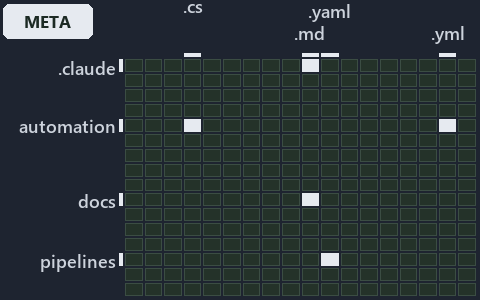

# docs/.assets/explanation/adr-auto-depm--a-declared-allow-list-of-layers--meta.grid.md

`Grid minimap: adr-auto-depm--a-declared-allow-list-of-layers--meta`

The grid minimap of the slide `adr-auto-depm--a-declared-allow-list-of-layers--meta` (meta lens). The slide supports [ADR-AUTO-DEPM][1]; the
highlight of those ADR codes selects what is lit, and each reason below names the code that selects it.

## What the minimap shows

The grid crosses the 16 tracks (rows) with the 18 file languages (columns) of the world map and lights 5 cells, filled in ink. A cell lit
only by passing mentions (citations in body comments, not in a file's header or text) is touched: a lighter ink. Every other cell is idle, a
grey box: it holds files the slide's ADR codes do not select, or no file at all (237 of the 288 cells hold none). The minimap shows where
the slide sits, not how many files a cell holds; the world-map PDFs show the counts.

- .claude × markdown: 4 lit of 51 files
- automation × csharp: 3 lit of 272 files
- automation × yaml: 1 lit of 107 files
- docs × markdown: 6 lit of 1985 files
- pipelines × pipeline-yaml: 1 lit of 9 files

## Key

A lit row prints its track's name; a lit column prints a short code, the first extension of its file language:

- `.cs`: csharp
- `.md`: markdown
- `.yaml`: pipeline-yaml
- `.yml`: yaml

## Why each cell is lit

### .claude × markdown (4 lit files)

Placed: the root folder `.claude/` names the track .claude ([ADR-DSGN-TRACK#1][2]); the extension `.md` names the file language markdown
([ADR-DSGN-TRACK#6][3]). Lit ([ADR-DSGN-TRACK#12][4]) by:

- [.claude/plans/plan-adr-link-cleanup-prose-to-pages.md][5]: selected by [ADR-AUTO-DEPM][1]: the file cites it at line 136 (text).
- [.claude/plans/plan-module-kinds-tracks.md][6]: selected by [ADR-AUTO-DEPM][1]: the file cites it at line 113 (text), line 195 (text),
  line 199 (text), line 258 (text), line 264 (text), line 268 (text), line 286 (text), line 415 (text) and line 454 (text).
- [.claude/plans/prompt-k8s-kinds-2-implement.md][7]: selected by [ADR-AUTO-DEPM][1]: the file cites it at line 17 (text).
- [.claude/plans/prompt-module-model-1-prepare.md][8]: selected by [ADR-AUTO-DEPM][1]: the file cites it at line 18 (text).

### automation × csharp (3 lit files)

Placed: the root folder `automation/` names the track automation ([ADR-DSGN-TRACK#1][2]); the extension `.cs` names the file language csharp
([ADR-DSGN-TRACK#6][3]). Lit ([ADR-DSGN-TRACK#12][4]) by:

- [automation/Catzc.Base.ModuleSystem/types/DependenciesConfig.cs][9]: selected by [ADR-AUTO-DEPM][1]: the file cites it at line 20 (text).
- [automation/Catzc.Base.ModuleSystem/types/DependencyGraph.cs][10]: selected by [ADR-AUTO-DEPM][1]: the file cites it at line 19 (text).
- [automation/Catzc.Base.ModuleSystem/types/ModuleGroup.cs][11]: selected by [ADR-AUTO-DEPM][1]: the file cites it at line 19 (text).

### automation × yaml (1 lit file)

Placed: the root folder `automation/` names the track automation ([ADR-DSGN-TRACK#1][2]); the extension `.yml` names the file language yaml
([ADR-DSGN-TRACK#6][3]). Lit ([ADR-DSGN-TRACK#12][4]) by:

- [automation/Catzc.Base.Docs/configs/adrs.yml][12]: selected by [ADR-AUTO-DEPM][1]: the file cites it at line 153 (text).

### docs × markdown (6 lit files)

Placed: the root folder `docs/` names the track docs ([ADR-DSGN-TRACK#1][2]); the extension `.md` names the file language markdown
([ADR-DSGN-TRACK#6][3]). Lit ([ADR-DSGN-TRACK#12][4]) by:

- [docs/adr/automation/controlling-module-dependencies.md][1]: selected by [ADR-AUTO-DEPM][1]: the ADR's own file.
- [docs/adr/automation/dora-explains.md][13]: selected by [ADR-AUTO-DEPM][1]: the file cites it at line 413 (text).
- [docs/adr/index.md][14]: selected by [ADR-AUTO-DEPM][1]: the file cites it at line 162 (text).
- [docs/references/automation/catzc-base-modulesystem/types/DependenciesConfig.cs.md][15]: selected by [ADR-AUTO-DEPM][1]: the file cites it
  at line 30 (text).
- [docs/references/automation/catzc-base-modulesystem/types/DependencyGraph.cs.md][16]: selected by [ADR-AUTO-DEPM][1]: the file cites it at
  line 16 (text) and line 33 (text).
- [docs/references/automation/catzc-base-modulesystem/types/ModuleGroup.cs.md][17]: selected by [ADR-AUTO-DEPM][1]: the file cites it at
  line 16 (text) and line 31 (text).

### pipelines × pipeline-yaml (1 lit file)

Placed: the root folder `pipelines/` names the track pipelines ([ADR-DSGN-TRACK#1][2]); the extension `.yaml` names the file language
pipeline-yaml ([ADR-DSGN-TRACK#6][3]). Lit ([ADR-DSGN-TRACK#12][4]) by:

- [pipelines/ci-automation.yaml][18]: selected by [ADR-AUTO-DEPM][1]: a pipeline that cites nothing itself carries its globset's citations,
  which cite it at `automation/Catzc.Base.Docs/configs/adrs.yml` line 153 (text),
  `automation/Catzc.Base.ModuleSystem/types/DependenciesConfig.cs` line 20 (text),
  `automation/Catzc.Base.ModuleSystem/types/DependencyGraph.cs` line 19 (text) and `automation/Catzc.Base.ModuleSystem/types/ModuleGroup.cs`
  line 19 (text).

## Keywords

- [world map][19]
- [track][20]
- [file language][21]
- [cell][22]
- [lit cell][23]
- [.claude][24]: a track
- [automation][24]: a track
- [docs][24]: a track
- [pipelines][24]: a track
- [csharp][25]: a file language
- [markdown][25]: a file language
- [pipeline-yaml][25]: a file language
- [yaml][25]: a file language

[1]: ../../adr/automation/controlling-module-dependencies.md
[2]: ../../adr/design/tracks.md#rule-adr-dsgn-track1
[3]: ../../adr/design/tracks.md#rule-adr-dsgn-track6
[4]: ../../adr/design/tracks.md#rule-adr-dsgn-track12
[5]: ../../../.claude/plans/plan-adr-link-cleanup-prose-to-pages.md
[6]: ../../../.claude/plans/plan-module-kinds-tracks.md
[7]: ../../../.claude/plans/prompt-k8s-kinds-2-implement.md
[8]: ../../../.claude/plans/prompt-module-model-1-prepare.md
[9]: ../../../automation/Catzc.Base.ModuleSystem/types/DependenciesConfig.cs
[10]: ../../../automation/Catzc.Base.ModuleSystem/types/DependencyGraph.cs
[11]: ../../../automation/Catzc.Base.ModuleSystem/types/ModuleGroup.cs
[12]: ../../../automation/Catzc.Base.Docs/configs/adrs.yml
[13]: ../../adr/automation/dora-explains.md
[14]: ../../adr/index.md
[15]: ../../references/automation/catzc-base-modulesystem/types/DependenciesConfig.cs.md
[16]: ../../references/automation/catzc-base-modulesystem/types/DependencyGraph.cs.md
[17]: ../../references/automation/catzc-base-modulesystem/types/ModuleGroup.cs.md
[18]: ../../../pipelines/ci-automation.yaml
[19]: ../../adr/glossary.md#world-map
[20]: ../../adr/glossary.md#track
[21]: ../../adr/glossary.md#file-language
[22]: ../../adr/glossary.md#cell
[23]: ../../adr/glossary.md#lit-cell
[24]: ../../../automation/Catzc.Base.Variants/configs/variants.yml
[25]: ../../../automation/Catzc.Base.Languages/configs/languages.yml
