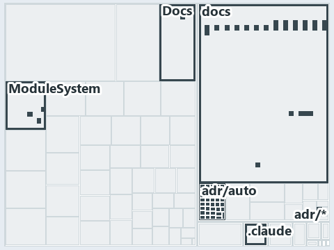

# docs/.assets/explanation/adr-auto-depm--a-declared-allow-list-of-layers--meta.tree.md

`Tree minimap: adr-auto-depm--a-declared-allow-list-of-layers--meta`

The tree minimap of the slide `adr-auto-depm--a-declared-allow-list-of-layers--meta` (meta lens). The slide supports [ADR-AUTO-DEPM][1]; the
highlight of those ADR codes selects what is lit, and each reason below names the code that selects it.

## What the minimap shows

The tree draws every file of the world map as a tile, grouped by top-level folder (under `automation/` by module, under `docs/adr/` by ADR
domain), and lights 70 files in 6 groups, filled in ink. A lit ADR file has a white rim; a file lit only by passing mentions is a lighter
ink. Every other tile is idle, a grey box: a file the slide's ADR codes do not select.

- adr/auto (docs/adr/automation): 39 lit files
- docs (docs/ outside docs/adr/): 25 lit files
- ModuleSystem (automation/Catzc.Base.ModuleSystem): 3 lit files
- .claude: 1 lit file
- Docs (automation/Catzc.Base.Docs): 1 lit file
- adr/* (the files directly in docs/adr/): 1 lit file

## Why each group is lit

### adr/auto (39 lit files)

The group holds the files of docs/adr/automation; each sits in its world-map cell and is lit by:

- [docs/adr/automation/BCL/index.md][2], in the cell docs × markdown: selected by [ADR-AUTO-DEPM][1]: an ADR file of the `automation` ADR
  domain, the ADR domain of that code.
- [docs/adr/automation/BCL/native-csharp-types.md][3], in the cell docs × markdown: selected by [ADR-AUTO-DEPM][1]: an ADR file of the
  `automation` ADR domain, the ADR domain of that code.
- [docs/adr/automation/avoid-deep-nesting.md][4], in the cell docs × markdown: selected by [ADR-AUTO-DEPM][1]: an ADR file of the
  `automation` ADR domain, the ADR domain of that code.
- [docs/adr/automation/bash/bash-test-artifacts.md][5], in the cell docs × markdown: selected by [ADR-AUTO-DEPM][1]: an ADR file of the
  `automation` ADR domain, the ADR domain of that code.
- [docs/adr/automation/caching.md][6], in the cell docs × markdown: selected by [ADR-AUTO-DEPM][1]: an ADR file of the `automation` ADR
  domain, the ADR domain of that code.
- [docs/adr/automation/console-output-matters.md][7], in the cell docs × markdown: selected by [ADR-AUTO-DEPM][1]: an ADR file of the
  `automation` ADR domain, the ADR domain of that code.
- [docs/adr/automation/controlling-module-dependencies.md][1], in the cell docs × markdown: selected by [ADR-AUTO-DEPM][1]: an ADR file of
  the `automation` ADR domain, the ADR domain of that code.
- [docs/adr/automation/controlling-systemwide-deps.md][8], in the cell docs × markdown: selected by [ADR-AUTO-DEPM][1]: an ADR file of the
  `automation` ADR domain, the ADR domain of that code.
- [docs/adr/automation/cross-platform.md][9], in the cell docs × markdown: selected by [ADR-AUTO-DEPM][1]: an ADR file of the `automation`
  ADR domain, the ADR domain of that code.
- [docs/adr/automation/devbox-pipeline-parity.md][10], in the cell docs × markdown: selected by [ADR-AUTO-DEPM][1]: an ADR file of the
  `automation` ADR domain, the ADR domain of that code.
- [docs/adr/automation/dora-explains.md][11], in the cell docs × markdown: selected by [ADR-AUTO-DEPM][1]: an ADR file of the `automation`
  ADR domain, the ADR domain of that code.
- [docs/adr/automation/dry-run.md][12], in the cell docs × markdown: selected by [ADR-AUTO-DEPM][1]: an ADR file of the `automation` ADR
  domain, the ADR domain of that code.
- [docs/adr/automation/effective-in-enterprises.md][13], in the cell docs × markdown: selected by [ADR-AUTO-DEPM][1]: an ADR file of the
  `automation` ADR domain, the ADR domain of that code.
- [docs/adr/automation/environment-variables.md][14], in the cell docs × markdown: selected by [ADR-AUTO-DEPM][1]: an ADR file of the
  `automation` ADR domain, the ADR domain of that code.
- [docs/adr/automation/execution-engines.md][15], in the cell docs × markdown: selected by [ADR-AUTO-DEPM][1]: an ADR file of the
  `automation` ADR domain, the ADR domain of that code.
- [docs/adr/automation/fail-fast-with-asserts.md][16], in the cell docs × markdown: selected by [ADR-AUTO-DEPM][1]: an ADR file of the
  `automation` ADR domain, the ADR domain of that code.
- [docs/adr/automation/go/index.md][17], in the cell docs × markdown: selected by [ADR-AUTO-DEPM][1]: an ADR file of the `automation` ADR
  domain, the ADR domain of that code.
- [docs/adr/automation/go/test-artifacts.md][18], in the cell docs × markdown: selected by [ADR-AUTO-DEPM][1]: an ADR file of the
  `automation` ADR domain, the ADR domain of that code.
- [docs/adr/automation/idempotent-state-functions.md][19], in the cell docs × markdown: selected by [ADR-AUTO-DEPM][1]: an ADR file of the
  `automation` ADR domain, the ADR domain of that code.
- [docs/adr/automation/internal-asset-dependencies.md][20], in the cell docs × markdown: selected by [ADR-AUTO-DEPM][1]: an ADR file of the
  `automation` ADR domain, the ADR domain of that code.
- [docs/adr/automation/log-before-invoke.md][21], in the cell docs × markdown: selected by [ADR-AUTO-DEPM][1]: an ADR file of the
  `automation` ADR domain, the ADR domain of that code.
- [docs/adr/automation/managed-guids.md][22], in the cell docs × markdown: selected by [ADR-AUTO-DEPM][1]: an ADR file of the `automation`
  ADR domain, the ADR domain of that code.
- [docs/adr/automation/never-depend-on-pwd.md][23], in the cell docs × markdown: selected by [ADR-AUTO-DEPM][1]: an ADR file of the
  `automation` ADR domain, the ADR domain of that code.
- [docs/adr/automation/open-closed-architecture.md][24], in the cell docs × markdown: selected by [ADR-AUTO-DEPM][1]: an ADR file of the
  `automation` ADR domain, the ADR domain of that code.
- [docs/adr/automation/path-representation.md][25], in the cell docs × markdown: selected by [ADR-AUTO-DEPM][1]: an ADR file of the
  `automation` ADR domain, the ADR domain of that code.
- [docs/adr/automation/platform-bundle.md][26], in the cell docs × markdown: selected by [ADR-AUTO-DEPM][1]: an ADR file of the `automation`
  ADR domain, the ADR domain of that code.
- [docs/adr/automation/protected-globs.md][27], in the cell docs × markdown: selected by [ADR-AUTO-DEPM][1]: an ADR file of the `automation`
  ADR domain, the ADR domain of that code.
- [docs/adr/automation/python/index.md][28], in the cell docs × markdown: selected by [ADR-AUTO-DEPM][1]: an ADR file of the `automation`
  ADR domain, the ADR domain of that code.
- [docs/adr/automation/python/python-test-artifacts.md][29], in the cell docs × markdown: selected by [ADR-AUTO-DEPM][1]: an ADR file of the
  `automation` ADR domain, the ADR domain of that code.
- [docs/adr/automation/retry-as-last-resort.md][30], in the cell docs × markdown: selected by [ADR-AUTO-DEPM][1]: an ADR file of the
  `automation` ADR domain, the ADR domain of that code.
- [docs/adr/automation/sensible-defaults.md][31], in the cell docs × markdown: selected by [ADR-AUTO-DEPM][1]: an ADR file of the
  `automation` ADR domain, the ADR domain of that code.
- [docs/adr/automation/single-responsibility-functions.md][32], in the cell docs × markdown: selected by [ADR-AUTO-DEPM][1]: an ADR file of
  the `automation` ADR domain, the ADR domain of that code.
- [docs/adr/automation/spell-out-names.md][33], in the cell docs × markdown: selected by [ADR-AUTO-DEPM][1]: an ADR file of the `automation`
  ADR domain, the ADR domain of that code.
- [docs/adr/automation/test-automation.md][34], in the cell docs × markdown: selected by [ADR-AUTO-DEPM][1]: an ADR file of the `automation`
  ADR domain, the ADR domain of that code.
- [docs/adr/automation/tool-removal-lifecycle.md][35], in the cell docs × markdown: selected by [ADR-AUTO-DEPM][1]: an ADR file of the
  `automation` ADR domain, the ADR domain of that code.
- [docs/adr/automation/tracked-files-from-the-index.md][36], in the cell docs × markdown: selected by [ADR-AUTO-DEPM][1]: an ADR file of the
  `automation` ADR domain, the ADR domain of that code.
- [docs/adr/automation/use-proper-package-managers.md][37], in the cell docs × markdown: selected by [ADR-AUTO-DEPM][1]: an ADR file of the
  `automation` ADR domain, the ADR domain of that code.
- [docs/adr/automation/uv-python-handler.md][38], in the cell docs × markdown: selected by [ADR-AUTO-DEPM][1]: an ADR file of the
  `automation` ADR domain, the ADR domain of that code.
- [docs/adr/automation/zero-ceremony-poka-yoke.md][39], in the cell docs × markdown: selected by [ADR-AUTO-DEPM][1]: an ADR file of the
  `automation` ADR domain, the ADR domain of that code.

### docs (25 lit files)

The group holds the files of docs/ outside docs/adr/; each sits in its world-map cell and is lit by:

- [docs/.assets/explanation/adr-auto-depm--a-declared-allow-list-of-layers--meta.chain.md][40], in the cell docs × markdown: selected by
  [ADR-AUTO-DEPM][1]: the file cites it at line 8 (text), line 24 (text) and line 24 (text).
- [docs/.assets/explanation/adr-auto-depm--a-declared-allow-list-of-layers--meta.drawio.md][41], in the cell docs × markdown: selected by
  [ADR-AUTO-DEPM][1]: the file cites it at line 69 (text).
- [docs/.assets/explanation/adr-auto-depm--a-declared-allow-list-of-layers--meta.grid.md][42], in the cell docs × markdown: selected by
  [ADR-AUTO-DEPM][1]: the file cites it at line 7 (text), line 27 (text), line 34 (text), line 35 (text), line 36 (text), line 43 (text),
  line 50 (text), line 52 (text), line 54 (text), line 57 (text), line 58 (text), line 60 (text), line 62 (text), line 64 (text), line 66
  (text), line 68 (text), line 70 (text), line 72 (text), line 74 (text), line 76 (text), line 78 (text), line 80 (text), line 82 (text),
  line 84 (text), line 86 (text), line 88 (text), line 90 (text), line 92 (text), line 94 (text), line 96 (text), line 98 (text), line 100
  (text), line 102 (text), line 104 (text), line 106 (text), line 108 (text), line 110 (text), line 112 (text), line 114 (text), line 116
  (text), line 118 (text), line 120 (text), line 122 (text), line 124 (text), line 126 (text), line 128 (text), line 130 (text), line 132
  (text), line 134 (text), line 136 (text), line 138 (text), line 139 (text), line 141 (text), line 143 (text), line 145 (text) and line 147
  (text).
- [docs/.assets/explanation/adr-auto-depm--a-declared-allow-list-of-layers--meta.tree.md][43], in the cell docs × markdown: selected by
  [ADR-AUTO-DEPM][1]: the file cites it at line 7 (text), line 28 (text), line 30 (text), line 32 (text), line 34 (text), line 36 (text),
  line 38 (text), line 40 (text), line 42 (text), line 44 (text), line 46 (text), line 48 (text), line 50 (text), line 52 (text), line 54
  (text), line 56 (text), line 58 (text), line 60 (text), line 62 (text), line 64 (text), line 66 (text), line 68 (text), line 70 (text),
  line 72 (text), line 74 (text), line 76 (text), line 78 (text), line 80 (text), line 82 (text), line 84 (text), line 86 (text), line 88
  (text), line 90 (text), line 92 (text), line 94 (text), line 96 (text), line 98 (text), line 100 (text), line 102 (text), line 104 (text),
  line 112 (text), line 114 (text), line 116 (text), line 118 (text), line 120 (text), line 121 (text), line 123 (text), line 125 (text),
  line 127 (text), line 129 (text), line 136 (text), line 138 (text), line 140 (text), line 147 (text), line 153 (text) and line 160 (text).
- [docs/.assets/explanation/adr-auto-depm--three-layers-edges-point-down--architecture.chain.md][44], in the cell docs × markdown: selected
  by [ADR-AUTO-DEPM][1]: the file cites it at line 8 (text), line 24 (text) and line 24 (text).
- [docs/.assets/explanation/adr-auto-depm--three-layers-edges-point-down--architecture.drawio.md][45], in the cell docs × markdown: selected
  by [ADR-AUTO-DEPM][1]: the file cites it at line 67 (text).
- [docs/.assets/explanation/adr-auto-depm--three-layers-edges-point-down--architecture.grid.md][46], in the cell docs × markdown: selected
  by [ADR-AUTO-DEPM][1]: the file cites it at line 8 (text), line 27 (text), line 34 (text), line 35 (text), line 36 (text), line 43 (text),
  line 50 (text), line 52 (text), line 54 (text), line 57 (text), line 58 (text), line 60 (text), line 62 (text), line 64 (text), line 66
  (text), line 68 (text), line 70 (text), line 72 (text), line 74 (text), line 76 (text), line 78 (text), line 80 (text), line 82 (text),
  line 84 (text), line 86 (text), line 88 (text), line 90 (text), line 92 (text), line 94 (text), line 96 (text), line 98 (text), line 100
  (text), line 102 (text), line 104 (text), line 106 (text), line 108 (text), line 110 (text), line 112 (text), line 114 (text), line 116
  (text), line 118 (text), line 120 (text), line 122 (text), line 124 (text), line 126 (text), line 128 (text), line 130 (text), line 132
  (text), line 134 (text), line 136 (text), line 138 (text), line 139 (text), line 141 (text), line 143 (text), line 145 (text) and line 147
  (text).
- [docs/.assets/explanation/adr-auto-depm--three-layers-edges-point-down--architecture.tree.md][47], in the cell docs × markdown: selected
  by [ADR-AUTO-DEPM][1]: the file cites it at line 8 (text), line 28 (text), line 30 (text), line 32 (text), line 34 (text), line 36 (text),
  line 38 (text), line 40 (text), line 42 (text), line 44 (text), line 46 (text), line 48 (text), line 50 (text), line 52 (text), line 54
  (text), line 56 (text), line 58 (text), line 60 (text), line 62 (text), line 64 (text), line 66 (text), line 68 (text), line 70 (text),
  line 72 (text), line 74 (text), line 76 (text), line 78 (text), line 80 (text), line 82 (text), line 84 (text), line 86 (text), line 88
  (text), line 90 (text), line 92 (text), line 94 (text), line 96 (text), line 98 (text), line 100 (text), line 102 (text), line 104 (text),
  line 112 (text), line 114 (text), line 116 (text), line 118 (text), line 120 (text), line 121 (text), line 123 (text), line 125 (text),
  line 127 (text), line 129 (text), line 136 (text), line 138 (text), line 140 (text), line 147 (text), line 153 (text) and line 160 (text).
- [docs/.assets/explanation/adr-auto-depm--two-gates-check-the-layer-pins--governance.chain.md][48], in the cell docs × markdown: selected
  by [ADR-AUTO-DEPM][1]: the file cites it at line 8 (text), line 26 (text) and line 26 (text).
- [docs/.assets/explanation/adr-auto-depm--two-gates-check-the-layer-pins--governance.drawio.md][49], in the cell docs × markdown: selected
  by [ADR-AUTO-DEPM][1]: the file cites it at line 68 (text).
- [docs/.assets/explanation/adr-auto-depm--two-gates-check-the-layer-pins--governance.grid.md][50], in the cell docs × markdown: selected by
  [ADR-AUTO-DEPM][1]: the file cites it at line 8 (text), line 37 (text), line 50 (text), line 52 (text), line 53 (text), line 679 (text),
  line 708 (text), line 710 (text), line 712 (text), line 715 (text), line 716 (text), line 726 (text), line 728 (text), line 730 (text),
  line 732 (text), line 734 (text), line 736 (text), line 738 (text), line 740 (text), line 742 (text), line 744 (text), line 746 (text),
  line 748 (text), line 750 (text), line 752 (text), line 754 (text), line 756 (text), line 758 (text), line 760 (text), line 762 (text),
  line 764 (text), line 766 (text), line 768 (text), line 770 (text), line 772 (text), line 774 (text), line 776 (text), line 778 (text),
  line 780 (text), line 782 (text), line 784 (text), line 786 (text), line 788 (text), line 790 (text), line 792 (text), line 794 (text),
  line 796 (text), line 798 (text), line 800 (text), line 802 (text), line 807 (text), line 809 (text), line 811 (text), line 813 (text),
  line 816 (text) and line 818 (text).
- [docs/.assets/explanation/adr-auto-depm--two-gates-check-the-layer-pins--governance.tree.md][51], in the cell docs × markdown: selected by
  [ADR-AUTO-DEPM][1]: the file cites it at line 8 (text), line 326 (text), line 329 (text), line 332 (text), line 335 (text), line 338
  (text), line 341 (text), line 344 (text), line 347 (text), line 350 (text), line 353 (text), line 356 (text), line 359 (text), line 362
  (text), line 365 (text), line 368 (text), line 371 (text), line 374 (text), line 377 (text), line 380 (text), line 383 (text), line 386
  (text), line 389 (text), line 392 (text), line 395 (text), line 398 (text), line 401 (text), line 404 (text), line 407 (text), line 410
  (text), line 413 (text), line 416 (text), line 419 (text), line 422 (text), line 425 (text), line 428 (text), line 431 (text), line 434
  (text), line 437 (text), line 440 (text), line 456 (text), line 530 (text), line 532 (text), line 534 (text), line 536 (text), line 538
  (text), line 547 (text), line 549 (text), line 551 (text), line 555 (text), line 556 (text), line 702 (text), line 704 (text), line 706
  (text), line 973 (text) and line 1109 (text).
- [docs/.assets/explanation/adr-auto-depm--two-sections-unioned-into-one-allow-set--implementation.chain.md][52], in the cell docs ×
  markdown: selected by [ADR-AUTO-DEPM][1]: the file cites it at line 8 (text), line 25 (text) and line 25 (text).
- [docs/.assets/explanation/adr-auto-depm--two-sections-unioned-into-one-allow-set--implementation.drawio.md][53], in the cell docs ×
  markdown: selected by [ADR-AUTO-DEPM][1]: the file cites it at line 72 (text).
- [docs/.assets/explanation/adr-auto-depm--two-sections-unioned-into-one-allow-set--implementation.grid.md][54], in the cell docs ×
  markdown: selected by [ADR-AUTO-DEPM][1]: the file cites it at line 8 (text), line 27 (text), line 34 (text), line 35 (text), line 36
  (text), line 43 (text), line 50 (text), line 52 (text), line 54 (text), line 57 (text), line 58 (text), line 60 (text), line 62 (text),
  line 64 (text), line 66 (text), line 68 (text), line 70 (text), line 72 (text), line 74 (text), line 76 (text), line 78 (text), line 80
  (text), line 82 (text), line 84 (text), line 86 (text), line 88 (text), line 90 (text), line 92 (text), line 94 (text), line 96 (text),
  line 98 (text), line 100 (text), line 102 (text), line 104 (text), line 106 (text), line 108 (text), line 110 (text), line 112 (text),
  line 114 (text), line 116 (text), line 118 (text), line 120 (text), line 122 (text), line 124 (text), line 126 (text), line 128 (text),
  line 130 (text), line 132 (text), line 134 (text), line 136 (text), line 138 (text), line 139 (text), line 141 (text), line 143 (text),
  line 145 (text) and line 147 (text).
- [docs/.assets/explanation/adr-auto-depm--two-sections-unioned-into-one-allow-set--implementation.tree.md][55], in the cell docs ×
  markdown: selected by [ADR-AUTO-DEPM][1]: the file cites it at line 8 (text), line 28 (text), line 30 (text), line 32 (text), line 34
  (text), line 36 (text), line 38 (text), line 40 (text), line 42 (text), line 44 (text), line 46 (text), line 48 (text), line 50 (text),
  line 52 (text), line 54 (text), line 56 (text), line 58 (text), line 60 (text), line 62 (text), line 64 (text), line 66 (text), line 68
  (text), line 70 (text), line 72 (text), line 74 (text), line 76 (text), line 78 (text), line 80 (text), line 82 (text), line 84 (text),
  line 86 (text), line 88 (text), line 90 (text), line 92 (text), line 94 (text), line 96 (text), line 98 (text), line 100 (text), line 102
  (text), line 104 (text), line 112 (text), line 114 (text), line 116 (text), line 118 (text), line 120 (text), line 121 (text), line 123
  (text), line 125 (text), line 127 (text), line 129 (text), line 136 (text), line 138 (text), line 140 (text), line 147 (text), line 153
  (text) and line 160 (text).
- [docs/.assets/explanation/adr-auto-depm--undeclared-edge-fails-with-one-line--operations.chain.md][56], in the cell docs × markdown:
  selected by [ADR-AUTO-DEPM][1]: the file cites it at line 8 (text), line 24 (text) and line 24 (text).
- [docs/.assets/explanation/adr-auto-depm--undeclared-edge-fails-with-one-line--operations.drawio.md][57], in the cell docs × markdown:
  selected by [ADR-AUTO-DEPM][1]: the file cites it at line 71 (text).
- [docs/.assets/explanation/adr-auto-depm--undeclared-edge-fails-with-one-line--operations.grid.md][58], in the cell docs × markdown:
  selected by [ADR-AUTO-DEPM][1]: the file cites it at line 8 (text), line 27 (text), line 34 (text), line 35 (text), line 36 (text), line
  43 (text), line 50 (text), line 52 (text), line 54 (text), line 57 (text), line 58 (text), line 60 (text), line 62 (text), line 64 (text),
  line 66 (text), line 68 (text), line 70 (text), line 72 (text), line 74 (text), line 76 (text), line 78 (text), line 80 (text), line 82
  (text), line 84 (text), line 86 (text), line 88 (text), line 90 (text), line 92 (text), line 94 (text), line 96 (text), line 98 (text),
  line 100 (text), line 102 (text), line 104 (text), line 106 (text), line 108 (text), line 110 (text), line 112 (text), line 114 (text),
  line 116 (text), line 118 (text), line 120 (text), line 122 (text), line 124 (text), line 126 (text), line 128 (text), line 130 (text),
  line 132 (text), line 134 (text), line 136 (text), line 138 (text), line 139 (text), line 141 (text), line 143 (text), line 145 (text) and
  line 147 (text).
- [docs/.assets/explanation/adr-auto-depm--undeclared-edge-fails-with-one-line--operations.tree.md][59], in the cell docs × markdown:
  selected by [ADR-AUTO-DEPM][1]: the file cites it at line 8 (text), line 28 (text), line 30 (text), line 32 (text), line 34 (text), line
  36 (text), line 38 (text), line 40 (text), line 42 (text), line 44 (text), line 46 (text), line 48 (text), line 50 (text), line 52 (text),
  line 54 (text), line 56 (text), line 58 (text), line 60 (text), line 62 (text), line 64 (text), line 66 (text), line 68 (text), line 70
  (text), line 72 (text), line 74 (text), line 76 (text), line 78 (text), line 80 (text), line 82 (text), line 84 (text), line 86 (text),
  line 88 (text), line 90 (text), line 92 (text), line 94 (text), line 96 (text), line 98 (text), line 100 (text), line 102 (text), line 104
  (text), line 112 (text), line 114 (text), line 116 (text), line 118 (text), line 120 (text), line 121 (text), line 123 (text), line 125
  (text), line 127 (text), line 129 (text), line 136 (text), line 138 (text), line 140 (text), line 147 (text), line 153 (text) and line 160
  (text).
- [docs/explanation/automation/a-declared-allow-list-of-layers.md][60], in the cell docs × markdown: selected by [ADR-AUTO-DEPM][1]: the
  file cites it at line 14 (text), line 38 (text), line 40 (text), line 41 (text) and line 42 (text).
- [docs/explanation/automation/three-layers-edges-point-down.md][61], in the cell docs × markdown: selected by [ADR-AUTO-DEPM][1]: the file
  cites it at line 15 (text), line 44 (text), line 46 (text) and line 48 (text).
- [docs/explanation/automation/two-gates-check-the-layer-pins.md][62], in the cell docs × markdown: selected by [ADR-AUTO-DEPM][1]: the file
  cites it at line 15 (text), line 47 (text), line 48 (text), line 49 (text), line 50 (text), line 51 (text) and line 55 (text).
- [docs/explanation/automation/two-sections-unioned-into-one-allow-set.md][63], in the cell docs × markdown: selected by [ADR-AUTO-DEPM][1]:
  the file cites it at line 18 (text), line 56 (text), line 57 (text) and line 58 (text).
- [docs/explanation/automation/undeclared-edge-fails-with-one-line.md][64], in the cell docs × markdown: selected by [ADR-AUTO-DEPM][1]: the
  file cites it at line 15 (text), line 49 (text), line 50 (text) and line 51 (text).

### ModuleSystem (3 lit files)

The group holds the files of automation/Catzc.Base.ModuleSystem; each sits in its world-map cell and is lit by:

- [automation/Catzc.Base.ModuleSystem/types/DependenciesConfig.cs][65], in the cell automation × csharp: selected by [ADR-AUTO-DEPM][1]: the
  file cites it at line 2 (header).
- [automation/Catzc.Base.ModuleSystem/types/DependencyGraph.cs][66], in the cell automation × csharp: selected by [ADR-AUTO-DEPM][1]: the
  file cites it at line 5 (header).
- [automation/Catzc.Base.ModuleSystem/types/ModuleGroup.cs][67], in the cell automation × csharp: selected by [ADR-AUTO-DEPM][1]: the file
  cites it at line 3 (header).

### .claude (1 lit file)

The group holds the files of .claude; each sits in its world-map cell and is lit by:

- [.claude/drawio/STYLE.md][68], in the cell .claude × markdown: selected by [ADR-AUTO-DEPM][1]: the file cites it at line 324 (text).

### Docs (1 lit file)

The group holds the files of automation/Catzc.Base.Docs; each sits in its world-map cell and is lit by:

- [automation/Catzc.Base.Docs/configs/adrs.yml][69], in the cell automation × yaml: selected by [ADR-AUTO-DEPM][1]: the file cites it at
  line 157 (text).

### adr/* (1 lit file)

The group holds the files of the files directly in docs/adr/; each sits in its world-map cell and is lit by:

- [docs/adr/index.md][70], in the cell docs × markdown: selected by [ADR-AUTO-DEPM][1]: the file cites it at line 145 (text).

## Keywords

- [world map][71]
- [track][72]
- [file language][73]
- [cell][74]
- [lit cell][75]
- [.claude][76]: a track
- [automation][76]: a track
- [docs][76]: a track
- [csharp][77]: a file language
- [markdown][77]: a file language
- [yaml][77]: a file language

[1]: ../../adr/automation/controlling-module-dependencies.md
[2]: ../../adr/automation/BCL/index.md
[3]: ../../adr/automation/BCL/native-csharp-types.md
[4]: ../../adr/automation/avoid-deep-nesting.md
[5]: ../../adr/automation/bash/bash-test-artifacts.md
[6]: ../../adr/automation/caching.md
[7]: ../../adr/automation/console-output-matters.md
[8]: ../../adr/automation/controlling-systemwide-deps.md
[9]: ../../adr/automation/cross-platform.md
[10]: ../../adr/automation/devbox-pipeline-parity.md
[11]: ../../adr/automation/dora-explains.md
[12]: ../../adr/automation/dry-run.md
[13]: ../../adr/automation/effective-in-enterprises.md
[14]: ../../adr/automation/environment-variables.md
[15]: ../../adr/automation/execution-engines.md
[16]: ../../adr/automation/fail-fast-with-asserts.md
[17]: ../../adr/automation/go/index.md
[18]: ../../adr/automation/go/test-artifacts.md
[19]: ../../adr/automation/idempotent-state-functions.md
[20]: ../../adr/automation/internal-asset-dependencies.md
[21]: ../../adr/automation/log-before-invoke.md
[22]: ../../adr/automation/managed-guids.md
[23]: ../../adr/automation/never-depend-on-pwd.md
[24]: ../../adr/automation/open-closed-architecture.md
[25]: ../../adr/automation/path-representation.md
[26]: ../../adr/automation/platform-bundle.md
[27]: ../../adr/automation/protected-globs.md
[28]: ../../adr/automation/python/index.md
[29]: ../../adr/automation/python/python-test-artifacts.md
[30]: ../../adr/automation/retry-as-last-resort.md
[31]: ../../adr/automation/sensible-defaults.md
[32]: ../../adr/automation/single-responsibility-functions.md
[33]: ../../adr/automation/spell-out-names.md
[34]: ../../adr/automation/test-automation.md
[35]: ../../adr/automation/tool-removal-lifecycle.md
[36]: ../../adr/automation/tracked-files-from-the-index.md
[37]: ../../adr/automation/use-proper-package-managers.md
[38]: ../../adr/automation/uv-python-handler.md
[39]: ../../adr/automation/zero-ceremony-poka-yoke.md
[40]: adr-auto-depm--a-declared-allow-list-of-layers--meta.chain.md
[41]: adr-auto-depm--a-declared-allow-list-of-layers--meta.drawio.md
[42]: adr-auto-depm--a-declared-allow-list-of-layers--meta.grid.md
[43]: adr-auto-depm--a-declared-allow-list-of-layers--meta.tree.md
[44]: adr-auto-depm--three-layers-edges-point-down--architecture.chain.md
[45]: adr-auto-depm--three-layers-edges-point-down--architecture.drawio.md
[46]: adr-auto-depm--three-layers-edges-point-down--architecture.grid.md
[47]: adr-auto-depm--three-layers-edges-point-down--architecture.tree.md
[48]: adr-auto-depm--two-gates-check-the-layer-pins--governance.chain.md
[49]: adr-auto-depm--two-gates-check-the-layer-pins--governance.drawio.md
[50]: adr-auto-depm--two-gates-check-the-layer-pins--governance.grid.md
[51]: adr-auto-depm--two-gates-check-the-layer-pins--governance.tree.md
[52]: adr-auto-depm--two-sections-unioned-into-one-allow-set--implementation.chain.md
[53]: adr-auto-depm--two-sections-unioned-into-one-allow-set--implementation.drawio.md
[54]: adr-auto-depm--two-sections-unioned-into-one-allow-set--implementation.grid.md
[55]: adr-auto-depm--two-sections-unioned-into-one-allow-set--implementation.tree.md
[56]: adr-auto-depm--undeclared-edge-fails-with-one-line--operations.chain.md
[57]: adr-auto-depm--undeclared-edge-fails-with-one-line--operations.drawio.md
[58]: adr-auto-depm--undeclared-edge-fails-with-one-line--operations.grid.md
[59]: adr-auto-depm--undeclared-edge-fails-with-one-line--operations.tree.md
[60]: ../../explanation/automation/a-declared-allow-list-of-layers.md
[61]: ../../explanation/automation/three-layers-edges-point-down.md
[62]: ../../explanation/automation/two-gates-check-the-layer-pins.md
[63]: ../../explanation/automation/two-sections-unioned-into-one-allow-set.md
[64]: ../../explanation/automation/undeclared-edge-fails-with-one-line.md
[65]: ../../../automation/Catzc.Base.ModuleSystem/types/DependenciesConfig.cs
[66]: ../../../automation/Catzc.Base.ModuleSystem/types/DependencyGraph.cs
[67]: ../../../automation/Catzc.Base.ModuleSystem/types/ModuleGroup.cs
[68]: ../../../.claude/drawio/STYLE.md
[69]: ../../../automation/Catzc.Base.Docs/configs/adrs.yml
[70]: ../../adr/index.md
[71]: ../../adr/glossary.md#world-map
[72]: ../../adr/glossary.md#track
[73]: ../../adr/glossary.md#file-language
[74]: ../../adr/glossary.md#cell
[75]: ../../adr/glossary.md#lit-cell
[76]: ../../../automation/Catzc.Base.Variants/configs/variants.yml
[77]: ../../../automation/Catzc.Base.Languages/configs/languages.yml
