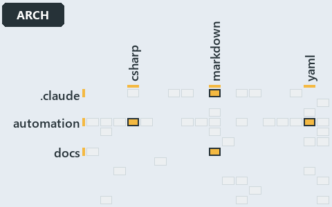

# docs/.assets/explanation/adr-auto-depm--three-layers-edges-point-down--architecture.grid.md

`Grid minimap: adr-auto-depm--three-layers-edges-point-down--architecture`

The grid minimap of the slide `adr-auto-depm--three-layers-edges-point-down--architecture` (architecture lens). The slide supports
[ADR-AUTO-DEPM][1]; the highlight of those ADR codes selects what is lit, and each reason below names the code that selects it.

## What the minimap shows

The grid crosses the 12 tracks with the 18 file languages of the world map and lights 4 cells. A cell lit only by passing mentions
(citations in body comments, not in a file's header or text) is touched: drawn pale.

- .claude × markdown: 1 lit of 9 files
- automation × csharp: 3 lit of 219 files
- automation × yaml: 1 lit of 95 files
- docs × markdown: 50 lit of 469 files

## Why each cell is lit

### .claude × markdown (1 lit file)

Placed: the root folder `.claude/` names the track .claude ([ADR-DSGN-TRACK#1][2]); the extension `.md` names the file language markdown
([ADR-DSGN-TRACK#6][3]). Lit ([ADR-DSGN-TRACK#12][4]) by:

- [.claude/drawio/STYLE.md][5]: selected by [ADR-AUTO-DEPM][1]: the file cites it at line 300 (text).

### automation × csharp (3 lit files)

Placed: the root folder `automation/` names the track automation ([ADR-DSGN-TRACK#1][2]); the extension `.cs` names the file language csharp
([ADR-DSGN-TRACK#6][3]). Lit ([ADR-DSGN-TRACK#12][4]) by:

- [automation/Catzc.Base.ModuleSystem/types/DependenciesConfig.cs][6]: selected by [ADR-AUTO-DEPM][1]: the file cites it at line 2 (header).
- [automation/Catzc.Base.ModuleSystem/types/DependencyGraph.cs][7]: selected by [ADR-AUTO-DEPM][1]: the file cites it at line 5 (header).
- [automation/Catzc.Base.ModuleSystem/types/ModuleGroup.cs][8]: selected by [ADR-AUTO-DEPM][1]: the file cites it at line 3 (header).

### automation × yaml (1 lit file)

Placed: the root folder `automation/` names the track automation ([ADR-DSGN-TRACK#1][2]); the extension `.yml` names the file language yaml
([ADR-DSGN-TRACK#6][3]). Lit ([ADR-DSGN-TRACK#12][4]) by:

- [automation/Catzc.Base.Docs/configs/adrs.yml][9]: selected by [ADR-AUTO-DEPM][1]: the file cites it at line 157 (text).

### docs × markdown (50 lit files)

Placed: the root folder `docs/` names the track docs ([ADR-DSGN-TRACK#1][2]); the extension `.md` names the file language markdown
([ADR-DSGN-TRACK#6][3]). Lit ([ADR-DSGN-TRACK#12][4]) by:

- [docs/.assets/explanation/adr-auto-depm--a-declared-allow-list-of-layers--meta.drawio.md][10]: selected by [ADR-AUTO-DEPM][1]: the file
  cites it at line 69 (text).
- [docs/.assets/explanation/adr-auto-depm--three-layers-edges-point-down--architecture.drawio.md][11]: selected by [ADR-AUTO-DEPM][1]: the
  file cites it at line 67 (text).
- [docs/.assets/explanation/adr-auto-depm--two-gates-check-the-layer-pins--governance.drawio.md][12]: selected by [ADR-AUTO-DEPM][1]: the
  file cites it at line 68 (text).
- [docs/.assets/explanation/adr-auto-depm--two-sections-unioned-into-one-allow-set--implementation.drawio.md][13]: selected by
  [ADR-AUTO-DEPM][1]: the file cites it at line 72 (text).
- [docs/.assets/explanation/adr-auto-depm--undeclared-edge-fails-with-one-line--operations.drawio.md][14]: selected by [ADR-AUTO-DEPM][1]:
  the file cites it at line 71 (text).
- [docs/adr/automation/BCL/index.md][15]: selected by [ADR-AUTO-DEPM][1]: an ADR file of the `automation` ADR domain, the ADR domain of that
  code.
- [docs/adr/automation/BCL/native-csharp-types.md][16]: selected by [ADR-AUTO-DEPM][1]: an ADR file of the `automation` ADR domain, the ADR
  domain of that code.
- [docs/adr/automation/avoid-deep-nesting.md][17]: selected by [ADR-AUTO-DEPM][1]: an ADR file of the `automation` ADR domain, the ADR
  domain of that code.
- [docs/adr/automation/bash/bash-test-artifacts.md][18]: selected by [ADR-AUTO-DEPM][1]: an ADR file of the `automation` ADR domain, the ADR
  domain of that code.
- [docs/adr/automation/caching.md][19]: selected by [ADR-AUTO-DEPM][1]: an ADR file of the `automation` ADR domain, the ADR domain of that
  code.
- [docs/adr/automation/console-output-matters.md][20]: selected by [ADR-AUTO-DEPM][1]: an ADR file of the `automation` ADR domain, the ADR
  domain of that code.
- [docs/adr/automation/controlling-module-dependencies.md][1]: selected by [ADR-AUTO-DEPM][1]: an ADR file of the `automation` ADR domain,
  the ADR domain of that code.
- [docs/adr/automation/controlling-systemwide-deps.md][21]: selected by [ADR-AUTO-DEPM][1]: an ADR file of the `automation` ADR domain, the
  ADR domain of that code.
- [docs/adr/automation/cross-platform.md][22]: selected by [ADR-AUTO-DEPM][1]: an ADR file of the `automation` ADR domain, the ADR domain of
  that code.
- [docs/adr/automation/devbox-pipeline-parity.md][23]: selected by [ADR-AUTO-DEPM][1]: an ADR file of the `automation` ADR domain, the ADR
  domain of that code.
- [docs/adr/automation/dora-explains.md][24]: selected by [ADR-AUTO-DEPM][1]: an ADR file of the `automation` ADR domain, the ADR domain of
  that code.
- [docs/adr/automation/dry-run.md][25]: selected by [ADR-AUTO-DEPM][1]: an ADR file of the `automation` ADR domain, the ADR domain of that
  code.
- [docs/adr/automation/effective-in-enterprises.md][26]: selected by [ADR-AUTO-DEPM][1]: an ADR file of the `automation` ADR domain, the ADR
  domain of that code.
- [docs/adr/automation/environment-variables.md][27]: selected by [ADR-AUTO-DEPM][1]: an ADR file of the `automation` ADR domain, the ADR
  domain of that code.
- [docs/adr/automation/execution-engines.md][28]: selected by [ADR-AUTO-DEPM][1]: an ADR file of the `automation` ADR domain, the ADR domain
  of that code.
- [docs/adr/automation/fail-fast-with-asserts.md][29]: selected by [ADR-AUTO-DEPM][1]: an ADR file of the `automation` ADR domain, the ADR
  domain of that code.
- [docs/adr/automation/go/index.md][30]: selected by [ADR-AUTO-DEPM][1]: an ADR file of the `automation` ADR domain, the ADR domain of that
  code.
- [docs/adr/automation/go/test-artifacts.md][31]: selected by [ADR-AUTO-DEPM][1]: an ADR file of the `automation` ADR domain, the ADR domain
  of that code.
- [docs/adr/automation/idempotent-state-functions.md][32]: selected by [ADR-AUTO-DEPM][1]: an ADR file of the `automation` ADR domain, the
  ADR domain of that code.
- [docs/adr/automation/internal-asset-dependencies.md][33]: selected by [ADR-AUTO-DEPM][1]: an ADR file of the `automation` ADR domain, the
  ADR domain of that code.
- [docs/adr/automation/log-before-invoke.md][34]: selected by [ADR-AUTO-DEPM][1]: an ADR file of the `automation` ADR domain, the ADR domain
  of that code.
- [docs/adr/automation/managed-guids.md][35]: selected by [ADR-AUTO-DEPM][1]: an ADR file of the `automation` ADR domain, the ADR domain of
  that code.
- [docs/adr/automation/never-depend-on-pwd.md][36]: selected by [ADR-AUTO-DEPM][1]: an ADR file of the `automation` ADR domain, the ADR
  domain of that code.
- [docs/adr/automation/open-closed-architecture.md][37]: selected by [ADR-AUTO-DEPM][1]: an ADR file of the `automation` ADR domain, the ADR
  domain of that code.
- [docs/adr/automation/path-representation.md][38]: selected by [ADR-AUTO-DEPM][1]: an ADR file of the `automation` ADR domain, the ADR
  domain of that code.
- [docs/adr/automation/platform-bundle.md][39]: selected by [ADR-AUTO-DEPM][1]: an ADR file of the `automation` ADR domain, the ADR domain
  of that code.
- [docs/adr/automation/protected-globs.md][40]: selected by [ADR-AUTO-DEPM][1]: an ADR file of the `automation` ADR domain, the ADR domain
  of that code.
- [docs/adr/automation/python/index.md][41]: selected by [ADR-AUTO-DEPM][1]: an ADR file of the `automation` ADR domain, the ADR domain of
  that code.
- [docs/adr/automation/python/python-test-artifacts.md][42]: selected by [ADR-AUTO-DEPM][1]: an ADR file of the `automation` ADR domain, the
  ADR domain of that code.
- [docs/adr/automation/retry-as-last-resort.md][43]: selected by [ADR-AUTO-DEPM][1]: an ADR file of the `automation` ADR domain, the ADR
  domain of that code.
- [docs/adr/automation/sensible-defaults.md][44]: selected by [ADR-AUTO-DEPM][1]: an ADR file of the `automation` ADR domain, the ADR domain
  of that code.
- [docs/adr/automation/single-responsibility-functions.md][45]: selected by [ADR-AUTO-DEPM][1]: an ADR file of the `automation` ADR domain,
  the ADR domain of that code.
- [docs/adr/automation/spell-out-names.md][46]: selected by [ADR-AUTO-DEPM][1]: an ADR file of the `automation` ADR domain, the ADR domain
  of that code.
- [docs/adr/automation/test-automation.md][47]: selected by [ADR-AUTO-DEPM][1]: an ADR file of the `automation` ADR domain, the ADR domain
  of that code.
- [docs/adr/automation/tool-removal-lifecycle.md][48]: selected by [ADR-AUTO-DEPM][1]: an ADR file of the `automation` ADR domain, the ADR
  domain of that code.
- [docs/adr/automation/tracked-files-from-the-index.md][49]: selected by [ADR-AUTO-DEPM][1]: an ADR file of the `automation` ADR domain, the
  ADR domain of that code.
- [docs/adr/automation/use-proper-package-managers.md][50]: selected by [ADR-AUTO-DEPM][1]: an ADR file of the `automation` ADR domain, the
  ADR domain of that code.
- [docs/adr/automation/uv-python-handler.md][51]: selected by [ADR-AUTO-DEPM][1]: an ADR file of the `automation` ADR domain, the ADR domain
  of that code.
- [docs/adr/automation/zero-ceremony-poka-yoke.md][52]: selected by [ADR-AUTO-DEPM][1]: an ADR file of the `automation` ADR domain, the ADR
  domain of that code.
- [docs/adr/index.md][53]: selected by [ADR-AUTO-DEPM][1]: the file cites it at line 145 (text).
- [docs/explanation/automation/a-declared-allow-list-of-layers.md][54]: selected by [ADR-AUTO-DEPM][1]: the file cites it at line 14 (text),
  line 38 (text), line 40 (text), line 41 (text) and line 42 (text).
- [docs/explanation/automation/three-layers-edges-point-down.md][55]: selected by [ADR-AUTO-DEPM][1]: the file cites it at line 15 (text),
  line 44 (text), line 46 (text) and line 48 (text).
- [docs/explanation/automation/two-gates-check-the-layer-pins.md][56]: selected by [ADR-AUTO-DEPM][1]: the file cites it at line 15 (text),
  line 47 (text), line 48 (text), line 49 (text), line 50 (text), line 51 (text) and line 55 (text).
- [docs/explanation/automation/two-sections-unioned-into-one-allow-set.md][57]: selected by [ADR-AUTO-DEPM][1]: the file cites it at line 18
  (text), line 56 (text), line 57 (text) and line 58 (text).
- [docs/explanation/automation/undeclared-edge-fails-with-one-line.md][58]: selected by [ADR-AUTO-DEPM][1]: the file cites it at line 15
  (text), line 49 (text), line 50 (text) and line 51 (text).

## Keywords

- [world map][59]
- [track][60]
- [file language][61]
- [cell][62]
- [lit cell][63]
- [.claude][64]: a track
- [automation][64]: a track
- [docs][64]: a track
- [csharp][65]: a file language
- [markdown][65]: a file language
- [yaml][65]: a file language

[1]: ../../adr/automation/controlling-module-dependencies.md
[2]: ../../adr/design/tracks.md#rule-adr-dsgn-track1
[3]: ../../adr/design/tracks.md#rule-adr-dsgn-track6
[4]: ../../adr/design/tracks.md#rule-adr-dsgn-track12
[5]: ../../../.claude/drawio/STYLE.md
[6]: ../../../automation/Catzc.Base.ModuleSystem/types/DependenciesConfig.cs
[7]: ../../../automation/Catzc.Base.ModuleSystem/types/DependencyGraph.cs
[8]: ../../../automation/Catzc.Base.ModuleSystem/types/ModuleGroup.cs
[9]: ../../../automation/Catzc.Base.Docs/configs/adrs.yml
[10]: adr-auto-depm--a-declared-allow-list-of-layers--meta.drawio.md
[11]: adr-auto-depm--three-layers-edges-point-down--architecture.drawio.md
[12]: adr-auto-depm--two-gates-check-the-layer-pins--governance.drawio.md
[13]: adr-auto-depm--two-sections-unioned-into-one-allow-set--implementation.drawio.md
[14]: adr-auto-depm--undeclared-edge-fails-with-one-line--operations.drawio.md
[15]: ../../adr/automation/BCL/index.md
[16]: ../../adr/automation/BCL/native-csharp-types.md
[17]: ../../adr/automation/avoid-deep-nesting.md
[18]: ../../adr/automation/bash/bash-test-artifacts.md
[19]: ../../adr/automation/caching.md
[20]: ../../adr/automation/console-output-matters.md
[21]: ../../adr/automation/controlling-systemwide-deps.md
[22]: ../../adr/automation/cross-platform.md
[23]: ../../adr/automation/devbox-pipeline-parity.md
[24]: ../../adr/automation/dora-explains.md
[25]: ../../adr/automation/dry-run.md
[26]: ../../adr/automation/effective-in-enterprises.md
[27]: ../../adr/automation/environment-variables.md
[28]: ../../adr/automation/execution-engines.md
[29]: ../../adr/automation/fail-fast-with-asserts.md
[30]: ../../adr/automation/go/index.md
[31]: ../../adr/automation/go/test-artifacts.md
[32]: ../../adr/automation/idempotent-state-functions.md
[33]: ../../adr/automation/internal-asset-dependencies.md
[34]: ../../adr/automation/log-before-invoke.md
[35]: ../../adr/automation/managed-guids.md
[36]: ../../adr/automation/never-depend-on-pwd.md
[37]: ../../adr/automation/open-closed-architecture.md
[38]: ../../adr/automation/path-representation.md
[39]: ../../adr/automation/platform-bundle.md
[40]: ../../adr/automation/protected-globs.md
[41]: ../../adr/automation/python/index.md
[42]: ../../adr/automation/python/python-test-artifacts.md
[43]: ../../adr/automation/retry-as-last-resort.md
[44]: ../../adr/automation/sensible-defaults.md
[45]: ../../adr/automation/single-responsibility-functions.md
[46]: ../../adr/automation/spell-out-names.md
[47]: ../../adr/automation/test-automation.md
[48]: ../../adr/automation/tool-removal-lifecycle.md
[49]: ../../adr/automation/tracked-files-from-the-index.md
[50]: ../../adr/automation/use-proper-package-managers.md
[51]: ../../adr/automation/uv-python-handler.md
[52]: ../../adr/automation/zero-ceremony-poka-yoke.md
[53]: ../../adr/index.md
[54]: ../../explanation/automation/a-declared-allow-list-of-layers.md
[55]: ../../explanation/automation/three-layers-edges-point-down.md
[56]: ../../explanation/automation/two-gates-check-the-layer-pins.md
[57]: ../../explanation/automation/two-sections-unioned-into-one-allow-set.md
[58]: ../../explanation/automation/undeclared-edge-fails-with-one-line.md
[59]: ../../adr/glossary.md#world-map
[60]: ../../adr/glossary.md#track
[61]: ../../adr/glossary.md#file-language
[62]: ../../adr/glossary.md#cell
[63]: ../../adr/glossary.md#lit-cell
[64]: ../../../automation/Catzc.Base.Variants/configs/variants.yml
[65]: ../../../automation/Catzc.Base.Languages/configs/languages.yml
