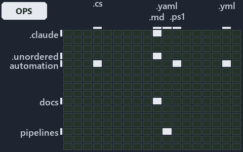

# docs/.assets/explanation/adr-auto-failfast--pass-the-limit-or-the-call-is-denied--operations.grid.md

`Grid minimap: adr-auto-failfast--pass-the-limit-or-the-call-is-denied--operations`

The grid minimap of the slide `adr-auto-failfast--pass-the-limit-or-the-call-is-denied--operations` (operations lens). The slide supports
[ADR-AUTO-FAILFAST][1]; the highlight of those ADR codes selects what is lit, and each reason below names the code that selects it.

## What the minimap shows

The grid crosses the 16 tracks (rows) with the 18 file languages (columns) of the world map and lights 7 cells, filled in ink. A cell lit
only by passing mentions (citations in body comments, not in a file's header or text) is touched: a lighter ink. Every other cell is idle, a
grey box: it holds files the slide's ADR codes do not select, or no file at all (237 of the 288 cells hold none). The minimap shows where
the slide sits, not how many files a cell holds; the world-map PDFs show the counts.

- .claude × markdown: 11 lit of 51 files
- .unordered × markdown: 5 lit of 20 files
- automation × csharp: 2 lit of 272 files
- automation × powershell: 12 lit of 1563 files
- automation × yaml: 3 lit of 107 files
- docs × markdown: 8 lit of 1985 files
- pipelines × pipeline-yaml: 1 lit of 9 files

## Key

A lit row prints its track's name; a lit column prints a short code, the first extension of its file language:

- `.cs`: csharp
- `.md`: markdown
- `.yaml`: pipeline-yaml
- `.ps1`: powershell
- `.yml`: yaml

## Why each cell is lit

### .claude × markdown (11 lit files)

Placed: the root folder `.claude/` names the track .claude ([ADR-DSGN-TRACK#1][2]); the extension `.md` names the file language markdown
([ADR-DSGN-TRACK#6][3]). Lit ([ADR-DSGN-TRACK#12][4]) by:

- [.claude/CLAUDE.md][5]: selected by [ADR-AUTO-FAILFAST][1]: the file cites it at line 105 (text).
- [.claude/agents/session-cost-audit.md][6]: selected by [ADR-AUTO-FAILFAST][1]: the file cites it at line 29 (text) and line 41 (text).
- [.claude/agents/test-optimization.md][7]: selected by [ADR-AUTO-FAILFAST][1]: the file cites it at line 29 (text) and line 59 (text).
- [.claude/plans/decisions-2026-10-16.md][8]: selected by [ADR-AUTO-FAILFAST][1]: the file cites it at line 37 (text).
- [.claude/plans/plan-bounded-folder-enumeration.md][9]: selected by [ADR-AUTO-FAILFAST][1]: the file cites it at line 33 (text), line 198
  (text) and line 199 (text).
- [.claude/plans/plan-config-defaults.md][10]: selected by [ADR-AUTO-FAILFAST][1]: the file cites it at line 27 (text) and line 224 (text).
- [.claude/plans/plan-lazy-types-load.md][11]: selected by [ADR-AUTO-FAILFAST][1]: the file cites it at line 163 (text).
- [.claude/plans/plan-minimal-robots-agents.md][12]: selected by [ADR-AUTO-FAILFAST][1]: the file cites it at line 61 (text).
- [.claude/plans/plan-minimal-robots-capabilities.md][13]: selected by [ADR-AUTO-FAILFAST][1]: the file cites it at line 101 (text).
- [.claude/plans/prompt-bounded-folder-enumeration-continue.md][14]: selected by [ADR-AUTO-FAILFAST][1]: the file cites it at line 16
  (text).
- [.claude/plans/questionnaire-2026-10-16.md][15]: selected by [ADR-AUTO-FAILFAST][1]: the file cites it at line 121 (text).

### .unordered × markdown (5 lit files)

Placed: the root folder `.unordered/` names the track .unordered ([ADR-DSGN-TRACK#1][2]); the extension `.md` names the file language
markdown ([ADR-DSGN-TRACK#6][3]). Lit ([ADR-DSGN-TRACK#12][4]) by:

- [.unordered/15-10-2026/plan-built-bundle.md][16]: selected by [ADR-AUTO-FAILFAST][1]: the file cites it at line 13 (text).
- [.unordered/15-10-2026/plan-diagram-wave-8.md][17]: selected by [ADR-AUTO-FAILFAST][1]: the file cites it at line 14 (text) and line 16
  (text).
- [.unordered/15-10-2026/plan-duration-categories.md][18]: selected by [ADR-AUTO-FAILFAST][1]: the file cites it at line 25 (text).
- [.unordered/15-10-2026/plan-explanation-drift.md][19]: selected by [ADR-AUTO-FAILFAST][1]: the file cites it at line 129 (text).
- [.unordered/15-10-2026/plan-test-runtime.md][20]: selected by [ADR-AUTO-FAILFAST][1]: the file cites it at line 70 (text).

### automation × csharp (2 lit files)

Placed: the root folder `automation/` names the track automation ([ADR-DSGN-TRACK#1][2]); the extension `.cs` names the file language csharp
([ADR-DSGN-TRACK#6][3]). Lit ([ADR-DSGN-TRACK#12][4]) by:

- [automation/Catzc.Base.Engines/types/ExecutionEngine.cs][21]: selected by [ADR-AUTO-FAILFAST][1]: the file cites it at line 21 (text).
- [automation/Catzc.Base.Timeouts/types/BashSafeguard.cs][22]: selected by [ADR-AUTO-FAILFAST][1]: the file cites it at line 20 (text).

### automation × powershell (12 lit files)

Placed: the root folder `automation/` names the track automation ([ADR-DSGN-TRACK#1][2]); the extension `.ps1` names the file language
powershell ([ADR-DSGN-TRACK#6][3]). Lit ([ADR-DSGN-TRACK#12][4]) by:

- [automation/Catzc.Azure.Cli/Assert-AzCliSubscriptionAccessible.ps1][23]: selected by [ADR-AUTO-FAILFAST][1]: the file cites it at line 20
  (header) and line 35 (header).
- [automation/Catzc.Base.Docs/Test-Glossary.ps1][24]: selected by [ADR-AUTO-FAILFAST][1]: the file cites it at line 20 (header) and line 40
  (header).
- [automation/Catzc.Base.Docs/private/Import-AdrCitationMapFile.ps1][25]: selected by [ADR-AUTO-FAILFAST][1]: the file cites it at line 19
  (header) and line 25 (header).
- [automation/Catzc.Base.Docs/tests/Test-Glossary.Tests.ps1][26]: selected by [ADR-AUTO-FAILFAST][1]: the file cites it at line 19 (header).
- [automation/Catzc.Base.Folders/tests/Get-ChildPath.Tests.ps1][27]: selected by [ADR-AUTO-FAILFAST][1]: the file cites it at line 19
  (header) and line 70 (text).
- [automation/Catzc.Base.Folders/tests/types/FolderWalker.Tests.ps1][28]: selected by [ADR-AUTO-FAILFAST][1]: the file cites it at line 19
  (header) and line 86 (text).
- [automation/Catzc.Base.Globs/Test-GlobSetAffected.ps1][29]: selected by [ADR-AUTO-FAILFAST][1]: the file cites it at line 20 (header) and
  line 42 (header).
- [automation/Catzc.Base.QualityGates/private/Test-TestRunOverBudget.ps1][30]: selected by [ADR-AUTO-FAILFAST][1]: the file cites it at line
  20 (header) and line 27 (header).
- [automation/Catzc.Base.QualityGates/private/Write-TestAutomationVerdict.ps1][31]: selected by [ADR-AUTO-FAILFAST][1]: the file cites it at
  line 22 (header) and line 42 (header).
- [automation/Catzc.Base.Timeouts/Get-TestTimeLimits.ps1][32]: selected by [ADR-AUTO-FAILFAST][1]: the file cites it at line 19 (header) and
  line 25 (header).
- [automation/Catzc.Base.TypesSystem/Assert-LoadedTypesCurrent.ps1][33]: selected by [ADR-AUTO-FAILFAST][1]: the file cites it at line 20
  (header) and line 26 (header).
- [automation/Catzc.Base.TypesSystem/Build-BashTimeoutHook.ps1][34]: selected by [ADR-AUTO-FAILFAST][1]: the file cites it at line 21
  (header) and line 28 (header).

### automation × yaml (3 lit files)

Placed: the root folder `automation/` names the track automation ([ADR-DSGN-TRACK#1][2]); the extension `.yml` names the file language yaml
([ADR-DSGN-TRACK#6][3]). Lit ([ADR-DSGN-TRACK#12][4]) by:

- [automation/Catzc.Base.Docs/configs/adrs.yml][35]: selected by [ADR-AUTO-FAILFAST][1]: the file cites it at line 147 (text).
- [automation/Catzc.Base.Docs/configs/agents.yml][36]: selected by [ADR-AUTO-FAILFAST][1]: the file cites it at line 64 (body comment) (a
  passing mention only).
- [automation/Catzc.Base.QualityGates/configs/terminology.yml][37]: selected by [ADR-AUTO-FAILFAST][1]: the file cites it at line 598
  (text).

### docs × markdown (8 lit files)

Placed: the root folder `docs/` names the track docs ([ADR-DSGN-TRACK#1][2]); the extension `.md` names the file language markdown
([ADR-DSGN-TRACK#6][3]). Lit ([ADR-DSGN-TRACK#12][4]) by:

- [docs/adr/automation/dora-explains.md][38]: selected by [ADR-AUTO-FAILFAST][1]: the file cites it at line 308 (text).
- [docs/adr/automation/fail-fast-with-asserts.md][1]: selected by [ADR-AUTO-FAILFAST][1]: the ADR's own file.
- [docs/adr/index.md][39]: selected by [ADR-AUTO-FAILFAST][1]: the file cites it at line 156 (text).
- [docs/references/automation/catzc-base-docs/tests/Test-Glossary.Tests.ps1.md][40]: selected by [ADR-AUTO-FAILFAST][1]: the file cites it
  at line 31 (text).
- [docs/references/automation/catzc-base-engines/types/ExecutionEngine.cs.md][41]: selected by [ADR-AUTO-FAILFAST][1]: the file cites it at
  line 16 (text) and line 56 (text).
- [docs/references/automation/catzc-base-timeouts/types/BashSafeguard.cs.md][42]: selected by [ADR-AUTO-FAILFAST][1]: the file cites it at
  line 16 (text) and line 30 (text).
- [docs/references/automation/catzc-base-typessystem.md][43]: selected by [ADR-AUTO-FAILFAST][1]: the file cites it at line 15 (text) and
  line 99 (text).
- [docs/references/automation/claude-hooks/Assert-BashTimeout/Program.cs.md][44]: selected by [ADR-AUTO-FAILFAST][1]: the file cites it at
  line 16 (text) and line 30 (text).

### pipelines × pipeline-yaml (1 lit file)

Placed: the root folder `pipelines/` names the track pipelines ([ADR-DSGN-TRACK#1][2]); the extension `.yaml` names the file language
pipeline-yaml ([ADR-DSGN-TRACK#6][3]). Lit ([ADR-DSGN-TRACK#12][4]) by:

- [pipelines/ci-automation.yaml][45]: selected by [ADR-AUTO-FAILFAST][1]: a pipeline that cites nothing itself carries its globset's
  citations, which cite it at `automation/Catzc.Azure.Cli/Assert-AzCliSubscriptionAccessible.ps1` line 20 (header),
  `automation/Catzc.Azure.Cli/Assert-AzCliSubscriptionAccessible.ps1` line 35 (header), `automation/Catzc.Base.Docs/Test-Glossary.ps1` line
  20 (header), `automation/Catzc.Base.Docs/Test-Glossary.ps1` line 40 (header), `automation/Catzc.Base.Docs/configs/adrs.yml` line 147
  (text), `automation/Catzc.Base.Docs/configs/agents.yml` line 64 (body comment),
  `automation/Catzc.Base.Docs/private/Import-AdrCitationMapFile.ps1` line 19 (header),
  `automation/Catzc.Base.Docs/private/Import-AdrCitationMapFile.ps1` line 25 (header),
  `automation/Catzc.Base.Docs/tests/Test-Glossary.Tests.ps1` line 19 (header), `automation/Catzc.Base.Engines/types/ExecutionEngine.cs` line
  21 (text), `automation/Catzc.Base.Folders/tests/Get-ChildPath.Tests.ps1` line 19 (header),
  `automation/Catzc.Base.Folders/tests/Get-ChildPath.Tests.ps1` line 70 (text),
  `automation/Catzc.Base.Folders/tests/types/FolderWalker.Tests.ps1` line 19 (header),
  `automation/Catzc.Base.Folders/tests/types/FolderWalker.Tests.ps1` line 86 (text), `automation/Catzc.Base.Globs/Test-GlobSetAffected.ps1`
  line 20 (header), `automation/Catzc.Base.Globs/Test-GlobSetAffected.ps1` line 42 (header),
  `automation/Catzc.Base.QualityGates/configs/terminology.yml` line 598 (text),
  `automation/Catzc.Base.QualityGates/private/Test-TestRunOverBudget.ps1` line 20 (header),
  `automation/Catzc.Base.QualityGates/private/Test-TestRunOverBudget.ps1` line 27 (header),
  `automation/Catzc.Base.QualityGates/private/Write-TestAutomationVerdict.ps1` line 22 (header),
  `automation/Catzc.Base.QualityGates/private/Write-TestAutomationVerdict.ps1` line 42 (header),
  `automation/Catzc.Base.Timeouts/Get-TestTimeLimits.ps1` line 19 (header), `automation/Catzc.Base.Timeouts/Get-TestTimeLimits.ps1` line 25
  (header), `automation/Catzc.Base.Timeouts/types/BashSafeguard.cs` line 20 (text),
  `automation/Catzc.Base.TypesSystem/Assert-LoadedTypesCurrent.ps1` line 20 (header),
  `automation/Catzc.Base.TypesSystem/Assert-LoadedTypesCurrent.ps1` line 26 (header),
  `automation/Catzc.Base.TypesSystem/Build-BashTimeoutHook.ps1` line 21 (header) and
  `automation/Catzc.Base.TypesSystem/Build-BashTimeoutHook.ps1` line 28 (header).

## Keywords

- [world map][46]
- [track][47]
- [file language][48]
- [cell][49]
- [lit cell][50]
- [.claude][51]: a track
- [.unordered][51]: a track
- [automation][51]: a track
- [docs][51]: a track
- [pipelines][51]: a track
- [csharp][52]: a file language
- [markdown][52]: a file language
- [pipeline-yaml][52]: a file language
- [powershell][52]: a file language
- [yaml][52]: a file language

[1]: ../../adr/automation/fail-fast-with-asserts.md
[2]: ../../adr/design/tracks.md#rule-adr-dsgn-track1
[3]: ../../adr/design/tracks.md#rule-adr-dsgn-track6
[4]: ../../adr/design/tracks.md#rule-adr-dsgn-track12
[5]: ../../../.claude/CLAUDE.md
[6]: ../../../.claude/agents/session-cost-audit.md
[7]: ../../../.claude/agents/test-optimization.md
[8]: ../../../.claude/plans/decisions-2026-10-16.md
[9]: ../../../.claude/plans/plan-bounded-folder-enumeration.md
[10]: ../../../.claude/plans/plan-config-defaults.md
[11]: ../../../.claude/plans/plan-lazy-types-load.md
[12]: ../../../.claude/plans/plan-minimal-robots-agents.md
[13]: ../../../.claude/plans/plan-minimal-robots-capabilities.md
[14]: ../../../.claude/plans/prompt-bounded-folder-enumeration-continue.md
[15]: ../../../.claude/plans/questionnaire-2026-10-16.md
[16]: ../../../.unordered/15-10-2026/plan-built-bundle.md
[17]: ../../../.unordered/15-10-2026/plan-diagram-wave-8.md
[18]: ../../../.unordered/15-10-2026/plan-duration-categories.md
[19]: ../../../.unordered/15-10-2026/plan-explanation-drift.md
[20]: ../../../.unordered/15-10-2026/plan-test-runtime.md
[21]: ../../../automation/Catzc.Base.Engines/types/ExecutionEngine.cs
[22]: ../../../automation/Catzc.Base.Timeouts/types/BashSafeguard.cs
[23]: ../../../automation/Catzc.Azure.Cli/Assert-AzCliSubscriptionAccessible.ps1
[24]: ../../../automation/Catzc.Base.Docs/Test-Glossary.ps1
[25]: ../../../automation/Catzc.Base.Docs/private/Import-AdrCitationMapFile.ps1
[26]: ../../../automation/Catzc.Base.Docs/tests/Test-Glossary.Tests.ps1
[27]: ../../../automation/Catzc.Base.Folders/tests/Get-ChildPath.Tests.ps1
[28]: ../../../automation/Catzc.Base.Folders/tests/types/FolderWalker.Tests.ps1
[29]: ../../../automation/Catzc.Base.Globs/Test-GlobSetAffected.ps1
[30]: ../../../automation/Catzc.Base.QualityGates/private/Test-TestRunOverBudget.ps1
[31]: ../../../automation/Catzc.Base.QualityGates/private/Write-TestAutomationVerdict.ps1
[32]: ../../../automation/Catzc.Base.Timeouts/Get-TestTimeLimits.ps1
[33]: ../../../automation/Catzc.Base.TypesSystem/Assert-LoadedTypesCurrent.ps1
[34]: ../../../automation/Catzc.Base.TypesSystem/Build-BashTimeoutHook.ps1
[35]: ../../../automation/Catzc.Base.Docs/configs/adrs.yml
[36]: ../../../automation/Catzc.Base.Docs/configs/agents.yml
[37]: ../../../automation/Catzc.Base.QualityGates/configs/terminology.yml
[38]: ../../adr/automation/dora-explains.md
[39]: ../../adr/index.md
[40]: ../../references/automation/catzc-base-docs/tests/Test-Glossary.Tests.ps1.md
[41]: ../../references/automation/catzc-base-engines/types/ExecutionEngine.cs.md
[42]: ../../references/automation/catzc-base-timeouts/types/BashSafeguard.cs.md
[43]: ../../references/automation/catzc-base-typessystem.md
[44]: ../../references/automation/claude-hooks/Assert-BashTimeout/Program.cs.md
[45]: ../../../pipelines/ci-automation.yaml
[46]: ../../adr/glossary.md#world-map
[47]: ../../adr/glossary.md#track
[48]: ../../adr/glossary.md#file-language
[49]: ../../adr/glossary.md#cell
[50]: ../../adr/glossary.md#lit-cell
[51]: ../../../automation/Catzc.Base.Variants/configs/variants.yml
[52]: ../../../automation/Catzc.Base.Languages/configs/languages.yml
