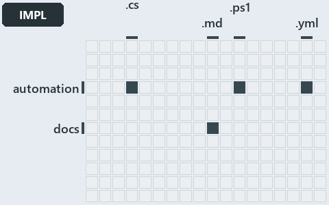

# docs/.assets/explanation/adr-az-naming--lookup-form-check-render-in-order--implementation.grid.md

`Grid minimap: adr-az-naming--lookup-form-check-render-in-order--implementation`

The grid minimap of the slide `adr-az-naming--lookup-form-check-render-in-order--implementation` (implementation lens). The slide supports
[ADR-AZ-NAMING][1]; the highlight of those ADR codes selects what is lit, and each reason below names the code that selects it.

## What the minimap shows

The grid crosses the 12 tracks (rows) with the 18 file languages (columns) of the world map and lights 4 cells, filled in ink. A cell lit
only by passing mentions (citations in body comments, not in a file's header or text) is touched: a lighter ink. Every other cell is idle, a
grey box: it holds files the slide's ADR codes do not select, or no file at all (174 of the 216 cells hold none). The minimap shows where
the slide sits, not how many files a cell holds; the world-map PDFs show the counts.

- automation × csharp: 3 lit of 219 files
- automation × powershell: 7 lit of 1400 files
- automation × yaml: 4 lit of 95 files
- docs × markdown: 52 lit of 741 files

## Key

A lit row prints its track's name; a lit column prints a short code, the first extension of its file language:

- `.cs`: csharp
- `.md`: markdown
- `.ps1`: powershell
- `.yml`: yaml

## Why each cell is lit

### automation × csharp (3 lit files)

Placed: the root folder `automation/` names the track automation ([ADR-DSGN-TRACK#1][2]); the extension `.cs` names the file language csharp
([ADR-DSGN-TRACK#6][3]). Lit ([ADR-DSGN-TRACK#12][4]) by:

- [automation/Catzc.Azure.Templates/types/BicepShortName.cs][5]: selected by [ADR-AZ-NAMING][1]: the file cites it at line 2 (header), line
  25 (body comment) and line 95 (body comment).
- [automation/Catzc.Azure/types/AzureConfig.cs][6]: selected by [ADR-AZ-NAMING][1]: the file cites it at line 18 (header).
- [automation/Catzc.Azure/types/AzureEnvironmentRecord.cs][7]: selected by [ADR-AZ-NAMING][1]: the file cites it at line 2 (header).

### automation × powershell (7 lit files)

Placed: the root folder `automation/` names the track automation ([ADR-DSGN-TRACK#1][2]); the extension `.ps1` names the file language
powershell ([ADR-DSGN-TRACK#6][3]). Lit ([ADR-DSGN-TRACK#12][4]) by:

- [automation/Catzc.Azure.Templates/Get-AzureResourceName.ps1][8]: selected by [ADR-AZ-NAMING][1]: the file cites it at line 87 (body
  comment), line 98 (body comment) and line 126 (body comment) (a passing mention only).
- [automation/Catzc.Azure.Templates/Get-AzureResourceTypeSet.ps1][9]: selected by [ADR-AZ-NAMING][1]: the file cites it at line 18 (header)
  and line 21 (header).
- [automation/Catzc.Azure.Templates/Get-BicepResourceName.ps1][10]: selected by [ADR-AZ-NAMING][1]: the file cites it at line 77 (body
  comment) (a passing mention only).
- [automation/Catzc.Azure.Templates/Get-BicepTemplates.ps1][11]: selected by [ADR-AZ-NAMING][1]: the file cites it at line 136 (body
  comment) (a passing mention only).
- [automation/Catzc.Azure.Templates/tests/Build-Bicep.Integrity.Tests.ps1][12]: selected by [ADR-AZ-NAMING][1]: the file cites it at line 68
  (text).
- [automation/Catzc.Azure.Templates/tests/types/BicepShortName.Tests.ps1][13]: selected by [ADR-AZ-NAMING][1]: the file cites it at line 4
  (body comment) (a passing mention only).
- [automation/Catzc.Base.Docs/Build-AdrIndex.ps1][14]: selected by [ADR-AZ-NAMING][1]: the file cites it at line 60 (body comment) (a
  passing mention only).

### automation × yaml (4 lit files)

Placed: the root folder `automation/` names the track automation ([ADR-DSGN-TRACK#1][2]); the extension `.yml` names the file language yaml
([ADR-DSGN-TRACK#6][3]). Lit ([ADR-DSGN-TRACK#12][4]) by:

- [automation/Catzc.Azure/configs/azure.yml][15]: selected by [ADR-AZ-NAMING][1]: the file cites it at line 11 (header), line 38 (body
  comment) and line 85 (body comment).
- [automation/Catzc.Azure/configs/customer.yml][16]: selected by [ADR-AZ-NAMING][1]: the file cites it at line 9 (header).
- [automation/Catzc.Base.Docs/configs/adrs.yml][17]: selected by [ADR-AZ-NAMING][1]: the file cites it at line 269 (text).
- [automation/Catzc.Base.Variants/configs/variants.yml][18]: selected by [ADR-AZ-NAMING][1]: the file cites it at line 7 (header).

### docs × markdown (52 lit files)

Placed: the root folder `docs/` names the track docs ([ADR-DSGN-TRACK#1][2]); the extension `.md` names the file language markdown
([ADR-DSGN-TRACK#6][3]). Lit ([ADR-DSGN-TRACK#12][4]) by:

- [docs/.assets/explanation/adr-az-naming--how-each-naming-rule-is-held--governance.chain.md][19]: selected by [ADR-AZ-NAMING][1]: the file
  cites it at line 8 (text), line 24 (text) and line 24 (text).
- [docs/.assets/explanation/adr-az-naming--how-each-naming-rule-is-held--governance.drawio.md][20]: selected by [ADR-AZ-NAMING][1]: the file
  cites it at line 63 (text) and line 71 (text).
- [docs/.assets/explanation/adr-az-naming--how-each-naming-rule-is-held--governance.grid.md][21]: selected by [ADR-AZ-NAMING][1]: the file
  cites it at line 8 (text), line 27 (text), line 29 (text), line 30 (text), line 37 (text), line 39 (text), line 41 (text), line 43 (text),
  line 45 (text), line 47 (text), line 49 (text), line 57 (text), line 59 (text), line 60 (text), line 61 (text), line 68 (text), line 70
  (text), line 72 (text), line 74 (text), line 76 (text), line 78 (text), line 80 (text), line 82 (text), line 84 (text), line 86 (text),
  line 88 (text), line 90 (text), line 92 (text), line 94 (text), line 96 (text), line 98 (text), line 99 (text), line 100 (text), line 101
  (text), line 102 (text), line 104 (text), line 106 (text), line 108 (text), line 110 (text), line 111 (text), line 112 (text), line 114
  (text), line 116 (text), line 118 (text), line 120 (text) and line 122 (text).
- [docs/.assets/explanation/adr-az-naming--how-each-naming-rule-is-held--governance.tree.md][22]: selected by [ADR-AZ-NAMING][1]: the file
  cites it at line 8 (text), line 29 (text), line 31 (text), line 33 (text), line 35 (text), line 37 (text), line 39 (text), line 41 (text),
  line 43 (text), line 45 (text), line 47 (text), line 49 (text), line 51 (text), line 53 (text), line 55 (text), line 57 (text), line 59
  (text), line 61 (text), line 63 (text), line 65 (text), line 73 (text), line 75 (text), line 77 (text), line 79 (text), line 81 (text),
  line 82 (text), line 85 (text), line 87 (text), line 89 (text), line 91 (text), line 93 (text), line 100 (text), line 102 (text), line 104
  (text), line 106 (text), line 109 (text), line 111 (text), line 112 (text), line 119 (text), line 121 (text), line 123 (text), line 125
  (text), line 132 (text), line 134 (text), line 141 (text) and line 148 (text).
- [docs/.assets/explanation/adr-az-naming--lookup-form-check-render-in-order--implementation.chain.md][23]: selected by [ADR-AZ-NAMING][1]:
  the file cites it at line 8 (text), line 24 (text) and line 24 (text).
- [docs/.assets/explanation/adr-az-naming--lookup-form-check-render-in-order--implementation.drawio.md][24]: selected by [ADR-AZ-NAMING][1]:
  the file cites it at line 70 (text).
- [docs/.assets/explanation/adr-az-naming--lookup-form-check-render-in-order--implementation.grid.md][25]: selected by [ADR-AZ-NAMING][1]:
  the file cites it at line 8 (text), line 27 (text), line 29 (text), line 30 (text), line 37 (text), line 39 (text), line 41 (text), line
  43 (text), line 45 (text), line 47 (text), line 49 (text), line 57 (text), line 59 (text), line 60 (text), line 61 (text), line 68 (text),
  line 70 (text), line 72 (text), line 74 (text), line 76 (text), line 78 (text), line 80 (text), line 82 (text), line 84 (text), line 86
  (text), line 88 (text), line 90 (text), line 92 (text), line 94 (text), line 96 (text), line 98 (text), line 99 (text), line 100 (text),
  line 101 (text), line 102 (text), line 104 (text), line 106 (text), line 108 (text), line 110 (text), line 111 (text), line 112 (text),
  line 114 (text), line 116 (text), line 118 (text), line 120 (text) and line 122 (text).
- [docs/.assets/explanation/adr-az-naming--lookup-form-check-render-in-order--implementation.tree.md][26]: selected by [ADR-AZ-NAMING][1]:
  the file cites it at line 8 (text), line 29 (text), line 31 (text), line 33 (text), line 35 (text), line 37 (text), line 39 (text), line
  41 (text), line 43 (text), line 45 (text), line 47 (text), line 49 (text), line 51 (text), line 53 (text), line 55 (text), line 57 (text),
  line 59 (text), line 61 (text), line 63 (text), line 65 (text), line 73 (text), line 75 (text), line 77 (text), line 79 (text), line 81
  (text), line 82 (text), line 85 (text), line 87 (text), line 89 (text), line 91 (text), line 93 (text), line 100 (text), line 102 (text),
  line 104 (text), line 106 (text), line 109 (text), line 111 (text), line 112 (text), line 119 (text), line 121 (text), line 123 (text),
  line 125 (text), line 132 (text), line 134 (text), line 141 (text) and line 148 (text).
- [docs/.assets/explanation/adr-az-naming--names-are-derived-never-typed--operations.chain.md][27]: selected by [ADR-AZ-NAMING][1]: the file
  cites it at line 8 (text), line 24 (text) and line 24 (text).
- [docs/.assets/explanation/adr-az-naming--names-are-derived-never-typed--operations.drawio.md][28]: selected by [ADR-AZ-NAMING][1]: the
  file cites it at line 70 (text).
- [docs/.assets/explanation/adr-az-naming--names-are-derived-never-typed--operations.grid.md][29]: selected by [ADR-AZ-NAMING][1]: the file
  cites it at line 8 (text), line 27 (text), line 29 (text), line 30 (text), line 37 (text), line 39 (text), line 41 (text), line 43 (text),
  line 45 (text), line 47 (text), line 49 (text), line 57 (text), line 59 (text), line 60 (text), line 61 (text), line 68 (text), line 70
  (text), line 72 (text), line 74 (text), line 76 (text), line 78 (text), line 80 (text), line 82 (text), line 84 (text), line 86 (text),
  line 88 (text), line 90 (text), line 92 (text), line 94 (text), line 96 (text), line 98 (text), line 99 (text), line 100 (text), line 101
  (text), line 102 (text), line 104 (text), line 106 (text), line 108 (text), line 110 (text), line 111 (text), line 112 (text), line 114
  (text), line 116 (text), line 118 (text), line 120 (text) and line 122 (text).
- [docs/.assets/explanation/adr-az-naming--names-are-derived-never-typed--operations.tree.md][30]: selected by [ADR-AZ-NAMING][1]: the file
  cites it at line 8 (text), line 29 (text), line 31 (text), line 33 (text), line 35 (text), line 37 (text), line 39 (text), line 41 (text),
  line 43 (text), line 45 (text), line 47 (text), line 49 (text), line 51 (text), line 53 (text), line 55 (text), line 57 (text), line 59
  (text), line 61 (text), line 63 (text), line 65 (text), line 73 (text), line 75 (text), line 77 (text), line 79 (text), line 81 (text),
  line 82 (text), line 85 (text), line 87 (text), line 89 (text), line 91 (text), line 93 (text), line 100 (text), line 102 (text), line 104
  (text), line 106 (text), line 109 (text), line 111 (text), line 112 (text), line 119 (text), line 121 (text), line 123 (text), line 125
  (text), line 132 (text), line 134 (text), line 141 (text) and line 148 (text).
- [docs/.assets/explanation/adr-az-naming--names-are-pure-and-never-truncated--meta.chain.md][31]: selected by [ADR-AZ-NAMING][1]: the file
  cites it at line 8 (text), line 24 (text) and line 24 (text).
- [docs/.assets/explanation/adr-az-naming--names-are-pure-and-never-truncated--meta.drawio.md][32]: selected by [ADR-AZ-NAMING][1]: the file
  cites it at line 68 (text).
- [docs/.assets/explanation/adr-az-naming--names-are-pure-and-never-truncated--meta.grid.md][33]: selected by [ADR-AZ-NAMING][1]: the file
  cites it at line 7 (text), line 27 (text), line 29 (text), line 30 (text), line 37 (text), line 39 (text), line 41 (text), line 43 (text),
  line 45 (text), line 47 (text), line 49 (text), line 57 (text), line 59 (text), line 60 (text), line 61 (text), line 68 (text), line 70
  (text), line 72 (text), line 74 (text), line 76 (text), line 78 (text), line 80 (text), line 82 (text), line 84 (text), line 86 (text),
  line 88 (text), line 90 (text), line 92 (text), line 94 (text), line 96 (text), line 98 (text), line 99 (text), line 100 (text), line 101
  (text), line 102 (text), line 104 (text), line 106 (text), line 108 (text), line 110 (text), line 111 (text), line 112 (text), line 114
  (text), line 116 (text), line 118 (text), line 120 (text) and line 122 (text).
- [docs/.assets/explanation/adr-az-naming--names-are-pure-and-never-truncated--meta.tree.md][34]: selected by [ADR-AZ-NAMING][1]: the file
  cites it at line 7 (text), line 29 (text), line 31 (text), line 33 (text), line 35 (text), line 37 (text), line 39 (text), line 41 (text),
  line 43 (text), line 45 (text), line 47 (text), line 49 (text), line 51 (text), line 53 (text), line 55 (text), line 57 (text), line 59
  (text), line 61 (text), line 63 (text), line 65 (text), line 73 (text), line 75 (text), line 77 (text), line 79 (text), line 81 (text),
  line 82 (text), line 85 (text), line 87 (text), line 89 (text), line 91 (text), line 93 (text), line 100 (text), line 102 (text), line 104
  (text), line 106 (text), line 109 (text), line 111 (text), line 112 (text), line 119 (text), line 121 (text), line 123 (text), line 125
  (text), line 132 (text), line 134 (text), line 141 (text) and line 148 (text).
- [docs/.assets/explanation/adr-az-naming--one-namer-assembles-every-name--architecture.chain.md][35]: selected by [ADR-AZ-NAMING][1]: the
  file cites it at line 8 (text), line 24 (text) and line 24 (text).
- [docs/.assets/explanation/adr-az-naming--one-namer-assembles-every-name--architecture.drawio.md][36]: selected by [ADR-AZ-NAMING][1]: the
  file cites it at line 69 (text).
- [docs/.assets/explanation/adr-az-naming--one-namer-assembles-every-name--architecture.grid.md][37]: selected by [ADR-AZ-NAMING][1]: the
  file cites it at line 8 (text), line 27 (text), line 29 (text), line 30 (text), line 37 (text), line 39 (text), line 41 (text), line 43
  (text), line 45 (text), line 47 (text), line 49 (text), line 57 (text), line 59 (text), line 60 (text), line 61 (text), line 68 (text),
  line 70 (text), line 72 (text), line 74 (text), line 76 (text), line 78 (text), line 80 (text), line 82 (text), line 84 (text), line 86
  (text), line 88 (text), line 90 (text), line 92 (text), line 94 (text), line 96 (text), line 98 (text), line 99 (text), line 100 (text),
  line 101 (text), line 102 (text), line 104 (text), line 106 (text), line 108 (text), line 110 (text), line 111 (text), line 112 (text),
  line 114 (text), line 116 (text), line 118 (text), line 120 (text) and line 122 (text).
- [docs/.assets/explanation/adr-az-naming--one-namer-assembles-every-name--architecture.tree.md][38]: selected by [ADR-AZ-NAMING][1]: the
  file cites it at line 8 (text), line 29 (text), line 31 (text), line 33 (text), line 35 (text), line 37 (text), line 39 (text), line 41
  (text), line 43 (text), line 45 (text), line 47 (text), line 49 (text), line 51 (text), line 53 (text), line 55 (text), line 57 (text),
  line 59 (text), line 61 (text), line 63 (text), line 65 (text), line 73 (text), line 75 (text), line 77 (text), line 79 (text), line 81
  (text), line 82 (text), line 85 (text), line 87 (text), line 89 (text), line 91 (text), line 93 (text), line 100 (text), line 102 (text),
  line 104 (text), line 106 (text), line 109 (text), line 111 (text), line 112 (text), line 119 (text), line 121 (text), line 123 (text),
  line 125 (text), line 132 (text), line 134 (text), line 141 (text) and line 148 (text).
- [docs/adr/azure/az-session-verification.md][39]: selected by [ADR-AZ-NAMING][1]: an ADR file of the `azure` ADR domain, the ADR domain of
  that code.
- [docs/adr/azure/azure-customer-model.md][40]: selected by [ADR-AZ-NAMING][1]: an ADR file of the `azure` ADR domain, the ADR domain of
  that code.
- [docs/adr/azure/azure-data-model.md][41]: selected by [ADR-AZ-NAMING][1]: an ADR file of the `azure` ADR domain, the ADR domain of that
  code.
- [docs/adr/azure/azure-naming-standard.md][1]: selected by [ADR-AZ-NAMING][1]: an ADR file of the `azure` ADR domain, the ADR domain of
  that code.
- [docs/adr/azure/azure-network-model.md][42]: selected by [ADR-AZ-NAMING][1]: an ADR file of the `azure` ADR domain, the ADR domain of that
  code.
- [docs/adr/azure/caf/billing-and-tenant.md][43]: selected by [ADR-AZ-NAMING][1]: an ADR file of the `azure` ADR domain, the ADR domain of
  that code.
- [docs/adr/azure/caf/design-principles.md][44]: selected by [ADR-AZ-NAMING][1]: an ADR file of the `azure` ADR domain, the ADR domain of
  that code.
- [docs/adr/azure/caf/governance.md][45]: selected by [ADR-AZ-NAMING][1]: an ADR file of the `azure` ADR domain, the ADR domain of that
  code.
- [docs/adr/azure/caf/identity-and-access.md][46]: selected by [ADR-AZ-NAMING][1]: an ADR file of the `azure` ADR domain, the ADR domain of
  that code.
- [docs/adr/azure/caf/landing-zone-security.md][47]: selected by [ADR-AZ-NAMING][1]: an ADR file of the `azure` ADR domain, the ADR domain
  of that code.
- [docs/adr/azure/caf/management.md][48]: selected by [ADR-AZ-NAMING][1]: an ADR file of the `azure` ADR domain, the ADR domain of that
  code.
- [docs/adr/azure/caf/naming-and-tagging.md][49]: selected by [ADR-AZ-NAMING][1]: an ADR file of the `azure` ADR domain, the ADR domain of
  that code.
- [docs/adr/azure/caf/network-connectivity.md][50]: selected by [ADR-AZ-NAMING][1]: an ADR file of the `azure` ADR domain, the ADR domain of
  that code.
- [docs/adr/azure/caf/network-private-access.md][51]: selected by [ADR-AZ-NAMING][1]: an ADR file of the `azure` ADR domain, the ADR domain
  of that code.
- [docs/adr/azure/caf/network-topology.md][52]: selected by [ADR-AZ-NAMING][1]: an ADR file of the `azure` ADR domain, the ADR domain of
  that code.
- [docs/adr/azure/caf/platform-automation-and-devops.md][53]: selected by [ADR-AZ-NAMING][1]: an ADR file of the `azure` ADR domain, the ADR
  domain of that code.
- [docs/adr/azure/caf/resource-organization.md][54]: selected by [ADR-AZ-NAMING][1]: an ADR file of the `azure` ADR domain, the ADR domain
  of that code.
- [docs/adr/azure/dora-explains.md][55]: selected by [ADR-AZ-NAMING][1]: an ADR file of the `azure` ADR domain, the ADR domain of that code.
- [docs/adr/azure/landing-zones.md][56]: selected by [ADR-AZ-NAMING][1]: an ADR file of the `azure` ADR domain, the ADR domain of that code.
- [docs/adr/azure/prefer-az-cli.md][57]: selected by [ADR-AZ-NAMING][1]: an ADR file of the `azure` ADR domain, the ADR domain of that code.
- [docs/adr/azure/waf/cost-optimization.md][58]: selected by [ADR-AZ-NAMING][1]: an ADR file of the `azure` ADR domain, the ADR domain of
  that code.
- [docs/adr/azure/waf/operational-excellence.md][59]: selected by [ADR-AZ-NAMING][1]: an ADR file of the `azure` ADR domain, the ADR domain
  of that code.
- [docs/adr/azure/waf/performance-efficiency.md][60]: selected by [ADR-AZ-NAMING][1]: an ADR file of the `azure` ADR domain, the ADR domain
  of that code.
- [docs/adr/azure/waf/reliability.md][61]: selected by [ADR-AZ-NAMING][1]: an ADR file of the `azure` ADR domain, the ADR domain of that
  code.
- [docs/adr/azure/waf/security.md][62]: selected by [ADR-AZ-NAMING][1]: an ADR file of the `azure` ADR domain, the ADR domain of that code.
- [docs/adr/index.md][63]: selected by [ADR-AZ-NAMING][1]: the file cites it at line 15 (text) and line 251 (text).
- [docs/explanation/azure/how-each-naming-rule-is-held.md][64]: selected by [ADR-AZ-NAMING][1]: the file cites it at line 15 (text), line 51
  (text), line 53 (text), line 54 (text), line 55 (text), line 56 (text), line 57 (text), line 58 (text) and line 59 (text).
- [docs/explanation/azure/lookup-form-check-render-in-order.md][65]: selected by [ADR-AZ-NAMING][1]: the file cites it at line 19 (text),
  line 60 (text), line 61 (text), line 62 (text) and line 63 (text).
- [docs/explanation/azure/names-are-derived-never-typed.md][66]: selected by [ADR-AZ-NAMING][1]: the file cites it at line 16 (text), line
  49 (text), line 50 (text), line 51 (text), line 52 (text) and line 53 (text).
- [docs/explanation/azure/names-are-pure-and-never-truncated.md][67]: selected by [ADR-AZ-NAMING][1]: the file cites it at line 16 (text),
  line 42 (text), line 42 (text), line 44 (text) and line 45 (text).
- [docs/explanation/azure/one-namer-assembles-every-name.md][68]: selected by [ADR-AZ-NAMING][1]: the file cites it at line 17 (text), line
  53 (text), line 55 (text), line 57 (text) and line 59 (text).
- [docs/how-to/getting-started/automation/add-a-doc-chapter.md][69]: selected by [ADR-AZ-NAMING][1]: the file cites it at line 69 (text).

## Keywords

- [world map][70]
- [track][71]
- [file language][72]
- [cell][73]
- [lit cell][74]
- [automation][18]: a track
- [docs][18]: a track
- [csharp][75]: a file language
- [markdown][75]: a file language
- [powershell][75]: a file language
- [yaml][75]: a file language

[1]: ../../adr/azure/azure-naming-standard.md
[2]: ../../adr/design/tracks.md#rule-adr-dsgn-track1
[3]: ../../adr/design/tracks.md#rule-adr-dsgn-track6
[4]: ../../adr/design/tracks.md#rule-adr-dsgn-track12
[5]: ../../../automation/Catzc.Azure.Templates/types/BicepShortName.cs
[6]: ../../../automation/Catzc.Azure/types/AzureConfig.cs
[7]: ../../../automation/Catzc.Azure/types/AzureEnvironmentRecord.cs
[8]: ../../../automation/Catzc.Azure.Templates/Get-AzureResourceName.ps1
[9]: ../../../automation/Catzc.Azure.Templates/Get-AzureResourceTypeSet.ps1
[10]: ../../../automation/Catzc.Azure.Templates/Get-BicepResourceName.ps1
[11]: ../../../automation/Catzc.Azure.Templates/Get-BicepTemplates.ps1
[12]: ../../../automation/Catzc.Azure.Templates/tests/Build-Bicep.Integrity.Tests.ps1
[13]: ../../../automation/Catzc.Azure.Templates/tests/types/BicepShortName.Tests.ps1
[14]: ../../../automation/Catzc.Base.Docs/Build-AdrIndex.ps1
[15]: ../../../automation/Catzc.Azure/configs/azure.yml
[16]: ../../../automation/Catzc.Azure/configs/customer.yml
[17]: ../../../automation/Catzc.Base.Docs/configs/adrs.yml
[18]: ../../../automation/Catzc.Base.Variants/configs/variants.yml
[19]: adr-az-naming--how-each-naming-rule-is-held--governance.chain.md
[20]: adr-az-naming--how-each-naming-rule-is-held--governance.drawio.md
[21]: adr-az-naming--how-each-naming-rule-is-held--governance.grid.md
[22]: adr-az-naming--how-each-naming-rule-is-held--governance.tree.md
[23]: adr-az-naming--lookup-form-check-render-in-order--implementation.chain.md
[24]: adr-az-naming--lookup-form-check-render-in-order--implementation.drawio.md
[25]: adr-az-naming--lookup-form-check-render-in-order--implementation.grid.md
[26]: adr-az-naming--lookup-form-check-render-in-order--implementation.tree.md
[27]: adr-az-naming--names-are-derived-never-typed--operations.chain.md
[28]: adr-az-naming--names-are-derived-never-typed--operations.drawio.md
[29]: adr-az-naming--names-are-derived-never-typed--operations.grid.md
[30]: adr-az-naming--names-are-derived-never-typed--operations.tree.md
[31]: adr-az-naming--names-are-pure-and-never-truncated--meta.chain.md
[32]: adr-az-naming--names-are-pure-and-never-truncated--meta.drawio.md
[33]: adr-az-naming--names-are-pure-and-never-truncated--meta.grid.md
[34]: adr-az-naming--names-are-pure-and-never-truncated--meta.tree.md
[35]: adr-az-naming--one-namer-assembles-every-name--architecture.chain.md
[36]: adr-az-naming--one-namer-assembles-every-name--architecture.drawio.md
[37]: adr-az-naming--one-namer-assembles-every-name--architecture.grid.md
[38]: adr-az-naming--one-namer-assembles-every-name--architecture.tree.md
[39]: ../../adr/azure/az-session-verification.md
[40]: ../../adr/azure/azure-customer-model.md
[41]: ../../adr/azure/azure-data-model.md
[42]: ../../adr/azure/azure-network-model.md
[43]: ../../adr/azure/caf/billing-and-tenant.md
[44]: ../../adr/azure/caf/design-principles.md
[45]: ../../adr/azure/caf/governance.md
[46]: ../../adr/azure/caf/identity-and-access.md
[47]: ../../adr/azure/caf/landing-zone-security.md
[48]: ../../adr/azure/caf/management.md
[49]: ../../adr/azure/caf/naming-and-tagging.md
[50]: ../../adr/azure/caf/network-connectivity.md
[51]: ../../adr/azure/caf/network-private-access.md
[52]: ../../adr/azure/caf/network-topology.md
[53]: ../../adr/azure/caf/platform-automation-and-devops.md
[54]: ../../adr/azure/caf/resource-organization.md
[55]: ../../adr/azure/dora-explains.md
[56]: ../../adr/azure/landing-zones.md
[57]: ../../adr/azure/prefer-az-cli.md
[58]: ../../adr/azure/waf/cost-optimization.md
[59]: ../../adr/azure/waf/operational-excellence.md
[60]: ../../adr/azure/waf/performance-efficiency.md
[61]: ../../adr/azure/waf/reliability.md
[62]: ../../adr/azure/waf/security.md
[63]: ../../adr/index.md
[64]: ../../explanation/azure/how-each-naming-rule-is-held.md
[65]: ../../explanation/azure/lookup-form-check-render-in-order.md
[66]: ../../explanation/azure/names-are-derived-never-typed.md
[67]: ../../explanation/azure/names-are-pure-and-never-truncated.md
[68]: ../../explanation/azure/one-namer-assembles-every-name.md
[69]: ../../how-to/getting-started/automation/add-a-doc-chapter.md
[70]: ../../adr/glossary.md#world-map
[71]: ../../adr/glossary.md#track
[72]: ../../adr/glossary.md#file-language
[73]: ../../adr/glossary.md#cell
[74]: ../../adr/glossary.md#lit-cell
[75]: ../../../automation/Catzc.Base.Languages/configs/languages.yml
