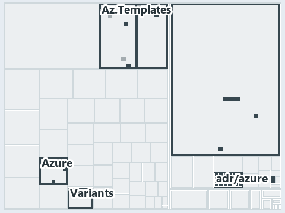

# docs/.assets/explanation/adr-az-naming--lookup-form-check-render-in-order--implementation.tree.md

`Tree minimap: adr-az-naming--lookup-form-check-render-in-order--implementation`

The tree minimap of the slide `adr-az-naming--lookup-form-check-render-in-order--implementation` (implementation lens). The slide supports
[ADR-AZ-NAMING][1]; the highlight of those ADR codes selects what is lit, and each reason below names the code that selects it.

## What the minimap shows

The tree draws every file of the world map as a tile, grouped by top-level folder (under `automation/` by module, under `docs/adr/` by ADR
domain), and lights 46 files in 7 groups, filled in ink. A lit ADR file has a white rim; a file lit only by passing mentions is a lighter
ink. Every other tile is idle, a grey box: a file the slide's ADR codes do not select.

- adr/azure (docs/adr/azure): 25 lit files
- Az.Templates (automation/Catzc.Azure.Templates): 7 lit files
- docs (docs/ outside docs/adr/): 6 lit files
- Azure (automation/Catzc.Azure): 4 lit files
- Docs (automation/Catzc.Base.Docs): 2 lit files
- Variants (automation/Catzc.Base.Variants): 1 lit file
- adr/* (the files directly in docs/adr/): 1 lit file

## Why each group is lit

### adr/azure (25 lit files)

The group holds the files of docs/adr/azure; each sits in its world-map cell and is lit by:

- [docs/adr/azure/az-session-verification.md][2], in the cell docs × markdown: selected by [ADR-AZ-NAMING][1]: an ADR file of the `azure`
  ADR domain, the ADR domain of that code.
- [docs/adr/azure/azure-customer-model.md][3], in the cell docs × markdown: selected by [ADR-AZ-NAMING][1]: an ADR file of the `azure` ADR
  domain, the ADR domain of that code.
- [docs/adr/azure/azure-data-model.md][4], in the cell docs × markdown: selected by [ADR-AZ-NAMING][1]: an ADR file of the `azure` ADR
  domain, the ADR domain of that code.
- [docs/adr/azure/azure-naming-standard.md][1], in the cell docs × markdown: selected by [ADR-AZ-NAMING][1]: an ADR file of the `azure` ADR
  domain, the ADR domain of that code.
- [docs/adr/azure/azure-network-model.md][5], in the cell docs × markdown: selected by [ADR-AZ-NAMING][1]: an ADR file of the `azure` ADR
  domain, the ADR domain of that code.
- [docs/adr/azure/caf/billing-and-tenant.md][6], in the cell docs × markdown: selected by [ADR-AZ-NAMING][1]: an ADR file of the `azure` ADR
  domain, the ADR domain of that code.
- [docs/adr/azure/caf/design-principles.md][7], in the cell docs × markdown: selected by [ADR-AZ-NAMING][1]: an ADR file of the `azure` ADR
  domain, the ADR domain of that code.
- [docs/adr/azure/caf/governance.md][8], in the cell docs × markdown: selected by [ADR-AZ-NAMING][1]: an ADR file of the `azure` ADR domain,
  the ADR domain of that code.
- [docs/adr/azure/caf/identity-and-access.md][9], in the cell docs × markdown: selected by [ADR-AZ-NAMING][1]: an ADR file of the `azure`
  ADR domain, the ADR domain of that code.
- [docs/adr/azure/caf/landing-zone-security.md][10], in the cell docs × markdown: selected by [ADR-AZ-NAMING][1]: an ADR file of the `azure`
  ADR domain, the ADR domain of that code.
- [docs/adr/azure/caf/management.md][11], in the cell docs × markdown: selected by [ADR-AZ-NAMING][1]: an ADR file of the `azure` ADR
  domain, the ADR domain of that code.
- [docs/adr/azure/caf/naming-and-tagging.md][12], in the cell docs × markdown: selected by [ADR-AZ-NAMING][1]: an ADR file of the `azure`
  ADR domain, the ADR domain of that code.
- [docs/adr/azure/caf/network-connectivity.md][13], in the cell docs × markdown: selected by [ADR-AZ-NAMING][1]: an ADR file of the `azure`
  ADR domain, the ADR domain of that code.
- [docs/adr/azure/caf/network-private-access.md][14], in the cell docs × markdown: selected by [ADR-AZ-NAMING][1]: an ADR file of the
  `azure` ADR domain, the ADR domain of that code.
- [docs/adr/azure/caf/network-topology.md][15], in the cell docs × markdown: selected by [ADR-AZ-NAMING][1]: an ADR file of the `azure` ADR
  domain, the ADR domain of that code.
- [docs/adr/azure/caf/platform-automation-and-devops.md][16], in the cell docs × markdown: selected by [ADR-AZ-NAMING][1]: an ADR file of
  the `azure` ADR domain, the ADR domain of that code.
- [docs/adr/azure/caf/resource-organization.md][17], in the cell docs × markdown: selected by [ADR-AZ-NAMING][1]: an ADR file of the `azure`
  ADR domain, the ADR domain of that code.
- [docs/adr/azure/dora-explains.md][18], in the cell docs × markdown: selected by [ADR-AZ-NAMING][1]: an ADR file of the `azure` ADR domain,
  the ADR domain of that code.
- [docs/adr/azure/landing-zones.md][19], in the cell docs × markdown: selected by [ADR-AZ-NAMING][1]: an ADR file of the `azure` ADR domain,
  the ADR domain of that code.
- [docs/adr/azure/prefer-az-cli.md][20], in the cell docs × markdown: selected by [ADR-AZ-NAMING][1]: an ADR file of the `azure` ADR domain,
  the ADR domain of that code.
- [docs/adr/azure/waf/cost-optimization.md][21], in the cell docs × markdown: selected by [ADR-AZ-NAMING][1]: an ADR file of the `azure` ADR
  domain, the ADR domain of that code.
- [docs/adr/azure/waf/operational-excellence.md][22], in the cell docs × markdown: selected by [ADR-AZ-NAMING][1]: an ADR file of the
  `azure` ADR domain, the ADR domain of that code.
- [docs/adr/azure/waf/performance-efficiency.md][23], in the cell docs × markdown: selected by [ADR-AZ-NAMING][1]: an ADR file of the
  `azure` ADR domain, the ADR domain of that code.
- [docs/adr/azure/waf/reliability.md][24], in the cell docs × markdown: selected by [ADR-AZ-NAMING][1]: an ADR file of the `azure` ADR
  domain, the ADR domain of that code.
- [docs/adr/azure/waf/security.md][25], in the cell docs × markdown: selected by [ADR-AZ-NAMING][1]: an ADR file of the `azure` ADR domain,
  the ADR domain of that code.

### Az.Templates (7 lit files)

The group holds the files of automation/Catzc.Azure.Templates; each sits in its world-map cell and is lit by:

- [automation/Catzc.Azure.Templates/Get-AzureResourceName.ps1][26], in the cell automation × powershell: selected by [ADR-AZ-NAMING][1]: the
  file cites it at line 87 (body comment), line 98 (body comment) and line 126 (body comment) (a passing mention only).
- [automation/Catzc.Azure.Templates/Get-AzureResourceTypeSet.ps1][27], in the cell automation × powershell: selected by [ADR-AZ-NAMING][1]:
  the file cites it at line 18 (header) and line 21 (header).
- [automation/Catzc.Azure.Templates/Get-BicepResourceName.ps1][28], in the cell automation × powershell: selected by [ADR-AZ-NAMING][1]: the
  file cites it at line 77 (body comment) (a passing mention only).
- [automation/Catzc.Azure.Templates/Get-BicepTemplates.ps1][29], in the cell automation × powershell: selected by [ADR-AZ-NAMING][1]: the
  file cites it at line 136 (body comment) (a passing mention only).
- [automation/Catzc.Azure.Templates/tests/Build-Bicep.Integrity.Tests.ps1][30], in the cell automation × powershell: selected by
  [ADR-AZ-NAMING][1]: the file cites it at line 68 (text).
- [automation/Catzc.Azure.Templates/tests/types/BicepShortName.Tests.ps1][31], in the cell automation × powershell: selected by
  [ADR-AZ-NAMING][1]: the file cites it at line 4 (body comment) (a passing mention only).
- [automation/Catzc.Azure.Templates/types/BicepShortName.cs][32], in the cell automation × csharp: selected by [ADR-AZ-NAMING][1]: the file
  cites it at line 2 (header), line 25 (body comment) and line 95 (body comment).

### docs (6 lit files)

The group holds the files of docs/ outside docs/adr/; each sits in its world-map cell and is lit by:

- [docs/explanation/azure/how-each-naming-rule-is-held.md][33], in the cell docs × markdown: selected by [ADR-AZ-NAMING][1]: the file cites
  it at line 15 (text), line 51 (text), line 53 (text), line 54 (text), line 55 (text), line 56 (text), line 57 (text), line 58 (text) and
  line 59 (text).
- [docs/explanation/azure/lookup-form-check-render-in-order.md][34], in the cell docs × markdown: selected by [ADR-AZ-NAMING][1]: the file
  cites it at line 19 (text), line 60 (text), line 61 (text), line 62 (text) and line 63 (text).
- [docs/explanation/azure/names-are-derived-never-typed.md][35], in the cell docs × markdown: selected by [ADR-AZ-NAMING][1]: the file cites
  it at line 16 (text), line 49 (text), line 50 (text), line 51 (text), line 52 (text) and line 53 (text).
- [docs/explanation/azure/names-are-pure-and-never-truncated.md][36], in the cell docs × markdown: selected by [ADR-AZ-NAMING][1]: the file
  cites it at line 16 (text), line 42 (text), line 42 (text), line 44 (text) and line 45 (text).
- [docs/explanation/azure/one-namer-assembles-every-name.md][37], in the cell docs × markdown: selected by [ADR-AZ-NAMING][1]: the file
  cites it at line 17 (text), line 53 (text), line 55 (text), line 57 (text) and line 59 (text).
- [docs/how-to/getting-started/automation/add-a-doc-chapter.md][38], in the cell docs × markdown: selected by [ADR-AZ-NAMING][1]: the file
  cites it at line 69 (text).

### Azure (4 lit files)

The group holds the files of automation/Catzc.Azure; each sits in its world-map cell and is lit by:

- [automation/Catzc.Azure/configs/azure.yml][39], in the cell automation × yaml: selected by [ADR-AZ-NAMING][1]: the file cites it at line
  11 (header), line 38 (body comment) and line 85 (body comment).
- [automation/Catzc.Azure/configs/customer.yml][40], in the cell automation × yaml: selected by [ADR-AZ-NAMING][1]: the file cites it at
  line 9 (header).
- [automation/Catzc.Azure/types/AzureConfig.cs][41], in the cell automation × csharp: selected by [ADR-AZ-NAMING][1]: the file cites it at
  line 18 (header).
- [automation/Catzc.Azure/types/AzureEnvironmentRecord.cs][42], in the cell automation × csharp: selected by [ADR-AZ-NAMING][1]: the file
  cites it at line 2 (header).

### Docs (2 lit files)

The group holds the files of automation/Catzc.Base.Docs; each sits in its world-map cell and is lit by:

- [automation/Catzc.Base.Docs/Build-AdrIndex.ps1][43], in the cell automation × powershell: selected by [ADR-AZ-NAMING][1]: the file cites
  it at line 60 (body comment) (a passing mention only).
- [automation/Catzc.Base.Docs/configs/adrs.yml][44], in the cell automation × yaml: selected by [ADR-AZ-NAMING][1]: the file cites it at
  line 270 (text).

### Variants (1 lit file)

The group holds the files of automation/Catzc.Base.Variants; each sits in its world-map cell and is lit by:

- [automation/Catzc.Base.Variants/configs/variants.yml][45], in the cell automation × yaml: selected by [ADR-AZ-NAMING][1]: the file cites
  it at line 7 (header).

### adr/* (1 lit file)

The group holds the files of the files directly in docs/adr/; each sits in its world-map cell and is lit by:

- [docs/adr/index.md][46], in the cell docs × markdown: selected by [ADR-AZ-NAMING][1]: the file cites it at line 15 (text) and line 252
  (text).

## Keywords

- [world map][47]
- [track][48]
- [file language][49]
- [cell][50]
- [lit cell][51]
- [automation][45]: a track
- [docs][45]: a track
- [csharp][52]: a file language
- [markdown][52]: a file language
- [powershell][52]: a file language
- [yaml][52]: a file language

[1]: ../../adr/azure/azure-naming-standard.md
[2]: ../../adr/azure/az-session-verification.md
[3]: ../../adr/azure/azure-customer-model.md
[4]: ../../adr/azure/azure-data-model.md
[5]: ../../adr/azure/azure-network-model.md
[6]: ../../adr/azure/caf/billing-and-tenant.md
[7]: ../../adr/azure/caf/design-principles.md
[8]: ../../adr/azure/caf/governance.md
[9]: ../../adr/azure/caf/identity-and-access.md
[10]: ../../adr/azure/caf/landing-zone-security.md
[11]: ../../adr/azure/caf/management.md
[12]: ../../adr/azure/caf/naming-and-tagging.md
[13]: ../../adr/azure/caf/network-connectivity.md
[14]: ../../adr/azure/caf/network-private-access.md
[15]: ../../adr/azure/caf/network-topology.md
[16]: ../../adr/azure/caf/platform-automation-and-devops.md
[17]: ../../adr/azure/caf/resource-organization.md
[18]: ../../adr/azure/dora-explains.md
[19]: ../../adr/azure/landing-zones.md
[20]: ../../adr/azure/prefer-az-cli.md
[21]: ../../adr/azure/waf/cost-optimization.md
[22]: ../../adr/azure/waf/operational-excellence.md
[23]: ../../adr/azure/waf/performance-efficiency.md
[24]: ../../adr/azure/waf/reliability.md
[25]: ../../adr/azure/waf/security.md
[26]: ../../../automation/Catzc.Azure.Templates/Get-AzureResourceName.ps1
[27]: ../../../automation/Catzc.Azure.Templates/Get-AzureResourceTypeSet.ps1
[28]: ../../../automation/Catzc.Azure.Templates/Get-BicepResourceName.ps1
[29]: ../../../automation/Catzc.Azure.Templates/Get-BicepTemplates.ps1
[30]: ../../../automation/Catzc.Azure.Templates/tests/Build-Bicep.Integrity.Tests.ps1
[31]: ../../../automation/Catzc.Azure.Templates/tests/types/BicepShortName.Tests.ps1
[32]: ../../../automation/Catzc.Azure.Templates/types/BicepShortName.cs
[33]: ../../explanation/azure/how-each-naming-rule-is-held.md
[34]: ../../explanation/azure/lookup-form-check-render-in-order.md
[35]: ../../explanation/azure/names-are-derived-never-typed.md
[36]: ../../explanation/azure/names-are-pure-and-never-truncated.md
[37]: ../../explanation/azure/one-namer-assembles-every-name.md
[38]: ../../how-to/getting-started/automation/add-a-doc-chapter.md
[39]: ../../../automation/Catzc.Azure/configs/azure.yml
[40]: ../../../automation/Catzc.Azure/configs/customer.yml
[41]: ../../../automation/Catzc.Azure/types/AzureConfig.cs
[42]: ../../../automation/Catzc.Azure/types/AzureEnvironmentRecord.cs
[43]: ../../../automation/Catzc.Base.Docs/Build-AdrIndex.ps1
[44]: ../../../automation/Catzc.Base.Docs/configs/adrs.yml
[45]: ../../../automation/Catzc.Base.Variants/configs/variants.yml
[46]: ../../adr/index.md
[47]: ../../adr/glossary.md#world-map
[48]: ../../adr/glossary.md#track
[49]: ../../adr/glossary.md#file-language
[50]: ../../adr/glossary.md#cell
[51]: ../../adr/glossary.md#lit-cell
[52]: ../../../automation/Catzc.Base.Languages/configs/languages.yml
