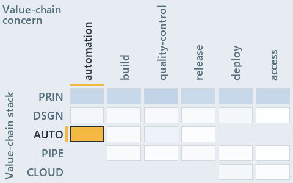

# docs/.assets/explanation/adr-conf-loading--ask-by-name-get-the-cached-object--operations.chain.md

`Value-chain minimap: adr-conf-loading--ask-by-name-get-the-cached-object--operations`

The value-chain minimap of the slide `adr-conf-loading--ask-by-name-get-the-cached-object--operations` (operations lens). The slide supports
[ADR-CONF-ADDRESSING][1] and [ADR-CONF-LOADING][2]; the highlight of those ADR codes selects what is lit, and each reason below names the
code that selects it.

## What the minimap shows

Value-chain map: value-chain stack × value-chain concerns. The grid crosses the 5 rows of the value-chain stack (PRIN, DSGN, AUTO, PIPE,
CLOUD) with the 6 value-chain concerns (automation, build, quality-control, release, deploy, access) and lights 1 cell, filled in ink. Every
other cell is idle, a grey box: it holds ADRs the slide does not cite, or none, because no ADR's value-chain concern lands there (7 of the
30 cells hold none). The minimap shows where the slide sits, not how many ADRs a cell holds; that count belongs to the full value-chain map.

- AUTO × automation: 2 lit of 64 ADRs

## Key

Rows are the value-chain stack and columns the value-chain concerns, each printed as a capital code:

- `PRIN`: the PRIN row of the value-chain stack
- `DSGN`: the DSGN row of the value-chain stack
- `AUTO`: the AUTO row of the value-chain stack
- `PIPE`: the PIPE row of the value-chain stack
- `CLOUD`: the CLOUD row of the value-chain stack
- `LOCAL`: the LOCAL row of the value-chain stack
- `BUILD`: build
- `QC`: quality-control
- `RELEASE`: release
- `DEPLOY`: deploy
- `ACCESS`: access

## Why each cell is lit

### AUTO × automation (2 ADRs)

Lit ([ADR-DSGN-TRACK#12][3]) by:

- [ADR-CONF-ADDRESSING][1]: selected by [ADR-CONF-ADDRESSING][1]; its ADR domain `configuration` sits on the AUTO row of the value-chain
  stack ([ADR-DSGN-TRACK#14][4]); its value-chain concerns (automation) are its ADR domain's default, so it lights the automation column
  ([ADR-DSGN-TRACK#15][5]).
- [ADR-CONF-LOADING][2]: selected by [ADR-CONF-LOADING][2]; its ADR domain `configuration` sits on the AUTO row of the value-chain stack
  ([ADR-DSGN-TRACK#14][4]); its value-chain concerns (automation) are its ADR domain's default, so it lights the automation column
  ([ADR-DSGN-TRACK#15][5]).

## Keywords

- [value-chain map][6]
- [value-chain stack][7]
- [value-chain concern][8]
- [cell][9]
- [lit cell][10]

[1]: ../../adr/configuration/config-value-addressing.md
[2]: ../../adr/configuration/module-config-loading.md
[3]: ../../adr/design/tracks.md#rule-adr-dsgn-track12
[4]: ../../adr/design/tracks.md#rule-adr-dsgn-track14
[5]: ../../adr/design/tracks.md#rule-adr-dsgn-track15
[6]: ../../adr/glossary.md#value-chain-map
[7]: ../../adr/glossary.md#value-chain-stack
[8]: ../../adr/glossary.md#value-chain-concern
[9]: ../../adr/glossary.md#cell
[10]: ../../adr/glossary.md#lit-cell
