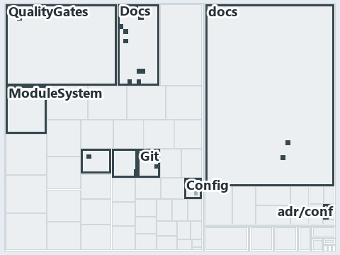

# docs/.assets/explanation/adr-conf-loading--callers-depend-on-one-config-module--architecture.tree.md

`Tree minimap: adr-conf-loading--callers-depend-on-one-config-module--architecture`

The tree minimap of the slide `adr-conf-loading--callers-depend-on-one-config-module--architecture` (architecture lens). The slide supports
[ADR-CONF-LOADING][1]; the highlight of those ADR codes selects what is lit, and each reason below names the code that selects it.

## What the minimap shows

The tree draws every file of the world map as a tile, grouped by top-level folder (under `automation/` by module, under `docs/adr/` by ADR
domain), and lights 23 files in 10 groups, filled in ink. A lit ADR file has a white rim; a file lit only by passing mentions is a lighter
ink. Every other tile is idle, a grey box: a file the slide's ADR codes do not select.

- Docs (automation/Catzc.Base.Docs): 9 lit files
- Config (automation/Catzc.Base.Config): 2 lit files
- Git (automation/Catzc.Base.Git): 2 lit files
- QualityGates (automation/Catzc.Base.QualityGates): 2 lit files
- adr/conf (docs/adr/configuration): 2 lit files
- docs (docs/ outside docs/adr/): 2 lit files
- Execution (automation/Catzc.Base.Execution): 1 lit file
- ModuleSystem (automation/Catzc.Base.ModuleSystem): 1 lit file
- RootConfig (automation/Catzc.Base.RootConfig): 1 lit file
- adr/* (the files directly in docs/adr/): 1 lit file

## Why each group is lit

### Docs (automation/Catzc.Base.Docs, 9 lit files)

The group holds the files of automation/Catzc.Base.Docs; each sits in its world-map cell and is lit by:

- [automation/Catzc.Base.Docs/Build-Readme.ps1][2], in the cell automation × powershell: selected by [ADR-CONF-LOADING][1]: the file cites
  it at line 21 (header).
- [automation/Catzc.Base.Docs/configs/adrs.yml][3], in the cell automation × yaml: selected by [ADR-CONF-LOADING][1]: the file cites it at
  line 221 (text).
- [automation/Catzc.Base.Docs/private/Get-CatsRuleEnforcers.ps1][4], in the cell automation × powershell: selected by [ADR-CONF-LOADING][1]:
  the file cites it at line 15 (header).
- [automation/Catzc.Base.Docs/private/Get-GlossarySources.ps1][5], in the cell automation × powershell: selected by [ADR-CONF-LOADING][1]:
  the file cites it at line 9 (header).
- [automation/Catzc.Base.Docs/tests/Get-AdrRuleSet.Tests.ps1][6], in the cell automation × powershell: selected by [ADR-CONF-LOADING][1]:
  the file cites it at line 43 (text).
- [automation/Catzc.Base.Docs/types/AdrChecksConfig.cs][7], in the cell automation × csharp: selected by [ADR-CONF-LOADING][1]: the file
  cites it at line 6 (header).
- [automation/Catzc.Base.Docs/types/AdrsConfig.cs][8], in the cell automation × csharp: selected by [ADR-CONF-LOADING][1]: the file cites it
  at line 5 (header).
- [automation/Catzc.Base.Docs/types/AgentsConfig.cs][9], in the cell automation × csharp: selected by [ADR-CONF-LOADING][1]: the file cites
  it at line 6 (header).
- [automation/Catzc.Base.Docs/types/DocsConfig.cs][10], in the cell automation × csharp: selected by [ADR-CONF-LOADING][1]: the file cites
  it at line 6 (header).

### Config (automation/Catzc.Base.Config, 2 lit files)

The group holds the files of automation/Catzc.Base.Config; each sits in its world-map cell and is lit by:

- [automation/Catzc.Base.Config/Get-ConfigValue.ps1][11], in the cell automation × powershell: selected by [ADR-CONF-LOADING][1]: the file
  cites it at line 8 (header) and line 14 (header).
- [automation/Catzc.Base.Config/tests/Get-ConfigValue.Tests.ps1][12], in the cell automation × powershell: selected by
  [ADR-CONF-LOADING][1]: the file cites it at line 16 (body comment) (a passing mention only).

### Git (automation/Catzc.Base.Git, 2 lit files)

The group holds the files of automation/Catzc.Base.Git; each sits in its world-map cell and is lit by:

- [automation/Catzc.Base.Git/private/Get-AutoControlledGlobs.ps1][13], in the cell automation × powershell: selected by
  [ADR-CONF-LOADING][1]: the file cites it at line 12 (header).
- [automation/Catzc.Base.Git/types/GitIgnoreConfig.cs][14], in the cell automation × csharp: selected by [ADR-CONF-LOADING][1]: the file
  cites it at line 5 (header).

### QualityGates (automation/Catzc.Base.QualityGates, 2 lit files)

The group holds the files of automation/Catzc.Base.QualityGates; each sits in its world-map cell and is lit by:

- [automation/Catzc.Base.QualityGates/Test-ShippedConfigs.ps1][15], in the cell automation × powershell: selected by [ADR-CONF-LOADING][1]:
  the file cites it at line 6 (header).
- [automation/Catzc.Base.QualityGates/private/Get-LiveIdentityTokens.ps1][16], in the cell automation × powershell: selected by
  [ADR-CONF-LOADING][1]: the file cites it at line 13 (header).

### adr/conf (docs/adr/configuration, 2 lit files)

The group holds the files of docs/adr/configuration; each sits in its world-map cell and is lit by:

- [docs/adr/configuration/dora-explains.md][17], in the cell docs × markdown: selected by [ADR-CONF-LOADING][1]: the file cites it at line
  13 (text).
- [docs/adr/configuration/module-config-loading.md][1], in the cell docs × markdown: selected by [ADR-CONF-LOADING][1]: the ADR's own file.

### docs (docs/ outside docs/adr/, 2 lit files)

The group holds the files of docs/ outside docs/adr/; each sits in its world-map cell and is lit by:

- [docs/how-to/automation/manual-test-plan/configs.md][18], in the cell docs × markdown: selected by [ADR-CONF-LOADING][1]: the file cites
  it at line 37 (text) and line 56 (text).
- [docs/how-to/getting-started/automation/add-a-module.md][19], in the cell docs × markdown: selected by [ADR-CONF-LOADING][1]: the file
  cites it at line 74 (text).

### Execution (automation/Catzc.Base.Execution, 1 lit file)

The group holds the files of automation/Catzc.Base.Execution; each sits in its world-map cell and is lit by:

- [automation/Catzc.Base.Execution/Resolve-ToolExecutable.ps1][20], in the cell automation × powershell: selected by [ADR-CONF-LOADING][1]:
  the file cites it at line 10 (header).

### ModuleSystem (automation/Catzc.Base.ModuleSystem, 1 lit file)

The group holds the files of automation/Catzc.Base.ModuleSystem; each sits in its world-map cell and is lit by:

- [automation/Catzc.Base.ModuleSystem/Copy-Automation.ps1][21], in the cell automation × powershell: selected by [ADR-CONF-LOADING][1]: the
  file cites it at line 28 (header).

### RootConfig (automation/Catzc.Base.RootConfig, 1 lit file)

The group holds the files of automation/Catzc.Base.RootConfig; each sits in its world-map cell and is lit by:

- [automation/Catzc.Base.RootConfig/types/RootConfigFiles.cs][22], in the cell automation × csharp: selected by [ADR-CONF-LOADING][1]: the
  file cites it at line 5 (header).

### adr/* (the files directly in docs/adr/, 1 lit file)

The group holds the files of the files directly in docs/adr/; each sits in its world-map cell and is lit by:

- [docs/adr/index.md][23], in the cell docs × markdown: selected by [ADR-CONF-LOADING][1]: the file cites it at line 206 (text).

## Keywords

- [world map][24]
- [track][25]
- [file language][26]
- [cell][27]
- [lit cell][28]
- [automation][29]: a track
- [docs][29]: a track
- [csharp][30]: a file language
- [markdown][30]: a file language
- [powershell][30]: a file language
- [yaml][30]: a file language

[1]: ../../adr/configuration/module-config-loading.md
[2]: ../../../automation/Catzc.Base.Docs/Build-Readme.ps1
[3]: ../../../automation/Catzc.Base.Docs/configs/adrs.yml
[4]: ../../../automation/Catzc.Base.Docs/private/Get-CatsRuleEnforcers.ps1
[5]: ../../../automation/Catzc.Base.Docs/private/Get-GlossarySources.ps1
[6]: ../../../automation/Catzc.Base.Docs/tests/Get-AdrRuleSet.Tests.ps1
[7]: ../../../automation/Catzc.Base.Docs/types/AdrChecksConfig.cs
[8]: ../../../automation/Catzc.Base.Docs/types/AdrsConfig.cs
[9]: ../../../automation/Catzc.Base.Docs/types/AgentsConfig.cs
[10]: ../../../automation/Catzc.Base.Docs/types/DocsConfig.cs
[11]: ../../../automation/Catzc.Base.Config/Get-ConfigValue.ps1
[12]: ../../../automation/Catzc.Base.Config/tests/Get-ConfigValue.Tests.ps1
[13]: ../../../automation/Catzc.Base.Git/private/Get-AutoControlledGlobs.ps1
[14]: ../../../automation/Catzc.Base.Git/types/GitIgnoreConfig.cs
[15]: ../../../automation/Catzc.Base.QualityGates/Test-ShippedConfigs.ps1
[16]: ../../../automation/Catzc.Base.QualityGates/private/Get-LiveIdentityTokens.ps1
[17]: ../../adr/configuration/dora-explains.md
[18]: ../../how-to/automation/manual-test-plan/configs.md
[19]: ../../how-to/getting-started/automation/add-a-module.md
[20]: ../../../automation/Catzc.Base.Execution/Resolve-ToolExecutable.ps1
[21]: ../../../automation/Catzc.Base.ModuleSystem/Copy-Automation.ps1
[22]: ../../../automation/Catzc.Base.RootConfig/types/RootConfigFiles.cs
[23]: ../../adr/index.md
[24]: ../../adr/glossary.md#world-map
[25]: ../../adr/glossary.md#track
[26]: ../../adr/glossary.md#file-language
[27]: ../../adr/glossary.md#cell
[28]: ../../adr/glossary.md#lit-cell
[29]: ../../../automation/Catzc.Base.Variants/configs/variants.yml
[30]: ../../../automation/Catzc.Base.Languages/configs/languages.yml
