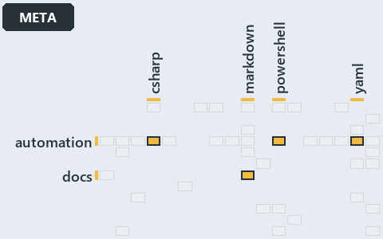

# docs/.assets/explanation/adr-conf-loading--one-reader-one-cache-per-session--meta.grid.md

`Grid minimap: adr-conf-loading--one-reader-one-cache-per-session--meta`

The grid minimap of the slide `adr-conf-loading--one-reader-one-cache-per-session--meta` (meta lens). The slide supports
[ADR-CONF-LOADING][1]; the highlight of those ADR codes selects what is lit, and each reason below names the code that selects it.

## What the minimap shows

The grid crosses the 12 tracks with the 18 file languages of the world map and lights 4 cells. A cell lit only by passing mentions
(citations in body comments, not in a file's header or text) is touched: drawn pale.

- automation × csharp: 5 lit of 219 files
- automation × powershell: 11 lit of 1398 files
- automation × yaml: 1 lit of 95 files
- docs × markdown: 16 lit of 469 files

## Why each cell is lit

### automation × csharp (5 lit files)

Placed: the root folder `automation/` names the track automation ([ADR-DSGN-TRACK#1][2]); the extension `.cs` names the file language csharp
([ADR-DSGN-TRACK#6][3]). Lit ([ADR-DSGN-TRACK#12][4]) by:

- [automation/Catzc.Base.Docs/types/AdrsConfig.cs][5]: selected by [ADR-CONF-LOADING][1]: the file cites it at line 5 (header).
- [automation/Catzc.Base.Docs/types/AgentsConfig.cs][6]: selected by [ADR-CONF-LOADING][1]: the file cites it at line 6 (header).
- [automation/Catzc.Base.Docs/types/DocsConfig.cs][7]: selected by [ADR-CONF-LOADING][1]: the file cites it at line 6 (header).
- [automation/Catzc.Base.Git/types/GitIgnoreConfig.cs][8]: selected by [ADR-CONF-LOADING][1]: the file cites it at line 5 (header).
- [automation/Catzc.Base.RootConfig/types/RootConfigFiles.cs][9]: selected by [ADR-CONF-LOADING][1]: the file cites it at line 5 (header).

### automation × powershell (11 lit files)

Placed: the root folder `automation/` names the track automation ([ADR-DSGN-TRACK#1][2]); the extension `.ps1` names the file language
powershell ([ADR-DSGN-TRACK#6][3]). Lit ([ADR-DSGN-TRACK#12][4]) by:

- [automation/Catzc.Base.Config/Get-ConfigValue.ps1][10]: selected by [ADR-CONF-LOADING][1]: the file cites it at line 8 (header) and line
  14 (header).
- [automation/Catzc.Base.Config/tests/Get-ConfigValue.Tests.ps1][11]: selected by [ADR-CONF-LOADING][1]: the file cites it at line 16 (body
  comment) (a passing mention only).
- [automation/Catzc.Base.Docs/Build-Readme.ps1][12]: selected by [ADR-CONF-LOADING][1]: the file cites it at line 21 (header).
- [automation/Catzc.Base.Docs/private/Get-CatsRuleEnforcers.ps1][13]: selected by [ADR-CONF-LOADING][1]: the file cites it at line 15
  (header).
- [automation/Catzc.Base.Docs/private/Get-GlossarySources.ps1][14]: selected by [ADR-CONF-LOADING][1]: the file cites it at line 9 (header).
- [automation/Catzc.Base.Docs/tests/Get-AdrRuleSet.Tests.ps1][15]: selected by [ADR-CONF-LOADING][1]: the file cites it at line 43 (text).
- [automation/Catzc.Base.Execution/Resolve-ToolExecutable.ps1][16]: selected by [ADR-CONF-LOADING][1]: the file cites it at line 10
  (header).
- [automation/Catzc.Base.Git/private/Get-AutoControlledGlobs.ps1][17]: selected by [ADR-CONF-LOADING][1]: the file cites it at line 12
  (header).
- [automation/Catzc.Base.ModuleSystem/Copy-Automation.ps1][18]: selected by [ADR-CONF-LOADING][1]: the file cites it at line 28 (header).
- [automation/Catzc.Base.QualityGates/Test-ShippedConfigs.ps1][19]: selected by [ADR-CONF-LOADING][1]: the file cites it at line 6 (header).
- [automation/Catzc.Base.QualityGates/private/Get-LiveIdentityTokens.ps1][20]: selected by [ADR-CONF-LOADING][1]: the file cites it at line
  13 (header).

### automation × yaml (1 lit file)

Placed: the root folder `automation/` names the track automation ([ADR-DSGN-TRACK#1][2]); the extension `.yml` names the file language yaml
([ADR-DSGN-TRACK#6][3]). Lit ([ADR-DSGN-TRACK#12][4]) by:

- [automation/Catzc.Base.Docs/configs/adrs.yml][21]: selected by [ADR-CONF-LOADING][1]: the file cites it at line 221 (text).

### docs × markdown (16 lit files)

Placed: the root folder `docs/` names the track docs ([ADR-DSGN-TRACK#1][2]); the extension `.md` names the file language markdown
([ADR-DSGN-TRACK#6][3]). Lit ([ADR-DSGN-TRACK#12][4]) by:

- [docs/.assets/explanation/adr-conf-loading--ask-by-name-get-the-cached-object--operations.drawio.md][22]: selected by
  [ADR-CONF-LOADING][1]: the file cites it at line 70 (text).
- [docs/.assets/explanation/adr-conf-loading--callers-depend-on-one-config-module--architecture.drawio.md][23]: selected by
  [ADR-CONF-LOADING][1]: the file cites it at line 69 (text).
- [docs/.assets/explanation/adr-conf-loading--one-gate-guards-the-read-path--governance.drawio.md][24]: selected by [ADR-CONF-LOADING][1]:
  the file cites it at line 72 (text).
- [docs/.assets/explanation/adr-conf-loading--one-reader-one-cache-per-session--meta.drawio.md][25]: selected by [ADR-CONF-LOADING][1]: the
  file cites it at line 66 (text).
- [docs/.assets/explanation/adr-conf-loading--three-caches-back-one-reader--implementation.drawio.md][26]: selected by
  [ADR-CONF-LOADING][1]: the file cites it at line 69 (text).
- [docs/adr/configuration/config-value-addressing.md][27]: selected by [ADR-CONF-LOADING][1]: an ADR file of the `configuration` ADR domain,
  the ADR domain of that code.
- [docs/adr/configuration/dora-explains.md][28]: selected by [ADR-CONF-LOADING][1]: an ADR file of the `configuration` ADR domain, the ADR
  domain of that code.
- [docs/adr/configuration/module-config-loading.md][1]: selected by [ADR-CONF-LOADING][1]: an ADR file of the `configuration` ADR domain,
  the ADR domain of that code.
- [docs/adr/index.md][29]: selected by [ADR-CONF-LOADING][1]: the file cites it at line 206 (text).
- [docs/explanation/configuration/ask-by-name-get-the-cached-object.md][30]: selected by [ADR-CONF-LOADING][1]: the file cites it at line 17
  (text), line 51 (text), line 52 (text), line 53 (text) and line 54 (text).
- [docs/explanation/configuration/callers-depend-on-one-config-module.md][31]: selected by [ADR-CONF-LOADING][1]: the file cites it at line
  16 (text), line 47 (text), line 48 (text), line 49 (text), line 50 (text) and line 51 (text).
- [docs/explanation/configuration/one-gate-guards-the-read-path.md][32]: selected by [ADR-CONF-LOADING][1]: the file cites it at line 17
  (text), line 29 (text), line 56 (text), line 56 (text), line 57 (text), line 58 (text), line 59 (text) and line 60 (text).
- [docs/explanation/configuration/one-reader-one-cache-per-session.md][33]: selected by [ADR-CONF-LOADING][1]: the file cites it at line 14
  (text), line 40 (text) and line 41 (text).
- [docs/explanation/configuration/three-caches-back-one-reader.md][34]: selected by [ADR-CONF-LOADING][1]: the file cites it at line 19
  (text), line 53 (text), line 54 (text), line 55 (text) and line 56 (text).
- [docs/how-to/automation/manual-test-plan/configs.md][35]: selected by [ADR-CONF-LOADING][1]: the file cites it at line 37 (text) and line
  56 (text).
- [docs/how-to/getting-started/automation/add-a-module.md][36]: selected by [ADR-CONF-LOADING][1]: the file cites it at line 74 (text).

## Keywords

- [world map][37]
- [track][38]
- [file language][39]
- [cell][40]
- [lit cell][41]
- [automation][42]: a track
- [docs][42]: a track
- [csharp][43]: a file language
- [markdown][43]: a file language
- [powershell][43]: a file language
- [yaml][43]: a file language

[1]: ../../adr/configuration/module-config-loading.md
[2]: ../../adr/design/tracks.md#rule-adr-dsgn-track1
[3]: ../../adr/design/tracks.md#rule-adr-dsgn-track6
[4]: ../../adr/design/tracks.md#rule-adr-dsgn-track12
[5]: ../../../automation/Catzc.Base.Docs/types/AdrsConfig.cs
[6]: ../../../automation/Catzc.Base.Docs/types/AgentsConfig.cs
[7]: ../../../automation/Catzc.Base.Docs/types/DocsConfig.cs
[8]: ../../../automation/Catzc.Base.Git/types/GitIgnoreConfig.cs
[9]: ../../../automation/Catzc.Base.RootConfig/types/RootConfigFiles.cs
[10]: ../../../automation/Catzc.Base.Config/Get-ConfigValue.ps1
[11]: ../../../automation/Catzc.Base.Config/tests/Get-ConfigValue.Tests.ps1
[12]: ../../../automation/Catzc.Base.Docs/Build-Readme.ps1
[13]: ../../../automation/Catzc.Base.Docs/private/Get-CatsRuleEnforcers.ps1
[14]: ../../../automation/Catzc.Base.Docs/private/Get-GlossarySources.ps1
[15]: ../../../automation/Catzc.Base.Docs/tests/Get-AdrRuleSet.Tests.ps1
[16]: ../../../automation/Catzc.Base.Execution/Resolve-ToolExecutable.ps1
[17]: ../../../automation/Catzc.Base.Git/private/Get-AutoControlledGlobs.ps1
[18]: ../../../automation/Catzc.Base.ModuleSystem/Copy-Automation.ps1
[19]: ../../../automation/Catzc.Base.QualityGates/Test-ShippedConfigs.ps1
[20]: ../../../automation/Catzc.Base.QualityGates/private/Get-LiveIdentityTokens.ps1
[21]: ../../../automation/Catzc.Base.Docs/configs/adrs.yml
[22]: adr-conf-loading--ask-by-name-get-the-cached-object--operations.drawio.md
[23]: adr-conf-loading--callers-depend-on-one-config-module--architecture.drawio.md
[24]: adr-conf-loading--one-gate-guards-the-read-path--governance.drawio.md
[25]: adr-conf-loading--one-reader-one-cache-per-session--meta.drawio.md
[26]: adr-conf-loading--three-caches-back-one-reader--implementation.drawio.md
[27]: ../../adr/configuration/config-value-addressing.md
[28]: ../../adr/configuration/dora-explains.md
[29]: ../../adr/index.md
[30]: ../../explanation/configuration/ask-by-name-get-the-cached-object.md
[31]: ../../explanation/configuration/callers-depend-on-one-config-module.md
[32]: ../../explanation/configuration/one-gate-guards-the-read-path.md
[33]: ../../explanation/configuration/one-reader-one-cache-per-session.md
[34]: ../../explanation/configuration/three-caches-back-one-reader.md
[35]: ../../how-to/automation/manual-test-plan/configs.md
[36]: ../../how-to/getting-started/automation/add-a-module.md
[37]: ../../adr/glossary.md#world-map
[38]: ../../adr/glossary.md#track
[39]: ../../adr/glossary.md#file-language
[40]: ../../adr/glossary.md#cell
[41]: ../../adr/glossary.md#lit-cell
[42]: ../../../automation/Catzc.Base.Variants/configs/variants.yml
[43]: ../../../automation/Catzc.Base.Languages/configs/languages.yml
