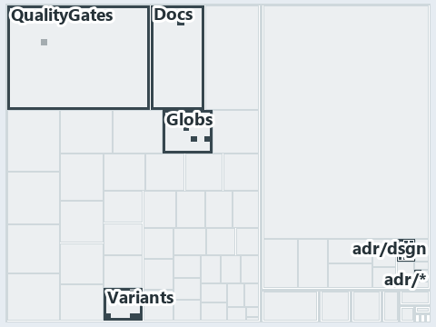

# docs/.assets/explanation/adr-dsgn-aspect--manifest-and-aspects-from-one-folder--implementation.tree.md

`Tree minimap: adr-dsgn-aspect--manifest-and-aspects-from-one-folder--implementation`

The tree minimap of the slide `adr-dsgn-aspect--manifest-and-aspects-from-one-folder--implementation` (implementation lens). The slide
supports [ADR-DSGN-ASPECT][1]; the highlight of those ADR codes selects what is lit, and each reason below names the code that selects it.

## What the minimap shows

The tree draws every file of the world map as a tile, grouped by top-level folder (under `automation/` by module, under `docs/adr/` by ADR
domain), and lights 20 files in 6 groups, filled in ink. A lit ADR file has a white rim; a file lit only by passing mentions is a lighter
ink. Every other tile is idle, a grey box: a file the slide's ADR codes do not select.

- adr/dsgn (docs/adr/design): 9 lit files
- Globs (automation/Catzc.Base.Globs): 4 lit files
- Variants (automation/Catzc.Base.Variants): 4 lit files
- Docs (automation/Catzc.Base.Docs): 1 lit file
- QualityGates (automation/Catzc.Base.QualityGates): 1 lit file
- adr/* (the files directly in docs/adr/): 1 lit file

## Why each group is lit

### adr/dsgn (9 lit files)

The group holds the files of docs/adr/design; each sits in its world-map cell and is lit by:

- [docs/adr/design/commit-lifecycle.md][2], in the cell docs × markdown: selected by [ADR-DSGN-ASPECT][1]: an ADR file of the `design` ADR
  domain, the ADR domain of that code.
- [docs/adr/design/dora-explains.md][3], in the cell docs × markdown: selected by [ADR-DSGN-ASPECT][1]: an ADR file of the `design` ADR
  domain, the ADR domain of that code.
- [docs/adr/design/module-aspects.md][1], in the cell docs × markdown: selected by [ADR-DSGN-ASPECT][1]: an ADR file of the `design` ADR
  domain, the ADR domain of that code.
- [docs/adr/design/run-modes.md][4], in the cell docs × markdown: selected by [ADR-DSGN-ASPECT][1]: an ADR file of the `design` ADR domain,
  the ADR domain of that code.
- [docs/adr/design/self-service.md][5], in the cell docs × markdown: selected by [ADR-DSGN-ASPECT][1]: an ADR file of the `design` ADR
  domain, the ADR domain of that code.
- [docs/adr/design/server-remote-integration.md][6], in the cell docs × markdown: selected by [ADR-DSGN-ASPECT][1]: an ADR file of the
  `design` ADR domain, the ADR domain of that code.
- [docs/adr/design/thin-platforms.md][7], in the cell docs × markdown: selected by [ADR-DSGN-ASPECT][1]: an ADR file of the `design` ADR
  domain, the ADR domain of that code.
- [docs/adr/design/tracks.md][8], in the cell docs × markdown: selected by [ADR-DSGN-ASPECT][1]: an ADR file of the `design` ADR domain, the
  ADR domain of that code.
- [docs/adr/design/visual-design.md][9], in the cell docs × markdown: selected by [ADR-DSGN-ASPECT][1]: an ADR file of the `design` ADR
  domain, the ADR domain of that code.

### Globs (4 lit files)

The group holds the files of automation/Catzc.Base.Globs; each sits in its world-map cell and is lit by:

- [automation/Catzc.Base.Globs/Get-ModuleGlobSet.ps1][10], in the cell automation × powershell: selected by [ADR-DSGN-ASPECT][1]: the file
  cites it at line 6 (header), line 10 (header) and line 83 (body comment).
- [automation/Catzc.Base.Globs/tests/Get-ModuleGlobSet.Tests.ps1][11], in the cell automation × powershell: selected by
  [ADR-DSGN-ASPECT][1]: the file cites it at line 40 (text).
- [automation/Catzc.Base.Globs/tests/types/Aspect.Tests.ps1][12], in the cell automation × powershell: selected by [ADR-DSGN-ASPECT][1]: the
  file cites it at line 1 (header).
- [automation/Catzc.Base.Globs/types/Aspect.cs][13], in the cell automation × csharp: selected by [ADR-DSGN-ASPECT][1]: the file cites it at
  line 1 (header), line 14 (header) and line 92 (body comment).

### Variants (4 lit files)

The group holds the files of automation/Catzc.Base.Variants; each sits in its world-map cell and is lit by:

- [automation/Catzc.Base.Variants/Get-Aspect.ps1][14], in the cell automation × powershell: selected by [ADR-DSGN-ASPECT][1]: the file cites
  it at line 6 (header).
- [automation/Catzc.Base.Variants/configs/variants.yml][15], in the cell automation × yaml: selected by [ADR-DSGN-ASPECT][1]: the file cites
  it at line 30 (body comment) (a passing mention only).
- [automation/Catzc.Base.Variants/types/VariantAspect.cs][16], in the cell automation × csharp: selected by [ADR-DSGN-ASPECT][1]: the file
  cites it at line 2 (header).
- [automation/Catzc.Base.Variants/types/VariantsConfig.cs][17], in the cell automation × csharp: selected by [ADR-DSGN-ASPECT][1]: the file
  cites it at line 18 (header).

### Docs (1 lit file)

The group holds the files of automation/Catzc.Base.Docs; each sits in its world-map cell and is lit by:

- [automation/Catzc.Base.Docs/configs/adrs.yml][18], in the cell automation × yaml: selected by [ADR-DSGN-ASPECT][1]: the file cites it at
  line 102 (text).

### QualityGates (1 lit file)

The group holds the files of automation/Catzc.Base.QualityGates; each sits in its world-map cell and is lit by:

- [automation/Catzc.Base.QualityGates/private/Get-ModuleProtectionIdentity.ps1][19], in the cell automation × powershell: selected by
  [ADR-DSGN-ASPECT][1]: the file cites it at line 54 (body comment) (a passing mention only).

### adr/* (1 lit file)

The group holds the files of the files directly in docs/adr/; each sits in its world-map cell and is lit by:

- [docs/adr/index.md][20], in the cell docs × markdown: selected by [ADR-DSGN-ASPECT][1]: the file cites it at line 95 (text).

## Keywords

- [world map][21]
- [track][22]
- [file language][23]
- [cell][24]
- [lit cell][25]
- [automation][15]: a track
- [docs][15]: a track
- [csharp][26]: a file language
- [markdown][26]: a file language
- [powershell][26]: a file language
- [yaml][26]: a file language

[1]: ../../adr/design/module-aspects.md
[2]: ../../adr/design/commit-lifecycle.md
[3]: ../../adr/design/dora-explains.md
[4]: ../../adr/design/run-modes.md
[5]: ../../adr/design/self-service.md
[6]: ../../adr/design/server-remote-integration.md
[7]: ../../adr/design/thin-platforms.md
[8]: ../../adr/design/tracks.md
[9]: ../../adr/design/visual-design.md
[10]: ../../../automation/Catzc.Base.Globs/Get-ModuleGlobSet.ps1
[11]: ../../../automation/Catzc.Base.Globs/tests/Get-ModuleGlobSet.Tests.ps1
[12]: ../../../automation/Catzc.Base.Globs/tests/types/Aspect.Tests.ps1
[13]: ../../../automation/Catzc.Base.Globs/types/Aspect.cs
[14]: ../../../automation/Catzc.Base.Variants/Get-Aspect.ps1
[15]: ../../../automation/Catzc.Base.Variants/configs/variants.yml
[16]: ../../../automation/Catzc.Base.Variants/types/VariantAspect.cs
[17]: ../../../automation/Catzc.Base.Variants/types/VariantsConfig.cs
[18]: ../../../automation/Catzc.Base.Docs/configs/adrs.yml
[19]: ../../../automation/Catzc.Base.QualityGates/private/Get-ModuleProtectionIdentity.ps1
[20]: ../../adr/index.md
[21]: ../../adr/glossary.md#world-map
[22]: ../../adr/glossary.md#track
[23]: ../../adr/glossary.md#file-language
[24]: ../../adr/glossary.md#cell
[25]: ../../adr/glossary.md#lit-cell
[26]: ../../../automation/Catzc.Base.Languages/configs/languages.yml
