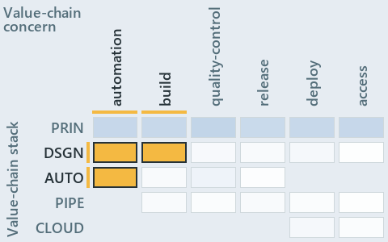

# docs/.assets/explanation/adr-dsgn-aspect--partition-integrity-runs-only-in-unit-tests--governance.chain.md

`Value-chain minimap: adr-dsgn-aspect--partition-integrity-runs-only-in-unit-tests--governance`

The value-chain minimap of the slide `adr-dsgn-aspect--partition-integrity-runs-only-in-unit-tests--governance` (governance lens). The slide
supports [ADR-DSGN-ASPECT][1], [ADR-FLOW-CD-GLOBS][2], [ADR-PWSH-MANIFEST][3], [ADR-PWSH-ONEFUNC][4] and [ADR-REPO-FOLDERS][5]; the
highlight of those ADR codes selects what is lit, and each reason below names the code that selects it.

## What the minimap shows

Value-chain map: value-chain stack × value-chain concerns. The grid crosses the 5 rows of the value-chain stack (PRIN, DSGN, AUTO, PIPE,
CLOUD) with the 6 value-chain concerns (automation, build, quality-control, release, deploy, access), shades each cell by the ADRs it holds,
and lights 3 cells.

- DSGN × automation: 2 lit of 7 ADRs
- DSGN × build: 1 lit of 5 ADRs
- AUTO × automation: 3 lit of 63 ADRs

## Why each cell is lit

### DSGN × automation (2 ADRs)

Lit ([ADR-DSGN-TRACK#12][6]) by:

- [ADR-DSGN-ASPECT][1]: selected by [ADR-DSGN-ASPECT][1]; its ADR domain `design` sits on the DSGN row of the value-chain stack
  ([ADR-DSGN-TRACK#14][7]); its own value-chain concerns (automation and build) override its ADR domain's default (automation), so it lights
  the automation column ([ADR-DSGN-TRACK#15][8]).
- [ADR-FLOW-CD-GLOBS][2]: selected by [ADR-FLOW-CD-GLOBS][2]; its ADR domain `flow` sits on the DSGN row of the value-chain stack
  ([ADR-DSGN-TRACK#14][7]); its own value-chain concerns (automation) override its ADR domain's default (build, quality-control, release and
  deploy), so it lights the automation column ([ADR-DSGN-TRACK#15][8]).

### DSGN × build (1 ADR)

Lit ([ADR-DSGN-TRACK#12][6]) by:

- [ADR-DSGN-ASPECT][1]: selected by [ADR-DSGN-ASPECT][1]; its ADR domain `design` sits on the DSGN row of the value-chain stack
  ([ADR-DSGN-TRACK#14][7]); its own value-chain concerns (automation and build) override its ADR domain's default (automation), so it lights
  the build column ([ADR-DSGN-TRACK#15][8]).

### AUTO × automation (3 ADRs)

Lit ([ADR-DSGN-TRACK#12][6]) by:

- [ADR-PWSH-MANIFEST][3]: selected by [ADR-PWSH-MANIFEST][3]; its ADR domain `pwsh` sits on the AUTO row of the value-chain stack
  ([ADR-DSGN-TRACK#14][7]); its value-chain concerns (automation) are its ADR domain's default, so it lights the automation column
  ([ADR-DSGN-TRACK#15][8]).
- [ADR-PWSH-ONEFUNC][4]: selected by [ADR-PWSH-ONEFUNC][4]; its ADR domain `pwsh` sits on the AUTO row of the value-chain stack
  ([ADR-DSGN-TRACK#14][7]); its value-chain concerns (automation) are its ADR domain's default, so it lights the automation column
  ([ADR-DSGN-TRACK#15][8]).
- [ADR-REPO-FOLDERS][5]: selected by [ADR-REPO-FOLDERS][5]; its ADR domain `repository` sits on the AUTO row of the value-chain stack
  ([ADR-DSGN-TRACK#14][7]); its value-chain concerns (automation) are its ADR domain's default, so it lights the automation column
  ([ADR-DSGN-TRACK#15][8]).

## Keywords

- [value-chain map][9]
- [value-chain stack][10]
- [value-chain concern][11]
- [cell][12]
- [lit cell][13]

Terms the cited ADRs define:

- [domain][14], defined by [ADR-REPO-FOLDERS#5][15]

[1]: ../../adr/design/module-aspects.md
[2]: ../../adr/flow/durable-sha-globs.md
[3]: ../../adr/pwsh/dynamic-module-manifests.md
[4]: ../../adr/pwsh/one-function-per-file.md
[5]: ../../adr/repository/conventional-folders.md
[6]: ../../adr/design/tracks.md#rule-adr-dsgn-track12
[7]: ../../adr/design/tracks.md#rule-adr-dsgn-track14
[8]: ../../adr/design/tracks.md#rule-adr-dsgn-track15
[9]: ../../adr/glossary.md#value-chain-map
[10]: ../../adr/glossary.md#value-chain-stack
[11]: ../../adr/glossary.md#value-chain-concern
[12]: ../../adr/glossary.md#cell
[13]: ../../adr/glossary.md#lit-cell
[14]: ../../adr/glossary.md#domain
[15]: ../../adr/repository/conventional-folders.md#rule-adr-repo-folders5
