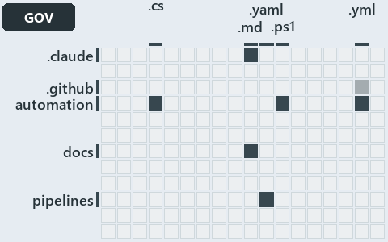

# docs/.assets/explanation/adr-dsgn-aspect--partition-integrity-runs-only-in-unit-tests--governance.grid.md

`Grid minimap: adr-dsgn-aspect--partition-integrity-runs-only-in-unit-tests--governance`

The grid minimap of the slide `adr-dsgn-aspect--partition-integrity-runs-only-in-unit-tests--governance` (governance lens). The slide
supports [ADR-DSGN-ASPECT][1], [ADR-FLOW-CD-GLOBS][2], [ADR-PWSH-MANIFEST][3], [ADR-PWSH-ONEFUNC][4] and [ADR-REPO-FOLDERS][5]; the
highlight of those ADR codes selects what is lit, and each reason below names the code that selects it.

## What the minimap shows

The grid crosses the 12 tracks (rows) with the 18 file languages (columns) of the world map and lights 7 cells, filled in ink. A cell lit
only by passing mentions (citations in body comments, not in a file's header or text) is touched: a lighter ink. Every other cell is idle, a
grey box: it holds files the slide's ADR codes do not select, or no file at all (174 of the 216 cells hold none). The minimap shows where
the slide sits, not how many files a cell holds; the world-map PDFs show the counts.

- .claude × markdown: 1 lit of 9 files
- .github × yaml: 1 lit of 2 files, touched
- automation × csharp: 10 lit of 219 files
- automation × powershell: 47 lit of 1400 files
- automation × yaml: 7 lit of 95 files
- docs × markdown: 143 lit of 741 files
- pipelines × pipeline-yaml: 6 lit of 9 files

## Key

A lit row prints its track's name; a lit column prints a short code, the first extension of its file language:

- `.cs`: csharp
- `.md`: markdown
- `.yaml`: pipeline-yaml
- `.ps1`: powershell
- `.yml`: yaml

## Why each cell is lit

### .claude × markdown (1 lit file)

Placed: the root folder `.claude/` names the track .claude ([ADR-DSGN-TRACK#1][6]); the extension `.md` names the file language markdown
([ADR-DSGN-TRACK#6][7]). Lit ([ADR-DSGN-TRACK#12][8]) by:

- [.claude/CLAUDE.md][9]: selected by [ADR-PWSH-ONEFUNC][4]: the file cites it at line 45 (text).

### .github × yaml (1 lit file, touched)

Placed: the root folder `.github/` names the track .github ([ADR-DSGN-TRACK#1][6]); the extension `.yml` names the file language yaml
([ADR-DSGN-TRACK#6][7]). Lit ([ADR-DSGN-TRACK#12][8]) by:

- [.github/workflows/ci-automation.yml][10]: selected by [ADR-FLOW-CD-GLOBS][2]: the file cites it at line 4 (body comment) (a passing
  mention only).

### automation × csharp (10 lit files)

Placed: the root folder `automation/` names the track automation ([ADR-DSGN-TRACK#1][6]); the extension `.cs` names the file language csharp
([ADR-DSGN-TRACK#6][7]). Lit ([ADR-DSGN-TRACK#12][8]) by:

- [automation/Catzc.Base.Globs/types/Aspect.cs][11]: selected by [ADR-DSGN-ASPECT][1]: the file cites it at line 1 (header), line 14
  (header) and line 92 (body comment); selected by [ADR-FLOW-CD-GLOBS][2]: the file cites it at line 9 (header).
- [automation/Catzc.Base.Globs/types/DurableHash.cs][12]: selected by [ADR-FLOW-CD-GLOBS][2]: the file cites it at line 1 (header) and line
  7 (header).
- [automation/Catzc.Base.Globs/types/GlobPattern.cs][13]: selected by [ADR-FLOW-CD-GLOBS][2]: the file cites it at line 7 (header), line 8
  (header), line 9 (header), line 33 (text), line 37 (text), line 41 (text), line 53 (text), line 57 (text) and line 66 (text).
- [automation/Catzc.Base.Globs/types/GlobSet.cs][14]: selected by [ADR-FLOW-CD-GLOBS][2]: the file cites it at line 3 (header), line 5
  (header), line 6 (header), line 12 (header), line 15 (header), line 17 (header), line 20 (header), line 32 (body comment), line 41 (body
  comment), line 63 (body comment), line 89 (text), line 122 (body comment), line 135 (body comment), line 158 (body comment) and line 180
  (body comment).
- [automation/Catzc.Base.Globs/types/GlobsConfig.cs][15]: selected by [ADR-FLOW-CD-GLOBS][2]: the file cites it at line 3 (header), line 7
  (header), line 10 (header), line 88 (text), line 143 (body comment), line 154 (text), line 158 (text) and line 172 (text).
- [automation/Catzc.Base.Languages/types/BashConfig.cs][16]: selected by [ADR-REPO-FOLDERS][5]: the file cites it at line 12 (header).
- [automation/Catzc.Base.Languages/types/GoConfig.cs][17]: selected by [ADR-REPO-FOLDERS][5]: the file cites it at line 15 (header).
- [automation/Catzc.Base.Languages/types/PythonConfig.cs][18]: selected by [ADR-REPO-FOLDERS][5]: the file cites it at line 15 (header).
- [automation/Catzc.Base.Variants/types/VariantAspect.cs][19]: selected by [ADR-DSGN-ASPECT][1]: the file cites it at line 2 (header).
- [automation/Catzc.Base.Variants/types/VariantsConfig.cs][20]: selected by [ADR-DSGN-ASPECT][1]: the file cites it at line 18 (header).

### automation × powershell (47 lit files)

Placed: the root folder `automation/` names the track automation ([ADR-DSGN-TRACK#1][6]); the extension `.ps1` names the file language
powershell ([ADR-DSGN-TRACK#6][7]). Lit ([ADR-DSGN-TRACK#12][8]) by:

- [automation/Catzc.Azure.DevOps.BuildValidation/Get-AdoBuildValidations.ps1][21]: selected by [ADR-FLOW-CD-GLOBS][2]: the file cites it at
  line 10 (header).
- [automation/Catzc.Azure.DevOps.BuildValidation/Register-AdoBuildValidation.ps1][22]: selected by [ADR-FLOW-CD-GLOBS][2]: the file cites it
  at line 6 (header) and line 98 (body comment).
- [automation/Catzc.Azure.DevOps.BuildValidation/Unregister-AdoBuildValidation.ps1][23]: selected by [ADR-FLOW-CD-GLOBS][2]: the file cites
  it at line 6 (header).
- [automation/Catzc.Azure.DevOps.BuildValidation/private/Get-BuildValidationPathFilter.ps1][24]: selected by [ADR-FLOW-CD-GLOBS][2]: the
  file cites it at line 8 (header).
- [automation/Catzc.Base.Docs/private/Get-CatsModules.ps1][25]: selected by [ADR-REPO-FOLDERS][5]: the file cites it at line 7 (header).
- [automation/Catzc.Base.Exporter/Get-CatzcContentHash.ps1][26]: selected by [ADR-FLOW-CD-GLOBS][2]: the file cites it at line 6 (header).
- [automation/Catzc.Base.Globs/Get-ChangedGlobSet.ps1][27]: selected by [ADR-FLOW-CD-GLOBS][2]: the file cites it at line 4 (header) and
  line 8 (header).
- [automation/Catzc.Base.Globs/Get-GlobSet.ps1][28]: selected by [ADR-FLOW-CD-GLOBS][2]: the file cites it at line 6 (header).
- [automation/Catzc.Base.Globs/Get-GlobSetFile.ps1][29]: selected by [ADR-FLOW-CD-GLOBS][2]: the file cites it at line 6 (header) and line 9
  (header).
- [automation/Catzc.Base.Globs/Get-GlobSetHash.ps1][30]: selected by [ADR-FLOW-CD-GLOBS][2]: the file cites it at line 4 (header) and line
  10 (header).
- [automation/Catzc.Base.Globs/Get-GlobSetTrigger.ps1][31]: selected by [ADR-FLOW-CD-GLOBS][2]: the file cites it at line 4 (header) and
  line 7 (header).
- [automation/Catzc.Base.Globs/Get-MarkerBlastRadius.ps1][32]: selected by [ADR-FLOW-CD-GLOBS][2]: the file cites it at line 6 (header).
- [automation/Catzc.Base.Globs/Get-ModuleGlobSet.ps1][33]: selected by [ADR-DSGN-ASPECT][1]: the file cites it at line 6 (header), line 10
  (header) and line 83 (body comment); selected by [ADR-FLOW-CD-GLOBS][2]: the file cites it at line 72 (body comment), line 75 (body
  comment) and line 163 (body comment) (a passing mention only).
- [automation/Catzc.Base.Globs/Get-TrackedFile.ps1][34]: selected by [ADR-FLOW-CD-GLOBS][2]: the file cites it at line 6 (header).
- [automation/Catzc.Base.Globs/Test-AdoPipelineTriggerGlob.ps1][35]: selected by [ADR-FLOW-CD-GLOBS][2]: the file cites it at line 4
  (header).
- [automation/Catzc.Base.Globs/Test-GitHubWorkflowTriggerGlob.ps1][36]: selected by [ADR-FLOW-CD-GLOBS][2]: the file cites it at line 4
  (header).
- [automation/Catzc.Base.Globs/Test-GlobSetAffected.ps1][37]: selected by [ADR-FLOW-CD-GLOBS][2]: the file cites it at line 10 (header).
- [automation/Catzc.Base.Globs/Test-GlobSetIndependence.ps1][38]: selected by [ADR-FLOW-CD-GLOBS][2]: the file cites it at line 4 (header),
  line 13 (header), line 42 (body comment), line 50 (body comment) and line 79 (text).
- [automation/Catzc.Base.Globs/Test-GlobSetTriggerCoverage.ps1][39]: selected by [ADR-FLOW-CD-GLOBS][2]: the file cites it at line 7
  (header).
- [automation/Catzc.Base.Globs/private/Get-ChangedFile.ps1][40]: selected by [ADR-FLOW-CD-GLOBS][2]: the file cites it at line 7 (header).
- [automation/Catzc.Base.Globs/private/Get-GlobSetMember.ps1][41]: selected by [ADR-FLOW-CD-GLOBS][2]: the file cites it at line 6 (header).
- [automation/Catzc.Base.Globs/private/Get-PipelineTrigger.ps1][42]: selected by [ADR-FLOW-CD-GLOBS][2]: the file cites it at line 7
  (header).
- [automation/Catzc.Base.Globs/private/Test-GlobListEqual.ps1][43]: selected by [ADR-FLOW-CD-GLOBS][2]: the file cites it at line 11
  (header).
- [automation/Catzc.Base.Globs/tests/Get-ChangedFile.Tests.ps1][44]: selected by [ADR-FLOW-CD-GLOBS][2]: the file cites it at line 2
  (header).
- [automation/Catzc.Base.Globs/tests/Get-ChangedGlobSet.Tests.ps1][45]: selected by [ADR-FLOW-CD-GLOBS][2]: the file cites it at line 2
  (header).
- [automation/Catzc.Base.Globs/tests/Get-GlobSetFile.Tests.ps1][46]: selected by [ADR-FLOW-CD-GLOBS][2]: the file cites it at line 2
  (header) and line 3 (header).
- [automation/Catzc.Base.Globs/tests/Get-GlobSetHash.Tests.ps1][47]: selected by [ADR-FLOW-CD-GLOBS][2]: the file cites it at line 2
  (header).
- [automation/Catzc.Base.Globs/tests/Get-GlobSetMember.Tests.ps1][48]: selected by [ADR-FLOW-CD-GLOBS][2]: the file cites it at line 2
  (header).
- [automation/Catzc.Base.Globs/tests/Get-GlobSetTrigger.Tests.ps1][49]: selected by [ADR-FLOW-CD-GLOBS][2]: the file cites it at line 2
  (header).
- [automation/Catzc.Base.Globs/tests/Get-ModuleGlobSet.Tests.ps1][50]: selected by [ADR-DSGN-ASPECT][1]: the file cites it at line 40
  (text).
- [automation/Catzc.Base.Globs/tests/Get-PipelineTrigger.Tests.ps1][51]: selected by [ADR-FLOW-CD-GLOBS][2]: the file cites it at line 2
  (header).
- [automation/Catzc.Base.Globs/tests/Get-TrackedFile.Tests.ps1][52]: selected by [ADR-FLOW-CD-GLOBS][2]: the file cites it at line 1
  (header).
- [automation/Catzc.Base.Globs/tests/GlobSet-Independence.Tests.ps1][53]: selected by [ADR-FLOW-CD-GLOBS][2]: the file cites it at line 2
  (header), line 10 (text) and line 12 (text).
- [automation/Catzc.Base.Globs/tests/GlobSetTrigger-Coverage.Tests.ps1][54]: selected by [ADR-FLOW-CD-GLOBS][2]: the file cites it at line 2
  (header).
- [automation/Catzc.Base.Globs/tests/PipelineTrigger-Integrity.Tests.ps1][55]: selected by [ADR-FLOW-CD-GLOBS][2]: the file cites it at line
  3 (header).
- [automation/Catzc.Base.Globs/tests/Test-GlobSetIndependence.Tests.ps1][56]: selected by [ADR-FLOW-CD-GLOBS][2]: the file cites it at line
  3 (header).
- [automation/Catzc.Base.Globs/tests/types/Aspect.Tests.ps1][57]: selected by [ADR-DSGN-ASPECT][1]: the file cites it at line 1 (header).
- [automation/Catzc.Base.Globs/tests/types/GlobPattern.Tests.ps1][58]: selected by [ADR-FLOW-CD-GLOBS][2]: the file cites it at line 1
  (header), line 3 (header) and line 63 (text).
- [automation/Catzc.Base.Globs/tests/types/GlobSet.Tests.ps1][59]: selected by [ADR-FLOW-CD-GLOBS][2]: the file cites it at line 2 (header),
  line 4 (header) and line 15 (text).
- [automation/Catzc.Base.Globs/tests/types/GlobsConfig.Tests.ps1][60]: selected by [ADR-FLOW-CD-GLOBS][2]: the file cites it at line 3
  (header), line 5 (header), line 13 (body comment), line 62 (text), line 75 (text), line 86 (text) and line 98 (text).
- [automation/Catzc.Base.ModuleSystem/Test-FolderConventions.ps1][61]: selected by [ADR-REPO-FOLDERS][5]: the file cites it at line 8
  (header) and line 89 (body comment).
- [automation/Catzc.Base.QualityGates/Test-Automation.ps1][62]: selected by [ADR-FLOW-CD-GLOBS][2]: the file cites it at line 72 (header).
- [automation/Catzc.Base.QualityGates/private/Get-ChangeTestFile.ps1][63]: selected by [ADR-PWSH-ONEFUNC][4]: the file cites it at line 6
  (header).
- [automation/Catzc.Base.QualityGates/private/Get-GuidScanFiles.ps1][64]: selected by [ADR-FLOW-CD-GLOBS][2]: the file cites it at line 7
  (header).
- [automation/Catzc.Base.QualityGates/private/Get-ModuleProtectionIdentity.ps1][65]: selected by [ADR-DSGN-ASPECT][1]: the file cites it at
  line 54 (body comment) (a passing mention only); selected by [ADR-FLOW-CD-GLOBS][2]: the file cites it at line 143 (body comment) (a
  passing mention only).
- [automation/Catzc.Base.QualityGates/private/Resolve-TestSuite.ps1][66]: selected by [ADR-FLOW-CD-GLOBS][2]: the file cites it at line 9
  (header).
- [automation/Catzc.Base.Variants/Get-Aspect.ps1][67]: selected by [ADR-DSGN-ASPECT][1]: the file cites it at line 6 (header).

### automation × yaml (7 lit files)

Placed: the root folder `automation/` names the track automation ([ADR-DSGN-TRACK#1][6]); the extension `.yml` names the file language yaml
([ADR-DSGN-TRACK#6][7]). Lit ([ADR-DSGN-TRACK#12][8]) by:

- [automation/Catzc.Azure.DevOps.BuildValidation/configs/build-validation.yml][68]: selected by [ADR-FLOW-CD-GLOBS][2]: the file cites it at
  line 5 (header).
- [automation/Catzc.Base.Docs/configs/adrs.yml][69]: selected by [ADR-DSGN-ASPECT][1]: the file cites it at line 102 (text); selected by
  [ADR-FLOW-CD-GLOBS][2]: the file cites it at line 122 (text); selected by [ADR-PWSH-MANIFEST][3]: the file cites it at line 188 (text);
  selected by [ADR-PWSH-ONEFUNC][4]: the file cites it at line 186 (text); selected by [ADR-REPO-FOLDERS][5]: the file cites it at line 307
  (text).
- [automation/Catzc.Base.Docs/configs/agents.yml][70]: selected by [ADR-REPO-FOLDERS][5]: the file cites it at line 32 (body comment) and
  line 37 (body comment) (a passing mention only).
- [automation/Catzc.Base.Docs/configs/glossary.yml][71]: selected by [ADR-REPO-FOLDERS][5]: the file cites it at line 17 (text).
- [automation/Catzc.Base.Globs/configs/globs.yml][72]: selected by [ADR-FLOW-CD-GLOBS][2]: the file cites it at line 2 (header), line 7
  (header), line 15 (header), line 17 (header), line 26 (body comment), line 61 (body comment) and line 81 (body comment).
- [automation/Catzc.Base.QualityGates/configs/terminology.yml][73]: selected by [ADR-PWSH-ONEFUNC][4]: the file cites it at line 584 (text).
- [automation/Catzc.Base.Variants/configs/variants.yml][74]: selected by [ADR-DSGN-ASPECT][1]: the file cites it at line 30 (body comment)
  (a passing mention only).

### docs × markdown (143 lit files)

Placed: the root folder `docs/` names the track docs ([ADR-DSGN-TRACK#1][6]); the extension `.md` names the file language markdown
([ADR-DSGN-TRACK#6][7]). Lit ([ADR-DSGN-TRACK#12][8]) by:

- [docs/.assets/explanation/adr-auto-bundle--what-gates-each-bundle-stage--governance.drawio.md][75]: selected by [ADR-PWSH-MANIFEST][3]:
  the file cites it at line 74 (text).
- [docs/.assets/explanation/adr-dsgn-aspect--drop-a-file-the-import-exports-it--operations.chain.md][76]: selected by [ADR-DSGN-ASPECT][1]:
  the file cites it at line 8 (text), line 25 (text), line 25 (text), line 33 (text) and line 33 (text).
- [docs/.assets/explanation/adr-dsgn-aspect--drop-a-file-the-import-exports-it--operations.drawio.md][77]: selected by [ADR-DSGN-ASPECT][1]:
  the file cites it at line 71 (text).
- [docs/.assets/explanation/adr-dsgn-aspect--drop-a-file-the-import-exports-it--operations.grid.md][78]: selected by [ADR-DSGN-ASPECT][1]:
  the file cites it at line 8 (text), line 27 (text), line 29 (text), line 30 (text), line 37 (text), line 39 (text), line 40 (text), line
  41 (text), line 43 (text), line 50 (text), line 51 (text), line 59 (text), line 61 (text), line 64 (text), line 66 (text), line 68 (text),
  line 69 (text), line 71 (text), line 73 (text), line 75 (text), line 76 (text), line 78 (text), line 80 (text), line 82 (text), line 83
  (text), line 85 (text), line 86 (text), line 88 (text), line 90 (text), line 92 (text) and line 94 (text).
- [docs/.assets/explanation/adr-dsgn-aspect--drop-a-file-the-import-exports-it--operations.tree.md][79]: selected by [ADR-DSGN-ASPECT][1]:
  the file cites it at line 8 (text), line 30 (text), line 32 (text), line 34 (text), line 36 (text), line 38 (text), line 39 (text), line
  41 (text), line 44 (text), line 46 (text), line 49 (text), line 56 (text), line 58 (text), line 60 (text), line 62 (text), line 64 (text),
  line 66 (text), line 68 (text), line 70 (text), line 72 (text), line 79 (text), line 82 (text), line 83 (text), line 85 (text), line 92
  (text), line 94 (text), line 96 (text), line 98 (text), line 105 (text), line 113 (text) and line 119 (text).
- [docs/.assets/explanation/adr-dsgn-aspect--every-file-in-exactly-one-aspect--meta.chain.md][80]: selected by [ADR-DSGN-ASPECT][1]: the
  file cites it at line 8 (text), line 25 (text), line 25 (text), line 33 (text) and line 33 (text).
- [docs/.assets/explanation/adr-dsgn-aspect--every-file-in-exactly-one-aspect--meta.drawio.md][81]: selected by [ADR-DSGN-ASPECT][1]: the
  file cites it at line 65 (text).
- [docs/.assets/explanation/adr-dsgn-aspect--every-file-in-exactly-one-aspect--meta.grid.md][82]: selected by [ADR-DSGN-ASPECT][1]: the file
  cites it at line 8 (text), line 27 (text), line 29 (text), line 30 (text), line 37 (text), line 39 (text), line 40 (text), line 41 (text),
  line 43 (text), line 50 (text), line 51 (text), line 59 (text), line 61 (text), line 64 (text), line 66 (text), line 68 (text), line 69
  (text), line 71 (text), line 73 (text), line 75 (text), line 76 (text), line 78 (text), line 80 (text), line 82 (text), line 83 (text),
  line 85 (text), line 86 (text), line 88 (text), line 90 (text), line 92 (text) and line 94 (text).
- [docs/.assets/explanation/adr-dsgn-aspect--every-file-in-exactly-one-aspect--meta.tree.md][83]: selected by [ADR-DSGN-ASPECT][1]: the file
  cites it at line 8 (text), line 30 (text), line 32 (text), line 34 (text), line 36 (text), line 38 (text), line 39 (text), line 41 (text),
  line 44 (text), line 46 (text), line 49 (text), line 56 (text), line 58 (text), line 60 (text), line 62 (text), line 64 (text), line 66
  (text), line 68 (text), line 70 (text), line 72 (text), line 79 (text), line 82 (text), line 83 (text), line 85 (text), line 92 (text),
  line 94 (text), line 96 (text), line 98 (text), line 105 (text), line 113 (text) and line 119 (text).
- [docs/.assets/explanation/adr-dsgn-aspect--manifest-and-aspects-from-one-folder--implementation.chain.md][84]: selected by
  [ADR-DSGN-ASPECT][1]: the file cites it at line 8 (text), line 26 (text), line 26 (text), line 34 (text) and line 34 (text).
- [docs/.assets/explanation/adr-dsgn-aspect--manifest-and-aspects-from-one-folder--implementation.drawio.md][85]: selected by
  [ADR-DSGN-ASPECT][1]: the file cites it at line 71 (text).
- [docs/.assets/explanation/adr-dsgn-aspect--manifest-and-aspects-from-one-folder--implementation.grid.md][86]: selected by
  [ADR-DSGN-ASPECT][1]: the file cites it at line 8 (text), line 27 (text), line 29 (text), line 30 (text), line 37 (text), line 39 (text),
  line 40 (text), line 41 (text), line 43 (text), line 50 (text), line 51 (text), line 59 (text), line 61 (text), line 64 (text), line 66
  (text), line 68 (text), line 69 (text), line 71 (text), line 73 (text), line 75 (text), line 76 (text), line 78 (text), line 80 (text),
  line 82 (text), line 83 (text), line 85 (text), line 86 (text), line 88 (text), line 90 (text), line 92 (text) and line 94 (text).
- [docs/.assets/explanation/adr-dsgn-aspect--manifest-and-aspects-from-one-folder--implementation.tree.md][87]: selected by
  [ADR-DSGN-ASPECT][1]: the file cites it at line 8 (text), line 30 (text), line 32 (text), line 34 (text), line 36 (text), line 38 (text),
  line 39 (text), line 41 (text), line 44 (text), line 46 (text), line 49 (text), line 56 (text), line 58 (text), line 60 (text), line 62
  (text), line 64 (text), line 66 (text), line 68 (text), line 70 (text), line 72 (text), line 79 (text), line 82 (text), line 83 (text),
  line 85 (text), line 92 (text), line 94 (text), line 96 (text), line 98 (text), line 105 (text), line 113 (text) and line 119 (text).
- [docs/.assets/explanation/adr-dsgn-aspect--one-folder-two-independent-readers--architecture.chain.md][88]: selected by
  [ADR-DSGN-ASPECT][1]: the file cites it at line 8 (text), line 25 (text), line 25 (text), line 33 (text) and line 33 (text).
- [docs/.assets/explanation/adr-dsgn-aspect--one-folder-two-independent-readers--architecture.drawio.md][89]: selected by
  [ADR-DSGN-ASPECT][1]: the file cites it at line 73 (text).
- [docs/.assets/explanation/adr-dsgn-aspect--one-folder-two-independent-readers--architecture.grid.md][90]: selected by
  [ADR-DSGN-ASPECT][1]: the file cites it at line 8 (text), line 27 (text), line 29 (text), line 30 (text), line 37 (text), line 39 (text),
  line 40 (text), line 41 (text), line 43 (text), line 50 (text), line 51 (text), line 59 (text), line 61 (text), line 64 (text), line 66
  (text), line 68 (text), line 69 (text), line 71 (text), line 73 (text), line 75 (text), line 76 (text), line 78 (text), line 80 (text),
  line 82 (text), line 83 (text), line 85 (text), line 86 (text), line 88 (text), line 90 (text), line 92 (text) and line 94 (text).
- [docs/.assets/explanation/adr-dsgn-aspect--one-folder-two-independent-readers--architecture.tree.md][91]: selected by
  [ADR-DSGN-ASPECT][1]: the file cites it at line 8 (text), line 30 (text), line 32 (text), line 34 (text), line 36 (text), line 38 (text),
  line 39 (text), line 41 (text), line 44 (text), line 46 (text), line 49 (text), line 56 (text), line 58 (text), line 60 (text), line 62
  (text), line 64 (text), line 66 (text), line 68 (text), line 70 (text), line 72 (text), line 79 (text), line 82 (text), line 83 (text),
  line 85 (text), line 92 (text), line 94 (text), line 96 (text), line 98 (text), line 105 (text), line 113 (text) and line 119 (text).
- [docs/.assets/explanation/adr-dsgn-aspect--partition-integrity-runs-only-in-unit-tests--governance.chain.md][92]: selected by
  [ADR-DSGN-ASPECT][1]: the file cites it at line 8 (text), line 27 (text), line 27 (text), line 38 (text) and line 38 (text); selected by
  [ADR-FLOW-CD-GLOBS][2]: the file cites it at line 8 (text), line 30 (text) and line 30 (text); selected by [ADR-PWSH-MANIFEST][3]: the
  file cites it at line 8 (text), line 46 (text) and line 46 (text); selected by [ADR-PWSH-ONEFUNC][4]: the file cites it at line 8 (text),
  line 49 (text) and line 49 (text); selected by [ADR-REPO-FOLDERS][5]: the file cites it at line 8 (text), line 52 (text), line 52 (text)
  and line 66 (text).
- [docs/.assets/explanation/adr-dsgn-aspect--partition-integrity-runs-only-in-unit-tests--governance.drawio.md][93]: selected by
  [ADR-DSGN-ASPECT][1]: the file cites it at line 66 (text) and line 75 (text); selected by [ADR-FLOW-CD-GLOBS][2]: the file cites it at
  line 66 (text) and line 76 (text); selected by [ADR-PWSH-MANIFEST][3]: the file cites it at line 66 (text) and line 75 (text); selected by
  [ADR-PWSH-ONEFUNC][4]: the file cites it at line 66 (text) and line 75 (text); selected by [ADR-REPO-FOLDERS][5]: the file cites it at
  line 66 (text) and line 76 (text).
- [docs/.assets/explanation/adr-dsgn-aspect--partition-integrity-runs-only-in-unit-tests--governance.grid.md][94]: selected by
  [ADR-DSGN-ASPECT][1]: the file cites it at line 8 (text), line 46 (text), line 61 (text), line 62 (text), line 89 (text), line 120 (text),
  line 134 (text), line 148 (text), line 153 (text), line 162 (text), line 172 (text), line 182 (text), line 184 (text), line 187 (text),
  line 189 (text), line 191 (text), line 218 (text), line 220 (text), line 222 (text), line 224 (text), line 225 (text), line 227 (text),
  line 229 (text), line 231 (text), line 232 (text), line 247 (text), line 334 (text), line 336 (text), line 339 (text), line 341 (text) and
  line 344 (text); selected by [ADR-FLOW-CD-GLOBS][2]: the file cites it at line 8 (text), line 38 (text), line 47 (text), line 48 (text),
  line 50 (text), line 52 (text), line 56 (text), line 69 (text), line 71 (text), line 73 (text), line 75 (text), line 78 (text), line 79
  (text), line 81 (text), line 82 (text), line 84 (text), line 86 (text), line 88 (text), line 90 (text), line 92 (text), line 93 (text),
  line 95 (text), line 97 (text), line 98 (text), line 100 (text), line 102 (text), line 103 (text), line 104 (text), line 106 (text), line
  108 (text), line 110 (text), line 112 (text), line 114 (text), line 116 (text), line 118 (text), line 122 (text), line 124 (text), line
  126 (text), line 128 (text), line 130 (text), line 132 (text), line 135 (text), line 137 (text), line 139 (text), line 143 (text), line
  146 (text), line 149 (text), line 151 (text), line 160 (text), line 163 (text), line 169 (text), line 191 (text), line 196 (text), line
  199 (text), line 201 (text), line 203 (text), line 205 (text), line 207 (text), line 209 (text), line 211 (text), line 212 (text), line
  215 (text), line 217 (text), line 234 (text), line 236 (text), line 238 (text), line 240 (text), line 242 (text), line 244 (text), line
  247 (text), line 338 (text), line 342 (text), line 346 (text), line 350 (text), line 352 (text), line 354 (text), line 356 (text), line
  359 (text), line 361 (text), line 363 (text), line 365 (text), line 367 (text), line 369 (text), line 371 (text), line 373 (text), line
  375 (text), line 384 (text), line 385 (text), line 386 (text), line 387 (text), line 388 (text) and line 389 (text); selected by
  [ADR-PWSH-MANIFEST][3]: the file cites it at line 8 (text), line 163 (text), line 180 (text), line 192 (text), line 248 (text), line 250
  (text), line 252 (text), line 254 (text), line 256 (text), line 258 (text), line 260 (text), line 262 (text), line 264 (text), line 266
  (text), line 268 (text), line 270 (text), line 272 (text), line 274 (text), line 276 (text), line 278 (text), line 280 (text), line 282
  (text), line 284 (text), line 286 (text), line 288 (text), line 290 (text), line 292 (text), line 294 (text), line 296 (text), line 298
  (text), line 300 (text), line 332 (text), line 340 (text) and line 347 (text); selected by [ADR-PWSH-ONEFUNC][4]: the file cites it at
  line 8 (text), line 31 (text), line 144 (text), line 164 (text), line 171 (text), line 193 (text), line 249 (text), line 251 (text), line
  253 (text), line 255 (text), line 257 (text), line 259 (text), line 261 (text), line 263 (text), line 265 (text), line 267 (text), line
  269 (text), line 271 (text), line 273 (text), line 275 (text), line 277 (text), line 279 (text), line 281 (text), line 283 (text), line
  285 (text), line 287 (text), line 289 (text), line 291 (text), line 293 (text), line 295 (text), line 297 (text), line 299 (text), line
  301 (text) and line 348 (text); selected by [ADR-REPO-FOLDERS][5]: the file cites it at line 8 (text), line 58 (text), line 59 (text),
  line 60 (text), line 77 (text), line 141 (text), line 164 (text), line 166 (text), line 168 (text), line 193 (text), line 196 (text), line
  246 (text), line 249 (text), line 302 (text), line 304 (text), line 306 (text), line 308 (text), line 310 (text), line 312 (text), line
  314 (text), line 316 (text), line 318 (text), line 320 (text), line 322 (text), line 324 (text), line 326 (text), line 328 (text), line
  330 (text), line 335 (text), line 348 (text), line 351 (text), line 376 (text) and line 411 (text).
- [docs/.assets/explanation/adr-dsgn-aspect--partition-integrity-runs-only-in-unit-tests--governance.tree.md][95]: selected by
  [ADR-DSGN-ASPECT][1]: the file cites it at line 8 (text), line 52 (text), line 91 (text), line 104 (text), line 113 (text), line 135
  (text), line 137 (text), line 139 (text), line 141 (text), line 143 (text), line 172 (text), line 175 (text), line 178 (text), line 181
  (text), line 185 (text), line 333 (text), line 335 (text), line 337 (text), line 339 (text), line 341 (text), line 343 (text), line 345
  (text), line 347 (text), line 349 (text), line 365 (text), line 423 (text), line 438 (text), line 440 (text), line 442 (text), line 444
  (text) and line 463 (text); selected by [ADR-FLOW-CD-GLOBS][2]: the file cites it at line 8 (text), line 40 (text), line 42 (text), line
  44 (text), line 46 (text), line 48 (text), line 50 (text), line 53 (text), line 55 (text), line 58 (text), line 60 (text), line 61 (text),
  line 63 (text), line 66 (text), line 67 (text), line 70 (text), line 72 (text), line 75 (text), line 76 (text), line 79 (text), line 81
  (text), line 83 (text), line 85 (text), line 87 (text), line 89 (text), line 93 (text), line 95 (text), line 97 (text), line 99 (text),
  line 101 (text), line 103 (text), line 107 (text), line 108 (text), line 111 (text), line 114 (text), line 115 (text), line 117 (text),
  line 120 (text), line 124 (text), line 143 (text), line 148 (text), line 151 (text), line 153 (text), line 155 (text), line 157 (text),
  line 159 (text), line 161 (text), line 163 (text), line 165 (text), line 167 (text), line 169 (text), line 177 (text), line 183 (text),
  line 186 (text), line 190 (text), line 193 (text), line 195 (text), line 197 (text), line 200 (text), line 202 (text), line 204 (text),
  line 206 (text), line 208 (text), line 210 (text), line 212 (text), line 214 (text), line 216 (text), line 356 (text), line 363 (text),
  line 365 (text), line 368 (text), line 374 (text), line 376 (text), line 378 (text), line 380 (text), line 382 (text), line 384 (text),
  line 391 (text), line 393 (text), line 395 (text), line 397 (text), line 399 (text), line 401 (text), line 409 (text), line 411 (text),
  line 413 (text), line 415 (text), line 417 (text), line 424 (text), line 464 (text), line 478 (text) and line 485 (text); selected by
  [ADR-PWSH-MANIFEST][3]: the file cites it at line 8 (text), line 133 (text), line 144 (text), line 170 (text), line 179 (text), line 187
  (text), line 225 (text), line 228 (text), line 230 (text), line 233 (text), line 236 (text), line 239 (text), line 241 (text), line 244
  (text), line 247 (text), line 249 (text), line 252 (text), line 254 (text), line 256 (text), line 258 (text), line 261 (text), line 263
  (text), line 265 (text), line 268 (text), line 271 (text), line 274 (text), line 277 (text), line 279 (text), line 282 (text), line 285
  (text), line 287 (text), line 290 (text), line 424 (text) and line 464 (text); selected by [ADR-PWSH-ONEFUNC][4]: the file cites it at
  line 8 (text), line 145 (text), line 188 (text), line 226 (text), line 229 (text), line 231 (text), line 234 (text), line 237 (text), line
  240 (text), line 242 (text), line 245 (text), line 248 (text), line 250 (text), line 253 (text), line 255 (text), line 257 (text), line
  259 (text), line 262 (text), line 264 (text), line 266 (text), line 269 (text), line 272 (text), line 275 (text), line 278 (text), line
  280 (text), line 283 (text), line 286 (text), line 288 (text), line 291 (text), line 358 (text), line 361 (text), line 425 (text), line
  465 (text) and line 472 (text); selected by [ADR-REPO-FOLDERS][5]: the file cites it at line 8 (text), line 145 (text), line 148 (text),
  line 173 (text), line 189 (text), line 191 (text), line 218 (text), line 298 (text), line 300 (text), line 302 (text), line 304 (text),
  line 306 (text), line 308 (text), line 310 (text), line 312 (text), line 314 (text), line 316 (text), line 318 (text), line 320 (text),
  line 322 (text), line 324 (text), line 326 (text), line 425 (text), line 427 (text), line 429 (text), line 431 (text), line 451 (text),
  line 453 (text), line 455 (text), line 462 (text), line 465 (text), line 493 (text) and line 515 (text).
- [docs/.assets/explanation/adr-dsgn-track--unit-to-pipeline-rule-is-review-only--governance.chain.md][96]: selected by
  [ADR-FLOW-CD-GLOBS][2]: the file cites it at line 8 (text), line 33 (text) and line 33 (text); selected by [ADR-REPO-FOLDERS][5]: the file
  cites it at line 8 (text), line 73 (text), line 73 (text) and line 89 (text).
- [docs/.assets/explanation/adr-dsgn-track--unit-to-pipeline-rule-is-review-only--governance.drawio.md][97]: selected by
  [ADR-FLOW-CD-GLOBS][2]: the file cites it at line 60 (text) and line 68 (text); selected by [ADR-REPO-FOLDERS][5]: the file cites it at
  line 60 (text) and line 68 (text).
- [docs/.assets/explanation/adr-dsgn-track--unit-to-pipeline-rule-is-review-only--governance.grid.md][98]: selected by
  [ADR-FLOW-CD-GLOBS][2]: the file cites it at line 8 (text), line 49 (text), line 65 (text), line 66 (text), line 68 (text), line 70
  (text), line 74 (text), line 112 (text), line 114 (text), line 116 (text), line 118 (text), line 123 (text), line 124 (text), line 126
  (text), line 127 (text), line 129 (text), line 131 (text), line 133 (text), line 134 (text), line 136 (text), line 137 (text), line 139
  (text), line 141 (text), line 142 (text), line 144 (text), line 146 (text), line 147 (text), line 148 (text), line 150 (text), line 152
  (text), line 154 (text), line 156 (text), line 158 (text), line 160 (text), line 162 (text), line 164 (text), line 166 (text), line 168
  (text), line 170 (text), line 172 (text), line 174 (text), line 176 (text), line 178 (text), line 181 (text), line 225 (text), line 226
  (text), line 230 (text), line 232 (text), line 242 (text), line 246 (text), line 251 (text), line 270 (text), line 289 (text), line 304
  (text), line 306 (text), line 308 (text), line 310 (text), line 312 (text), line 314 (text), line 316 (text), line 317 (text), line 320
  (text), line 322 (text), line 340 (text), line 342 (text), line 344 (text), line 346 (text), line 348 (text), line 350 (text), line 356
  (text), line 394 (text), line 402 (text), line 406 (text), line 413 (text), line 425 (text), line 427 (text), line 429 (text), line 432
  (text), line 434 (text), line 438 (text), line 440 (text), line 442 (text), line 446 (text), line 448 (text), line 450 (text), line 455
  (text), line 466 (text), line 467 (text), line 468 (text), line 469 (text), line 471 (text) and line 472 (text); selected by
  [ADR-REPO-FOLDERS][5]: the file cites it at line 8 (text), line 76 (text), line 78 (text), line 80 (text), line 120 (text), line 223
  (text), line 246 (text), line 247 (text), line 249 (text), line 270 (text), line 290 (text), line 354 (text), line 356 (text), line 358
  (text), line 360 (text), line 362 (text), line 364 (text), line 366 (text), line 368 (text), line 370 (text), line 372 (text), line 374
  (text), line 376 (text), line 378 (text), line 380 (text), line 382 (text), line 384 (text), line 386 (text), line 390 (text), line 407
  (text), line 413 (text), line 456 (text) and line 496 (text).
- [docs/.assets/explanation/adr-dsgn-track--unit-to-pipeline-rule-is-review-only--governance.tree.md][99]: selected by
  [ADR-FLOW-CD-GLOBS][2]: the file cites it at line 8 (text), line 41 (text), line 60 (text), line 75 (text), line 77 (text), line 79
  (text), line 81 (text), line 83 (text), line 85 (text), line 87 (text), line 89 (text), line 91 (text), line 93 (text), line 100 (text),
  line 108 (text), line 113 (text), line 119 (text), line 132 (text), line 134 (text), line 136 (text), line 139 (text), line 141 (text),
  line 145 (text), line 147 (text), line 149 (text), line 153 (text), line 155 (text), line 157 (text), line 162 (text), line 173 (text),
  line 175 (text), line 177 (text), line 179 (text), line 181 (text), line 183 (text), line 185 (text), line 187 (text), line 190 (text),
  line 192 (text), line 193 (text), line 195 (text), line 198 (text), line 200 (text), line 202 (text), line 204 (text), line 207 (text),
  line 208 (text), line 211 (text), line 213 (text), line 215 (text), line 217 (text), line 219 (text), line 221 (text), line 223 (text),
  line 225 (text), line 227 (text), line 229 (text), line 231 (text), line 233 (text), line 235 (text), line 236 (text), line 239 (text),
  line 241 (text), line 243 (text), line 245 (text), line 248 (text), line 252 (text), line 368 (text), line 438 (text), line 443 (text),
  line 447 (text), line 449 (text), line 456 (text), line 459 (text), line 461 (text), line 463 (text), line 466 (text), line 469 (text),
  line 475 (text), line 477 (text), line 479 (text), line 481 (text), line 484 (text), line 485 (text), line 493 (text), line 495 (text),
  line 497 (text), line 499 (text), line 501 (text), line 547 (text), line 554 (text) and line 561 (text); selected by
  [ADR-REPO-FOLDERS][5]: the file cites it at line 8 (text), line 41 (text), line 61 (text), line 96 (text), line 113 (text), line 119
  (text), line 164 (text), line 331 (text), line 333 (text), line 335 (text), line 337 (text), line 339 (text), line 341 (text), line 343
  (text), line 345 (text), line 347 (text), line 349 (text), line 351 (text), line 353 (text), line 355 (text), line 357 (text), line 359
  (text), line 368 (text), line 370 (text), line 372 (text), line 374 (text), line 400 (text), line 404 (text), line 408 (text), line 532
  (text), line 545 (text), line 548 (text) and line 586 (text).
- [docs/.assets/explanation/adr-flow-cd-globs--declare-or-add-folder-gate-names-overlaps--operations.chain.md][100]: selected by
  [ADR-FLOW-CD-GLOBS][2]: the file cites it at line 8 (text), line 24 (text) and line 24 (text).
- [docs/.assets/explanation/adr-flow-cd-globs--declare-or-add-folder-gate-names-overlaps--operations.drawio.md][101]: selected by
  [ADR-FLOW-CD-GLOBS][2]: the file cites it at line 71 (text).
- [docs/.assets/explanation/adr-flow-cd-globs--declare-or-add-folder-gate-names-overlaps--operations.grid.md][102]: selected by
  [ADR-FLOW-CD-GLOBS][2]: the file cites it at line 8 (text), line 29 (text), line 37 (text), line 38 (text), line 40 (text), line 42
  (text), line 46 (text), line 54 (text), line 56 (text), line 58 (text), line 60 (text), line 62 (text), line 63 (text), line 65 (text),
  line 66 (text), line 68 (text), line 70 (text), line 72 (text), line 73 (text), line 75 (text), line 76 (text), line 78 (text), line 80
  (text), line 81 (text), line 83 (text), line 85 (text), line 86 (text), line 87 (text), line 89 (text), line 91 (text), line 93 (text),
  line 95 (text), line 97 (text), line 99 (text), line 101 (text), line 103 (text), line 105 (text), line 107 (text), line 109 (text), line
  111 (text), line 113 (text), line 115 (text), line 117 (text), line 119 (text), line 121 (text), line 122 (text), line 124 (text), line
  126 (text), line 134 (text), line 136 (text), line 137 (text), line 146 (text), line 148 (text), line 150 (text), line 152 (text), line
  154 (text), line 156 (text), line 158 (text), line 160 (text), line 162 (text), line 163 (text), line 166 (text), line 168 (text), line
  169 (text), line 171 (text), line 173 (text), line 175 (text), line 177 (text), line 179 (text), line 181 (text), line 182 (text), line
  184 (text), line 186 (text), line 188 (text), line 190 (text), line 192 (text), line 194 (text), line 197 (text), line 199 (text), line
  201 (text), line 203 (text), line 205 (text), line 207 (text), line 209 (text), line 211 (text), line 213 (text), line 220 (text), line
  221 (text), line 222 (text), line 223 (text), line 224 (text) and line 225 (text).
- [docs/.assets/explanation/adr-flow-cd-globs--declare-or-add-folder-gate-names-overlaps--operations.tree.md][103]: selected by
  [ADR-FLOW-CD-GLOBS][2]: the file cites it at line 8 (text), line 32 (text), line 34 (text), line 36 (text), line 38 (text), line 40
  (text), line 42 (text), line 44 (text), line 46 (text), line 49 (text), line 51 (text), line 52 (text), line 54 (text), line 57 (text),
  line 58 (text), line 61 (text), line 63 (text), line 66 (text), line 67 (text), line 70 (text), line 72 (text), line 74 (text), line 76
  (text), line 78 (text), line 80 (text), line 82 (text), line 84 (text), line 86 (text), line 88 (text), line 90 (text), line 92 (text),
  line 94 (text), line 95 (text), line 98 (text), line 100 (text), line 102 (text), line 104 (text), line 107 (text), line 111 (text), line
  120 (text), line 122 (text), line 124 (text), line 126 (text), line 128 (text), line 130 (text), line 132 (text), line 134 (text), line
  136 (text), line 138 (text), line 140 (text), line 142 (text), line 143 (text), line 145 (text), line 148 (text), line 149 (text), line
  151 (text), line 153 (text), line 155 (text), line 158 (text), line 160 (text), line 162 (text), line 164 (text), line 166 (text), line
  168 (text), line 170 (text), line 172 (text), line 174 (text), line 181 (text), line 183 (text), line 185 (text), line 187 (text), line
  189 (text), line 191 (text), line 198 (text), line 200 (text), line 202 (text), line 204 (text), line 206 (text), line 208 (text), line
  216 (text), line 218 (text), line 220 (text), line 222 (text), line 224 (text), line 230 (text), line 233 (text), line 235 (text), line
  237 (text), line 243 (text), line 250 (text), line 257 (text) and line 264 (text).
- [docs/.assets/explanation/adr-flow-cd-globs--edit-globs-yml-then-read-the-output--operations.chain.md][104]: selected by
  [ADR-FLOW-CD-GLOBS][2]: the file cites it at line 8 (text), line 24 (text) and line 24 (text).
- [docs/.assets/explanation/adr-flow-cd-globs--edit-globs-yml-then-read-the-output--operations.drawio.md][105]: selected by
  [ADR-FLOW-CD-GLOBS][2]: the file cites it at line 66 (text).
- [docs/.assets/explanation/adr-flow-cd-globs--edit-globs-yml-then-read-the-output--operations.grid.md][106]: selected by
  [ADR-FLOW-CD-GLOBS][2]: the file cites it at line 8 (text), line 29 (text), line 37 (text), line 38 (text), line 40 (text), line 42
  (text), line 46 (text), line 54 (text), line 56 (text), line 58 (text), line 60 (text), line 62 (text), line 63 (text), line 65 (text),
  line 66 (text), line 68 (text), line 70 (text), line 72 (text), line 73 (text), line 75 (text), line 76 (text), line 78 (text), line 80
  (text), line 81 (text), line 83 (text), line 85 (text), line 86 (text), line 87 (text), line 89 (text), line 91 (text), line 93 (text),
  line 95 (text), line 97 (text), line 99 (text), line 101 (text), line 103 (text), line 105 (text), line 107 (text), line 109 (text), line
  111 (text), line 113 (text), line 115 (text), line 117 (text), line 119 (text), line 121 (text), line 122 (text), line 124 (text), line
  126 (text), line 134 (text), line 136 (text), line 137 (text), line 146 (text), line 148 (text), line 150 (text), line 152 (text), line
  154 (text), line 156 (text), line 158 (text), line 160 (text), line 162 (text), line 163 (text), line 166 (text), line 168 (text), line
  169 (text), line 171 (text), line 173 (text), line 175 (text), line 177 (text), line 179 (text), line 181 (text), line 182 (text), line
  184 (text), line 186 (text), line 188 (text), line 190 (text), line 192 (text), line 194 (text), line 197 (text), line 199 (text), line
  201 (text), line 203 (text), line 205 (text), line 207 (text), line 209 (text), line 211 (text), line 213 (text), line 220 (text), line
  221 (text), line 222 (text), line 223 (text), line 224 (text) and line 225 (text).
- [docs/.assets/explanation/adr-flow-cd-globs--edit-globs-yml-then-read-the-output--operations.tree.md][107]: selected by
  [ADR-FLOW-CD-GLOBS][2]: the file cites it at line 8 (text), line 32 (text), line 34 (text), line 36 (text), line 38 (text), line 40
  (text), line 42 (text), line 44 (text), line 46 (text), line 49 (text), line 51 (text), line 52 (text), line 54 (text), line 57 (text),
  line 58 (text), line 61 (text), line 63 (text), line 66 (text), line 67 (text), line 70 (text), line 72 (text), line 74 (text), line 76
  (text), line 78 (text), line 80 (text), line 82 (text), line 84 (text), line 86 (text), line 88 (text), line 90 (text), line 92 (text),
  line 94 (text), line 95 (text), line 98 (text), line 100 (text), line 102 (text), line 104 (text), line 107 (text), line 111 (text), line
  120 (text), line 122 (text), line 124 (text), line 126 (text), line 128 (text), line 130 (text), line 132 (text), line 134 (text), line
  136 (text), line 138 (text), line 140 (text), line 142 (text), line 143 (text), line 145 (text), line 148 (text), line 149 (text), line
  151 (text), line 153 (text), line 155 (text), line 158 (text), line 160 (text), line 162 (text), line 164 (text), line 166 (text), line
  168 (text), line 170 (text), line 172 (text), line 174 (text), line 181 (text), line 183 (text), line 185 (text), line 187 (text), line
  189 (text), line 191 (text), line 198 (text), line 200 (text), line 202 (text), line 204 (text), line 206 (text), line 208 (text), line
  216 (text), line 218 (text), line 220 (text), line 222 (text), line 224 (text), line 230 (text), line 233 (text), line 235 (text), line
  237 (text), line 243 (text), line 250 (text), line 257 (text) and line 264 (text).
- [docs/.assets/explanation/adr-flow-cd-globs--gates-check-source-and-trigger--governance.chain.md][108]: selected by
  [ADR-FLOW-CD-GLOBS][2]: the file cites it at line 8 (text), line 27 (text) and line 27 (text).
- [docs/.assets/explanation/adr-flow-cd-globs--gates-check-source-and-trigger--governance.drawio.md][109]: selected by
  [ADR-FLOW-CD-GLOBS][2]: the file cites it at line 65 (text) and line 73 (text).
- [docs/.assets/explanation/adr-flow-cd-globs--gates-check-source-and-trigger--governance.grid.md][110]: selected by [ADR-FLOW-CD-GLOBS][2]:
  the file cites it at line 8 (text), line 44 (text), line 54 (text), line 55 (text), line 57 (text), line 59 (text), line 63 (text), line
  89 (text), line 91 (text), line 93 (text), line 95 (text), line 280 (text), line 290 (text), line 292 (text), line 294 (text), line 296
  (text), line 298 (text), line 300 (text), line 302 (text), line 305 (text), line 309 (text), line 311 (text), line 312 (text), line 315
  (text), line 319 (text), line 320 (text), line 321 (text), line 323 (text), line 325 (text), line 327 (text), line 330 (text), line 333
  (text), line 335 (text), line 337 (text), line 339 (text), line 343 (text), line 345 (text), line 347 (text), line 350 (text), line 351
  (text), line 360 (text), line 366 (text), line 368 (text), line 371 (text), line 446 (text), line 481 (text), line 489 (text), line 513
  (text), line 777 (text), line 784 (text), line 793 (text), line 821 (text), line 825 (text), line 827 (text), line 829 (text), line 831
  (text), line 834 (text), line 836 (text), line 838 (text), line 840 (text), line 842 (text), line 845 (text), line 847 (text), line 926
  (text), line 928 (text), line 930 (text), line 932 (text), line 934 (text), line 936 (text), line 941 (text), line 949 (text), line 951
  (text), line 954 (text), line 956 (text), line 959 (text), line 961 (text), line 964 (text), line 967 (text), line 969 (text), line 971
  (text), line 975 (text), line 977 (text), line 979 (text), line 981 (text), line 986 (text), line 993 (text), line 1003 (text), line 1004
  (text), line 1005 (text), line 1006 (text), line 1007 (text) and line 1009 (text).
- [docs/.assets/explanation/adr-flow-cd-globs--gates-check-source-and-trigger--governance.tree.md][111]: selected by [ADR-FLOW-CD-GLOBS][2]:
  the file cites it at line 8 (text), line 71 (text), line 126 (text), line 134 (text), line 158 (text), line 346 (text), line 348 (text),
  line 352 (text), line 354 (text), line 356 (text), line 358 (text), line 360 (text), line 364 (text), line 369 (text), line 371 (text),
  line 372 (text), line 375 (text), line 380 (text), line 381 (text), line 384 (text), line 386 (text), line 389 (text), line 391 (text),
  line 393 (text), line 395 (text), line 400 (text), line 402 (text), line 404 (text), line 406 (text), line 411 (text), line 413 (text),
  line 415 (text), line 417 (text), line 419 (text), line 429 (text), line 435 (text), line 436 (text), line 439 (text), line 442 (text),
  line 444 (text), line 446 (text), line 449 (text), line 454 (text), line 469 (text), line 473 (text), line 475 (text), line 477 (text),
  line 479 (text), line 482 (text), line 484 (text), line 486 (text), line 488 (text), line 491 (text), line 493 (text), line 495 (text),
  line 502 (text), line 504 (text), line 509 (text), line 510 (text), line 515 (text), line 517 (text), line 520 (text), line 523 (text),
  line 525 (text), line 527 (text), line 531 (text), line 533 (text), line 536 (text), line 537 (text), line 543 (text), line 552 (text),
  line 695 (text), line 1071 (text), line 1073 (text), line 1075 (text), line 1077 (text), line 1079 (text), line 1087 (text), line 1089
  (text), line 1091 (text), line 1093 (text), line 1095 (text), line 1097 (text), line 1104 (text), line 1106 (text), line 1108 (text), line
  1110 (text), line 1112 (text), line 1115 (text), line 1178 (text), line 1296 (text) and line 1302 (text).
- [docs/.assets/explanation/adr-flow-cd-globs--globs-module-owns-config-and-types--architecture.chain.md][112]: selected by
  [ADR-FLOW-CD-GLOBS][2]: the file cites it at line 8 (text), line 24 (text) and line 24 (text).
- [docs/.assets/explanation/adr-flow-cd-globs--globs-module-owns-config-and-types--architecture.drawio.md][113]: selected by
  [ADR-FLOW-CD-GLOBS][2]: the file cites it at line 70 (text).
- [docs/.assets/explanation/adr-flow-cd-globs--globs-module-owns-config-and-types--architecture.grid.md][114]: selected by
  [ADR-FLOW-CD-GLOBS][2]: the file cites it at line 8 (text), line 29 (text), line 37 (text), line 38 (text), line 40 (text), line 42
  (text), line 46 (text), line 54 (text), line 56 (text), line 58 (text), line 60 (text), line 62 (text), line 63 (text), line 65 (text),
  line 66 (text), line 68 (text), line 70 (text), line 72 (text), line 73 (text), line 75 (text), line 76 (text), line 78 (text), line 80
  (text), line 81 (text), line 83 (text), line 85 (text), line 86 (text), line 87 (text), line 89 (text), line 91 (text), line 93 (text),
  line 95 (text), line 97 (text), line 99 (text), line 101 (text), line 103 (text), line 105 (text), line 107 (text), line 109 (text), line
  111 (text), line 113 (text), line 115 (text), line 117 (text), line 119 (text), line 121 (text), line 122 (text), line 124 (text), line
  126 (text), line 134 (text), line 136 (text), line 137 (text), line 146 (text), line 148 (text), line 150 (text), line 152 (text), line
  154 (text), line 156 (text), line 158 (text), line 160 (text), line 162 (text), line 163 (text), line 166 (text), line 168 (text), line
  169 (text), line 171 (text), line 173 (text), line 175 (text), line 177 (text), line 179 (text), line 181 (text), line 182 (text), line
  184 (text), line 186 (text), line 188 (text), line 190 (text), line 192 (text), line 194 (text), line 197 (text), line 199 (text), line
  201 (text), line 203 (text), line 205 (text), line 207 (text), line 209 (text), line 211 (text), line 213 (text), line 220 (text), line
  221 (text), line 222 (text), line 223 (text), line 224 (text) and line 225 (text).
- [docs/.assets/explanation/adr-flow-cd-globs--globs-module-owns-config-and-types--architecture.tree.md][115]: selected by
  [ADR-FLOW-CD-GLOBS][2]: the file cites it at line 8 (text), line 32 (text), line 34 (text), line 36 (text), line 38 (text), line 40
  (text), line 42 (text), line 44 (text), line 46 (text), line 49 (text), line 51 (text), line 52 (text), line 54 (text), line 57 (text),
  line 58 (text), line 61 (text), line 63 (text), line 66 (text), line 67 (text), line 70 (text), line 72 (text), line 74 (text), line 76
  (text), line 78 (text), line 80 (text), line 82 (text), line 84 (text), line 86 (text), line 88 (text), line 90 (text), line 92 (text),
  line 94 (text), line 95 (text), line 98 (text), line 100 (text), line 102 (text), line 104 (text), line 107 (text), line 111 (text), line
  120 (text), line 122 (text), line 124 (text), line 126 (text), line 128 (text), line 130 (text), line 132 (text), line 134 (text), line
  136 (text), line 138 (text), line 140 (text), line 142 (text), line 143 (text), line 145 (text), line 148 (text), line 149 (text), line
  151 (text), line 153 (text), line 155 (text), line 158 (text), line 160 (text), line 162 (text), line 164 (text), line 166 (text), line
  168 (text), line 170 (text), line 172 (text), line 174 (text), line 181 (text), line 183 (text), line 185 (text), line 187 (text), line
  189 (text), line 191 (text), line 198 (text), line 200 (text), line 202 (text), line 204 (text), line 206 (text), line 208 (text), line
  216 (text), line 218 (text), line 220 (text), line 222 (text), line 224 (text), line 230 (text), line 233 (text), line 235 (text), line
  237 (text), line 243 (text), line 250 (text), line 257 (text) and line 264 (text).
- [docs/.assets/explanation/adr-flow-cd-globs--independence-check-groups-by-layer--implementation.chain.md][116]: selected by
  [ADR-FLOW-CD-GLOBS][2]: the file cites it at line 8 (text), line 25 (text) and line 25 (text).
- [docs/.assets/explanation/adr-flow-cd-globs--independence-check-groups-by-layer--implementation.drawio.md][117]: selected by
  [ADR-FLOW-CD-GLOBS][2]: the file cites it at line 70 (text).
- [docs/.assets/explanation/adr-flow-cd-globs--independence-check-groups-by-layer--implementation.grid.md][118]: selected by
  [ADR-FLOW-CD-GLOBS][2]: the file cites it at line 8 (text), line 29 (text), line 37 (text), line 38 (text), line 40 (text), line 42
  (text), line 46 (text), line 54 (text), line 56 (text), line 58 (text), line 60 (text), line 62 (text), line 63 (text), line 65 (text),
  line 66 (text), line 68 (text), line 70 (text), line 72 (text), line 73 (text), line 75 (text), line 76 (text), line 78 (text), line 80
  (text), line 81 (text), line 83 (text), line 85 (text), line 86 (text), line 87 (text), line 89 (text), line 91 (text), line 93 (text),
  line 95 (text), line 97 (text), line 99 (text), line 101 (text), line 103 (text), line 105 (text), line 107 (text), line 109 (text), line
  111 (text), line 113 (text), line 115 (text), line 117 (text), line 119 (text), line 121 (text), line 122 (text), line 124 (text), line
  126 (text), line 134 (text), line 136 (text), line 137 (text), line 146 (text), line 148 (text), line 150 (text), line 152 (text), line
  154 (text), line 156 (text), line 158 (text), line 160 (text), line 162 (text), line 163 (text), line 166 (text), line 168 (text), line
  169 (text), line 171 (text), line 173 (text), line 175 (text), line 177 (text), line 179 (text), line 181 (text), line 182 (text), line
  184 (text), line 186 (text), line 188 (text), line 190 (text), line 192 (text), line 194 (text), line 197 (text), line 199 (text), line
  201 (text), line 203 (text), line 205 (text), line 207 (text), line 209 (text), line 211 (text), line 213 (text), line 220 (text), line
  221 (text), line 222 (text), line 223 (text), line 224 (text) and line 225 (text).
- [docs/.assets/explanation/adr-flow-cd-globs--independence-check-groups-by-layer--implementation.tree.md][119]: selected by
  [ADR-FLOW-CD-GLOBS][2]: the file cites it at line 8 (text), line 32 (text), line 34 (text), line 36 (text), line 38 (text), line 40
  (text), line 42 (text), line 44 (text), line 46 (text), line 49 (text), line 51 (text), line 52 (text), line 54 (text), line 57 (text),
  line 58 (text), line 61 (text), line 63 (text), line 66 (text), line 67 (text), line 70 (text), line 72 (text), line 74 (text), line 76
  (text), line 78 (text), line 80 (text), line 82 (text), line 84 (text), line 86 (text), line 88 (text), line 90 (text), line 92 (text),
  line 94 (text), line 95 (text), line 98 (text), line 100 (text), line 102 (text), line 104 (text), line 107 (text), line 111 (text), line
  120 (text), line 122 (text), line 124 (text), line 126 (text), line 128 (text), line 130 (text), line 132 (text), line 134 (text), line
  136 (text), line 138 (text), line 140 (text), line 142 (text), line 143 (text), line 145 (text), line 148 (text), line 149 (text), line
  151 (text), line 153 (text), line 155 (text), line 158 (text), line 160 (text), line 162 (text), line 164 (text), line 166 (text), line
  168 (text), line 170 (text), line 172 (text), line 174 (text), line 181 (text), line 183 (text), line 185 (text), line 187 (text), line
  189 (text), line 191 (text), line 198 (text), line 200 (text), line 202 (text), line 204 (text), line 206 (text), line 208 (text), line
  216 (text), line 218 (text), line 220 (text), line 222 (text), line 224 (text), line 230 (text), line 233 (text), line 235 (text), line
  237 (text), line 243 (text), line 250 (text), line 257 (text) and line 264 (text).
- [docs/.assets/explanation/adr-flow-cd-globs--one-scan-program-feeds-three-roles--implementation.chain.md][120]: selected by
  [ADR-FLOW-CD-GLOBS][2]: the file cites it at line 8 (text), line 25 (text) and line 25 (text).
- [docs/.assets/explanation/adr-flow-cd-globs--one-scan-program-feeds-three-roles--implementation.drawio.md][121]: selected by
  [ADR-FLOW-CD-GLOBS][2]: the file cites it at line 70 (text).
- [docs/.assets/explanation/adr-flow-cd-globs--one-scan-program-feeds-three-roles--implementation.grid.md][122]: selected by
  [ADR-FLOW-CD-GLOBS][2]: the file cites it at line 8 (text), line 29 (text), line 37 (text), line 38 (text), line 40 (text), line 42
  (text), line 46 (text), line 54 (text), line 56 (text), line 58 (text), line 60 (text), line 62 (text), line 63 (text), line 65 (text),
  line 66 (text), line 68 (text), line 70 (text), line 72 (text), line 73 (text), line 75 (text), line 76 (text), line 78 (text), line 80
  (text), line 81 (text), line 83 (text), line 85 (text), line 86 (text), line 87 (text), line 89 (text), line 91 (text), line 93 (text),
  line 95 (text), line 97 (text), line 99 (text), line 101 (text), line 103 (text), line 105 (text), line 107 (text), line 109 (text), line
  111 (text), line 113 (text), line 115 (text), line 117 (text), line 119 (text), line 121 (text), line 122 (text), line 124 (text), line
  126 (text), line 134 (text), line 136 (text), line 137 (text), line 146 (text), line 148 (text), line 150 (text), line 152 (text), line
  154 (text), line 156 (text), line 158 (text), line 160 (text), line 162 (text), line 163 (text), line 166 (text), line 168 (text), line
  169 (text), line 171 (text), line 173 (text), line 175 (text), line 177 (text), line 179 (text), line 181 (text), line 182 (text), line
  184 (text), line 186 (text), line 188 (text), line 190 (text), line 192 (text), line 194 (text), line 197 (text), line 199 (text), line
  201 (text), line 203 (text), line 205 (text), line 207 (text), line 209 (text), line 211 (text), line 213 (text), line 220 (text), line
  221 (text), line 222 (text), line 223 (text), line 224 (text) and line 225 (text).
- [docs/.assets/explanation/adr-flow-cd-globs--one-scan-program-feeds-three-roles--implementation.tree.md][123]: selected by
  [ADR-FLOW-CD-GLOBS][2]: the file cites it at line 8 (text), line 32 (text), line 34 (text), line 36 (text), line 38 (text), line 40
  (text), line 42 (text), line 44 (text), line 46 (text), line 49 (text), line 51 (text), line 52 (text), line 54 (text), line 57 (text),
  line 58 (text), line 61 (text), line 63 (text), line 66 (text), line 67 (text), line 70 (text), line 72 (text), line 74 (text), line 76
  (text), line 78 (text), line 80 (text), line 82 (text), line 84 (text), line 86 (text), line 88 (text), line 90 (text), line 92 (text),
  line 94 (text), line 95 (text), line 98 (text), line 100 (text), line 102 (text), line 104 (text), line 107 (text), line 111 (text), line
  120 (text), line 122 (text), line 124 (text), line 126 (text), line 128 (text), line 130 (text), line 132 (text), line 134 (text), line
  136 (text), line 138 (text), line 140 (text), line 142 (text), line 143 (text), line 145 (text), line 148 (text), line 149 (text), line
  151 (text), line 153 (text), line 155 (text), line 158 (text), line 160 (text), line 162 (text), line 164 (text), line 166 (text), line
  168 (text), line 170 (text), line 172 (text), line 174 (text), line 181 (text), line 183 (text), line 185 (text), line 187 (text), line
  189 (text), line 191 (text), line 198 (text), line 200 (text), line 202 (text), line 204 (text), line 206 (text), line 208 (text), line
  216 (text), line 218 (text), line 220 (text), line 222 (text), line 224 (text), line 230 (text), line 233 (text), line 235 (text), line
  237 (text), line 243 (text), line 250 (text), line 257 (text) and line 264 (text).
- [docs/.assets/explanation/adr-flow-cd-globs--overlap-gated-for-units-and-modules--governance.chain.md][124]: selected by
  [ADR-FLOW-CD-GLOBS][2]: the file cites it at line 8 (text), line 36 (text) and line 36 (text).
- [docs/.assets/explanation/adr-flow-cd-globs--overlap-gated-for-units-and-modules--governance.drawio.md][125]: selected by
  [ADR-FLOW-CD-GLOBS][2]: the file cites it at line 61 (text) and line 68 (text).
- [docs/.assets/explanation/adr-flow-cd-globs--overlap-gated-for-units-and-modules--governance.grid.md][126]: selected by
  [ADR-FLOW-CD-GLOBS][2]: the file cites it at line 8 (text), line 45 (text), line 55 (text), line 56 (text), line 58 (text), line 60
  (text), line 64 (text), line 90 (text), line 92 (text), line 94 (text), line 96 (text), line 281 (text), line 292 (text), line 294 (text),
  line 296 (text), line 298 (text), line 300 (text), line 302 (text), line 304 (text), line 307 (text), line 311 (text), line 313 (text),
  line 314 (text), line 317 (text), line 321 (text), line 322 (text), line 323 (text), line 325 (text), line 327 (text), line 329 (text),
  line 332 (text), line 335 (text), line 337 (text), line 339 (text), line 341 (text), line 345 (text), line 347 (text), line 349 (text),
  line 352 (text), line 353 (text), line 362 (text), line 368 (text), line 370 (text), line 373 (text), line 448 (text), line 483 (text),
  line 491 (text), line 515 (text), line 779 (text), line 786 (text), line 796 (text), line 827 (text), line 831 (text), line 833 (text),
  line 835 (text), line 837 (text), line 840 (text), line 842 (text), line 844 (text), line 846 (text), line 849 (text), line 852 (text),
  line 854 (text), line 933 (text), line 935 (text), line 937 (text), line 939 (text), line 941 (text), line 943 (text), line 948 (text),
  line 973 (text), line 975 (text), line 978 (text), line 980 (text), line 983 (text), line 985 (text), line 988 (text), line 991 (text),
  line 993 (text), line 995 (text), line 999 (text), line 1002 (text), line 1004 (text), line 1006 (text), line 1011 (text), line 1018
  (text), line 1028 (text), line 1029 (text), line 1030 (text), line 1031 (text), line 1032 (text) and line 1034 (text).
- [docs/.assets/explanation/adr-flow-cd-globs--overlap-gated-for-units-and-modules--governance.tree.md][127]: selected by
  [ADR-FLOW-CD-GLOBS][2]: the file cites it at line 8 (text), line 72 (text), line 128 (text), line 136 (text), line 160 (text), line 348
  (text), line 350 (text), line 354 (text), line 356 (text), line 358 (text), line 360 (text), line 362 (text), line 366 (text), line 371
  (text), line 373 (text), line 374 (text), line 377 (text), line 382 (text), line 383 (text), line 386 (text), line 388 (text), line 391
  (text), line 393 (text), line 395 (text), line 397 (text), line 402 (text), line 404 (text), line 406 (text), line 408 (text), line 413
  (text), line 415 (text), line 417 (text), line 419 (text), line 421 (text), line 431 (text), line 437 (text), line 438 (text), line 441
  (text), line 444 (text), line 446 (text), line 448 (text), line 451 (text), line 456 (text), line 473 (text), line 477 (text), line 479
  (text), line 481 (text), line 483 (text), line 486 (text), line 488 (text), line 490 (text), line 492 (text), line 496 (text), line 498
  (text), line 500 (text), line 509 (text), line 511 (text), line 516 (text), line 517 (text), line 522 (text), line 524 (text), line 527
  (text), line 530 (text), line 532 (text), line 534 (text), line 538 (text), line 541 (text), line 544 (text), line 545 (text), line 551
  (text), line 560 (text), line 703 (text), line 1098 (text), line 1100 (text), line 1102 (text), line 1104 (text), line 1106 (text), line
  1114 (text), line 1116 (text), line 1118 (text), line 1120 (text), line 1122 (text), line 1124 (text), line 1131 (text), line 1133 (text),
  line 1135 (text), line 1137 (text), line 1139 (text), line 1142 (text), line 1205 (text), line 1333 (text) and line 1340 (text).
- [docs/.assets/explanation/adr-flow-cd-globs--peers-in-a-layer-never-overlap--meta.chain.md][128]: selected by [ADR-FLOW-CD-GLOBS][2]: the
  file cites it at line 8 (text), line 24 (text) and line 24 (text).
- [docs/.assets/explanation/adr-flow-cd-globs--peers-in-a-layer-never-overlap--meta.drawio.md][129]: selected by [ADR-FLOW-CD-GLOBS][2]: the
  file cites it at line 62 (text).
- [docs/.assets/explanation/adr-flow-cd-globs--peers-in-a-layer-never-overlap--meta.grid.md][130]: selected by [ADR-FLOW-CD-GLOBS][2]: the
  file cites it at line 8 (text), line 29 (text), line 37 (text), line 38 (text), line 40 (text), line 42 (text), line 46 (text), line 54
  (text), line 56 (text), line 58 (text), line 60 (text), line 62 (text), line 63 (text), line 65 (text), line 66 (text), line 68 (text),
  line 70 (text), line 72 (text), line 73 (text), line 75 (text), line 76 (text), line 78 (text), line 80 (text), line 81 (text), line 83
  (text), line 85 (text), line 86 (text), line 87 (text), line 89 (text), line 91 (text), line 93 (text), line 95 (text), line 97 (text),
  line 99 (text), line 101 (text), line 103 (text), line 105 (text), line 107 (text), line 109 (text), line 111 (text), line 113 (text),
  line 115 (text), line 117 (text), line 119 (text), line 121 (text), line 122 (text), line 124 (text), line 126 (text), line 134 (text),
  line 136 (text), line 137 (text), line 146 (text), line 148 (text), line 150 (text), line 152 (text), line 154 (text), line 156 (text),
  line 158 (text), line 160 (text), line 162 (text), line 163 (text), line 166 (text), line 168 (text), line 169 (text), line 171 (text),
  line 173 (text), line 175 (text), line 177 (text), line 179 (text), line 181 (text), line 182 (text), line 184 (text), line 186 (text),
  line 188 (text), line 190 (text), line 192 (text), line 194 (text), line 197 (text), line 199 (text), line 201 (text), line 203 (text),
  line 205 (text), line 207 (text), line 209 (text), line 211 (text), line 213 (text), line 220 (text), line 221 (text), line 222 (text),
  line 223 (text), line 224 (text) and line 225 (text).
- [docs/.assets/explanation/adr-flow-cd-globs--peers-in-a-layer-never-overlap--meta.tree.md][131]: selected by [ADR-FLOW-CD-GLOBS][2]: the
  file cites it at line 8 (text), line 32 (text), line 34 (text), line 36 (text), line 38 (text), line 40 (text), line 42 (text), line 44
  (text), line 46 (text), line 49 (text), line 51 (text), line 52 (text), line 54 (text), line 57 (text), line 58 (text), line 61 (text),
  line 63 (text), line 66 (text), line 67 (text), line 70 (text), line 72 (text), line 74 (text), line 76 (text), line 78 (text), line 80
  (text), line 82 (text), line 84 (text), line 86 (text), line 88 (text), line 90 (text), line 92 (text), line 94 (text), line 95 (text),
  line 98 (text), line 100 (text), line 102 (text), line 104 (text), line 107 (text), line 111 (text), line 120 (text), line 122 (text),
  line 124 (text), line 126 (text), line 128 (text), line 130 (text), line 132 (text), line 134 (text), line 136 (text), line 138 (text),
  line 140 (text), line 142 (text), line 143 (text), line 145 (text), line 148 (text), line 149 (text), line 151 (text), line 153 (text),
  line 155 (text), line 158 (text), line 160 (text), line 162 (text), line 164 (text), line 166 (text), line 168 (text), line 170 (text),
  line 172 (text), line 174 (text), line 181 (text), line 183 (text), line 185 (text), line 187 (text), line 189 (text), line 191 (text),
  line 198 (text), line 200 (text), line 202 (text), line 204 (text), line 206 (text), line 208 (text), line 216 (text), line 218 (text),
  line 220 (text), line 222 (text), line 224 (text), line 230 (text), line 233 (text), line 235 (text), line 237 (text), line 243 (text),
  line 250 (text), line 257 (text) and line 264 (text).
- [docs/.assets/explanation/adr-flow-cd-globs--three-views-derived-live-from-one-program--meta.chain.md][132]: selected by
  [ADR-FLOW-CD-GLOBS][2]: the file cites it at line 8 (text), line 24 (text) and line 24 (text).
- [docs/.assets/explanation/adr-flow-cd-globs--three-views-derived-live-from-one-program--meta.drawio.md][133]: selected by
  [ADR-FLOW-CD-GLOBS][2]: the file cites it at line 62 (text).
- [docs/.assets/explanation/adr-flow-cd-globs--three-views-derived-live-from-one-program--meta.grid.md][134]: selected by
  [ADR-FLOW-CD-GLOBS][2]: the file cites it at line 8 (text), line 29 (text), line 37 (text), line 38 (text), line 40 (text), line 42
  (text), line 46 (text), line 54 (text), line 56 (text), line 58 (text), line 60 (text), line 62 (text), line 63 (text), line 65 (text),
  line 66 (text), line 68 (text), line 70 (text), line 72 (text), line 73 (text), line 75 (text), line 76 (text), line 78 (text), line 80
  (text), line 81 (text), line 83 (text), line 85 (text), line 86 (text), line 87 (text), line 89 (text), line 91 (text), line 93 (text),
  line 95 (text), line 97 (text), line 99 (text), line 101 (text), line 103 (text), line 105 (text), line 107 (text), line 109 (text), line
  111 (text), line 113 (text), line 115 (text), line 117 (text), line 119 (text), line 121 (text), line 122 (text), line 124 (text), line
  126 (text), line 134 (text), line 136 (text), line 137 (text), line 146 (text), line 148 (text), line 150 (text), line 152 (text), line
  154 (text), line 156 (text), line 158 (text), line 160 (text), line 162 (text), line 163 (text), line 166 (text), line 168 (text), line
  169 (text), line 171 (text), line 173 (text), line 175 (text), line 177 (text), line 179 (text), line 181 (text), line 182 (text), line
  184 (text), line 186 (text), line 188 (text), line 190 (text), line 192 (text), line 194 (text), line 197 (text), line 199 (text), line
  201 (text), line 203 (text), line 205 (text), line 207 (text), line 209 (text), line 211 (text), line 213 (text), line 220 (text), line
  221 (text), line 222 (text), line 223 (text), line 224 (text) and line 225 (text).
- [docs/.assets/explanation/adr-flow-cd-globs--three-views-derived-live-from-one-program--meta.tree.md][135]: selected by
  [ADR-FLOW-CD-GLOBS][2]: the file cites it at line 8 (text), line 32 (text), line 34 (text), line 36 (text), line 38 (text), line 40
  (text), line 42 (text), line 44 (text), line 46 (text), line 49 (text), line 51 (text), line 52 (text), line 54 (text), line 57 (text),
  line 58 (text), line 61 (text), line 63 (text), line 66 (text), line 67 (text), line 70 (text), line 72 (text), line 74 (text), line 76
  (text), line 78 (text), line 80 (text), line 82 (text), line 84 (text), line 86 (text), line 88 (text), line 90 (text), line 92 (text),
  line 94 (text), line 95 (text), line 98 (text), line 100 (text), line 102 (text), line 104 (text), line 107 (text), line 111 (text), line
  120 (text), line 122 (text), line 124 (text), line 126 (text), line 128 (text), line 130 (text), line 132 (text), line 134 (text), line
  136 (text), line 138 (text), line 140 (text), line 142 (text), line 143 (text), line 145 (text), line 148 (text), line 149 (text), line
  151 (text), line 153 (text), line 155 (text), line 158 (text), line 160 (text), line 162 (text), line 164 (text), line 166 (text), line
  168 (text), line 170 (text), line 172 (text), line 174 (text), line 181 (text), line 183 (text), line 185 (text), line 187 (text), line
  189 (text), line 191 (text), line 198 (text), line 200 (text), line 202 (text), line 204 (text), line 206 (text), line 208 (text), line
  216 (text), line 218 (text), line 220 (text), line 222 (text), line 224 (text), line 230 (text), line 233 (text), line 235 (text), line
  237 (text), line 243 (text), line 250 (text), line 257 (text) and line 264 (text).
- [docs/.assets/explanation/adr-flow-cd-globs--two-declared-layers-one-derived--architecture.chain.md][136]: selected by
  [ADR-FLOW-CD-GLOBS][2]: the file cites it at line 8 (text), line 24 (text) and line 24 (text).
- [docs/.assets/explanation/adr-flow-cd-globs--two-declared-layers-one-derived--architecture.drawio.md][137]: selected by
  [ADR-FLOW-CD-GLOBS][2]: the file cites it at line 62 (text).
- [docs/.assets/explanation/adr-flow-cd-globs--two-declared-layers-one-derived--architecture.grid.md][138]: selected by
  [ADR-FLOW-CD-GLOBS][2]: the file cites it at line 8 (text), line 29 (text), line 37 (text), line 38 (text), line 40 (text), line 42
  (text), line 46 (text), line 54 (text), line 56 (text), line 58 (text), line 60 (text), line 62 (text), line 63 (text), line 65 (text),
  line 66 (text), line 68 (text), line 70 (text), line 72 (text), line 73 (text), line 75 (text), line 76 (text), line 78 (text), line 80
  (text), line 81 (text), line 83 (text), line 85 (text), line 86 (text), line 87 (text), line 89 (text), line 91 (text), line 93 (text),
  line 95 (text), line 97 (text), line 99 (text), line 101 (text), line 103 (text), line 105 (text), line 107 (text), line 109 (text), line
  111 (text), line 113 (text), line 115 (text), line 117 (text), line 119 (text), line 121 (text), line 122 (text), line 124 (text), line
  126 (text), line 134 (text), line 136 (text), line 137 (text), line 146 (text), line 148 (text), line 150 (text), line 152 (text), line
  154 (text), line 156 (text), line 158 (text), line 160 (text), line 162 (text), line 163 (text), line 166 (text), line 168 (text), line
  169 (text), line 171 (text), line 173 (text), line 175 (text), line 177 (text), line 179 (text), line 181 (text), line 182 (text), line
  184 (text), line 186 (text), line 188 (text), line 190 (text), line 192 (text), line 194 (text), line 197 (text), line 199 (text), line
  201 (text), line 203 (text), line 205 (text), line 207 (text), line 209 (text), line 211 (text), line 213 (text), line 220 (text), line
  221 (text), line 222 (text), line 223 (text), line 224 (text) and line 225 (text).
- [docs/.assets/explanation/adr-flow-cd-globs--two-declared-layers-one-derived--architecture.tree.md][139]: selected by
  [ADR-FLOW-CD-GLOBS][2]: the file cites it at line 8 (text), line 32 (text), line 34 (text), line 36 (text), line 38 (text), line 40
  (text), line 42 (text), line 44 (text), line 46 (text), line 49 (text), line 51 (text), line 52 (text), line 54 (text), line 57 (text),
  line 58 (text), line 61 (text), line 63 (text), line 66 (text), line 67 (text), line 70 (text), line 72 (text), line 74 (text), line 76
  (text), line 78 (text), line 80 (text), line 82 (text), line 84 (text), line 86 (text), line 88 (text), line 90 (text), line 92 (text),
  line 94 (text), line 95 (text), line 98 (text), line 100 (text), line 102 (text), line 104 (text), line 107 (text), line 111 (text), line
  120 (text), line 122 (text), line 124 (text), line 126 (text), line 128 (text), line 130 (text), line 132 (text), line 134 (text), line
  136 (text), line 138 (text), line 140 (text), line 142 (text), line 143 (text), line 145 (text), line 148 (text), line 149 (text), line
  151 (text), line 153 (text), line 155 (text), line 158 (text), line 160 (text), line 162 (text), line 164 (text), line 166 (text), line
  168 (text), line 170 (text), line 172 (text), line 174 (text), line 181 (text), line 183 (text), line 185 (text), line 187 (text), line
  189 (text), line 191 (text), line 198 (text), line 200 (text), line 202 (text), line 204 (text), line 206 (text), line 208 (text), line
  216 (text), line 218 (text), line 220 (text), line 222 (text), line 224 (text), line 230 (text), line 233 (text), line 235 (text), line
  237 (text), line 243 (text), line 250 (text), line 257 (text) and line 264 (text).
- [docs/adr/design/commit-lifecycle.md][140]: selected by [ADR-DSGN-ASPECT][1]: an ADR file of the `design` ADR domain, the ADR domain of
  that code.
- [docs/adr/design/dora-explains.md][141]: selected by [ADR-DSGN-ASPECT][1]: an ADR file of the `design` ADR domain, the ADR domain of that
  code.
- [docs/adr/design/module-aspects.md][1]: selected by [ADR-DSGN-ASPECT][1]: an ADR file of the `design` ADR domain, the ADR domain of that
  code.
- [docs/adr/design/run-modes.md][142]: selected by [ADR-DSGN-ASPECT][1]: an ADR file of the `design` ADR domain, the ADR domain of that
  code.
- [docs/adr/design/self-service.md][143]: selected by [ADR-DSGN-ASPECT][1]: an ADR file of the `design` ADR domain, the ADR domain of that
  code.
- [docs/adr/design/server-remote-integration.md][144]: selected by [ADR-DSGN-ASPECT][1]: an ADR file of the `design` ADR domain, the ADR
  domain of that code.
- [docs/adr/design/thin-platforms.md][145]: selected by [ADR-DSGN-ASPECT][1]: an ADR file of the `design` ADR domain, the ADR domain of that
  code.
- [docs/adr/design/tracks.md][146]: selected by [ADR-DSGN-ASPECT][1]: an ADR file of the `design` ADR domain, the ADR domain of that code.
- [docs/adr/design/visual-design.md][147]: selected by [ADR-DSGN-ASPECT][1]: an ADR file of the `design` ADR domain, the ADR domain of that
  code.
- [docs/adr/flow/cd-discipline-and-promotion-flow.md][148]: selected by [ADR-FLOW-CD-GLOBS][2]: an ADR file of the `flow` ADR domain, the
  ADR domain of that code.
- [docs/adr/flow/dora-explains.md][149]: selected by [ADR-FLOW-CD-GLOBS][2]: an ADR file of the `flow` ADR domain, the ADR domain of that
  code.
- [docs/adr/flow/durable-sha-globs.md][2]: selected by [ADR-FLOW-CD-GLOBS][2]: an ADR file of the `flow` ADR domain, the ADR domain of that
  code.
- [docs/adr/flow/pipeline-detection.md][150]: selected by [ADR-FLOW-CD-GLOBS][2]: an ADR file of the `flow` ADR domain, the ADR domain of
  that code.
- [docs/adr/flow/pipeline-runner-pattern.md][151]: selected by [ADR-FLOW-CD-GLOBS][2]: an ADR file of the `flow` ADR domain, the ADR domain
  of that code.
- [docs/adr/flow/pipeline-types.md][152]: selected by [ADR-FLOW-CD-GLOBS][2]: an ADR file of the `flow` ADR domain, the ADR domain of that
  code.
- [docs/adr/glossary.md][153]: selected by [ADR-REPO-FOLDERS][5]: the file cites it at line 752 (text).
- [docs/adr/index.md][154]: selected by [ADR-DSGN-ASPECT][1]: the file cites it at line 95 (text); selected by [ADR-FLOW-CD-GLOBS][2]: the
  file cites it at line 111 (text); selected by [ADR-PWSH-MANIFEST][3]: the file cites it at line 174 (text); selected by
  [ADR-PWSH-ONEFUNC][4]: the file cites it at line 172 (text); selected by [ADR-REPO-FOLDERS][5]: the file cites it at line 286 (text).
- [docs/adr/pwsh/announce-state-changes.md][155]: selected by [ADR-PWSH-MANIFEST][3]: an ADR file of the `pwsh` ADR domain, the ADR domain
  of that code; selected by [ADR-PWSH-ONEFUNC][4]: an ADR file of the `pwsh` ADR domain, the ADR domain of that code.
- [docs/adr/pwsh/assert-idioms.md][156]: selected by [ADR-PWSH-MANIFEST][3]: an ADR file of the `pwsh` ADR domain, the ADR domain of that
  code; selected by [ADR-PWSH-ONEFUNC][4]: an ADR file of the `pwsh` ADR domain, the ADR domain of that code.
- [docs/adr/pwsh/automatic-variable-pitfalls.md][157]: selected by [ADR-PWSH-MANIFEST][3]: an ADR file of the `pwsh` ADR domain, the ADR
  domain of that code; selected by [ADR-PWSH-ONEFUNC][4]: an ADR file of the `pwsh` ADR domain, the ADR domain of that code.
- [docs/adr/pwsh/avoid-using-semicolons.md][158]: selected by [ADR-PWSH-MANIFEST][3]: an ADR file of the `pwsh` ADR domain, the ADR domain
  of that code; selected by [ADR-PWSH-ONEFUNC][4]: an ADR file of the `pwsh` ADR domain, the ADR domain of that code.
- [docs/adr/pwsh/cross-platform-powershell.md][159]: selected by [ADR-PWSH-MANIFEST][3]: an ADR file of the `pwsh` ADR domain, the ADR
  domain of that code; selected by [ADR-PWSH-ONEFUNC][4]: an ADR file of the `pwsh` ADR domain, the ADR domain of that code.
- [docs/adr/pwsh/dora-explains.md][160]: selected by [ADR-PWSH-MANIFEST][3]: an ADR file of the `pwsh` ADR domain, the ADR domain of that
  code; selected by [ADR-PWSH-ONEFUNC][4]: an ADR file of the `pwsh` ADR domain, the ADR domain of that code.
- [docs/adr/pwsh/dynamic-module-manifests.md][3]: selected by [ADR-PWSH-MANIFEST][3]: an ADR file of the `pwsh` ADR domain, the ADR domain
  of that code; selected by [ADR-PWSH-ONEFUNC][4]: an ADR file of the `pwsh` ADR domain, the ADR domain of that code.
- [docs/adr/pwsh/environment-variable-mechanics.md][161]: selected by [ADR-PWSH-MANIFEST][3]: an ADR file of the `pwsh` ADR domain, the ADR
  domain of that code; selected by [ADR-PWSH-ONEFUNC][4]: an ADR file of the `pwsh` ADR domain, the ADR domain of that code.
- [docs/adr/pwsh/error-handling.md][162]: selected by [ADR-PWSH-MANIFEST][3]: an ADR file of the `pwsh` ADR domain, the ADR domain of that
  code; selected by [ADR-PWSH-ONEFUNC][4]: an ADR file of the `pwsh` ADR domain, the ADR domain of that code.
- [docs/adr/pwsh/hosting-csharp-types.md][163]: selected by [ADR-PWSH-MANIFEST][3]: an ADR file of the `pwsh` ADR domain, the ADR domain of
  that code; selected by [ADR-PWSH-ONEFUNC][4]: an ADR file of the `pwsh` ADR domain, the ADR domain of that code.
- [docs/adr/pwsh/identifier-names.md][164]: selected by [ADR-PWSH-MANIFEST][3]: an ADR file of the `pwsh` ADR domain, the ADR domain of that
  code; selected by [ADR-PWSH-ONEFUNC][4]: an ADR file of the `pwsh` ADR domain, the ADR domain of that code.
- [docs/adr/pwsh/index.md][165]: selected by [ADR-PWSH-MANIFEST][3]: an ADR file of the `pwsh` ADR domain, the ADR domain of that code;
  selected by [ADR-PWSH-ONEFUNC][4]: an ADR file of the `pwsh` ADR domain, the ADR domain of that code.
- [docs/adr/pwsh/module-path-hygiene.md][166]: selected by [ADR-PWSH-MANIFEST][3]: an ADR file of the `pwsh` ADR domain, the ADR domain of
  that code; selected by [ADR-PWSH-ONEFUNC][4]: an ADR file of the `pwsh` ADR domain, the ADR domain of that code.
- [docs/adr/pwsh/one-function-per-file.md][4]: selected by [ADR-PWSH-MANIFEST][3]: an ADR file of the `pwsh` ADR domain, the ADR domain of
  that code; selected by [ADR-PWSH-ONEFUNC][4]: an ADR file of the `pwsh` ADR domain, the ADR domain of that code.
- [docs/adr/pwsh/parameter-design.md][167]: selected by [ADR-PWSH-MANIFEST][3]: an ADR file of the `pwsh` ADR domain, the ADR domain of that
  code; selected by [ADR-PWSH-ONEFUNC][4]: an ADR file of the `pwsh` ADR domain, the ADR domain of that code.
- [docs/adr/pwsh/pester-testing.md][168]: selected by [ADR-PWSH-MANIFEST][3]: an ADR file of the `pwsh` ADR domain, the ADR domain of that
  code; selected by [ADR-PWSH-ONEFUNC][4]: an ADR file of the `pwsh` ADR domain, the ADR domain of that code.
- [docs/adr/pwsh/powershell-formatting.md][169]: selected by [ADR-PWSH-MANIFEST][3]: an ADR file of the `pwsh` ADR domain, the ADR domain of
  that code; selected by [ADR-PWSH-ONEFUNC][4]: an ADR file of the `pwsh` ADR domain, the ADR domain of that code.
- [docs/adr/pwsh/prefer-dryrun-over-shouldprocess.md][170]: selected by [ADR-PWSH-MANIFEST][3]: an ADR file of the `pwsh` ADR domain, the
  ADR domain of that code; selected by [ADR-PWSH-ONEFUNC][4]: an ADR file of the `pwsh` ADR domain, the ADR domain of that code.
- [docs/adr/pwsh/prefer-foreach-over-foreach-object.md][171]: selected by [ADR-PWSH-MANIFEST][3]: an ADR file of the `pwsh` ADR domain, the
  ADR domain of that code; selected by [ADR-PWSH-ONEFUNC][4]: an ADR file of the `pwsh` ADR domain, the ADR domain of that code.
- [docs/adr/pwsh/prepost-extension-modules.md][172]: selected by [ADR-PWSH-MANIFEST][3]: an ADR file of the `pwsh` ADR domain, the ADR
  domain of that code; selected by [ADR-PWSH-ONEFUNC][4]: an ADR file of the `pwsh` ADR domain, the ADR domain of that code.
- [docs/adr/pwsh/pwsh-engine.md][173]: selected by [ADR-PWSH-MANIFEST][3]: an ADR file of the `pwsh` ADR domain, the ADR domain of that
  code; selected by [ADR-PWSH-ONEFUNC][4]: an ADR file of the `pwsh` ADR domain, the ADR domain of that code.
- [docs/adr/pwsh/respect-pwsh-verb-rules.md][174]: selected by [ADR-PWSH-MANIFEST][3]: an ADR file of the `pwsh` ADR domain, the ADR domain
  of that code; selected by [ADR-PWSH-ONEFUNC][4]: an ADR file of the `pwsh` ADR domain, the ADR domain of that code.
- [docs/adr/pwsh/script-scope-caching.md][175]: selected by [ADR-PWSH-MANIFEST][3]: an ADR file of the `pwsh` ADR domain, the ADR domain of
  that code; selected by [ADR-PWSH-ONEFUNC][4]: an ADR file of the `pwsh` ADR domain, the ADR domain of that code.
- [docs/adr/pwsh/use-ps1-not-psm1.md][176]: selected by [ADR-PWSH-MANIFEST][3]: an ADR file of the `pwsh` ADR domain, the ADR domain of that
  code; selected by [ADR-PWSH-ONEFUNC][4]: an ADR file of the `pwsh` ADR domain, the ADR domain of that code.
- [docs/adr/pwsh/vendor-toolset-dependencies.md][177]: selected by [ADR-PWSH-MANIFEST][3]: an ADR file of the `pwsh` ADR domain, the ADR
  domain of that code; selected by [ADR-PWSH-ONEFUNC][4]: an ADR file of the `pwsh` ADR domain, the ADR domain of that code.
- [docs/adr/pwsh/working-directory-mechanics.md][178]: selected by [ADR-PWSH-MANIFEST][3]: an ADR file of the `pwsh` ADR domain, the ADR
  domain of that code; selected by [ADR-PWSH-ONEFUNC][4]: an ADR file of the `pwsh` ADR domain, the ADR domain of that code.
- [docs/adr/repository/agent-definitions.md][179]: selected by [ADR-REPO-FOLDERS][5]: an ADR file of the `repository` ADR domain, the ADR
  domain of that code.
- [docs/adr/repository/api-contracts.md][180]: selected by [ADR-REPO-FOLDERS][5]: an ADR file of the `repository` ADR domain, the ADR domain
  of that code.
- [docs/adr/repository/controlled-vocabulary.md][181]: selected by [ADR-REPO-FOLDERS][5]: an ADR file of the `repository` ADR domain, the
  ADR domain of that code.
- [docs/adr/repository/conventional-folders.md][5]: selected by [ADR-REPO-FOLDERS][5]: an ADR file of the `repository` ADR domain, the ADR
  domain of that code.
- [docs/adr/repository/dedicated-output-directory.md][182]: selected by [ADR-REPO-FOLDERS][5]: an ADR file of the `repository` ADR domain,
  the ADR domain of that code.
- [docs/adr/repository/documentation-examples.md][183]: selected by [ADR-REPO-FOLDERS][5]: an ADR file of the `repository` ADR domain, the
  ADR domain of that code.
- [docs/adr/repository/domain-language-separation.md][184]: selected by [ADR-REPO-FOLDERS][5]: an ADR file of the `repository` ADR domain,
  the ADR domain of that code.
- [docs/adr/repository/dora-explains.md][185]: selected by [ADR-REPO-FOLDERS][5]: an ADR file of the `repository` ADR domain, the ADR domain
  of that code.
- [docs/adr/repository/generated-readmes.md][186]: selected by [ADR-REPO-FOLDERS][5]: an ADR file of the `repository` ADR domain, the ADR
  domain of that code.
- [docs/adr/repository/generated-root-configs.md][187]: selected by [ADR-REPO-FOLDERS][5]: an ADR file of the `repository` ADR domain, the
  ADR domain of that code.
- [docs/adr/repository/inspiration.md][188]: selected by [ADR-REPO-FOLDERS][5]: an ADR file of the `repository` ADR domain, the ADR domain
  of that code.
- [docs/adr/repository/markdown-links.md][189]: selected by [ADR-REPO-FOLDERS][5]: an ADR file of the `repository` ADR domain, the ADR
  domain of that code.
- [docs/adr/repository/output-formats.md][190]: selected by [ADR-REPO-FOLDERS][5]: an ADR file of the `repository` ADR domain, the ADR
  domain of that code.
- [docs/adr/repository/repo-variants.md][191]: selected by [ADR-REPO-FOLDERS][5]: an ADR file of the `repository` ADR domain, the ADR domain
  of that code.
- [docs/adr/repository/uniform-formatting.md][192]: selected by [ADR-REPO-FOLDERS][5]: an ADR file of the `repository` ADR domain, the ADR
  domain of that code.
- [docs/explanation/automation/what-gates-each-bundle-stage.md][193]: selected by [ADR-PWSH-MANIFEST][3]: the file cites it at line 16
  (text), line 32 (text) and line 50 (text).
- [docs/explanation/design/drop-a-file-the-import-exports-it.md][194]: selected by [ADR-DSGN-ASPECT][1]: the file cites it at line 16
  (text), line 46 (text) and line 48 (text); selected by [ADR-REPO-FOLDERS][5]: the file cites it at line 52 (text).
- [docs/explanation/design/every-file-in-exactly-one-aspect.md][195]: selected by [ADR-DSGN-ASPECT][1]: the file cites it at line 14 (text),
  line 42 (text), line 44 (text), line 45 (text), line 46 (text), line 51 (text), line 53 (text) and line 55 (text); selected by
  [ADR-FLOW-CD-GLOBS][2]: the file cites it at line 51 (text).
- [docs/explanation/design/manifest-and-aspects-from-one-folder.md][196]: selected by [ADR-DSGN-ASPECT][1]: the file cites it at line 18
  (text), line 53 (text), line 55 (text) and line 61 (text); selected by [ADR-PWSH-MANIFEST][3]: the file cites it at line 59 (text).
- [docs/explanation/design/one-folder-two-independent-readers.md][197]: selected by [ADR-DSGN-ASPECT][1]: the file cites it at line 17
  (text), line 51 (text), line 53 (text), line 55 (text), line 59 (text) and line 61 (text); selected by [ADR-FLOW-CD-GLOBS][2]: the file
  cites it at line 59 (text).
- [docs/explanation/design/partition-integrity-runs-only-in-unit-tests.md][198]: selected by [ADR-DSGN-ASPECT][1]: the file cites it at line
  17 (text), line 21 (text), line 22 (text), line 45 (text), line 46 (text), line 48 (text), line 59 (text), line 60 (text), line 61 (text),
  line 65 (text) and line 67 (text); selected by [ADR-FLOW-CD-GLOBS][2]: the file cites it at line 49 (text) and line 67 (text); selected by
  [ADR-PWSH-MANIFEST][3]: the file cites it at line 36 (text), line 42 (text), line 43 (text), line 55 (text), line 56 (text) and line 69
  (text); selected by [ADR-PWSH-ONEFUNC][4]: the file cites it at line 35 (text) and line 53 (text); selected by [ADR-REPO-FOLDERS][5]: the
  file cites it at line 38 (text), line 57 (text) and line 71 (text).
- [docs/explanation/design/unit-to-pipeline-rule-is-review-only.md][199]: selected by [ADR-FLOW-CD-GLOBS][2]: the file cites it at line 59
  (text) and line 59 (text); selected by [ADR-REPO-FOLDERS][5]: the file cites it at line 54 (text) and line 55 (text).
- [docs/explanation/flow/declare-or-add-folder-gate-names-overlaps.md][200]: selected by [ADR-FLOW-CD-GLOBS][2]: the file cites it at line
  16 (text), line 47 (text), line 49 (text) and line 53 (text).
- [docs/explanation/flow/edit-globs-yml-then-read-the-output.md][201]: selected by [ADR-FLOW-CD-GLOBS][2]: the file cites it at line 17
  (text), line 47 (text), line 49 (text) and line 50 (text).
- [docs/explanation/flow/gates-check-source-and-trigger.md][202]: selected by [ADR-FLOW-CD-GLOBS][2]: the file cites it at line 17 (text),
  line 52 (text), line 53 (text), line 54 (text), line 55 (text), line 56 (text), line 57 (text), line 57 (text), line 58 (text), line 59
  (text), line 59 (text), line 61 (text) and line 72 (text).
- [docs/explanation/flow/globs-module-owns-config-and-types.md][203]: selected by [ADR-FLOW-CD-GLOBS][2]: the file cites it at line 15
  (text), line 48 (text), line 49 (text), line 51 (text) and line 52 (text).
- [docs/explanation/flow/independence-check-groups-by-layer.md][204]: selected by [ADR-FLOW-CD-GLOBS][2]: the file cites it at line 17
  (text), line 52 (text), line 54 (text), line 58 (text) and line 58 (text).
- [docs/explanation/flow/one-scan-program-feeds-three-roles.md][205]: selected by [ADR-FLOW-CD-GLOBS][2]: the file cites it at line 18
  (text), line 53 (text), line 54 (text), line 55 (text), line 56 (text), line 61 (text) and line 62 (text).
- [docs/explanation/flow/overlap-gated-for-units-and-modules.md][206]: selected by [ADR-FLOW-CD-GLOBS][2]: the file cites it at line 16
  (text), line 49 (text) and line 51 (text).
- [docs/explanation/flow/peers-in-a-layer-never-overlap.md][207]: selected by [ADR-FLOW-CD-GLOBS][2]: the file cites it at line 13 (text),
  line 38 (text) and line 40 (text).
- [docs/explanation/flow/three-views-derived-live-from-one-program.md][208]: selected by [ADR-FLOW-CD-GLOBS][2]: the file cites it at line
  14 (text), line 37 (text), line 38 (text), line 39 (text) and line 40 (text).
- [docs/explanation/flow/two-declared-layers-one-derived.md][209]: selected by [ADR-FLOW-CD-GLOBS][2]: the file cites it at line 15 (text),
  line 47 (text), line 49 (text), line 51 (text) and line 53 (text).
- [docs/how-to/automation/manual-test-plan/pipelines-and-globs.md][210]: selected by [ADR-FLOW-CD-GLOBS][2]: the file cites it at line 18
  (text).
- [docs/references/automation/catzc-base-globs.md][211]: selected by [ADR-FLOW-CD-GLOBS][2]: the file cites it at line 29 (text).
- [docs/references/automation/catzc-base-languages.md][212]: selected by [ADR-REPO-FOLDERS][5]: the file cites it at line 47 (text) and line
  77 (text).

### pipelines × pipeline-yaml (6 lit files)

Placed: the root folder `pipelines/` names the track pipelines ([ADR-DSGN-TRACK#1][6]); the extension `.yaml` names the file language
pipeline-yaml ([ADR-DSGN-TRACK#6][7]). Lit ([ADR-DSGN-TRACK#12][8]) by:

- [pipelines/cd-apex.yaml][213]: selected by [ADR-FLOW-CD-GLOBS][2]: the file cites it at line 15 (header).
- [pipelines/cd-flux.yaml][214]: selected by [ADR-FLOW-CD-GLOBS][2]: the file cites it at line 14 (header).
- [pipelines/cd-nova.yaml][215]: selected by [ADR-FLOW-CD-GLOBS][2]: the file cites it at line 14 (header).
- [pipelines/cd-shared.yaml][216]: selected by [ADR-FLOW-CD-GLOBS][2]: the file cites it at line 29 (header).
- [pipelines/ci-automation.yaml][217]: selected by [ADR-FLOW-CD-GLOBS][2]: the file cites it at line 4 (header).
- [pipelines/ci-infrastructure.yaml][218]: selected by [ADR-FLOW-CD-GLOBS][2]: the file cites it at line 17 (header).

## Keywords

- [world map][219]
- [track][220]
- [file language][221]
- [cell][222]
- [lit cell][223]
- [.claude][74]: a track
- [.github][74]: a track
- [automation][74]: a track
- [docs][74]: a track
- [pipelines][74]: a track
- [csharp][224]: a file language
- [markdown][224]: a file language
- [pipeline-yaml][224]: a file language
- [powershell][224]: a file language
- [yaml][224]: a file language

Terms the cited ADRs define:

- [domain][225], defined by [ADR-REPO-FOLDERS#5][226]

[1]: ../../adr/design/module-aspects.md
[2]: ../../adr/flow/durable-sha-globs.md
[3]: ../../adr/pwsh/dynamic-module-manifests.md
[4]: ../../adr/pwsh/one-function-per-file.md
[5]: ../../adr/repository/conventional-folders.md
[6]: ../../adr/design/tracks.md#rule-adr-dsgn-track1
[7]: ../../adr/design/tracks.md#rule-adr-dsgn-track6
[8]: ../../adr/design/tracks.md#rule-adr-dsgn-track12
[9]: ../../../.claude/CLAUDE.md
[10]: ../../../.github/workflows/ci-automation.yml
[11]: ../../../automation/Catzc.Base.Globs/types/Aspect.cs
[12]: ../../../automation/Catzc.Base.Globs/types/DurableHash.cs
[13]: ../../../automation/Catzc.Base.Globs/types/GlobPattern.cs
[14]: ../../../automation/Catzc.Base.Globs/types/GlobSet.cs
[15]: ../../../automation/Catzc.Base.Globs/types/GlobsConfig.cs
[16]: ../../../automation/Catzc.Base.Languages/types/BashConfig.cs
[17]: ../../../automation/Catzc.Base.Languages/types/GoConfig.cs
[18]: ../../../automation/Catzc.Base.Languages/types/PythonConfig.cs
[19]: ../../../automation/Catzc.Base.Variants/types/VariantAspect.cs
[20]: ../../../automation/Catzc.Base.Variants/types/VariantsConfig.cs
[21]: ../../../automation/Catzc.Azure.DevOps.BuildValidation/Get-AdoBuildValidations.ps1
[22]: ../../../automation/Catzc.Azure.DevOps.BuildValidation/Register-AdoBuildValidation.ps1
[23]: ../../../automation/Catzc.Azure.DevOps.BuildValidation/Unregister-AdoBuildValidation.ps1
[24]: ../../../automation/Catzc.Azure.DevOps.BuildValidation/private/Get-BuildValidationPathFilter.ps1
[25]: ../../../automation/Catzc.Base.Docs/private/Get-CatsModules.ps1
[26]: ../../../automation/Catzc.Base.Exporter/Get-CatzcContentHash.ps1
[27]: ../../../automation/Catzc.Base.Globs/Get-ChangedGlobSet.ps1
[28]: ../../../automation/Catzc.Base.Globs/Get-GlobSet.ps1
[29]: ../../../automation/Catzc.Base.Globs/Get-GlobSetFile.ps1
[30]: ../../../automation/Catzc.Base.Globs/Get-GlobSetHash.ps1
[31]: ../../../automation/Catzc.Base.Globs/Get-GlobSetTrigger.ps1
[32]: ../../../automation/Catzc.Base.Globs/Get-MarkerBlastRadius.ps1
[33]: ../../../automation/Catzc.Base.Globs/Get-ModuleGlobSet.ps1
[34]: ../../../automation/Catzc.Base.Globs/Get-TrackedFile.ps1
[35]: ../../../automation/Catzc.Base.Globs/Test-AdoPipelineTriggerGlob.ps1
[36]: ../../../automation/Catzc.Base.Globs/Test-GitHubWorkflowTriggerGlob.ps1
[37]: ../../../automation/Catzc.Base.Globs/Test-GlobSetAffected.ps1
[38]: ../../../automation/Catzc.Base.Globs/Test-GlobSetIndependence.ps1
[39]: ../../../automation/Catzc.Base.Globs/Test-GlobSetTriggerCoverage.ps1
[40]: ../../../automation/Catzc.Base.Globs/private/Get-ChangedFile.ps1
[41]: ../../../automation/Catzc.Base.Globs/private/Get-GlobSetMember.ps1
[42]: ../../../automation/Catzc.Base.Globs/private/Get-PipelineTrigger.ps1
[43]: ../../../automation/Catzc.Base.Globs/private/Test-GlobListEqual.ps1
[44]: ../../../automation/Catzc.Base.Globs/tests/Get-ChangedFile.Tests.ps1
[45]: ../../../automation/Catzc.Base.Globs/tests/Get-ChangedGlobSet.Tests.ps1
[46]: ../../../automation/Catzc.Base.Globs/tests/Get-GlobSetFile.Tests.ps1
[47]: ../../../automation/Catzc.Base.Globs/tests/Get-GlobSetHash.Tests.ps1
[48]: ../../../automation/Catzc.Base.Globs/tests/Get-GlobSetMember.Tests.ps1
[49]: ../../../automation/Catzc.Base.Globs/tests/Get-GlobSetTrigger.Tests.ps1
[50]: ../../../automation/Catzc.Base.Globs/tests/Get-ModuleGlobSet.Tests.ps1
[51]: ../../../automation/Catzc.Base.Globs/tests/Get-PipelineTrigger.Tests.ps1
[52]: ../../../automation/Catzc.Base.Globs/tests/Get-TrackedFile.Tests.ps1
[53]: ../../../automation/Catzc.Base.Globs/tests/GlobSet-Independence.Tests.ps1
[54]: ../../../automation/Catzc.Base.Globs/tests/GlobSetTrigger-Coverage.Tests.ps1
[55]: ../../../automation/Catzc.Base.Globs/tests/PipelineTrigger-Integrity.Tests.ps1
[56]: ../../../automation/Catzc.Base.Globs/tests/Test-GlobSetIndependence.Tests.ps1
[57]: ../../../automation/Catzc.Base.Globs/tests/types/Aspect.Tests.ps1
[58]: ../../../automation/Catzc.Base.Globs/tests/types/GlobPattern.Tests.ps1
[59]: ../../../automation/Catzc.Base.Globs/tests/types/GlobSet.Tests.ps1
[60]: ../../../automation/Catzc.Base.Globs/tests/types/GlobsConfig.Tests.ps1
[61]: ../../../automation/Catzc.Base.ModuleSystem/Test-FolderConventions.ps1
[62]: ../../../automation/Catzc.Base.QualityGates/Test-Automation.ps1
[63]: ../../../automation/Catzc.Base.QualityGates/private/Get-ChangeTestFile.ps1
[64]: ../../../automation/Catzc.Base.QualityGates/private/Get-GuidScanFiles.ps1
[65]: ../../../automation/Catzc.Base.QualityGates/private/Get-ModuleProtectionIdentity.ps1
[66]: ../../../automation/Catzc.Base.QualityGates/private/Resolve-TestSuite.ps1
[67]: ../../../automation/Catzc.Base.Variants/Get-Aspect.ps1
[68]: ../../../automation/Catzc.Azure.DevOps.BuildValidation/configs/build-validation.yml
[69]: ../../../automation/Catzc.Base.Docs/configs/adrs.yml
[70]: ../../../automation/Catzc.Base.Docs/configs/agents.yml
[71]: ../../../automation/Catzc.Base.Docs/configs/glossary.yml
[72]: ../../../automation/Catzc.Base.Globs/configs/globs.yml
[73]: ../../../automation/Catzc.Base.QualityGates/configs/terminology.yml
[74]: ../../../automation/Catzc.Base.Variants/configs/variants.yml
[75]: adr-auto-bundle--what-gates-each-bundle-stage--governance.drawio.md
[76]: adr-dsgn-aspect--drop-a-file-the-import-exports-it--operations.chain.md
[77]: adr-dsgn-aspect--drop-a-file-the-import-exports-it--operations.drawio.md
[78]: adr-dsgn-aspect--drop-a-file-the-import-exports-it--operations.grid.md
[79]: adr-dsgn-aspect--drop-a-file-the-import-exports-it--operations.tree.md
[80]: adr-dsgn-aspect--every-file-in-exactly-one-aspect--meta.chain.md
[81]: adr-dsgn-aspect--every-file-in-exactly-one-aspect--meta.drawio.md
[82]: adr-dsgn-aspect--every-file-in-exactly-one-aspect--meta.grid.md
[83]: adr-dsgn-aspect--every-file-in-exactly-one-aspect--meta.tree.md
[84]: adr-dsgn-aspect--manifest-and-aspects-from-one-folder--implementation.chain.md
[85]: adr-dsgn-aspect--manifest-and-aspects-from-one-folder--implementation.drawio.md
[86]: adr-dsgn-aspect--manifest-and-aspects-from-one-folder--implementation.grid.md
[87]: adr-dsgn-aspect--manifest-and-aspects-from-one-folder--implementation.tree.md
[88]: adr-dsgn-aspect--one-folder-two-independent-readers--architecture.chain.md
[89]: adr-dsgn-aspect--one-folder-two-independent-readers--architecture.drawio.md
[90]: adr-dsgn-aspect--one-folder-two-independent-readers--architecture.grid.md
[91]: adr-dsgn-aspect--one-folder-two-independent-readers--architecture.tree.md
[92]: adr-dsgn-aspect--partition-integrity-runs-only-in-unit-tests--governance.chain.md
[93]: adr-dsgn-aspect--partition-integrity-runs-only-in-unit-tests--governance.drawio.md
[94]: adr-dsgn-aspect--partition-integrity-runs-only-in-unit-tests--governance.grid.md
[95]: adr-dsgn-aspect--partition-integrity-runs-only-in-unit-tests--governance.tree.md
[96]: adr-dsgn-track--unit-to-pipeline-rule-is-review-only--governance.chain.md
[97]: adr-dsgn-track--unit-to-pipeline-rule-is-review-only--governance.drawio.md
[98]: adr-dsgn-track--unit-to-pipeline-rule-is-review-only--governance.grid.md
[99]: adr-dsgn-track--unit-to-pipeline-rule-is-review-only--governance.tree.md
[100]: adr-flow-cd-globs--declare-or-add-folder-gate-names-overlaps--operations.chain.md
[101]: adr-flow-cd-globs--declare-or-add-folder-gate-names-overlaps--operations.drawio.md
[102]: adr-flow-cd-globs--declare-or-add-folder-gate-names-overlaps--operations.grid.md
[103]: adr-flow-cd-globs--declare-or-add-folder-gate-names-overlaps--operations.tree.md
[104]: adr-flow-cd-globs--edit-globs-yml-then-read-the-output--operations.chain.md
[105]: adr-flow-cd-globs--edit-globs-yml-then-read-the-output--operations.drawio.md
[106]: adr-flow-cd-globs--edit-globs-yml-then-read-the-output--operations.grid.md
[107]: adr-flow-cd-globs--edit-globs-yml-then-read-the-output--operations.tree.md
[108]: adr-flow-cd-globs--gates-check-source-and-trigger--governance.chain.md
[109]: adr-flow-cd-globs--gates-check-source-and-trigger--governance.drawio.md
[110]: adr-flow-cd-globs--gates-check-source-and-trigger--governance.grid.md
[111]: adr-flow-cd-globs--gates-check-source-and-trigger--governance.tree.md
[112]: adr-flow-cd-globs--globs-module-owns-config-and-types--architecture.chain.md
[113]: adr-flow-cd-globs--globs-module-owns-config-and-types--architecture.drawio.md
[114]: adr-flow-cd-globs--globs-module-owns-config-and-types--architecture.grid.md
[115]: adr-flow-cd-globs--globs-module-owns-config-and-types--architecture.tree.md
[116]: adr-flow-cd-globs--independence-check-groups-by-layer--implementation.chain.md
[117]: adr-flow-cd-globs--independence-check-groups-by-layer--implementation.drawio.md
[118]: adr-flow-cd-globs--independence-check-groups-by-layer--implementation.grid.md
[119]: adr-flow-cd-globs--independence-check-groups-by-layer--implementation.tree.md
[120]: adr-flow-cd-globs--one-scan-program-feeds-three-roles--implementation.chain.md
[121]: adr-flow-cd-globs--one-scan-program-feeds-three-roles--implementation.drawio.md
[122]: adr-flow-cd-globs--one-scan-program-feeds-three-roles--implementation.grid.md
[123]: adr-flow-cd-globs--one-scan-program-feeds-three-roles--implementation.tree.md
[124]: adr-flow-cd-globs--overlap-gated-for-units-and-modules--governance.chain.md
[125]: adr-flow-cd-globs--overlap-gated-for-units-and-modules--governance.drawio.md
[126]: adr-flow-cd-globs--overlap-gated-for-units-and-modules--governance.grid.md
[127]: adr-flow-cd-globs--overlap-gated-for-units-and-modules--governance.tree.md
[128]: adr-flow-cd-globs--peers-in-a-layer-never-overlap--meta.chain.md
[129]: adr-flow-cd-globs--peers-in-a-layer-never-overlap--meta.drawio.md
[130]: adr-flow-cd-globs--peers-in-a-layer-never-overlap--meta.grid.md
[131]: adr-flow-cd-globs--peers-in-a-layer-never-overlap--meta.tree.md
[132]: adr-flow-cd-globs--three-views-derived-live-from-one-program--meta.chain.md
[133]: adr-flow-cd-globs--three-views-derived-live-from-one-program--meta.drawio.md
[134]: adr-flow-cd-globs--three-views-derived-live-from-one-program--meta.grid.md
[135]: adr-flow-cd-globs--three-views-derived-live-from-one-program--meta.tree.md
[136]: adr-flow-cd-globs--two-declared-layers-one-derived--architecture.chain.md
[137]: adr-flow-cd-globs--two-declared-layers-one-derived--architecture.drawio.md
[138]: adr-flow-cd-globs--two-declared-layers-one-derived--architecture.grid.md
[139]: adr-flow-cd-globs--two-declared-layers-one-derived--architecture.tree.md
[140]: ../../adr/design/commit-lifecycle.md
[141]: ../../adr/design/dora-explains.md
[142]: ../../adr/design/run-modes.md
[143]: ../../adr/design/self-service.md
[144]: ../../adr/design/server-remote-integration.md
[145]: ../../adr/design/thin-platforms.md
[146]: ../../adr/design/tracks.md
[147]: ../../adr/design/visual-design.md
[148]: ../../adr/flow/cd-discipline-and-promotion-flow.md
[149]: ../../adr/flow/dora-explains.md
[150]: ../../adr/flow/pipeline-detection.md
[151]: ../../adr/flow/pipeline-runner-pattern.md
[152]: ../../adr/flow/pipeline-types.md
[153]: ../../adr/glossary.md
[154]: ../../adr/index.md
[155]: ../../adr/pwsh/announce-state-changes.md
[156]: ../../adr/pwsh/assert-idioms.md
[157]: ../../adr/pwsh/automatic-variable-pitfalls.md
[158]: ../../adr/pwsh/avoid-using-semicolons.md
[159]: ../../adr/pwsh/cross-platform-powershell.md
[160]: ../../adr/pwsh/dora-explains.md
[161]: ../../adr/pwsh/environment-variable-mechanics.md
[162]: ../../adr/pwsh/error-handling.md
[163]: ../../adr/pwsh/hosting-csharp-types.md
[164]: ../../adr/pwsh/identifier-names.md
[165]: ../../adr/pwsh/index.md
[166]: ../../adr/pwsh/module-path-hygiene.md
[167]: ../../adr/pwsh/parameter-design.md
[168]: ../../adr/pwsh/pester-testing.md
[169]: ../../adr/pwsh/powershell-formatting.md
[170]: ../../adr/pwsh/prefer-dryrun-over-shouldprocess.md
[171]: ../../adr/pwsh/prefer-foreach-over-foreach-object.md
[172]: ../../adr/pwsh/prepost-extension-modules.md
[173]: ../../adr/pwsh/pwsh-engine.md
[174]: ../../adr/pwsh/respect-pwsh-verb-rules.md
[175]: ../../adr/pwsh/script-scope-caching.md
[176]: ../../adr/pwsh/use-ps1-not-psm1.md
[177]: ../../adr/pwsh/vendor-toolset-dependencies.md
[178]: ../../adr/pwsh/working-directory-mechanics.md
[179]: ../../adr/repository/agent-definitions.md
[180]: ../../adr/repository/api-contracts.md
[181]: ../../adr/repository/controlled-vocabulary.md
[182]: ../../adr/repository/dedicated-output-directory.md
[183]: ../../adr/repository/documentation-examples.md
[184]: ../../adr/repository/domain-language-separation.md
[185]: ../../adr/repository/dora-explains.md
[186]: ../../adr/repository/generated-readmes.md
[187]: ../../adr/repository/generated-root-configs.md
[188]: ../../adr/repository/inspiration.md
[189]: ../../adr/repository/markdown-links.md
[190]: ../../adr/repository/output-formats.md
[191]: ../../adr/repository/repo-variants.md
[192]: ../../adr/repository/uniform-formatting.md
[193]: ../../explanation/automation/what-gates-each-bundle-stage.md
[194]: ../../explanation/design/drop-a-file-the-import-exports-it.md
[195]: ../../explanation/design/every-file-in-exactly-one-aspect.md
[196]: ../../explanation/design/manifest-and-aspects-from-one-folder.md
[197]: ../../explanation/design/one-folder-two-independent-readers.md
[198]: ../../explanation/design/partition-integrity-runs-only-in-unit-tests.md
[199]: ../../explanation/design/unit-to-pipeline-rule-is-review-only.md
[200]: ../../explanation/flow/declare-or-add-folder-gate-names-overlaps.md
[201]: ../../explanation/flow/edit-globs-yml-then-read-the-output.md
[202]: ../../explanation/flow/gates-check-source-and-trigger.md
[203]: ../../explanation/flow/globs-module-owns-config-and-types.md
[204]: ../../explanation/flow/independence-check-groups-by-layer.md
[205]: ../../explanation/flow/one-scan-program-feeds-three-roles.md
[206]: ../../explanation/flow/overlap-gated-for-units-and-modules.md
[207]: ../../explanation/flow/peers-in-a-layer-never-overlap.md
[208]: ../../explanation/flow/three-views-derived-live-from-one-program.md
[209]: ../../explanation/flow/two-declared-layers-one-derived.md
[210]: ../../how-to/automation/manual-test-plan/pipelines-and-globs.md
[211]: ../../references/automation/catzc-base-globs.md
[212]: ../../references/automation/catzc-base-languages.md
[213]: ../../../pipelines/cd-apex.yaml
[214]: ../../../pipelines/cd-flux.yaml
[215]: ../../../pipelines/cd-nova.yaml
[216]: ../../../pipelines/cd-shared.yaml
[217]: ../../../pipelines/ci-automation.yaml
[218]: ../../../pipelines/ci-infrastructure.yaml
[219]: ../../adr/glossary.md#world-map
[220]: ../../adr/glossary.md#track
[221]: ../../adr/glossary.md#file-language
[222]: ../../adr/glossary.md#cell
[223]: ../../adr/glossary.md#lit-cell
[224]: ../../../automation/Catzc.Base.Languages/configs/languages.yml
[225]: ../../adr/glossary.md#domain
[226]: ../../adr/repository/conventional-folders.md#rule-adr-repo-folders5
