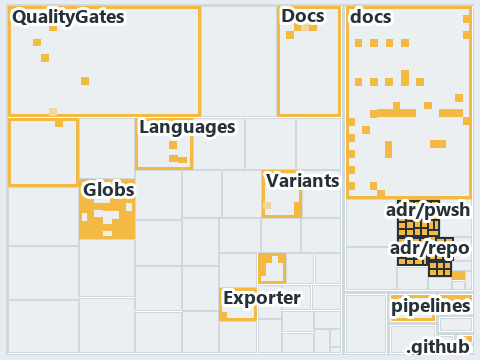

# docs/.assets/explanation/adr-dsgn-aspect--partition-integrity-runs-only-in-unit-tests--governance.tree.md

`Tree minimap: adr-dsgn-aspect--partition-integrity-runs-only-in-unit-tests--governance`

The tree minimap of the slide `adr-dsgn-aspect--partition-integrity-runs-only-in-unit-tests--governance` (governance lens). The slide
supports [ADR-DSGN-ASPECT][1], [ADR-FLOW-CD-GLOBS][2], [ADR-PWSH-MANIFEST][3], [ADR-PWSH-ONEFUNC][4] and [ADR-REPO-FOLDERS][5]; the
highlight of those ADR codes selects what is lit, and each reason below names the code that selects it.

## What the minimap shows

The tree draws every file of the world map as a tile, grouped by top-level folder (under `automation/` by module, under `docs/adr/` by ADR
domain), and lights 167 files in 17 groups. A lit ADR file is framed; a file lit only by passing mentions is drawn pale.

- Globs (automation/Catzc.Base.Globs): 40 lit files
- docs (docs/ outside docs/adr/): 37 lit files
- adr/pwsh (docs/adr/pwsh): 26 lit files
- adr/repo (docs/adr/repository): 15 lit files
- adr/dsgn (docs/adr/design): 9 lit files
- QualityGates (automation/Catzc.Base.QualityGates): 6 lit files
- adr/flow (docs/adr/flow): 6 lit files
- pipelines: 6 lit files
- Az.DevOps.BuildValidation (automation/Catzc.Azure.DevOps.BuildValidation): 5 lit files
- Docs (automation/Catzc.Base.Docs): 4 lit files
- Variants (automation/Catzc.Base.Variants): 4 lit files
- Languages (automation/Catzc.Base.Languages): 3 lit files
- adr/* (the files directly in docs/adr/): 2 lit files
- .claude: 1 lit file
- .github: 1 lit file
- Exporter (automation/Catzc.Base.Exporter): 1 lit file
- ModuleSystem (automation/Catzc.Base.ModuleSystem): 1 lit file

## Why each group is lit

### Globs (40 lit files)

The group holds the files of automation/Catzc.Base.Globs; each sits in its world-map cell and is lit by:

- [automation/Catzc.Base.Globs/Get-ChangedGlobSet.ps1][6], in the cell automation × powershell: selected by [ADR-FLOW-CD-GLOBS][2]: the file
  cites it at line 4 (header) and line 8 (header).
- [automation/Catzc.Base.Globs/Get-GlobSet.ps1][7], in the cell automation × powershell: selected by [ADR-FLOW-CD-GLOBS][2]: the file cites
  it at line 6 (header).
- [automation/Catzc.Base.Globs/Get-GlobSetFile.ps1][8], in the cell automation × powershell: selected by [ADR-FLOW-CD-GLOBS][2]: the file
  cites it at line 6 (header) and line 9 (header).
- [automation/Catzc.Base.Globs/Get-GlobSetHash.ps1][9], in the cell automation × powershell: selected by [ADR-FLOW-CD-GLOBS][2]: the file
  cites it at line 4 (header) and line 10 (header).
- [automation/Catzc.Base.Globs/Get-GlobSetTrigger.ps1][10], in the cell automation × powershell: selected by [ADR-FLOW-CD-GLOBS][2]: the
  file cites it at line 4 (header) and line 7 (header).
- [automation/Catzc.Base.Globs/Get-MarkerBlastRadius.ps1][11], in the cell automation × powershell: selected by [ADR-FLOW-CD-GLOBS][2]: the
  file cites it at line 6 (header).
- [automation/Catzc.Base.Globs/Get-ModuleGlobSet.ps1][12], in the cell automation × powershell: selected by [ADR-DSGN-ASPECT][1]: the file
  cites it at line 6 (header), line 10 (header) and line 83 (body comment); selected by [ADR-FLOW-CD-GLOBS][2]: the file cites it at line 72
  (body comment), line 75 (body comment) and line 163 (body comment) (a passing mention only).
- [automation/Catzc.Base.Globs/Get-TrackedFile.ps1][13], in the cell automation × powershell: selected by [ADR-FLOW-CD-GLOBS][2]: the file
  cites it at line 6 (header).
- [automation/Catzc.Base.Globs/Test-AdoPipelineTriggerGlob.ps1][14], in the cell automation × powershell: selected by
  [ADR-FLOW-CD-GLOBS][2]: the file cites it at line 4 (header).
- [automation/Catzc.Base.Globs/Test-GitHubWorkflowTriggerGlob.ps1][15], in the cell automation × powershell: selected by
  [ADR-FLOW-CD-GLOBS][2]: the file cites it at line 4 (header).
- [automation/Catzc.Base.Globs/Test-GlobSetAffected.ps1][16], in the cell automation × powershell: selected by [ADR-FLOW-CD-GLOBS][2]: the
  file cites it at line 10 (header).
- [automation/Catzc.Base.Globs/Test-GlobSetIndependence.ps1][17], in the cell automation × powershell: selected by [ADR-FLOW-CD-GLOBS][2]:
  the file cites it at line 4 (header), line 13 (header), line 42 (body comment), line 50 (body comment) and line 79 (text).
- [automation/Catzc.Base.Globs/Test-GlobSetTriggerCoverage.ps1][18], in the cell automation × powershell: selected by
  [ADR-FLOW-CD-GLOBS][2]: the file cites it at line 7 (header).
- [automation/Catzc.Base.Globs/configs/globs.yml][19], in the cell automation × yaml: selected by [ADR-FLOW-CD-GLOBS][2]: the file cites it
  at line 2 (header), line 7 (header), line 15 (header), line 17 (header), line 26 (body comment), line 61 (body comment) and line 81 (body
  comment).
- [automation/Catzc.Base.Globs/private/Get-ChangedFile.ps1][20], in the cell automation × powershell: selected by [ADR-FLOW-CD-GLOBS][2]:
  the file cites it at line 7 (header).
- [automation/Catzc.Base.Globs/private/Get-GlobSetMember.ps1][21], in the cell automation × powershell: selected by [ADR-FLOW-CD-GLOBS][2]:
  the file cites it at line 6 (header).
- [automation/Catzc.Base.Globs/private/Get-PipelineTrigger.ps1][22], in the cell automation × powershell: selected by
  [ADR-FLOW-CD-GLOBS][2]: the file cites it at line 7 (header).
- [automation/Catzc.Base.Globs/private/Test-GlobListEqual.ps1][23], in the cell automation × powershell: selected by [ADR-FLOW-CD-GLOBS][2]:
  the file cites it at line 11 (header).
- [automation/Catzc.Base.Globs/tests/Get-ChangedFile.Tests.ps1][24], in the cell automation × powershell: selected by
  [ADR-FLOW-CD-GLOBS][2]: the file cites it at line 2 (header).
- [automation/Catzc.Base.Globs/tests/Get-ChangedGlobSet.Tests.ps1][25], in the cell automation × powershell: selected by
  [ADR-FLOW-CD-GLOBS][2]: the file cites it at line 2 (header).
- [automation/Catzc.Base.Globs/tests/Get-GlobSetFile.Tests.ps1][26], in the cell automation × powershell: selected by
  [ADR-FLOW-CD-GLOBS][2]: the file cites it at line 2 (header) and line 3 (header).
- [automation/Catzc.Base.Globs/tests/Get-GlobSetHash.Tests.ps1][27], in the cell automation × powershell: selected by
  [ADR-FLOW-CD-GLOBS][2]: the file cites it at line 2 (header).
- [automation/Catzc.Base.Globs/tests/Get-GlobSetMember.Tests.ps1][28], in the cell automation × powershell: selected by
  [ADR-FLOW-CD-GLOBS][2]: the file cites it at line 2 (header).
- [automation/Catzc.Base.Globs/tests/Get-GlobSetTrigger.Tests.ps1][29], in the cell automation × powershell: selected by
  [ADR-FLOW-CD-GLOBS][2]: the file cites it at line 2 (header).
- [automation/Catzc.Base.Globs/tests/Get-ModuleGlobSet.Tests.ps1][30], in the cell automation × powershell: selected by
  [ADR-DSGN-ASPECT][1]: the file cites it at line 40 (text).
- [automation/Catzc.Base.Globs/tests/Get-PipelineTrigger.Tests.ps1][31], in the cell automation × powershell: selected by
  [ADR-FLOW-CD-GLOBS][2]: the file cites it at line 2 (header).
- [automation/Catzc.Base.Globs/tests/Get-TrackedFile.Tests.ps1][32], in the cell automation × powershell: selected by
  [ADR-FLOW-CD-GLOBS][2]: the file cites it at line 1 (header).
- [automation/Catzc.Base.Globs/tests/GlobSet-Independence.Tests.ps1][33], in the cell automation × powershell: selected by
  [ADR-FLOW-CD-GLOBS][2]: the file cites it at line 2 (header), line 10 (text) and line 12 (text).
- [automation/Catzc.Base.Globs/tests/GlobSetTrigger-Coverage.Tests.ps1][34], in the cell automation × powershell: selected by
  [ADR-FLOW-CD-GLOBS][2]: the file cites it at line 2 (header).
- [automation/Catzc.Base.Globs/tests/PipelineTrigger-Integrity.Tests.ps1][35], in the cell automation × powershell: selected by
  [ADR-FLOW-CD-GLOBS][2]: the file cites it at line 3 (header).
- [automation/Catzc.Base.Globs/tests/Test-GlobSetIndependence.Tests.ps1][36], in the cell automation × powershell: selected by
  [ADR-FLOW-CD-GLOBS][2]: the file cites it at line 3 (header).
- [automation/Catzc.Base.Globs/tests/types/Aspect.Tests.ps1][37], in the cell automation × powershell: selected by [ADR-DSGN-ASPECT][1]: the
  file cites it at line 1 (header).
- [automation/Catzc.Base.Globs/tests/types/GlobPattern.Tests.ps1][38], in the cell automation × powershell: selected by
  [ADR-FLOW-CD-GLOBS][2]: the file cites it at line 1 (header), line 3 (header) and line 63 (text).
- [automation/Catzc.Base.Globs/tests/types/GlobSet.Tests.ps1][39], in the cell automation × powershell: selected by [ADR-FLOW-CD-GLOBS][2]:
  the file cites it at line 2 (header), line 4 (header) and line 15 (text).
- [automation/Catzc.Base.Globs/tests/types/GlobsConfig.Tests.ps1][40], in the cell automation × powershell: selected by
  [ADR-FLOW-CD-GLOBS][2]: the file cites it at line 3 (header), line 5 (header), line 13 (body comment), line 62 (text), line 75 (text),
  line 86 (text) and line 98 (text).
- [automation/Catzc.Base.Globs/types/Aspect.cs][41], in the cell automation × csharp: selected by [ADR-DSGN-ASPECT][1]: the file cites it at
  line 1 (header), line 14 (header) and line 92 (body comment); selected by [ADR-FLOW-CD-GLOBS][2]: the file cites it at line 9 (header).
- [automation/Catzc.Base.Globs/types/DurableHash.cs][42], in the cell automation × csharp: selected by [ADR-FLOW-CD-GLOBS][2]: the file
  cites it at line 1 (header) and line 7 (header).
- [automation/Catzc.Base.Globs/types/GlobPattern.cs][43], in the cell automation × csharp: selected by [ADR-FLOW-CD-GLOBS][2]: the file
  cites it at line 7 (header), line 8 (header), line 9 (header), line 33 (text), line 37 (text), line 41 (text), line 53 (text), line 57
  (text) and line 66 (text).
- [automation/Catzc.Base.Globs/types/GlobSet.cs][44], in the cell automation × csharp: selected by [ADR-FLOW-CD-GLOBS][2]: the file cites it
  at line 3 (header), line 5 (header), line 6 (header), line 12 (header), line 15 (header), line 17 (header), line 20 (header), line 32
  (body comment), line 41 (body comment), line 63 (body comment), line 89 (text), line 122 (body comment), line 135 (body comment), line 158
  (body comment) and line 180 (body comment).
- [automation/Catzc.Base.Globs/types/GlobsConfig.cs][45], in the cell automation × csharp: selected by [ADR-FLOW-CD-GLOBS][2]: the file
  cites it at line 3 (header), line 7 (header), line 10 (header), line 88 (text), line 143 (body comment), line 154 (text), line 158 (text)
  and line 172 (text).

### docs (37 lit files)

The group holds the files of docs/ outside docs/adr/; each sits in its world-map cell and is lit by:

- [docs/.assets/explanation/adr-auto-bundle--what-gates-each-bundle-stage--governance.drawio.md][46], in the cell docs × markdown: selected
  by [ADR-PWSH-MANIFEST][3]: the file cites it at line 74 (text).
- [docs/.assets/explanation/adr-dsgn-aspect--drop-a-file-the-import-exports-it--operations.drawio.md][47], in the cell docs × markdown:
  selected by [ADR-DSGN-ASPECT][1]: the file cites it at line 71 (text).
- [docs/.assets/explanation/adr-dsgn-aspect--every-file-in-exactly-one-aspect--meta.drawio.md][48], in the cell docs × markdown: selected by
  [ADR-DSGN-ASPECT][1]: the file cites it at line 65 (text).
- [docs/.assets/explanation/adr-dsgn-aspect--manifest-and-aspects-from-one-folder--implementation.drawio.md][49], in the cell docs ×
  markdown: selected by [ADR-DSGN-ASPECT][1]: the file cites it at line 71 (text).
- [docs/.assets/explanation/adr-dsgn-aspect--one-folder-two-independent-readers--architecture.drawio.md][50], in the cell docs × markdown:
  selected by [ADR-DSGN-ASPECT][1]: the file cites it at line 73 (text).
- [docs/.assets/explanation/adr-dsgn-aspect--partition-integrity-runs-only-in-unit-tests--governance.drawio.md][51], in the cell docs ×
  markdown: selected by [ADR-DSGN-ASPECT][1]: the file cites it at line 66 (text) and line 75 (text); selected by [ADR-FLOW-CD-GLOBS][2]:
  the file cites it at line 66 (text) and line 76 (text); selected by [ADR-PWSH-MANIFEST][3]: the file cites it at line 66 (text) and line
  75 (text); selected by [ADR-PWSH-ONEFUNC][4]: the file cites it at line 66 (text) and line 75 (text); selected by [ADR-REPO-FOLDERS][5]:
  the file cites it at line 66 (text) and line 76 (text).
- [docs/.assets/explanation/adr-dsgn-track--unit-to-pipeline-rule-is-review-only--governance.drawio.md][52], in the cell docs × markdown:
  selected by [ADR-FLOW-CD-GLOBS][2]: the file cites it at line 60 (text) and line 68 (text); selected by [ADR-REPO-FOLDERS][5]: the file
  cites it at line 60 (text) and line 68 (text).
- [docs/.assets/explanation/adr-flow-cd-globs--declare-or-add-folder-gate-names-overlaps--operations.drawio.md][53], in the cell docs ×
  markdown: selected by [ADR-FLOW-CD-GLOBS][2]: the file cites it at line 71 (text).
- [docs/.assets/explanation/adr-flow-cd-globs--edit-globs-yml-then-read-the-output--operations.drawio.md][54], in the cell docs × markdown:
  selected by [ADR-FLOW-CD-GLOBS][2]: the file cites it at line 66 (text).
- [docs/.assets/explanation/adr-flow-cd-globs--gates-check-source-and-trigger--governance.drawio.md][55], in the cell docs × markdown:
  selected by [ADR-FLOW-CD-GLOBS][2]: the file cites it at line 65 (text) and line 73 (text).
- [docs/.assets/explanation/adr-flow-cd-globs--globs-module-owns-config-and-types--architecture.drawio.md][56], in the cell docs × markdown:
  selected by [ADR-FLOW-CD-GLOBS][2]: the file cites it at line 70 (text).
- [docs/.assets/explanation/adr-flow-cd-globs--independence-check-groups-by-layer--implementation.drawio.md][57], in the cell docs ×
  markdown: selected by [ADR-FLOW-CD-GLOBS][2]: the file cites it at line 70 (text).
- [docs/.assets/explanation/adr-flow-cd-globs--one-scan-program-feeds-three-roles--implementation.drawio.md][58], in the cell docs ×
  markdown: selected by [ADR-FLOW-CD-GLOBS][2]: the file cites it at line 70 (text).
- [docs/.assets/explanation/adr-flow-cd-globs--overlap-gated-for-units-and-modules--governance.drawio.md][59], in the cell docs × markdown:
  selected by [ADR-FLOW-CD-GLOBS][2]: the file cites it at line 61 (text) and line 68 (text).
- [docs/.assets/explanation/adr-flow-cd-globs--peers-in-a-layer-never-overlap--meta.drawio.md][60], in the cell docs × markdown: selected by
  [ADR-FLOW-CD-GLOBS][2]: the file cites it at line 62 (text).
- [docs/.assets/explanation/adr-flow-cd-globs--three-views-derived-live-from-one-program--meta.drawio.md][61], in the cell docs × markdown:
  selected by [ADR-FLOW-CD-GLOBS][2]: the file cites it at line 62 (text).
- [docs/.assets/explanation/adr-flow-cd-globs--two-declared-layers-one-derived--architecture.drawio.md][62], in the cell docs × markdown:
  selected by [ADR-FLOW-CD-GLOBS][2]: the file cites it at line 62 (text).
- [docs/explanation/automation/what-gates-each-bundle-stage.md][63], in the cell docs × markdown: selected by [ADR-PWSH-MANIFEST][3]: the
  file cites it at line 16 (text), line 32 (text) and line 50 (text).
- [docs/explanation/design/drop-a-file-the-import-exports-it.md][64], in the cell docs × markdown: selected by [ADR-DSGN-ASPECT][1]: the
  file cites it at line 16 (text), line 46 (text) and line 48 (text); selected by [ADR-REPO-FOLDERS][5]: the file cites it at line 52
  (text).
- [docs/explanation/design/every-file-in-exactly-one-aspect.md][65], in the cell docs × markdown: selected by [ADR-DSGN-ASPECT][1]: the file
  cites it at line 14 (text), line 42 (text), line 44 (text), line 45 (text), line 46 (text), line 51 (text), line 53 (text) and line 55
  (text); selected by [ADR-FLOW-CD-GLOBS][2]: the file cites it at line 51 (text).
- [docs/explanation/design/manifest-and-aspects-from-one-folder.md][66], in the cell docs × markdown: selected by [ADR-DSGN-ASPECT][1]: the
  file cites it at line 18 (text), line 53 (text), line 55 (text) and line 61 (text); selected by [ADR-PWSH-MANIFEST][3]: the file cites it
  at line 59 (text).
- [docs/explanation/design/one-folder-two-independent-readers.md][67], in the cell docs × markdown: selected by [ADR-DSGN-ASPECT][1]: the
  file cites it at line 17 (text), line 51 (text), line 53 (text), line 55 (text), line 59 (text) and line 61 (text); selected by
  [ADR-FLOW-CD-GLOBS][2]: the file cites it at line 59 (text).
- [docs/explanation/design/partition-integrity-runs-only-in-unit-tests.md][68], in the cell docs × markdown: selected by
  [ADR-DSGN-ASPECT][1]: the file cites it at line 17 (text), line 21 (text), line 22 (text), line 45 (text), line 46 (text), line 48 (text),
  line 59 (text), line 60 (text), line 61 (text), line 65 (text) and line 67 (text); selected by [ADR-FLOW-CD-GLOBS][2]: the file cites it
  at line 49 (text) and line 67 (text); selected by [ADR-PWSH-MANIFEST][3]: the file cites it at line 36 (text), line 42 (text), line 43
  (text), line 55 (text), line 56 (text) and line 69 (text); selected by [ADR-PWSH-ONEFUNC][4]: the file cites it at line 35 (text) and line
  53 (text); selected by [ADR-REPO-FOLDERS][5]: the file cites it at line 38 (text), line 57 (text) and line 71 (text).
- [docs/explanation/design/unit-to-pipeline-rule-is-review-only.md][69], in the cell docs × markdown: selected by [ADR-FLOW-CD-GLOBS][2]:
  the file cites it at line 59 (text) and line 59 (text); selected by [ADR-REPO-FOLDERS][5]: the file cites it at line 54 (text) and line 55
  (text).
- [docs/explanation/flow/declare-or-add-folder-gate-names-overlaps.md][70], in the cell docs × markdown: selected by [ADR-FLOW-CD-GLOBS][2]:
  the file cites it at line 16 (text), line 47 (text), line 49 (text) and line 53 (text).
- [docs/explanation/flow/edit-globs-yml-then-read-the-output.md][71], in the cell docs × markdown: selected by [ADR-FLOW-CD-GLOBS][2]: the
  file cites it at line 17 (text), line 47 (text), line 49 (text) and line 50 (text).
- [docs/explanation/flow/gates-check-source-and-trigger.md][72], in the cell docs × markdown: selected by [ADR-FLOW-CD-GLOBS][2]: the file
  cites it at line 17 (text), line 52 (text), line 53 (text), line 54 (text), line 55 (text), line 56 (text), line 57 (text), line 57
  (text), line 58 (text), line 59 (text), line 59 (text), line 61 (text) and line 72 (text).
- [docs/explanation/flow/globs-module-owns-config-and-types.md][73], in the cell docs × markdown: selected by [ADR-FLOW-CD-GLOBS][2]: the
  file cites it at line 15 (text), line 48 (text), line 49 (text), line 51 (text) and line 52 (text).
- [docs/explanation/flow/independence-check-groups-by-layer.md][74], in the cell docs × markdown: selected by [ADR-FLOW-CD-GLOBS][2]: the
  file cites it at line 17 (text), line 52 (text), line 54 (text), line 58 (text) and line 58 (text).
- [docs/explanation/flow/one-scan-program-feeds-three-roles.md][75], in the cell docs × markdown: selected by [ADR-FLOW-CD-GLOBS][2]: the
  file cites it at line 18 (text), line 53 (text), line 54 (text), line 55 (text), line 56 (text), line 61 (text) and line 62 (text).
- [docs/explanation/flow/overlap-gated-for-units-and-modules.md][76], in the cell docs × markdown: selected by [ADR-FLOW-CD-GLOBS][2]: the
  file cites it at line 16 (text), line 49 (text) and line 51 (text).
- [docs/explanation/flow/peers-in-a-layer-never-overlap.md][77], in the cell docs × markdown: selected by [ADR-FLOW-CD-GLOBS][2]: the file
  cites it at line 13 (text), line 38 (text) and line 40 (text).
- [docs/explanation/flow/three-views-derived-live-from-one-program.md][78], in the cell docs × markdown: selected by [ADR-FLOW-CD-GLOBS][2]:
  the file cites it at line 14 (text), line 37 (text), line 38 (text), line 39 (text) and line 40 (text).
- [docs/explanation/flow/two-declared-layers-one-derived.md][79], in the cell docs × markdown: selected by [ADR-FLOW-CD-GLOBS][2]: the file
  cites it at line 15 (text), line 47 (text), line 49 (text), line 51 (text) and line 53 (text).
- [docs/how-to/automation/manual-test-plan/pipelines-and-globs.md][80], in the cell docs × markdown: selected by [ADR-FLOW-CD-GLOBS][2]: the
  file cites it at line 18 (text).
- [docs/references/automation/catzc-base-globs.md][81], in the cell docs × markdown: selected by [ADR-FLOW-CD-GLOBS][2]: the file cites it
  at line 29 (text).
- [docs/references/automation/catzc-base-languages.md][82], in the cell docs × markdown: selected by [ADR-REPO-FOLDERS][5]: the file cites
  it at line 47 (text) and line 77 (text).

### adr/pwsh (26 lit files)

The group holds the files of docs/adr/pwsh; each sits in its world-map cell and is lit by:

- [docs/adr/pwsh/announce-state-changes.md][83], in the cell docs × markdown: selected by [ADR-PWSH-MANIFEST][3]: an ADR file of the `pwsh`
  ADR domain, the ADR domain of that code; selected by [ADR-PWSH-ONEFUNC][4]: an ADR file of the `pwsh` ADR domain, the ADR domain of that
  code.
- [docs/adr/pwsh/assert-idioms.md][84], in the cell docs × markdown: selected by [ADR-PWSH-MANIFEST][3]: an ADR file of the `pwsh` ADR
  domain, the ADR domain of that code; selected by [ADR-PWSH-ONEFUNC][4]: an ADR file of the `pwsh` ADR domain, the ADR domain of that code.
- [docs/adr/pwsh/automatic-variable-pitfalls.md][85], in the cell docs × markdown: selected by [ADR-PWSH-MANIFEST][3]: an ADR file of the
  `pwsh` ADR domain, the ADR domain of that code; selected by [ADR-PWSH-ONEFUNC][4]: an ADR file of the `pwsh` ADR domain, the ADR domain of
  that code.
- [docs/adr/pwsh/avoid-using-semicolons.md][86], in the cell docs × markdown: selected by [ADR-PWSH-MANIFEST][3]: an ADR file of the `pwsh`
  ADR domain, the ADR domain of that code; selected by [ADR-PWSH-ONEFUNC][4]: an ADR file of the `pwsh` ADR domain, the ADR domain of that
  code.
- [docs/adr/pwsh/cross-platform-powershell.md][87], in the cell docs × markdown: selected by [ADR-PWSH-MANIFEST][3]: an ADR file of the
  `pwsh` ADR domain, the ADR domain of that code; selected by [ADR-PWSH-ONEFUNC][4]: an ADR file of the `pwsh` ADR domain, the ADR domain of
  that code.
- [docs/adr/pwsh/dora-explains.md][88], in the cell docs × markdown: selected by [ADR-PWSH-MANIFEST][3]: an ADR file of the `pwsh` ADR
  domain, the ADR domain of that code; selected by [ADR-PWSH-ONEFUNC][4]: an ADR file of the `pwsh` ADR domain, the ADR domain of that code.
- [docs/adr/pwsh/dynamic-module-manifests.md][3], in the cell docs × markdown: selected by [ADR-PWSH-MANIFEST][3]: an ADR file of the `pwsh`
  ADR domain, the ADR domain of that code; selected by [ADR-PWSH-ONEFUNC][4]: an ADR file of the `pwsh` ADR domain, the ADR domain of that
  code.
- [docs/adr/pwsh/environment-variable-mechanics.md][89], in the cell docs × markdown: selected by [ADR-PWSH-MANIFEST][3]: an ADR file of the
  `pwsh` ADR domain, the ADR domain of that code; selected by [ADR-PWSH-ONEFUNC][4]: an ADR file of the `pwsh` ADR domain, the ADR domain of
  that code.
- [docs/adr/pwsh/error-handling.md][90], in the cell docs × markdown: selected by [ADR-PWSH-MANIFEST][3]: an ADR file of the `pwsh` ADR
  domain, the ADR domain of that code; selected by [ADR-PWSH-ONEFUNC][4]: an ADR file of the `pwsh` ADR domain, the ADR domain of that code.
- [docs/adr/pwsh/hosting-csharp-types.md][91], in the cell docs × markdown: selected by [ADR-PWSH-MANIFEST][3]: an ADR file of the `pwsh`
  ADR domain, the ADR domain of that code; selected by [ADR-PWSH-ONEFUNC][4]: an ADR file of the `pwsh` ADR domain, the ADR domain of that
  code.
- [docs/adr/pwsh/identifier-names.md][92], in the cell docs × markdown: selected by [ADR-PWSH-MANIFEST][3]: an ADR file of the `pwsh` ADR
  domain, the ADR domain of that code; selected by [ADR-PWSH-ONEFUNC][4]: an ADR file of the `pwsh` ADR domain, the ADR domain of that code.
- [docs/adr/pwsh/index.md][93], in the cell docs × markdown: selected by [ADR-PWSH-MANIFEST][3]: an ADR file of the `pwsh` ADR domain, the
  ADR domain of that code; selected by [ADR-PWSH-ONEFUNC][4]: an ADR file of the `pwsh` ADR domain, the ADR domain of that code.
- [docs/adr/pwsh/module-path-hygiene.md][94], in the cell docs × markdown: selected by [ADR-PWSH-MANIFEST][3]: an ADR file of the `pwsh` ADR
  domain, the ADR domain of that code; selected by [ADR-PWSH-ONEFUNC][4]: an ADR file of the `pwsh` ADR domain, the ADR domain of that code.
- [docs/adr/pwsh/one-function-per-file.md][4], in the cell docs × markdown: selected by [ADR-PWSH-MANIFEST][3]: an ADR file of the `pwsh`
  ADR domain, the ADR domain of that code; selected by [ADR-PWSH-ONEFUNC][4]: an ADR file of the `pwsh` ADR domain, the ADR domain of that
  code.
- [docs/adr/pwsh/parameter-design.md][95], in the cell docs × markdown: selected by [ADR-PWSH-MANIFEST][3]: an ADR file of the `pwsh` ADR
  domain, the ADR domain of that code; selected by [ADR-PWSH-ONEFUNC][4]: an ADR file of the `pwsh` ADR domain, the ADR domain of that code.
- [docs/adr/pwsh/pester-testing.md][96], in the cell docs × markdown: selected by [ADR-PWSH-MANIFEST][3]: an ADR file of the `pwsh` ADR
  domain, the ADR domain of that code; selected by [ADR-PWSH-ONEFUNC][4]: an ADR file of the `pwsh` ADR domain, the ADR domain of that code.
- [docs/adr/pwsh/powershell-formatting.md][97], in the cell docs × markdown: selected by [ADR-PWSH-MANIFEST][3]: an ADR file of the `pwsh`
  ADR domain, the ADR domain of that code; selected by [ADR-PWSH-ONEFUNC][4]: an ADR file of the `pwsh` ADR domain, the ADR domain of that
  code.
- [docs/adr/pwsh/prefer-dryrun-over-shouldprocess.md][98], in the cell docs × markdown: selected by [ADR-PWSH-MANIFEST][3]: an ADR file of
  the `pwsh` ADR domain, the ADR domain of that code; selected by [ADR-PWSH-ONEFUNC][4]: an ADR file of the `pwsh` ADR domain, the ADR
  domain of that code.
- [docs/adr/pwsh/prefer-foreach-over-foreach-object.md][99], in the cell docs × markdown: selected by [ADR-PWSH-MANIFEST][3]: an ADR file of
  the `pwsh` ADR domain, the ADR domain of that code; selected by [ADR-PWSH-ONEFUNC][4]: an ADR file of the `pwsh` ADR domain, the ADR
  domain of that code.
- [docs/adr/pwsh/prepost-extension-modules.md][100], in the cell docs × markdown: selected by [ADR-PWSH-MANIFEST][3]: an ADR file of the
  `pwsh` ADR domain, the ADR domain of that code; selected by [ADR-PWSH-ONEFUNC][4]: an ADR file of the `pwsh` ADR domain, the ADR domain of
  that code.
- [docs/adr/pwsh/pwsh-engine.md][101], in the cell docs × markdown: selected by [ADR-PWSH-MANIFEST][3]: an ADR file of the `pwsh` ADR
  domain, the ADR domain of that code; selected by [ADR-PWSH-ONEFUNC][4]: an ADR file of the `pwsh` ADR domain, the ADR domain of that code.
- [docs/adr/pwsh/respect-pwsh-verb-rules.md][102], in the cell docs × markdown: selected by [ADR-PWSH-MANIFEST][3]: an ADR file of the
  `pwsh` ADR domain, the ADR domain of that code; selected by [ADR-PWSH-ONEFUNC][4]: an ADR file of the `pwsh` ADR domain, the ADR domain of
  that code.
- [docs/adr/pwsh/script-scope-caching.md][103], in the cell docs × markdown: selected by [ADR-PWSH-MANIFEST][3]: an ADR file of the `pwsh`
  ADR domain, the ADR domain of that code; selected by [ADR-PWSH-ONEFUNC][4]: an ADR file of the `pwsh` ADR domain, the ADR domain of that
  code.
- [docs/adr/pwsh/use-ps1-not-psm1.md][104], in the cell docs × markdown: selected by [ADR-PWSH-MANIFEST][3]: an ADR file of the `pwsh` ADR
  domain, the ADR domain of that code; selected by [ADR-PWSH-ONEFUNC][4]: an ADR file of the `pwsh` ADR domain, the ADR domain of that code.
- [docs/adr/pwsh/vendor-toolset-dependencies.md][105], in the cell docs × markdown: selected by [ADR-PWSH-MANIFEST][3]: an ADR file of the
  `pwsh` ADR domain, the ADR domain of that code; selected by [ADR-PWSH-ONEFUNC][4]: an ADR file of the `pwsh` ADR domain, the ADR domain of
  that code.
- [docs/adr/pwsh/working-directory-mechanics.md][106], in the cell docs × markdown: selected by [ADR-PWSH-MANIFEST][3]: an ADR file of the
  `pwsh` ADR domain, the ADR domain of that code; selected by [ADR-PWSH-ONEFUNC][4]: an ADR file of the `pwsh` ADR domain, the ADR domain of
  that code.

### adr/repo (15 lit files)

The group holds the files of docs/adr/repository; each sits in its world-map cell and is lit by:

- [docs/adr/repository/agent-definitions.md][107], in the cell docs × markdown: selected by [ADR-REPO-FOLDERS][5]: an ADR file of the
  `repository` ADR domain, the ADR domain of that code.
- [docs/adr/repository/api-contracts.md][108], in the cell docs × markdown: selected by [ADR-REPO-FOLDERS][5]: an ADR file of the
  `repository` ADR domain, the ADR domain of that code.
- [docs/adr/repository/controlled-vocabulary.md][109], in the cell docs × markdown: selected by [ADR-REPO-FOLDERS][5]: an ADR file of the
  `repository` ADR domain, the ADR domain of that code.
- [docs/adr/repository/conventional-folders.md][5], in the cell docs × markdown: selected by [ADR-REPO-FOLDERS][5]: an ADR file of the
  `repository` ADR domain, the ADR domain of that code.
- [docs/adr/repository/dedicated-output-directory.md][110], in the cell docs × markdown: selected by [ADR-REPO-FOLDERS][5]: an ADR file of
  the `repository` ADR domain, the ADR domain of that code.
- [docs/adr/repository/documentation-examples.md][111], in the cell docs × markdown: selected by [ADR-REPO-FOLDERS][5]: an ADR file of the
  `repository` ADR domain, the ADR domain of that code.
- [docs/adr/repository/domain-language-separation.md][112], in the cell docs × markdown: selected by [ADR-REPO-FOLDERS][5]: an ADR file of
  the `repository` ADR domain, the ADR domain of that code.
- [docs/adr/repository/dora-explains.md][113], in the cell docs × markdown: selected by [ADR-REPO-FOLDERS][5]: an ADR file of the
  `repository` ADR domain, the ADR domain of that code.
- [docs/adr/repository/generated-readmes.md][114], in the cell docs × markdown: selected by [ADR-REPO-FOLDERS][5]: an ADR file of the
  `repository` ADR domain, the ADR domain of that code.
- [docs/adr/repository/generated-root-configs.md][115], in the cell docs × markdown: selected by [ADR-REPO-FOLDERS][5]: an ADR file of the
  `repository` ADR domain, the ADR domain of that code.
- [docs/adr/repository/inspiration.md][116], in the cell docs × markdown: selected by [ADR-REPO-FOLDERS][5]: an ADR file of the `repository`
  ADR domain, the ADR domain of that code.
- [docs/adr/repository/markdown-links.md][117], in the cell docs × markdown: selected by [ADR-REPO-FOLDERS][5]: an ADR file of the
  `repository` ADR domain, the ADR domain of that code.
- [docs/adr/repository/output-formats.md][118], in the cell docs × markdown: selected by [ADR-REPO-FOLDERS][5]: an ADR file of the
  `repository` ADR domain, the ADR domain of that code.
- [docs/adr/repository/repo-variants.md][119], in the cell docs × markdown: selected by [ADR-REPO-FOLDERS][5]: an ADR file of the
  `repository` ADR domain, the ADR domain of that code.
- [docs/adr/repository/uniform-formatting.md][120], in the cell docs × markdown: selected by [ADR-REPO-FOLDERS][5]: an ADR file of the
  `repository` ADR domain, the ADR domain of that code.

### adr/dsgn (9 lit files)

The group holds the files of docs/adr/design; each sits in its world-map cell and is lit by:

- [docs/adr/design/commit-lifecycle.md][121], in the cell docs × markdown: selected by [ADR-DSGN-ASPECT][1]: an ADR file of the `design` ADR
  domain, the ADR domain of that code.
- [docs/adr/design/dora-explains.md][122], in the cell docs × markdown: selected by [ADR-DSGN-ASPECT][1]: an ADR file of the `design` ADR
  domain, the ADR domain of that code.
- [docs/adr/design/module-aspects.md][1], in the cell docs × markdown: selected by [ADR-DSGN-ASPECT][1]: an ADR file of the `design` ADR
  domain, the ADR domain of that code.
- [docs/adr/design/run-modes.md][123], in the cell docs × markdown: selected by [ADR-DSGN-ASPECT][1]: an ADR file of the `design` ADR
  domain, the ADR domain of that code.
- [docs/adr/design/self-service.md][124], in the cell docs × markdown: selected by [ADR-DSGN-ASPECT][1]: an ADR file of the `design` ADR
  domain, the ADR domain of that code.
- [docs/adr/design/server-remote-integration.md][125], in the cell docs × markdown: selected by [ADR-DSGN-ASPECT][1]: an ADR file of the
  `design` ADR domain, the ADR domain of that code.
- [docs/adr/design/thin-platforms.md][126], in the cell docs × markdown: selected by [ADR-DSGN-ASPECT][1]: an ADR file of the `design` ADR
  domain, the ADR domain of that code.
- [docs/adr/design/tracks.md][127], in the cell docs × markdown: selected by [ADR-DSGN-ASPECT][1]: an ADR file of the `design` ADR domain,
  the ADR domain of that code.
- [docs/adr/design/visual-design.md][128], in the cell docs × markdown: selected by [ADR-DSGN-ASPECT][1]: an ADR file of the `design` ADR
  domain, the ADR domain of that code.

### QualityGates (6 lit files)

The group holds the files of automation/Catzc.Base.QualityGates; each sits in its world-map cell and is lit by:

- [automation/Catzc.Base.QualityGates/Test-Automation.ps1][129], in the cell automation × powershell: selected by [ADR-FLOW-CD-GLOBS][2]:
  the file cites it at line 72 (header).
- [automation/Catzc.Base.QualityGates/configs/terminology.yml][130], in the cell automation × yaml: selected by [ADR-PWSH-ONEFUNC][4]: the
  file cites it at line 582 (text).
- [automation/Catzc.Base.QualityGates/private/Get-ChangeTestFile.ps1][131], in the cell automation × powershell: selected by
  [ADR-PWSH-ONEFUNC][4]: the file cites it at line 6 (header).
- [automation/Catzc.Base.QualityGates/private/Get-GuidScanFiles.ps1][132], in the cell automation × powershell: selected by
  [ADR-FLOW-CD-GLOBS][2]: the file cites it at line 7 (header).
- [automation/Catzc.Base.QualityGates/private/Get-ModuleProtectionIdentity.ps1][133], in the cell automation × powershell: selected by
  [ADR-DSGN-ASPECT][1]: the file cites it at line 54 (body comment) (a passing mention only); selected by [ADR-FLOW-CD-GLOBS][2]: the file
  cites it at line 143 (body comment) (a passing mention only).
- [automation/Catzc.Base.QualityGates/private/Resolve-TestSuite.ps1][134], in the cell automation × powershell: selected by
  [ADR-FLOW-CD-GLOBS][2]: the file cites it at line 9 (header).

### adr/flow (6 lit files)

The group holds the files of docs/adr/flow; each sits in its world-map cell and is lit by:

- [docs/adr/flow/cd-discipline-and-promotion-flow.md][135], in the cell docs × markdown: selected by [ADR-FLOW-CD-GLOBS][2]: an ADR file of
  the `flow` ADR domain, the ADR domain of that code.
- [docs/adr/flow/dora-explains.md][136], in the cell docs × markdown: selected by [ADR-FLOW-CD-GLOBS][2]: an ADR file of the `flow` ADR
  domain, the ADR domain of that code.
- [docs/adr/flow/durable-sha-globs.md][2], in the cell docs × markdown: selected by [ADR-FLOW-CD-GLOBS][2]: an ADR file of the `flow` ADR
  domain, the ADR domain of that code.
- [docs/adr/flow/pipeline-detection.md][137], in the cell docs × markdown: selected by [ADR-FLOW-CD-GLOBS][2]: an ADR file of the `flow` ADR
  domain, the ADR domain of that code.
- [docs/adr/flow/pipeline-runner-pattern.md][138], in the cell docs × markdown: selected by [ADR-FLOW-CD-GLOBS][2]: an ADR file of the
  `flow` ADR domain, the ADR domain of that code.
- [docs/adr/flow/pipeline-types.md][139], in the cell docs × markdown: selected by [ADR-FLOW-CD-GLOBS][2]: an ADR file of the `flow` ADR
  domain, the ADR domain of that code.

### pipelines (6 lit files)

The group holds the files of pipelines; each sits in its world-map cell and is lit by:

- [pipelines/cd-apex.yaml][140], in the cell pipelines × pipeline-yaml: selected by [ADR-FLOW-CD-GLOBS][2]: the file cites it at line 15
  (header).
- [pipelines/cd-flux.yaml][141], in the cell pipelines × pipeline-yaml: selected by [ADR-FLOW-CD-GLOBS][2]: the file cites it at line 14
  (header).
- [pipelines/cd-nova.yaml][142], in the cell pipelines × pipeline-yaml: selected by [ADR-FLOW-CD-GLOBS][2]: the file cites it at line 14
  (header).
- [pipelines/cd-shared.yaml][143], in the cell pipelines × pipeline-yaml: selected by [ADR-FLOW-CD-GLOBS][2]: the file cites it at line 29
  (header).
- [pipelines/ci-automation.yaml][144], in the cell pipelines × pipeline-yaml: selected by [ADR-FLOW-CD-GLOBS][2]: the file cites it at line
  4 (header).
- [pipelines/ci-infrastructure.yaml][145], in the cell pipelines × pipeline-yaml: selected by [ADR-FLOW-CD-GLOBS][2]: the file cites it at
  line 17 (header).

### Az.DevOps.BuildValidation (5 lit files)

The group holds the files of automation/Catzc.Azure.DevOps.BuildValidation; each sits in its world-map cell and is lit by:

- [automation/Catzc.Azure.DevOps.BuildValidation/Get-AdoBuildValidations.ps1][146], in the cell automation × powershell: selected by
  [ADR-FLOW-CD-GLOBS][2]: the file cites it at line 10 (header).
- [automation/Catzc.Azure.DevOps.BuildValidation/Register-AdoBuildValidation.ps1][147], in the cell automation × powershell: selected by
  [ADR-FLOW-CD-GLOBS][2]: the file cites it at line 6 (header) and line 98 (body comment).
- [automation/Catzc.Azure.DevOps.BuildValidation/Unregister-AdoBuildValidation.ps1][148], in the cell automation × powershell: selected by
  [ADR-FLOW-CD-GLOBS][2]: the file cites it at line 6 (header).
- [automation/Catzc.Azure.DevOps.BuildValidation/configs/build-validation.yml][149], in the cell automation × yaml: selected by
  [ADR-FLOW-CD-GLOBS][2]: the file cites it at line 5 (header).
- [automation/Catzc.Azure.DevOps.BuildValidation/private/Get-BuildValidationPathFilter.ps1][150], in the cell automation × powershell:
  selected by [ADR-FLOW-CD-GLOBS][2]: the file cites it at line 8 (header).

### Docs (4 lit files)

The group holds the files of automation/Catzc.Base.Docs; each sits in its world-map cell and is lit by:

- [automation/Catzc.Base.Docs/configs/adrs.yml][151], in the cell automation × yaml: selected by [ADR-DSGN-ASPECT][1]: the file cites it at
  line 102 (text); selected by [ADR-FLOW-CD-GLOBS][2]: the file cites it at line 122 (text); selected by [ADR-PWSH-MANIFEST][3]: the file
  cites it at line 188 (text); selected by [ADR-PWSH-ONEFUNC][4]: the file cites it at line 186 (text); selected by [ADR-REPO-FOLDERS][5]:
  the file cites it at line 286 (text).
- [automation/Catzc.Base.Docs/configs/agents.yml][152], in the cell automation × yaml: selected by [ADR-REPO-FOLDERS][5]: the file cites it
  at line 32 (body comment) and line 37 (body comment) (a passing mention only).
- [automation/Catzc.Base.Docs/configs/glossary.yml][153], in the cell automation × yaml: selected by [ADR-REPO-FOLDERS][5]: the file cites
  it at line 17 (text).
- [automation/Catzc.Base.Docs/private/Get-CatsModules.ps1][154], in the cell automation × powershell: selected by [ADR-REPO-FOLDERS][5]: the
  file cites it at line 7 (header).

### Variants (4 lit files)

The group holds the files of automation/Catzc.Base.Variants; each sits in its world-map cell and is lit by:

- [automation/Catzc.Base.Variants/Get-Aspect.ps1][155], in the cell automation × powershell: selected by [ADR-DSGN-ASPECT][1]: the file
  cites it at line 6 (header).
- [automation/Catzc.Base.Variants/configs/variants.yml][156], in the cell automation × yaml: selected by [ADR-DSGN-ASPECT][1]: the file
  cites it at line 30 (body comment) (a passing mention only).
- [automation/Catzc.Base.Variants/types/VariantAspect.cs][157], in the cell automation × csharp: selected by [ADR-DSGN-ASPECT][1]: the file
  cites it at line 2 (header).
- [automation/Catzc.Base.Variants/types/VariantsConfig.cs][158], in the cell automation × csharp: selected by [ADR-DSGN-ASPECT][1]: the file
  cites it at line 18 (header).

### Languages (3 lit files)

The group holds the files of automation/Catzc.Base.Languages; each sits in its world-map cell and is lit by:

- [automation/Catzc.Base.Languages/types/BashConfig.cs][159], in the cell automation × csharp: selected by [ADR-REPO-FOLDERS][5]: the file
  cites it at line 12 (header).
- [automation/Catzc.Base.Languages/types/GoConfig.cs][160], in the cell automation × csharp: selected by [ADR-REPO-FOLDERS][5]: the file
  cites it at line 15 (header).
- [automation/Catzc.Base.Languages/types/PythonConfig.cs][161], in the cell automation × csharp: selected by [ADR-REPO-FOLDERS][5]: the file
  cites it at line 15 (header).

### adr/* (2 lit files)

The group holds the files of the files directly in docs/adr/; each sits in its world-map cell and is lit by:

- [docs/adr/glossary.md][162], in the cell docs × markdown: selected by [ADR-REPO-FOLDERS][5]: the file cites it at line 677 (text).
- [docs/adr/index.md][163], in the cell docs × markdown: selected by [ADR-DSGN-ASPECT][1]: the file cites it at line 95 (text); selected by
  [ADR-FLOW-CD-GLOBS][2]: the file cites it at line 111 (text); selected by [ADR-PWSH-MANIFEST][3]: the file cites it at line 174 (text);
  selected by [ADR-PWSH-ONEFUNC][4]: the file cites it at line 172 (text); selected by [ADR-REPO-FOLDERS][5]: the file cites it at line 267
  (text).

### .claude (1 lit file)

The group holds the files of .claude; each sits in its world-map cell and is lit by:

- [.claude/CLAUDE.md][164], in the cell .claude × markdown: selected by [ADR-PWSH-ONEFUNC][4]: the file cites it at line 45 (text).

### .github (1 lit file)

The group holds the files of .github; each sits in its world-map cell and is lit by:

- [.github/workflows/ci-automation.yml][165], in the cell .github × yaml: selected by [ADR-FLOW-CD-GLOBS][2]: the file cites it at line 4
  (body comment) (a passing mention only).

### Exporter (1 lit file)

The group holds the files of automation/Catzc.Base.Exporter; each sits in its world-map cell and is lit by:

- [automation/Catzc.Base.Exporter/Get-CatzcContentHash.ps1][166], in the cell automation × powershell: selected by [ADR-FLOW-CD-GLOBS][2]:
  the file cites it at line 6 (header).

### ModuleSystem (1 lit file)

The group holds the files of automation/Catzc.Base.ModuleSystem; each sits in its world-map cell and is lit by:

- [automation/Catzc.Base.ModuleSystem/Test-FolderConventions.ps1][167], in the cell automation × powershell: selected by
  [ADR-REPO-FOLDERS][5]: the file cites it at line 8 (header) and line 89 (body comment).

## Keywords

- [world map][168]
- [track][169]
- [file language][170]
- [cell][171]
- [lit cell][172]
- [.claude][156]: a track
- [.github][156]: a track
- [automation][156]: a track
- [docs][156]: a track
- [pipelines][156]: a track
- [csharp][173]: a file language
- [markdown][173]: a file language
- [pipeline-yaml][173]: a file language
- [powershell][173]: a file language
- [yaml][173]: a file language

Terms the cited ADRs define:

- [domain][174], defined by [ADR-REPO-FOLDERS#5][175]

[1]: ../../adr/design/module-aspects.md
[2]: ../../adr/flow/durable-sha-globs.md
[3]: ../../adr/pwsh/dynamic-module-manifests.md
[4]: ../../adr/pwsh/one-function-per-file.md
[5]: ../../adr/repository/conventional-folders.md
[6]: ../../../automation/Catzc.Base.Globs/Get-ChangedGlobSet.ps1
[7]: ../../../automation/Catzc.Base.Globs/Get-GlobSet.ps1
[8]: ../../../automation/Catzc.Base.Globs/Get-GlobSetFile.ps1
[9]: ../../../automation/Catzc.Base.Globs/Get-GlobSetHash.ps1
[10]: ../../../automation/Catzc.Base.Globs/Get-GlobSetTrigger.ps1
[11]: ../../../automation/Catzc.Base.Globs/Get-MarkerBlastRadius.ps1
[12]: ../../../automation/Catzc.Base.Globs/Get-ModuleGlobSet.ps1
[13]: ../../../automation/Catzc.Base.Globs/Get-TrackedFile.ps1
[14]: ../../../automation/Catzc.Base.Globs/Test-AdoPipelineTriggerGlob.ps1
[15]: ../../../automation/Catzc.Base.Globs/Test-GitHubWorkflowTriggerGlob.ps1
[16]: ../../../automation/Catzc.Base.Globs/Test-GlobSetAffected.ps1
[17]: ../../../automation/Catzc.Base.Globs/Test-GlobSetIndependence.ps1
[18]: ../../../automation/Catzc.Base.Globs/Test-GlobSetTriggerCoverage.ps1
[19]: ../../../automation/Catzc.Base.Globs/configs/globs.yml
[20]: ../../../automation/Catzc.Base.Globs/private/Get-ChangedFile.ps1
[21]: ../../../automation/Catzc.Base.Globs/private/Get-GlobSetMember.ps1
[22]: ../../../automation/Catzc.Base.Globs/private/Get-PipelineTrigger.ps1
[23]: ../../../automation/Catzc.Base.Globs/private/Test-GlobListEqual.ps1
[24]: ../../../automation/Catzc.Base.Globs/tests/Get-ChangedFile.Tests.ps1
[25]: ../../../automation/Catzc.Base.Globs/tests/Get-ChangedGlobSet.Tests.ps1
[26]: ../../../automation/Catzc.Base.Globs/tests/Get-GlobSetFile.Tests.ps1
[27]: ../../../automation/Catzc.Base.Globs/tests/Get-GlobSetHash.Tests.ps1
[28]: ../../../automation/Catzc.Base.Globs/tests/Get-GlobSetMember.Tests.ps1
[29]: ../../../automation/Catzc.Base.Globs/tests/Get-GlobSetTrigger.Tests.ps1
[30]: ../../../automation/Catzc.Base.Globs/tests/Get-ModuleGlobSet.Tests.ps1
[31]: ../../../automation/Catzc.Base.Globs/tests/Get-PipelineTrigger.Tests.ps1
[32]: ../../../automation/Catzc.Base.Globs/tests/Get-TrackedFile.Tests.ps1
[33]: ../../../automation/Catzc.Base.Globs/tests/GlobSet-Independence.Tests.ps1
[34]: ../../../automation/Catzc.Base.Globs/tests/GlobSetTrigger-Coverage.Tests.ps1
[35]: ../../../automation/Catzc.Base.Globs/tests/PipelineTrigger-Integrity.Tests.ps1
[36]: ../../../automation/Catzc.Base.Globs/tests/Test-GlobSetIndependence.Tests.ps1
[37]: ../../../automation/Catzc.Base.Globs/tests/types/Aspect.Tests.ps1
[38]: ../../../automation/Catzc.Base.Globs/tests/types/GlobPattern.Tests.ps1
[39]: ../../../automation/Catzc.Base.Globs/tests/types/GlobSet.Tests.ps1
[40]: ../../../automation/Catzc.Base.Globs/tests/types/GlobsConfig.Tests.ps1
[41]: ../../../automation/Catzc.Base.Globs/types/Aspect.cs
[42]: ../../../automation/Catzc.Base.Globs/types/DurableHash.cs
[43]: ../../../automation/Catzc.Base.Globs/types/GlobPattern.cs
[44]: ../../../automation/Catzc.Base.Globs/types/GlobSet.cs
[45]: ../../../automation/Catzc.Base.Globs/types/GlobsConfig.cs
[46]: adr-auto-bundle--what-gates-each-bundle-stage--governance.drawio.md
[47]: adr-dsgn-aspect--drop-a-file-the-import-exports-it--operations.drawio.md
[48]: adr-dsgn-aspect--every-file-in-exactly-one-aspect--meta.drawio.md
[49]: adr-dsgn-aspect--manifest-and-aspects-from-one-folder--implementation.drawio.md
[50]: adr-dsgn-aspect--one-folder-two-independent-readers--architecture.drawio.md
[51]: adr-dsgn-aspect--partition-integrity-runs-only-in-unit-tests--governance.drawio.md
[52]: adr-dsgn-track--unit-to-pipeline-rule-is-review-only--governance.drawio.md
[53]: adr-flow-cd-globs--declare-or-add-folder-gate-names-overlaps--operations.drawio.md
[54]: adr-flow-cd-globs--edit-globs-yml-then-read-the-output--operations.drawio.md
[55]: adr-flow-cd-globs--gates-check-source-and-trigger--governance.drawio.md
[56]: adr-flow-cd-globs--globs-module-owns-config-and-types--architecture.drawio.md
[57]: adr-flow-cd-globs--independence-check-groups-by-layer--implementation.drawio.md
[58]: adr-flow-cd-globs--one-scan-program-feeds-three-roles--implementation.drawio.md
[59]: adr-flow-cd-globs--overlap-gated-for-units-and-modules--governance.drawio.md
[60]: adr-flow-cd-globs--peers-in-a-layer-never-overlap--meta.drawio.md
[61]: adr-flow-cd-globs--three-views-derived-live-from-one-program--meta.drawio.md
[62]: adr-flow-cd-globs--two-declared-layers-one-derived--architecture.drawio.md
[63]: ../../explanation/automation/what-gates-each-bundle-stage.md
[64]: ../../explanation/design/drop-a-file-the-import-exports-it.md
[65]: ../../explanation/design/every-file-in-exactly-one-aspect.md
[66]: ../../explanation/design/manifest-and-aspects-from-one-folder.md
[67]: ../../explanation/design/one-folder-two-independent-readers.md
[68]: ../../explanation/design/partition-integrity-runs-only-in-unit-tests.md
[69]: ../../explanation/design/unit-to-pipeline-rule-is-review-only.md
[70]: ../../explanation/flow/declare-or-add-folder-gate-names-overlaps.md
[71]: ../../explanation/flow/edit-globs-yml-then-read-the-output.md
[72]: ../../explanation/flow/gates-check-source-and-trigger.md
[73]: ../../explanation/flow/globs-module-owns-config-and-types.md
[74]: ../../explanation/flow/independence-check-groups-by-layer.md
[75]: ../../explanation/flow/one-scan-program-feeds-three-roles.md
[76]: ../../explanation/flow/overlap-gated-for-units-and-modules.md
[77]: ../../explanation/flow/peers-in-a-layer-never-overlap.md
[78]: ../../explanation/flow/three-views-derived-live-from-one-program.md
[79]: ../../explanation/flow/two-declared-layers-one-derived.md
[80]: ../../how-to/automation/manual-test-plan/pipelines-and-globs.md
[81]: ../../references/automation/catzc-base-globs.md
[82]: ../../references/automation/catzc-base-languages.md
[83]: ../../adr/pwsh/announce-state-changes.md
[84]: ../../adr/pwsh/assert-idioms.md
[85]: ../../adr/pwsh/automatic-variable-pitfalls.md
[86]: ../../adr/pwsh/avoid-using-semicolons.md
[87]: ../../adr/pwsh/cross-platform-powershell.md
[88]: ../../adr/pwsh/dora-explains.md
[89]: ../../adr/pwsh/environment-variable-mechanics.md
[90]: ../../adr/pwsh/error-handling.md
[91]: ../../adr/pwsh/hosting-csharp-types.md
[92]: ../../adr/pwsh/identifier-names.md
[93]: ../../adr/pwsh/index.md
[94]: ../../adr/pwsh/module-path-hygiene.md
[95]: ../../adr/pwsh/parameter-design.md
[96]: ../../adr/pwsh/pester-testing.md
[97]: ../../adr/pwsh/powershell-formatting.md
[98]: ../../adr/pwsh/prefer-dryrun-over-shouldprocess.md
[99]: ../../adr/pwsh/prefer-foreach-over-foreach-object.md
[100]: ../../adr/pwsh/prepost-extension-modules.md
[101]: ../../adr/pwsh/pwsh-engine.md
[102]: ../../adr/pwsh/respect-pwsh-verb-rules.md
[103]: ../../adr/pwsh/script-scope-caching.md
[104]: ../../adr/pwsh/use-ps1-not-psm1.md
[105]: ../../adr/pwsh/vendor-toolset-dependencies.md
[106]: ../../adr/pwsh/working-directory-mechanics.md
[107]: ../../adr/repository/agent-definitions.md
[108]: ../../adr/repository/api-contracts.md
[109]: ../../adr/repository/controlled-vocabulary.md
[110]: ../../adr/repository/dedicated-output-directory.md
[111]: ../../adr/repository/documentation-examples.md
[112]: ../../adr/repository/domain-language-separation.md
[113]: ../../adr/repository/dora-explains.md
[114]: ../../adr/repository/generated-readmes.md
[115]: ../../adr/repository/generated-root-configs.md
[116]: ../../adr/repository/inspiration.md
[117]: ../../adr/repository/markdown-links.md
[118]: ../../adr/repository/output-formats.md
[119]: ../../adr/repository/repo-variants.md
[120]: ../../adr/repository/uniform-formatting.md
[121]: ../../adr/design/commit-lifecycle.md
[122]: ../../adr/design/dora-explains.md
[123]: ../../adr/design/run-modes.md
[124]: ../../adr/design/self-service.md
[125]: ../../adr/design/server-remote-integration.md
[126]: ../../adr/design/thin-platforms.md
[127]: ../../adr/design/tracks.md
[128]: ../../adr/design/visual-design.md
[129]: ../../../automation/Catzc.Base.QualityGates/Test-Automation.ps1
[130]: ../../../automation/Catzc.Base.QualityGates/configs/terminology.yml
[131]: ../../../automation/Catzc.Base.QualityGates/private/Get-ChangeTestFile.ps1
[132]: ../../../automation/Catzc.Base.QualityGates/private/Get-GuidScanFiles.ps1
[133]: ../../../automation/Catzc.Base.QualityGates/private/Get-ModuleProtectionIdentity.ps1
[134]: ../../../automation/Catzc.Base.QualityGates/private/Resolve-TestSuite.ps1
[135]: ../../adr/flow/cd-discipline-and-promotion-flow.md
[136]: ../../adr/flow/dora-explains.md
[137]: ../../adr/flow/pipeline-detection.md
[138]: ../../adr/flow/pipeline-runner-pattern.md
[139]: ../../adr/flow/pipeline-types.md
[140]: ../../../pipelines/cd-apex.yaml
[141]: ../../../pipelines/cd-flux.yaml
[142]: ../../../pipelines/cd-nova.yaml
[143]: ../../../pipelines/cd-shared.yaml
[144]: ../../../pipelines/ci-automation.yaml
[145]: ../../../pipelines/ci-infrastructure.yaml
[146]: ../../../automation/Catzc.Azure.DevOps.BuildValidation/Get-AdoBuildValidations.ps1
[147]: ../../../automation/Catzc.Azure.DevOps.BuildValidation/Register-AdoBuildValidation.ps1
[148]: ../../../automation/Catzc.Azure.DevOps.BuildValidation/Unregister-AdoBuildValidation.ps1
[149]: ../../../automation/Catzc.Azure.DevOps.BuildValidation/configs/build-validation.yml
[150]: ../../../automation/Catzc.Azure.DevOps.BuildValidation/private/Get-BuildValidationPathFilter.ps1
[151]: ../../../automation/Catzc.Base.Docs/configs/adrs.yml
[152]: ../../../automation/Catzc.Base.Docs/configs/agents.yml
[153]: ../../../automation/Catzc.Base.Docs/configs/glossary.yml
[154]: ../../../automation/Catzc.Base.Docs/private/Get-CatsModules.ps1
[155]: ../../../automation/Catzc.Base.Variants/Get-Aspect.ps1
[156]: ../../../automation/Catzc.Base.Variants/configs/variants.yml
[157]: ../../../automation/Catzc.Base.Variants/types/VariantAspect.cs
[158]: ../../../automation/Catzc.Base.Variants/types/VariantsConfig.cs
[159]: ../../../automation/Catzc.Base.Languages/types/BashConfig.cs
[160]: ../../../automation/Catzc.Base.Languages/types/GoConfig.cs
[161]: ../../../automation/Catzc.Base.Languages/types/PythonConfig.cs
[162]: ../../adr/glossary.md
[163]: ../../adr/index.md
[164]: ../../../.claude/CLAUDE.md
[165]: ../../../.github/workflows/ci-automation.yml
[166]: ../../../automation/Catzc.Base.Exporter/Get-CatzcContentHash.ps1
[167]: ../../../automation/Catzc.Base.ModuleSystem/Test-FolderConventions.ps1
[168]: ../../adr/glossary.md#world-map
[169]: ../../adr/glossary.md#track
[170]: ../../adr/glossary.md#file-language
[171]: ../../adr/glossary.md#cell
[172]: ../../adr/glossary.md#lit-cell
[173]: ../../../automation/Catzc.Base.Languages/configs/languages.yml
[174]: ../../adr/glossary.md#domain
[175]: ../../adr/repository/conventional-folders.md#rule-adr-repo-folders5
