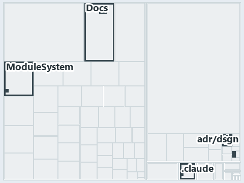

# docs/.assets/explanation/adr-dsgn-life--deploying-is-not-integrating--meta.tree.md

`Tree minimap: adr-dsgn-life--deploying-is-not-integrating--meta`

The tree minimap of the slide `adr-dsgn-life--deploying-is-not-integrating--meta` (meta lens). The slide supports [ADR-DSGN-LIFE][1] and
[ADR-DSGN-VISUAL][2]; the highlight of those ADR codes selects what is lit, and each reason below names the code that selects it.

## What the minimap shows

The tree draws every file of the world map as a tile, grouped by top-level folder (under `automation/` by module, under `docs/adr/` by ADR
domain), and lights 10 files in 5 groups, filled in ink. A lit ADR file has a white rim; a file lit only by passing mentions is a lighter
ink. Every other tile is idle, a grey box: a file the slide's ADR codes do not select.

- adr/dsgn (docs/adr/design): 3 lit files
- .claude: 2 lit files
- Docs (automation/Catzc.Base.Docs): 2 lit files
- adr/* (the files directly in docs/adr/): 2 lit files
- ModuleSystem (automation/Catzc.Base.ModuleSystem): 1 lit file

## Why each group is lit

### adr/dsgn (docs/adr/design, 3 lit files)

The group holds the files of docs/adr/design; each sits in its world-map cell and is lit by:

- [docs/adr/design/commit-lifecycle.md][1], in the cell docs × markdown: selected by [ADR-DSGN-LIFE][1]: the ADR's own file.
- [docs/adr/design/dora-explains.md][3], in the cell docs × markdown: selected by [ADR-DSGN-LIFE][1]: the file cites it at line 84 (text);
  selected by [ADR-DSGN-VISUAL][2]: the file cites it at line 65 (text).
- [docs/adr/design/visual-design.md][2], in the cell docs × markdown: selected by [ADR-DSGN-VISUAL][2]: the ADR's own file.

### .claude (2 lit files)

The group holds the files of .claude; each sits in its world-map cell and is lit by:

- [.claude/agents/drawio-diagram-waves.md][4], in the cell .claude × markdown: selected by [ADR-DSGN-VISUAL][2]: the file cites it at line
  48 (text).
- [.claude/agents/write-drawio-files.md][5], in the cell .claude × markdown: selected by [ADR-DSGN-LIFE][1]: the file cites it at line 43
  (text); selected by [ADR-DSGN-VISUAL][2]: the file cites it at line 43 (text) and line 129 (text).

### Docs (automation/Catzc.Base.Docs, 2 lit files)

The group holds the files of automation/Catzc.Base.Docs; each sits in its world-map cell and is lit by:

- [automation/Catzc.Base.Docs/configs/adrs.yml][6], in the cell automation × yaml: selected by [ADR-DSGN-LIFE][1]: the file cites it at line
  99 (text); selected by [ADR-DSGN-VISUAL][2]: the file cites it at line 98 (text).
- [automation/Catzc.Base.Docs/configs/agents.yml][7], in the cell automation × yaml: selected by [ADR-DSGN-VISUAL][2]: the file cites it at
  line 32 (text), line 32 (body comment) and line 37 (text).

### adr/* (the files directly in docs/adr/, 2 lit files)

The group holds the files of the files directly in docs/adr/; each sits in its world-map cell and is lit by:

- [docs/adr/glossary.md][8], in the cell docs × markdown: selected by [ADR-DSGN-LIFE][1]: the file cites it at line 149 (text).
- [docs/adr/index.md][9], in the cell docs × markdown: selected by [ADR-DSGN-LIFE][1]: the file cites it at line 92 (text); selected by
  [ADR-DSGN-VISUAL][2]: the file cites it at line 91 (text).

### ModuleSystem (automation/Catzc.Base.ModuleSystem, 1 lit file)

The group holds the files of automation/Catzc.Base.ModuleSystem; each sits in its world-map cell and is lit by:

- [automation/Catzc.Base.ModuleSystem/configs/glossary.yml][10], in the cell automation × yaml: selected by [ADR-DSGN-LIFE][1]: the file
  cites it at line 52 (text).

## Keywords

- [world map][11]
- [track][12]
- [file language][13]
- [cell][14]
- [lit cell][15]
- [.claude][16]: a track
- [automation][16]: a track
- [docs][16]: a track
- [markdown][17]: a file language
- [yaml][17]: a file language

Terms the cited ADRs define:

- [occupant][18], defined by [ADR-DSGN-LIFE#5][19]

[1]: ../../adr/design/commit-lifecycle.md
[2]: ../../adr/design/visual-design.md
[3]: ../../adr/design/dora-explains.md
[4]: ../../../.claude/agents/drawio-diagram-waves.md
[5]: ../../../.claude/agents/write-drawio-files.md
[6]: ../../../automation/Catzc.Base.Docs/configs/adrs.yml
[7]: ../../../automation/Catzc.Base.Docs/configs/agents.yml
[8]: ../../adr/glossary.md
[9]: ../../adr/index.md
[10]: ../../../automation/Catzc.Base.ModuleSystem/configs/glossary.yml
[11]: ../../adr/glossary.md#world-map
[12]: ../../adr/glossary.md#track
[13]: ../../adr/glossary.md#file-language
[14]: ../../adr/glossary.md#cell
[15]: ../../adr/glossary.md#lit-cell
[16]: ../../../automation/Catzc.Base.Variants/configs/variants.yml
[17]: ../../../automation/Catzc.Base.Languages/configs/languages.yml
[18]: ../../adr/glossary.md#occupant
[19]: ../../adr/design/commit-lifecycle.md#rule-adr-dsgn-life5
