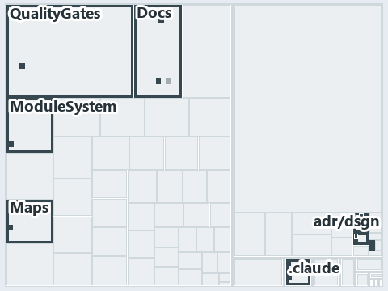

# docs/.assets/explanation/adr-dsgn-life--engineer-merges-pipelines-do-the-rest--operations.tree.md

`Tree minimap: adr-dsgn-life--engineer-merges-pipelines-do-the-rest--operations`

The tree minimap of the slide `adr-dsgn-life--engineer-merges-pipelines-do-the-rest--operations` (operations lens). The slide supports
[ADR-DSGN-LIFE][1] and [ADR-FLOW-CD][2]; the highlight of those ADR codes selects what is lit, and each reason below names the code that
selects it.

## What the minimap shows

The tree draws every file of the world map as a tile, grouped by top-level folder (under `automation/` by module, under `docs/adr/` by ADR
domain), and lights 16 files in 8 groups, filled in ink. A lit ADR file has a white rim; a file lit only by passing mentions is a lighter
ink. Every other tile is idle, a grey box: a file the slide's ADR codes do not select.

- Docs (automation/Catzc.Base.Docs): 3 lit files
- Maps (automation/Catzc.Base.Maps): 3 lit files
- .claude: 2 lit files
- adr/* (the files directly in docs/adr/): 2 lit files
- adr/dsgn (docs/adr/design): 2 lit files
- adr/flow (docs/adr/flow): 2 lit files
- ModuleSystem (automation/Catzc.Base.ModuleSystem): 1 lit file
- QualityGates (automation/Catzc.Base.QualityGates): 1 lit file

## Why each group is lit

### Docs (automation/Catzc.Base.Docs, 3 lit files)

The group holds the files of automation/Catzc.Base.Docs; each sits in its world-map cell and is lit by:

- [automation/Catzc.Base.Docs/configs/adrs.yml][3], in the cell automation × yaml: selected by [ADR-DSGN-LIFE][1]: the file cites it at line
  99 (text); selected by [ADR-FLOW-CD][2]: the file cites it at line 105 (body comment) and line 118 (text).
- [automation/Catzc.Base.Docs/types/AdrsConfig.cs][4], in the cell automation × csharp: selected by [ADR-FLOW-CD][2]: the file cites it at
  line 17 (header), line 18 (header), line 194 (body comment) and line 195 (body comment).
- [automation/Catzc.Base.Docs/types/GlossaryConcept.cs][5], in the cell automation × csharp: selected by [ADR-FLOW-CD][2]: the file cites it
  at line 41 (body comment) (a passing mention only).

### Maps (automation/Catzc.Base.Maps, 3 lit files)

The group holds the files of automation/Catzc.Base.Maps; each sits in its world-map cell and is lit by:

- [automation/Catzc.Base.Maps/Get-ValueChainHighlight.ps1][6], in the cell automation × powershell: selected by [ADR-FLOW-CD][2]: the file
  cites it at line 20 (header).
- [automation/Catzc.Base.Maps/Get-WorldMapHighlight.ps1][7], in the cell automation × powershell: selected by [ADR-FLOW-CD][2]: the file
  cites it at line 31 (header).
- [automation/Catzc.Base.Maps/tests/Get-WorldMapHighlight.Tests.ps1][8], in the cell automation × powershell: selected by [ADR-FLOW-CD][2]:
  the file cites it at line 70 (text) and line 71 (text).

### .claude (2 lit files)

The group holds the files of .claude; each sits in its world-map cell and is lit by:

- [.claude/CLAUDE.md][9], in the cell .claude × markdown: selected by [ADR-FLOW-CD][2]: the file cites it at line 51 (text).
- [.claude/agents/write-drawio-files.md][10], in the cell .claude × markdown: selected by [ADR-DSGN-LIFE][1]: the file cites it at line 43
  (text).

### adr/* (the files directly in docs/adr/, 2 lit files)

The group holds the files of the files directly in docs/adr/; each sits in its world-map cell and is lit by:

- [docs/adr/glossary.md][11], in the cell docs × markdown: selected by [ADR-DSGN-LIFE][1]: the file cites it at line 149 (text); selected by
  [ADR-FLOW-CD][2]: the file cites it at line 292 (text) and line 305 (text).
- [docs/adr/index.md][12], in the cell docs × markdown: selected by [ADR-DSGN-LIFE][1]: the file cites it at line 92 (text); selected by
  [ADR-FLOW-CD][2]: the file cites it at line 107 (text).

### adr/dsgn (docs/adr/design, 2 lit files)

The group holds the files of docs/adr/design; each sits in its world-map cell and is lit by:

- [docs/adr/design/commit-lifecycle.md][1], in the cell docs × markdown: selected by [ADR-DSGN-LIFE][1]: the ADR's own file.
- [docs/adr/design/dora-explains.md][13], in the cell docs × markdown: selected by [ADR-DSGN-LIFE][1]: the file cites it at line 84 (text).

### adr/flow (docs/adr/flow, 2 lit files)

The group holds the files of docs/adr/flow; each sits in its world-map cell and is lit by:

- [docs/adr/flow/cd-discipline-and-promotion-flow.md][2], in the cell docs × markdown: selected by [ADR-FLOW-CD][2]: the ADR's own file.
- [docs/adr/flow/dora-explains.md][14], in the cell docs × markdown: selected by [ADR-FLOW-CD][2]: the file cites it at line 13 (text).

### ModuleSystem (automation/Catzc.Base.ModuleSystem, 1 lit file)

The group holds the files of automation/Catzc.Base.ModuleSystem; each sits in its world-map cell and is lit by:

- [automation/Catzc.Base.ModuleSystem/configs/glossary.yml][15], in the cell automation × yaml: selected by [ADR-DSGN-LIFE][1]: the file
  cites it at line 52 (text); selected by [ADR-FLOW-CD][2]: the file cites it at line 21 (text).

### QualityGates (automation/Catzc.Base.QualityGates, 1 lit file)

The group holds the files of automation/Catzc.Base.QualityGates; each sits in its world-map cell and is lit by:

- [automation/Catzc.Base.QualityGates/configs/glossary.yml][16], in the cell automation × yaml: selected by [ADR-FLOW-CD][2]: the file cites
  it at line 62 (text).

## Keywords

- [world map][17]
- [track][18]
- [file language][19]
- [cell][20]
- [lit cell][21]
- [.claude][22]: a track
- [automation][22]: a track
- [docs][22]: a track
- [csharp][23]: a file language
- [markdown][23]: a file language
- [powershell][23]: a file language
- [yaml][23]: a file language

Terms the cited ADRs define:

- [gate][24], defined by [ADR-FLOW-CD#13][25]
- [occupant][26], defined by [ADR-DSGN-LIFE#5][27]
- [release candidate][28], defined by [ADR-FLOW-CD#14][29]

[1]: ../../adr/design/commit-lifecycle.md
[2]: ../../adr/flow/cd-discipline-and-promotion-flow.md
[3]: ../../../automation/Catzc.Base.Docs/configs/adrs.yml
[4]: ../../../automation/Catzc.Base.Docs/types/AdrsConfig.cs
[5]: ../../../automation/Catzc.Base.Docs/types/GlossaryConcept.cs
[6]: ../../../automation/Catzc.Base.Maps/Get-ValueChainHighlight.ps1
[7]: ../../../automation/Catzc.Base.Maps/Get-WorldMapHighlight.ps1
[8]: ../../../automation/Catzc.Base.Maps/tests/Get-WorldMapHighlight.Tests.ps1
[9]: ../../../.claude/CLAUDE.md
[10]: ../../../.claude/agents/write-drawio-files.md
[11]: ../../adr/glossary.md
[12]: ../../adr/index.md
[13]: ../../adr/design/dora-explains.md
[14]: ../../adr/flow/dora-explains.md
[15]: ../../../automation/Catzc.Base.ModuleSystem/configs/glossary.yml
[16]: ../../../automation/Catzc.Base.QualityGates/configs/glossary.yml
[17]: ../../adr/glossary.md#world-map
[18]: ../../adr/glossary.md#track
[19]: ../../adr/glossary.md#file-language
[20]: ../../adr/glossary.md#cell
[21]: ../../adr/glossary.md#lit-cell
[22]: ../../../automation/Catzc.Base.Variants/configs/variants.yml
[23]: ../../../automation/Catzc.Base.Languages/configs/languages.yml
[24]: ../../adr/glossary.md#gate
[25]: ../../adr/flow/cd-discipline-and-promotion-flow.md#rule-adr-flow-cd13
[26]: ../../adr/glossary.md#occupant
[27]: ../../adr/design/commit-lifecycle.md#rule-adr-dsgn-life5
[28]: ../../adr/glossary.md#release-candidate
[29]: ../../adr/flow/cd-discipline-and-promotion-flow.md#rule-adr-flow-cd14
