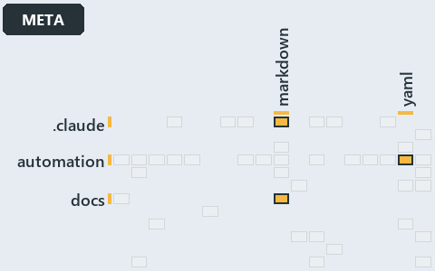

# docs/.assets/explanation/adr-dsgn-life--one-way-climb-three-endings--meta.grid.md

`Grid minimap: adr-dsgn-life--one-way-climb-three-endings--meta`

The grid minimap of the slide `adr-dsgn-life--one-way-climb-three-endings--meta` (meta lens). The slide supports [ADR-DSGN-LIFE][1] and
[ADR-DSGN-VISUAL][2]; the highlight of those ADR codes selects what is lit, and each reason below names the code that selects it.

## What the minimap shows

The grid crosses the 12 tracks with the 18 file languages of the world map and lights 3 cells. A cell lit only by passing mentions
(citations in body comments, not in a file's header or text) is touched: drawn pale.

- .claude × markdown: 3 lit of 9 files
- automation × yaml: 3 lit of 95 files
- docs × markdown: 42 lit of 469 files

## Why each cell is lit

### .claude × markdown (3 lit files)

Placed: the root folder `.claude/` names the track .claude ([ADR-DSGN-TRACK#1][3]); the extension `.md` names the file language markdown
([ADR-DSGN-TRACK#6][4]). Lit ([ADR-DSGN-TRACK#12][5]) by:

- [.claude/agents/drawio-diagram-waves.md][6]: selected by [ADR-DSGN-VISUAL][2]: the file cites it at line 48 (text).
- [.claude/agents/write-drawio-files.md][7]: selected by [ADR-DSGN-LIFE][1]: the file cites it at line 43 (text); selected by
  [ADR-DSGN-VISUAL][2]: the file cites it at line 43 (text) and line 129 (text).
- [.claude/drawio/STYLE.md][8]: selected by [ADR-DSGN-VISUAL][2]: the file cites it at line 41 (text), line 52 (text) and line 64 (text).

### automation × yaml (3 lit files)

Placed: the root folder `automation/` names the track automation ([ADR-DSGN-TRACK#1][3]); the extension `.yml` names the file language yaml
([ADR-DSGN-TRACK#6][4]). Lit ([ADR-DSGN-TRACK#12][5]) by:

- [automation/Catzc.Base.Docs/configs/adrs.yml][9]: selected by [ADR-DSGN-LIFE][1]: the file cites it at line 99 (text); selected by
  [ADR-DSGN-VISUAL][2]: the file cites it at line 98 (text).
- [automation/Catzc.Base.Docs/configs/agents.yml][10]: selected by [ADR-DSGN-VISUAL][2]: the file cites it at line 32 (text), line 32 (body
  comment) and line 37 (text).
- [automation/Catzc.Base.ModuleSystem/configs/glossary.yml][11]: selected by [ADR-DSGN-LIFE][1]: the file cites it at line 52 (text).

### docs × markdown (42 lit files)

Placed: the root folder `docs/` names the track docs ([ADR-DSGN-TRACK#1][3]); the extension `.md` names the file language markdown
([ADR-DSGN-TRACK#6][4]). Lit ([ADR-DSGN-TRACK#12][5]) by:

- [docs/.assets/explanation/adr-dsgn-life--code-wires-only-the-first-rungs--implementation.drawio.md][12]: selected by [ADR-DSGN-LIFE][1]:
  the file cites it at line 68 (text).
- [docs/.assets/explanation/adr-dsgn-life--deploy-and-integrate-share-only-the-topic--architecture.drawio.md][13]: selected by
  [ADR-DSGN-LIFE][1]: the file cites it at line 70 (text); selected by [ADR-DSGN-VISUAL][2]: the file cites it at line 70 (text).
- [docs/.assets/explanation/adr-dsgn-life--deploying-is-not-integrating--meta.drawio.md][14]: selected by [ADR-DSGN-LIFE][1]: the file cites
  it at line 68 (text); selected by [ADR-DSGN-VISUAL][2]: the file cites it at line 68 (text).
- [docs/.assets/explanation/adr-dsgn-life--engineer-merges-pipelines-do-the-rest--operations.drawio.md][15]: selected by [ADR-DSGN-LIFE][1]:
  the file cites it at line 72 (text).
- [docs/.assets/explanation/adr-dsgn-life--every-deploy-stage-is-main-only--implementation.drawio.md][16]: selected by [ADR-DSGN-LIFE][1]:
  the file cites it at line 75 (text); selected by [ADR-DSGN-VISUAL][2]: the file cites it at line 75 (text).
- [docs/.assets/explanation/adr-dsgn-life--four-domains-promote-one-artifact--architecture.drawio.md][17]: selected by [ADR-DSGN-LIFE][1]:
  the file cites it at line 71 (text).
- [docs/.assets/explanation/adr-dsgn-life--integrators-depend-on-an-occupant--architecture.drawio.md][18]: selected by [ADR-DSGN-LIFE][1]:
  the file cites it at line 67 (text).
- [docs/.assets/explanation/adr-dsgn-life--merging-to-main-is-what-deploys--operations.drawio.md][19]: selected by [ADR-DSGN-LIFE][1]: the
  file cites it at line 72 (text); selected by [ADR-DSGN-VISUAL][2]: the file cites it at line 72 (text).
- [docs/.assets/explanation/adr-dsgn-life--one-way-climb-three-endings--meta.drawio.md][20]: selected by [ADR-DSGN-LIFE][1]: the file cites
  it at line 69 (text); selected by [ADR-DSGN-VISUAL][2]: the file cites it at line 69 (text).
- [docs/.assets/explanation/adr-dsgn-life--out-of-band-deploy-is-adr-only--governance.drawio.md][21]: selected by [ADR-DSGN-LIFE][1]: the
  file cites it at line 64 (text) and line 74 (text); selected by [ADR-DSGN-VISUAL][2]: the file cites it at line 64 (text) and line 74
  (text).
- [docs/.assets/explanation/adr-dsgn-life--sync-from-the-last-certified-commit--meta.drawio.md][22]: selected by [ADR-DSGN-LIFE][1]: the
  file cites it at line 63 (text).
- [docs/.assets/explanation/adr-dsgn-life--sync-point-rules-are-adr-only--governance.drawio.md][23]: selected by [ADR-DSGN-LIFE][1]: the
  file cites it at line 65 (text) and line 74 (text).
- [docs/.assets/explanation/adr-dsgn-life--which-rung-gates-exist-in-code--governance.drawio.md][24]: selected by [ADR-DSGN-LIFE][1]: the
  file cites it at line 67 (text) and line 76 (text); selected by [ADR-DSGN-VISUAL][2]: the file cites it at line 76 (text).
- [docs/.assets/explanation/adr-dsgn-remote--clients-bridge-to-one-server--architecture.drawio.md][25]: selected by [ADR-DSGN-LIFE][1]: the
  file cites it at line 70 (text).
- [docs/.assets/explanation/adr-dsgn-remote--ingress-gated-the-rest-by-review--governance.drawio.md][26]: selected by [ADR-DSGN-LIFE][1]:
  the file cites it at line 73 (text).
- [docs/.assets/explanation/glyphs.drawio.md][27]: selected by [ADR-DSGN-VISUAL][2]: the file cites it at line 30 (text).
- [docs/adr/design/commit-lifecycle.md][1]: selected by [ADR-DSGN-LIFE][1]: an ADR file of the `design` ADR domain, the ADR domain of that
  code; selected by [ADR-DSGN-VISUAL][2]: an ADR file of the `design` ADR domain, the ADR domain of that code.
- [docs/adr/design/dora-explains.md][28]: selected by [ADR-DSGN-LIFE][1]: an ADR file of the `design` ADR domain, the ADR domain of that
  code; selected by [ADR-DSGN-VISUAL][2]: an ADR file of the `design` ADR domain, the ADR domain of that code.
- [docs/adr/design/module-aspects.md][29]: selected by [ADR-DSGN-LIFE][1]: an ADR file of the `design` ADR domain, the ADR domain of that
  code; selected by [ADR-DSGN-VISUAL][2]: an ADR file of the `design` ADR domain, the ADR domain of that code.
- [docs/adr/design/run-modes.md][30]: selected by [ADR-DSGN-LIFE][1]: an ADR file of the `design` ADR domain, the ADR domain of that code;
  selected by [ADR-DSGN-VISUAL][2]: an ADR file of the `design` ADR domain, the ADR domain of that code.
- [docs/adr/design/self-service.md][31]: selected by [ADR-DSGN-LIFE][1]: an ADR file of the `design` ADR domain, the ADR domain of that
  code; selected by [ADR-DSGN-VISUAL][2]: an ADR file of the `design` ADR domain, the ADR domain of that code.
- [docs/adr/design/server-remote-integration.md][32]: selected by [ADR-DSGN-LIFE][1]: an ADR file of the `design` ADR domain, the ADR domain
  of that code; selected by [ADR-DSGN-VISUAL][2]: an ADR file of the `design` ADR domain, the ADR domain of that code.
- [docs/adr/design/thin-platforms.md][33]: selected by [ADR-DSGN-LIFE][1]: an ADR file of the `design` ADR domain, the ADR domain of that
  code; selected by [ADR-DSGN-VISUAL][2]: an ADR file of the `design` ADR domain, the ADR domain of that code.
- [docs/adr/design/tracks.md][34]: selected by [ADR-DSGN-LIFE][1]: an ADR file of the `design` ADR domain, the ADR domain of that code;
  selected by [ADR-DSGN-VISUAL][2]: an ADR file of the `design` ADR domain, the ADR domain of that code.
- [docs/adr/design/visual-design.md][2]: selected by [ADR-DSGN-LIFE][1]: an ADR file of the `design` ADR domain, the ADR domain of that
  code; selected by [ADR-DSGN-VISUAL][2]: an ADR file of the `design` ADR domain, the ADR domain of that code.
- [docs/adr/glossary.md][35]: selected by [ADR-DSGN-LIFE][1]: the file cites it at line 149 (text).
- [docs/adr/index.md][36]: selected by [ADR-DSGN-LIFE][1]: the file cites it at line 92 (text); selected by [ADR-DSGN-VISUAL][2]: the file
  cites it at line 91 (text).
- [docs/explanation/design/clients-bridge-to-one-server.md][37]: selected by [ADR-DSGN-LIFE][1]: the file cites it at line 15 (text), line
  49 (text) and line 50 (text).
- [docs/explanation/design/code-wires-only-the-first-rungs.md][38]: selected by [ADR-DSGN-LIFE][1]: the file cites it at line 17 (text) and
  line 54 (text).
- [docs/explanation/design/deploy-and-integrate-share-only-the-topic.md][39]: selected by [ADR-DSGN-LIFE][1]: the file cites it at line 15
  (text), line 46 (text), line 48 (text) and line 55 (text); selected by [ADR-DSGN-VISUAL][2]: the file cites it at line 15 (text), line 50
  (text), line 51 (text) and line 57 (text).
- [docs/explanation/design/deploying-is-not-integrating.md][40]: selected by [ADR-DSGN-LIFE][1]: the file cites it at line 14 (text), line
  43 (text), line 44 (text) and line 51 (text); selected by [ADR-DSGN-VISUAL][2]: the file cites it at line 14 (text), line 46 (text) and
  line 47 (text).
- [docs/explanation/design/engineer-merges-pipelines-do-the-rest.md][41]: selected by [ADR-DSGN-LIFE][1]: the file cites it at line 17
  (text), line 52 (text) and line 53 (text).
- [docs/explanation/design/every-deploy-stage-is-main-only.md][42]: selected by [ADR-DSGN-LIFE][1]: the file cites it at line 11 (text),
  line 16 (text), line 19 (text), line 36 (text), line 50 (text), line 55 (text) and line 57 (text).
- [docs/explanation/design/four-domains-promote-one-artifact.md][43]: selected by [ADR-DSGN-LIFE][1]: the file cites it at line 16 (text),
  line 48 (text), line 50 (text), line 52 (text) and line 53 (text).
- [docs/explanation/design/ingress-gated-the-rest-by-review.md][44]: selected by [ADR-DSGN-LIFE][1]: the file cites it at line 16 (text),
  line 22 (text) and line 51 (text).
- [docs/explanation/design/integrators-depend-on-an-occupant.md][45]: selected by [ADR-DSGN-LIFE][1]: the file cites it at line 15 (text),
  line 46 (text), line 47 (text), line 48 (text) and line 49 (text); selected by [ADR-DSGN-VISUAL][2]: the file cites it at line 46 (text).
- [docs/explanation/design/merging-to-main-is-what-deploys.md][46]: selected by [ADR-DSGN-LIFE][1]: the file cites it at line 15 (text),
  line 20 (text), line 44 (text) and line 49 (text).
- [docs/explanation/design/one-way-climb-three-endings.md][47]: selected by [ADR-DSGN-LIFE][1]: the file cites it at line 13 (text), line 41
  (text), line 42 (text), line 43 (text), line 44 (text) and line 45 (text); selected by [ADR-DSGN-VISUAL][2]: the file cites it at line 46
  (text).
- [docs/explanation/design/out-of-band-deploy-is-adr-only.md][48]: selected by [ADR-DSGN-LIFE][1]: the file cites it at line 6 (text), line
  15 (text), line 18 (text), line 23 (text), line 45 (text), line 46 (text) and line 54 (text); selected by [ADR-DSGN-VISUAL][2]: the file
  cites it at line 15 (text), line 20 (text), line 47 (text), line 49 (text), line 50 (text) and line 58 (text).
- [docs/explanation/design/sync-from-the-last-certified-commit.md][49]: selected by [ADR-DSGN-LIFE][1]: the file cites it at line 12 (text),
  line 34 (text), line 35 (text) and line 36 (text).
- [docs/explanation/design/sync-point-rules-are-adr-only.md][50]: selected by [ADR-DSGN-LIFE][1]: the file cites it at line 17 (text), line
  31 (text), line 31 (text), line 33 (text), line 37 (text), line 43 (text), line 44 (text), line 45 (text), line 49 (text), line 50 (text),
  line 52 (text), line 52 (text), line 53 (text) and line 61 (text).
- [docs/explanation/design/which-rung-gates-exist-in-code.md][51]: selected by [ADR-DSGN-LIFE][1]: the file cites it at line 17 (text), line
  52 (text), line 53 (text), line 54 (text), line 55 (text), line 56 (text), line 57 (text), line 58 (text) and line 59 (text); selected by
  [ADR-DSGN-VISUAL][2]: the file cites it at line 63 (text).

## Keywords

- [world map][52]
- [track][53]
- [file language][54]
- [cell][55]
- [lit cell][56]
- [.claude][57]: a track
- [automation][57]: a track
- [docs][57]: a track
- [markdown][58]: a file language
- [yaml][58]: a file language

Terms the cited ADRs define:

- [occupant][59], defined by [ADR-DSGN-LIFE#5][60]

[1]: ../../adr/design/commit-lifecycle.md
[2]: ../../adr/design/visual-design.md
[3]: ../../adr/design/tracks.md#rule-adr-dsgn-track1
[4]: ../../adr/design/tracks.md#rule-adr-dsgn-track6
[5]: ../../adr/design/tracks.md#rule-adr-dsgn-track12
[6]: ../../../.claude/agents/drawio-diagram-waves.md
[7]: ../../../.claude/agents/write-drawio-files.md
[8]: ../../../.claude/drawio/STYLE.md
[9]: ../../../automation/Catzc.Base.Docs/configs/adrs.yml
[10]: ../../../automation/Catzc.Base.Docs/configs/agents.yml
[11]: ../../../automation/Catzc.Base.ModuleSystem/configs/glossary.yml
[12]: adr-dsgn-life--code-wires-only-the-first-rungs--implementation.drawio.md
[13]: adr-dsgn-life--deploy-and-integrate-share-only-the-topic--architecture.drawio.md
[14]: adr-dsgn-life--deploying-is-not-integrating--meta.drawio.md
[15]: adr-dsgn-life--engineer-merges-pipelines-do-the-rest--operations.drawio.md
[16]: adr-dsgn-life--every-deploy-stage-is-main-only--implementation.drawio.md
[17]: adr-dsgn-life--four-domains-promote-one-artifact--architecture.drawio.md
[18]: adr-dsgn-life--integrators-depend-on-an-occupant--architecture.drawio.md
[19]: adr-dsgn-life--merging-to-main-is-what-deploys--operations.drawio.md
[20]: adr-dsgn-life--one-way-climb-three-endings--meta.drawio.md
[21]: adr-dsgn-life--out-of-band-deploy-is-adr-only--governance.drawio.md
[22]: adr-dsgn-life--sync-from-the-last-certified-commit--meta.drawio.md
[23]: adr-dsgn-life--sync-point-rules-are-adr-only--governance.drawio.md
[24]: adr-dsgn-life--which-rung-gates-exist-in-code--governance.drawio.md
[25]: adr-dsgn-remote--clients-bridge-to-one-server--architecture.drawio.md
[26]: adr-dsgn-remote--ingress-gated-the-rest-by-review--governance.drawio.md
[27]: glyphs.drawio.md
[28]: ../../adr/design/dora-explains.md
[29]: ../../adr/design/module-aspects.md
[30]: ../../adr/design/run-modes.md
[31]: ../../adr/design/self-service.md
[32]: ../../adr/design/server-remote-integration.md
[33]: ../../adr/design/thin-platforms.md
[34]: ../../adr/design/tracks.md
[35]: ../../adr/glossary.md
[36]: ../../adr/index.md
[37]: ../../explanation/design/clients-bridge-to-one-server.md
[38]: ../../explanation/design/code-wires-only-the-first-rungs.md
[39]: ../../explanation/design/deploy-and-integrate-share-only-the-topic.md
[40]: ../../explanation/design/deploying-is-not-integrating.md
[41]: ../../explanation/design/engineer-merges-pipelines-do-the-rest.md
[42]: ../../explanation/design/every-deploy-stage-is-main-only.md
[43]: ../../explanation/design/four-domains-promote-one-artifact.md
[44]: ../../explanation/design/ingress-gated-the-rest-by-review.md
[45]: ../../explanation/design/integrators-depend-on-an-occupant.md
[46]: ../../explanation/design/merging-to-main-is-what-deploys.md
[47]: ../../explanation/design/one-way-climb-three-endings.md
[48]: ../../explanation/design/out-of-band-deploy-is-adr-only.md
[49]: ../../explanation/design/sync-from-the-last-certified-commit.md
[50]: ../../explanation/design/sync-point-rules-are-adr-only.md
[51]: ../../explanation/design/which-rung-gates-exist-in-code.md
[52]: ../../adr/glossary.md#world-map
[53]: ../../adr/glossary.md#track
[54]: ../../adr/glossary.md#file-language
[55]: ../../adr/glossary.md#cell
[56]: ../../adr/glossary.md#lit-cell
[57]: ../../../automation/Catzc.Base.Variants/configs/variants.yml
[58]: ../../../automation/Catzc.Base.Languages/configs/languages.yml
[59]: ../../adr/glossary.md#occupant
[60]: ../../adr/design/commit-lifecycle.md#rule-adr-dsgn-life5
