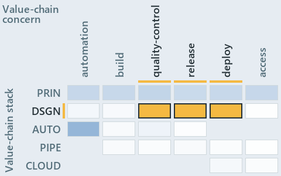

# docs/.assets/explanation/adr-dsgn-life--out-of-band-deploy-is-adr-only--governance.chain.md

`Value-chain minimap: adr-dsgn-life--out-of-band-deploy-is-adr-only--governance`

The value-chain minimap of the slide `adr-dsgn-life--out-of-band-deploy-is-adr-only--governance` (governance lens). The slide supports
[ADR-DSGN-LIFE][1] and [ADR-DSGN-VISUAL][2]; the highlight of those ADR codes selects what is lit, and each reason below names the code that
selects it.

## What the minimap shows

Value-chain map: value-chain stack × value-chain concerns. The grid crosses the 5 rows of the value-chain stack (PRIN, DSGN, AUTO, PIPE,
CLOUD) with the 6 value-chain concerns (automation, build, quality-control, release, deploy, access), shades each cell by the ADRs it holds,
and lights 3 cells.

- DSGN × quality-control: 2 lit of 5 ADRs
- DSGN × release: 2 lit of 4 ADRs
- DSGN × deploy: 2 lit of 6 ADRs

## Why each cell is lit

### DSGN × quality-control (2 ADRs)

Lit ([ADR-DSGN-TRACK#12][3]) by:

- [ADR-DSGN-LIFE][1]: selected by [ADR-DSGN-LIFE][1]; its ADR domain `design` sits on the DSGN row of the value-chain stack
  ([ADR-DSGN-TRACK#14][4]); its own value-chain concerns (quality-control, release and deploy) override its ADR domain's default
  (automation), so it lights the quality-control column ([ADR-DSGN-TRACK#15][5]).
- [ADR-DSGN-VISUAL][2]: selected by [ADR-DSGN-VISUAL][2]; its ADR domain `design` sits on the DSGN row of the value-chain stack
  ([ADR-DSGN-TRACK#14][4]); its own value-chain concerns (quality-control, release and deploy) override its ADR domain's default
  (automation), so it lights the quality-control column ([ADR-DSGN-TRACK#15][5]).

### DSGN × release (2 ADRs)

Lit ([ADR-DSGN-TRACK#12][3]) by:

- [ADR-DSGN-LIFE][1]: selected by [ADR-DSGN-LIFE][1]; its ADR domain `design` sits on the DSGN row of the value-chain stack
  ([ADR-DSGN-TRACK#14][4]); its own value-chain concerns (quality-control, release and deploy) override its ADR domain's default
  (automation), so it lights the release column ([ADR-DSGN-TRACK#15][5]).
- [ADR-DSGN-VISUAL][2]: selected by [ADR-DSGN-VISUAL][2]; its ADR domain `design` sits on the DSGN row of the value-chain stack
  ([ADR-DSGN-TRACK#14][4]); its own value-chain concerns (quality-control, release and deploy) override its ADR domain's default
  (automation), so it lights the release column ([ADR-DSGN-TRACK#15][5]).

### DSGN × deploy (2 ADRs)

Lit ([ADR-DSGN-TRACK#12][3]) by:

- [ADR-DSGN-LIFE][1]: selected by [ADR-DSGN-LIFE][1]; its ADR domain `design` sits on the DSGN row of the value-chain stack
  ([ADR-DSGN-TRACK#14][4]); its own value-chain concerns (quality-control, release and deploy) override its ADR domain's default
  (automation), so it lights the deploy column ([ADR-DSGN-TRACK#15][5]).
- [ADR-DSGN-VISUAL][2]: selected by [ADR-DSGN-VISUAL][2]; its ADR domain `design` sits on the DSGN row of the value-chain stack
  ([ADR-DSGN-TRACK#14][4]); its own value-chain concerns (quality-control, release and deploy) override its ADR domain's default
  (automation), so it lights the deploy column ([ADR-DSGN-TRACK#15][5]).

## Keywords

- [value-chain map][6]
- [value-chain stack][7]
- [value-chain concern][8]
- [cell][9]
- [lit cell][10]

Terms the cited ADRs define:

- [occupant][11], defined by [ADR-DSGN-LIFE#5][12]

[1]: ../../adr/design/commit-lifecycle.md
[2]: ../../adr/design/visual-design.md
[3]: ../../adr/design/tracks.md#rule-adr-dsgn-track12
[4]: ../../adr/design/tracks.md#rule-adr-dsgn-track14
[5]: ../../adr/design/tracks.md#rule-adr-dsgn-track15
[6]: ../../adr/glossary.md#value-chain-map
[7]: ../../adr/glossary.md#value-chain-stack
[8]: ../../adr/glossary.md#value-chain-concern
[9]: ../../adr/glossary.md#cell
[10]: ../../adr/glossary.md#lit-cell
[11]: ../../adr/glossary.md#occupant
[12]: ../../adr/design/commit-lifecycle.md#rule-adr-dsgn-life5
