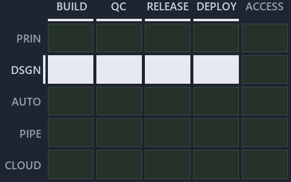

# docs/.assets/explanation/adr-dsgn-life--sync-point-rules-are-adr-only--governance.chain.md

`Value-chain minimap: adr-dsgn-life--sync-point-rules-are-adr-only--governance`

The value-chain minimap of the slide `adr-dsgn-life--sync-point-rules-are-adr-only--governance` (governance lens). The slide supports
[ADR-DSGN-LIFE][1] and [ADR-FLOW-CD][2]; the highlight of those ADR codes selects what is lit, and each reason below names the code that
selects it.

## What the minimap shows

Value-chain map: value-chain stack × value-chain concerns. The grid crosses the 5 rows of the value-chain stack (PRIN, DSGN, AUTO, PIPE,
CLOUD) with the 5 value-chain concerns (build, quality-control, release, deploy, access) and lights 4 cells, filled in ink. Every other cell
is idle, a grey box: it holds ADRs the slide does not cite, or none, because no ADR's value-chain concern lands there (5 of the 25 cells
hold none). The minimap shows where the slide sits, not how many ADRs a cell holds; that count belongs to the full value-chain map.

- DSGN × build: 1 lit of 5 ADRs
- DSGN × quality-control: 2 lit of 5 ADRs
- DSGN × release: 2 lit of 4 ADRs
- DSGN × deploy: 2 lit of 6 ADRs

## Key

Rows are the value-chain stack and columns the value-chain concerns, each printed as a capital code:

- `PRIN`: the PRIN row of the value-chain stack
- `DSGN`: the DSGN row of the value-chain stack
- `AUTO`: the AUTO row of the value-chain stack
- `PIPE`: the PIPE row of the value-chain stack
- `CLOUD`: the CLOUD row of the value-chain stack
- `BUILD`: build
- `QC`: quality-control
- `RELEASE`: release
- `DEPLOY`: deploy
- `ACCESS`: access

## Why each cell is lit

### DSGN × build (1 ADR)

Lit ([ADR-DSGN-TRACK#12][3]) by:

- [ADR-FLOW-CD][2]: selected by [ADR-FLOW-CD][2]; its ADR domain `flow` sits on the DSGN row of the value-chain stack
  ([ADR-DSGN-TRACK#14][4]); its value-chain concerns (build, quality-control, release and deploy) are its ADR domain's default, so it lights
  the build column ([ADR-DSGN-TRACK#15][5]).

### DSGN × quality-control (2 ADRs)

Lit ([ADR-DSGN-TRACK#12][3]) by:

- [ADR-DSGN-LIFE][1]: selected by [ADR-DSGN-LIFE][1]; its ADR domain `design` sits on the DSGN row of the value-chain stack
  ([ADR-DSGN-TRACK#14][4]); its own value-chain concerns (quality-control, release and deploy) override its ADR domain's default
  (automation), so it lights the quality-control column ([ADR-DSGN-TRACK#15][5]).
- [ADR-FLOW-CD][2]: selected by [ADR-FLOW-CD][2]; its ADR domain `flow` sits on the DSGN row of the value-chain stack
  ([ADR-DSGN-TRACK#14][4]); its value-chain concerns (build, quality-control, release and deploy) are its ADR domain's default, so it lights
  the quality-control column ([ADR-DSGN-TRACK#15][5]).

### DSGN × release (2 ADRs)

Lit ([ADR-DSGN-TRACK#12][3]) by:

- [ADR-DSGN-LIFE][1]: selected by [ADR-DSGN-LIFE][1]; its ADR domain `design` sits on the DSGN row of the value-chain stack
  ([ADR-DSGN-TRACK#14][4]); its own value-chain concerns (quality-control, release and deploy) override its ADR domain's default
  (automation), so it lights the release column ([ADR-DSGN-TRACK#15][5]).
- [ADR-FLOW-CD][2]: selected by [ADR-FLOW-CD][2]; its ADR domain `flow` sits on the DSGN row of the value-chain stack
  ([ADR-DSGN-TRACK#14][4]); its value-chain concerns (build, quality-control, release and deploy) are its ADR domain's default, so it lights
  the release column ([ADR-DSGN-TRACK#15][5]).

### DSGN × deploy (2 ADRs)

Lit ([ADR-DSGN-TRACK#12][3]) by:

- [ADR-DSGN-LIFE][1]: selected by [ADR-DSGN-LIFE][1]; its ADR domain `design` sits on the DSGN row of the value-chain stack
  ([ADR-DSGN-TRACK#14][4]); its own value-chain concerns (quality-control, release and deploy) override its ADR domain's default
  (automation), so it lights the deploy column ([ADR-DSGN-TRACK#15][5]).
- [ADR-FLOW-CD][2]: selected by [ADR-FLOW-CD][2]; its ADR domain `flow` sits on the DSGN row of the value-chain stack
  ([ADR-DSGN-TRACK#14][4]); its value-chain concerns (build, quality-control, release and deploy) are its ADR domain's default, so it lights
  the deploy column ([ADR-DSGN-TRACK#15][5]).

## Keywords

- [value-chain map][6]
- [value-chain stack][7]
- [value-chain concern][8]
- [cell][9]
- [lit cell][10]

Terms the cited ADRs define:

- [gate][11], defined by [ADR-FLOW-CD#13][12]
- [occupant][13], defined by [ADR-DSGN-LIFE#5][14]
- [release candidate][15], defined by [ADR-FLOW-CD#14][16]

[1]: ../../adr/design/commit-lifecycle.md
[2]: ../../adr/flow/cd-discipline-and-promotion-flow.md
[3]: ../../adr/design/tracks.md#rule-adr-dsgn-track12
[4]: ../../adr/design/tracks.md#rule-adr-dsgn-track14
[5]: ../../adr/design/tracks.md#rule-adr-dsgn-track15
[6]: ../../adr/glossary.md#value-chain-map
[7]: ../../adr/glossary.md#value-chain-stack
[8]: ../../adr/glossary.md#value-chain-concern
[9]: ../../adr/glossary.md#cell
[10]: ../../adr/glossary.md#lit-cell
[11]: ../../adr/glossary.md#gate
[12]: ../../adr/flow/cd-discipline-and-promotion-flow.md#rule-adr-flow-cd13
[13]: ../../adr/glossary.md#occupant
[14]: ../../adr/design/commit-lifecycle.md#rule-adr-dsgn-life5
[15]: ../../adr/glossary.md#release-candidate
[16]: ../../adr/flow/cd-discipline-and-promotion-flow.md#rule-adr-flow-cd14
