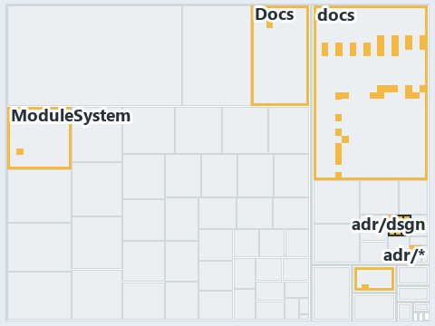

# docs/.assets/explanation/adr-dsgn-remote--clients-bridge-to-one-server--architecture.tree.md

`Tree minimap: adr-dsgn-remote--clients-bridge-to-one-server--architecture`

The tree minimap of the slide `adr-dsgn-remote--clients-bridge-to-one-server--architecture` (architecture lens). The slide supports
[ADR-DSGN-LIFE][1] and [ADR-DSGN-REMOTE][2]; the highlight of those ADR codes selects what is lit, and each reason below names the code that
selects it.

## What the minimap shows

The tree draws every file of the world map as a tile, grouped by top-level folder (under `automation/` by module, under `docs/adr/` by ADR
domain), and lights 50 files in 6 groups. A lit ADR file is framed; a file lit only by passing mentions is drawn pale.

- docs (docs/ outside docs/adr/): 36 lit files
- adr/dsgn (docs/adr/design): 9 lit files
- adr/* (the files directly in docs/adr/): 2 lit files
- .claude: 1 lit file
- Docs (automation/Catzc.Base.Docs): 1 lit file
- ModuleSystem (automation/Catzc.Base.ModuleSystem): 1 lit file

## Why each group is lit

### docs (36 lit files)

The group holds the files of docs/ outside docs/adr/; each sits in its world-map cell and is lit by:

- [docs/.assets/explanation/adr-dsgn-life--code-wires-only-the-first-rungs--implementation.drawio.md][3], in the cell docs × markdown:
  selected by [ADR-DSGN-LIFE][1]: the file cites it at line 68 (text).
- [docs/.assets/explanation/adr-dsgn-life--deploy-and-integrate-share-only-the-topic--architecture.drawio.md][4], in the cell docs ×
  markdown: selected by [ADR-DSGN-LIFE][1]: the file cites it at line 70 (text).
- [docs/.assets/explanation/adr-dsgn-life--deploying-is-not-integrating--meta.drawio.md][5], in the cell docs × markdown: selected by
  [ADR-DSGN-LIFE][1]: the file cites it at line 68 (text).
- [docs/.assets/explanation/adr-dsgn-life--engineer-merges-pipelines-do-the-rest--operations.drawio.md][6], in the cell docs × markdown:
  selected by [ADR-DSGN-LIFE][1]: the file cites it at line 72 (text).
- [docs/.assets/explanation/adr-dsgn-life--every-deploy-stage-is-main-only--implementation.drawio.md][7], in the cell docs × markdown:
  selected by [ADR-DSGN-LIFE][1]: the file cites it at line 75 (text).
- [docs/.assets/explanation/adr-dsgn-life--four-domains-promote-one-artifact--architecture.drawio.md][8], in the cell docs × markdown:
  selected by [ADR-DSGN-LIFE][1]: the file cites it at line 71 (text).
- [docs/.assets/explanation/adr-dsgn-life--integrators-depend-on-an-occupant--architecture.drawio.md][9], in the cell docs × markdown:
  selected by [ADR-DSGN-LIFE][1]: the file cites it at line 67 (text).
- [docs/.assets/explanation/adr-dsgn-life--merging-to-main-is-what-deploys--operations.drawio.md][10], in the cell docs × markdown: selected
  by [ADR-DSGN-LIFE][1]: the file cites it at line 72 (text).
- [docs/.assets/explanation/adr-dsgn-life--one-way-climb-three-endings--meta.drawio.md][11], in the cell docs × markdown: selected by
  [ADR-DSGN-LIFE][1]: the file cites it at line 69 (text).
- [docs/.assets/explanation/adr-dsgn-life--out-of-band-deploy-is-adr-only--governance.drawio.md][12], in the cell docs × markdown: selected
  by [ADR-DSGN-LIFE][1]: the file cites it at line 64 (text) and line 74 (text).
- [docs/.assets/explanation/adr-dsgn-life--sync-from-the-last-certified-commit--meta.drawio.md][13], in the cell docs × markdown: selected
  by [ADR-DSGN-LIFE][1]: the file cites it at line 63 (text).
- [docs/.assets/explanation/adr-dsgn-life--sync-point-rules-are-adr-only--governance.drawio.md][14], in the cell docs × markdown: selected
  by [ADR-DSGN-LIFE][1]: the file cites it at line 65 (text) and line 74 (text).
- [docs/.assets/explanation/adr-dsgn-life--which-rung-gates-exist-in-code--governance.drawio.md][15], in the cell docs × markdown: selected
  by [ADR-DSGN-LIFE][1]: the file cites it at line 67 (text) and line 76 (text).
- [docs/.assets/explanation/adr-dsgn-remote--clients-bridge-to-one-server--architecture.drawio.md][16], in the cell docs × markdown:
  selected by [ADR-DSGN-LIFE][1]: the file cites it at line 70 (text); selected by [ADR-DSGN-REMOTE][2]: the file cites it at line 70
  (text).
- [docs/.assets/explanation/adr-dsgn-remote--guard-and-policies-by-command--operations.drawio.md][17], in the cell docs × markdown: selected
  by [ADR-DSGN-REMOTE][2]: the file cites it at line 69 (text).
- [docs/.assets/explanation/adr-dsgn-remote--ingress-gated-the-rest-by-review--governance.drawio.md][18], in the cell docs × markdown:
  selected by [ADR-DSGN-LIFE][1]: the file cites it at line 73 (text); selected by [ADR-DSGN-REMOTE][2]: the file cites it at line 73
  (text).
- [docs/.assets/explanation/adr-dsgn-remote--local-guard-and-server-policies--implementation.drawio.md][19], in the cell docs × markdown:
  selected by [ADR-DSGN-REMOTE][2]: the file cites it at line 73 (text).
- [docs/.assets/explanation/adr-dsgn-remote--one-door-in-one-stable-point-out--meta.drawio.md][20], in the cell docs × markdown: selected by
  [ADR-DSGN-REMOTE][2]: the file cites it at line 67 (text).
- [docs/explanation/design/clients-bridge-to-one-server.md][21], in the cell docs × markdown: selected by [ADR-DSGN-LIFE][1]: the file cites
  it at line 15 (text), line 49 (text) and line 50 (text); selected by [ADR-DSGN-REMOTE][2]: the file cites it at line 15 (text), line 45
  (text), line 46 (text) and line 48 (text).
- [docs/explanation/design/code-wires-only-the-first-rungs.md][22], in the cell docs × markdown: selected by [ADR-DSGN-LIFE][1]: the file
  cites it at line 17 (text) and line 54 (text).
- [docs/explanation/design/deploy-and-integrate-share-only-the-topic.md][23], in the cell docs × markdown: selected by [ADR-DSGN-LIFE][1]:
  the file cites it at line 15 (text), line 46 (text), line 48 (text) and line 55 (text).
- [docs/explanation/design/deploying-is-not-integrating.md][24], in the cell docs × markdown: selected by [ADR-DSGN-LIFE][1]: the file cites
  it at line 14 (text), line 43 (text), line 44 (text) and line 51 (text).
- [docs/explanation/design/engineer-merges-pipelines-do-the-rest.md][25], in the cell docs × markdown: selected by [ADR-DSGN-LIFE][1]: the
  file cites it at line 17 (text), line 52 (text) and line 53 (text).
- [docs/explanation/design/every-deploy-stage-is-main-only.md][26], in the cell docs × markdown: selected by [ADR-DSGN-LIFE][1]: the file
  cites it at line 11 (text), line 16 (text), line 19 (text), line 36 (text), line 50 (text), line 55 (text) and line 57 (text).
- [docs/explanation/design/four-domains-promote-one-artifact.md][27], in the cell docs × markdown: selected by [ADR-DSGN-LIFE][1]: the file
  cites it at line 16 (text), line 48 (text), line 50 (text), line 52 (text) and line 53 (text).
- [docs/explanation/design/guard-and-policies-by-command.md][28], in the cell docs × markdown: selected by [ADR-DSGN-REMOTE][2]: the file
  cites it at line 16 (text), line 48 (text) and line 51 (text).
- [docs/explanation/design/ingress-gated-the-rest-by-review.md][29], in the cell docs × markdown: selected by [ADR-DSGN-LIFE][1]: the file
  cites it at line 16 (text), line 22 (text) and line 51 (text); selected by [ADR-DSGN-REMOTE][2]: the file cites it at line 16 (text), line
  19 (text), line 22 (text), line 49 (text), line 50 (text), line 50 (text) and line 52 (text).
- [docs/explanation/design/integrators-depend-on-an-occupant.md][30], in the cell docs × markdown: selected by [ADR-DSGN-LIFE][1]: the file
  cites it at line 15 (text), line 46 (text), line 47 (text), line 48 (text) and line 49 (text).
- [docs/explanation/design/local-guard-and-server-policies.md][31], in the cell docs × markdown: selected by [ADR-DSGN-REMOTE][2]: the file
  cites it at line 19 (text), line 55 (text) and line 58 (text).
- [docs/explanation/design/merging-to-main-is-what-deploys.md][32], in the cell docs × markdown: selected by [ADR-DSGN-LIFE][1]: the file
  cites it at line 15 (text), line 20 (text), line 44 (text) and line 49 (text).
- [docs/explanation/design/one-door-in-one-stable-point-out.md][33], in the cell docs × markdown: selected by [ADR-DSGN-REMOTE][2]: the file
  cites it at line 14 (text), line 43 (text), line 44 (text), line 45 (text) and line 47 (text).
- [docs/explanation/design/one-way-climb-three-endings.md][34], in the cell docs × markdown: selected by [ADR-DSGN-LIFE][1]: the file cites
  it at line 13 (text), line 41 (text), line 42 (text), line 43 (text), line 44 (text) and line 45 (text).
- [docs/explanation/design/out-of-band-deploy-is-adr-only.md][35], in the cell docs × markdown: selected by [ADR-DSGN-LIFE][1]: the file
  cites it at line 6 (text), line 15 (text), line 18 (text), line 23 (text), line 45 (text), line 46 (text) and line 54 (text).
- [docs/explanation/design/sync-from-the-last-certified-commit.md][36], in the cell docs × markdown: selected by [ADR-DSGN-LIFE][1]: the
  file cites it at line 12 (text), line 34 (text), line 35 (text) and line 36 (text).
- [docs/explanation/design/sync-point-rules-are-adr-only.md][37], in the cell docs × markdown: selected by [ADR-DSGN-LIFE][1]: the file
  cites it at line 17 (text), line 31 (text), line 31 (text), line 33 (text), line 37 (text), line 43 (text), line 44 (text), line 45
  (text), line 49 (text), line 50 (text), line 52 (text), line 52 (text), line 53 (text) and line 61 (text).
- [docs/explanation/design/which-rung-gates-exist-in-code.md][38], in the cell docs × markdown: selected by [ADR-DSGN-LIFE][1]: the file
  cites it at line 17 (text), line 52 (text), line 53 (text), line 54 (text), line 55 (text), line 56 (text), line 57 (text), line 58 (text)
  and line 59 (text).

### adr/dsgn (9 lit files)

The group holds the files of docs/adr/design; each sits in its world-map cell and is lit by:

- [docs/adr/design/commit-lifecycle.md][1], in the cell docs × markdown: selected by [ADR-DSGN-LIFE][1]: an ADR file of the `design` ADR
  domain, the ADR domain of that code; selected by [ADR-DSGN-REMOTE][2]: an ADR file of the `design` ADR domain, the ADR domain of that
  code.
- [docs/adr/design/dora-explains.md][39], in the cell docs × markdown: selected by [ADR-DSGN-LIFE][1]: an ADR file of the `design` ADR
  domain, the ADR domain of that code; selected by [ADR-DSGN-REMOTE][2]: an ADR file of the `design` ADR domain, the ADR domain of that
  code.
- [docs/adr/design/module-aspects.md][40], in the cell docs × markdown: selected by [ADR-DSGN-LIFE][1]: an ADR file of the `design` ADR
  domain, the ADR domain of that code; selected by [ADR-DSGN-REMOTE][2]: an ADR file of the `design` ADR domain, the ADR domain of that
  code.
- [docs/adr/design/run-modes.md][41], in the cell docs × markdown: selected by [ADR-DSGN-LIFE][1]: an ADR file of the `design` ADR domain,
  the ADR domain of that code; selected by [ADR-DSGN-REMOTE][2]: an ADR file of the `design` ADR domain, the ADR domain of that code.
- [docs/adr/design/self-service.md][42], in the cell docs × markdown: selected by [ADR-DSGN-LIFE][1]: an ADR file of the `design` ADR
  domain, the ADR domain of that code; selected by [ADR-DSGN-REMOTE][2]: an ADR file of the `design` ADR domain, the ADR domain of that
  code.
- [docs/adr/design/server-remote-integration.md][2], in the cell docs × markdown: selected by [ADR-DSGN-LIFE][1]: an ADR file of the
  `design` ADR domain, the ADR domain of that code; selected by [ADR-DSGN-REMOTE][2]: an ADR file of the `design` ADR domain, the ADR domain
  of that code.
- [docs/adr/design/thin-platforms.md][43], in the cell docs × markdown: selected by [ADR-DSGN-LIFE][1]: an ADR file of the `design` ADR
  domain, the ADR domain of that code; selected by [ADR-DSGN-REMOTE][2]: an ADR file of the `design` ADR domain, the ADR domain of that
  code.
- [docs/adr/design/tracks.md][44], in the cell docs × markdown: selected by [ADR-DSGN-LIFE][1]: an ADR file of the `design` ADR domain, the
  ADR domain of that code; selected by [ADR-DSGN-REMOTE][2]: an ADR file of the `design` ADR domain, the ADR domain of that code.
- [docs/adr/design/visual-design.md][45], in the cell docs × markdown: selected by [ADR-DSGN-LIFE][1]: an ADR file of the `design` ADR
  domain, the ADR domain of that code; selected by [ADR-DSGN-REMOTE][2]: an ADR file of the `design` ADR domain, the ADR domain of that
  code.

### adr/* (2 lit files)

The group holds the files of the files directly in docs/adr/; each sits in its world-map cell and is lit by:

- [docs/adr/glossary.md][46], in the cell docs × markdown: selected by [ADR-DSGN-LIFE][1]: the file cites it at line 149 (text).
- [docs/adr/index.md][47], in the cell docs × markdown: selected by [ADR-DSGN-LIFE][1]: the file cites it at line 92 (text); selected by
  [ADR-DSGN-REMOTE][2]: the file cites it at line 93 (text).

### .claude (1 lit file)

The group holds the files of .claude; each sits in its world-map cell and is lit by:

- [.claude/agents/write-drawio-files.md][48], in the cell .claude × markdown: selected by [ADR-DSGN-LIFE][1]: the file cites it at line 43
  (text).

### Docs (1 lit file)

The group holds the files of automation/Catzc.Base.Docs; each sits in its world-map cell and is lit by:

- [automation/Catzc.Base.Docs/configs/adrs.yml][49], in the cell automation × yaml: selected by [ADR-DSGN-LIFE][1]: the file cites it at
  line 99 (text); selected by [ADR-DSGN-REMOTE][2]: the file cites it at line 100 (text).

### ModuleSystem (1 lit file)

The group holds the files of automation/Catzc.Base.ModuleSystem; each sits in its world-map cell and is lit by:

- [automation/Catzc.Base.ModuleSystem/configs/glossary.yml][50], in the cell automation × yaml: selected by [ADR-DSGN-LIFE][1]: the file
  cites it at line 52 (text).

## Keywords

- [world map][51]
- [track][52]
- [file language][53]
- [cell][54]
- [lit cell][55]
- [.claude][56]: a track
- [automation][56]: a track
- [docs][56]: a track
- [markdown][57]: a file language
- [yaml][57]: a file language

Terms the cited ADRs define:

- [occupant][58], defined by [ADR-DSGN-LIFE#5][59]

[1]: ../../adr/design/commit-lifecycle.md
[2]: ../../adr/design/server-remote-integration.md
[3]: adr-dsgn-life--code-wires-only-the-first-rungs--implementation.drawio.md
[4]: adr-dsgn-life--deploy-and-integrate-share-only-the-topic--architecture.drawio.md
[5]: adr-dsgn-life--deploying-is-not-integrating--meta.drawio.md
[6]: adr-dsgn-life--engineer-merges-pipelines-do-the-rest--operations.drawio.md
[7]: adr-dsgn-life--every-deploy-stage-is-main-only--implementation.drawio.md
[8]: adr-dsgn-life--four-domains-promote-one-artifact--architecture.drawio.md
[9]: adr-dsgn-life--integrators-depend-on-an-occupant--architecture.drawio.md
[10]: adr-dsgn-life--merging-to-main-is-what-deploys--operations.drawio.md
[11]: adr-dsgn-life--one-way-climb-three-endings--meta.drawio.md
[12]: adr-dsgn-life--out-of-band-deploy-is-adr-only--governance.drawio.md
[13]: adr-dsgn-life--sync-from-the-last-certified-commit--meta.drawio.md
[14]: adr-dsgn-life--sync-point-rules-are-adr-only--governance.drawio.md
[15]: adr-dsgn-life--which-rung-gates-exist-in-code--governance.drawio.md
[16]: adr-dsgn-remote--clients-bridge-to-one-server--architecture.drawio.md
[17]: adr-dsgn-remote--guard-and-policies-by-command--operations.drawio.md
[18]: adr-dsgn-remote--ingress-gated-the-rest-by-review--governance.drawio.md
[19]: adr-dsgn-remote--local-guard-and-server-policies--implementation.drawio.md
[20]: adr-dsgn-remote--one-door-in-one-stable-point-out--meta.drawio.md
[21]: ../../explanation/design/clients-bridge-to-one-server.md
[22]: ../../explanation/design/code-wires-only-the-first-rungs.md
[23]: ../../explanation/design/deploy-and-integrate-share-only-the-topic.md
[24]: ../../explanation/design/deploying-is-not-integrating.md
[25]: ../../explanation/design/engineer-merges-pipelines-do-the-rest.md
[26]: ../../explanation/design/every-deploy-stage-is-main-only.md
[27]: ../../explanation/design/four-domains-promote-one-artifact.md
[28]: ../../explanation/design/guard-and-policies-by-command.md
[29]: ../../explanation/design/ingress-gated-the-rest-by-review.md
[30]: ../../explanation/design/integrators-depend-on-an-occupant.md
[31]: ../../explanation/design/local-guard-and-server-policies.md
[32]: ../../explanation/design/merging-to-main-is-what-deploys.md
[33]: ../../explanation/design/one-door-in-one-stable-point-out.md
[34]: ../../explanation/design/one-way-climb-three-endings.md
[35]: ../../explanation/design/out-of-band-deploy-is-adr-only.md
[36]: ../../explanation/design/sync-from-the-last-certified-commit.md
[37]: ../../explanation/design/sync-point-rules-are-adr-only.md
[38]: ../../explanation/design/which-rung-gates-exist-in-code.md
[39]: ../../adr/design/dora-explains.md
[40]: ../../adr/design/module-aspects.md
[41]: ../../adr/design/run-modes.md
[42]: ../../adr/design/self-service.md
[43]: ../../adr/design/thin-platforms.md
[44]: ../../adr/design/tracks.md
[45]: ../../adr/design/visual-design.md
[46]: ../../adr/glossary.md
[47]: ../../adr/index.md
[48]: ../../../.claude/agents/write-drawio-files.md
[49]: ../../../automation/Catzc.Base.Docs/configs/adrs.yml
[50]: ../../../automation/Catzc.Base.ModuleSystem/configs/glossary.yml
[51]: ../../adr/glossary.md#world-map
[52]: ../../adr/glossary.md#track
[53]: ../../adr/glossary.md#file-language
[54]: ../../adr/glossary.md#cell
[55]: ../../adr/glossary.md#lit-cell
[56]: ../../../automation/Catzc.Base.Variants/configs/variants.yml
[57]: ../../../automation/Catzc.Base.Languages/configs/languages.yml
[58]: ../../adr/glossary.md#occupant
[59]: ../../adr/design/commit-lifecycle.md#rule-adr-dsgn-life5
