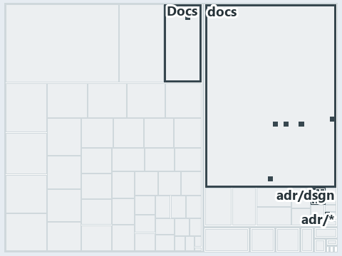

# docs/.assets/explanation/adr-dsgn-remote--guard-and-policies-by-command--operations.tree.md

`Tree minimap: adr-dsgn-remote--guard-and-policies-by-command--operations`

The tree minimap of the slide `adr-dsgn-remote--guard-and-policies-by-command--operations` (operations lens). The slide supports
[ADR-DSGN-REMOTE][1]; the highlight of those ADR codes selects what is lit, and each reason below names the code that selects it.

## What the minimap shows

The tree draws every file of the world map as a tile, grouped by top-level folder (under `automation/` by module, under `docs/adr/` by ADR
domain), and lights 16 files in 4 groups, filled in ink. A lit ADR file has a white rim; a file lit only by passing mentions is a lighter
ink. Every other tile is idle, a grey box: a file the slide's ADR codes do not select.

- adr/dsgn (docs/adr/design): 9 lit files
- docs (docs/ outside docs/adr/): 5 lit files
- Docs (automation/Catzc.Base.Docs): 1 lit file
- adr/* (the files directly in docs/adr/): 1 lit file

## Why each group is lit

### adr/dsgn (9 lit files)

The group holds the files of docs/adr/design; each sits in its world-map cell and is lit by:

- [docs/adr/design/commit-lifecycle.md][2], in the cell docs × markdown: selected by [ADR-DSGN-REMOTE][1]: an ADR file of the `design` ADR
  domain, the ADR domain of that code.
- [docs/adr/design/dora-explains.md][3], in the cell docs × markdown: selected by [ADR-DSGN-REMOTE][1]: an ADR file of the `design` ADR
  domain, the ADR domain of that code.
- [docs/adr/design/module-aspects.md][4], in the cell docs × markdown: selected by [ADR-DSGN-REMOTE][1]: an ADR file of the `design` ADR
  domain, the ADR domain of that code.
- [docs/adr/design/run-modes.md][5], in the cell docs × markdown: selected by [ADR-DSGN-REMOTE][1]: an ADR file of the `design` ADR domain,
  the ADR domain of that code.
- [docs/adr/design/self-service.md][6], in the cell docs × markdown: selected by [ADR-DSGN-REMOTE][1]: an ADR file of the `design` ADR
  domain, the ADR domain of that code.
- [docs/adr/design/server-remote-integration.md][1], in the cell docs × markdown: selected by [ADR-DSGN-REMOTE][1]: an ADR file of the
  `design` ADR domain, the ADR domain of that code.
- [docs/adr/design/thin-platforms.md][7], in the cell docs × markdown: selected by [ADR-DSGN-REMOTE][1]: an ADR file of the `design` ADR
  domain, the ADR domain of that code.
- [docs/adr/design/tracks.md][8], in the cell docs × markdown: selected by [ADR-DSGN-REMOTE][1]: an ADR file of the `design` ADR domain, the
  ADR domain of that code.
- [docs/adr/design/visual-design.md][9], in the cell docs × markdown: selected by [ADR-DSGN-REMOTE][1]: an ADR file of the `design` ADR
  domain, the ADR domain of that code.

### docs (5 lit files)

The group holds the files of docs/ outside docs/adr/; each sits in its world-map cell and is lit by:

- [docs/explanation/design/clients-bridge-to-one-server.md][10], in the cell docs × markdown: selected by [ADR-DSGN-REMOTE][1]: the file
  cites it at line 15 (text), line 45 (text), line 46 (text) and line 48 (text).
- [docs/explanation/design/guard-and-policies-by-command.md][11], in the cell docs × markdown: selected by [ADR-DSGN-REMOTE][1]: the file
  cites it at line 16 (text), line 48 (text) and line 51 (text).
- [docs/explanation/design/ingress-gated-the-rest-by-review.md][12], in the cell docs × markdown: selected by [ADR-DSGN-REMOTE][1]: the file
  cites it at line 16 (text), line 19 (text), line 22 (text), line 49 (text), line 50 (text), line 50 (text) and line 52 (text).
- [docs/explanation/design/local-guard-and-server-policies.md][13], in the cell docs × markdown: selected by [ADR-DSGN-REMOTE][1]: the file
  cites it at line 19 (text), line 55 (text) and line 58 (text).
- [docs/explanation/design/one-door-in-one-stable-point-out.md][14], in the cell docs × markdown: selected by [ADR-DSGN-REMOTE][1]: the file
  cites it at line 14 (text), line 43 (text), line 44 (text), line 45 (text) and line 47 (text).

### Docs (1 lit file)

The group holds the files of automation/Catzc.Base.Docs; each sits in its world-map cell and is lit by:

- [automation/Catzc.Base.Docs/configs/adrs.yml][15], in the cell automation × yaml: selected by [ADR-DSGN-REMOTE][1]: the file cites it at
  line 100 (text).

### adr/* (1 lit file)

The group holds the files of the files directly in docs/adr/; each sits in its world-map cell and is lit by:

- [docs/adr/index.md][16], in the cell docs × markdown: selected by [ADR-DSGN-REMOTE][1]: the file cites it at line 93 (text).

## Keywords

- [world map][17]
- [track][18]
- [file language][19]
- [cell][20]
- [lit cell][21]
- [automation][22]: a track
- [docs][22]: a track
- [markdown][23]: a file language
- [yaml][23]: a file language

[1]: ../../adr/design/server-remote-integration.md
[2]: ../../adr/design/commit-lifecycle.md
[3]: ../../adr/design/dora-explains.md
[4]: ../../adr/design/module-aspects.md
[5]: ../../adr/design/run-modes.md
[6]: ../../adr/design/self-service.md
[7]: ../../adr/design/thin-platforms.md
[8]: ../../adr/design/tracks.md
[9]: ../../adr/design/visual-design.md
[10]: ../../explanation/design/clients-bridge-to-one-server.md
[11]: ../../explanation/design/guard-and-policies-by-command.md
[12]: ../../explanation/design/ingress-gated-the-rest-by-review.md
[13]: ../../explanation/design/local-guard-and-server-policies.md
[14]: ../../explanation/design/one-door-in-one-stable-point-out.md
[15]: ../../../automation/Catzc.Base.Docs/configs/adrs.yml
[16]: ../../adr/index.md
[17]: ../../adr/glossary.md#world-map
[18]: ../../adr/glossary.md#track
[19]: ../../adr/glossary.md#file-language
[20]: ../../adr/glossary.md#cell
[21]: ../../adr/glossary.md#lit-cell
[22]: ../../../automation/Catzc.Base.Variants/configs/variants.yml
[23]: ../../../automation/Catzc.Base.Languages/configs/languages.yml
