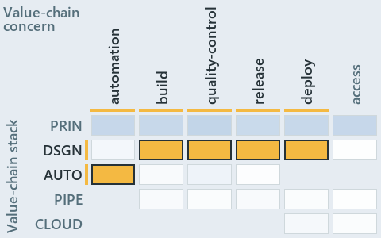

# docs/.assets/explanation/adr-dsgn-remote--ingress-gated-the-rest-by-review--governance.chain.md

`Value-chain minimap: adr-dsgn-remote--ingress-gated-the-rest-by-review--governance`

The value-chain minimap of the slide `adr-dsgn-remote--ingress-gated-the-rest-by-review--governance` (governance lens). The slide supports
[ADR-DSGN-LIFE][1], [ADR-DSGN-REMOTE][2] and [ADR-REPO-VARIANT][3]; the highlight of those ADR codes selects what is lit, and each reason
below names the code that selects it.

## What the minimap shows

Value-chain map: value-chain stack × value-chain concerns. The grid crosses the 5 rows of the value-chain stack (PRIN, DSGN, AUTO, PIPE,
CLOUD) with the 6 value-chain concerns (automation, build, quality-control, release, deploy, access), shades each cell by the ADRs it holds,
and lights 5 cells.

- DSGN × build: 1 lit of 5 ADRs
- DSGN × quality-control: 2 lit of 5 ADRs
- DSGN × release: 1 lit of 4 ADRs
- DSGN × deploy: 1 lit of 6 ADRs
- AUTO × automation: 1 lit of 63 ADRs

## Why each cell is lit

### DSGN × build (1 ADR)

Lit ([ADR-DSGN-TRACK#12][4]) by:

- [ADR-DSGN-REMOTE][2]: selected by [ADR-DSGN-REMOTE][2]; its ADR domain `design` sits on the DSGN row of the value-chain stack
  ([ADR-DSGN-TRACK#14][5]); its own value-chain concerns (build and quality-control) override its ADR domain's default (automation), so it
  lights the build column ([ADR-DSGN-TRACK#15][6]).

### DSGN × quality-control (2 ADRs)

Lit ([ADR-DSGN-TRACK#12][4]) by:

- [ADR-DSGN-LIFE][1]: selected by [ADR-DSGN-LIFE][1]; its ADR domain `design` sits on the DSGN row of the value-chain stack
  ([ADR-DSGN-TRACK#14][5]); its own value-chain concerns (quality-control, release and deploy) override its ADR domain's default
  (automation), so it lights the quality-control column ([ADR-DSGN-TRACK#15][6]).
- [ADR-DSGN-REMOTE][2]: selected by [ADR-DSGN-REMOTE][2]; its ADR domain `design` sits on the DSGN row of the value-chain stack
  ([ADR-DSGN-TRACK#14][5]); its own value-chain concerns (build and quality-control) override its ADR domain's default (automation), so it
  lights the quality-control column ([ADR-DSGN-TRACK#15][6]).

### DSGN × release (1 ADR)

Lit ([ADR-DSGN-TRACK#12][4]) by:

- [ADR-DSGN-LIFE][1]: selected by [ADR-DSGN-LIFE][1]; its ADR domain `design` sits on the DSGN row of the value-chain stack
  ([ADR-DSGN-TRACK#14][5]); its own value-chain concerns (quality-control, release and deploy) override its ADR domain's default
  (automation), so it lights the release column ([ADR-DSGN-TRACK#15][6]).

### DSGN × deploy (1 ADR)

Lit ([ADR-DSGN-TRACK#12][4]) by:

- [ADR-DSGN-LIFE][1]: selected by [ADR-DSGN-LIFE][1]; its ADR domain `design` sits on the DSGN row of the value-chain stack
  ([ADR-DSGN-TRACK#14][5]); its own value-chain concerns (quality-control, release and deploy) override its ADR domain's default
  (automation), so it lights the deploy column ([ADR-DSGN-TRACK#15][6]).

### AUTO × automation (1 ADR)

Lit ([ADR-DSGN-TRACK#12][4]) by:

- [ADR-REPO-VARIANT][3]: selected by [ADR-REPO-VARIANT][3]; its ADR domain `repository` sits on the AUTO row of the value-chain stack
  ([ADR-DSGN-TRACK#14][5]); its value-chain concerns (automation) are its ADR domain's default, so it lights the automation column
  ([ADR-DSGN-TRACK#15][6]).

## Keywords

- [value-chain map][7]
- [value-chain stack][8]
- [value-chain concern][9]
- [cell][10]
- [lit cell][11]

Terms the cited ADRs define:

- [occupant][12], defined by [ADR-DSGN-LIFE#5][13]

[1]: ../../adr/design/commit-lifecycle.md
[2]: ../../adr/design/server-remote-integration.md
[3]: ../../adr/repository/repo-variants.md
[4]: ../../adr/design/tracks.md#rule-adr-dsgn-track12
[5]: ../../adr/design/tracks.md#rule-adr-dsgn-track14
[6]: ../../adr/design/tracks.md#rule-adr-dsgn-track15
[7]: ../../adr/glossary.md#value-chain-map
[8]: ../../adr/glossary.md#value-chain-stack
[9]: ../../adr/glossary.md#value-chain-concern
[10]: ../../adr/glossary.md#cell
[11]: ../../adr/glossary.md#lit-cell
[12]: ../../adr/glossary.md#occupant
[13]: ../../adr/design/commit-lifecycle.md#rule-adr-dsgn-life5
