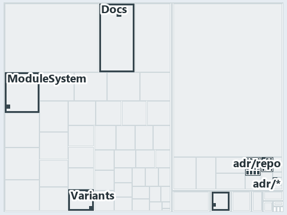

# docs/.assets/explanation/adr-dsgn-remote--ingress-gated-the-rest-by-review--governance.tree.md

`Tree minimap: adr-dsgn-remote--ingress-gated-the-rest-by-review--governance`

The tree minimap of the slide `adr-dsgn-remote--ingress-gated-the-rest-by-review--governance` (governance lens). The slide supports
[ADR-DSGN-LIFE][1], [ADR-DSGN-REMOTE][2] and [ADR-REPO-VARIANT][3]; the highlight of those ADR codes selects what is lit, and each reason
below names the code that selects it.

## What the minimap shows

The tree draws every file of the world map as a tile, grouped by top-level folder (under `automation/` by module, under `docs/adr/` by ADR
domain), and lights 33 files in 7 groups, filled in ink. A lit ADR file has a white rim; a file lit only by passing mentions is a lighter
ink. Every other tile is idle, a grey box: a file the slide's ADR codes do not select.

- adr/repo (docs/adr/repository): 16 lit files
- adr/dsgn (docs/adr/design): 9 lit files
- ModuleSystem (automation/Catzc.Base.ModuleSystem): 2 lit files
- Variants (automation/Catzc.Base.Variants): 2 lit files
- adr/* (the files directly in docs/adr/): 2 lit files
- .claude: 1 lit file
- Docs (automation/Catzc.Base.Docs): 1 lit file

## Why each group is lit

### adr/repo (16 lit files)

The group holds the files of docs/adr/repository; each sits in its world-map cell and is lit by:

- [docs/adr/repository/agent-definitions.md][4], in the cell docs × markdown: selected by [ADR-REPO-VARIANT][3]: an ADR file of the
  `repository` ADR domain, the ADR domain of that code.
- [docs/adr/repository/api-contracts.md][5], in the cell docs × markdown: selected by [ADR-REPO-VARIANT][3]: an ADR file of the `repository`
  ADR domain, the ADR domain of that code.
- [docs/adr/repository/controlled-vocabulary.md][6], in the cell docs × markdown: selected by [ADR-REPO-VARIANT][3]: an ADR file of the
  `repository` ADR domain, the ADR domain of that code.
- [docs/adr/repository/conventional-folders.md][7], in the cell docs × markdown: selected by [ADR-REPO-VARIANT][3]: an ADR file of the
  `repository` ADR domain, the ADR domain of that code.
- [docs/adr/repository/dedicated-output-directory.md][8], in the cell docs × markdown: selected by [ADR-REPO-VARIANT][3]: an ADR file of the
  `repository` ADR domain, the ADR domain of that code.
- [docs/adr/repository/documentation-examples.md][9], in the cell docs × markdown: selected by [ADR-REPO-VARIANT][3]: an ADR file of the
  `repository` ADR domain, the ADR domain of that code.
- [docs/adr/repository/domain-language-separation.md][10], in the cell docs × markdown: selected by [ADR-REPO-VARIANT][3]: an ADR file of
  the `repository` ADR domain, the ADR domain of that code.
- [docs/adr/repository/dora-explains.md][11], in the cell docs × markdown: selected by [ADR-REPO-VARIANT][3]: an ADR file of the
  `repository` ADR domain, the ADR domain of that code.
- [docs/adr/repository/generated-readmes.md][12], in the cell docs × markdown: selected by [ADR-REPO-VARIANT][3]: an ADR file of the
  `repository` ADR domain, the ADR domain of that code.
- [docs/adr/repository/generated-root-configs.md][13], in the cell docs × markdown: selected by [ADR-REPO-VARIANT][3]: an ADR file of the
  `repository` ADR domain, the ADR domain of that code.
- [docs/adr/repository/inspiration.md][14], in the cell docs × markdown: selected by [ADR-REPO-VARIANT][3]: an ADR file of the `repository`
  ADR domain, the ADR domain of that code.
- [docs/adr/repository/markdown-links.md][15], in the cell docs × markdown: selected by [ADR-REPO-VARIANT][3]: an ADR file of the
  `repository` ADR domain, the ADR domain of that code.
- [docs/adr/repository/output-formats.md][16], in the cell docs × markdown: selected by [ADR-REPO-VARIANT][3]: an ADR file of the
  `repository` ADR domain, the ADR domain of that code.
- [docs/adr/repository/protected-globs.md][17], in the cell docs × markdown: selected by [ADR-REPO-VARIANT][3]: an ADR file of the
  `repository` ADR domain, the ADR domain of that code.
- [docs/adr/repository/repo-variants.md][3], in the cell docs × markdown: selected by [ADR-REPO-VARIANT][3]: an ADR file of the `repository`
  ADR domain, the ADR domain of that code.
- [docs/adr/repository/uniform-formatting.md][18], in the cell docs × markdown: selected by [ADR-REPO-VARIANT][3]: an ADR file of the
  `repository` ADR domain, the ADR domain of that code.

### adr/dsgn (9 lit files)

The group holds the files of docs/adr/design; each sits in its world-map cell and is lit by:

- [docs/adr/design/commit-lifecycle.md][1], in the cell docs × markdown: selected by [ADR-DSGN-LIFE][1]: an ADR file of the `design` ADR
  domain, the ADR domain of that code; selected by [ADR-DSGN-REMOTE][2]: an ADR file of the `design` ADR domain, the ADR domain of that
  code.
- [docs/adr/design/dora-explains.md][19], in the cell docs × markdown: selected by [ADR-DSGN-LIFE][1]: an ADR file of the `design` ADR
  domain, the ADR domain of that code; selected by [ADR-DSGN-REMOTE][2]: an ADR file of the `design` ADR domain, the ADR domain of that
  code.
- [docs/adr/design/module-aspects.md][20], in the cell docs × markdown: selected by [ADR-DSGN-LIFE][1]: an ADR file of the `design` ADR
  domain, the ADR domain of that code; selected by [ADR-DSGN-REMOTE][2]: an ADR file of the `design` ADR domain, the ADR domain of that
  code.
- [docs/adr/design/run-modes.md][21], in the cell docs × markdown: selected by [ADR-DSGN-LIFE][1]: an ADR file of the `design` ADR domain,
  the ADR domain of that code; selected by [ADR-DSGN-REMOTE][2]: an ADR file of the `design` ADR domain, the ADR domain of that code.
- [docs/adr/design/self-service.md][22], in the cell docs × markdown: selected by [ADR-DSGN-LIFE][1]: an ADR file of the `design` ADR
  domain, the ADR domain of that code; selected by [ADR-DSGN-REMOTE][2]: an ADR file of the `design` ADR domain, the ADR domain of that
  code.
- [docs/adr/design/server-remote-integration.md][2], in the cell docs × markdown: selected by [ADR-DSGN-LIFE][1]: an ADR file of the
  `design` ADR domain, the ADR domain of that code; selected by [ADR-DSGN-REMOTE][2]: an ADR file of the `design` ADR domain, the ADR domain
  of that code.
- [docs/adr/design/thin-platforms.md][23], in the cell docs × markdown: selected by [ADR-DSGN-LIFE][1]: an ADR file of the `design` ADR
  domain, the ADR domain of that code; selected by [ADR-DSGN-REMOTE][2]: an ADR file of the `design` ADR domain, the ADR domain of that
  code.
- [docs/adr/design/tracks.md][24], in the cell docs × markdown: selected by [ADR-DSGN-LIFE][1]: an ADR file of the `design` ADR domain, the
  ADR domain of that code; selected by [ADR-DSGN-REMOTE][2]: an ADR file of the `design` ADR domain, the ADR domain of that code.
- [docs/adr/design/visual-design.md][25], in the cell docs × markdown: selected by [ADR-DSGN-LIFE][1]: an ADR file of the `design` ADR
  domain, the ADR domain of that code; selected by [ADR-DSGN-REMOTE][2]: an ADR file of the `design` ADR domain, the ADR domain of that
  code.

### ModuleSystem (2 lit files)

The group holds the files of automation/Catzc.Base.ModuleSystem; each sits in its world-map cell and is lit by:

- [automation/Catzc.Base.ModuleSystem/Sync-GeneratedFile.ps1][26], in the cell automation × powershell: selected by [ADR-REPO-VARIANT][3]:
  the file cites it at line 29 (header) and line 100 (text).
- [automation/Catzc.Base.ModuleSystem/configs/glossary.yml][27], in the cell automation × yaml: selected by [ADR-DSGN-LIFE][1]: the file
  cites it at line 52 (text).

### Variants (2 lit files)

The group holds the files of automation/Catzc.Base.Variants; each sits in its world-map cell and is lit by:

- [automation/Catzc.Base.Variants/configs/variants.yml][28], in the cell automation × yaml: selected by [ADR-REPO-VARIANT][3]: the file
  cites it at line 1 (header).
- [automation/Catzc.Base.Variants/types/VariantsConfig.cs][29], in the cell automation × csharp: selected by [ADR-REPO-VARIANT][3]: the file
  cites it at line 1 (header).

### adr/* (2 lit files)

The group holds the files of the files directly in docs/adr/; each sits in its world-map cell and is lit by:

- [docs/adr/glossary.md][30], in the cell docs × markdown: selected by [ADR-DSGN-LIFE][1]: the file cites it at line 149 (text).
- [docs/adr/index.md][31], in the cell docs × markdown: selected by [ADR-DSGN-LIFE][1]: the file cites it at line 92 (text); selected by
  [ADR-DSGN-REMOTE][2]: the file cites it at line 93 (text); selected by [ADR-REPO-VARIANT][3]: the file cites it at line 294 (text).

### .claude (1 lit file)

The group holds the files of .claude; each sits in its world-map cell and is lit by:

- [.claude/agents/write-drawio-files.md][32], in the cell .claude × markdown: selected by [ADR-DSGN-LIFE][1]: the file cites it at line 43
  (text).

### Docs (1 lit file)

The group holds the files of automation/Catzc.Base.Docs; each sits in its world-map cell and is lit by:

- [automation/Catzc.Base.Docs/configs/adrs.yml][33], in the cell automation × yaml: selected by [ADR-DSGN-LIFE][1]: the file cites it at
  line 99 (text); selected by [ADR-DSGN-REMOTE][2]: the file cites it at line 100 (text); selected by [ADR-REPO-VARIANT][3]: the file cites
  it at line 316 (text).

## Keywords

- [world map][34]
- [track][35]
- [file language][36]
- [cell][37]
- [lit cell][38]
- [.claude][28]: a track
- [automation][28]: a track
- [docs][28]: a track
- [csharp][39]: a file language
- [markdown][39]: a file language
- [powershell][39]: a file language
- [yaml][39]: a file language

Terms the cited ADRs define:

- [occupant][40], defined by [ADR-DSGN-LIFE#5][41]

[1]: ../../adr/design/commit-lifecycle.md
[2]: ../../adr/design/server-remote-integration.md
[3]: ../../adr/repository/repo-variants.md
[4]: ../../adr/repository/agent-definitions.md
[5]: ../../adr/repository/api-contracts.md
[6]: ../../adr/repository/controlled-vocabulary.md
[7]: ../../adr/repository/conventional-folders.md
[8]: ../../adr/repository/dedicated-output-directory.md
[9]: ../../adr/repository/documentation-examples.md
[10]: ../../adr/repository/domain-language-separation.md
[11]: ../../adr/repository/dora-explains.md
[12]: ../../adr/repository/generated-readmes.md
[13]: ../../adr/repository/generated-root-configs.md
[14]: ../../adr/repository/inspiration.md
[15]: ../../adr/repository/markdown-links.md
[16]: ../../adr/repository/output-formats.md
[17]: ../../adr/repository/protected-globs.md
[18]: ../../adr/repository/uniform-formatting.md
[19]: ../../adr/design/dora-explains.md
[20]: ../../adr/design/module-aspects.md
[21]: ../../adr/design/run-modes.md
[22]: ../../adr/design/self-service.md
[23]: ../../adr/design/thin-platforms.md
[24]: ../../adr/design/tracks.md
[25]: ../../adr/design/visual-design.md
[26]: ../../../automation/Catzc.Base.ModuleSystem/Sync-GeneratedFile.ps1
[27]: ../../../automation/Catzc.Base.ModuleSystem/configs/glossary.yml
[28]: ../../../automation/Catzc.Base.Variants/configs/variants.yml
[29]: ../../../automation/Catzc.Base.Variants/types/VariantsConfig.cs
[30]: ../../adr/glossary.md
[31]: ../../adr/index.md
[32]: ../../../.claude/agents/write-drawio-files.md
[33]: ../../../automation/Catzc.Base.Docs/configs/adrs.yml
[34]: ../../adr/glossary.md#world-map
[35]: ../../adr/glossary.md#track
[36]: ../../adr/glossary.md#file-language
[37]: ../../adr/glossary.md#cell
[38]: ../../adr/glossary.md#lit-cell
[39]: ../../../automation/Catzc.Base.Languages/configs/languages.yml
[40]: ../../adr/glossary.md#occupant
[41]: ../../adr/design/commit-lifecycle.md#rule-adr-dsgn-life5
