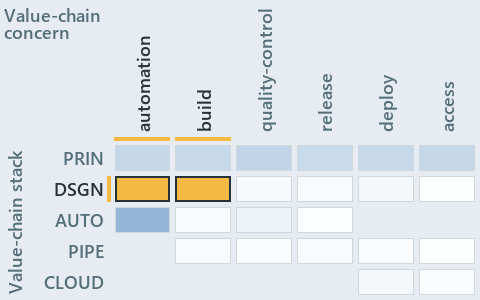

# docs/.assets/explanation/adr-dsgn-runmode--shims-set-roots-mode-read-back--implementation.chain.md

`Value-chain minimap: adr-dsgn-runmode--shims-set-roots-mode-read-back--implementation`

The value-chain minimap of the slide `adr-dsgn-runmode--shims-set-roots-mode-read-back--implementation` (implementation lens). The slide
supports [ADR-DSGN-RUNMODE][1]; the highlight of those ADR codes selects what is lit, and each reason below names the code that selects it.

## What the minimap shows

Value-chain map: value-chain stack × value-chain concerns. The grid crosses the 5 rows of the value-chain stack (PRIN, DSGN, AUTO, PIPE,
CLOUD) with the 6 value-chain concerns (automation, build, quality-control, release, deploy, access), shades each cell by the ADRs it holds,
and lights 2 cells.

- DSGN × automation: 1 lit of 7 ADRs
- DSGN × build: 1 lit of 5 ADRs

## Why each cell is lit

### DSGN × automation (1 ADR)

Lit ([ADR-DSGN-TRACK#12][2]) by:

- [ADR-DSGN-RUNMODE][1]: selected by [ADR-DSGN-RUNMODE][1]; its ADR domain `design` sits on the DSGN row of the value-chain stack
  ([ADR-DSGN-TRACK#14][3]); its own value-chain concerns (automation and build) override its ADR domain's default (automation), so it lights
  the automation column ([ADR-DSGN-TRACK#15][4]).

### DSGN × build (1 ADR)

Lit ([ADR-DSGN-TRACK#12][2]) by:

- [ADR-DSGN-RUNMODE][1]: selected by [ADR-DSGN-RUNMODE][1]; its ADR domain `design` sits on the DSGN row of the value-chain stack
  ([ADR-DSGN-TRACK#14][3]); its own value-chain concerns (automation and build) override its ADR domain's default (automation), so it lights
  the build column ([ADR-DSGN-TRACK#15][4]).

## Keywords

- [value-chain map][5]
- [value-chain stack][6]
- [value-chain concern][7]
- [cell][8]
- [lit cell][9]

[1]: ../../adr/design/run-modes.md
[2]: ../../adr/design/tracks.md#rule-adr-dsgn-track12
[3]: ../../adr/design/tracks.md#rule-adr-dsgn-track14
[4]: ../../adr/design/tracks.md#rule-adr-dsgn-track15
[5]: ../../adr/glossary.md#value-chain-map
[6]: ../../adr/glossary.md#value-chain-stack
[7]: ../../adr/glossary.md#value-chain-concern
[8]: ../../adr/glossary.md#cell
[9]: ../../adr/glossary.md#lit-cell
