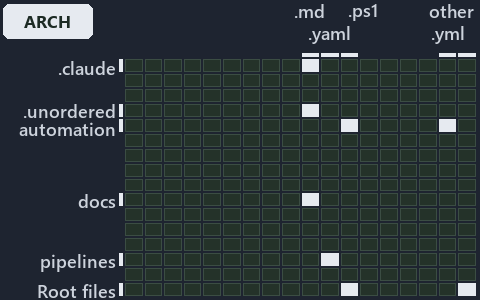

# docs/.assets/explanation/adr-dsgn-runmode--two-roots-one-importer-same-modules--architecture.grid.md

`Grid minimap: adr-dsgn-runmode--two-roots-one-importer-same-modules--architecture`

The grid minimap of the slide `adr-dsgn-runmode--two-roots-one-importer-same-modules--architecture` (architecture lens). The slide supports
[ADR-DSGN-RUNMODE][1]; the highlight of those ADR codes selects what is lit, and each reason below names the code that selects it.

## What the minimap shows

The grid crosses the 16 tracks (rows) with the 18 file languages (columns) of the world map and lights 8 cells, filled in ink. A cell lit
only by passing mentions (citations in body comments, not in a file's header or text) is touched: a lighter ink. Every other cell is idle, a
grey box: it holds files the slide's ADR codes do not select, or no file at all (237 of the 288 cells hold none). The minimap shows where
the slide sits, not how many files a cell holds; the world-map PDFs show the counts.

- .claude × markdown: 2 lit of 51 files
- .unordered × markdown: 5 lit of 20 files
- automation × powershell: 28 lit of 1563 files
- automation × yaml: 2 lit of 107 files
- docs × markdown: 8 lit of 1985 files
- pipelines × pipeline-yaml: 1 lit of 9 files
- Root files × powershell: 1 lit of 1 file
- Root files × Unlisted files: 2 lit of 3 files

## Key

A lit row prints its track's name; a lit column prints a short code, the first extension of its file language:

- `.md`: markdown
- `.yaml`: pipeline-yaml
- `.ps1`: powershell
- `.yml`: yaml
- `other`: Unlisted files

## Why each cell is lit

### .claude × markdown (2 lit files)

Placed: the root folder `.claude/` names the track .claude ([ADR-DSGN-TRACK#1][2]); the extension `.md` names the file language markdown
([ADR-DSGN-TRACK#6][3]). Lit ([ADR-DSGN-TRACK#12][4]) by:

- [.claude/plans/plan-layers-vocabulary-rename-contracts.md][5]: selected by [ADR-DSGN-RUNMODE][1]: the file cites it at line 401 (text),
  line 458 (text) and line 796 (text).
- [.claude/plans/plan-lazy-types-load.md][6]: selected by [ADR-DSGN-RUNMODE][1]: the file cites it at line 139 (text).

### .unordered × markdown (5 lit files)

Placed: the root folder `.unordered/` names the track .unordered ([ADR-DSGN-TRACK#1][2]); the extension `.md` names the file language
markdown ([ADR-DSGN-TRACK#6][3]). Lit ([ADR-DSGN-TRACK#12][4]) by:

- [.unordered/15-10-2026/plan-adr-consistency.md][7]: selected by [ADR-DSGN-RUNMODE][1]: the file cites it at line 195 (text).
- [.unordered/15-10-2026/plan-built-bundle.md][8]: selected by [ADR-DSGN-RUNMODE][1]: the file cites it at line 12 (text), line 32 (text),
  line 261 (text) and line 272 (text).
- [.unordered/15-10-2026/plan-concern-axis.md][9]: selected by [ADR-DSGN-RUNMODE][1]: the file cites it at line 93 (text).
- [.unordered/15-10-2026/plan-diagram-wave-9.md][10]: selected by [ADR-DSGN-RUNMODE][1]: the file cites it at line 124 (text).
- [.unordered/15-10-2026/plan-explanation-drift.md][11]: selected by [ADR-DSGN-RUNMODE][1]: the file cites it at line 71 (text) and line 96
  (text).

### automation × powershell (28 lit files)

Placed: the root folder `automation/` names the track automation ([ADR-DSGN-TRACK#1][2]); the extension `.ps1` names the file language
powershell ([ADR-DSGN-TRACK#6][3]). Lit ([ADR-DSGN-TRACK#12][4]) by:

- [automation/.internal/assets/Import-Catzc.ps1][12]: selected by [ADR-DSGN-RUNMODE][1]: the file cites it at line 18 (header).
- [automation/.internal/tests/New-FakeRepositoryRoot.Tests.ps1][13]: selected by [ADR-DSGN-RUNMODE][1]: the file cites it at line 17
  (header) and line 21 (text).
- [automation/Catzc.Base.ConfigExtensions/Test-ConfigValidators.ps1][14]: selected by [ADR-DSGN-RUNMODE][1]: the file cites it at line 21
  (header) and line 32 (header).
- [automation/Catzc.Base.Docs/private/Get-CatsModules.ps1][15]: selected by [ADR-DSGN-RUNMODE][1]: the file cites it at line 21 (header) and
  line 32 (header).
- [automation/Catzc.Base.Globs/Get-ModuleGlobSet.ps1][16]: selected by [ADR-DSGN-RUNMODE][1]: the file cites it at line 24 (header) and line
  53 (header).
- [automation/Catzc.Base.ModuleSystem/Copy-Automation.ps1][17]: selected by [ADR-DSGN-RUNMODE][1]: the file cites it at line 23 (header) and
  line 50 (header).
- [automation/Catzc.Base.ModuleSystem/Get-AutomationFunctions.ps1][18]: selected by [ADR-DSGN-RUNMODE][1]: the file cites it at line 19
  (header) and line 31 (header).
- [automation/Catzc.Base.ModuleSystem/Get-BaseModule.ps1][19]: selected by [ADR-DSGN-RUNMODE][1]: the file cites it at line 20 (header) and
  line 40 (header).
- [automation/Catzc.Base.ModuleSystem/Get-FunctionDependency.ps1][20]: selected by [ADR-DSGN-RUNMODE][1]: the file cites it at line 22
  (header) and line 33 (header).
- [automation/Catzc.Base.ModuleSystem/Get-InternalAssetDependency.ps1][21]: selected by [ADR-DSGN-RUNMODE][1]: the file cites it at line 21
  (header) and line 48 (header).
- [automation/Catzc.Base.ModuleSystem/New-Importer.ps1][22]: selected by [ADR-DSGN-RUNMODE][1]: the file cites it at line 22 (header) and
  line 38 (header).
- [automation/Catzc.Base.ModuleSystem/Sync-GeneratedFile.ps1][23]: selected by [ADR-DSGN-RUNMODE][1]: the file cites it at line 22 (header)
  and line 39 (header).
- [automation/Catzc.Base.ModuleSystem/Test-FunctionDependency.ps1][24]: selected by [ADR-DSGN-RUNMODE][1]: the file cites it at line 22
  (header) and line 43 (header).
- [automation/Catzc.Base.QualityGates/Test-BuildArtifact.ps1][25]: selected by [ADR-DSGN-RUNMODE][1]: the file cites it at line 21 (header)
  and line 45 (header).
- [automation/Catzc.Base.QualityGates/Test-CatzcBuild.ps1][26]: selected by [ADR-DSGN-RUNMODE][1]: the file cites it at line 22 (header) and
  line 28 (header).
- [automation/Catzc.Base.QualityGates/tests/Test-CatzcBuild.Parity.Tests.ps1][27]: selected by [ADR-DSGN-RUNMODE][1]: the file cites it at
  line 19 (header) and line 23 (text).
- [automation/Catzc.Base.QualityGates/tests/Test-CatzcBuild.ScopeIsolation.Tests.ps1][28]: selected by [ADR-DSGN-RUNMODE][1]: the file cites
  it at line 19 (header) and line 23 (text).
- [automation/Catzc.Base.Repository/Assert-SourceTree.ps1][29]: selected by [ADR-DSGN-RUNMODE][1]: the file cites it at line 20 (header) and
  line 27 (header).
- [automation/Catzc.Base.Repository/Get-CatzcModuleRoot.ps1][30]: selected by [ADR-DSGN-RUNMODE][1]: the file cites it at line 21 (header)
  and line 30 (header).
- [automation/Catzc.Base.Repository/Get-CatzcRunMode.ps1][31]: selected by [ADR-DSGN-RUNMODE][1]: the file cites it at line 19 (header) and
  line 24 (header).
- [automation/Catzc.Base.RootConfig/Build-RootConfig.ps1][32]: selected by [ADR-DSGN-RUNMODE][1]: the file cites it at line 22 (header) and
  line 47 (header).
- [automation/Catzc.Base.TypesSystem/Build-BashTimeoutHook.ps1][33]: selected by [ADR-DSGN-RUNMODE][1]: the file cites it at line 22
  (header) and line 36 (header).
- [automation/Catzc.Base.TypesSystem/Clear-ModuleTypeCache.ps1][34]: selected by [ADR-DSGN-RUNMODE][1]: the file cites it at line 21
  (header) and line 50 (header).
- [automation/Catzc.Base.TypesSystem/Get-AutomationModules.ps1][35]: selected by [ADR-DSGN-RUNMODE][1]: the file cites it at line 20
  (header) and line 28 (header).
- [automation/Catzc.Base.TypesSystem/Get-CSharpTypeDependency.ps1][36]: selected by [ADR-DSGN-RUNMODE][1]: the file cites it at line 20
  (header) and line 44 (header).
- [automation/Catzc.Base.TypesSystem/Invoke-BuildForVSCode.ps1][37]: selected by [ADR-DSGN-RUNMODE][1]: the file cites it at line 21
  (header) and line 43 (header).
- [automation/Catzc.Base.Vendor/Install-VendorModule.ps1][38]: selected by [ADR-DSGN-RUNMODE][1]: the file cites it at line 20 (header) and
  line 31 (header).
- [automation/Catzc.Base.Vendor/Remove-VendorModules.ps1][39]: selected by [ADR-DSGN-RUNMODE][1]: the file cites it at line 19 (header) and
  line 36 (header).

### automation × yaml (2 lit files)

Placed: the root folder `automation/` names the track automation ([ADR-DSGN-TRACK#1][2]); the extension `.yml` names the file language yaml
([ADR-DSGN-TRACK#6][3]). Lit ([ADR-DSGN-TRACK#12][4]) by:

- [automation/Catzc.Base.Docs/configs/adrs.yml][40]: selected by [ADR-DSGN-RUNMODE][1]: the file cites it at line 97 (text).
- [automation/Catzc.Base.QualityGates/configs/terminology.yml][41]: selected by [ADR-DSGN-RUNMODE][1]: the file cites it at line 590 (text).

### docs × markdown (8 lit files)

Placed: the root folder `docs/` names the track docs ([ADR-DSGN-TRACK#1][2]); the extension `.md` names the file language markdown
([ADR-DSGN-TRACK#6][3]). Lit ([ADR-DSGN-TRACK#12][4]) by:

- [docs/adr/design/dora-explains.md][42]: selected by [ADR-DSGN-RUNMODE][1]: the file cites it at line 162 (text).
- [docs/adr/design/run-modes.md][1]: selected by [ADR-DSGN-RUNMODE][1]: the ADR's own file.
- [docs/adr/index.md][43]: selected by [ADR-DSGN-RUNMODE][1]: the file cites it at line 109 (text).
- [docs/references/automation/catzc-base-qualitygates/tests/Test-CatzcBuild.Parity.Tests.ps1.md][44]: selected by [ADR-DSGN-RUNMODE][1]: the
  file cites it at line 16 (text) and line 29 (text).
- [docs/references/automation/catzc-base-qualitygates/tests/Test-CatzcBuild.ScopeIsolation.Tests.ps1.md][45]: selected by
  [ADR-DSGN-RUNMODE][1]: the file cites it at line 16 (text), line 26 (text) and line 29 (text).
- [docs/references/automation/internal/Catzc.Internal.Builder.psm1.md][46]: selected by [ADR-DSGN-RUNMODE][1]: the file cites it at line 34
  (text).
- [docs/references/automation/internal/Catzc.Internal.Importer.psm1.md][47]: selected by [ADR-DSGN-RUNMODE][1]: the file cites it at line 17
  (text) and line 222 (text).
- [docs/references/automation/internal/Catzc.Internal.TestKit.psm1.md][48]: selected by [ADR-DSGN-RUNMODE][1]: the file cites it at line 16
  (text) and line 76 (text).

### pipelines × pipeline-yaml (1 lit file)

Placed: the root folder `pipelines/` names the track pipelines ([ADR-DSGN-TRACK#1][2]); the extension `.yaml` names the file language
pipeline-yaml ([ADR-DSGN-TRACK#6][3]). Lit ([ADR-DSGN-TRACK#12][4]) by:

- [pipelines/ci-automation.yaml][49]: selected by [ADR-DSGN-RUNMODE][1]: a pipeline that cites nothing itself carries its globset's
  citations, which cite it at `automation/.internal/assets/Import-Catzc.ps1` line 18 (header),
  `automation/.internal/tests/New-FakeRepositoryRoot.Tests.ps1` line 17 (header),
  `automation/.internal/tests/New-FakeRepositoryRoot.Tests.ps1` line 21 (text),
  `automation/Catzc.Base.ConfigExtensions/Test-ConfigValidators.ps1` line 21 (header),
  `automation/Catzc.Base.ConfigExtensions/Test-ConfigValidators.ps1` line 32 (header), `automation/Catzc.Base.Docs/configs/adrs.yml` line 97
  (text), `automation/Catzc.Base.Docs/private/Get-CatsModules.ps1` line 21 (header),
  `automation/Catzc.Base.Docs/private/Get-CatsModules.ps1` line 32 (header), `automation/Catzc.Base.Globs/Get-ModuleGlobSet.ps1` line 24
  (header), `automation/Catzc.Base.Globs/Get-ModuleGlobSet.ps1` line 53 (header), `automation/Catzc.Base.ModuleSystem/Copy-Automation.ps1`
  line 23 (header), `automation/Catzc.Base.ModuleSystem/Copy-Automation.ps1` line 50 (header),
  `automation/Catzc.Base.ModuleSystem/Get-AutomationFunctions.ps1` line 19 (header),
  `automation/Catzc.Base.ModuleSystem/Get-AutomationFunctions.ps1` line 31 (header), `automation/Catzc.Base.ModuleSystem/Get-BaseModule.ps1`
  line 20 (header), `automation/Catzc.Base.ModuleSystem/Get-BaseModule.ps1` line 40 (header),
  `automation/Catzc.Base.ModuleSystem/Get-FunctionDependency.ps1` line 22 (header),
  `automation/Catzc.Base.ModuleSystem/Get-FunctionDependency.ps1` line 33 (header),
  `automation/Catzc.Base.ModuleSystem/Get-InternalAssetDependency.ps1` line 21 (header),
  `automation/Catzc.Base.ModuleSystem/Get-InternalAssetDependency.ps1` line 48 (header),
  `automation/Catzc.Base.ModuleSystem/New-Importer.ps1` line 22 (header), `automation/Catzc.Base.ModuleSystem/New-Importer.ps1` line 38
  (header), `automation/Catzc.Base.ModuleSystem/Sync-GeneratedFile.ps1` line 22 (header),
  `automation/Catzc.Base.ModuleSystem/Sync-GeneratedFile.ps1` line 39 (header),
  `automation/Catzc.Base.ModuleSystem/Test-FunctionDependency.ps1` line 22 (header),
  `automation/Catzc.Base.ModuleSystem/Test-FunctionDependency.ps1` line 43 (header),
  `automation/Catzc.Base.QualityGates/Test-BuildArtifact.ps1` line 21 (header), `automation/Catzc.Base.QualityGates/Test-BuildArtifact.ps1`
  line 45 (header), `automation/Catzc.Base.QualityGates/Test-CatzcBuild.ps1` line 22 (header),
  `automation/Catzc.Base.QualityGates/Test-CatzcBuild.ps1` line 28 (header), `automation/Catzc.Base.QualityGates/configs/terminology.yml`
  line 590 (text), `automation/Catzc.Base.QualityGates/tests/Test-CatzcBuild.Parity.Tests.ps1` line 19 (header),
  `automation/Catzc.Base.QualityGates/tests/Test-CatzcBuild.Parity.Tests.ps1` line 23 (text),
  `automation/Catzc.Base.QualityGates/tests/Test-CatzcBuild.ScopeIsolation.Tests.ps1` line 19 (header),
  `automation/Catzc.Base.QualityGates/tests/Test-CatzcBuild.ScopeIsolation.Tests.ps1` line 23 (text),
  `automation/Catzc.Base.Repository/Assert-SourceTree.ps1` line 20 (header), `automation/Catzc.Base.Repository/Assert-SourceTree.ps1` line
  27 (header), `automation/Catzc.Base.Repository/Get-CatzcModuleRoot.ps1` line 21 (header),
  `automation/Catzc.Base.Repository/Get-CatzcModuleRoot.ps1` line 30 (header), `automation/Catzc.Base.Repository/Get-CatzcRunMode.ps1` line
  19 (header), `automation/Catzc.Base.Repository/Get-CatzcRunMode.ps1` line 24 (header),
  `automation/Catzc.Base.RootConfig/Build-RootConfig.ps1` line 22 (header), `automation/Catzc.Base.RootConfig/Build-RootConfig.ps1` line 47
  (header), `automation/Catzc.Base.TypesSystem/Build-BashTimeoutHook.ps1` line 22 (header),
  `automation/Catzc.Base.TypesSystem/Build-BashTimeoutHook.ps1` line 36 (header),
  `automation/Catzc.Base.TypesSystem/Clear-ModuleTypeCache.ps1` line 21 (header),
  `automation/Catzc.Base.TypesSystem/Clear-ModuleTypeCache.ps1` line 50 (header),
  `automation/Catzc.Base.TypesSystem/Get-AutomationModules.ps1` line 20 (header),
  `automation/Catzc.Base.TypesSystem/Get-AutomationModules.ps1` line 28 (header),
  `automation/Catzc.Base.TypesSystem/Get-CSharpTypeDependency.ps1` line 20 (header),
  `automation/Catzc.Base.TypesSystem/Get-CSharpTypeDependency.ps1` line 44 (header),
  `automation/Catzc.Base.TypesSystem/Invoke-BuildForVSCode.ps1` line 21 (header),
  `automation/Catzc.Base.TypesSystem/Invoke-BuildForVSCode.ps1` line 43 (header), `automation/Catzc.Base.Vendor/Install-VendorModule.ps1`
  line 20 (header), `automation/Catzc.Base.Vendor/Install-VendorModule.ps1` line 31 (header),
  `automation/Catzc.Base.Vendor/Remove-VendorModules.ps1` line 19 (header) and `automation/Catzc.Base.Vendor/Remove-VendorModules.ps1` line
  36 (header).

### Root files × powershell (1 lit file)

Placed: each file sits directly in the repository root, so it is a root file ([ADR-DSGN-TRACK#7][50]); the extension `.ps1` names the file
language powershell ([ADR-DSGN-TRACK#6][3]). Lit ([ADR-DSGN-TRACK#12][4]) by:

- [importer.ps1][51]: selected by [ADR-DSGN-RUNMODE][1]: a root file carries the citations of its owner module's files (files.yml), which
  cite it at `automation/.internal/assets/Import-Catzc.ps1` line 18 (header), `automation/.internal/tests/New-FakeRepositoryRoot.Tests.ps1`
  line 17 (header) and `automation/.internal/tests/New-FakeRepositoryRoot.Tests.ps1` line 21 (text).

### Root files × Unlisted files (2 lit files)

Placed: each file sits directly in the repository root, so it is a root file ([ADR-DSGN-TRACK#7][50]); no extension names no file language,
so each is an unlisted file ([ADR-DSGN-TRACK#8][52]). Lit ([ADR-DSGN-TRACK#12][4]) by:

- [.gitattributes][53]: selected by [ADR-DSGN-RUNMODE][1]: a root file carries the citations of its owner module's files (files.yml), which
  cite it at `automation/Catzc.Base.Repository/Assert-SourceTree.ps1` line 20 (header),
  `automation/Catzc.Base.Repository/Assert-SourceTree.ps1` line 27 (header), `automation/Catzc.Base.Repository/Get-CatzcModuleRoot.ps1` line
  21 (header), `automation/Catzc.Base.Repository/Get-CatzcModuleRoot.ps1` line 30 (header),
  `automation/Catzc.Base.Repository/Get-CatzcRunMode.ps1` line 19 (header) and `automation/Catzc.Base.Repository/Get-CatzcRunMode.ps1` line
  24 (header).
- [.gitignore][54]: selected by [ADR-DSGN-RUNMODE][1]: a root file carries the citations of its owner module's files (files.yml), which cite
  it at `automation/Catzc.Base.Repository/Assert-SourceTree.ps1` line 20 (header), `automation/Catzc.Base.Repository/Assert-SourceTree.ps1`
  line 27 (header), `automation/Catzc.Base.Repository/Get-CatzcModuleRoot.ps1` line 21 (header),
  `automation/Catzc.Base.Repository/Get-CatzcModuleRoot.ps1` line 30 (header), `automation/Catzc.Base.Repository/Get-CatzcRunMode.ps1` line
  19 (header) and `automation/Catzc.Base.Repository/Get-CatzcRunMode.ps1` line 24 (header).

## Keywords

- [world map][55]
- [track][56]
- [file language][57]
- [cell][58]
- [lit cell][59]
- [root file][60]
- [unlisted file][61]
- [.claude][62]: a track
- [.unordered][62]: a track
- [automation][62]: a track
- [docs][62]: a track
- [pipelines][62]: a track
- [markdown][63]: a file language
- [pipeline-yaml][63]: a file language
- [powershell][63]: a file language
- [yaml][63]: a file language

[1]: ../../adr/design/run-modes.md
[2]: ../../adr/design/tracks.md#rule-adr-dsgn-track1
[3]: ../../adr/design/tracks.md#rule-adr-dsgn-track6
[4]: ../../adr/design/tracks.md#rule-adr-dsgn-track12
[5]: ../../../.claude/plans/plan-layers-vocabulary-rename-contracts.md
[6]: ../../../.claude/plans/plan-lazy-types-load.md
[7]: ../../../.unordered/15-10-2026/plan-adr-consistency.md
[8]: ../../../.unordered/15-10-2026/plan-built-bundle.md
[9]: ../../../.unordered/15-10-2026/plan-concern-axis.md
[10]: ../../../.unordered/15-10-2026/plan-diagram-wave-9.md
[11]: ../../../.unordered/15-10-2026/plan-explanation-drift.md
[12]: ../../../automation/.internal/assets/Import-Catzc.ps1
[13]: ../../../automation/.internal/tests/New-FakeRepositoryRoot.Tests.ps1
[14]: ../../../automation/Catzc.Base.ConfigExtensions/Test-ConfigValidators.ps1
[15]: ../../../automation/Catzc.Base.Docs/private/Get-CatsModules.ps1
[16]: ../../../automation/Catzc.Base.Globs/Get-ModuleGlobSet.ps1
[17]: ../../../automation/Catzc.Base.ModuleSystem/Copy-Automation.ps1
[18]: ../../../automation/Catzc.Base.ModuleSystem/Get-AutomationFunctions.ps1
[19]: ../../../automation/Catzc.Base.ModuleSystem/Get-BaseModule.ps1
[20]: ../../../automation/Catzc.Base.ModuleSystem/Get-FunctionDependency.ps1
[21]: ../../../automation/Catzc.Base.ModuleSystem/Get-InternalAssetDependency.ps1
[22]: ../../../automation/Catzc.Base.ModuleSystem/New-Importer.ps1
[23]: ../../../automation/Catzc.Base.ModuleSystem/Sync-GeneratedFile.ps1
[24]: ../../../automation/Catzc.Base.ModuleSystem/Test-FunctionDependency.ps1
[25]: ../../../automation/Catzc.Base.QualityGates/Test-BuildArtifact.ps1
[26]: ../../../automation/Catzc.Base.QualityGates/Test-CatzcBuild.ps1
[27]: ../../../automation/Catzc.Base.QualityGates/tests/Test-CatzcBuild.Parity.Tests.ps1
[28]: ../../../automation/Catzc.Base.QualityGates/tests/Test-CatzcBuild.ScopeIsolation.Tests.ps1
[29]: ../../../automation/Catzc.Base.Repository/Assert-SourceTree.ps1
[30]: ../../../automation/Catzc.Base.Repository/Get-CatzcModuleRoot.ps1
[31]: ../../../automation/Catzc.Base.Repository/Get-CatzcRunMode.ps1
[32]: ../../../automation/Catzc.Base.RootConfig/Build-RootConfig.ps1
[33]: ../../../automation/Catzc.Base.TypesSystem/Build-BashTimeoutHook.ps1
[34]: ../../../automation/Catzc.Base.TypesSystem/Clear-ModuleTypeCache.ps1
[35]: ../../../automation/Catzc.Base.TypesSystem/Get-AutomationModules.ps1
[36]: ../../../automation/Catzc.Base.TypesSystem/Get-CSharpTypeDependency.ps1
[37]: ../../../automation/Catzc.Base.TypesSystem/Invoke-BuildForVSCode.ps1
[38]: ../../../automation/Catzc.Base.Vendor/Install-VendorModule.ps1
[39]: ../../../automation/Catzc.Base.Vendor/Remove-VendorModules.ps1
[40]: ../../../automation/Catzc.Base.Docs/configs/adrs.yml
[41]: ../../../automation/Catzc.Base.QualityGates/configs/terminology.yml
[42]: ../../adr/design/dora-explains.md
[43]: ../../adr/index.md
[44]: ../../references/automation/catzc-base-qualitygates/tests/Test-CatzcBuild.Parity.Tests.ps1.md
[45]: ../../references/automation/catzc-base-qualitygates/tests/Test-CatzcBuild.ScopeIsolation.Tests.ps1.md
[46]: ../../references/automation/internal/Catzc.Internal.Builder.psm1.md
[47]: ../../references/automation/internal/Catzc.Internal.Importer.psm1.md
[48]: ../../references/automation/internal/Catzc.Internal.TestKit.psm1.md
[49]: ../../../pipelines/ci-automation.yaml
[50]: ../../adr/design/tracks.md#rule-adr-dsgn-track7
[51]: ../../../importer.ps1
[52]: ../../adr/design/tracks.md#rule-adr-dsgn-track8
[53]: ../../../.gitattributes
[54]: ../../../.gitignore
[55]: ../../adr/glossary.md#world-map
[56]: ../../adr/glossary.md#track
[57]: ../../adr/glossary.md#file-language
[58]: ../../adr/glossary.md#cell
[59]: ../../adr/glossary.md#lit-cell
[60]: ../../adr/glossary.md#root-file
[61]: ../../adr/glossary.md#unlisted-file
[62]: ../../../automation/Catzc.Base.Variants/configs/variants.yml
[63]: ../../../automation/Catzc.Base.Languages/configs/languages.yml
