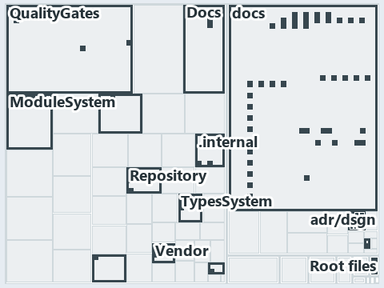

# docs/.assets/explanation/adr-dsgn-runmode--where-code-loads-from-decides-the-mode--meta.tree.md

`Tree minimap: adr-dsgn-runmode--where-code-loads-from-decides-the-mode--meta`

The tree minimap of the slide `adr-dsgn-runmode--where-code-loads-from-decides-the-mode--meta` (meta lens). The slide supports
[ADR-DSGN-RUNMODE][1]; the highlight of those ADR codes selects what is lit, and each reason below names the code that selects it.

## What the minimap shows

The tree draws every file of the world map as a tile, grouped by top-level folder (under `automation/` by module, under `docs/adr/` by ADR
domain), and lights 89 files in 14 groups, filled in ink. A lit ADR file has a white rim; a file lit only by passing mentions is a lighter
ink. Every other tile is idle, a grey box: a file the slide's ADR codes do not select.

- docs (docs/ outside docs/adr/): 46 lit files
- adr/dsgn (docs/adr/design): 9 lit files
- ModuleSystem (automation/Catzc.Base.ModuleSystem): 8 lit files
- QualityGates (automation/Catzc.Base.QualityGates): 5 lit files
- TypesSystem (automation/Catzc.Base.TypesSystem): 5 lit files
- Root files: 3 lit files
- Repository (automation/Catzc.Base.Repository): 3 lit files
- .internal (automation/.internal): 2 lit files
- Docs (automation/Catzc.Base.Docs): 2 lit files
- Vendor (automation/Catzc.Base.Vendor): 2 lit files
- ConfigExtensions (automation/Catzc.Base.ConfigExtensions): 1 lit file
- Globs (automation/Catzc.Base.Globs): 1 lit file
- RootConfig (automation/Catzc.Base.RootConfig): 1 lit file
- adr/* (the files directly in docs/adr/): 1 lit file

## Why each group is lit

### docs (46 lit files)

The group holds the files of docs/ outside docs/adr/; each sits in its world-map cell and is lit by:

- [docs/.assets/explanation/adr-auto-bundle--every-code-root-is-a-copy--architecture.chain.md][2], in the cell docs × markdown: selected by
  [ADR-DSGN-RUNMODE][1]: the file cites it at line 8 (text), line 28 (text), line 28 (text), line 36 (text) and line 36 (text).
- [docs/.assets/explanation/adr-auto-bundle--every-code-root-is-a-copy--architecture.drawio.md][3], in the cell docs × markdown: selected by
  [ADR-DSGN-RUNMODE][1]: the file cites it at line 70 (text).
- [docs/.assets/explanation/adr-auto-bundle--every-code-root-is-a-copy--architecture.grid.md][4], in the cell docs × markdown: selected by
  [ADR-DSGN-RUNMODE][1]: the file cites it at line 8 (text), line 48 (text), line 49 (text), line 50 (text), line 54 (text), line 64 (text),
  line 65 (text), line 66 (text), line 68 (text), line 69 (text), line 71 (text), line 73 (text), line 74 (text), line 75 (text), line 77
  (text), line 78 (text), line 79 (text), line 81 (text), line 83 (text), line 84 (text), line 85 (text), line 86 (text), line 87 (text),
  line 89 (text), line 91 (text), line 93 (text), line 95 (text), line 97 (text), line 98 (text), line 106 (text), line 108 (text), line 122
  (text), line 128 (text), line 130 (text), line 135 (text), line 137 (text), line 140 (text), line 142 (text), line 144 (text), line 146
  (text), line 225 (text), line 227 (text), line 229 (text), line 231 (text), line 232 (text), line 234 (text), line 236 (text), line 238
  (text), line 239 (text), line 241 (text), line 250 (text), line 253 (text), line 257 (text), line 260 (text), line 266 (text), line 267
  (text), line 269 (text), line 271 (text), line 273 (text), line 275 (text), line 284 (text), line 293 (text) and line 297 (text).
- [docs/.assets/explanation/adr-auto-bundle--every-code-root-is-a-copy--architecture.tree.md][5], in the cell docs × markdown: selected by
  [ADR-DSGN-RUNMODE][1]: the file cites it at line 8 (text), line 131 (text), line 137 (text), line 139 (text), line 144 (text), line 147
  (text), line 149 (text), line 151 (text), line 153 (text), line 155 (text), line 164 (text), line 166 (text), line 171 (text), line 175
  (text), line 180 (text), line 182 (text), line 184 (text), line 186 (text), line 188 (text), line 190 (text), line 221 (text), line 223
  (text), line 225 (text), line 227 (text), line 229 (text), line 231 (text), line 233 (text), line 235 (text), line 237 (text), line 244
  (text), line 247 (text), line 248 (text), line 251 (text), line 253 (text), line 254 (text), line 256 (text), line 259 (text), line 265
  (text), line 267 (text), line 269 (text), line 272 (text), line 274 (text), line 281 (text), line 283 (text), line 285 (text), line 287
  (text), line 289 (text), line 295 (text), line 299 (text), line 305 (text), line 313 (text), line 315 (text), line 317 (text), line 325
  (text), line 327 (text), line 334 (text), line 335 (text), line 342 (text), line 344 (text), line 359 (text), line 372 (text), line 379
  (text) and line 387 (text).
- [docs/.assets/explanation/adr-auto-bundle--one-commit-one-immutable-package--meta.chain.md][6], in the cell docs × markdown: selected by
  [ADR-DSGN-RUNMODE][1]: the file cites it at line 8 (text), line 28 (text), line 28 (text), line 36 (text) and line 36 (text).
- [docs/.assets/explanation/adr-auto-bundle--one-commit-one-immutable-package--meta.drawio.md][7], in the cell docs × markdown: selected by
  [ADR-DSGN-RUNMODE][1]: the file cites it at line 69 (text).
- [docs/.assets/explanation/adr-auto-bundle--one-commit-one-immutable-package--meta.grid.md][8], in the cell docs × markdown: selected by
  [ADR-DSGN-RUNMODE][1]: the file cites it at line 8 (text), line 47 (text), line 48 (text), line 49 (text), line 53 (text), line 63 (text),
  line 64 (text), line 65 (text), line 67 (text), line 68 (text), line 70 (text), line 72 (text), line 73 (text), line 74 (text), line 76
  (text), line 77 (text), line 78 (text), line 80 (text), line 82 (text), line 83 (text), line 84 (text), line 85 (text), line 86 (text),
  line 88 (text), line 90 (text), line 92 (text), line 94 (text), line 96 (text), line 97 (text), line 105 (text), line 107 (text), line 121
  (text), line 127 (text), line 129 (text), line 134 (text), line 136 (text), line 139 (text), line 141 (text), line 143 (text), line 145
  (text), line 224 (text), line 226 (text), line 228 (text), line 230 (text), line 231 (text), line 233 (text), line 235 (text), line 237
  (text), line 238 (text), line 240 (text), line 249 (text), line 252 (text), line 256 (text), line 259 (text), line 265 (text), line 266
  (text), line 268 (text), line 270 (text), line 272 (text), line 274 (text), line 283 (text), line 292 (text) and line 296 (text).
- [docs/.assets/explanation/adr-auto-bundle--one-commit-one-immutable-package--meta.tree.md][9], in the cell docs × markdown: selected by
  [ADR-DSGN-RUNMODE][1]: the file cites it at line 8 (text), line 130 (text), line 136 (text), line 138 (text), line 143 (text), line 146
  (text), line 148 (text), line 150 (text), line 152 (text), line 154 (text), line 163 (text), line 165 (text), line 170 (text), line 174
  (text), line 179 (text), line 181 (text), line 183 (text), line 185 (text), line 187 (text), line 189 (text), line 220 (text), line 222
  (text), line 224 (text), line 226 (text), line 228 (text), line 230 (text), line 232 (text), line 234 (text), line 236 (text), line 243
  (text), line 246 (text), line 247 (text), line 250 (text), line 252 (text), line 253 (text), line 255 (text), line 258 (text), line 264
  (text), line 266 (text), line 268 (text), line 271 (text), line 273 (text), line 280 (text), line 282 (text), line 284 (text), line 286
  (text), line 288 (text), line 294 (text), line 298 (text), line 304 (text), line 312 (text), line 314 (text), line 316 (text), line 324
  (text), line 326 (text), line 333 (text), line 334 (text), line 341 (text), line 343 (text), line 358 (text), line 371 (text), line 378
  (text) and line 386 (text).
- [docs/.assets/explanation/adr-auto-bundle--rule-and-gate-per-load-stage--governance.chain.md][10], in the cell docs × markdown: selected
  by [ADR-DSGN-RUNMODE][1]: the file cites it at line 8 (text), line 38 (text), line 38 (text), line 46 (text) and line 46 (text).
- [docs/.assets/explanation/adr-auto-bundle--rule-and-gate-per-load-stage--governance.drawio.md][11], in the cell docs × markdown: selected
  by [ADR-DSGN-RUNMODE][1]: the file cites it at line 56 (text) and line 64 (text).
- [docs/.assets/explanation/adr-auto-bundle--rule-and-gate-per-load-stage--governance.grid.md][12], in the cell docs × markdown: selected by
  [ADR-DSGN-RUNMODE][1]: the file cites it at line 8 (text), line 179 (text), line 182 (text), line 190 (text), line 201 (text), line 217
  (text), line 220 (text), line 221 (text), line 224 (text), line 225 (text), line 227 (text), line 229 (text), line 231 (text), line 232
  (text), line 242 (text), line 244 (text), line 253 (text), line 255 (text), line 261 (text), line 262 (text), line 263 (text), line 267
  (text), line 280 (text), line 283 (text), line 284 (text), line 286 (text), line 289 (text), line 301 (text), line 302 (text), line 310
  (text), line 317 (text), line 340 (text), line 346 (text), line 349 (text), line 355 (text), line 357 (text), line 360 (text), line 362
  (text), line 364 (text), line 366 (text), line 449 (text), line 451 (text), line 453 (text), line 455 (text), line 456 (text), line 458
  (text), line 460 (text), line 462 (text), line 463 (text), line 466 (text), line 567 (text), line 570 (text), line 574 (text), line 578
  (text), line 586 (text), line 587 (text), line 589 (text), line 591 (text), line 593 (text), line 595 (text), line 623 (text), line 634
  (text) and line 640 (text).
- [docs/.assets/explanation/adr-auto-bundle--rule-and-gate-per-load-stage--governance.tree.md][13], in the cell docs × markdown: selected by
  [ADR-DSGN-RUNMODE][1]: the file cites it at line 8 (text), line 191 (text), line 197 (text), line 200 (text), line 206 (text), line 209
  (text), line 211 (text), line 213 (text), line 215 (text), line 217 (text), line 228 (text), line 230 (text), line 235 (text), line 239
  (text), line 247 (text), line 249 (text), line 251 (text), line 253 (text), line 255 (text), line 257 (text), line 345 (text), line 348
  (text), line 391 (text), line 393 (text), line 397 (text), line 409 (text), line 411 (text), line 473 (text), line 475 (text), line 477
  (text), line 479 (text), line 481 (text), line 482 (text), line 485 (text), line 488 (text), line 654 (text), line 656 (text), line 658
  (text), line 660 (text), line 662 (text), line 674 (text), line 676 (text), line 678 (text), line 680 (text), line 682 (text), line 684
  (text), line 686 (text), line 688 (text), line 690 (text), line 697 (text), line 769 (text), line 771 (text), line 773 (text), line 785
  (text), line 789 (text), line 812 (text), line 818 (text), line 829 (text), line 859 (text), line 861 (text), line 955 (text), line 968
  (text) and line 976 (text).
- [docs/.assets/explanation/adr-auto-bundle--what-gates-each-bundle-stage--governance.chain.md][14], in the cell docs × markdown: selected
  by [ADR-DSGN-RUNMODE][1]: the file cites it at line 8 (text), line 30 (text), line 30 (text), line 38 (text) and line 38 (text).
- [docs/.assets/explanation/adr-auto-bundle--what-gates-each-bundle-stage--governance.drawio.md][15], in the cell docs × markdown: selected
  by [ADR-DSGN-RUNMODE][1]: the file cites it at line 67 (text) and line 74 (text).
- [docs/.assets/explanation/adr-auto-bundle--what-gates-each-bundle-stage--governance.grid.md][16], in the cell docs × markdown: selected by
  [ADR-DSGN-RUNMODE][1]: the file cites it at line 8 (text), line 72 (text), line 77 (text), line 176 (text), line 200 (text), line 295
  (text), line 351 (text), line 352 (text), line 354 (text), line 356 (text), line 358 (text), line 359 (text), line 360 (text), line 367
  (text), line 407 (text), line 409 (text), line 592 (text), line 594 (text), line 650 (text), line 652 (text), line 653 (text), line 658
  (text), line 672 (text), line 674 (text), line 676 (text), line 678 (text), line 680 (text), line 691 (text), line 692 (text), line 764
  (text), line 781 (text), line 800 (text), line 806 (text), line 808 (text), line 814 (text), line 821 (text), line 824 (text), line 826
  (text), line 828 (text), line 830 (text), line 952 (text), line 954 (text), line 956 (text), line 958 (text), line 959 (text), line 961
  (text), line 963 (text), line 965 (text), line 966 (text), line 972 (text), line 982 (text), line 985 (text), line 989 (text), line 992
  (text), line 1001 (text), line 1005 (text), line 1008 (text), line 1010 (text), line 1012 (text), line 1015 (text), line 1055 (text), line
  1069 (text) and line 1077 (text).
- [docs/.assets/explanation/adr-auto-bundle--what-gates-each-bundle-stage--governance.tree.md][17], in the cell docs × markdown: selected by
  [ADR-DSGN-RUNMODE][1]: the file cites it at line 8 (text), line 74 (text), line 76 (text), line 120 (text), line 286 (text), line 288
  (text), line 358 (text), line 364 (text), line 366 (text), line 372 (text), line 380 (text), line 382 (text), line 384 (text), line 386
  (text), line 388 (text), line 402 (text), line 404 (text), line 409 (text), line 413 (text), line 421 (text), line 425 (text), line 429
  (text), line 431 (text), line 433 (text), line 436 (text), line 481 (text), line 484 (text), line 752 (text), line 755 (text), line 756
  (text), line 759 (text), line 762 (text), line 764 (text), line 766 (text), line 773 (text), line 814 (text), line 986 (text), line 988
  (text), line 990 (text), line 992 (text), line 994 (text), line 1033 (text), line 1056 (text), line 1058 (text), line 1060 (text), line
  1062 (text), line 1064 (text), line 1066 (text), line 1068 (text), line 1070 (text), line 1072 (text), line 1121 (text), line 1127 (text),
  line 1169 (text), line 1172 (text), line 1173 (text), line 1228 (text), line 1236 (text), line 1245 (text), line 1265 (text), line 1304
  (text), line 1306 (text) and line 1318 (text).
- [docs/.assets/explanation/adr-dsgn-runmode--one-entry-script-per-mode--operations.chain.md][18], in the cell docs × markdown: selected by
  [ADR-DSGN-RUNMODE][1]: the file cites it at line 8 (text), line 25 (text), line 25 (text), line 33 (text) and line 33 (text).
- [docs/.assets/explanation/adr-dsgn-runmode--one-entry-script-per-mode--operations.drawio.md][19], in the cell docs × markdown: selected by
  [ADR-DSGN-RUNMODE][1]: the file cites it at line 71 (text).
- [docs/.assets/explanation/adr-dsgn-runmode--one-entry-script-per-mode--operations.grid.md][20], in the cell docs × markdown: selected by
  [ADR-DSGN-RUNMODE][1]: the file cites it at line 8 (text), line 28 (text), line 29 (text), line 30 (text), line 32 (text), line 33 (text),
  line 34 (text), line 35 (text), line 37 (text), line 38 (text), line 40 (text), line 42 (text), line 43 (text), line 44 (text), line 46
  (text), line 47 (text), line 48 (text), line 50 (text), line 52 (text), line 53 (text), line 54 (text), line 55 (text), line 56 (text),
  line 58 (text), line 60 (text), line 62 (text), line 64 (text), line 66 (text), line 67 (text), line 74 (text), line 75 (text), line 82
  (text), line 84 (text), line 86 (text), line 88 (text), line 90 (text), line 93 (text), line 95 (text), line 97 (text), line 99 (text),
  line 100 (text), line 102 (text), line 104 (text), line 106 (text), line 107 (text), line 109 (text), line 111 (text), line 113 (text),
  line 114 (text), line 116 (text), line 117 (text), line 119 (text), line 121 (text), line 123 (text), line 125 (text), line 127 (text),
  line 129 (text), line 131 (text), line 133 (text), line 135 (text), line 143 (text), line 152 (text) and line 156 (text).
- [docs/.assets/explanation/adr-dsgn-runmode--one-entry-script-per-mode--operations.tree.md][21], in the cell docs × markdown: selected by
  [ADR-DSGN-RUNMODE][1]: the file cites it at line 8 (text), line 37 (text), line 39 (text), line 41 (text), line 43 (text), line 45 (text),
  line 47 (text), line 49 (text), line 51 (text), line 53 (text), line 54 (text), line 56 (text), line 58 (text), line 60 (text), line 62
  (text), line 64 (text), line 66 (text), line 68 (text), line 70 (text), line 72 (text), line 80 (text), line 82 (text), line 84 (text),
  line 86 (text), line 88 (text), line 90 (text), line 92 (text), line 94 (text), line 96 (text), line 103 (text), line 106 (text), line 107
  (text), line 110 (text), line 112 (text), line 113 (text), line 115 (text), line 118 (text), line 124 (text), line 126 (text), line 128
  (text), line 131 (text), line 133 (text), line 139 (text), line 141 (text), line 143 (text), line 146 (text), line 147 (text), line 154
  (text), line 158 (text), line 162 (text), line 170 (text), line 172 (text), line 174 (text), line 181 (text), line 183 (text), line 190
  (text), line 192 (text), line 199 (text), line 201 (text), line 209 (text), line 215 (text), line 222 (text) and line 229 (text).
- [docs/.assets/explanation/adr-dsgn-runmode--shims-set-roots-mode-read-back--implementation.chain.md][22], in the cell docs × markdown:
  selected by [ADR-DSGN-RUNMODE][1]: the file cites it at line 8 (text), line 25 (text), line 25 (text), line 33 (text) and line 33 (text).
- [docs/.assets/explanation/adr-dsgn-runmode--shims-set-roots-mode-read-back--implementation.drawio.md][23], in the cell docs × markdown:
  selected by [ADR-DSGN-RUNMODE][1]: the file cites it at line 74 (text).
- [docs/.assets/explanation/adr-dsgn-runmode--shims-set-roots-mode-read-back--implementation.grid.md][24], in the cell docs × markdown:
  selected by [ADR-DSGN-RUNMODE][1]: the file cites it at line 8 (text), line 28 (text), line 29 (text), line 30 (text), line 32 (text),
  line 33 (text), line 34 (text), line 35 (text), line 37 (text), line 38 (text), line 40 (text), line 42 (text), line 43 (text), line 44
  (text), line 46 (text), line 47 (text), line 48 (text), line 50 (text), line 52 (text), line 53 (text), line 54 (text), line 55 (text),
  line 56 (text), line 58 (text), line 60 (text), line 62 (text), line 64 (text), line 66 (text), line 67 (text), line 74 (text), line 75
  (text), line 82 (text), line 84 (text), line 86 (text), line 88 (text), line 90 (text), line 93 (text), line 95 (text), line 97 (text),
  line 99 (text), line 100 (text), line 102 (text), line 104 (text), line 106 (text), line 107 (text), line 109 (text), line 111 (text),
  line 113 (text), line 114 (text), line 116 (text), line 117 (text), line 119 (text), line 121 (text), line 123 (text), line 125 (text),
  line 127 (text), line 129 (text), line 131 (text), line 133 (text), line 135 (text), line 143 (text), line 152 (text) and line 156 (text).
- [docs/.assets/explanation/adr-dsgn-runmode--shims-set-roots-mode-read-back--implementation.tree.md][25], in the cell docs × markdown:
  selected by [ADR-DSGN-RUNMODE][1]: the file cites it at line 8 (text), line 37 (text), line 39 (text), line 41 (text), line 43 (text),
  line 45 (text), line 47 (text), line 49 (text), line 51 (text), line 53 (text), line 54 (text), line 56 (text), line 58 (text), line 60
  (text), line 62 (text), line 64 (text), line 66 (text), line 68 (text), line 70 (text), line 72 (text), line 80 (text), line 82 (text),
  line 84 (text), line 86 (text), line 88 (text), line 90 (text), line 92 (text), line 94 (text), line 96 (text), line 103 (text), line 106
  (text), line 107 (text), line 110 (text), line 112 (text), line 113 (text), line 115 (text), line 118 (text), line 124 (text), line 126
  (text), line 128 (text), line 131 (text), line 133 (text), line 139 (text), line 141 (text), line 143 (text), line 146 (text), line 147
  (text), line 154 (text), line 158 (text), line 162 (text), line 170 (text), line 172 (text), line 174 (text), line 181 (text), line 183
  (text), line 190 (text), line 192 (text), line 199 (text), line 201 (text), line 209 (text), line 215 (text), line 222 (text) and line 229
  (text).
- [docs/.assets/explanation/adr-dsgn-runmode--two-roots-one-importer-same-modules--architecture.chain.md][26], in the cell docs × markdown:
  selected by [ADR-DSGN-RUNMODE][1]: the file cites it at line 8 (text), line 25 (text), line 25 (text), line 33 (text) and line 33 (text).
- [docs/.assets/explanation/adr-dsgn-runmode--two-roots-one-importer-same-modules--architecture.drawio.md][27], in the cell docs × markdown:
  selected by [ADR-DSGN-RUNMODE][1]: the file cites it at line 68 (text).
- [docs/.assets/explanation/adr-dsgn-runmode--two-roots-one-importer-same-modules--architecture.grid.md][28], in the cell docs × markdown:
  selected by [ADR-DSGN-RUNMODE][1]: the file cites it at line 8 (text), line 28 (text), line 29 (text), line 30 (text), line 32 (text),
  line 33 (text), line 34 (text), line 35 (text), line 37 (text), line 38 (text), line 40 (text), line 42 (text), line 43 (text), line 44
  (text), line 46 (text), line 47 (text), line 48 (text), line 50 (text), line 52 (text), line 53 (text), line 54 (text), line 55 (text),
  line 56 (text), line 58 (text), line 60 (text), line 62 (text), line 64 (text), line 66 (text), line 67 (text), line 74 (text), line 75
  (text), line 82 (text), line 84 (text), line 86 (text), line 88 (text), line 90 (text), line 93 (text), line 95 (text), line 97 (text),
  line 99 (text), line 100 (text), line 102 (text), line 104 (text), line 106 (text), line 107 (text), line 109 (text), line 111 (text),
  line 113 (text), line 114 (text), line 116 (text), line 117 (text), line 119 (text), line 121 (text), line 123 (text), line 125 (text),
  line 127 (text), line 129 (text), line 131 (text), line 133 (text), line 135 (text), line 143 (text), line 152 (text) and line 156 (text).
- [docs/.assets/explanation/adr-dsgn-runmode--two-roots-one-importer-same-modules--architecture.tree.md][29], in the cell docs × markdown:
  selected by [ADR-DSGN-RUNMODE][1]: the file cites it at line 8 (text), line 37 (text), line 39 (text), line 41 (text), line 43 (text),
  line 45 (text), line 47 (text), line 49 (text), line 51 (text), line 53 (text), line 54 (text), line 56 (text), line 58 (text), line 60
  (text), line 62 (text), line 64 (text), line 66 (text), line 68 (text), line 70 (text), line 72 (text), line 80 (text), line 82 (text),
  line 84 (text), line 86 (text), line 88 (text), line 90 (text), line 92 (text), line 94 (text), line 96 (text), line 103 (text), line 106
  (text), line 107 (text), line 110 (text), line 112 (text), line 113 (text), line 115 (text), line 118 (text), line 124 (text), line 126
  (text), line 128 (text), line 131 (text), line 133 (text), line 139 (text), line 141 (text), line 143 (text), line 146 (text), line 147
  (text), line 154 (text), line 158 (text), line 162 (text), line 170 (text), line 172 (text), line 174 (text), line 181 (text), line 183
  (text), line 190 (text), line 192 (text), line 199 (text), line 201 (text), line 209 (text), line 215 (text), line 222 (text) and line 229
  (text).
- [docs/.assets/explanation/adr-dsgn-runmode--where-code-loads-from-decides-the-mode--meta.chain.md][30], in the cell docs × markdown:
  selected by [ADR-DSGN-RUNMODE][1]: the file cites it at line 8 (text), line 25 (text), line 25 (text), line 33 (text) and line 33 (text).
- [docs/.assets/explanation/adr-dsgn-runmode--where-code-loads-from-decides-the-mode--meta.drawio.md][31], in the cell docs × markdown:
  selected by [ADR-DSGN-RUNMODE][1]: the file cites it at line 67 (text).
- [docs/.assets/explanation/adr-dsgn-runmode--where-code-loads-from-decides-the-mode--meta.grid.md][32], in the cell docs × markdown:
  selected by [ADR-DSGN-RUNMODE][1]: the file cites it at line 8 (text), line 28 (text), line 29 (text), line 30 (text), line 32 (text),
  line 33 (text), line 34 (text), line 35 (text), line 37 (text), line 38 (text), line 40 (text), line 42 (text), line 43 (text), line 44
  (text), line 46 (text), line 47 (text), line 48 (text), line 50 (text), line 52 (text), line 53 (text), line 54 (text), line 55 (text),
  line 56 (text), line 58 (text), line 60 (text), line 62 (text), line 64 (text), line 66 (text), line 67 (text), line 74 (text), line 75
  (text), line 82 (text), line 84 (text), line 86 (text), line 88 (text), line 90 (text), line 93 (text), line 95 (text), line 97 (text),
  line 99 (text), line 100 (text), line 102 (text), line 104 (text), line 106 (text), line 107 (text), line 109 (text), line 111 (text),
  line 113 (text), line 114 (text), line 116 (text), line 117 (text), line 119 (text), line 121 (text), line 123 (text), line 125 (text),
  line 127 (text), line 129 (text), line 131 (text), line 133 (text), line 135 (text), line 143 (text), line 152 (text) and line 156 (text).
- [docs/.assets/explanation/adr-dsgn-runmode--where-code-loads-from-decides-the-mode--meta.tree.md][33], in the cell docs × markdown:
  selected by [ADR-DSGN-RUNMODE][1]: the file cites it at line 8 (text), line 37 (text), line 39 (text), line 41 (text), line 43 (text),
  line 45 (text), line 47 (text), line 49 (text), line 51 (text), line 53 (text), line 54 (text), line 56 (text), line 58 (text), line 60
  (text), line 62 (text), line 64 (text), line 66 (text), line 68 (text), line 70 (text), line 72 (text), line 80 (text), line 82 (text),
  line 84 (text), line 86 (text), line 88 (text), line 90 (text), line 92 (text), line 94 (text), line 96 (text), line 103 (text), line 106
  (text), line 107 (text), line 110 (text), line 112 (text), line 113 (text), line 115 (text), line 118 (text), line 124 (text), line 126
  (text), line 128 (text), line 131 (text), line 133 (text), line 139 (text), line 141 (text), line 143 (text), line 146 (text), line 147
  (text), line 154 (text), line 158 (text), line 162 (text), line 170 (text), line 172 (text), line 174 (text), line 181 (text), line 183
  (text), line 190 (text), line 192 (text), line 199 (text), line 201 (text), line 209 (text), line 215 (text), line 222 (text) and line 229
  (text).
- [docs/.assets/explanation/adr-dsgn-runmode--which-run-mode-rules-have-a-gate--governance.chain.md][34], in the cell docs × markdown:
  selected by [ADR-DSGN-RUNMODE][1]: the file cites it at line 8 (text), line 25 (text), line 25 (text), line 33 (text) and line 33 (text).
- [docs/.assets/explanation/adr-dsgn-runmode--which-run-mode-rules-have-a-gate--governance.drawio.md][35], in the cell docs × markdown:
  selected by [ADR-DSGN-RUNMODE][1]: the file cites it at line 63 (text) and line 73 (text).
- [docs/.assets/explanation/adr-dsgn-runmode--which-run-mode-rules-have-a-gate--governance.grid.md][36], in the cell docs × markdown:
  selected by [ADR-DSGN-RUNMODE][1]: the file cites it at line 8 (text), line 28 (text), line 29 (text), line 30 (text), line 32 (text),
  line 33 (text), line 34 (text), line 35 (text), line 37 (text), line 38 (text), line 40 (text), line 42 (text), line 43 (text), line 44
  (text), line 46 (text), line 47 (text), line 48 (text), line 50 (text), line 52 (text), line 53 (text), line 54 (text), line 55 (text),
  line 56 (text), line 58 (text), line 60 (text), line 62 (text), line 64 (text), line 66 (text), line 67 (text), line 74 (text), line 75
  (text), line 82 (text), line 84 (text), line 86 (text), line 88 (text), line 90 (text), line 93 (text), line 95 (text), line 97 (text),
  line 99 (text), line 100 (text), line 102 (text), line 104 (text), line 106 (text), line 107 (text), line 109 (text), line 111 (text),
  line 113 (text), line 114 (text), line 116 (text), line 117 (text), line 119 (text), line 121 (text), line 123 (text), line 125 (text),
  line 127 (text), line 129 (text), line 131 (text), line 133 (text), line 135 (text), line 143 (text), line 152 (text) and line 156 (text).
- [docs/.assets/explanation/adr-dsgn-runmode--which-run-mode-rules-have-a-gate--governance.tree.md][37], in the cell docs × markdown:
  selected by [ADR-DSGN-RUNMODE][1]: the file cites it at line 8 (text), line 37 (text), line 39 (text), line 41 (text), line 43 (text),
  line 45 (text), line 47 (text), line 49 (text), line 51 (text), line 53 (text), line 54 (text), line 56 (text), line 58 (text), line 60
  (text), line 62 (text), line 64 (text), line 66 (text), line 68 (text), line 70 (text), line 72 (text), line 80 (text), line 82 (text),
  line 84 (text), line 86 (text), line 88 (text), line 90 (text), line 92 (text), line 94 (text), line 96 (text), line 103 (text), line 106
  (text), line 107 (text), line 110 (text), line 112 (text), line 113 (text), line 115 (text), line 118 (text), line 124 (text), line 126
  (text), line 128 (text), line 131 (text), line 133 (text), line 139 (text), line 141 (text), line 143 (text), line 146 (text), line 147
  (text), line 154 (text), line 158 (text), line 162 (text), line 170 (text), line 172 (text), line 174 (text), line 181 (text), line 183
  (text), line 190 (text), line 192 (text), line 199 (text), line 201 (text), line 209 (text), line 215 (text), line 222 (text) and line 229
  (text).
- [docs/explanation/automation/every-code-root-is-a-copy.md][38], in the cell docs × markdown: selected by [ADR-DSGN-RUNMODE][1]: the file
  cites it at line 17 (text), line 62 (text) and line 63 (text).
- [docs/explanation/automation/every-entry-runs-one-load-sequence.md][39], in the cell docs × markdown: selected by [ADR-DSGN-RUNMODE][1]:
  the file cites it at line 47 (text).
- [docs/explanation/automation/one-commit-one-immutable-package.md][40], in the cell docs × markdown: selected by [ADR-DSGN-RUNMODE][1]: the
  file cites it at line 15 (text), line 50 (text) and line 54 (text).
- [docs/explanation/automation/rule-and-gate-per-load-stage.md][41], in the cell docs × markdown: selected by [ADR-DSGN-RUNMODE][1]: the
  file cites it at line 41 (text), line 51 (text), line 66 (text), line 69 (text) and line 73 (text).
- [docs/explanation/automation/what-gates-each-bundle-stage.md][42], in the cell docs × markdown: selected by [ADR-DSGN-RUNMODE][1]: the
  file cites it at line 16 (text), line 42 (text), line 57 (text), line 63 (text) and line 64 (text).
- [docs/explanation/design/one-entry-script-per-mode.md][43], in the cell docs × markdown: selected by [ADR-DSGN-RUNMODE][1]: the file cites
  it at line 17 (text), line 60 (text), line 61 (text), line 62 (text) and line 63 (text).
- [docs/explanation/design/shims-set-roots-mode-read-back.md][44], in the cell docs × markdown: selected by [ADR-DSGN-RUNMODE][1]: the file
  cites it at line 19 (text), line 58 (text), line 59 (text), line 61 (text) and line 62 (text).
- [docs/explanation/design/two-roots-one-importer-same-modules.md][45], in the cell docs × markdown: selected by [ADR-DSGN-RUNMODE][1]: the
  file cites it at line 17 (text), line 56 (text), line 57 (text), line 58 (text) and line 60 (text).
- [docs/explanation/design/where-code-loads-from-decides-the-mode.md][46], in the cell docs × markdown: selected by [ADR-DSGN-RUNMODE][1]:
  the file cites it at line 14 (text), line 40 (text), line 41 (text), line 42 (text) and line 43 (text).
- [docs/explanation/design/which-run-mode-rules-have-a-gate.md][47], in the cell docs × markdown: selected by [ADR-DSGN-RUNMODE][1]: the
  file cites it at line 17 (text), line 53 (text), line 55 (text), line 57 (text), line 58 (text), line 59 (text), line 60 (text) and line
  61 (text).

### adr/dsgn (9 lit files)

The group holds the files of docs/adr/design; each sits in its world-map cell and is lit by:

- [docs/adr/design/commit-lifecycle.md][48], in the cell docs × markdown: selected by [ADR-DSGN-RUNMODE][1]: an ADR file of the `design` ADR
  domain, the ADR domain of that code.
- [docs/adr/design/dora-explains.md][49], in the cell docs × markdown: selected by [ADR-DSGN-RUNMODE][1]: an ADR file of the `design` ADR
  domain, the ADR domain of that code.
- [docs/adr/design/module-aspects.md][50], in the cell docs × markdown: selected by [ADR-DSGN-RUNMODE][1]: an ADR file of the `design` ADR
  domain, the ADR domain of that code.
- [docs/adr/design/run-modes.md][1], in the cell docs × markdown: selected by [ADR-DSGN-RUNMODE][1]: an ADR file of the `design` ADR domain,
  the ADR domain of that code.
- [docs/adr/design/self-service.md][51], in the cell docs × markdown: selected by [ADR-DSGN-RUNMODE][1]: an ADR file of the `design` ADR
  domain, the ADR domain of that code.
- [docs/adr/design/server-remote-integration.md][52], in the cell docs × markdown: selected by [ADR-DSGN-RUNMODE][1]: an ADR file of the
  `design` ADR domain, the ADR domain of that code.
- [docs/adr/design/thin-platforms.md][53], in the cell docs × markdown: selected by [ADR-DSGN-RUNMODE][1]: an ADR file of the `design` ADR
  domain, the ADR domain of that code.
- [docs/adr/design/tracks.md][54], in the cell docs × markdown: selected by [ADR-DSGN-RUNMODE][1]: an ADR file of the `design` ADR domain,
  the ADR domain of that code.
- [docs/adr/design/visual-design.md][55], in the cell docs × markdown: selected by [ADR-DSGN-RUNMODE][1]: an ADR file of the `design` ADR
  domain, the ADR domain of that code.

### ModuleSystem (8 lit files)

The group holds the files of automation/Catzc.Base.ModuleSystem; each sits in its world-map cell and is lit by:

- [automation/Catzc.Base.ModuleSystem/Copy-Automation.ps1][56], in the cell automation × powershell: selected by [ADR-DSGN-RUNMODE][1]: the
  file cites it at line 26 (header).
- [automation/Catzc.Base.ModuleSystem/Get-AutomationFunctions.ps1][57], in the cell automation × powershell: selected by
  [ADR-DSGN-RUNMODE][1]: the file cites it at line 12 (header).
- [automation/Catzc.Base.ModuleSystem/Get-BaseModule.ps1][58], in the cell automation × powershell: selected by [ADR-DSGN-RUNMODE][1]: the
  file cites it at line 22 (header).
- [automation/Catzc.Base.ModuleSystem/Get-FunctionDependency.ps1][59], in the cell automation × powershell: selected by
  [ADR-DSGN-RUNMODE][1]: the file cites it at line 10 (header).
- [automation/Catzc.Base.ModuleSystem/Get-InternalAssetDependency.ps1][60], in the cell automation × powershell: selected by
  [ADR-DSGN-RUNMODE][1]: the file cites it at line 28 (header).
- [automation/Catzc.Base.ModuleSystem/New-Importer.ps1][61], in the cell automation × powershell: selected by [ADR-DSGN-RUNMODE][1]: the
  file cites it at line 16 (header).
- [automation/Catzc.Base.ModuleSystem/Sync-GeneratedFile.ps1][62], in the cell automation × powershell: selected by [ADR-DSGN-RUNMODE][1]:
  the file cites it at line 17 (header).
- [automation/Catzc.Base.ModuleSystem/Test-FunctionDependency.ps1][63], in the cell automation × powershell: selected by
  [ADR-DSGN-RUNMODE][1]: the file cites it at line 21 (header).

### QualityGates (5 lit files)

The group holds the files of automation/Catzc.Base.QualityGates; each sits in its world-map cell and is lit by:

- [automation/Catzc.Base.QualityGates/Test-BuildArtifact.ps1][64], in the cell automation × powershell: selected by [ADR-DSGN-RUNMODE][1]:
  the file cites it at line 25 (header).
- [automation/Catzc.Base.QualityGates/Test-CatzcBuild.ps1][65], in the cell automation × powershell: selected by [ADR-DSGN-RUNMODE][1]: the
  file cites it at line 7 (header).
- [automation/Catzc.Base.QualityGates/configs/terminology.yml][66], in the cell automation × yaml: selected by [ADR-DSGN-RUNMODE][1]: the
  file cites it at line 590 (text).
- [automation/Catzc.Base.QualityGates/tests/Test-CatzcBuild.Parity.Tests.ps1][67], in the cell automation × powershell: selected by
  [ADR-DSGN-RUNMODE][1]: the file cites it at line 1 (header) and line 7 (text).
- [automation/Catzc.Base.QualityGates/tests/Test-CatzcBuild.ScopeIsolation.Tests.ps1][68], in the cell automation × powershell: selected by
  [ADR-DSGN-RUNMODE][1]: the file cites it at line 1 (header) and line 6 (text).

### TypesSystem (5 lit files)

The group holds the files of automation/Catzc.Base.TypesSystem; each sits in its world-map cell and is lit by:

- [automation/Catzc.Base.TypesSystem/Build-BashTimeoutHook.ps1][69], in the cell automation × powershell: selected by [ADR-DSGN-RUNMODE][1]:
  the file cites it at line 15 (header).
- [automation/Catzc.Base.TypesSystem/Clear-ModuleTypeCache.ps1][70], in the cell automation × powershell: selected by [ADR-DSGN-RUNMODE][1]:
  the file cites it at line 30 (header).
- [automation/Catzc.Base.TypesSystem/Get-AutomationModules.ps1][71], in the cell automation × powershell: selected by [ADR-DSGN-RUNMODE][1]:
  the file cites it at line 8 (header).
- [automation/Catzc.Base.TypesSystem/Get-CSharpTypeDependency.ps1][72], in the cell automation × powershell: selected by
  [ADR-DSGN-RUNMODE][1]: the file cites it at line 24 (header).
- [automation/Catzc.Base.TypesSystem/Invoke-BuildForVSCode.ps1][73], in the cell automation × powershell: selected by [ADR-DSGN-RUNMODE][1]:
  the file cites it at line 22 (header).

### Root files (3 lit files)

The group holds the files of Root files; each sits in its world-map cell and is lit by:

- [.gitattributes][74], in the cell Root files × Unlisted files: selected by [ADR-DSGN-RUNMODE][1]: a root file carries the citations of its
  owner module's files (files.yml), which cite it at `automation/Catzc.Base.Repository/Assert-SourceTree.ps1` line 8 (header),
  `automation/Catzc.Base.Repository/Get-CatzcModuleRoot.ps1` line 10 (header) and `automation/Catzc.Base.Repository/Get-CatzcRunMode.ps1`
  line 6 (header).
- [.gitignore][75], in the cell Root files × Unlisted files: selected by [ADR-DSGN-RUNMODE][1]: a root file carries the citations of its
  owner module's files (files.yml), which cite it at `automation/Catzc.Base.Repository/Assert-SourceTree.ps1` line 8 (header),
  `automation/Catzc.Base.Repository/Get-CatzcModuleRoot.ps1` line 10 (header) and `automation/Catzc.Base.Repository/Get-CatzcRunMode.ps1`
  line 6 (header).
- [importer.ps1][76], in the cell Root files × powershell: selected by [ADR-DSGN-RUNMODE][1]: a root file carries the citations of its owner
  module's files (files.yml), which cite it at `automation/.internal/assets/Import-Catzc.ps1` line 5 (header) and
  `automation/.internal/tests/New-FakeRepositoryRoot.Tests.ps1` line 1 (text).

### Repository (3 lit files)

The group holds the files of automation/Catzc.Base.Repository; each sits in its world-map cell and is lit by:

- [automation/Catzc.Base.Repository/Assert-SourceTree.ps1][77], in the cell automation × powershell: selected by [ADR-DSGN-RUNMODE][1]: the
  file cites it at line 8 (header).
- [automation/Catzc.Base.Repository/Get-CatzcModuleRoot.ps1][78], in the cell automation × powershell: selected by [ADR-DSGN-RUNMODE][1]:
  the file cites it at line 10 (header).
- [automation/Catzc.Base.Repository/Get-CatzcRunMode.ps1][79], in the cell automation × powershell: selected by [ADR-DSGN-RUNMODE][1]: the
  file cites it at line 6 (header).

### .internal (2 lit files)

The group holds the files of automation/.internal; each sits in its world-map cell and is lit by:

- [automation/.internal/assets/Import-Catzc.ps1][80], in the cell automation × powershell: selected by [ADR-DSGN-RUNMODE][1]: the file cites
  it at line 5 (header).
- [automation/.internal/tests/New-FakeRepositoryRoot.Tests.ps1][81], in the cell automation × powershell: selected by [ADR-DSGN-RUNMODE][1]:
  the file cites it at line 1 (text).

### Docs (2 lit files)

The group holds the files of automation/Catzc.Base.Docs; each sits in its world-map cell and is lit by:

- [automation/Catzc.Base.Docs/configs/adrs.yml][82], in the cell automation × yaml: selected by [ADR-DSGN-RUNMODE][1]: the file cites it at
  line 101 (text).
- [automation/Catzc.Base.Docs/private/Get-CatsModules.ps1][83], in the cell automation × powershell: selected by [ADR-DSGN-RUNMODE][1]: the
  file cites it at line 11 (header).

### Vendor (2 lit files)

The group holds the files of automation/Catzc.Base.Vendor; each sits in its world-map cell and is lit by:

- [automation/Catzc.Base.Vendor/Install-VendorModule.ps1][84], in the cell automation × powershell: selected by [ADR-DSGN-RUNMODE][1]: the
  file cites it at line 11 (header).
- [automation/Catzc.Base.Vendor/Remove-VendorModules.ps1][85], in the cell automation × powershell: selected by [ADR-DSGN-RUNMODE][1]: the
  file cites it at line 18 (header).

### ConfigExtensions (1 lit file)

The group holds the files of automation/Catzc.Base.ConfigExtensions; each sits in its world-map cell and is lit by:

- [automation/Catzc.Base.ConfigExtensions/Test-ConfigValidators.ps1][86], in the cell automation × powershell: selected by
  [ADR-DSGN-RUNMODE][1]: the file cites it at line 12 (header).

### Globs (1 lit file)

The group holds the files of automation/Catzc.Base.Globs; each sits in its world-map cell and is lit by:

- [automation/Catzc.Base.Globs/Get-ModuleGlobSet.ps1][87], in the cell automation × powershell: selected by [ADR-DSGN-RUNMODE][1]: the file
  cites it at line 29 (header).

### RootConfig (1 lit file)

The group holds the files of automation/Catzc.Base.RootConfig; each sits in its world-map cell and is lit by:

- [automation/Catzc.Base.RootConfig/Build-RootConfig.ps1][88], in the cell automation × powershell: selected by [ADR-DSGN-RUNMODE][1]: the
  file cites it at line 24 (header).

### adr/* (1 lit file)

The group holds the files of the files directly in docs/adr/; each sits in its world-map cell and is lit by:

- [docs/adr/index.md][89], in the cell docs × markdown: selected by [ADR-DSGN-RUNMODE][1]: the file cites it at line 94 (text).

## Keywords

- [world map][90]
- [track][91]
- [file language][92]
- [cell][93]
- [lit cell][94]
- [root file][95]
- [unlisted file][96]
- [automation][97]: a track
- [docs][97]: a track
- [markdown][98]: a file language
- [powershell][98]: a file language
- [yaml][98]: a file language

[1]: ../../adr/design/run-modes.md
[2]: adr-auto-bundle--every-code-root-is-a-copy--architecture.chain.md
[3]: adr-auto-bundle--every-code-root-is-a-copy--architecture.drawio.md
[4]: adr-auto-bundle--every-code-root-is-a-copy--architecture.grid.md
[5]: adr-auto-bundle--every-code-root-is-a-copy--architecture.tree.md
[6]: adr-auto-bundle--one-commit-one-immutable-package--meta.chain.md
[7]: adr-auto-bundle--one-commit-one-immutable-package--meta.drawio.md
[8]: adr-auto-bundle--one-commit-one-immutable-package--meta.grid.md
[9]: adr-auto-bundle--one-commit-one-immutable-package--meta.tree.md
[10]: adr-auto-bundle--rule-and-gate-per-load-stage--governance.chain.md
[11]: adr-auto-bundle--rule-and-gate-per-load-stage--governance.drawio.md
[12]: adr-auto-bundle--rule-and-gate-per-load-stage--governance.grid.md
[13]: adr-auto-bundle--rule-and-gate-per-load-stage--governance.tree.md
[14]: adr-auto-bundle--what-gates-each-bundle-stage--governance.chain.md
[15]: adr-auto-bundle--what-gates-each-bundle-stage--governance.drawio.md
[16]: adr-auto-bundle--what-gates-each-bundle-stage--governance.grid.md
[17]: adr-auto-bundle--what-gates-each-bundle-stage--governance.tree.md
[18]: adr-dsgn-runmode--one-entry-script-per-mode--operations.chain.md
[19]: adr-dsgn-runmode--one-entry-script-per-mode--operations.drawio.md
[20]: adr-dsgn-runmode--one-entry-script-per-mode--operations.grid.md
[21]: adr-dsgn-runmode--one-entry-script-per-mode--operations.tree.md
[22]: adr-dsgn-runmode--shims-set-roots-mode-read-back--implementation.chain.md
[23]: adr-dsgn-runmode--shims-set-roots-mode-read-back--implementation.drawio.md
[24]: adr-dsgn-runmode--shims-set-roots-mode-read-back--implementation.grid.md
[25]: adr-dsgn-runmode--shims-set-roots-mode-read-back--implementation.tree.md
[26]: adr-dsgn-runmode--two-roots-one-importer-same-modules--architecture.chain.md
[27]: adr-dsgn-runmode--two-roots-one-importer-same-modules--architecture.drawio.md
[28]: adr-dsgn-runmode--two-roots-one-importer-same-modules--architecture.grid.md
[29]: adr-dsgn-runmode--two-roots-one-importer-same-modules--architecture.tree.md
[30]: adr-dsgn-runmode--where-code-loads-from-decides-the-mode--meta.chain.md
[31]: adr-dsgn-runmode--where-code-loads-from-decides-the-mode--meta.drawio.md
[32]: adr-dsgn-runmode--where-code-loads-from-decides-the-mode--meta.grid.md
[33]: adr-dsgn-runmode--where-code-loads-from-decides-the-mode--meta.tree.md
[34]: adr-dsgn-runmode--which-run-mode-rules-have-a-gate--governance.chain.md
[35]: adr-dsgn-runmode--which-run-mode-rules-have-a-gate--governance.drawio.md
[36]: adr-dsgn-runmode--which-run-mode-rules-have-a-gate--governance.grid.md
[37]: adr-dsgn-runmode--which-run-mode-rules-have-a-gate--governance.tree.md
[38]: ../../explanation/automation/every-code-root-is-a-copy.md
[39]: ../../explanation/automation/every-entry-runs-one-load-sequence.md
[40]: ../../explanation/automation/one-commit-one-immutable-package.md
[41]: ../../explanation/automation/rule-and-gate-per-load-stage.md
[42]: ../../explanation/automation/what-gates-each-bundle-stage.md
[43]: ../../explanation/design/one-entry-script-per-mode.md
[44]: ../../explanation/design/shims-set-roots-mode-read-back.md
[45]: ../../explanation/design/two-roots-one-importer-same-modules.md
[46]: ../../explanation/design/where-code-loads-from-decides-the-mode.md
[47]: ../../explanation/design/which-run-mode-rules-have-a-gate.md
[48]: ../../adr/design/commit-lifecycle.md
[49]: ../../adr/design/dora-explains.md
[50]: ../../adr/design/module-aspects.md
[51]: ../../adr/design/self-service.md
[52]: ../../adr/design/server-remote-integration.md
[53]: ../../adr/design/thin-platforms.md
[54]: ../../adr/design/tracks.md
[55]: ../../adr/design/visual-design.md
[56]: ../../../automation/Catzc.Base.ModuleSystem/Copy-Automation.ps1
[57]: ../../../automation/Catzc.Base.ModuleSystem/Get-AutomationFunctions.ps1
[58]: ../../../automation/Catzc.Base.ModuleSystem/Get-BaseModule.ps1
[59]: ../../../automation/Catzc.Base.ModuleSystem/Get-FunctionDependency.ps1
[60]: ../../../automation/Catzc.Base.ModuleSystem/Get-InternalAssetDependency.ps1
[61]: ../../../automation/Catzc.Base.ModuleSystem/New-Importer.ps1
[62]: ../../../automation/Catzc.Base.ModuleSystem/Sync-GeneratedFile.ps1
[63]: ../../../automation/Catzc.Base.ModuleSystem/Test-FunctionDependency.ps1
[64]: ../../../automation/Catzc.Base.QualityGates/Test-BuildArtifact.ps1
[65]: ../../../automation/Catzc.Base.QualityGates/Test-CatzcBuild.ps1
[66]: ../../../automation/Catzc.Base.QualityGates/configs/terminology.yml
[67]: ../../../automation/Catzc.Base.QualityGates/tests/Test-CatzcBuild.Parity.Tests.ps1
[68]: ../../../automation/Catzc.Base.QualityGates/tests/Test-CatzcBuild.ScopeIsolation.Tests.ps1
[69]: ../../../automation/Catzc.Base.TypesSystem/Build-BashTimeoutHook.ps1
[70]: ../../../automation/Catzc.Base.TypesSystem/Clear-ModuleTypeCache.ps1
[71]: ../../../automation/Catzc.Base.TypesSystem/Get-AutomationModules.ps1
[72]: ../../../automation/Catzc.Base.TypesSystem/Get-CSharpTypeDependency.ps1
[73]: ../../../automation/Catzc.Base.TypesSystem/Invoke-BuildForVSCode.ps1
[74]: ../../../.gitattributes
[75]: ../../../.gitignore
[76]: ../../../importer.ps1
[77]: ../../../automation/Catzc.Base.Repository/Assert-SourceTree.ps1
[78]: ../../../automation/Catzc.Base.Repository/Get-CatzcModuleRoot.ps1
[79]: ../../../automation/Catzc.Base.Repository/Get-CatzcRunMode.ps1
[80]: ../../../automation/.internal/assets/Import-Catzc.ps1
[81]: ../../../automation/.internal/tests/New-FakeRepositoryRoot.Tests.ps1
[82]: ../../../automation/Catzc.Base.Docs/configs/adrs.yml
[83]: ../../../automation/Catzc.Base.Docs/private/Get-CatsModules.ps1
[84]: ../../../automation/Catzc.Base.Vendor/Install-VendorModule.ps1
[85]: ../../../automation/Catzc.Base.Vendor/Remove-VendorModules.ps1
[86]: ../../../automation/Catzc.Base.ConfigExtensions/Test-ConfigValidators.ps1
[87]: ../../../automation/Catzc.Base.Globs/Get-ModuleGlobSet.ps1
[88]: ../../../automation/Catzc.Base.RootConfig/Build-RootConfig.ps1
[89]: ../../adr/index.md
[90]: ../../adr/glossary.md#world-map
[91]: ../../adr/glossary.md#track
[92]: ../../adr/glossary.md#file-language
[93]: ../../adr/glossary.md#cell
[94]: ../../adr/glossary.md#lit-cell
[95]: ../../adr/glossary.md#root-file
[96]: ../../adr/glossary.md#unlisted-file
[97]: ../../../automation/Catzc.Base.Variants/configs/variants.yml
[98]: ../../../automation/Catzc.Base.Languages/configs/languages.yml
