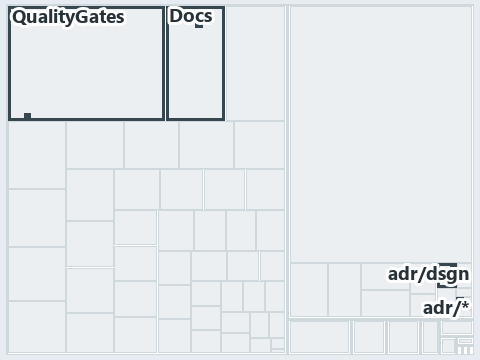

# docs/.assets/explanation/adr-dsgn-thinplat--deploy-bicep-delegates-to-az--implementation.tree.md

`Tree minimap: adr-dsgn-thinplat--deploy-bicep-delegates-to-az--implementation`

The tree minimap of the slide `adr-dsgn-thinplat--deploy-bicep-delegates-to-az--implementation` (implementation lens). The slide supports
[ADR-DSGN-THINPLAT][1]; the highlight of those ADR codes selects what is lit, and each reason below names the code that selects it.

## What the minimap shows

The tree draws every file of the world map as a tile, grouped by top-level folder (under `automation/` by module, under `docs/adr/` by ADR
domain), and lights 5 files in 4 groups, filled in ink. A lit ADR file has a white rim; a file lit only by passing mentions is a lighter
ink. Every other tile is idle, a grey box: a file the slide's ADR codes do not select.

- adr/dsgn (docs/adr/design): 2 lit files
- Docs (automation/Catzc.Base.Docs): 1 lit file
- QualityGates (automation/Catzc.Base.QualityGates): 1 lit file
- adr/* (the files directly in docs/adr/): 1 lit file

## Why each group is lit

### adr/dsgn (docs/adr/design, 2 lit files)

The group holds the files of docs/adr/design; each sits in its world-map cell and is lit by:

- [docs/adr/design/dora-explains.md][2], in the cell docs × markdown: selected by [ADR-DSGN-THINPLAT][1]: the file cites it at line 29
  (text).
- [docs/adr/design/thin-platforms.md][1], in the cell docs × markdown: selected by [ADR-DSGN-THINPLAT][1]: the ADR's own file.

### Docs (automation/Catzc.Base.Docs, 1 lit file)

The group holds the files of automation/Catzc.Base.Docs; each sits in its world-map cell and is lit by:

- [automation/Catzc.Base.Docs/configs/adrs.yml][3], in the cell automation × yaml: selected by [ADR-DSGN-THINPLAT][1]: the file cites it at
  line 96 (text).

### QualityGates (automation/Catzc.Base.QualityGates, 1 lit file)

The group holds the files of automation/Catzc.Base.QualityGates; each sits in its world-map cell and is lit by:

- [automation/Catzc.Base.QualityGates/configs/terminology.yml][4], in the cell automation × yaml: selected by [ADR-DSGN-THINPLAT][1]: the
  file cites it at line 670 (text).

### adr/* (the files directly in docs/adr/, 1 lit file)

The group holds the files of the files directly in docs/adr/; each sits in its world-map cell and is lit by:

- [docs/adr/index.md][5], in the cell docs × markdown: selected by [ADR-DSGN-THINPLAT][1]: the file cites it at line 89 (text).

## Keywords

- [world map][6]
- [track][7]
- [file language][8]
- [cell][9]
- [lit cell][10]
- [automation][11]: a track
- [docs][11]: a track
- [markdown][12]: a file language
- [yaml][12]: a file language

[1]: ../../adr/design/thin-platforms.md
[2]: ../../adr/design/dora-explains.md
[3]: ../../../automation/Catzc.Base.Docs/configs/adrs.yml
[4]: ../../../automation/Catzc.Base.QualityGates/configs/terminology.yml
[5]: ../../adr/index.md
[6]: ../../adr/glossary.md#world-map
[7]: ../../adr/glossary.md#track
[8]: ../../adr/glossary.md#file-language
[9]: ../../adr/glossary.md#cell
[10]: ../../adr/glossary.md#lit-cell
[11]: ../../../automation/Catzc.Base.Variants/configs/variants.yml
[12]: ../../../automation/Catzc.Base.Languages/configs/languages.yml
