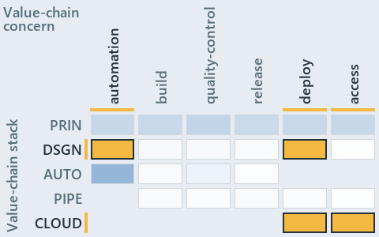

# docs/.assets/explanation/adr-dsgn-thinplat--every-vendor-call-leaves-through-az--architecture.chain.md

`Value-chain minimap: adr-dsgn-thinplat--every-vendor-call-leaves-through-az--architecture`

The value-chain minimap of the slide `adr-dsgn-thinplat--every-vendor-call-leaves-through-az--architecture` (architecture lens). The slide
supports [ADR-AZ-CLI][1] and [ADR-DSGN-THINPLAT][2]; the highlight of those ADR codes selects what is lit, and each reason below names the
code that selects it.

## What the minimap shows

Value-chain map: value-chain stack × value-chain concerns. The grid crosses the 5 rows of the value-chain stack (PRIN, DSGN, AUTO, PIPE,
CLOUD) with the 6 value-chain concerns (automation, build, quality-control, release, deploy, access), shades each cell by the ADRs it holds,
and lights 4 cells.

- DSGN × automation: 1 lit of 7 ADRs
- DSGN × deploy: 1 lit of 6 ADRs
- CLOUD × deploy: 1 lit of 6 ADRs
- CLOUD × access: 1 lit of 3 ADRs

## Why each cell is lit

### DSGN × automation (1 ADR)

Lit ([ADR-DSGN-TRACK#12][3]) by:

- [ADR-DSGN-THINPLAT][2]: selected by [ADR-DSGN-THINPLAT][2]; its ADR domain `design` sits on the DSGN row of the value-chain stack
  ([ADR-DSGN-TRACK#14][4]); its own value-chain concerns (automation and deploy) override its ADR domain's default (automation), so it
  lights the automation column ([ADR-DSGN-TRACK#15][5]).

### DSGN × deploy (1 ADR)

Lit ([ADR-DSGN-TRACK#12][3]) by:

- [ADR-DSGN-THINPLAT][2]: selected by [ADR-DSGN-THINPLAT][2]; its ADR domain `design` sits on the DSGN row of the value-chain stack
  ([ADR-DSGN-TRACK#14][4]); its own value-chain concerns (automation and deploy) override its ADR domain's default (automation), so it
  lights the deploy column ([ADR-DSGN-TRACK#15][5]).

### CLOUD × deploy (1 ADR)

Lit ([ADR-DSGN-TRACK#12][3]) by:

- [ADR-AZ-CLI][1]: selected by [ADR-AZ-CLI][1]; its ADR domain `azure` sits on the CLOUD row of the value-chain stack
  ([ADR-DSGN-TRACK#14][4]); its own value-chain concerns (deploy and access) override its ADR domain's default (deploy), so it lights the
  deploy column ([ADR-DSGN-TRACK#15][5]).

### CLOUD × access (1 ADR)

Lit ([ADR-DSGN-TRACK#12][3]) by:

- [ADR-AZ-CLI][1]: selected by [ADR-AZ-CLI][1]; its ADR domain `azure` sits on the CLOUD row of the value-chain stack
  ([ADR-DSGN-TRACK#14][4]); its own value-chain concerns (deploy and access) override its ADR domain's default (deploy), so it lights the
  access column ([ADR-DSGN-TRACK#15][5]).

## Keywords

- [value-chain map][6]
- [value-chain stack][7]
- [value-chain concern][8]
- [cell][9]
- [lit cell][10]

[1]: ../../adr/azure/prefer-az-cli.md
[2]: ../../adr/design/thin-platforms.md
[3]: ../../adr/design/tracks.md#rule-adr-dsgn-track12
[4]: ../../adr/design/tracks.md#rule-adr-dsgn-track14
[5]: ../../adr/design/tracks.md#rule-adr-dsgn-track15
[6]: ../../adr/glossary.md#value-chain-map
[7]: ../../adr/glossary.md#value-chain-stack
[8]: ../../adr/glossary.md#value-chain-concern
[9]: ../../adr/glossary.md#cell
[10]: ../../adr/glossary.md#lit-cell
