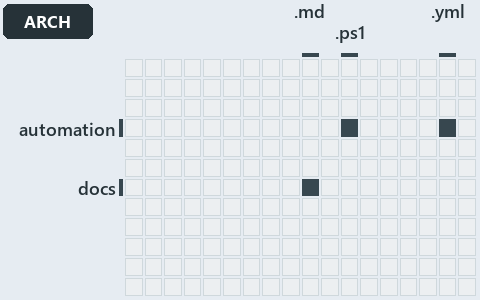

# docs/.assets/explanation/adr-dsgn-thinplat--every-vendor-call-leaves-through-az--architecture.grid.md

`Grid minimap: adr-dsgn-thinplat--every-vendor-call-leaves-through-az--architecture`

The grid minimap of the slide `adr-dsgn-thinplat--every-vendor-call-leaves-through-az--architecture` (architecture lens). The slide supports
[ADR-AZ-CLI][1] and [ADR-DSGN-THINPLAT][2]; the highlight of those ADR codes selects what is lit, and each reason below names the code that
selects it.

## What the minimap shows

The grid crosses the 12 tracks (rows) with the 18 file languages (columns) of the world map and lights 3 cells, filled in ink. A cell lit
only by passing mentions (citations in body comments, not in a file's header or text) is touched: a lighter ink. Every other cell is idle, a
grey box: it holds files the slide's ADR codes do not select, or no file at all (174 of the 216 cells hold none). The minimap shows where
the slide sits, not how many files a cell holds; the world-map PDFs show the counts.

- automation × powershell: 8 lit of 1400 files
- automation × yaml: 3 lit of 95 files
- docs × markdown: 60 lit of 741 files

## Key

A lit row prints its track's name; a lit column prints a short code, the first extension of its file language:

- `.md`: markdown
- `.ps1`: powershell
- `.yml`: yaml

## Why each cell is lit

### automation × powershell (8 lit files)

Placed: the root folder `automation/` names the track automation ([ADR-DSGN-TRACK#1][3]); the extension `.ps1` names the file language
powershell ([ADR-DSGN-TRACK#6][4]). Lit ([ADR-DSGN-TRACK#12][5]) by:

- [automation/Catzc.Azure.Cli/Assert-AzCliBicep.ps1][6]: selected by [ADR-AZ-CLI][1]: the file cites it at line 11 (header).
- [automation/Catzc.Azure.Cli/Assert-AzCliCanAccess.ps1][7]: selected by [ADR-AZ-CLI][1]: the file cites it at line 15 (header).
- [automation/Catzc.Azure.Cli/Assert-AzCliSubscriptionAccessible.ps1][8]: selected by [ADR-AZ-CLI][1]: the file cites it at line 14
  (header).
- [automation/Catzc.Azure.Cli/Get-AzCliSubscriptionAccessState.ps1][9]: selected by [ADR-AZ-CLI][1]: the file cites it at line 21 (header).
- [automation/Catzc.Azure.Cli/Install-AzCliBicep.ps1][10]: selected by [ADR-AZ-CLI][1]: the file cites it at line 11 (header).
- [automation/Catzc.Azure.Cli/Test-AzCliBicep.ps1][11]: selected by [ADR-AZ-CLI][1]: the file cites it at line 14 (header).
- [automation/Catzc.Azure.Cli/Test-AzCliCanAccess.ps1][12]: selected by [ADR-AZ-CLI][1]: the file cites it at line 14 (header).
- [automation/Catzc.Azure.Cli/Test-AzCliSubscriptionAccessible.ps1][13]: selected by [ADR-AZ-CLI][1]: the file cites it at line 13 (header).

### automation × yaml (3 lit files)

Placed: the root folder `automation/` names the track automation ([ADR-DSGN-TRACK#1][3]); the extension `.yml` names the file language yaml
([ADR-DSGN-TRACK#6][4]). Lit ([ADR-DSGN-TRACK#12][5]) by:

- [automation/Catzc.Base.Docs/configs/adrs.yml][14]: selected by [ADR-AZ-CLI][1]: the file cites it at line 270 (text); selected by
  [ADR-DSGN-THINPLAT][2]: the file cites it at line 96 (text).
- [automation/Catzc.Base.QualityGates/configs/analyzer-adr-map.yml][15]: selected by [ADR-AZ-CLI][1]: the file cites it at line 19 (text).
- [automation/Catzc.Base.QualityGates/configs/terminology.yml][16]: selected by [ADR-AZ-CLI][1]: the file cites it at line 580 (text);
  selected by [ADR-DSGN-THINPLAT][2]: the file cites it at line 664 (text).

### docs × markdown (60 lit files)

Placed: the root folder `docs/` names the track docs ([ADR-DSGN-TRACK#1][3]); the extension `.md` names the file language markdown
([ADR-DSGN-TRACK#6][4]). Lit ([ADR-DSGN-TRACK#12][5]) by:

- [docs/.assets/explanation/adr-dsgn-thinplat--bind-to-one-cli-delegate-the-rest--meta.chain.md][17]: selected by [ADR-DSGN-THINPLAT][2]:
  the file cites it at line 8 (text), line 25 (text), line 25 (text), line 33 (text) and line 33 (text).
- [docs/.assets/explanation/adr-dsgn-thinplat--bind-to-one-cli-delegate-the-rest--meta.drawio.md][18]: selected by [ADR-DSGN-THINPLAT][2]:
  the file cites it at line 66 (text).
- [docs/.assets/explanation/adr-dsgn-thinplat--bind-to-one-cli-delegate-the-rest--meta.grid.md][19]: selected by [ADR-DSGN-THINPLAT][2]: the
  file cites it at line 8 (text), line 25 (text), line 26 (text), line 33 (text), line 36 (text), line 38 (text), line 40 (text), line 41
  (text), line 43 (text), line 45 (text), line 47 (text), line 49 (text), line 51 (text), line 53 (text), line 55 (text), line 57 (text),
  line 58 (text), line 60 (text), line 61 (text), line 63 (text), line 65 (text), line 67 (text) and line 69 (text).
- [docs/.assets/explanation/adr-dsgn-thinplat--bind-to-one-cli-delegate-the-rest--meta.tree.md][20]: selected by [ADR-DSGN-THINPLAT][2]: the
  file cites it at line 8 (text), line 28 (text), line 30 (text), line 32 (text), line 34 (text), line 36 (text), line 37 (text), line 39
  (text), line 41 (text), line 43 (text), line 45 (text), line 52 (text), line 54 (text), line 56 (text), line 58 (text), line 60 (text),
  line 62 (text), line 64 (text), line 66 (text), line 68 (text), line 75 (text), line 82 (text) and line 89 (text).
- [docs/.assets/explanation/adr-dsgn-thinplat--deploy-bicep-delegates-to-az--implementation.chain.md][21]: selected by
  [ADR-DSGN-THINPLAT][2]: the file cites it at line 8 (text), line 25 (text), line 25 (text), line 33 (text) and line 33 (text).
- [docs/.assets/explanation/adr-dsgn-thinplat--deploy-bicep-delegates-to-az--implementation.drawio.md][22]: selected by
  [ADR-DSGN-THINPLAT][2]: the file cites it at line 69 (text).
- [docs/.assets/explanation/adr-dsgn-thinplat--deploy-bicep-delegates-to-az--implementation.grid.md][23]: selected by
  [ADR-DSGN-THINPLAT][2]: the file cites it at line 8 (text), line 25 (text), line 26 (text), line 33 (text), line 36 (text), line 38
  (text), line 40 (text), line 41 (text), line 43 (text), line 45 (text), line 47 (text), line 49 (text), line 51 (text), line 53 (text),
  line 55 (text), line 57 (text), line 58 (text), line 60 (text), line 61 (text), line 63 (text), line 65 (text), line 67 (text) and line 69
  (text).
- [docs/.assets/explanation/adr-dsgn-thinplat--deploy-bicep-delegates-to-az--implementation.tree.md][24]: selected by
  [ADR-DSGN-THINPLAT][2]: the file cites it at line 8 (text), line 28 (text), line 30 (text), line 32 (text), line 34 (text), line 36
  (text), line 37 (text), line 39 (text), line 41 (text), line 43 (text), line 45 (text), line 52 (text), line 54 (text), line 56 (text),
  line 58 (text), line 60 (text), line 62 (text), line 64 (text), line 66 (text), line 68 (text), line 75 (text), line 82 (text) and line 89
  (text).
- [docs/.assets/explanation/adr-dsgn-thinplat--every-vendor-call-leaves-through-az--architecture.chain.md][25]: selected by [ADR-AZ-CLI][1]:
  the file cites it at line 8 (text), line 44 (text), line 44 (text), line 52 (text) and line 52 (text); selected by [ADR-DSGN-THINPLAT][2]:
  the file cites it at line 8 (text), line 28 (text), line 28 (text), line 36 (text) and line 36 (text).
- [docs/.assets/explanation/adr-dsgn-thinplat--every-vendor-call-leaves-through-az--architecture.drawio.md][26]: selected by
  [ADR-AZ-CLI][1]: the file cites it at line 68 (text); selected by [ADR-DSGN-THINPLAT][2]: the file cites it at line 68 (text).
- [docs/.assets/explanation/adr-dsgn-thinplat--every-vendor-call-leaves-through-az--architecture.grid.md][27]: selected by [ADR-AZ-CLI][1]:
  the file cites it at line 8 (text), line 27 (text), line 28 (text), line 29 (text), line 31 (text), line 32 (text), line 33 (text), line
  34 (text), line 35 (text), line 42 (text), line 44 (text), line 45 (text), line 58 (text), line 61 (text), line 63 (text), line 65 (text),
  line 67 (text), line 68 (text), line 70 (text), line 72 (text), line 74 (text), line 75 (text), line 76 (text), line 78 (text), line 80
  (text), line 81 (text), line 82 (text), line 83 (text), line 84 (text), line 86 (text), line 88 (text), line 90 (text), line 91 (text),
  line 109 (text), line 113 (text), line 115 (text) and line 120 (text); selected by [ADR-DSGN-THINPLAT][2]: the file cites it at line 8
  (text), line 43 (text), line 46 (text), line 53 (text), line 56 (text), line 58 (text), line 60 (text), line 62 (text), line 92 (text),
  line 94 (text), line 96 (text), line 98 (text), line 100 (text), line 102 (text), line 104 (text), line 106 (text), line 107 (text), line
  109 (text), line 111 (text), line 114 (text), line 116 (text), line 118 (text) and line 122 (text).
- [docs/.assets/explanation/adr-dsgn-thinplat--every-vendor-call-leaves-through-az--architecture.tree.md][28]: selected by [ADR-AZ-CLI][1]:
  the file cites it at line 8 (text), line 30 (text), line 32 (text), line 34 (text), line 36 (text), line 38 (text), line 40 (text), line
  42 (text), line 44 (text), line 46 (text), line 48 (text), line 50 (text), line 52 (text), line 54 (text), line 56 (text), line 58 (text),
  line 60 (text), line 62 (text), line 64 (text), line 66 (text), line 78 (text), line 83 (text), line 86 (text), line 89 (text), line 94
  (text), line 126 (text), line 128 (text), line 130 (text), line 132 (text), line 134 (text), line 136 (text), line 138 (text), line 140
  (text), line 147 (text), line 149 (text), line 156 (text) and line 163 (text); selected by [ADR-DSGN-THINPLAT][2]: the file cites it at
  line 8 (text), line 74 (text), line 76 (text), line 78 (text), line 81 (text), line 83 (text), line 84 (text), line 87 (text), line 90
  (text), line 92 (text), line 96 (text), line 103 (text), line 105 (text), line 107 (text), line 109 (text), line 111 (text), line 113
  (text), line 115 (text), line 117 (text), line 119 (text), line 150 (text), line 157 (text) and line 164 (text).
- [docs/.assets/explanation/adr-dsgn-thinplat--same-deploy-bicep-on-both-sides--operations.chain.md][29]: selected by
  [ADR-DSGN-THINPLAT][2]: the file cites it at line 8 (text), line 25 (text), line 25 (text), line 33 (text) and line 33 (text).
- [docs/.assets/explanation/adr-dsgn-thinplat--same-deploy-bicep-on-both-sides--operations.drawio.md][30]: selected by
  [ADR-DSGN-THINPLAT][2]: the file cites it at line 70 (text).
- [docs/.assets/explanation/adr-dsgn-thinplat--same-deploy-bicep-on-both-sides--operations.grid.md][31]: selected by [ADR-DSGN-THINPLAT][2]:
  the file cites it at line 8 (text), line 25 (text), line 26 (text), line 33 (text), line 36 (text), line 38 (text), line 40 (text), line
  41 (text), line 43 (text), line 45 (text), line 47 (text), line 49 (text), line 51 (text), line 53 (text), line 55 (text), line 57 (text),
  line 58 (text), line 60 (text), line 61 (text), line 63 (text), line 65 (text), line 67 (text) and line 69 (text).
- [docs/.assets/explanation/adr-dsgn-thinplat--same-deploy-bicep-on-both-sides--operations.tree.md][32]: selected by [ADR-DSGN-THINPLAT][2]:
  the file cites it at line 8 (text), line 28 (text), line 30 (text), line 32 (text), line 34 (text), line 36 (text), line 37 (text), line
  39 (text), line 41 (text), line 43 (text), line 45 (text), line 52 (text), line 54 (text), line 56 (text), line 58 (text), line 60 (text),
  line 62 (text), line 64 (text), line 66 (text), line 68 (text), line 75 (text), line 82 (text) and line 89 (text).
- [docs/.assets/explanation/adr-dsgn-thinplat--what-keeps-the-platform-thin--governance.chain.md][33]: selected by [ADR-AZ-CLI][1]: the file
  cites it at line 8 (text), line 53 (text), line 53 (text), line 61 (text) and line 61 (text); selected by [ADR-DSGN-THINPLAT][2]: the file
  cites it at line 8 (text), line 29 (text), line 29 (text), line 37 (text) and line 37 (text).
- [docs/.assets/explanation/adr-dsgn-thinplat--what-keeps-the-platform-thin--governance.drawio.md][34]: selected by [ADR-AZ-CLI][1]: the
  file cites it at line 74 (text); selected by [ADR-DSGN-THINPLAT][2]: the file cites it at line 74 (text).
- [docs/.assets/explanation/adr-dsgn-thinplat--what-keeps-the-platform-thin--governance.grid.md][35]: selected by [ADR-AZ-CLI][1]: the file
  cites it at line 8 (text), line 28 (text), line 29 (text), line 30 (text), line 32 (text), line 33 (text), line 34 (text), line 35 (text),
  line 36 (text), line 45 (text), line 46 (text), line 47 (text), line 60 (text), line 63 (text), line 143 (text), line 145 (text), line 147
  (text), line 148 (text), line 150 (text), line 152 (text), line 154 (text), line 155 (text), line 156 (text), line 158 (text), line 160
  (text), line 161 (text), line 162 (text), line 163 (text), line 164 (text), line 166 (text), line 168 (text), line 170 (text), line 171
  (text), line 189 (text), line 193 (text), line 197 (text) and line 202 (text); selected by [ADR-DSGN-THINPLAT][2]: the file cites it at
  line 8 (text), line 45 (text), line 48 (text), line 55 (text), line 58 (text), line 60 (text), line 62 (text), line 64 (text), line 172
  (text), line 174 (text), line 176 (text), line 178 (text), line 180 (text), line 182 (text), line 184 (text), line 186 (text), line 187
  (text), line 190 (text), line 191 (text), line 194 (text), line 198 (text), line 201 (text) and line 204 (text).
- [docs/.assets/explanation/adr-dsgn-thinplat--what-keeps-the-platform-thin--governance.tree.md][36]: selected by [ADR-AZ-CLI][1]: the file
  cites it at line 8 (text), line 116 (text), line 118 (text), line 120 (text), line 122 (text), line 124 (text), line 126 (text), line 128
  (text), line 130 (text), line 132 (text), line 134 (text), line 136 (text), line 138 (text), line 140 (text), line 142 (text), line 144
  (text), line 146 (text), line 148 (text), line 150 (text), line 152 (text), line 164 (text), line 169 (text), line 172 (text), line 177
  (text), line 182 (text), line 214 (text), line 216 (text), line 218 (text), line 220 (text), line 222 (text), line 224 (text), line 226
  (text), line 228 (text), line 244 (text), line 246 (text), line 254 (text) and line 269 (text); selected by [ADR-DSGN-THINPLAT][2]: the
  file cites it at line 8 (text), line 160 (text), line 162 (text), line 164 (text), line 167 (text), line 169 (text), line 170 (text), line
  173 (text), line 178 (text), line 181 (text), line 184 (text), line 191 (text), line 193 (text), line 195 (text), line 197 (text), line
  199 (text), line 201 (text), line 203 (text), line 205 (text), line 207 (text), line 247 (text), line 254 (text) and line 269 (text).
- [docs/adr/azure/az-session-verification.md][37]: selected by [ADR-AZ-CLI][1]: an ADR file of the `azure` ADR domain, the ADR domain of
  that code.
- [docs/adr/azure/azure-customer-model.md][38]: selected by [ADR-AZ-CLI][1]: an ADR file of the `azure` ADR domain, the ADR domain of that
  code.
- [docs/adr/azure/azure-data-model.md][39]: selected by [ADR-AZ-CLI][1]: an ADR file of the `azure` ADR domain, the ADR domain of that code.
- [docs/adr/azure/azure-naming-standard.md][40]: selected by [ADR-AZ-CLI][1]: an ADR file of the `azure` ADR domain, the ADR domain of that
  code.
- [docs/adr/azure/azure-network-model.md][41]: selected by [ADR-AZ-CLI][1]: an ADR file of the `azure` ADR domain, the ADR domain of that
  code.
- [docs/adr/azure/caf/billing-and-tenant.md][42]: selected by [ADR-AZ-CLI][1]: an ADR file of the `azure` ADR domain, the ADR domain of that
  code.
- [docs/adr/azure/caf/design-principles.md][43]: selected by [ADR-AZ-CLI][1]: an ADR file of the `azure` ADR domain, the ADR domain of that
  code.
- [docs/adr/azure/caf/governance.md][44]: selected by [ADR-AZ-CLI][1]: an ADR file of the `azure` ADR domain, the ADR domain of that code.
- [docs/adr/azure/caf/identity-and-access.md][45]: selected by [ADR-AZ-CLI][1]: an ADR file of the `azure` ADR domain, the ADR domain of
  that code.
- [docs/adr/azure/caf/landing-zone-security.md][46]: selected by [ADR-AZ-CLI][1]: an ADR file of the `azure` ADR domain, the ADR domain of
  that code.
- [docs/adr/azure/caf/management.md][47]: selected by [ADR-AZ-CLI][1]: an ADR file of the `azure` ADR domain, the ADR domain of that code.
- [docs/adr/azure/caf/naming-and-tagging.md][48]: selected by [ADR-AZ-CLI][1]: an ADR file of the `azure` ADR domain, the ADR domain of that
  code.
- [docs/adr/azure/caf/network-connectivity.md][49]: selected by [ADR-AZ-CLI][1]: an ADR file of the `azure` ADR domain, the ADR domain of
  that code.
- [docs/adr/azure/caf/network-private-access.md][50]: selected by [ADR-AZ-CLI][1]: an ADR file of the `azure` ADR domain, the ADR domain of
  that code.
- [docs/adr/azure/caf/network-topology.md][51]: selected by [ADR-AZ-CLI][1]: an ADR file of the `azure` ADR domain, the ADR domain of that
  code.
- [docs/adr/azure/caf/platform-automation-and-devops.md][52]: selected by [ADR-AZ-CLI][1]: an ADR file of the `azure` ADR domain, the ADR
  domain of that code.
- [docs/adr/azure/caf/resource-organization.md][53]: selected by [ADR-AZ-CLI][1]: an ADR file of the `azure` ADR domain, the ADR domain of
  that code.
- [docs/adr/azure/dora-explains.md][54]: selected by [ADR-AZ-CLI][1]: an ADR file of the `azure` ADR domain, the ADR domain of that code.
- [docs/adr/azure/landing-zones.md][55]: selected by [ADR-AZ-CLI][1]: an ADR file of the `azure` ADR domain, the ADR domain of that code.
- [docs/adr/azure/prefer-az-cli.md][1]: selected by [ADR-AZ-CLI][1]: an ADR file of the `azure` ADR domain, the ADR domain of that code.
- [docs/adr/azure/waf/cost-optimization.md][56]: selected by [ADR-AZ-CLI][1]: an ADR file of the `azure` ADR domain, the ADR domain of that
  code.
- [docs/adr/azure/waf/operational-excellence.md][57]: selected by [ADR-AZ-CLI][1]: an ADR file of the `azure` ADR domain, the ADR domain of
  that code.
- [docs/adr/azure/waf/performance-efficiency.md][58]: selected by [ADR-AZ-CLI][1]: an ADR file of the `azure` ADR domain, the ADR domain of
  that code.
- [docs/adr/azure/waf/reliability.md][59]: selected by [ADR-AZ-CLI][1]: an ADR file of the `azure` ADR domain, the ADR domain of that code.
- [docs/adr/azure/waf/security.md][60]: selected by [ADR-AZ-CLI][1]: an ADR file of the `azure` ADR domain, the ADR domain of that code.
- [docs/adr/design/commit-lifecycle.md][61]: selected by [ADR-DSGN-THINPLAT][2]: an ADR file of the `design` ADR domain, the ADR domain of
  that code.
- [docs/adr/design/dora-explains.md][62]: selected by [ADR-DSGN-THINPLAT][2]: an ADR file of the `design` ADR domain, the ADR domain of that
  code.
- [docs/adr/design/module-aspects.md][63]: selected by [ADR-DSGN-THINPLAT][2]: an ADR file of the `design` ADR domain, the ADR domain of
  that code.
- [docs/adr/design/run-modes.md][64]: selected by [ADR-DSGN-THINPLAT][2]: an ADR file of the `design` ADR domain, the ADR domain of that
  code.
- [docs/adr/design/self-service.md][65]: selected by [ADR-DSGN-THINPLAT][2]: an ADR file of the `design` ADR domain, the ADR domain of that
  code.
- [docs/adr/design/server-remote-integration.md][66]: selected by [ADR-DSGN-THINPLAT][2]: an ADR file of the `design` ADR domain, the ADR
  domain of that code.
- [docs/adr/design/thin-platforms.md][2]: selected by [ADR-DSGN-THINPLAT][2]: an ADR file of the `design` ADR domain, the ADR domain of that
  code.
- [docs/adr/design/tracks.md][67]: selected by [ADR-DSGN-THINPLAT][2]: an ADR file of the `design` ADR domain, the ADR domain of that code.
- [docs/adr/design/visual-design.md][68]: selected by [ADR-DSGN-THINPLAT][2]: an ADR file of the `design` ADR domain, the ADR domain of that
  code.
- [docs/adr/index.md][69]: selected by [ADR-AZ-CLI][1]: the file cites it at line 252 (text); selected by [ADR-DSGN-THINPLAT][2]: the file
  cites it at line 89 (text).
- [docs/explanation/design/bind-to-one-cli-delegate-the-rest.md][70]: selected by [ADR-DSGN-THINPLAT][2]: the file cites it at line 13
  (text), line 37 (text), line 38 (text), line 40 (text) and line 42 (text).
- [docs/explanation/design/deploy-bicep-delegates-to-az.md][71]: selected by [ADR-AZ-CLI][1]: the file cites it at line 63 (text); selected
  by [ADR-DSGN-THINPLAT][2]: the file cites it at line 19 (text), line 58 (text), line 59 (text) and line 65 (text).
- [docs/explanation/design/every-vendor-call-leaves-through-az.md][72]: selected by [ADR-AZ-CLI][1]: the file cites it at line 17 (text),
  line 52 (text), line 53 (text), line 53 (text) and line 57 (text); selected by [ADR-DSGN-THINPLAT][2]: the file cites it at line 17
  (text), line 48 (text), line 49 (text) and line 51 (text).
- [docs/explanation/design/same-deploy-bicep-on-both-sides.md][73]: selected by [ADR-DSGN-THINPLAT][2]: the file cites it at line 16 (text),
  line 52 (text) and line 53 (text).
- [docs/explanation/design/what-keeps-the-platform-thin.md][74]: selected by [ADR-AZ-CLI][1]: the file cites it at line 17 (text), line 34
  (text), line 60 (text), line 60 (text), line 61 (text), line 65 (text), line 67 (text) and line 71 (text); selected by
  [ADR-DSGN-THINPLAT][2]: the file cites it at line 17 (text), line 55 (text), line 56 (text), line 57 (text), line 58 (text) and line 59
  (text).

## Keywords

- [world map][75]
- [track][76]
- [file language][77]
- [cell][78]
- [lit cell][79]
- [automation][80]: a track
- [docs][80]: a track
- [markdown][81]: a file language
- [powershell][81]: a file language
- [yaml][81]: a file language

[1]: ../../adr/azure/prefer-az-cli.md
[2]: ../../adr/design/thin-platforms.md
[3]: ../../adr/design/tracks.md#rule-adr-dsgn-track1
[4]: ../../adr/design/tracks.md#rule-adr-dsgn-track6
[5]: ../../adr/design/tracks.md#rule-adr-dsgn-track12
[6]: ../../../automation/Catzc.Azure.Cli/Assert-AzCliBicep.ps1
[7]: ../../../automation/Catzc.Azure.Cli/Assert-AzCliCanAccess.ps1
[8]: ../../../automation/Catzc.Azure.Cli/Assert-AzCliSubscriptionAccessible.ps1
[9]: ../../../automation/Catzc.Azure.Cli/Get-AzCliSubscriptionAccessState.ps1
[10]: ../../../automation/Catzc.Azure.Cli/Install-AzCliBicep.ps1
[11]: ../../../automation/Catzc.Azure.Cli/Test-AzCliBicep.ps1
[12]: ../../../automation/Catzc.Azure.Cli/Test-AzCliCanAccess.ps1
[13]: ../../../automation/Catzc.Azure.Cli/Test-AzCliSubscriptionAccessible.ps1
[14]: ../../../automation/Catzc.Base.Docs/configs/adrs.yml
[15]: ../../../automation/Catzc.Base.QualityGates/configs/analyzer-adr-map.yml
[16]: ../../../automation/Catzc.Base.QualityGates/configs/terminology.yml
[17]: adr-dsgn-thinplat--bind-to-one-cli-delegate-the-rest--meta.chain.md
[18]: adr-dsgn-thinplat--bind-to-one-cli-delegate-the-rest--meta.drawio.md
[19]: adr-dsgn-thinplat--bind-to-one-cli-delegate-the-rest--meta.grid.md
[20]: adr-dsgn-thinplat--bind-to-one-cli-delegate-the-rest--meta.tree.md
[21]: adr-dsgn-thinplat--deploy-bicep-delegates-to-az--implementation.chain.md
[22]: adr-dsgn-thinplat--deploy-bicep-delegates-to-az--implementation.drawio.md
[23]: adr-dsgn-thinplat--deploy-bicep-delegates-to-az--implementation.grid.md
[24]: adr-dsgn-thinplat--deploy-bicep-delegates-to-az--implementation.tree.md
[25]: adr-dsgn-thinplat--every-vendor-call-leaves-through-az--architecture.chain.md
[26]: adr-dsgn-thinplat--every-vendor-call-leaves-through-az--architecture.drawio.md
[27]: adr-dsgn-thinplat--every-vendor-call-leaves-through-az--architecture.grid.md
[28]: adr-dsgn-thinplat--every-vendor-call-leaves-through-az--architecture.tree.md
[29]: adr-dsgn-thinplat--same-deploy-bicep-on-both-sides--operations.chain.md
[30]: adr-dsgn-thinplat--same-deploy-bicep-on-both-sides--operations.drawio.md
[31]: adr-dsgn-thinplat--same-deploy-bicep-on-both-sides--operations.grid.md
[32]: adr-dsgn-thinplat--same-deploy-bicep-on-both-sides--operations.tree.md
[33]: adr-dsgn-thinplat--what-keeps-the-platform-thin--governance.chain.md
[34]: adr-dsgn-thinplat--what-keeps-the-platform-thin--governance.drawio.md
[35]: adr-dsgn-thinplat--what-keeps-the-platform-thin--governance.grid.md
[36]: adr-dsgn-thinplat--what-keeps-the-platform-thin--governance.tree.md
[37]: ../../adr/azure/az-session-verification.md
[38]: ../../adr/azure/azure-customer-model.md
[39]: ../../adr/azure/azure-data-model.md
[40]: ../../adr/azure/azure-naming-standard.md
[41]: ../../adr/azure/azure-network-model.md
[42]: ../../adr/azure/caf/billing-and-tenant.md
[43]: ../../adr/azure/caf/design-principles.md
[44]: ../../adr/azure/caf/governance.md
[45]: ../../adr/azure/caf/identity-and-access.md
[46]: ../../adr/azure/caf/landing-zone-security.md
[47]: ../../adr/azure/caf/management.md
[48]: ../../adr/azure/caf/naming-and-tagging.md
[49]: ../../adr/azure/caf/network-connectivity.md
[50]: ../../adr/azure/caf/network-private-access.md
[51]: ../../adr/azure/caf/network-topology.md
[52]: ../../adr/azure/caf/platform-automation-and-devops.md
[53]: ../../adr/azure/caf/resource-organization.md
[54]: ../../adr/azure/dora-explains.md
[55]: ../../adr/azure/landing-zones.md
[56]: ../../adr/azure/waf/cost-optimization.md
[57]: ../../adr/azure/waf/operational-excellence.md
[58]: ../../adr/azure/waf/performance-efficiency.md
[59]: ../../adr/azure/waf/reliability.md
[60]: ../../adr/azure/waf/security.md
[61]: ../../adr/design/commit-lifecycle.md
[62]: ../../adr/design/dora-explains.md
[63]: ../../adr/design/module-aspects.md
[64]: ../../adr/design/run-modes.md
[65]: ../../adr/design/self-service.md
[66]: ../../adr/design/server-remote-integration.md
[67]: ../../adr/design/tracks.md
[68]: ../../adr/design/visual-design.md
[69]: ../../adr/index.md
[70]: ../../explanation/design/bind-to-one-cli-delegate-the-rest.md
[71]: ../../explanation/design/deploy-bicep-delegates-to-az.md
[72]: ../../explanation/design/every-vendor-call-leaves-through-az.md
[73]: ../../explanation/design/same-deploy-bicep-on-both-sides.md
[74]: ../../explanation/design/what-keeps-the-platform-thin.md
[75]: ../../adr/glossary.md#world-map
[76]: ../../adr/glossary.md#track
[77]: ../../adr/glossary.md#file-language
[78]: ../../adr/glossary.md#cell
[79]: ../../adr/glossary.md#lit-cell
[80]: ../../../automation/Catzc.Base.Variants/configs/variants.yml
[81]: ../../../automation/Catzc.Base.Languages/configs/languages.yml
