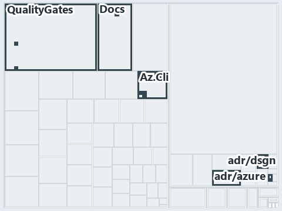

# docs/.assets/explanation/adr-dsgn-thinplat--every-vendor-call-leaves-through-az--architecture.tree.md

`Tree minimap: adr-dsgn-thinplat--every-vendor-call-leaves-through-az--architecture`

The tree minimap of the slide `adr-dsgn-thinplat--every-vendor-call-leaves-through-az--architecture` (architecture lens). The slide supports
[ADR-AZ-CLI][1] and [ADR-DSGN-THINPLAT][2]; the highlight of those ADR codes selects what is lit, and each reason below names the code that
selects it.

## What the minimap shows

The tree draws every file of the world map as a tile, grouped by top-level folder (under `automation/` by module, under `docs/adr/` by ADR
domain), and lights 16 files in 6 groups, filled in ink. A lit ADR file has a white rim; a file lit only by passing mentions is a lighter
ink. Every other tile is idle, a grey box: a file the slide's ADR codes do not select.

- Az.Cli (automation/Catzc.Azure.Cli): 8 lit files
- QualityGates (automation/Catzc.Base.QualityGates): 2 lit files
- adr/azure (docs/adr/azure): 2 lit files
- adr/dsgn (docs/adr/design): 2 lit files
- Docs (automation/Catzc.Base.Docs): 1 lit file
- adr/* (the files directly in docs/adr/): 1 lit file

## Why each group is lit

### Az.Cli (automation/Catzc.Azure.Cli, 8 lit files)

The group holds the files of automation/Catzc.Azure.Cli; each sits in its world-map cell and is lit by:

- [automation/Catzc.Azure.Cli/Assert-AzCliBicep.ps1][3], in the cell automation × powershell: selected by [ADR-AZ-CLI][1]: the file cites it
  at line 11 (header).
- [automation/Catzc.Azure.Cli/Assert-AzCliCanAccess.ps1][4], in the cell automation × powershell: selected by [ADR-AZ-CLI][1]: the file
  cites it at line 15 (header).
- [automation/Catzc.Azure.Cli/Assert-AzCliSubscriptionAccessible.ps1][5], in the cell automation × powershell: selected by [ADR-AZ-CLI][1]:
  the file cites it at line 14 (header).
- [automation/Catzc.Azure.Cli/Get-AzCliSubscriptionAccessState.ps1][6], in the cell automation × powershell: selected by [ADR-AZ-CLI][1]:
  the file cites it at line 21 (header).
- [automation/Catzc.Azure.Cli/Install-AzCliBicep.ps1][7], in the cell automation × powershell: selected by [ADR-AZ-CLI][1]: the file cites
  it at line 11 (header).
- [automation/Catzc.Azure.Cli/Test-AzCliBicep.ps1][8], in the cell automation × powershell: selected by [ADR-AZ-CLI][1]: the file cites it
  at line 14 (header).
- [automation/Catzc.Azure.Cli/Test-AzCliCanAccess.ps1][9], in the cell automation × powershell: selected by [ADR-AZ-CLI][1]: the file cites
  it at line 14 (header).
- [automation/Catzc.Azure.Cli/Test-AzCliSubscriptionAccessible.ps1][10], in the cell automation × powershell: selected by [ADR-AZ-CLI][1]:
  the file cites it at line 13 (header).

### QualityGates (automation/Catzc.Base.QualityGates, 2 lit files)

The group holds the files of automation/Catzc.Base.QualityGates; each sits in its world-map cell and is lit by:

- [automation/Catzc.Base.QualityGates/configs/analyzer-adr-map.yml][11], in the cell automation × yaml: selected by [ADR-AZ-CLI][1]: the
  file cites it at line 19 (text).
- [automation/Catzc.Base.QualityGates/configs/terminology.yml][12], in the cell automation × yaml: selected by [ADR-AZ-CLI][1]: the file
  cites it at line 586 (text); selected by [ADR-DSGN-THINPLAT][2]: the file cites it at line 670 (text).

### adr/azure (docs/adr/azure, 2 lit files)

The group holds the files of docs/adr/azure; each sits in its world-map cell and is lit by:

- [docs/adr/azure/dora-explains.md][13], in the cell docs × markdown: selected by [ADR-AZ-CLI][1]: the file cites it at line 342 (text).
- [docs/adr/azure/prefer-az-cli.md][1], in the cell docs × markdown: selected by [ADR-AZ-CLI][1]: the ADR's own file.

### adr/dsgn (docs/adr/design, 2 lit files)

The group holds the files of docs/adr/design; each sits in its world-map cell and is lit by:

- [docs/adr/design/dora-explains.md][14], in the cell docs × markdown: selected by [ADR-DSGN-THINPLAT][2]: the file cites it at line 29
  (text).
- [docs/adr/design/thin-platforms.md][2], in the cell docs × markdown: selected by [ADR-DSGN-THINPLAT][2]: the ADR's own file.

### Docs (automation/Catzc.Base.Docs, 1 lit file)

The group holds the files of automation/Catzc.Base.Docs; each sits in its world-map cell and is lit by:

- [automation/Catzc.Base.Docs/configs/adrs.yml][15], in the cell automation × yaml: selected by [ADR-AZ-CLI][1]: the file cites it at line
  270 (text); selected by [ADR-DSGN-THINPLAT][2]: the file cites it at line 96 (text).

### adr/* (the files directly in docs/adr/, 1 lit file)

The group holds the files of the files directly in docs/adr/; each sits in its world-map cell and is lit by:

- [docs/adr/index.md][16], in the cell docs × markdown: selected by [ADR-AZ-CLI][1]: the file cites it at line 252 (text); selected by
  [ADR-DSGN-THINPLAT][2]: the file cites it at line 89 (text).

## Keywords

- [world map][17]
- [track][18]
- [file language][19]
- [cell][20]
- [lit cell][21]
- [automation][22]: a track
- [docs][22]: a track
- [markdown][23]: a file language
- [powershell][23]: a file language
- [yaml][23]: a file language

[1]: ../../adr/azure/prefer-az-cli.md
[2]: ../../adr/design/thin-platforms.md
[3]: ../../../automation/Catzc.Azure.Cli/Assert-AzCliBicep.ps1
[4]: ../../../automation/Catzc.Azure.Cli/Assert-AzCliCanAccess.ps1
[5]: ../../../automation/Catzc.Azure.Cli/Assert-AzCliSubscriptionAccessible.ps1
[6]: ../../../automation/Catzc.Azure.Cli/Get-AzCliSubscriptionAccessState.ps1
[7]: ../../../automation/Catzc.Azure.Cli/Install-AzCliBicep.ps1
[8]: ../../../automation/Catzc.Azure.Cli/Test-AzCliBicep.ps1
[9]: ../../../automation/Catzc.Azure.Cli/Test-AzCliCanAccess.ps1
[10]: ../../../automation/Catzc.Azure.Cli/Test-AzCliSubscriptionAccessible.ps1
[11]: ../../../automation/Catzc.Base.QualityGates/configs/analyzer-adr-map.yml
[12]: ../../../automation/Catzc.Base.QualityGates/configs/terminology.yml
[13]: ../../adr/azure/dora-explains.md
[14]: ../../adr/design/dora-explains.md
[15]: ../../../automation/Catzc.Base.Docs/configs/adrs.yml
[16]: ../../adr/index.md
[17]: ../../adr/glossary.md#world-map
[18]: ../../adr/glossary.md#track
[19]: ../../adr/glossary.md#file-language
[20]: ../../adr/glossary.md#cell
[21]: ../../adr/glossary.md#lit-cell
[22]: ../../../automation/Catzc.Base.Variants/configs/variants.yml
[23]: ../../../automation/Catzc.Base.Languages/configs/languages.yml
