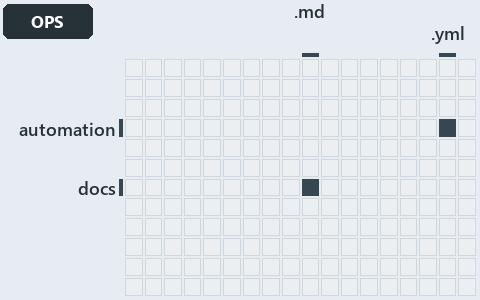

# docs/.assets/explanation/adr-dsgn-thinplat--same-deploy-bicep-on-both-sides--operations.grid.md

`Grid minimap: adr-dsgn-thinplat--same-deploy-bicep-on-both-sides--operations`

The grid minimap of the slide `adr-dsgn-thinplat--same-deploy-bicep-on-both-sides--operations` (operations lens). The slide supports
[ADR-DSGN-THINPLAT][1]; the highlight of those ADR codes selects what is lit, and each reason below names the code that selects it.

## What the minimap shows

The grid crosses the 12 tracks (rows) with the 18 file languages (columns) of the world map and lights 2 cells, filled in ink. A cell lit
only by passing mentions (citations in body comments, not in a file's header or text) is touched: a lighter ink. Every other cell is idle, a
grey box: it holds files the slide's ADR codes do not select, or no file at all (174 of the 216 cells hold none). The minimap shows where
the slide sits, not how many files a cell holds; the world-map PDFs show the counts.

- automation × yaml: 2 lit of 95 files
- docs × markdown: 15 lit of 742 files

## Key

A lit row prints its track's name; a lit column prints a short code, the first extension of its file language:

- `.md`: markdown
- `.yml`: yaml

## Why each cell is lit

### automation × yaml (2 lit files)

Placed: the root folder `automation/` names the track automation ([ADR-DSGN-TRACK#1][2]); the extension `.yml` names the file language yaml
([ADR-DSGN-TRACK#6][3]). Lit ([ADR-DSGN-TRACK#12][4]) by:

- [automation/Catzc.Base.Docs/configs/adrs.yml][5]: selected by [ADR-DSGN-THINPLAT][1]: the file cites it at line 96 (text).
- [automation/Catzc.Base.QualityGates/configs/terminology.yml][6]: selected by [ADR-DSGN-THINPLAT][1]: the file cites it at line 670 (text).

### docs × markdown (15 lit files)

Placed: the root folder `docs/` names the track docs ([ADR-DSGN-TRACK#1][2]); the extension `.md` names the file language markdown
([ADR-DSGN-TRACK#6][3]). Lit ([ADR-DSGN-TRACK#12][4]) by:

- [docs/adr/design/commit-lifecycle.md][7]: selected by [ADR-DSGN-THINPLAT][1]: an ADR file of the `design` ADR domain, the ADR domain of
  that code.
- [docs/adr/design/dora-explains.md][8]: selected by [ADR-DSGN-THINPLAT][1]: an ADR file of the `design` ADR domain, the ADR domain of that
  code.
- [docs/adr/design/module-aspects.md][9]: selected by [ADR-DSGN-THINPLAT][1]: an ADR file of the `design` ADR domain, the ADR domain of that
  code.
- [docs/adr/design/run-modes.md][10]: selected by [ADR-DSGN-THINPLAT][1]: an ADR file of the `design` ADR domain, the ADR domain of that
  code.
- [docs/adr/design/self-service.md][11]: selected by [ADR-DSGN-THINPLAT][1]: an ADR file of the `design` ADR domain, the ADR domain of that
  code.
- [docs/adr/design/server-remote-integration.md][12]: selected by [ADR-DSGN-THINPLAT][1]: an ADR file of the `design` ADR domain, the ADR
  domain of that code.
- [docs/adr/design/thin-platforms.md][1]: selected by [ADR-DSGN-THINPLAT][1]: an ADR file of the `design` ADR domain, the ADR domain of that
  code.
- [docs/adr/design/tracks.md][13]: selected by [ADR-DSGN-THINPLAT][1]: an ADR file of the `design` ADR domain, the ADR domain of that code.
- [docs/adr/design/visual-design.md][14]: selected by [ADR-DSGN-THINPLAT][1]: an ADR file of the `design` ADR domain, the ADR domain of that
  code.
- [docs/adr/index.md][15]: selected by [ADR-DSGN-THINPLAT][1]: the file cites it at line 89 (text).
- [docs/explanation/design/bind-to-one-cli-delegate-the-rest.md][16]: selected by [ADR-DSGN-THINPLAT][1]: the file cites it at line 13
  (text), line 37 (text), line 38 (text), line 40 (text) and line 42 (text).
- [docs/explanation/design/deploy-bicep-delegates-to-az.md][17]: selected by [ADR-DSGN-THINPLAT][1]: the file cites it at line 19 (text),
  line 58 (text), line 59 (text) and line 65 (text).
- [docs/explanation/design/every-vendor-call-leaves-through-az.md][18]: selected by [ADR-DSGN-THINPLAT][1]: the file cites it at line 17
  (text), line 48 (text), line 49 (text) and line 51 (text).
- [docs/explanation/design/same-deploy-bicep-on-both-sides.md][19]: selected by [ADR-DSGN-THINPLAT][1]: the file cites it at line 16 (text),
  line 52 (text) and line 53 (text).
- [docs/explanation/design/what-keeps-the-platform-thin.md][20]: selected by [ADR-DSGN-THINPLAT][1]: the file cites it at line 17 (text),
  line 55 (text), line 56 (text), line 57 (text), line 58 (text) and line 59 (text).

## Keywords

- [world map][21]
- [track][22]
- [file language][23]
- [cell][24]
- [lit cell][25]
- [automation][26]: a track
- [docs][26]: a track
- [markdown][27]: a file language
- [yaml][27]: a file language

[1]: ../../adr/design/thin-platforms.md
[2]: ../../adr/design/tracks.md#rule-adr-dsgn-track1
[3]: ../../adr/design/tracks.md#rule-adr-dsgn-track6
[4]: ../../adr/design/tracks.md#rule-adr-dsgn-track12
[5]: ../../../automation/Catzc.Base.Docs/configs/adrs.yml
[6]: ../../../automation/Catzc.Base.QualityGates/configs/terminology.yml
[7]: ../../adr/design/commit-lifecycle.md
[8]: ../../adr/design/dora-explains.md
[9]: ../../adr/design/module-aspects.md
[10]: ../../adr/design/run-modes.md
[11]: ../../adr/design/self-service.md
[12]: ../../adr/design/server-remote-integration.md
[13]: ../../adr/design/tracks.md
[14]: ../../adr/design/visual-design.md
[15]: ../../adr/index.md
[16]: ../../explanation/design/bind-to-one-cli-delegate-the-rest.md
[17]: ../../explanation/design/deploy-bicep-delegates-to-az.md
[18]: ../../explanation/design/every-vendor-call-leaves-through-az.md
[19]: ../../explanation/design/same-deploy-bicep-on-both-sides.md
[20]: ../../explanation/design/what-keeps-the-platform-thin.md
[21]: ../../adr/glossary.md#world-map
[22]: ../../adr/glossary.md#track
[23]: ../../adr/glossary.md#file-language
[24]: ../../adr/glossary.md#cell
[25]: ../../adr/glossary.md#lit-cell
[26]: ../../../automation/Catzc.Base.Variants/configs/variants.yml
[27]: ../../../automation/Catzc.Base.Languages/configs/languages.yml
