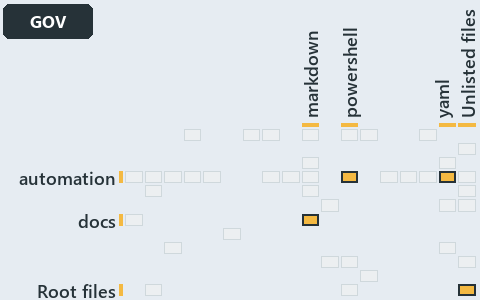

# docs/.assets/explanation/adr-dsgn-thinplat--what-keeps-the-platform-thin--governance.grid.md

`Grid minimap: adr-dsgn-thinplat--what-keeps-the-platform-thin--governance`

The grid minimap of the slide `adr-dsgn-thinplat--what-keeps-the-platform-thin--governance` (governance lens). The slide supports
[ADR-AUTO-PARITY][1], [ADR-AZ-CLI][2] and [ADR-DSGN-THINPLAT][3]; the highlight of those ADR codes selects what is lit, and each reason
below names the code that selects it.

## What the minimap shows

The grid crosses the 12 tracks with the 18 file languages of the world map and lights 4 cells. A cell lit only by passing mentions
(citations in body comments, not in a file's header or text) is touched: drawn pale.

- automation × powershell: 9 lit of 1398 files
- automation × yaml: 3 lit of 95 files
- docs × markdown: 79 lit of 469 files
- Root files × Unlisted files: 2 lit of 4 files

## Why each cell is lit

### automation × powershell (9 lit files)

Placed: the root folder `automation/` names the track automation ([ADR-DSGN-TRACK#1][4]); the extension `.ps1` names the file language
powershell ([ADR-DSGN-TRACK#6][5]). Lit ([ADR-DSGN-TRACK#12][6]) by:

- [automation/Catzc.Azure.Cli/Assert-AzCliBicep.ps1][7]: selected by [ADR-AZ-CLI][2]: the file cites it at line 11 (header).
- [automation/Catzc.Azure.Cli/Assert-AzCliCanAccess.ps1][8]: selected by [ADR-AZ-CLI][2]: the file cites it at line 15 (header).
- [automation/Catzc.Azure.Cli/Assert-AzCliSubscriptionAccessible.ps1][9]: selected by [ADR-AZ-CLI][2]: the file cites it at line 14
  (header).
- [automation/Catzc.Azure.Cli/Get-AzCliSubscriptionAccessState.ps1][10]: selected by [ADR-AZ-CLI][2]: the file cites it at line 21 (header).
- [automation/Catzc.Azure.Cli/Install-AzCliBicep.ps1][11]: selected by [ADR-AZ-CLI][2]: the file cites it at line 11 (header).
- [automation/Catzc.Azure.Cli/Test-AzCliBicep.ps1][12]: selected by [ADR-AZ-CLI][2]: the file cites it at line 14 (header).
- [automation/Catzc.Azure.Cli/Test-AzCliCanAccess.ps1][13]: selected by [ADR-AZ-CLI][2]: the file cites it at line 14 (header).
- [automation/Catzc.Azure.Cli/Test-AzCliSubscriptionAccessible.ps1][14]: selected by [ADR-AZ-CLI][2]: the file cites it at line 13 (header).
- [automation/Catzc.Base.Repository/Get-RunEnvironment.ps1][15]: selected by [ADR-AUTO-PARITY][1]: the file cites it at line 6 (header).

### automation × yaml (3 lit files)

Placed: the root folder `automation/` names the track automation ([ADR-DSGN-TRACK#1][4]); the extension `.yml` names the file language yaml
([ADR-DSGN-TRACK#6][5]). Lit ([ADR-DSGN-TRACK#12][6]) by:

- [automation/Catzc.Base.Docs/configs/adrs.yml][16]: selected by [ADR-AUTO-PARITY][1]: the file cites it at line 137 (text); selected by
  [ADR-AZ-CLI][2]: the file cites it at line 268 (text); selected by [ADR-DSGN-THINPLAT][3]: the file cites it at line 96 (text).
- [automation/Catzc.Base.QualityGates/configs/analyzer-adr-map.yml][17]: selected by [ADR-AZ-CLI][2]: the file cites it at line 19 (text).
- [automation/Catzc.Base.QualityGates/configs/terminology.yml][18]: selected by [ADR-AZ-CLI][2]: the file cites it at line 578 (text);
  selected by [ADR-DSGN-THINPLAT][3]: the file cites it at line 628 (text).

### docs × markdown (79 lit files)

Placed: the root folder `docs/` names the track docs ([ADR-DSGN-TRACK#1][4]); the extension `.md` names the file language markdown
([ADR-DSGN-TRACK#6][5]). Lit ([ADR-DSGN-TRACK#12][6]) by:

- [docs/.assets/explanation/adr-dsgn-thinplat--bind-to-one-cli-delegate-the-rest--meta.drawio.md][19]: selected by [ADR-DSGN-THINPLAT][3]:
  the file cites it at line 66 (text).
- [docs/.assets/explanation/adr-dsgn-thinplat--deploy-bicep-delegates-to-az--implementation.drawio.md][20]: selected by
  [ADR-DSGN-THINPLAT][3]: the file cites it at line 69 (text).
- [docs/.assets/explanation/adr-dsgn-thinplat--every-vendor-call-leaves-through-az--architecture.drawio.md][21]: selected by
  [ADR-AZ-CLI][2]: the file cites it at line 68 (text); selected by [ADR-DSGN-THINPLAT][3]: the file cites it at line 68 (text).
- [docs/.assets/explanation/adr-dsgn-thinplat--same-deploy-bicep-on-both-sides--operations.drawio.md][22]: selected by
  [ADR-DSGN-THINPLAT][3]: the file cites it at line 70 (text).
- [docs/.assets/explanation/adr-dsgn-thinplat--what-keeps-the-platform-thin--governance.drawio.md][23]: selected by [ADR-AZ-CLI][2]: the
  file cites it at line 74 (text); selected by [ADR-DSGN-THINPLAT][3]: the file cites it at line 74 (text).
- [docs/adr/automation/BCL/index.md][24]: selected by [ADR-AUTO-PARITY][1]: an ADR file of the `automation` ADR domain, the ADR domain of
  that code.
- [docs/adr/automation/BCL/native-csharp-types.md][25]: selected by [ADR-AUTO-PARITY][1]: an ADR file of the `automation` ADR domain, the
  ADR domain of that code.
- [docs/adr/automation/avoid-deep-nesting.md][26]: selected by [ADR-AUTO-PARITY][1]: an ADR file of the `automation` ADR domain, the ADR
  domain of that code.
- [docs/adr/automation/bash/bash-test-artifacts.md][27]: selected by [ADR-AUTO-PARITY][1]: an ADR file of the `automation` ADR domain, the
  ADR domain of that code.
- [docs/adr/automation/caching.md][28]: selected by [ADR-AUTO-PARITY][1]: an ADR file of the `automation` ADR domain, the ADR domain of that
  code.
- [docs/adr/automation/console-output-matters.md][29]: selected by [ADR-AUTO-PARITY][1]: an ADR file of the `automation` ADR domain, the ADR
  domain of that code.
- [docs/adr/automation/controlling-module-dependencies.md][30]: selected by [ADR-AUTO-PARITY][1]: an ADR file of the `automation` ADR
  domain, the ADR domain of that code.
- [docs/adr/automation/controlling-systemwide-deps.md][31]: selected by [ADR-AUTO-PARITY][1]: an ADR file of the `automation` ADR domain,
  the ADR domain of that code.
- [docs/adr/automation/cross-platform.md][32]: selected by [ADR-AUTO-PARITY][1]: an ADR file of the `automation` ADR domain, the ADR domain
  of that code.
- [docs/adr/automation/devbox-pipeline-parity.md][1]: selected by [ADR-AUTO-PARITY][1]: an ADR file of the `automation` ADR domain, the ADR
  domain of that code.
- [docs/adr/automation/dora-explains.md][33]: selected by [ADR-AUTO-PARITY][1]: an ADR file of the `automation` ADR domain, the ADR domain
  of that code.
- [docs/adr/automation/dry-run.md][34]: selected by [ADR-AUTO-PARITY][1]: an ADR file of the `automation` ADR domain, the ADR domain of that
  code.
- [docs/adr/automation/effective-in-enterprises.md][35]: selected by [ADR-AUTO-PARITY][1]: an ADR file of the `automation` ADR domain, the
  ADR domain of that code.
- [docs/adr/automation/environment-variables.md][36]: selected by [ADR-AUTO-PARITY][1]: an ADR file of the `automation` ADR domain, the ADR
  domain of that code.
- [docs/adr/automation/execution-engines.md][37]: selected by [ADR-AUTO-PARITY][1]: an ADR file of the `automation` ADR domain, the ADR
  domain of that code.
- [docs/adr/automation/fail-fast-with-asserts.md][38]: selected by [ADR-AUTO-PARITY][1]: an ADR file of the `automation` ADR domain, the ADR
  domain of that code.
- [docs/adr/automation/go/index.md][39]: selected by [ADR-AUTO-PARITY][1]: an ADR file of the `automation` ADR domain, the ADR domain of
  that code.
- [docs/adr/automation/go/test-artifacts.md][40]: selected by [ADR-AUTO-PARITY][1]: an ADR file of the `automation` ADR domain, the ADR
  domain of that code.
- [docs/adr/automation/idempotent-state-functions.md][41]: selected by [ADR-AUTO-PARITY][1]: an ADR file of the `automation` ADR domain, the
  ADR domain of that code.
- [docs/adr/automation/internal-asset-dependencies.md][42]: selected by [ADR-AUTO-PARITY][1]: an ADR file of the `automation` ADR domain,
  the ADR domain of that code.
- [docs/adr/automation/log-before-invoke.md][43]: selected by [ADR-AUTO-PARITY][1]: an ADR file of the `automation` ADR domain, the ADR
  domain of that code.
- [docs/adr/automation/managed-guids.md][44]: selected by [ADR-AUTO-PARITY][1]: an ADR file of the `automation` ADR domain, the ADR domain
  of that code.
- [docs/adr/automation/never-depend-on-pwd.md][45]: selected by [ADR-AUTO-PARITY][1]: an ADR file of the `automation` ADR domain, the ADR
  domain of that code.
- [docs/adr/automation/open-closed-architecture.md][46]: selected by [ADR-AUTO-PARITY][1]: an ADR file of the `automation` ADR domain, the
  ADR domain of that code.
- [docs/adr/automation/path-representation.md][47]: selected by [ADR-AUTO-PARITY][1]: an ADR file of the `automation` ADR domain, the ADR
  domain of that code.
- [docs/adr/automation/platform-bundle.md][48]: selected by [ADR-AUTO-PARITY][1]: an ADR file of the `automation` ADR domain, the ADR domain
  of that code.
- [docs/adr/automation/protected-globs.md][49]: selected by [ADR-AUTO-PARITY][1]: an ADR file of the `automation` ADR domain, the ADR domain
  of that code.
- [docs/adr/automation/python/index.md][50]: selected by [ADR-AUTO-PARITY][1]: an ADR file of the `automation` ADR domain, the ADR domain of
  that code.
- [docs/adr/automation/python/python-test-artifacts.md][51]: selected by [ADR-AUTO-PARITY][1]: an ADR file of the `automation` ADR domain,
  the ADR domain of that code.
- [docs/adr/automation/retry-as-last-resort.md][52]: selected by [ADR-AUTO-PARITY][1]: an ADR file of the `automation` ADR domain, the ADR
  domain of that code.
- [docs/adr/automation/sensible-defaults.md][53]: selected by [ADR-AUTO-PARITY][1]: an ADR file of the `automation` ADR domain, the ADR
  domain of that code.
- [docs/adr/automation/single-responsibility-functions.md][54]: selected by [ADR-AUTO-PARITY][1]: an ADR file of the `automation` ADR
  domain, the ADR domain of that code.
- [docs/adr/automation/spell-out-names.md][55]: selected by [ADR-AUTO-PARITY][1]: an ADR file of the `automation` ADR domain, the ADR domain
  of that code.
- [docs/adr/automation/test-automation.md][56]: selected by [ADR-AUTO-PARITY][1]: an ADR file of the `automation` ADR domain, the ADR domain
  of that code.
- [docs/adr/automation/tool-removal-lifecycle.md][57]: selected by [ADR-AUTO-PARITY][1]: an ADR file of the `automation` ADR domain, the ADR
  domain of that code.
- [docs/adr/automation/tracked-files-from-the-index.md][58]: selected by [ADR-AUTO-PARITY][1]: an ADR file of the `automation` ADR domain,
  the ADR domain of that code.
- [docs/adr/automation/use-proper-package-managers.md][59]: selected by [ADR-AUTO-PARITY][1]: an ADR file of the `automation` ADR domain,
  the ADR domain of that code.
- [docs/adr/automation/uv-python-handler.md][60]: selected by [ADR-AUTO-PARITY][1]: an ADR file of the `automation` ADR domain, the ADR
  domain of that code.
- [docs/adr/automation/zero-ceremony-poka-yoke.md][61]: selected by [ADR-AUTO-PARITY][1]: an ADR file of the `automation` ADR domain, the
  ADR domain of that code.
- [docs/adr/azure/az-session-verification.md][62]: selected by [ADR-AZ-CLI][2]: an ADR file of the `azure` ADR domain, the ADR domain of
  that code.
- [docs/adr/azure/azure-customer-model.md][63]: selected by [ADR-AZ-CLI][2]: an ADR file of the `azure` ADR domain, the ADR domain of that
  code.
- [docs/adr/azure/azure-data-model.md][64]: selected by [ADR-AZ-CLI][2]: an ADR file of the `azure` ADR domain, the ADR domain of that code.
- [docs/adr/azure/azure-naming-standard.md][65]: selected by [ADR-AZ-CLI][2]: an ADR file of the `azure` ADR domain, the ADR domain of that
  code.
- [docs/adr/azure/azure-network-model.md][66]: selected by [ADR-AZ-CLI][2]: an ADR file of the `azure` ADR domain, the ADR domain of that
  code.
- [docs/adr/azure/caf/design-principles.md][67]: selected by [ADR-AZ-CLI][2]: an ADR file of the `azure` ADR domain, the ADR domain of that
  code.
- [docs/adr/azure/caf/governance.md][68]: selected by [ADR-AZ-CLI][2]: an ADR file of the `azure` ADR domain, the ADR domain of that code.
- [docs/adr/azure/caf/management.md][69]: selected by [ADR-AZ-CLI][2]: an ADR file of the `azure` ADR domain, the ADR domain of that code.
- [docs/adr/azure/caf/naming-and-tagging.md][70]: selected by [ADR-AZ-CLI][2]: an ADR file of the `azure` ADR domain, the ADR domain of that
  code.
- [docs/adr/azure/caf/resource-organization.md][71]: selected by [ADR-AZ-CLI][2]: an ADR file of the `azure` ADR domain, the ADR domain of
  that code.
- [docs/adr/azure/caf/security.md][72]: selected by [ADR-AZ-CLI][2]: an ADR file of the `azure` ADR domain, the ADR domain of that code.
- [docs/adr/azure/dora-explains.md][73]: selected by [ADR-AZ-CLI][2]: an ADR file of the `azure` ADR domain, the ADR domain of that code.
- [docs/adr/azure/landing-zones.md][74]: selected by [ADR-AZ-CLI][2]: an ADR file of the `azure` ADR domain, the ADR domain of that code.
- [docs/adr/azure/prefer-az-cli.md][2]: selected by [ADR-AZ-CLI][2]: an ADR file of the `azure` ADR domain, the ADR domain of that code.
- [docs/adr/azure/waf/cost-optimization.md][75]: selected by [ADR-AZ-CLI][2]: an ADR file of the `azure` ADR domain, the ADR domain of that
  code.
- [docs/adr/azure/waf/operational-excellence.md][76]: selected by [ADR-AZ-CLI][2]: an ADR file of the `azure` ADR domain, the ADR domain of
  that code.
- [docs/adr/azure/waf/performance-efficiency.md][77]: selected by [ADR-AZ-CLI][2]: an ADR file of the `azure` ADR domain, the ADR domain of
  that code.
- [docs/adr/azure/waf/reliability.md][78]: selected by [ADR-AZ-CLI][2]: an ADR file of the `azure` ADR domain, the ADR domain of that code.
- [docs/adr/azure/waf/security.md][79]: selected by [ADR-AZ-CLI][2]: an ADR file of the `azure` ADR domain, the ADR domain of that code.
- [docs/adr/design/commit-lifecycle.md][80]: selected by [ADR-DSGN-THINPLAT][3]: an ADR file of the `design` ADR domain, the ADR domain of
  that code.
- [docs/adr/design/dora-explains.md][81]: selected by [ADR-DSGN-THINPLAT][3]: an ADR file of the `design` ADR domain, the ADR domain of that
  code.
- [docs/adr/design/module-aspects.md][82]: selected by [ADR-DSGN-THINPLAT][3]: an ADR file of the `design` ADR domain, the ADR domain of
  that code.
- [docs/adr/design/run-modes.md][83]: selected by [ADR-DSGN-THINPLAT][3]: an ADR file of the `design` ADR domain, the ADR domain of that
  code.
- [docs/adr/design/self-service.md][84]: selected by [ADR-DSGN-THINPLAT][3]: an ADR file of the `design` ADR domain, the ADR domain of that
  code.
- [docs/adr/design/server-remote-integration.md][85]: selected by [ADR-DSGN-THINPLAT][3]: an ADR file of the `design` ADR domain, the ADR
  domain of that code.
- [docs/adr/design/thin-platforms.md][3]: selected by [ADR-DSGN-THINPLAT][3]: an ADR file of the `design` ADR domain, the ADR domain of that
  code.
- [docs/adr/design/tracks.md][86]: selected by [ADR-DSGN-THINPLAT][3]: an ADR file of the `design` ADR domain, the ADR domain of that code.
- [docs/adr/design/visual-design.md][87]: selected by [ADR-DSGN-THINPLAT][3]: an ADR file of the `design` ADR domain, the ADR domain of that
  code.
- [docs/adr/index.md][88]: selected by [ADR-AUTO-PARITY][1]: the file cites it at line 125 (text); selected by [ADR-AZ-CLI][2]: the file
  cites it at line 250 (text); selected by [ADR-DSGN-THINPLAT][3]: the file cites it at line 89 (text).
- [docs/explanation/design/bind-to-one-cli-delegate-the-rest.md][89]: selected by [ADR-DSGN-THINPLAT][3]: the file cites it at line 13
  (text), line 37 (text), line 38 (text), line 40 (text) and line 42 (text).
- [docs/explanation/design/deploy-bicep-delegates-to-az.md][90]: selected by [ADR-AZ-CLI][2]: the file cites it at line 63 (text); selected
  by [ADR-DSGN-THINPLAT][3]: the file cites it at line 19 (text), line 58 (text), line 59 (text) and line 65 (text).
- [docs/explanation/design/engineer-merges-pipelines-do-the-rest.md][91]: selected by [ADR-AUTO-PARITY][1]: the file cites it at line 54
  (text).
- [docs/explanation/design/every-vendor-call-leaves-through-az.md][92]: selected by [ADR-AZ-CLI][2]: the file cites it at line 17 (text),
  line 52 (text), line 53 (text), line 53 (text) and line 57 (text); selected by [ADR-DSGN-THINPLAT][3]: the file cites it at line 17
  (text), line 48 (text), line 49 (text) and line 51 (text).
- [docs/explanation/design/same-deploy-bicep-on-both-sides.md][93]: selected by [ADR-AUTO-PARITY][1]: the file cites it at line 57 (text);
  selected by [ADR-DSGN-THINPLAT][3]: the file cites it at line 16 (text), line 52 (text) and line 53 (text).
- [docs/explanation/design/what-keeps-the-platform-thin.md][94]: selected by [ADR-AZ-CLI][2]: the file cites it at line 17 (text), line 34
  (text), line 60 (text), line 60 (text), line 61 (text), line 65 (text), line 67 (text) and line 71 (text); selected by
  [ADR-DSGN-THINPLAT][3]: the file cites it at line 17 (text), line 55 (text), line 56 (text), line 57 (text), line 58 (text) and line 59
  (text).

### Root files × Unlisted files (2 lit files)

Placed: each file sits directly in the repository root, so it is a root file ([ADR-DSGN-TRACK#7][95]); no extension names no file language,
so each is an unlisted file ([ADR-DSGN-TRACK#8][96]). Lit ([ADR-DSGN-TRACK#12][6]) by:

- [.gitattributes][97]: selected by [ADR-AUTO-PARITY][1]: a root file carries the citations of its owner module's files (files.yml), which
  cite it at `automation/Catzc.Base.Repository/Get-RunEnvironment.ps1` line 6 (header).
- [.gitignore][98]: selected by [ADR-AUTO-PARITY][1]: a root file carries the citations of its owner module's files (files.yml), which cite
  it at `automation/Catzc.Base.Repository/Get-RunEnvironment.ps1` line 6 (header).

## Keywords

- [world map][99]
- [track][100]
- [file language][101]
- [cell][102]
- [lit cell][103]
- [root file][104]
- [unlisted file][105]
- [automation][106]: a track
- [docs][106]: a track
- [markdown][107]: a file language
- [powershell][107]: a file language
- [yaml][107]: a file language

[1]: ../../adr/automation/devbox-pipeline-parity.md
[2]: ../../adr/azure/prefer-az-cli.md
[3]: ../../adr/design/thin-platforms.md
[4]: ../../adr/design/tracks.md#rule-adr-dsgn-track1
[5]: ../../adr/design/tracks.md#rule-adr-dsgn-track6
[6]: ../../adr/design/tracks.md#rule-adr-dsgn-track12
[7]: ../../../automation/Catzc.Azure.Cli/Assert-AzCliBicep.ps1
[8]: ../../../automation/Catzc.Azure.Cli/Assert-AzCliCanAccess.ps1
[9]: ../../../automation/Catzc.Azure.Cli/Assert-AzCliSubscriptionAccessible.ps1
[10]: ../../../automation/Catzc.Azure.Cli/Get-AzCliSubscriptionAccessState.ps1
[11]: ../../../automation/Catzc.Azure.Cli/Install-AzCliBicep.ps1
[12]: ../../../automation/Catzc.Azure.Cli/Test-AzCliBicep.ps1
[13]: ../../../automation/Catzc.Azure.Cli/Test-AzCliCanAccess.ps1
[14]: ../../../automation/Catzc.Azure.Cli/Test-AzCliSubscriptionAccessible.ps1
[15]: ../../../automation/Catzc.Base.Repository/Get-RunEnvironment.ps1
[16]: ../../../automation/Catzc.Base.Docs/configs/adrs.yml
[17]: ../../../automation/Catzc.Base.QualityGates/configs/analyzer-adr-map.yml
[18]: ../../../automation/Catzc.Base.QualityGates/configs/terminology.yml
[19]: adr-dsgn-thinplat--bind-to-one-cli-delegate-the-rest--meta.drawio.md
[20]: adr-dsgn-thinplat--deploy-bicep-delegates-to-az--implementation.drawio.md
[21]: adr-dsgn-thinplat--every-vendor-call-leaves-through-az--architecture.drawio.md
[22]: adr-dsgn-thinplat--same-deploy-bicep-on-both-sides--operations.drawio.md
[23]: adr-dsgn-thinplat--what-keeps-the-platform-thin--governance.drawio.md
[24]: ../../adr/automation/BCL/index.md
[25]: ../../adr/automation/BCL/native-csharp-types.md
[26]: ../../adr/automation/avoid-deep-nesting.md
[27]: ../../adr/automation/bash/bash-test-artifacts.md
[28]: ../../adr/automation/caching.md
[29]: ../../adr/automation/console-output-matters.md
[30]: ../../adr/automation/controlling-module-dependencies.md
[31]: ../../adr/automation/controlling-systemwide-deps.md
[32]: ../../adr/automation/cross-platform.md
[33]: ../../adr/automation/dora-explains.md
[34]: ../../adr/automation/dry-run.md
[35]: ../../adr/automation/effective-in-enterprises.md
[36]: ../../adr/automation/environment-variables.md
[37]: ../../adr/automation/execution-engines.md
[38]: ../../adr/automation/fail-fast-with-asserts.md
[39]: ../../adr/automation/go/index.md
[40]: ../../adr/automation/go/test-artifacts.md
[41]: ../../adr/automation/idempotent-state-functions.md
[42]: ../../adr/automation/internal-asset-dependencies.md
[43]: ../../adr/automation/log-before-invoke.md
[44]: ../../adr/automation/managed-guids.md
[45]: ../../adr/automation/never-depend-on-pwd.md
[46]: ../../adr/automation/open-closed-architecture.md
[47]: ../../adr/automation/path-representation.md
[48]: ../../adr/automation/platform-bundle.md
[49]: ../../adr/automation/protected-globs.md
[50]: ../../adr/automation/python/index.md
[51]: ../../adr/automation/python/python-test-artifacts.md
[52]: ../../adr/automation/retry-as-last-resort.md
[53]: ../../adr/automation/sensible-defaults.md
[54]: ../../adr/automation/single-responsibility-functions.md
[55]: ../../adr/automation/spell-out-names.md
[56]: ../../adr/automation/test-automation.md
[57]: ../../adr/automation/tool-removal-lifecycle.md
[58]: ../../adr/automation/tracked-files-from-the-index.md
[59]: ../../adr/automation/use-proper-package-managers.md
[60]: ../../adr/automation/uv-python-handler.md
[61]: ../../adr/automation/zero-ceremony-poka-yoke.md
[62]: ../../adr/azure/az-session-verification.md
[63]: ../../adr/azure/azure-customer-model.md
[64]: ../../adr/azure/azure-data-model.md
[65]: ../../adr/azure/azure-naming-standard.md
[66]: ../../adr/azure/azure-network-model.md
[67]: ../../adr/azure/caf/design-principles.md
[68]: ../../adr/azure/caf/governance.md
[69]: ../../adr/azure/caf/management.md
[70]: ../../adr/azure/caf/naming-and-tagging.md
[71]: ../../adr/azure/caf/resource-organization.md
[72]: ../../adr/azure/caf/security.md
[73]: ../../adr/azure/dora-explains.md
[74]: ../../adr/azure/landing-zones.md
[75]: ../../adr/azure/waf/cost-optimization.md
[76]: ../../adr/azure/waf/operational-excellence.md
[77]: ../../adr/azure/waf/performance-efficiency.md
[78]: ../../adr/azure/waf/reliability.md
[79]: ../../adr/azure/waf/security.md
[80]: ../../adr/design/commit-lifecycle.md
[81]: ../../adr/design/dora-explains.md
[82]: ../../adr/design/module-aspects.md
[83]: ../../adr/design/run-modes.md
[84]: ../../adr/design/self-service.md
[85]: ../../adr/design/server-remote-integration.md
[86]: ../../adr/design/tracks.md
[87]: ../../adr/design/visual-design.md
[88]: ../../adr/index.md
[89]: ../../explanation/design/bind-to-one-cli-delegate-the-rest.md
[90]: ../../explanation/design/deploy-bicep-delegates-to-az.md
[91]: ../../explanation/design/engineer-merges-pipelines-do-the-rest.md
[92]: ../../explanation/design/every-vendor-call-leaves-through-az.md
[93]: ../../explanation/design/same-deploy-bicep-on-both-sides.md
[94]: ../../explanation/design/what-keeps-the-platform-thin.md
[95]: ../../adr/design/tracks.md#rule-adr-dsgn-track7
[96]: ../../adr/design/tracks.md#rule-adr-dsgn-track8
[97]: ../../../.gitattributes
[98]: ../../../.gitignore
[99]: ../../adr/glossary.md#world-map
[100]: ../../adr/glossary.md#track
[101]: ../../adr/glossary.md#file-language
[102]: ../../adr/glossary.md#cell
[103]: ../../adr/glossary.md#lit-cell
[104]: ../../adr/glossary.md#root-file
[105]: ../../adr/glossary.md#unlisted-file
[106]: ../../../automation/Catzc.Base.Variants/configs/variants.yml
[107]: ../../../automation/Catzc.Base.Languages/configs/languages.yml
