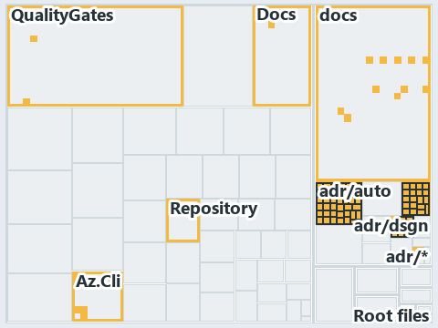

# docs/.assets/explanation/adr-dsgn-thinplat--what-keeps-the-platform-thin--governance.tree.md

`Tree minimap: adr-dsgn-thinplat--what-keeps-the-platform-thin--governance`

The tree minimap of the slide `adr-dsgn-thinplat--what-keeps-the-platform-thin--governance` (governance lens). The slide supports
[ADR-AUTO-PARITY][1], [ADR-AZ-CLI][2] and [ADR-DSGN-THINPLAT][3]; the highlight of those ADR codes selects what is lit, and each reason
below names the code that selects it.

## What the minimap shows

The tree draws every file of the world map as a tile, grouped by top-level folder (under `automation/` by module, under `docs/adr/` by ADR
domain), and lights 93 files in 10 groups. A lit ADR file is framed; a file lit only by passing mentions is drawn pale.

- adr/auto (docs/adr/automation): 39 lit files
- adr/azure (docs/adr/azure): 19 lit files
- docs (docs/ outside docs/adr/): 11 lit files
- adr/dsgn (docs/adr/design): 9 lit files
- Az.Cli (automation/Catzc.Azure.Cli): 8 lit files
- Root files: 2 lit files
- QualityGates (automation/Catzc.Base.QualityGates): 2 lit files
- Docs (automation/Catzc.Base.Docs): 1 lit file
- Repository (automation/Catzc.Base.Repository): 1 lit file
- adr/* (the files directly in docs/adr/): 1 lit file

## Why each group is lit

### adr/auto (39 lit files)

The group holds the files of docs/adr/automation; each sits in its world-map cell and is lit by:

- [docs/adr/automation/BCL/index.md][4], in the cell docs × markdown: selected by [ADR-AUTO-PARITY][1]: an ADR file of the `automation` ADR
  domain, the ADR domain of that code.
- [docs/adr/automation/BCL/native-csharp-types.md][5], in the cell docs × markdown: selected by [ADR-AUTO-PARITY][1]: an ADR file of the
  `automation` ADR domain, the ADR domain of that code.
- [docs/adr/automation/avoid-deep-nesting.md][6], in the cell docs × markdown: selected by [ADR-AUTO-PARITY][1]: an ADR file of the
  `automation` ADR domain, the ADR domain of that code.
- [docs/adr/automation/bash/bash-test-artifacts.md][7], in the cell docs × markdown: selected by [ADR-AUTO-PARITY][1]: an ADR file of the
  `automation` ADR domain, the ADR domain of that code.
- [docs/adr/automation/caching.md][8], in the cell docs × markdown: selected by [ADR-AUTO-PARITY][1]: an ADR file of the `automation` ADR
  domain, the ADR domain of that code.
- [docs/adr/automation/console-output-matters.md][9], in the cell docs × markdown: selected by [ADR-AUTO-PARITY][1]: an ADR file of the
  `automation` ADR domain, the ADR domain of that code.
- [docs/adr/automation/controlling-module-dependencies.md][10], in the cell docs × markdown: selected by [ADR-AUTO-PARITY][1]: an ADR file
  of the `automation` ADR domain, the ADR domain of that code.
- [docs/adr/automation/controlling-systemwide-deps.md][11], in the cell docs × markdown: selected by [ADR-AUTO-PARITY][1]: an ADR file of
  the `automation` ADR domain, the ADR domain of that code.
- [docs/adr/automation/cross-platform.md][12], in the cell docs × markdown: selected by [ADR-AUTO-PARITY][1]: an ADR file of the
  `automation` ADR domain, the ADR domain of that code.
- [docs/adr/automation/devbox-pipeline-parity.md][1], in the cell docs × markdown: selected by [ADR-AUTO-PARITY][1]: an ADR file of the
  `automation` ADR domain, the ADR domain of that code.
- [docs/adr/automation/dora-explains.md][13], in the cell docs × markdown: selected by [ADR-AUTO-PARITY][1]: an ADR file of the `automation`
  ADR domain, the ADR domain of that code.
- [docs/adr/automation/dry-run.md][14], in the cell docs × markdown: selected by [ADR-AUTO-PARITY][1]: an ADR file of the `automation` ADR
  domain, the ADR domain of that code.
- [docs/adr/automation/effective-in-enterprises.md][15], in the cell docs × markdown: selected by [ADR-AUTO-PARITY][1]: an ADR file of the
  `automation` ADR domain, the ADR domain of that code.
- [docs/adr/automation/environment-variables.md][16], in the cell docs × markdown: selected by [ADR-AUTO-PARITY][1]: an ADR file of the
  `automation` ADR domain, the ADR domain of that code.
- [docs/adr/automation/execution-engines.md][17], in the cell docs × markdown: selected by [ADR-AUTO-PARITY][1]: an ADR file of the
  `automation` ADR domain, the ADR domain of that code.
- [docs/adr/automation/fail-fast-with-asserts.md][18], in the cell docs × markdown: selected by [ADR-AUTO-PARITY][1]: an ADR file of the
  `automation` ADR domain, the ADR domain of that code.
- [docs/adr/automation/go/index.md][19], in the cell docs × markdown: selected by [ADR-AUTO-PARITY][1]: an ADR file of the `automation` ADR
  domain, the ADR domain of that code.
- [docs/adr/automation/go/test-artifacts.md][20], in the cell docs × markdown: selected by [ADR-AUTO-PARITY][1]: an ADR file of the
  `automation` ADR domain, the ADR domain of that code.
- [docs/adr/automation/idempotent-state-functions.md][21], in the cell docs × markdown: selected by [ADR-AUTO-PARITY][1]: an ADR file of the
  `automation` ADR domain, the ADR domain of that code.
- [docs/adr/automation/internal-asset-dependencies.md][22], in the cell docs × markdown: selected by [ADR-AUTO-PARITY][1]: an ADR file of
  the `automation` ADR domain, the ADR domain of that code.
- [docs/adr/automation/log-before-invoke.md][23], in the cell docs × markdown: selected by [ADR-AUTO-PARITY][1]: an ADR file of the
  `automation` ADR domain, the ADR domain of that code.
- [docs/adr/automation/managed-guids.md][24], in the cell docs × markdown: selected by [ADR-AUTO-PARITY][1]: an ADR file of the `automation`
  ADR domain, the ADR domain of that code.
- [docs/adr/automation/never-depend-on-pwd.md][25], in the cell docs × markdown: selected by [ADR-AUTO-PARITY][1]: an ADR file of the
  `automation` ADR domain, the ADR domain of that code.
- [docs/adr/automation/open-closed-architecture.md][26], in the cell docs × markdown: selected by [ADR-AUTO-PARITY][1]: an ADR file of the
  `automation` ADR domain, the ADR domain of that code.
- [docs/adr/automation/path-representation.md][27], in the cell docs × markdown: selected by [ADR-AUTO-PARITY][1]: an ADR file of the
  `automation` ADR domain, the ADR domain of that code.
- [docs/adr/automation/platform-bundle.md][28], in the cell docs × markdown: selected by [ADR-AUTO-PARITY][1]: an ADR file of the
  `automation` ADR domain, the ADR domain of that code.
- [docs/adr/automation/protected-globs.md][29], in the cell docs × markdown: selected by [ADR-AUTO-PARITY][1]: an ADR file of the
  `automation` ADR domain, the ADR domain of that code.
- [docs/adr/automation/python/index.md][30], in the cell docs × markdown: selected by [ADR-AUTO-PARITY][1]: an ADR file of the `automation`
  ADR domain, the ADR domain of that code.
- [docs/adr/automation/python/python-test-artifacts.md][31], in the cell docs × markdown: selected by [ADR-AUTO-PARITY][1]: an ADR file of
  the `automation` ADR domain, the ADR domain of that code.
- [docs/adr/automation/retry-as-last-resort.md][32], in the cell docs × markdown: selected by [ADR-AUTO-PARITY][1]: an ADR file of the
  `automation` ADR domain, the ADR domain of that code.
- [docs/adr/automation/sensible-defaults.md][33], in the cell docs × markdown: selected by [ADR-AUTO-PARITY][1]: an ADR file of the
  `automation` ADR domain, the ADR domain of that code.
- [docs/adr/automation/single-responsibility-functions.md][34], in the cell docs × markdown: selected by [ADR-AUTO-PARITY][1]: an ADR file
  of the `automation` ADR domain, the ADR domain of that code.
- [docs/adr/automation/spell-out-names.md][35], in the cell docs × markdown: selected by [ADR-AUTO-PARITY][1]: an ADR file of the
  `automation` ADR domain, the ADR domain of that code.
- [docs/adr/automation/test-automation.md][36], in the cell docs × markdown: selected by [ADR-AUTO-PARITY][1]: an ADR file of the
  `automation` ADR domain, the ADR domain of that code.
- [docs/adr/automation/tool-removal-lifecycle.md][37], in the cell docs × markdown: selected by [ADR-AUTO-PARITY][1]: an ADR file of the
  `automation` ADR domain, the ADR domain of that code.
- [docs/adr/automation/tracked-files-from-the-index.md][38], in the cell docs × markdown: selected by [ADR-AUTO-PARITY][1]: an ADR file of
  the `automation` ADR domain, the ADR domain of that code.
- [docs/adr/automation/use-proper-package-managers.md][39], in the cell docs × markdown: selected by [ADR-AUTO-PARITY][1]: an ADR file of
  the `automation` ADR domain, the ADR domain of that code.
- [docs/adr/automation/uv-python-handler.md][40], in the cell docs × markdown: selected by [ADR-AUTO-PARITY][1]: an ADR file of the
  `automation` ADR domain, the ADR domain of that code.
- [docs/adr/automation/zero-ceremony-poka-yoke.md][41], in the cell docs × markdown: selected by [ADR-AUTO-PARITY][1]: an ADR file of the
  `automation` ADR domain, the ADR domain of that code.

### adr/azure (19 lit files)

The group holds the files of docs/adr/azure; each sits in its world-map cell and is lit by:

- [docs/adr/azure/az-session-verification.md][42], in the cell docs × markdown: selected by [ADR-AZ-CLI][2]: an ADR file of the `azure` ADR
  domain, the ADR domain of that code.
- [docs/adr/azure/azure-customer-model.md][43], in the cell docs × markdown: selected by [ADR-AZ-CLI][2]: an ADR file of the `azure` ADR
  domain, the ADR domain of that code.
- [docs/adr/azure/azure-data-model.md][44], in the cell docs × markdown: selected by [ADR-AZ-CLI][2]: an ADR file of the `azure` ADR domain,
  the ADR domain of that code.
- [docs/adr/azure/azure-naming-standard.md][45], in the cell docs × markdown: selected by [ADR-AZ-CLI][2]: an ADR file of the `azure` ADR
  domain, the ADR domain of that code.
- [docs/adr/azure/azure-network-model.md][46], in the cell docs × markdown: selected by [ADR-AZ-CLI][2]: an ADR file of the `azure` ADR
  domain, the ADR domain of that code.
- [docs/adr/azure/caf/design-principles.md][47], in the cell docs × markdown: selected by [ADR-AZ-CLI][2]: an ADR file of the `azure` ADR
  domain, the ADR domain of that code.
- [docs/adr/azure/caf/governance.md][48], in the cell docs × markdown: selected by [ADR-AZ-CLI][2]: an ADR file of the `azure` ADR domain,
  the ADR domain of that code.
- [docs/adr/azure/caf/management.md][49], in the cell docs × markdown: selected by [ADR-AZ-CLI][2]: an ADR file of the `azure` ADR domain,
  the ADR domain of that code.
- [docs/adr/azure/caf/naming-and-tagging.md][50], in the cell docs × markdown: selected by [ADR-AZ-CLI][2]: an ADR file of the `azure` ADR
  domain, the ADR domain of that code.
- [docs/adr/azure/caf/resource-organization.md][51], in the cell docs × markdown: selected by [ADR-AZ-CLI][2]: an ADR file of the `azure`
  ADR domain, the ADR domain of that code.
- [docs/adr/azure/caf/security.md][52], in the cell docs × markdown: selected by [ADR-AZ-CLI][2]: an ADR file of the `azure` ADR domain, the
  ADR domain of that code.
- [docs/adr/azure/dora-explains.md][53], in the cell docs × markdown: selected by [ADR-AZ-CLI][2]: an ADR file of the `azure` ADR domain,
  the ADR domain of that code.
- [docs/adr/azure/landing-zones.md][54], in the cell docs × markdown: selected by [ADR-AZ-CLI][2]: an ADR file of the `azure` ADR domain,
  the ADR domain of that code.
- [docs/adr/azure/prefer-az-cli.md][2], in the cell docs × markdown: selected by [ADR-AZ-CLI][2]: an ADR file of the `azure` ADR domain, the
  ADR domain of that code.
- [docs/adr/azure/waf/cost-optimization.md][55], in the cell docs × markdown: selected by [ADR-AZ-CLI][2]: an ADR file of the `azure` ADR
  domain, the ADR domain of that code.
- [docs/adr/azure/waf/operational-excellence.md][56], in the cell docs × markdown: selected by [ADR-AZ-CLI][2]: an ADR file of the `azure`
  ADR domain, the ADR domain of that code.
- [docs/adr/azure/waf/performance-efficiency.md][57], in the cell docs × markdown: selected by [ADR-AZ-CLI][2]: an ADR file of the `azure`
  ADR domain, the ADR domain of that code.
- [docs/adr/azure/waf/reliability.md][58], in the cell docs × markdown: selected by [ADR-AZ-CLI][2]: an ADR file of the `azure` ADR domain,
  the ADR domain of that code.
- [docs/adr/azure/waf/security.md][59], in the cell docs × markdown: selected by [ADR-AZ-CLI][2]: an ADR file of the `azure` ADR domain, the
  ADR domain of that code.

### docs (11 lit files)

The group holds the files of docs/ outside docs/adr/; each sits in its world-map cell and is lit by:

- [docs/.assets/explanation/adr-dsgn-thinplat--bind-to-one-cli-delegate-the-rest--meta.drawio.md][60], in the cell docs × markdown: selected
  by [ADR-DSGN-THINPLAT][3]: the file cites it at line 66 (text).
- [docs/.assets/explanation/adr-dsgn-thinplat--deploy-bicep-delegates-to-az--implementation.drawio.md][61], in the cell docs × markdown:
  selected by [ADR-DSGN-THINPLAT][3]: the file cites it at line 69 (text).
- [docs/.assets/explanation/adr-dsgn-thinplat--every-vendor-call-leaves-through-az--architecture.drawio.md][62], in the cell docs ×
  markdown: selected by [ADR-AZ-CLI][2]: the file cites it at line 68 (text); selected by [ADR-DSGN-THINPLAT][3]: the file cites it at line
  68 (text).
- [docs/.assets/explanation/adr-dsgn-thinplat--same-deploy-bicep-on-both-sides--operations.drawio.md][63], in the cell docs × markdown:
  selected by [ADR-DSGN-THINPLAT][3]: the file cites it at line 70 (text).
- [docs/.assets/explanation/adr-dsgn-thinplat--what-keeps-the-platform-thin--governance.drawio.md][64], in the cell docs × markdown:
  selected by [ADR-AZ-CLI][2]: the file cites it at line 74 (text); selected by [ADR-DSGN-THINPLAT][3]: the file cites it at line 74 (text).
- [docs/explanation/design/bind-to-one-cli-delegate-the-rest.md][65], in the cell docs × markdown: selected by [ADR-DSGN-THINPLAT][3]: the
  file cites it at line 13 (text), line 37 (text), line 38 (text), line 40 (text) and line 42 (text).
- [docs/explanation/design/deploy-bicep-delegates-to-az.md][66], in the cell docs × markdown: selected by [ADR-AZ-CLI][2]: the file cites it
  at line 63 (text); selected by [ADR-DSGN-THINPLAT][3]: the file cites it at line 19 (text), line 58 (text), line 59 (text) and line 65
  (text).
- [docs/explanation/design/engineer-merges-pipelines-do-the-rest.md][67], in the cell docs × markdown: selected by [ADR-AUTO-PARITY][1]: the
  file cites it at line 54 (text).
- [docs/explanation/design/every-vendor-call-leaves-through-az.md][68], in the cell docs × markdown: selected by [ADR-AZ-CLI][2]: the file
  cites it at line 17 (text), line 52 (text), line 53 (text), line 53 (text) and line 57 (text); selected by [ADR-DSGN-THINPLAT][3]: the
  file cites it at line 17 (text), line 48 (text), line 49 (text) and line 51 (text).
- [docs/explanation/design/same-deploy-bicep-on-both-sides.md][69], in the cell docs × markdown: selected by [ADR-AUTO-PARITY][1]: the file
  cites it at line 57 (text); selected by [ADR-DSGN-THINPLAT][3]: the file cites it at line 16 (text), line 52 (text) and line 53 (text).
- [docs/explanation/design/what-keeps-the-platform-thin.md][70], in the cell docs × markdown: selected by [ADR-AZ-CLI][2]: the file cites it
  at line 17 (text), line 34 (text), line 60 (text), line 60 (text), line 61 (text), line 65 (text), line 67 (text) and line 71 (text);
  selected by [ADR-DSGN-THINPLAT][3]: the file cites it at line 17 (text), line 55 (text), line 56 (text), line 57 (text), line 58 (text)
  and line 59 (text).

### adr/dsgn (9 lit files)

The group holds the files of docs/adr/design; each sits in its world-map cell and is lit by:

- [docs/adr/design/commit-lifecycle.md][71], in the cell docs × markdown: selected by [ADR-DSGN-THINPLAT][3]: an ADR file of the `design`
  ADR domain, the ADR domain of that code.
- [docs/adr/design/dora-explains.md][72], in the cell docs × markdown: selected by [ADR-DSGN-THINPLAT][3]: an ADR file of the `design` ADR
  domain, the ADR domain of that code.
- [docs/adr/design/module-aspects.md][73], in the cell docs × markdown: selected by [ADR-DSGN-THINPLAT][3]: an ADR file of the `design` ADR
  domain, the ADR domain of that code.
- [docs/adr/design/run-modes.md][74], in the cell docs × markdown: selected by [ADR-DSGN-THINPLAT][3]: an ADR file of the `design` ADR
  domain, the ADR domain of that code.
- [docs/adr/design/self-service.md][75], in the cell docs × markdown: selected by [ADR-DSGN-THINPLAT][3]: an ADR file of the `design` ADR
  domain, the ADR domain of that code.
- [docs/adr/design/server-remote-integration.md][76], in the cell docs × markdown: selected by [ADR-DSGN-THINPLAT][3]: an ADR file of the
  `design` ADR domain, the ADR domain of that code.
- [docs/adr/design/thin-platforms.md][3], in the cell docs × markdown: selected by [ADR-DSGN-THINPLAT][3]: an ADR file of the `design` ADR
  domain, the ADR domain of that code.
- [docs/adr/design/tracks.md][77], in the cell docs × markdown: selected by [ADR-DSGN-THINPLAT][3]: an ADR file of the `design` ADR domain,
  the ADR domain of that code.
- [docs/adr/design/visual-design.md][78], in the cell docs × markdown: selected by [ADR-DSGN-THINPLAT][3]: an ADR file of the `design` ADR
  domain, the ADR domain of that code.

### Az.Cli (8 lit files)

The group holds the files of automation/Catzc.Azure.Cli; each sits in its world-map cell and is lit by:

- [automation/Catzc.Azure.Cli/Assert-AzCliBicep.ps1][79], in the cell automation × powershell: selected by [ADR-AZ-CLI][2]: the file cites
  it at line 11 (header).
- [automation/Catzc.Azure.Cli/Assert-AzCliCanAccess.ps1][80], in the cell automation × powershell: selected by [ADR-AZ-CLI][2]: the file
  cites it at line 15 (header).
- [automation/Catzc.Azure.Cli/Assert-AzCliSubscriptionAccessible.ps1][81], in the cell automation × powershell: selected by [ADR-AZ-CLI][2]:
  the file cites it at line 14 (header).
- [automation/Catzc.Azure.Cli/Get-AzCliSubscriptionAccessState.ps1][82], in the cell automation × powershell: selected by [ADR-AZ-CLI][2]:
  the file cites it at line 21 (header).
- [automation/Catzc.Azure.Cli/Install-AzCliBicep.ps1][83], in the cell automation × powershell: selected by [ADR-AZ-CLI][2]: the file cites
  it at line 11 (header).
- [automation/Catzc.Azure.Cli/Test-AzCliBicep.ps1][84], in the cell automation × powershell: selected by [ADR-AZ-CLI][2]: the file cites it
  at line 14 (header).
- [automation/Catzc.Azure.Cli/Test-AzCliCanAccess.ps1][85], in the cell automation × powershell: selected by [ADR-AZ-CLI][2]: the file cites
  it at line 14 (header).
- [automation/Catzc.Azure.Cli/Test-AzCliSubscriptionAccessible.ps1][86], in the cell automation × powershell: selected by [ADR-AZ-CLI][2]:
  the file cites it at line 13 (header).

### Root files (2 lit files)

The group holds the files of Root files; each sits in its world-map cell and is lit by:

- [.gitattributes][87], in the cell Root files × Unlisted files: selected by [ADR-AUTO-PARITY][1]: a root file carries the citations of its
  owner module's files (files.yml), which cite it at `automation/Catzc.Base.Repository/Get-RunEnvironment.ps1` line 6 (header).
- [.gitignore][88], in the cell Root files × Unlisted files: selected by [ADR-AUTO-PARITY][1]: a root file carries the citations of its
  owner module's files (files.yml), which cite it at `automation/Catzc.Base.Repository/Get-RunEnvironment.ps1` line 6 (header).

### QualityGates (2 lit files)

The group holds the files of automation/Catzc.Base.QualityGates; each sits in its world-map cell and is lit by:

- [automation/Catzc.Base.QualityGates/configs/analyzer-adr-map.yml][89], in the cell automation × yaml: selected by [ADR-AZ-CLI][2]: the
  file cites it at line 19 (text).
- [automation/Catzc.Base.QualityGates/configs/terminology.yml][90], in the cell automation × yaml: selected by [ADR-AZ-CLI][2]: the file
  cites it at line 578 (text); selected by [ADR-DSGN-THINPLAT][3]: the file cites it at line 628 (text).

### Docs (1 lit file)

The group holds the files of automation/Catzc.Base.Docs; each sits in its world-map cell and is lit by:

- [automation/Catzc.Base.Docs/configs/adrs.yml][91], in the cell automation × yaml: selected by [ADR-AUTO-PARITY][1]: the file cites it at
  line 137 (text); selected by [ADR-AZ-CLI][2]: the file cites it at line 268 (text); selected by [ADR-DSGN-THINPLAT][3]: the file cites it
  at line 96 (text).

### Repository (1 lit file)

The group holds the files of automation/Catzc.Base.Repository; each sits in its world-map cell and is lit by:

- [automation/Catzc.Base.Repository/Get-RunEnvironment.ps1][92], in the cell automation × powershell: selected by [ADR-AUTO-PARITY][1]: the
  file cites it at line 6 (header).

### adr/* (1 lit file)

The group holds the files of the files directly in docs/adr/; each sits in its world-map cell and is lit by:

- [docs/adr/index.md][93], in the cell docs × markdown: selected by [ADR-AUTO-PARITY][1]: the file cites it at line 125 (text); selected by
  [ADR-AZ-CLI][2]: the file cites it at line 250 (text); selected by [ADR-DSGN-THINPLAT][3]: the file cites it at line 89 (text).

## Keywords

- [world map][94]
- [track][95]
- [file language][96]
- [cell][97]
- [lit cell][98]
- [root file][99]
- [unlisted file][100]
- [automation][101]: a track
- [docs][101]: a track
- [markdown][102]: a file language
- [powershell][102]: a file language
- [yaml][102]: a file language

[1]: ../../adr/automation/devbox-pipeline-parity.md
[2]: ../../adr/azure/prefer-az-cli.md
[3]: ../../adr/design/thin-platforms.md
[4]: ../../adr/automation/BCL/index.md
[5]: ../../adr/automation/BCL/native-csharp-types.md
[6]: ../../adr/automation/avoid-deep-nesting.md
[7]: ../../adr/automation/bash/bash-test-artifacts.md
[8]: ../../adr/automation/caching.md
[9]: ../../adr/automation/console-output-matters.md
[10]: ../../adr/automation/controlling-module-dependencies.md
[11]: ../../adr/automation/controlling-systemwide-deps.md
[12]: ../../adr/automation/cross-platform.md
[13]: ../../adr/automation/dora-explains.md
[14]: ../../adr/automation/dry-run.md
[15]: ../../adr/automation/effective-in-enterprises.md
[16]: ../../adr/automation/environment-variables.md
[17]: ../../adr/automation/execution-engines.md
[18]: ../../adr/automation/fail-fast-with-asserts.md
[19]: ../../adr/automation/go/index.md
[20]: ../../adr/automation/go/test-artifacts.md
[21]: ../../adr/automation/idempotent-state-functions.md
[22]: ../../adr/automation/internal-asset-dependencies.md
[23]: ../../adr/automation/log-before-invoke.md
[24]: ../../adr/automation/managed-guids.md
[25]: ../../adr/automation/never-depend-on-pwd.md
[26]: ../../adr/automation/open-closed-architecture.md
[27]: ../../adr/automation/path-representation.md
[28]: ../../adr/automation/platform-bundle.md
[29]: ../../adr/automation/protected-globs.md
[30]: ../../adr/automation/python/index.md
[31]: ../../adr/automation/python/python-test-artifacts.md
[32]: ../../adr/automation/retry-as-last-resort.md
[33]: ../../adr/automation/sensible-defaults.md
[34]: ../../adr/automation/single-responsibility-functions.md
[35]: ../../adr/automation/spell-out-names.md
[36]: ../../adr/automation/test-automation.md
[37]: ../../adr/automation/tool-removal-lifecycle.md
[38]: ../../adr/automation/tracked-files-from-the-index.md
[39]: ../../adr/automation/use-proper-package-managers.md
[40]: ../../adr/automation/uv-python-handler.md
[41]: ../../adr/automation/zero-ceremony-poka-yoke.md
[42]: ../../adr/azure/az-session-verification.md
[43]: ../../adr/azure/azure-customer-model.md
[44]: ../../adr/azure/azure-data-model.md
[45]: ../../adr/azure/azure-naming-standard.md
[46]: ../../adr/azure/azure-network-model.md
[47]: ../../adr/azure/caf/design-principles.md
[48]: ../../adr/azure/caf/governance.md
[49]: ../../adr/azure/caf/management.md
[50]: ../../adr/azure/caf/naming-and-tagging.md
[51]: ../../adr/azure/caf/resource-organization.md
[52]: ../../adr/azure/caf/security.md
[53]: ../../adr/azure/dora-explains.md
[54]: ../../adr/azure/landing-zones.md
[55]: ../../adr/azure/waf/cost-optimization.md
[56]: ../../adr/azure/waf/operational-excellence.md
[57]: ../../adr/azure/waf/performance-efficiency.md
[58]: ../../adr/azure/waf/reliability.md
[59]: ../../adr/azure/waf/security.md
[60]: adr-dsgn-thinplat--bind-to-one-cli-delegate-the-rest--meta.drawio.md
[61]: adr-dsgn-thinplat--deploy-bicep-delegates-to-az--implementation.drawio.md
[62]: adr-dsgn-thinplat--every-vendor-call-leaves-through-az--architecture.drawio.md
[63]: adr-dsgn-thinplat--same-deploy-bicep-on-both-sides--operations.drawio.md
[64]: adr-dsgn-thinplat--what-keeps-the-platform-thin--governance.drawio.md
[65]: ../../explanation/design/bind-to-one-cli-delegate-the-rest.md
[66]: ../../explanation/design/deploy-bicep-delegates-to-az.md
[67]: ../../explanation/design/engineer-merges-pipelines-do-the-rest.md
[68]: ../../explanation/design/every-vendor-call-leaves-through-az.md
[69]: ../../explanation/design/same-deploy-bicep-on-both-sides.md
[70]: ../../explanation/design/what-keeps-the-platform-thin.md
[71]: ../../adr/design/commit-lifecycle.md
[72]: ../../adr/design/dora-explains.md
[73]: ../../adr/design/module-aspects.md
[74]: ../../adr/design/run-modes.md
[75]: ../../adr/design/self-service.md
[76]: ../../adr/design/server-remote-integration.md
[77]: ../../adr/design/tracks.md
[78]: ../../adr/design/visual-design.md
[79]: ../../../automation/Catzc.Azure.Cli/Assert-AzCliBicep.ps1
[80]: ../../../automation/Catzc.Azure.Cli/Assert-AzCliCanAccess.ps1
[81]: ../../../automation/Catzc.Azure.Cli/Assert-AzCliSubscriptionAccessible.ps1
[82]: ../../../automation/Catzc.Azure.Cli/Get-AzCliSubscriptionAccessState.ps1
[83]: ../../../automation/Catzc.Azure.Cli/Install-AzCliBicep.ps1
[84]: ../../../automation/Catzc.Azure.Cli/Test-AzCliBicep.ps1
[85]: ../../../automation/Catzc.Azure.Cli/Test-AzCliCanAccess.ps1
[86]: ../../../automation/Catzc.Azure.Cli/Test-AzCliSubscriptionAccessible.ps1
[87]: ../../../.gitattributes
[88]: ../../../.gitignore
[89]: ../../../automation/Catzc.Base.QualityGates/configs/analyzer-adr-map.yml
[90]: ../../../automation/Catzc.Base.QualityGates/configs/terminology.yml
[91]: ../../../automation/Catzc.Base.Docs/configs/adrs.yml
[92]: ../../../automation/Catzc.Base.Repository/Get-RunEnvironment.ps1
[93]: ../../adr/index.md
[94]: ../../adr/glossary.md#world-map
[95]: ../../adr/glossary.md#track
[96]: ../../adr/glossary.md#file-language
[97]: ../../adr/glossary.md#cell
[98]: ../../adr/glossary.md#lit-cell
[99]: ../../adr/glossary.md#root-file
[100]: ../../adr/glossary.md#unlisted-file
[101]: ../../../automation/Catzc.Base.Variants/configs/variants.yml
[102]: ../../../automation/Catzc.Base.Languages/configs/languages.yml
