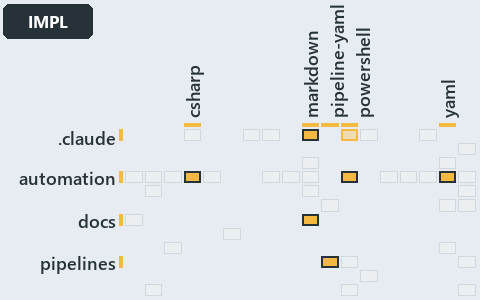

# docs/.assets/explanation/adr-dsgn-track--globs-yml-pipeline-field-is-the-binding--implementation.grid.md

`Grid minimap: adr-dsgn-track--globs-yml-pipeline-field-is-the-binding--implementation`

The grid minimap of the slide `adr-dsgn-track--globs-yml-pipeline-field-is-the-binding--implementation` (implementation lens). The slide
supports [ADR-DSGN-TRACK][1]; the highlight of those ADR codes selects what is lit, and each reason below names the code that selects it.

## What the minimap shows

The grid crosses the 12 tracks (rows) with the 18 file languages (columns) of the world map and lights 5 cells, filled in ink. A cell lit
only by passing mentions (citations in body comments, not in a file's header or text) is touched: a lighter ink. Every other cell is idle, a
grey box: it holds files the slide's ADR codes do not select, or no file at all (173 of the 216 cells hold none). The minimap shows where
the slide sits, not how many files a cell holds; the world-map PDFs show the counts.

- automation × csharp: 18 lit of 229 files
- automation × powershell: 23 lit of 1443 files
- automation × yaml: 8 lit of 97 files
- docs × markdown: 6 lit of 744 files
- pipelines × pipeline-yaml: 1 lit of 9 files

## Key

A lit row prints its track's name; a lit column prints a short code, the first extension of its file language:

- `.cs`: csharp
- `.md`: markdown
- `.yaml`: pipeline-yaml
- `.ps1`: powershell
- `.yml`: yaml

## Why each cell is lit

### automation × csharp (18 lit files)

Placed: the root folder `automation/` names the track automation ([ADR-DSGN-TRACK#1][2]); the extension `.cs` names the file language csharp
([ADR-DSGN-TRACK#6][3]). Lit ([ADR-DSGN-TRACK#12][4]) by:

- [automation/Catzc.Base.Docs/types/AdrDomain.cs][5]: selected by [ADR-DSGN-TRACK][1]: the file cites it at line 6 (header) and line 7
  (header).
- [automation/Catzc.Base.Docs/types/AdrRuleSet.cs][6]: selected by [ADR-DSGN-TRACK][1]: the file cites it at line 8 (header).
- [automation/Catzc.Base.Docs/types/AdrsConfig.cs][7]: selected by [ADR-DSGN-TRACK][1]: the file cites it at line 21 (header), line 24
  (header), line 43 (body comment) and line 47 (body comment).
- [automation/Catzc.Base.Languages/types/FileLanguage.cs][8]: selected by [ADR-DSGN-TRACK][1]: the file cites it at line 2 (header).
- [automation/Catzc.Base.Languages/types/LanguagesConfig.cs][9]: selected by [ADR-DSGN-TRACK][1]: the file cites it at line 2 (header).
- [automation/Catzc.Base.Maps/types/MapCell.cs][10]: selected by [ADR-DSGN-TRACK][1]: the file cites it at line 2 (header), line 3 (header)
  and line 4 (header).
- [automation/Catzc.Base.Maps/types/MapsLabels.cs][11]: selected by [ADR-DSGN-TRACK][1]: the file cites it at line 5 (header), line 6
  (header) and line 10 (header).
- [automation/Catzc.Base.Maps/types/ValueChainCell.cs][12]: selected by [ADR-DSGN-TRACK][1]: the file cites it at line 2 (header), line 3
  (header), line 15 (body comment) and line 18 (body comment).
- [automation/Catzc.Base.Maps/types/ValueChainHighlight.cs][13]: selected by [ADR-DSGN-TRACK][1]: the file cites it at line 2 (header) and
  line 3 (header).
- [automation/Catzc.Base.Maps/types/ValueChainMap.cs][14]: selected by [ADR-DSGN-TRACK][1]: the file cites it at line 2 (header), line 3
  (header) and line 5 (header).
- [automation/Catzc.Base.Maps/types/ValueChainReason.cs][15]: selected by [ADR-DSGN-TRACK][1]: the file cites it at line 2 (header) and line
  4 (header).
- [automation/Catzc.Base.Maps/types/WorldMap.cs][16]: selected by [ADR-DSGN-TRACK][1]: the file cites it at line 3 (header) and line 4
  (header).
- [automation/Catzc.Base.Maps/types/WorldMapBuilder.cs][17]: selected by [ADR-DSGN-TRACK][1]: the file cites it at line 8 (header), line 9
  (header) and line 12 (header).
- [automation/Catzc.Base.Maps/types/WorldMapGridLayout.cs][18]: selected by [ADR-DSGN-TRACK][1]: the file cites it at line 3 (header) and
  line 4 (header).
- [automation/Catzc.Base.Maps/types/WorldMapHighlight.cs][19]: selected by [ADR-DSGN-TRACK][1]: the file cites it at line 2 (header).
- [automation/Catzc.Base.Maps/types/WorldMapPdf.cs][20]: selected by [ADR-DSGN-TRACK][1]: the file cites it at line 4 (header), line 5
  (header) and line 6 (header).
- [automation/Catzc.Base.Variants/types/VariantTrack.cs][21]: selected by [ADR-DSGN-TRACK][1]: the file cites it at line 1 (header), line 3
  (header) and line 17 (body comment).
- [automation/Catzc.Base.Variants/types/VariantsConfig.cs][22]: selected by [ADR-DSGN-TRACK][1]: the file cites it at line 22 (header), line
  25 (header), line 27 (header) and line 270 (text).

### automation × powershell (23 lit files)

Placed: the root folder `automation/` names the track automation ([ADR-DSGN-TRACK#1][2]); the extension `.ps1` names the file language
powershell ([ADR-DSGN-TRACK#6][3]). Lit ([ADR-DSGN-TRACK#12][4]) by:

- [automation/Catzc.Base.Docs/tests/types/AdrsConfig.Tests.ps1][23]: selected by [ADR-DSGN-TRACK][1]: the file cites it at line 99 (text)
  and line 99 (body comment).
- [automation/Catzc.Base.Globs/tests/types/GlobsConfig.Tests.ps1][24]: selected by [ADR-DSGN-TRACK][1]: the file cites it at line 50 (text).
- [automation/Catzc.Base.Languages/Get-FileLanguage.ps1][25]: selected by [ADR-DSGN-TRACK][1]: the file cites it at line 6 (header).
- [automation/Catzc.Base.Languages/tests/Get-FileLanguage.Tests.ps1][26]: selected by [ADR-DSGN-TRACK][1]: the file cites it at line 47
  (body comment), line 124 (text), line 136 (text) and line 178 (text).
- [automation/Catzc.Base.Maps/Export-WorldMapPdf.ps1][27]: selected by [ADR-DSGN-TRACK][1]: the file cites it at line 10 (header), line 11
  (header), line 13 (header) and line 33 (header).
- [automation/Catzc.Base.Maps/Get-ValueChainHighlight.ps1][28]: selected by [ADR-DSGN-TRACK][1]: the file cites it at line 8 (header), line
  9 (header) and line 22 (header).
- [automation/Catzc.Base.Maps/Get-ValueChainMap.ps1][29]: selected by [ADR-DSGN-TRACK][1]: the file cites it at line 6 (header), line 8
  (header) and line 10 (header).
- [automation/Catzc.Base.Maps/Get-WorldMap.ps1][30]: selected by [ADR-DSGN-TRACK][1]: the file cites it at line 6 (header), line 7 (header)
  and line 19 (header).
- [automation/Catzc.Base.Maps/Get-WorldMapHighlight.ps1][31]: selected by [ADR-DSGN-TRACK][1]: the file cites it at line 12 (header) and
  line 33 (header).
- [automation/Catzc.Base.Maps/Test-ValueChainMap.ps1][32]: selected by [ADR-DSGN-TRACK][1]: the file cites it at line 14 (header), line 16
  (header), line 19 (header), line 23 (header), line 54 (text), line 55 (text), line 65 (text), line 68 (text) and line 85 (text).
- [automation/Catzc.Base.Maps/Test-WorldMap.ps1][33]: selected by [ADR-DSGN-TRACK][1]: the file cites it at line 11 (header), line 14
  (header), line 18 (header), line 22 (header), line 23 (header), line 66 (text), line 85 (text), line 102 (text), line 106 (text) and line
  107 (text).
- [automation/Catzc.Base.Maps/private/Resolve-MapLabelTerm.ps1][34]: selected by [ADR-DSGN-TRACK][1]: the file cites it at line 9 (header)
  and line 10 (header).
- [automation/Catzc.Base.Maps/tests/Get-ValueChainHighlight.Tests.ps1][35]: selected by [ADR-DSGN-TRACK][1]: the file cites it at line 2
  (header), line 3 (header), line 21 (text), line 27 (text) and line 46 (text).
- [automation/Catzc.Base.Maps/tests/Get-ValueChainMap.Tests.ps1][36]: selected by [ADR-DSGN-TRACK][1]: the file cites it at line 2 (header),
  line 21 (text), line 42 (text) and line 42 (body comment).
- [automation/Catzc.Base.Maps/tests/Get-WorldMap.Tests.ps1][37]: selected by [ADR-DSGN-TRACK][1]: the file cites it at line 75 (body
  comment) and line 91 (text).
- [automation/Catzc.Base.Maps/tests/Get-WorldMapHighlight.Tests.ps1][38]: selected by [ADR-DSGN-TRACK][1]: the file cites it at line 74
  (text).
- [automation/Catzc.Base.Maps/tests/Test-ValueChainMap.Tests.ps1][39]: selected by [ADR-DSGN-TRACK][1]: the file cites it at line 2
  (header), line 3 (header), line 4 (header), line 57 (text), line 57 (body comment), line 61 (text), line 62 (text), line 63 (text), line
  64 (text), line 68 (text), line 71 (text), line 90 (text), line 90 (body comment) and line 90 (body comment).
- [automation/Catzc.Base.Maps/tests/Test-WorldMap.Tests.ps1][40]: selected by [ADR-DSGN-TRACK][1]: the file cites it at line 2 (header),
  line 3 (header), line 65 (text), line 69 (text), line 72 (text), line 76 (text), line 77 (text), line 81 (text), line 90 (text), line 91
  (text), line 95 (text), line 99 (text), line 100 (text), line 121 (text), line 121 (body comment) and line 121 (body comment).
- [automation/Catzc.Base.Maps/tests/types/ValueChainHighlight.Tests.ps1][41]: selected by [ADR-DSGN-TRACK][1]: the file cites it at line 2
  (header), line 3 (header), line 19 (text), line 26 (text), line 32 (text), line 49 (text) and line 49 (body comment).
- [automation/Catzc.Base.Maps/tests/types/ValueChainMap.Tests.ps1][42]: selected by [ADR-DSGN-TRACK][1]: the file cites it at line 2
  (header), line 20 (text), line 29 (text), line 34 (text) and line 42 (text).
- [automation/Catzc.Base.Maps/tests/types/WorldMapHighlight.Tests.ps1][43]: selected by [ADR-DSGN-TRACK][1]: the file cites it at line 68
  (text), line 112 (text) and line 126 (text).
- [automation/Catzc.Base.QualityGates/private/Get-LanguageTestFolders.ps1][44]: selected by [ADR-DSGN-TRACK][1]: the file cites it at line 7
  (header).
- [automation/Catzc.Base.Variants/Get-Track.ps1][45]: selected by [ADR-DSGN-TRACK][1]: the file cites it at line 5 (header), line 7
  (header), line 8 (header) and line 12 (header).

### automation × yaml (8 lit files)

Placed: the root folder `automation/` names the track automation ([ADR-DSGN-TRACK#1][2]); the extension `.yml` names the file language yaml
([ADR-DSGN-TRACK#6][3]). Lit ([ADR-DSGN-TRACK#12][4]) by:

- [automation/Catzc.Base.Docs/configs/adrs.yml][46]: selected by [ADR-DSGN-TRACK][1]: the file cites it at line 11 (header), line 12
  (header) and line 95 (text).
- [automation/Catzc.Base.Globs/configs/globs.yml][47]: selected by [ADR-DSGN-TRACK][1]: the file cites it at line 113 (body comment) (a
  passing mention only).
- [automation/Catzc.Base.Languages/configs/glossary.yml][48]: selected by [ADR-DSGN-TRACK][1]: the file cites it at line 10 (text).
- [automation/Catzc.Base.Languages/configs/languages.yml][49]: selected by [ADR-DSGN-TRACK][1]: the file cites it at line 2 (header).
- [automation/Catzc.Base.Maps/configs/maps.yml][50]: selected by [ADR-DSGN-TRACK][1]: the file cites it at line 26 (header), line 32
  (header), line 34 (header) and line 39 (header).
- [automation/Catzc.Base.ModuleSystem/configs/glossary.yml][51]: selected by [ADR-DSGN-TRACK][1]: the file cites it at line 9 (text), line
  65 (text), line 84 (text), line 95 (text), line 110 (text), line 123 (text), line 137 (text), line 152 (text), line 165 (text), line 177
  (text), line 190 (text), line 192 (text) and line 204 (text).
- [automation/Catzc.Base.QualityGates/configs/terminology.yml][52]: selected by [ADR-DSGN-TRACK][1]: the file cites it at line 318 (text)
  and line 321 (text).
- [automation/Catzc.Base.Variants/configs/variants.yml][53]: selected by [ADR-DSGN-TRACK][1]: the file cites it at line 45 (body comment),
  line 48 (body comment) and line 50 (body comment) (a passing mention only).

### docs × markdown (6 lit files)

Placed: the root folder `docs/` names the track docs ([ADR-DSGN-TRACK#1][2]); the extension `.md` names the file language markdown
([ADR-DSGN-TRACK#6][3]). Lit ([ADR-DSGN-TRACK#12][4]) by:

- [docs/adr/design/dora-explains.md][54]: selected by [ADR-DSGN-TRACK][1]: the file cites it at line 13 (text).
- [docs/adr/design/tracks.md][1]: selected by [ADR-DSGN-TRACK][1]: the ADR's own file.
- [docs/adr/glossary.md][55]: selected by [ADR-DSGN-TRACK][1]: the file cites it at line 91 (text), line 107 (text), line 121 (text), line
  137 (text), line 166 (text), line 176 (text), line 178 (text), line 192 (text), line 211 (text), line 225 (text), line 239 (text), line
  252 (text), line 265 (text) and line 277 (text).
- [docs/adr/index.md][56]: selected by [ADR-DSGN-TRACK][1]: the file cites it at line 88 (text).
- [docs/how-to/automation/manual-test-plan/repository-conventions.md][57]: selected by [ADR-DSGN-TRACK][1]: the file cites it at line 19
  (text), line 25 (text), line 25 (text), line 28 (text), line 28 (text), line 30 (text), line 30 (text), line 30 (text), line 31 (text) and
  line 32 (text).
- [docs/references/automation/catzc-base-maps.md][58]: selected by [ADR-DSGN-TRACK][1]: the file cites it at line 68 (text), line 70 (text)
  and line 82 (text).

### pipelines × pipeline-yaml (1 lit file)

Placed: the root folder `pipelines/` names the track pipelines ([ADR-DSGN-TRACK#1][2]); the extension `.yaml` names the file language
pipeline-yaml ([ADR-DSGN-TRACK#6][3]). Lit ([ADR-DSGN-TRACK#12][4]) by:

- [pipelines/ci-automation.yaml][59]: selected by [ADR-DSGN-TRACK][1]: the file cites it at line 6 (header).

## Keywords

- [world map][60]
- [track][61]
- [file language][62]
- [cell][63]
- [lit cell][64]
- [automation][53]: a track
- [docs][53]: a track
- [pipelines][53]: a track
- [csharp][49]: a file language
- [markdown][49]: a file language
- [pipeline-yaml][49]: a file language
- [powershell][49]: a file language
- [yaml][49]: a file language

Terms the cited ADRs define:

- [cell][63], defined by [ADR-DSGN-TRACK#10][65]
- [deployable-unit][66], defined by [ADR-DSGN-TRACK#5][67]
- [file language][62], defined by [ADR-DSGN-TRACK#6][3]
- [lit cell][64], defined by [ADR-DSGN-TRACK#12][4]
- [root file][68], defined by [ADR-DSGN-TRACK#7][69]
- [stack violation][70], defined by [ADR-DSGN-TRACK#11][71]
- [track][61], defined by [ADR-DSGN-TRACK#1][2]
- [unlisted file][72], defined by [ADR-DSGN-TRACK#8][73]
- [value-chain concern][74], defined by [ADR-DSGN-TRACK#15][75]
- [value-chain map][76], defined by [ADR-DSGN-TRACK#16][77]
- [value-chain stack][78], defined by [ADR-DSGN-TRACK#14][79]
- [verification track][80], defined by [ADR-DSGN-TRACK#2][81]
- [world map][60], defined by [ADR-DSGN-TRACK#9][82]

[1]: ../../adr/design/tracks.md
[2]: ../../adr/design/tracks.md#rule-adr-dsgn-track1
[3]: ../../adr/design/tracks.md#rule-adr-dsgn-track6
[4]: ../../adr/design/tracks.md#rule-adr-dsgn-track12
[5]: ../../../automation/Catzc.Base.Docs/types/AdrDomain.cs
[6]: ../../../automation/Catzc.Base.Docs/types/AdrRuleSet.cs
[7]: ../../../automation/Catzc.Base.Docs/types/AdrsConfig.cs
[8]: ../../../automation/Catzc.Base.Languages/types/FileLanguage.cs
[9]: ../../../automation/Catzc.Base.Languages/types/LanguagesConfig.cs
[10]: ../../../automation/Catzc.Base.Maps/types/MapCell.cs
[11]: ../../../automation/Catzc.Base.Maps/types/MapsLabels.cs
[12]: ../../../automation/Catzc.Base.Maps/types/ValueChainCell.cs
[13]: ../../../automation/Catzc.Base.Maps/types/ValueChainHighlight.cs
[14]: ../../../automation/Catzc.Base.Maps/types/ValueChainMap.cs
[15]: ../../../automation/Catzc.Base.Maps/types/ValueChainReason.cs
[16]: ../../../automation/Catzc.Base.Maps/types/WorldMap.cs
[17]: ../../../automation/Catzc.Base.Maps/types/WorldMapBuilder.cs
[18]: ../../../automation/Catzc.Base.Maps/types/WorldMapGridLayout.cs
[19]: ../../../automation/Catzc.Base.Maps/types/WorldMapHighlight.cs
[20]: ../../../automation/Catzc.Base.Maps/types/WorldMapPdf.cs
[21]: ../../../automation/Catzc.Base.Variants/types/VariantTrack.cs
[22]: ../../../automation/Catzc.Base.Variants/types/VariantsConfig.cs
[23]: ../../../automation/Catzc.Base.Docs/tests/types/AdrsConfig.Tests.ps1
[24]: ../../../automation/Catzc.Base.Globs/tests/types/GlobsConfig.Tests.ps1
[25]: ../../../automation/Catzc.Base.Languages/Get-FileLanguage.ps1
[26]: ../../../automation/Catzc.Base.Languages/tests/Get-FileLanguage.Tests.ps1
[27]: ../../../automation/Catzc.Base.Maps/Export-WorldMapPdf.ps1
[28]: ../../../automation/Catzc.Base.Maps/Get-ValueChainHighlight.ps1
[29]: ../../../automation/Catzc.Base.Maps/Get-ValueChainMap.ps1
[30]: ../../../automation/Catzc.Base.Maps/Get-WorldMap.ps1
[31]: ../../../automation/Catzc.Base.Maps/Get-WorldMapHighlight.ps1
[32]: ../../../automation/Catzc.Base.Maps/Test-ValueChainMap.ps1
[33]: ../../../automation/Catzc.Base.Maps/Test-WorldMap.ps1
[34]: ../../../automation/Catzc.Base.Maps/private/Resolve-MapLabelTerm.ps1
[35]: ../../../automation/Catzc.Base.Maps/tests/Get-ValueChainHighlight.Tests.ps1
[36]: ../../../automation/Catzc.Base.Maps/tests/Get-ValueChainMap.Tests.ps1
[37]: ../../../automation/Catzc.Base.Maps/tests/Get-WorldMap.Tests.ps1
[38]: ../../../automation/Catzc.Base.Maps/tests/Get-WorldMapHighlight.Tests.ps1
[39]: ../../../automation/Catzc.Base.Maps/tests/Test-ValueChainMap.Tests.ps1
[40]: ../../../automation/Catzc.Base.Maps/tests/Test-WorldMap.Tests.ps1
[41]: ../../../automation/Catzc.Base.Maps/tests/types/ValueChainHighlight.Tests.ps1
[42]: ../../../automation/Catzc.Base.Maps/tests/types/ValueChainMap.Tests.ps1
[43]: ../../../automation/Catzc.Base.Maps/tests/types/WorldMapHighlight.Tests.ps1
[44]: ../../../automation/Catzc.Base.QualityGates/private/Get-LanguageTestFolders.ps1
[45]: ../../../automation/Catzc.Base.Variants/Get-Track.ps1
[46]: ../../../automation/Catzc.Base.Docs/configs/adrs.yml
[47]: ../../../automation/Catzc.Base.Globs/configs/globs.yml
[48]: ../../../automation/Catzc.Base.Languages/configs/glossary.yml
[49]: ../../../automation/Catzc.Base.Languages/configs/languages.yml
[50]: ../../../automation/Catzc.Base.Maps/configs/maps.yml
[51]: ../../../automation/Catzc.Base.ModuleSystem/configs/glossary.yml
[52]: ../../../automation/Catzc.Base.QualityGates/configs/terminology.yml
[53]: ../../../automation/Catzc.Base.Variants/configs/variants.yml
[54]: ../../adr/design/dora-explains.md
[55]: ../../adr/glossary.md
[56]: ../../adr/index.md
[57]: ../../how-to/automation/manual-test-plan/repository-conventions.md
[58]: ../../references/automation/catzc-base-maps.md
[59]: ../../../pipelines/ci-automation.yaml
[60]: ../../adr/glossary.md#world-map
[61]: ../../adr/glossary.md#track
[62]: ../../adr/glossary.md#file-language
[63]: ../../adr/glossary.md#cell
[64]: ../../adr/glossary.md#lit-cell
[65]: ../../adr/design/tracks.md#rule-adr-dsgn-track10
[66]: ../../adr/glossary.md#deployable-unit
[67]: ../../adr/design/tracks.md#rule-adr-dsgn-track5
[68]: ../../adr/glossary.md#root-file
[69]: ../../adr/design/tracks.md#rule-adr-dsgn-track7
[70]: ../../adr/glossary.md#stack-violation
[71]: ../../adr/design/tracks.md#rule-adr-dsgn-track11
[72]: ../../adr/glossary.md#unlisted-file
[73]: ../../adr/design/tracks.md#rule-adr-dsgn-track8
[74]: ../../adr/glossary.md#value-chain-concern
[75]: ../../adr/design/tracks.md#rule-adr-dsgn-track15
[76]: ../../adr/glossary.md#value-chain-map
[77]: ../../adr/design/tracks.md#rule-adr-dsgn-track16
[78]: ../../adr/glossary.md#value-chain-stack
[79]: ../../adr/design/tracks.md#rule-adr-dsgn-track14
[80]: ../../adr/glossary.md#verification-track
[81]: ../../adr/design/tracks.md#rule-adr-dsgn-track2
[82]: ../../adr/design/tracks.md#rule-adr-dsgn-track9
