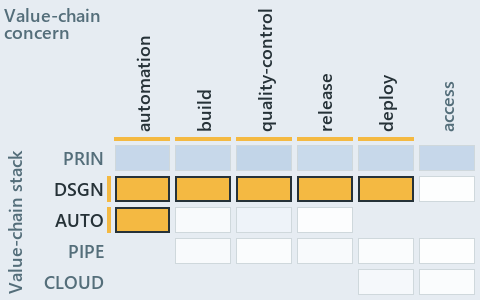

# docs/.assets/explanation/adr-dsgn-track--unit-to-pipeline-rule-is-review-only--governance.chain.md

`Value-chain minimap: adr-dsgn-track--unit-to-pipeline-rule-is-review-only--governance`

The value-chain minimap of the slide `adr-dsgn-track--unit-to-pipeline-rule-is-review-only--governance` (governance lens). The slide
supports [ADR-DSGN-TRACK][1], [ADR-FLOW-CD][2], [ADR-FLOW-CD-GLOBS][3] and [ADR-REPO-FOLDERS][4]; the highlight of those ADR codes selects
what is lit, and each reason below names the code that selects it.

## What the minimap shows

Value-chain map: value-chain stack × value-chain concerns. The grid crosses the 5 rows of the value-chain stack (PRIN, DSGN, AUTO, PIPE,
CLOUD) with the 6 value-chain concerns (automation, build, quality-control, release, deploy, access), shades each cell by the ADRs it holds,
and lights 6 cells.

- DSGN × automation: 2 lit of 7 ADRs
- DSGN × build: 1 lit of 5 ADRs
- DSGN × quality-control: 1 lit of 5 ADRs
- DSGN × release: 1 lit of 4 ADRs
- DSGN × deploy: 1 lit of 6 ADRs
- AUTO × automation: 1 lit of 63 ADRs

## Why each cell is lit

### DSGN × automation (2 ADRs)

Lit ([ADR-DSGN-TRACK#12][5]) by:

- [ADR-DSGN-TRACK][1]: selected by [ADR-DSGN-TRACK][1]; its ADR domain `design` sits on the DSGN row of the value-chain stack
  ([ADR-DSGN-TRACK#14][6]); its value-chain concerns (automation) are its ADR domain's default, so it lights the automation column
  ([ADR-DSGN-TRACK#15][7]).
- [ADR-FLOW-CD-GLOBS][3]: selected by [ADR-FLOW-CD-GLOBS][3]; its ADR domain `flow` sits on the DSGN row of the value-chain stack
  ([ADR-DSGN-TRACK#14][6]); its own value-chain concerns (automation) override its ADR domain's default (build, quality-control, release and
  deploy), so it lights the automation column ([ADR-DSGN-TRACK#15][7]).

### DSGN × build (1 ADR)

Lit ([ADR-DSGN-TRACK#12][5]) by:

- [ADR-FLOW-CD][2]: selected by [ADR-FLOW-CD][2]; its ADR domain `flow` sits on the DSGN row of the value-chain stack
  ([ADR-DSGN-TRACK#14][6]); its value-chain concerns (build, quality-control, release and deploy) are its ADR domain's default, so it lights
  the build column ([ADR-DSGN-TRACK#15][7]).

### DSGN × quality-control (1 ADR)

Lit ([ADR-DSGN-TRACK#12][5]) by:

- [ADR-FLOW-CD][2]: selected by [ADR-FLOW-CD][2]; its ADR domain `flow` sits on the DSGN row of the value-chain stack
  ([ADR-DSGN-TRACK#14][6]); its value-chain concerns (build, quality-control, release and deploy) are its ADR domain's default, so it lights
  the quality-control column ([ADR-DSGN-TRACK#15][7]).

### DSGN × release (1 ADR)

Lit ([ADR-DSGN-TRACK#12][5]) by:

- [ADR-FLOW-CD][2]: selected by [ADR-FLOW-CD][2]; its ADR domain `flow` sits on the DSGN row of the value-chain stack
  ([ADR-DSGN-TRACK#14][6]); its value-chain concerns (build, quality-control, release and deploy) are its ADR domain's default, so it lights
  the release column ([ADR-DSGN-TRACK#15][7]).

### DSGN × deploy (1 ADR)

Lit ([ADR-DSGN-TRACK#12][5]) by:

- [ADR-FLOW-CD][2]: selected by [ADR-FLOW-CD][2]; its ADR domain `flow` sits on the DSGN row of the value-chain stack
  ([ADR-DSGN-TRACK#14][6]); its value-chain concerns (build, quality-control, release and deploy) are its ADR domain's default, so it lights
  the deploy column ([ADR-DSGN-TRACK#15][7]).

### AUTO × automation (1 ADR)

Lit ([ADR-DSGN-TRACK#12][5]) by:

- [ADR-REPO-FOLDERS][4]: selected by [ADR-REPO-FOLDERS][4]; its ADR domain `repository` sits on the AUTO row of the value-chain stack
  ([ADR-DSGN-TRACK#14][6]); its value-chain concerns (automation) are its ADR domain's default, so it lights the automation column
  ([ADR-DSGN-TRACK#15][7]).

## Keywords

- [value-chain map][8]
- [value-chain stack][9]
- [value-chain concern][10]
- [cell][11]
- [lit cell][12]

Terms the cited ADRs define:

- [cell][11], defined by [ADR-DSGN-TRACK#10][13]
- [deployable-unit][14], defined by [ADR-DSGN-TRACK#5][15]
- [domain][16], defined by [ADR-REPO-FOLDERS#5][17]
- [file language][18], defined by [ADR-DSGN-TRACK#6][19]
- [gate][20], defined by [ADR-FLOW-CD#13][21]
- [lit cell][12], defined by [ADR-DSGN-TRACK#12][5]
- [release candidate][22], defined by [ADR-FLOW-CD#14][23]
- [root file][24], defined by [ADR-DSGN-TRACK#7][25]
- [stack violation][26], defined by [ADR-DSGN-TRACK#11][27]
- [track][28], defined by [ADR-DSGN-TRACK#1][29]
- [unlisted file][30], defined by [ADR-DSGN-TRACK#8][31]
- [value-chain concern][10], defined by [ADR-DSGN-TRACK#15][7]
- [value-chain map][8], defined by [ADR-DSGN-TRACK#16][32]
- [value-chain stack][9], defined by [ADR-DSGN-TRACK#14][6]
- [verification track][33], defined by [ADR-DSGN-TRACK#2][34]
- [world map][35], defined by [ADR-DSGN-TRACK#9][36]

[1]: ../../adr/design/tracks.md
[2]: ../../adr/flow/cd-discipline-and-promotion-flow.md
[3]: ../../adr/flow/durable-sha-globs.md
[4]: ../../adr/repository/conventional-folders.md
[5]: ../../adr/design/tracks.md#rule-adr-dsgn-track12
[6]: ../../adr/design/tracks.md#rule-adr-dsgn-track14
[7]: ../../adr/design/tracks.md#rule-adr-dsgn-track15
[8]: ../../adr/glossary.md#value-chain-map
[9]: ../../adr/glossary.md#value-chain-stack
[10]: ../../adr/glossary.md#value-chain-concern
[11]: ../../adr/glossary.md#cell
[12]: ../../adr/glossary.md#lit-cell
[13]: ../../adr/design/tracks.md#rule-adr-dsgn-track10
[14]: ../../adr/glossary.md#deployable-unit
[15]: ../../adr/design/tracks.md#rule-adr-dsgn-track5
[16]: ../../adr/glossary.md#domain
[17]: ../../adr/repository/conventional-folders.md#rule-adr-repo-folders5
[18]: ../../adr/glossary.md#file-language
[19]: ../../adr/design/tracks.md#rule-adr-dsgn-track6
[20]: ../../adr/glossary.md#gate
[21]: ../../adr/flow/cd-discipline-and-promotion-flow.md#rule-adr-flow-cd13
[22]: ../../adr/glossary.md#release-candidate
[23]: ../../adr/flow/cd-discipline-and-promotion-flow.md#rule-adr-flow-cd14
[24]: ../../adr/glossary.md#root-file
[25]: ../../adr/design/tracks.md#rule-adr-dsgn-track7
[26]: ../../adr/glossary.md#stack-violation
[27]: ../../adr/design/tracks.md#rule-adr-dsgn-track11
[28]: ../../adr/glossary.md#track
[29]: ../../adr/design/tracks.md#rule-adr-dsgn-track1
[30]: ../../adr/glossary.md#unlisted-file
[31]: ../../adr/design/tracks.md#rule-adr-dsgn-track8
[32]: ../../adr/design/tracks.md#rule-adr-dsgn-track16
[33]: ../../adr/glossary.md#verification-track
[34]: ../../adr/design/tracks.md#rule-adr-dsgn-track2
[35]: ../../adr/glossary.md#world-map
[36]: ../../adr/design/tracks.md#rule-adr-dsgn-track9
