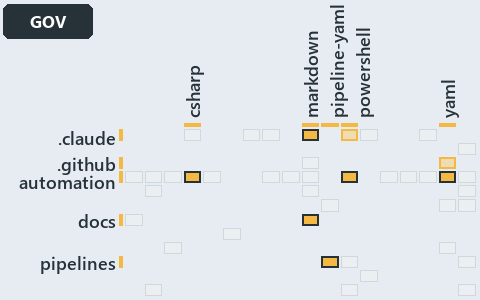

# docs/.assets/explanation/adr-dsgn-track--unit-to-pipeline-rule-is-review-only--governance.grid.md

`Grid minimap: adr-dsgn-track--unit-to-pipeline-rule-is-review-only--governance`

The grid minimap of the slide `adr-dsgn-track--unit-to-pipeline-rule-is-review-only--governance` (governance lens). The slide supports
[ADR-DSGN-TRACK][1], [ADR-FLOW-CD][2], [ADR-FLOW-CD-GLOBS][3] and [ADR-REPO-FOLDERS][4]; the highlight of those ADR codes selects what is
lit, and each reason below names the code that selects it.

## What the minimap shows

The grid crosses the 12 tracks with the 18 file languages of the world map and lights 8 cells. A cell lit only by passing mentions
(citations in body comments, not in a file's header or text) is touched: drawn pale.

- .claude × markdown: 2 lit of 9 files
- .claude × powershell: 1 lit of 1 file, touched
- .github × yaml: 1 lit of 2 files, touched
- automation × csharp: 27 lit of 219 files
- automation × powershell: 65 lit of 1398 files
- automation × yaml: 11 lit of 95 files
- docs × markdown: 92 lit of 469 files
- pipelines × pipeline-yaml: 6 lit of 9 files

## Why each cell is lit

### .claude × markdown (2 lit files)

Placed: the root folder `.claude/` names the track .claude ([ADR-DSGN-TRACK#1][5]); the extension `.md` names the file language markdown
([ADR-DSGN-TRACK#6][6]). Lit ([ADR-DSGN-TRACK#12][7]) by:

- [.claude/CLAUDE.md][8]: selected by [ADR-FLOW-CD][2]: the file cites it at line 51 (text).
- [.claude/drawio/STYLE.md][9]: selected by [ADR-DSGN-TRACK][1]: the file cites it at line 180 (text), line 181 (text), line 186 (text),
  line 194 (text), line 196 (text) and line 197 (text); selected by [ADR-FLOW-CD][2]: the file cites it at line 28 (text).

### .claude × powershell (1 lit file, touched)

Placed: the root folder `.claude/` names the track .claude ([ADR-DSGN-TRACK#1][5]); the extension `.ps1` names the file language powershell
([ADR-DSGN-TRACK#6][6]). Lit ([ADR-DSGN-TRACK#12][7]) by:

- [.claude/drawio/minimaps/highlights.ps1][10]: selected by [ADR-DSGN-TRACK][1]: the file cites it at line 44 (body comment) (a passing
  mention only).

### .github × yaml (1 lit file, touched)

Placed: the root folder `.github/` names the track .github ([ADR-DSGN-TRACK#1][5]); the extension `.yml` names the file language yaml
([ADR-DSGN-TRACK#6][6]). Lit ([ADR-DSGN-TRACK#12][7]) by:

- [.github/workflows/ci-automation.yml][11]: selected by [ADR-FLOW-CD-GLOBS][3]: the file cites it at line 4 (body comment) (a passing
  mention only).

### automation × csharp (27 lit files)

Placed: the root folder `automation/` names the track automation ([ADR-DSGN-TRACK#1][5]); the extension `.cs` names the file language csharp
([ADR-DSGN-TRACK#6][6]). Lit ([ADR-DSGN-TRACK#12][7]) by:

- [automation/Catzc.Base.Docs/types/AdrDomain.cs][12]: selected by [ADR-DSGN-TRACK][1]: the file cites it at line 6 (header) and line 7
  (header).
- [automation/Catzc.Base.Docs/types/AdrRuleSet.cs][13]: selected by [ADR-DSGN-TRACK][1]: the file cites it at line 8 (header).
- [automation/Catzc.Base.Docs/types/AdrsConfig.cs][14]: selected by [ADR-DSGN-TRACK][1]: the file cites it at line 21 (header), line 24
  (header), line 43 (body comment) and line 47 (body comment); selected by [ADR-FLOW-CD][2]: the file cites it at line 17 (header), line 18
  (header), line 194 (body comment) and line 195 (body comment).
- [automation/Catzc.Base.Docs/types/GlossaryConcept.cs][15]: selected by [ADR-FLOW-CD][2]: the file cites it at line 41 (body comment) (a
  passing mention only).
- [automation/Catzc.Base.Globs/types/Aspect.cs][16]: selected by [ADR-FLOW-CD-GLOBS][3]: the file cites it at line 9 (header).
- [automation/Catzc.Base.Globs/types/DurableHash.cs][17]: selected by [ADR-FLOW-CD-GLOBS][3]: the file cites it at line 1 (header) and line
  7 (header).
- [automation/Catzc.Base.Globs/types/GlobPattern.cs][18]: selected by [ADR-FLOW-CD-GLOBS][3]: the file cites it at line 7 (header), line 8
  (header), line 9 (header), line 33 (text), line 37 (text), line 41 (text), line 53 (text), line 57 (text) and line 66 (text).
- [automation/Catzc.Base.Globs/types/GlobSet.cs][19]: selected by [ADR-FLOW-CD-GLOBS][3]: the file cites it at line 3 (header), line 5
  (header), line 6 (header), line 12 (header), line 15 (header), line 17 (header), line 20 (header), line 32 (body comment), line 41 (body
  comment), line 63 (body comment), line 89 (text), line 122 (body comment), line 135 (body comment), line 158 (body comment) and line 180
  (body comment).
- [automation/Catzc.Base.Globs/types/GlobsConfig.cs][20]: selected by [ADR-FLOW-CD-GLOBS][3]: the file cites it at line 3 (header), line 7
  (header), line 10 (header), line 88 (text), line 143 (body comment), line 154 (text), line 158 (text) and line 172 (text).
- [automation/Catzc.Base.Languages/types/BashConfig.cs][21]: selected by [ADR-REPO-FOLDERS][4]: the file cites it at line 12 (header).
- [automation/Catzc.Base.Languages/types/FileLanguage.cs][22]: selected by [ADR-DSGN-TRACK][1]: the file cites it at line 2 (header).
- [automation/Catzc.Base.Languages/types/GoConfig.cs][23]: selected by [ADR-REPO-FOLDERS][4]: the file cites it at line 15 (header).
- [automation/Catzc.Base.Languages/types/LanguagesConfig.cs][24]: selected by [ADR-DSGN-TRACK][1]: the file cites it at line 2 (header).
- [automation/Catzc.Base.Languages/types/PythonConfig.cs][25]: selected by [ADR-REPO-FOLDERS][4]: the file cites it at line 15 (header).
- [automation/Catzc.Base.Maps/types/MapCell.cs][26]: selected by [ADR-DSGN-TRACK][1]: the file cites it at line 2 (header), line 3 (header)
  and line 4 (header).
- [automation/Catzc.Base.Maps/types/MapsLabels.cs][27]: selected by [ADR-DSGN-TRACK][1]: the file cites it at line 5 (header), line 6
  (header) and line 10 (header).
- [automation/Catzc.Base.Maps/types/ValueChainCell.cs][28]: selected by [ADR-DSGN-TRACK][1]: the file cites it at line 2 (header), line 3
  (header), line 15 (body comment) and line 18 (body comment).
- [automation/Catzc.Base.Maps/types/ValueChainHighlight.cs][29]: selected by [ADR-DSGN-TRACK][1]: the file cites it at line 2 (header) and
  line 3 (header).
- [automation/Catzc.Base.Maps/types/ValueChainMap.cs][30]: selected by [ADR-DSGN-TRACK][1]: the file cites it at line 2 (header), line 3
  (header) and line 5 (header).
- [automation/Catzc.Base.Maps/types/ValueChainReason.cs][31]: selected by [ADR-DSGN-TRACK][1]: the file cites it at line 2 (header) and line
  4 (header).
- [automation/Catzc.Base.Maps/types/WorldMap.cs][32]: selected by [ADR-DSGN-TRACK][1]: the file cites it at line 3 (header) and line 4
  (header).
- [automation/Catzc.Base.Maps/types/WorldMapBuilder.cs][33]: selected by [ADR-DSGN-TRACK][1]: the file cites it at line 7 (header), line 8
  (header) and line 11 (header).
- [automation/Catzc.Base.Maps/types/WorldMapGridLayout.cs][34]: selected by [ADR-DSGN-TRACK][1]: the file cites it at line 3 (header) and
  line 4 (header).
- [automation/Catzc.Base.Maps/types/WorldMapHighlight.cs][35]: selected by [ADR-DSGN-TRACK][1]: the file cites it at line 2 (header).
- [automation/Catzc.Base.Maps/types/WorldMapPdf.cs][36]: selected by [ADR-DSGN-TRACK][1]: the file cites it at line 4 (header), line 5
  (header) and line 6 (header).
- [automation/Catzc.Base.Variants/types/VariantTrack.cs][37]: selected by [ADR-DSGN-TRACK][1]: the file cites it at line 1 (header), line 3
  (header) and line 17 (body comment).
- [automation/Catzc.Base.Variants/types/VariantsConfig.cs][38]: selected by [ADR-DSGN-TRACK][1]: the file cites it at line 22 (header), line
  25 (header), line 27 (header) and line 270 (text).

### automation × powershell (65 lit files)

Placed: the root folder `automation/` names the track automation ([ADR-DSGN-TRACK#1][5]); the extension `.ps1` names the file language
powershell ([ADR-DSGN-TRACK#6][6]). Lit ([ADR-DSGN-TRACK#12][7]) by:

- [automation/Catzc.Azure.DevOps.BuildValidation/Get-AdoBuildValidations.ps1][39]: selected by [ADR-FLOW-CD-GLOBS][3]: the file cites it at
  line 10 (header).
- [automation/Catzc.Azure.DevOps.BuildValidation/Register-AdoBuildValidation.ps1][40]: selected by [ADR-FLOW-CD-GLOBS][3]: the file cites it
  at line 6 (header) and line 98 (body comment).
- [automation/Catzc.Azure.DevOps.BuildValidation/Unregister-AdoBuildValidation.ps1][41]: selected by [ADR-FLOW-CD-GLOBS][3]: the file cites
  it at line 6 (header).
- [automation/Catzc.Azure.DevOps.BuildValidation/private/Get-BuildValidationPathFilter.ps1][42]: selected by [ADR-FLOW-CD-GLOBS][3]: the
  file cites it at line 8 (header).
- [automation/Catzc.Base.Docs/private/Get-CatsModules.ps1][43]: selected by [ADR-REPO-FOLDERS][4]: the file cites it at line 7 (header).
- [automation/Catzc.Base.Docs/tests/types/AdrsConfig.Tests.ps1][44]: selected by [ADR-DSGN-TRACK][1]: the file cites it at line 99 (text)
  and line 99 (body comment).
- [automation/Catzc.Base.Exporter/Get-CatzcContentHash.ps1][45]: selected by [ADR-FLOW-CD-GLOBS][3]: the file cites it at line 6 (header).
- [automation/Catzc.Base.Globs/Get-ChangedGlobSet.ps1][46]: selected by [ADR-FLOW-CD-GLOBS][3]: the file cites it at line 4 (header) and
  line 8 (header).
- [automation/Catzc.Base.Globs/Get-GlobSet.ps1][47]: selected by [ADR-FLOW-CD-GLOBS][3]: the file cites it at line 6 (header).
- [automation/Catzc.Base.Globs/Get-GlobSetFile.ps1][48]: selected by [ADR-FLOW-CD-GLOBS][3]: the file cites it at line 6 (header) and line 9
  (header).
- [automation/Catzc.Base.Globs/Get-GlobSetHash.ps1][49]: selected by [ADR-FLOW-CD-GLOBS][3]: the file cites it at line 4 (header) and line
  10 (header).
- [automation/Catzc.Base.Globs/Get-GlobSetTrigger.ps1][50]: selected by [ADR-FLOW-CD-GLOBS][3]: the file cites it at line 4 (header) and
  line 7 (header).
- [automation/Catzc.Base.Globs/Get-MarkerBlastRadius.ps1][51]: selected by [ADR-FLOW-CD-GLOBS][3]: the file cites it at line 6 (header).
- [automation/Catzc.Base.Globs/Get-ModuleGlobSet.ps1][52]: selected by [ADR-FLOW-CD-GLOBS][3]: the file cites it at line 72 (body comment),
  line 75 (body comment) and line 163 (body comment) (a passing mention only).
- [automation/Catzc.Base.Globs/Get-TrackedFile.ps1][53]: selected by [ADR-FLOW-CD-GLOBS][3]: the file cites it at line 6 (header).
- [automation/Catzc.Base.Globs/Test-AdoPipelineTriggerGlob.ps1][54]: selected by [ADR-FLOW-CD-GLOBS][3]: the file cites it at line 4
  (header).
- [automation/Catzc.Base.Globs/Test-GitHubWorkflowTriggerGlob.ps1][55]: selected by [ADR-FLOW-CD-GLOBS][3]: the file cites it at line 4
  (header).
- [automation/Catzc.Base.Globs/Test-GlobSetAffected.ps1][56]: selected by [ADR-FLOW-CD-GLOBS][3]: the file cites it at line 10 (header).
- [automation/Catzc.Base.Globs/Test-GlobSetIndependence.ps1][57]: selected by [ADR-FLOW-CD-GLOBS][3]: the file cites it at line 4 (header),
  line 13 (header), line 42 (body comment), line 50 (body comment) and line 79 (text).
- [automation/Catzc.Base.Globs/Test-GlobSetTriggerCoverage.ps1][58]: selected by [ADR-FLOW-CD-GLOBS][3]: the file cites it at line 7
  (header).
- [automation/Catzc.Base.Globs/private/Get-ChangedFile.ps1][59]: selected by [ADR-FLOW-CD-GLOBS][3]: the file cites it at line 7 (header).
- [automation/Catzc.Base.Globs/private/Get-GlobSetMember.ps1][60]: selected by [ADR-FLOW-CD-GLOBS][3]: the file cites it at line 6 (header).
- [automation/Catzc.Base.Globs/private/Get-PipelineTrigger.ps1][61]: selected by [ADR-FLOW-CD-GLOBS][3]: the file cites it at line 7
  (header).
- [automation/Catzc.Base.Globs/private/Test-GlobListEqual.ps1][62]: selected by [ADR-FLOW-CD-GLOBS][3]: the file cites it at line 11
  (header).
- [automation/Catzc.Base.Globs/tests/Get-ChangedFile.Tests.ps1][63]: selected by [ADR-FLOW-CD-GLOBS][3]: the file cites it at line 2
  (header).
- [automation/Catzc.Base.Globs/tests/Get-ChangedGlobSet.Tests.ps1][64]: selected by [ADR-FLOW-CD-GLOBS][3]: the file cites it at line 2
  (header).
- [automation/Catzc.Base.Globs/tests/Get-GlobSetFile.Tests.ps1][65]: selected by [ADR-FLOW-CD-GLOBS][3]: the file cites it at line 2
  (header) and line 3 (header).
- [automation/Catzc.Base.Globs/tests/Get-GlobSetHash.Tests.ps1][66]: selected by [ADR-FLOW-CD-GLOBS][3]: the file cites it at line 2
  (header).
- [automation/Catzc.Base.Globs/tests/Get-GlobSetMember.Tests.ps1][67]: selected by [ADR-FLOW-CD-GLOBS][3]: the file cites it at line 2
  (header).
- [automation/Catzc.Base.Globs/tests/Get-GlobSetTrigger.Tests.ps1][68]: selected by [ADR-FLOW-CD-GLOBS][3]: the file cites it at line 2
  (header).
- [automation/Catzc.Base.Globs/tests/Get-PipelineTrigger.Tests.ps1][69]: selected by [ADR-FLOW-CD-GLOBS][3]: the file cites it at line 2
  (header).
- [automation/Catzc.Base.Globs/tests/Get-TrackedFile.Tests.ps1][70]: selected by [ADR-FLOW-CD-GLOBS][3]: the file cites it at line 1
  (header).
- [automation/Catzc.Base.Globs/tests/GlobSet-Independence.Tests.ps1][71]: selected by [ADR-FLOW-CD-GLOBS][3]: the file cites it at line 2
  (header), line 10 (text) and line 12 (text).
- [automation/Catzc.Base.Globs/tests/GlobSetTrigger-Coverage.Tests.ps1][72]: selected by [ADR-FLOW-CD-GLOBS][3]: the file cites it at line 2
  (header).
- [automation/Catzc.Base.Globs/tests/PipelineTrigger-Integrity.Tests.ps1][73]: selected by [ADR-FLOW-CD-GLOBS][3]: the file cites it at line
  3 (header).
- [automation/Catzc.Base.Globs/tests/Test-GlobSetIndependence.Tests.ps1][74]: selected by [ADR-FLOW-CD-GLOBS][3]: the file cites it at line
  3 (header).
- [automation/Catzc.Base.Globs/tests/types/GlobPattern.Tests.ps1][75]: selected by [ADR-FLOW-CD-GLOBS][3]: the file cites it at line 1
  (header), line 3 (header) and line 63 (text).
- [automation/Catzc.Base.Globs/tests/types/GlobSet.Tests.ps1][76]: selected by [ADR-FLOW-CD-GLOBS][3]: the file cites it at line 2 (header),
  line 4 (header) and line 15 (text).
- [automation/Catzc.Base.Globs/tests/types/GlobsConfig.Tests.ps1][77]: selected by [ADR-DSGN-TRACK][1]: the file cites it at line 50 (text);
  selected by [ADR-FLOW-CD-GLOBS][3]: the file cites it at line 3 (header), line 5 (header), line 13 (body comment), line 62 (text), line 75
  (text), line 86 (text) and line 98 (text).
- [automation/Catzc.Base.Languages/Get-FileLanguage.ps1][78]: selected by [ADR-DSGN-TRACK][1]: the file cites it at line 6 (header).
- [automation/Catzc.Base.Languages/tests/Get-FileLanguage.Tests.ps1][79]: selected by [ADR-DSGN-TRACK][1]: the file cites it at line 47
  (body comment), line 124 (text), line 136 (text) and line 178 (text).
- [automation/Catzc.Base.Maps/Export-WorldMapPdf.ps1][80]: selected by [ADR-DSGN-TRACK][1]: the file cites it at line 10 (header), line 11
  (header), line 13 (header) and line 33 (header).
- [automation/Catzc.Base.Maps/Get-ValueChainHighlight.ps1][81]: selected by [ADR-DSGN-TRACK][1]: the file cites it at line 8 (header), line
  9 (header) and line 22 (header); selected by [ADR-FLOW-CD][2]: the file cites it at line 20 (header).
- [automation/Catzc.Base.Maps/Get-ValueChainMap.ps1][82]: selected by [ADR-DSGN-TRACK][1]: the file cites it at line 6 (header), line 8
  (header) and line 10 (header).
- [automation/Catzc.Base.Maps/Get-WorldMap.ps1][83]: selected by [ADR-DSGN-TRACK][1]: the file cites it at line 6 (header), line 7 (header)
  and line 15 (header).
- [automation/Catzc.Base.Maps/Get-WorldMapHighlight.ps1][84]: selected by [ADR-DSGN-TRACK][1]: the file cites it at line 12 (header) and
  line 33 (header); selected by [ADR-FLOW-CD][2]: the file cites it at line 31 (header).
- [automation/Catzc.Base.Maps/Test-ValueChainMap.ps1][85]: selected by [ADR-DSGN-TRACK][1]: the file cites it at line 14 (header), line 16
  (header), line 19 (header), line 23 (header), line 54 (text), line 55 (text), line 65 (text), line 68 (text) and line 85 (text).
- [automation/Catzc.Base.Maps/Test-WorldMap.ps1][86]: selected by [ADR-DSGN-TRACK][1]: the file cites it at line 11 (header), line 14
  (header), line 18 (header), line 22 (header), line 23 (header), line 66 (text), line 85 (text), line 102 (text), line 106 (text) and line
  107 (text).
- [automation/Catzc.Base.Maps/private/Resolve-MapLabelTerm.ps1][87]: selected by [ADR-DSGN-TRACK][1]: the file cites it at line 9 (header)
  and line 10 (header).
- [automation/Catzc.Base.Maps/tests/Get-ValueChainHighlight.Tests.ps1][88]: selected by [ADR-DSGN-TRACK][1]: the file cites it at line 2
  (header), line 3 (header), line 21 (text), line 27 (text) and line 46 (text).
- [automation/Catzc.Base.Maps/tests/Get-ValueChainMap.Tests.ps1][89]: selected by [ADR-DSGN-TRACK][1]: the file cites it at line 2 (header),
  line 21 (text), line 42 (text) and line 42 (body comment).
- [automation/Catzc.Base.Maps/tests/Get-WorldMap.Tests.ps1][90]: selected by [ADR-DSGN-TRACK][1]: the file cites it at line 72 (body
  comment) and line 88 (text).
- [automation/Catzc.Base.Maps/tests/Get-WorldMapHighlight.Tests.ps1][91]: selected by [ADR-FLOW-CD][2]: the file cites it at line 70 (text)
  and line 71 (text).
- [automation/Catzc.Base.Maps/tests/Test-ValueChainMap.Tests.ps1][92]: selected by [ADR-DSGN-TRACK][1]: the file cites it at line 2
  (header), line 3 (header), line 4 (header), line 57 (text), line 57 (body comment), line 61 (text), line 62 (text), line 63 (text), line
  64 (text), line 68 (text), line 71 (text), line 90 (text), line 90 (body comment) and line 90 (body comment).
- [automation/Catzc.Base.Maps/tests/Test-WorldMap.Tests.ps1][93]: selected by [ADR-DSGN-TRACK][1]: the file cites it at line 2 (header),
  line 3 (header), line 65 (text), line 69 (text), line 72 (text), line 76 (text), line 77 (text), line 81 (text), line 90 (text), line 91
  (text), line 95 (text), line 99 (text), line 100 (text), line 121 (text), line 121 (body comment) and line 121 (body comment).
- [automation/Catzc.Base.Maps/tests/types/ValueChainHighlight.Tests.ps1][94]: selected by [ADR-DSGN-TRACK][1]: the file cites it at line 2
  (header), line 3 (header), line 19 (text), line 26 (text), line 32 (text), line 49 (text) and line 49 (body comment).
- [automation/Catzc.Base.Maps/tests/types/ValueChainMap.Tests.ps1][95]: selected by [ADR-DSGN-TRACK][1]: the file cites it at line 2
  (header), line 20 (text), line 29 (text), line 34 (text) and line 42 (text).
- [automation/Catzc.Base.Maps/tests/types/WorldMapHighlight.Tests.ps1][96]: selected by [ADR-DSGN-TRACK][1]: the file cites it at line 104
  (text) and line 119 (text).
- [automation/Catzc.Base.ModuleSystem/Test-FolderConventions.ps1][97]: selected by [ADR-REPO-FOLDERS][4]: the file cites it at line 8
  (header) and line 89 (body comment).
- [automation/Catzc.Base.QualityGates/Test-Automation.ps1][98]: selected by [ADR-FLOW-CD-GLOBS][3]: the file cites it at line 72 (header).
- [automation/Catzc.Base.QualityGates/private/Get-GuidScanFiles.ps1][99]: selected by [ADR-FLOW-CD-GLOBS][3]: the file cites it at line 7
  (header).
- [automation/Catzc.Base.QualityGates/private/Get-LanguageTestFolders.ps1][100]: selected by [ADR-DSGN-TRACK][1]: the file cites it at line
  7 (header).
- [automation/Catzc.Base.QualityGates/private/Get-ModuleProtectionIdentity.ps1][101]: selected by [ADR-FLOW-CD-GLOBS][3]: the file cites it
  at line 143 (body comment) (a passing mention only).
- [automation/Catzc.Base.QualityGates/private/Resolve-TestSuite.ps1][102]: selected by [ADR-FLOW-CD-GLOBS][3]: the file cites it at line 9
  (header).
- [automation/Catzc.Base.Variants/Get-Track.ps1][103]: selected by [ADR-DSGN-TRACK][1]: the file cites it at line 5 (header), line 7
  (header), line 8 (header) and line 12 (header).

### automation × yaml (11 lit files)

Placed: the root folder `automation/` names the track automation ([ADR-DSGN-TRACK#1][5]); the extension `.yml` names the file language yaml
([ADR-DSGN-TRACK#6][6]). Lit ([ADR-DSGN-TRACK#12][7]) by:

- [automation/Catzc.Azure.DevOps.BuildValidation/configs/build-validation.yml][104]: selected by [ADR-FLOW-CD-GLOBS][3]: the file cites it
  at line 5 (header).
- [automation/Catzc.Base.Docs/configs/adrs.yml][105]: selected by [ADR-DSGN-TRACK][1]: the file cites it at line 11 (header), line 12
  (header) and line 95 (text); selected by [ADR-FLOW-CD][2]: the file cites it at line 105 (body comment) and line 118 (text); selected by
  [ADR-FLOW-CD-GLOBS][3]: the file cites it at line 122 (text); selected by [ADR-REPO-FOLDERS][4]: the file cites it at line 286 (text).
- [automation/Catzc.Base.Docs/configs/agents.yml][106]: selected by [ADR-REPO-FOLDERS][4]: the file cites it at line 32 (body comment) and
  line 37 (body comment) (a passing mention only).
- [automation/Catzc.Base.Docs/configs/glossary.yml][107]: selected by [ADR-REPO-FOLDERS][4]: the file cites it at line 17 (text).
- [automation/Catzc.Base.Globs/configs/globs.yml][108]: selected by [ADR-DSGN-TRACK][1]: the file cites it at line 113 (body comment) (a
  passing mention only); selected by [ADR-FLOW-CD-GLOBS][3]: the file cites it at line 2 (header), line 7 (header), line 15 (header), line
  17 (header), line 26 (body comment), line 61 (body comment) and line 81 (body comment).
- [automation/Catzc.Base.Languages/configs/glossary.yml][109]: selected by [ADR-DSGN-TRACK][1]: the file cites it at line 10 (text).
- [automation/Catzc.Base.Languages/configs/languages.yml][110]: selected by [ADR-DSGN-TRACK][1]: the file cites it at line 2 (header).
- [automation/Catzc.Base.Maps/configs/maps.yml][111]: selected by [ADR-DSGN-TRACK][1]: the file cites it at line 26 (header), line 32
  (header), line 34 (header) and line 39 (header).
- [automation/Catzc.Base.ModuleSystem/configs/glossary.yml][112]: selected by [ADR-DSGN-TRACK][1]: the file cites it at line 9 (text), line
  65 (text), line 84 (text), line 95 (text), line 110 (text), line 123 (text), line 137 (text), line 152 (text), line 165 (text), line 177
  (text), line 190 (text), line 192 (text) and line 204 (text); selected by [ADR-FLOW-CD][2]: the file cites it at line 21 (text).
- [automation/Catzc.Base.QualityGates/configs/glossary.yml][113]: selected by [ADR-FLOW-CD][2]: the file cites it at line 62 (text).
- [automation/Catzc.Base.Variants/configs/variants.yml][114]: selected by [ADR-DSGN-TRACK][1]: the file cites it at line 45 (body comment),
  line 48 (body comment) and line 50 (body comment) (a passing mention only).

### docs × markdown (92 lit files)

Placed: the root folder `docs/` names the track docs ([ADR-DSGN-TRACK#1][5]); the extension `.md` names the file language markdown
([ADR-DSGN-TRACK#6][6]). Lit ([ADR-DSGN-TRACK#12][7]) by:

- [docs/.assets/explanation/adr-dsgn-aspect--partition-integrity-runs-only-in-unit-tests--governance.drawio.md][115]: selected by
  [ADR-FLOW-CD-GLOBS][3]: the file cites it at line 66 (text) and line 76 (text); selected by [ADR-REPO-FOLDERS][4]: the file cites it at
  line 66 (text) and line 76 (text).
- [docs/.assets/explanation/adr-dsgn-life--engineer-merges-pipelines-do-the-rest--operations.drawio.md][116]: selected by [ADR-FLOW-CD][2]:
  the file cites it at line 72 (text).
- [docs/.assets/explanation/adr-dsgn-life--four-domains-promote-one-artifact--architecture.drawio.md][117]: selected by [ADR-FLOW-CD][2]:
  the file cites it at line 71 (text).
- [docs/.assets/explanation/adr-dsgn-life--integrators-depend-on-an-occupant--architecture.drawio.md][118]: selected by [ADR-FLOW-CD][2]:
  the file cites it at line 67 (text).
- [docs/.assets/explanation/adr-dsgn-life--sync-point-rules-are-adr-only--governance.drawio.md][119]: selected by [ADR-FLOW-CD][2]: the file
  cites it at line 65 (text) and line 74 (text).
- [docs/.assets/explanation/adr-dsgn-life--which-rung-gates-exist-in-code--governance.drawio.md][120]: selected by [ADR-FLOW-CD][2]: the
  file cites it at line 67 (text) and line 76 (text).
- [docs/.assets/explanation/adr-dsgn-track--a-push-fires-only-touched-pipelines--operations.drawio.md][121]: selected by
  [ADR-DSGN-TRACK][1]: the file cites it at line 71 (text).
- [docs/.assets/explanation/adr-dsgn-track--globs-yml-pipeline-field-is-the-binding--implementation.drawio.md][122]: selected by
  [ADR-DSGN-TRACK][1]: the file cites it at line 68 (text).
- [docs/.assets/explanation/adr-dsgn-track--one-unit-one-pipeline--meta.drawio.md][123]: selected by [ADR-DSGN-TRACK][1]: the file cites it
  at line 64 (text).
- [docs/.assets/explanation/adr-dsgn-track--unit-to-pipeline-rule-is-review-only--governance.drawio.md][124]: selected by
  [ADR-DSGN-TRACK][1]: the file cites it at line 60 (text) and line 68 (text); selected by [ADR-FLOW-CD-GLOBS][3]: the file cites it at line
  60 (text) and line 68 (text); selected by [ADR-REPO-FOLDERS][4]: the file cites it at line 60 (text) and line 68 (text).
- [docs/.assets/explanation/adr-dsgn-track--units-not-tracks-own-the-pipelines--architecture.drawio.md][125]: selected by
  [ADR-DSGN-TRACK][1]: the file cites it at line 68 (text).
- [docs/.assets/explanation/adr-flow-cd--a-merge-runs-cd-to-prod--operations.drawio.md][126]: selected by [ADR-FLOW-CD][2]: the file cites
  it at line 72 (text).
- [docs/.assets/explanation/adr-flow-cd--cd-builds-once-then-deploys-prod-itself--implementation.drawio.md][127]: selected by
  [ADR-FLOW-CD][2]: the file cites it at line 67 (text).
- [docs/.assets/explanation/adr-flow-cd--ci-budget-is-the-only-quality-gate--governance.drawio.md][128]: selected by [ADR-FLOW-CD][2]: the
  file cites it at line 60 (text) and line 71 (text).
- [docs/.assets/explanation/adr-flow-cd--one-artifact-climbs-unchanged--meta.drawio.md][129]: selected by [ADR-FLOW-CD][2]: the file cites
  it at line 71 (text).
- [docs/.assets/explanation/adr-flow-cd--pipeline-kinds-keyed-by-one-artifact--architecture.drawio.md][130]: selected by [ADR-FLOW-CD][2]:
  the file cites it at line 74 (text).
- [docs/.assets/explanation/adr-flow-cd-globs--declare-or-add-folder-gate-names-overlaps--operations.drawio.md][131]: selected by
  [ADR-FLOW-CD-GLOBS][3]: the file cites it at line 71 (text).
- [docs/.assets/explanation/adr-flow-cd-globs--edit-globs-yml-then-read-the-output--operations.drawio.md][132]: selected by
  [ADR-FLOW-CD-GLOBS][3]: the file cites it at line 66 (text).
- [docs/.assets/explanation/adr-flow-cd-globs--gates-check-source-and-trigger--governance.drawio.md][133]: selected by
  [ADR-FLOW-CD-GLOBS][3]: the file cites it at line 65 (text) and line 73 (text).
- [docs/.assets/explanation/adr-flow-cd-globs--globs-module-owns-config-and-types--architecture.drawio.md][134]: selected by
  [ADR-FLOW-CD-GLOBS][3]: the file cites it at line 70 (text).
- [docs/.assets/explanation/adr-flow-cd-globs--independence-check-groups-by-layer--implementation.drawio.md][135]: selected by
  [ADR-FLOW-CD-GLOBS][3]: the file cites it at line 70 (text).
- [docs/.assets/explanation/adr-flow-cd-globs--one-scan-program-feeds-three-roles--implementation.drawio.md][136]: selected by
  [ADR-FLOW-CD-GLOBS][3]: the file cites it at line 70 (text).
- [docs/.assets/explanation/adr-flow-cd-globs--overlap-gated-for-units-and-modules--governance.drawio.md][137]: selected by
  [ADR-FLOW-CD-GLOBS][3]: the file cites it at line 61 (text) and line 68 (text).
- [docs/.assets/explanation/adr-flow-cd-globs--peers-in-a-layer-never-overlap--meta.drawio.md][138]: selected by [ADR-FLOW-CD-GLOBS][3]: the
  file cites it at line 62 (text).
- [docs/.assets/explanation/adr-flow-cd-globs--three-views-derived-live-from-one-program--meta.drawio.md][139]: selected by
  [ADR-FLOW-CD-GLOBS][3]: the file cites it at line 62 (text).
- [docs/.assets/explanation/adr-flow-cd-globs--two-declared-layers-one-derived--architecture.drawio.md][140]: selected by
  [ADR-FLOW-CD-GLOBS][3]: the file cites it at line 62 (text).
- [docs/adr/design/commit-lifecycle.md][141]: selected by [ADR-DSGN-TRACK][1]: an ADR file of the `design` ADR domain, the ADR domain of
  that code.
- [docs/adr/design/dora-explains.md][142]: selected by [ADR-DSGN-TRACK][1]: an ADR file of the `design` ADR domain, the ADR domain of that
  code.
- [docs/adr/design/module-aspects.md][143]: selected by [ADR-DSGN-TRACK][1]: an ADR file of the `design` ADR domain, the ADR domain of that
  code.
- [docs/adr/design/run-modes.md][144]: selected by [ADR-DSGN-TRACK][1]: an ADR file of the `design` ADR domain, the ADR domain of that code.
- [docs/adr/design/self-service.md][145]: selected by [ADR-DSGN-TRACK][1]: an ADR file of the `design` ADR domain, the ADR domain of that
  code.
- [docs/adr/design/server-remote-integration.md][146]: selected by [ADR-DSGN-TRACK][1]: an ADR file of the `design` ADR domain, the ADR
  domain of that code.
- [docs/adr/design/thin-platforms.md][147]: selected by [ADR-DSGN-TRACK][1]: an ADR file of the `design` ADR domain, the ADR domain of that
  code.
- [docs/adr/design/tracks.md][1]: selected by [ADR-DSGN-TRACK][1]: an ADR file of the `design` ADR domain, the ADR domain of that code.
- [docs/adr/design/visual-design.md][148]: selected by [ADR-DSGN-TRACK][1]: an ADR file of the `design` ADR domain, the ADR domain of that
  code.
- [docs/adr/flow/cd-discipline-and-promotion-flow.md][2]: selected by [ADR-FLOW-CD][2]: an ADR file of the `flow` ADR domain, the ADR domain
  of that code; selected by [ADR-FLOW-CD-GLOBS][3]: an ADR file of the `flow` ADR domain, the ADR domain of that code.
- [docs/adr/flow/dora-explains.md][149]: selected by [ADR-FLOW-CD][2]: an ADR file of the `flow` ADR domain, the ADR domain of that code;
  selected by [ADR-FLOW-CD-GLOBS][3]: an ADR file of the `flow` ADR domain, the ADR domain of that code.
- [docs/adr/flow/durable-sha-globs.md][3]: selected by [ADR-FLOW-CD][2]: an ADR file of the `flow` ADR domain, the ADR domain of that code;
  selected by [ADR-FLOW-CD-GLOBS][3]: an ADR file of the `flow` ADR domain, the ADR domain of that code.
- [docs/adr/flow/pipeline-detection.md][150]: selected by [ADR-FLOW-CD][2]: an ADR file of the `flow` ADR domain, the ADR domain of that
  code; selected by [ADR-FLOW-CD-GLOBS][3]: an ADR file of the `flow` ADR domain, the ADR domain of that code.
- [docs/adr/flow/pipeline-runner-pattern.md][151]: selected by [ADR-FLOW-CD][2]: an ADR file of the `flow` ADR domain, the ADR domain of
  that code; selected by [ADR-FLOW-CD-GLOBS][3]: an ADR file of the `flow` ADR domain, the ADR domain of that code.
- [docs/adr/flow/pipeline-types.md][152]: selected by [ADR-FLOW-CD][2]: an ADR file of the `flow` ADR domain, the ADR domain of that code;
  selected by [ADR-FLOW-CD-GLOBS][3]: an ADR file of the `flow` ADR domain, the ADR domain of that code.
- [docs/adr/glossary.md][153]: selected by [ADR-DSGN-TRACK][1]: the file cites it at line 91 (text), line 107 (text), line 121 (text), line
  137 (text), line 166 (text), line 176 (text), line 178 (text), line 192 (text), line 211 (text), line 225 (text), line 239 (text), line
  252 (text), line 265 (text) and line 277 (text); selected by [ADR-FLOW-CD][2]: the file cites it at line 292 (text) and line 305 (text);
  selected by [ADR-REPO-FOLDERS][4]: the file cites it at line 677 (text).
- [docs/adr/index.md][154]: selected by [ADR-DSGN-TRACK][1]: the file cites it at line 88 (text); selected by [ADR-FLOW-CD][2]: the file
  cites it at line 107 (text); selected by [ADR-FLOW-CD-GLOBS][3]: the file cites it at line 111 (text); selected by [ADR-REPO-FOLDERS][4]:
  the file cites it at line 267 (text).
- [docs/adr/repository/agent-definitions.md][155]: selected by [ADR-REPO-FOLDERS][4]: an ADR file of the `repository` ADR domain, the ADR
  domain of that code.
- [docs/adr/repository/api-contracts.md][156]: selected by [ADR-REPO-FOLDERS][4]: an ADR file of the `repository` ADR domain, the ADR domain
  of that code.
- [docs/adr/repository/controlled-vocabulary.md][157]: selected by [ADR-REPO-FOLDERS][4]: an ADR file of the `repository` ADR domain, the
  ADR domain of that code.
- [docs/adr/repository/conventional-folders.md][4]: selected by [ADR-REPO-FOLDERS][4]: an ADR file of the `repository` ADR domain, the ADR
  domain of that code.
- [docs/adr/repository/dedicated-output-directory.md][158]: selected by [ADR-REPO-FOLDERS][4]: an ADR file of the `repository` ADR domain,
  the ADR domain of that code.
- [docs/adr/repository/documentation-examples.md][159]: selected by [ADR-REPO-FOLDERS][4]: an ADR file of the `repository` ADR domain, the
  ADR domain of that code.
- [docs/adr/repository/domain-language-separation.md][160]: selected by [ADR-REPO-FOLDERS][4]: an ADR file of the `repository` ADR domain,
  the ADR domain of that code.
- [docs/adr/repository/dora-explains.md][161]: selected by [ADR-REPO-FOLDERS][4]: an ADR file of the `repository` ADR domain, the ADR domain
  of that code.
- [docs/adr/repository/generated-readmes.md][162]: selected by [ADR-REPO-FOLDERS][4]: an ADR file of the `repository` ADR domain, the ADR
  domain of that code.
- [docs/adr/repository/generated-root-configs.md][163]: selected by [ADR-REPO-FOLDERS][4]: an ADR file of the `repository` ADR domain, the
  ADR domain of that code.
- [docs/adr/repository/inspiration.md][164]: selected by [ADR-REPO-FOLDERS][4]: an ADR file of the `repository` ADR domain, the ADR domain
  of that code.
- [docs/adr/repository/markdown-links.md][165]: selected by [ADR-REPO-FOLDERS][4]: an ADR file of the `repository` ADR domain, the ADR
  domain of that code.
- [docs/adr/repository/output-formats.md][166]: selected by [ADR-REPO-FOLDERS][4]: an ADR file of the `repository` ADR domain, the ADR
  domain of that code.
- [docs/adr/repository/repo-variants.md][167]: selected by [ADR-REPO-FOLDERS][4]: an ADR file of the `repository` ADR domain, the ADR domain
  of that code.
- [docs/adr/repository/uniform-formatting.md][168]: selected by [ADR-REPO-FOLDERS][4]: an ADR file of the `repository` ADR domain, the ADR
  domain of that code.
- [docs/explanation/design/a-push-fires-only-touched-pipelines.md][169]: selected by [ADR-DSGN-TRACK][1]: the file cites it at line 16
  (text), line 50 (text) and line 51 (text).
- [docs/explanation/design/drop-a-file-the-import-exports-it.md][170]: selected by [ADR-REPO-FOLDERS][4]: the file cites it at line 52
  (text).
- [docs/explanation/design/engineer-merges-pipelines-do-the-rest.md][171]: selected by [ADR-FLOW-CD][2]: the file cites it at line 55
  (text).
- [docs/explanation/design/every-file-in-exactly-one-aspect.md][172]: selected by [ADR-FLOW-CD-GLOBS][3]: the file cites it at line 51
  (text).
- [docs/explanation/design/four-domains-promote-one-artifact.md][173]: selected by [ADR-FLOW-CD][2]: the file cites it at line 54 (text) and
  line 55 (text).
- [docs/explanation/design/globs-yml-pipeline-field-is-the-binding.md][174]: selected by [ADR-DSGN-TRACK][1]: the file cites it at line 16
  (text), line 49 (text) and line 50 (text).
- [docs/explanation/design/integrators-depend-on-an-occupant.md][175]: selected by [ADR-FLOW-CD][2]: the file cites it at line 15 (text),
  line 50 (text) and line 51 (text).
- [docs/explanation/design/one-folder-two-independent-readers.md][176]: selected by [ADR-FLOW-CD-GLOBS][3]: the file cites it at line 59
  (text).
- [docs/explanation/design/one-unit-one-pipeline.md][177]: selected by [ADR-DSGN-TRACK][1]: the file cites it at line 14 (text), line 38
  (text), line 39 (text), line 40 (text) and line 43 (text).
- [docs/explanation/design/partition-integrity-runs-only-in-unit-tests.md][178]: selected by [ADR-FLOW-CD-GLOBS][3]: the file cites it at
  line 49 (text) and line 67 (text); selected by [ADR-REPO-FOLDERS][4]: the file cites it at line 38 (text), line 57 (text) and line 71
  (text).
- [docs/explanation/design/sync-point-rules-are-adr-only.md][179]: selected by [ADR-FLOW-CD][2]: the file cites it at line 17 (text), line
  34 (text), line 36 (text), line 38 (text), line 40 (text), line 54 (text), line 54 (text) and line 55 (text).
- [docs/explanation/design/unit-to-pipeline-rule-is-review-only.md][180]: selected by [ADR-DSGN-TRACK][1]: the file cites it at line 17
  (text), line 54 (text), line 56 (text), line 57 (text), line 57 (text), line 58 (text) and line 60 (text); selected by
  [ADR-FLOW-CD-GLOBS][3]: the file cites it at line 59 (text) and line 59 (text); selected by [ADR-REPO-FOLDERS][4]: the file cites it at
  line 54 (text) and line 55 (text).
- [docs/explanation/design/units-not-tracks-own-the-pipelines.md][181]: selected by [ADR-DSGN-TRACK][1]: the file cites it at line 15
  (text), line 47 (text), line 48 (text), line 50 (text) and line 51 (text).
- [docs/explanation/design/which-rung-gates-exist-in-code.md][182]: selected by [ADR-FLOW-CD][2]: the file cites it at line 60 (text), line
  60 (text), line 60 (text) and line 61 (text).
- [docs/explanation/flow/a-merge-runs-cd-to-prod.md][183]: selected by [ADR-FLOW-CD][2]: the file cites it at line 16 (text), line 48
  (text), line 49 (text) and line 50 (text).
- [docs/explanation/flow/cd-builds-once-then-deploys-prod-itself.md][184]: selected by [ADR-FLOW-CD][2]: the file cites it at line 15
  (text), line 48 (text), line 49 (text), line 50 (text) and line 51 (text).
- [docs/explanation/flow/ci-budget-is-the-only-quality-gate.md][185]: selected by [ADR-FLOW-CD][2]: the file cites it at line 17 (text),
  line 47 (text), line 51 (text), line 52 (text), line 53 (text), line 54 (text), line 55 (text), line 57 (text) and line 58 (text).
- [docs/explanation/flow/declare-or-add-folder-gate-names-overlaps.md][186]: selected by [ADR-FLOW-CD-GLOBS][3]: the file cites it at line
  16 (text), line 47 (text), line 49 (text) and line 53 (text).
- [docs/explanation/flow/edit-globs-yml-then-read-the-output.md][187]: selected by [ADR-FLOW-CD-GLOBS][3]: the file cites it at line 17
  (text), line 47 (text), line 49 (text) and line 50 (text).
- [docs/explanation/flow/gates-check-source-and-trigger.md][188]: selected by [ADR-FLOW-CD-GLOBS][3]: the file cites it at line 17 (text),
  line 52 (text), line 53 (text), line 54 (text), line 55 (text), line 56 (text), line 57 (text), line 57 (text), line 58 (text), line 59
  (text), line 59 (text), line 61 (text) and line 72 (text).
- [docs/explanation/flow/globs-module-owns-config-and-types.md][189]: selected by [ADR-FLOW-CD-GLOBS][3]: the file cites it at line 15
  (text), line 48 (text), line 49 (text), line 51 (text) and line 52 (text).
- [docs/explanation/flow/independence-check-groups-by-layer.md][190]: selected by [ADR-FLOW-CD-GLOBS][3]: the file cites it at line 17
  (text), line 52 (text), line 54 (text), line 58 (text) and line 58 (text).
- [docs/explanation/flow/one-artifact-climbs-unchanged.md][191]: selected by [ADR-FLOW-CD][2]: the file cites it at line 15 (text), line 43
  (text), line 44 (text), line 45 (text), line 46 (text), line 47 (text) and line 47 (text).
- [docs/explanation/flow/one-scan-program-feeds-three-roles.md][192]: selected by [ADR-FLOW-CD-GLOBS][3]: the file cites it at line 18
  (text), line 53 (text), line 54 (text), line 55 (text), line 56 (text), line 61 (text) and line 62 (text).
- [docs/explanation/flow/overlap-gated-for-units-and-modules.md][193]: selected by [ADR-FLOW-CD-GLOBS][3]: the file cites it at line 16
  (text), line 49 (text) and line 51 (text).
- [docs/explanation/flow/peers-in-a-layer-never-overlap.md][194]: selected by [ADR-FLOW-CD-GLOBS][3]: the file cites it at line 13 (text),
  line 38 (text) and line 40 (text).
- [docs/explanation/flow/pipeline-kinds-keyed-by-one-artifact.md][195]: selected by [ADR-FLOW-CD][2]: the file cites it at line 17 (text),
  line 54 (text), line 55 (text), line 57 (text), line 58 (text), line 60 (text) and line 62 (text).
- [docs/explanation/flow/three-views-derived-live-from-one-program.md][196]: selected by [ADR-FLOW-CD-GLOBS][3]: the file cites it at line
  14 (text), line 37 (text), line 38 (text), line 39 (text) and line 40 (text).
- [docs/explanation/flow/two-declared-layers-one-derived.md][197]: selected by [ADR-FLOW-CD-GLOBS][3]: the file cites it at line 15 (text),
  line 47 (text), line 49 (text), line 51 (text) and line 53 (text).
- [docs/how-to/automation/manual-test-plan/pipelines-and-globs.md][198]: selected by [ADR-FLOW-CD-GLOBS][3]: the file cites it at line 18
  (text).
- [docs/how-to/automation/manual-test-plan/repository-conventions.md][199]: selected by [ADR-DSGN-TRACK][1]: the file cites it at line 19
  (text), line 25 (text), line 25 (text), line 29 (text), line 29 (text), line 31 (text), line 31 (text), line 31 (text), line 32 (text) and
  line 33 (text).
- [docs/references/automation/catzc-base-globs.md][200]: selected by [ADR-FLOW-CD-GLOBS][3]: the file cites it at line 29 (text).
- [docs/references/automation/catzc-base-languages.md][201]: selected by [ADR-REPO-FOLDERS][4]: the file cites it at line 47 (text) and line
  77 (text).
- [docs/references/automation/catzc-base-maps.md][202]: selected by [ADR-DSGN-TRACK][1]: the file cites it at line 68 (text), line 70 (text)
  and line 82 (text).

### pipelines × pipeline-yaml (6 lit files)

Placed: the root folder `pipelines/` names the track pipelines ([ADR-DSGN-TRACK#1][5]); the extension `.yaml` names the file language
pipeline-yaml ([ADR-DSGN-TRACK#6][6]). Lit ([ADR-DSGN-TRACK#12][7]) by:

- [pipelines/cd-apex.yaml][203]: selected by [ADR-FLOW-CD-GLOBS][3]: the file cites it at line 15 (header).
- [pipelines/cd-flux.yaml][204]: selected by [ADR-FLOW-CD-GLOBS][3]: the file cites it at line 14 (header).
- [pipelines/cd-nova.yaml][205]: selected by [ADR-FLOW-CD-GLOBS][3]: the file cites it at line 14 (header).
- [pipelines/cd-shared.yaml][206]: selected by [ADR-FLOW-CD-GLOBS][3]: the file cites it at line 29 (header).
- [pipelines/ci-automation.yaml][207]: selected by [ADR-DSGN-TRACK][1]: the file cites it at line 6 (header); selected by
  [ADR-FLOW-CD-GLOBS][3]: the file cites it at line 4 (header).
- [pipelines/ci-infrastructure.yaml][208]: selected by [ADR-FLOW-CD-GLOBS][3]: the file cites it at line 17 (header).

## Keywords

- [world map][209]
- [track][210]
- [file language][211]
- [cell][212]
- [lit cell][213]
- [.claude][114]: a track
- [.github][114]: a track
- [automation][114]: a track
- [docs][114]: a track
- [pipelines][114]: a track
- [csharp][110]: a file language
- [markdown][110]: a file language
- [pipeline-yaml][110]: a file language
- [powershell][110]: a file language
- [yaml][110]: a file language

Terms the cited ADRs define:

- [cell][212], defined by [ADR-DSGN-TRACK#10][214]
- [deployable-unit][215], defined by [ADR-DSGN-TRACK#5][216]
- [domain][217], defined by [ADR-REPO-FOLDERS#5][218]
- [file language][211], defined by [ADR-DSGN-TRACK#6][6]
- [gate][219], defined by [ADR-FLOW-CD#13][220]
- [lit cell][213], defined by [ADR-DSGN-TRACK#12][7]
- [release candidate][221], defined by [ADR-FLOW-CD#14][222]
- [root file][223], defined by [ADR-DSGN-TRACK#7][224]
- [stack violation][225], defined by [ADR-DSGN-TRACK#11][226]
- [track][210], defined by [ADR-DSGN-TRACK#1][5]
- [unlisted file][227], defined by [ADR-DSGN-TRACK#8][228]
- [value-chain concern][229], defined by [ADR-DSGN-TRACK#15][230]
- [value-chain map][231], defined by [ADR-DSGN-TRACK#16][232]
- [value-chain stack][233], defined by [ADR-DSGN-TRACK#14][234]
- [verification track][235], defined by [ADR-DSGN-TRACK#2][236]
- [world map][209], defined by [ADR-DSGN-TRACK#9][237]

[1]: ../../adr/design/tracks.md
[2]: ../../adr/flow/cd-discipline-and-promotion-flow.md
[3]: ../../adr/flow/durable-sha-globs.md
[4]: ../../adr/repository/conventional-folders.md
[5]: ../../adr/design/tracks.md#rule-adr-dsgn-track1
[6]: ../../adr/design/tracks.md#rule-adr-dsgn-track6
[7]: ../../adr/design/tracks.md#rule-adr-dsgn-track12
[8]: ../../../.claude/CLAUDE.md
[9]: ../../../.claude/drawio/STYLE.md
[10]: ../../../.claude/drawio/minimaps/highlights.ps1
[11]: ../../../.github/workflows/ci-automation.yml
[12]: ../../../automation/Catzc.Base.Docs/types/AdrDomain.cs
[13]: ../../../automation/Catzc.Base.Docs/types/AdrRuleSet.cs
[14]: ../../../automation/Catzc.Base.Docs/types/AdrsConfig.cs
[15]: ../../../automation/Catzc.Base.Docs/types/GlossaryConcept.cs
[16]: ../../../automation/Catzc.Base.Globs/types/Aspect.cs
[17]: ../../../automation/Catzc.Base.Globs/types/DurableHash.cs
[18]: ../../../automation/Catzc.Base.Globs/types/GlobPattern.cs
[19]: ../../../automation/Catzc.Base.Globs/types/GlobSet.cs
[20]: ../../../automation/Catzc.Base.Globs/types/GlobsConfig.cs
[21]: ../../../automation/Catzc.Base.Languages/types/BashConfig.cs
[22]: ../../../automation/Catzc.Base.Languages/types/FileLanguage.cs
[23]: ../../../automation/Catzc.Base.Languages/types/GoConfig.cs
[24]: ../../../automation/Catzc.Base.Languages/types/LanguagesConfig.cs
[25]: ../../../automation/Catzc.Base.Languages/types/PythonConfig.cs
[26]: ../../../automation/Catzc.Base.Maps/types/MapCell.cs
[27]: ../../../automation/Catzc.Base.Maps/types/MapsLabels.cs
[28]: ../../../automation/Catzc.Base.Maps/types/ValueChainCell.cs
[29]: ../../../automation/Catzc.Base.Maps/types/ValueChainHighlight.cs
[30]: ../../../automation/Catzc.Base.Maps/types/ValueChainMap.cs
[31]: ../../../automation/Catzc.Base.Maps/types/ValueChainReason.cs
[32]: ../../../automation/Catzc.Base.Maps/types/WorldMap.cs
[33]: ../../../automation/Catzc.Base.Maps/types/WorldMapBuilder.cs
[34]: ../../../automation/Catzc.Base.Maps/types/WorldMapGridLayout.cs
[35]: ../../../automation/Catzc.Base.Maps/types/WorldMapHighlight.cs
[36]: ../../../automation/Catzc.Base.Maps/types/WorldMapPdf.cs
[37]: ../../../automation/Catzc.Base.Variants/types/VariantTrack.cs
[38]: ../../../automation/Catzc.Base.Variants/types/VariantsConfig.cs
[39]: ../../../automation/Catzc.Azure.DevOps.BuildValidation/Get-AdoBuildValidations.ps1
[40]: ../../../automation/Catzc.Azure.DevOps.BuildValidation/Register-AdoBuildValidation.ps1
[41]: ../../../automation/Catzc.Azure.DevOps.BuildValidation/Unregister-AdoBuildValidation.ps1
[42]: ../../../automation/Catzc.Azure.DevOps.BuildValidation/private/Get-BuildValidationPathFilter.ps1
[43]: ../../../automation/Catzc.Base.Docs/private/Get-CatsModules.ps1
[44]: ../../../automation/Catzc.Base.Docs/tests/types/AdrsConfig.Tests.ps1
[45]: ../../../automation/Catzc.Base.Exporter/Get-CatzcContentHash.ps1
[46]: ../../../automation/Catzc.Base.Globs/Get-ChangedGlobSet.ps1
[47]: ../../../automation/Catzc.Base.Globs/Get-GlobSet.ps1
[48]: ../../../automation/Catzc.Base.Globs/Get-GlobSetFile.ps1
[49]: ../../../automation/Catzc.Base.Globs/Get-GlobSetHash.ps1
[50]: ../../../automation/Catzc.Base.Globs/Get-GlobSetTrigger.ps1
[51]: ../../../automation/Catzc.Base.Globs/Get-MarkerBlastRadius.ps1
[52]: ../../../automation/Catzc.Base.Globs/Get-ModuleGlobSet.ps1
[53]: ../../../automation/Catzc.Base.Globs/Get-TrackedFile.ps1
[54]: ../../../automation/Catzc.Base.Globs/Test-AdoPipelineTriggerGlob.ps1
[55]: ../../../automation/Catzc.Base.Globs/Test-GitHubWorkflowTriggerGlob.ps1
[56]: ../../../automation/Catzc.Base.Globs/Test-GlobSetAffected.ps1
[57]: ../../../automation/Catzc.Base.Globs/Test-GlobSetIndependence.ps1
[58]: ../../../automation/Catzc.Base.Globs/Test-GlobSetTriggerCoverage.ps1
[59]: ../../../automation/Catzc.Base.Globs/private/Get-ChangedFile.ps1
[60]: ../../../automation/Catzc.Base.Globs/private/Get-GlobSetMember.ps1
[61]: ../../../automation/Catzc.Base.Globs/private/Get-PipelineTrigger.ps1
[62]: ../../../automation/Catzc.Base.Globs/private/Test-GlobListEqual.ps1
[63]: ../../../automation/Catzc.Base.Globs/tests/Get-ChangedFile.Tests.ps1
[64]: ../../../automation/Catzc.Base.Globs/tests/Get-ChangedGlobSet.Tests.ps1
[65]: ../../../automation/Catzc.Base.Globs/tests/Get-GlobSetFile.Tests.ps1
[66]: ../../../automation/Catzc.Base.Globs/tests/Get-GlobSetHash.Tests.ps1
[67]: ../../../automation/Catzc.Base.Globs/tests/Get-GlobSetMember.Tests.ps1
[68]: ../../../automation/Catzc.Base.Globs/tests/Get-GlobSetTrigger.Tests.ps1
[69]: ../../../automation/Catzc.Base.Globs/tests/Get-PipelineTrigger.Tests.ps1
[70]: ../../../automation/Catzc.Base.Globs/tests/Get-TrackedFile.Tests.ps1
[71]: ../../../automation/Catzc.Base.Globs/tests/GlobSet-Independence.Tests.ps1
[72]: ../../../automation/Catzc.Base.Globs/tests/GlobSetTrigger-Coverage.Tests.ps1
[73]: ../../../automation/Catzc.Base.Globs/tests/PipelineTrigger-Integrity.Tests.ps1
[74]: ../../../automation/Catzc.Base.Globs/tests/Test-GlobSetIndependence.Tests.ps1
[75]: ../../../automation/Catzc.Base.Globs/tests/types/GlobPattern.Tests.ps1
[76]: ../../../automation/Catzc.Base.Globs/tests/types/GlobSet.Tests.ps1
[77]: ../../../automation/Catzc.Base.Globs/tests/types/GlobsConfig.Tests.ps1
[78]: ../../../automation/Catzc.Base.Languages/Get-FileLanguage.ps1
[79]: ../../../automation/Catzc.Base.Languages/tests/Get-FileLanguage.Tests.ps1
[80]: ../../../automation/Catzc.Base.Maps/Export-WorldMapPdf.ps1
[81]: ../../../automation/Catzc.Base.Maps/Get-ValueChainHighlight.ps1
[82]: ../../../automation/Catzc.Base.Maps/Get-ValueChainMap.ps1
[83]: ../../../automation/Catzc.Base.Maps/Get-WorldMap.ps1
[84]: ../../../automation/Catzc.Base.Maps/Get-WorldMapHighlight.ps1
[85]: ../../../automation/Catzc.Base.Maps/Test-ValueChainMap.ps1
[86]: ../../../automation/Catzc.Base.Maps/Test-WorldMap.ps1
[87]: ../../../automation/Catzc.Base.Maps/private/Resolve-MapLabelTerm.ps1
[88]: ../../../automation/Catzc.Base.Maps/tests/Get-ValueChainHighlight.Tests.ps1
[89]: ../../../automation/Catzc.Base.Maps/tests/Get-ValueChainMap.Tests.ps1
[90]: ../../../automation/Catzc.Base.Maps/tests/Get-WorldMap.Tests.ps1
[91]: ../../../automation/Catzc.Base.Maps/tests/Get-WorldMapHighlight.Tests.ps1
[92]: ../../../automation/Catzc.Base.Maps/tests/Test-ValueChainMap.Tests.ps1
[93]: ../../../automation/Catzc.Base.Maps/tests/Test-WorldMap.Tests.ps1
[94]: ../../../automation/Catzc.Base.Maps/tests/types/ValueChainHighlight.Tests.ps1
[95]: ../../../automation/Catzc.Base.Maps/tests/types/ValueChainMap.Tests.ps1
[96]: ../../../automation/Catzc.Base.Maps/tests/types/WorldMapHighlight.Tests.ps1
[97]: ../../../automation/Catzc.Base.ModuleSystem/Test-FolderConventions.ps1
[98]: ../../../automation/Catzc.Base.QualityGates/Test-Automation.ps1
[99]: ../../../automation/Catzc.Base.QualityGates/private/Get-GuidScanFiles.ps1
[100]: ../../../automation/Catzc.Base.QualityGates/private/Get-LanguageTestFolders.ps1
[101]: ../../../automation/Catzc.Base.QualityGates/private/Get-ModuleProtectionIdentity.ps1
[102]: ../../../automation/Catzc.Base.QualityGates/private/Resolve-TestSuite.ps1
[103]: ../../../automation/Catzc.Base.Variants/Get-Track.ps1
[104]: ../../../automation/Catzc.Azure.DevOps.BuildValidation/configs/build-validation.yml
[105]: ../../../automation/Catzc.Base.Docs/configs/adrs.yml
[106]: ../../../automation/Catzc.Base.Docs/configs/agents.yml
[107]: ../../../automation/Catzc.Base.Docs/configs/glossary.yml
[108]: ../../../automation/Catzc.Base.Globs/configs/globs.yml
[109]: ../../../automation/Catzc.Base.Languages/configs/glossary.yml
[110]: ../../../automation/Catzc.Base.Languages/configs/languages.yml
[111]: ../../../automation/Catzc.Base.Maps/configs/maps.yml
[112]: ../../../automation/Catzc.Base.ModuleSystem/configs/glossary.yml
[113]: ../../../automation/Catzc.Base.QualityGates/configs/glossary.yml
[114]: ../../../automation/Catzc.Base.Variants/configs/variants.yml
[115]: adr-dsgn-aspect--partition-integrity-runs-only-in-unit-tests--governance.drawio.md
[116]: adr-dsgn-life--engineer-merges-pipelines-do-the-rest--operations.drawio.md
[117]: adr-dsgn-life--four-domains-promote-one-artifact--architecture.drawio.md
[118]: adr-dsgn-life--integrators-depend-on-an-occupant--architecture.drawio.md
[119]: adr-dsgn-life--sync-point-rules-are-adr-only--governance.drawio.md
[120]: adr-dsgn-life--which-rung-gates-exist-in-code--governance.drawio.md
[121]: adr-dsgn-track--a-push-fires-only-touched-pipelines--operations.drawio.md
[122]: adr-dsgn-track--globs-yml-pipeline-field-is-the-binding--implementation.drawio.md
[123]: adr-dsgn-track--one-unit-one-pipeline--meta.drawio.md
[124]: adr-dsgn-track--unit-to-pipeline-rule-is-review-only--governance.drawio.md
[125]: adr-dsgn-track--units-not-tracks-own-the-pipelines--architecture.drawio.md
[126]: adr-flow-cd--a-merge-runs-cd-to-prod--operations.drawio.md
[127]: adr-flow-cd--cd-builds-once-then-deploys-prod-itself--implementation.drawio.md
[128]: adr-flow-cd--ci-budget-is-the-only-quality-gate--governance.drawio.md
[129]: adr-flow-cd--one-artifact-climbs-unchanged--meta.drawio.md
[130]: adr-flow-cd--pipeline-kinds-keyed-by-one-artifact--architecture.drawio.md
[131]: adr-flow-cd-globs--declare-or-add-folder-gate-names-overlaps--operations.drawio.md
[132]: adr-flow-cd-globs--edit-globs-yml-then-read-the-output--operations.drawio.md
[133]: adr-flow-cd-globs--gates-check-source-and-trigger--governance.drawio.md
[134]: adr-flow-cd-globs--globs-module-owns-config-and-types--architecture.drawio.md
[135]: adr-flow-cd-globs--independence-check-groups-by-layer--implementation.drawio.md
[136]: adr-flow-cd-globs--one-scan-program-feeds-three-roles--implementation.drawio.md
[137]: adr-flow-cd-globs--overlap-gated-for-units-and-modules--governance.drawio.md
[138]: adr-flow-cd-globs--peers-in-a-layer-never-overlap--meta.drawio.md
[139]: adr-flow-cd-globs--three-views-derived-live-from-one-program--meta.drawio.md
[140]: adr-flow-cd-globs--two-declared-layers-one-derived--architecture.drawio.md
[141]: ../../adr/design/commit-lifecycle.md
[142]: ../../adr/design/dora-explains.md
[143]: ../../adr/design/module-aspects.md
[144]: ../../adr/design/run-modes.md
[145]: ../../adr/design/self-service.md
[146]: ../../adr/design/server-remote-integration.md
[147]: ../../adr/design/thin-platforms.md
[148]: ../../adr/design/visual-design.md
[149]: ../../adr/flow/dora-explains.md
[150]: ../../adr/flow/pipeline-detection.md
[151]: ../../adr/flow/pipeline-runner-pattern.md
[152]: ../../adr/flow/pipeline-types.md
[153]: ../../adr/glossary.md
[154]: ../../adr/index.md
[155]: ../../adr/repository/agent-definitions.md
[156]: ../../adr/repository/api-contracts.md
[157]: ../../adr/repository/controlled-vocabulary.md
[158]: ../../adr/repository/dedicated-output-directory.md
[159]: ../../adr/repository/documentation-examples.md
[160]: ../../adr/repository/domain-language-separation.md
[161]: ../../adr/repository/dora-explains.md
[162]: ../../adr/repository/generated-readmes.md
[163]: ../../adr/repository/generated-root-configs.md
[164]: ../../adr/repository/inspiration.md
[165]: ../../adr/repository/markdown-links.md
[166]: ../../adr/repository/output-formats.md
[167]: ../../adr/repository/repo-variants.md
[168]: ../../adr/repository/uniform-formatting.md
[169]: ../../explanation/design/a-push-fires-only-touched-pipelines.md
[170]: ../../explanation/design/drop-a-file-the-import-exports-it.md
[171]: ../../explanation/design/engineer-merges-pipelines-do-the-rest.md
[172]: ../../explanation/design/every-file-in-exactly-one-aspect.md
[173]: ../../explanation/design/four-domains-promote-one-artifact.md
[174]: ../../explanation/design/globs-yml-pipeline-field-is-the-binding.md
[175]: ../../explanation/design/integrators-depend-on-an-occupant.md
[176]: ../../explanation/design/one-folder-two-independent-readers.md
[177]: ../../explanation/design/one-unit-one-pipeline.md
[178]: ../../explanation/design/partition-integrity-runs-only-in-unit-tests.md
[179]: ../../explanation/design/sync-point-rules-are-adr-only.md
[180]: ../../explanation/design/unit-to-pipeline-rule-is-review-only.md
[181]: ../../explanation/design/units-not-tracks-own-the-pipelines.md
[182]: ../../explanation/design/which-rung-gates-exist-in-code.md
[183]: ../../explanation/flow/a-merge-runs-cd-to-prod.md
[184]: ../../explanation/flow/cd-builds-once-then-deploys-prod-itself.md
[185]: ../../explanation/flow/ci-budget-is-the-only-quality-gate.md
[186]: ../../explanation/flow/declare-or-add-folder-gate-names-overlaps.md
[187]: ../../explanation/flow/edit-globs-yml-then-read-the-output.md
[188]: ../../explanation/flow/gates-check-source-and-trigger.md
[189]: ../../explanation/flow/globs-module-owns-config-and-types.md
[190]: ../../explanation/flow/independence-check-groups-by-layer.md
[191]: ../../explanation/flow/one-artifact-climbs-unchanged.md
[192]: ../../explanation/flow/one-scan-program-feeds-three-roles.md
[193]: ../../explanation/flow/overlap-gated-for-units-and-modules.md
[194]: ../../explanation/flow/peers-in-a-layer-never-overlap.md
[195]: ../../explanation/flow/pipeline-kinds-keyed-by-one-artifact.md
[196]: ../../explanation/flow/three-views-derived-live-from-one-program.md
[197]: ../../explanation/flow/two-declared-layers-one-derived.md
[198]: ../../how-to/automation/manual-test-plan/pipelines-and-globs.md
[199]: ../../how-to/automation/manual-test-plan/repository-conventions.md
[200]: ../../references/automation/catzc-base-globs.md
[201]: ../../references/automation/catzc-base-languages.md
[202]: ../../references/automation/catzc-base-maps.md
[203]: ../../../pipelines/cd-apex.yaml
[204]: ../../../pipelines/cd-flux.yaml
[205]: ../../../pipelines/cd-nova.yaml
[206]: ../../../pipelines/cd-shared.yaml
[207]: ../../../pipelines/ci-automation.yaml
[208]: ../../../pipelines/ci-infrastructure.yaml
[209]: ../../adr/glossary.md#world-map
[210]: ../../adr/glossary.md#track
[211]: ../../adr/glossary.md#file-language
[212]: ../../adr/glossary.md#cell
[213]: ../../adr/glossary.md#lit-cell
[214]: ../../adr/design/tracks.md#rule-adr-dsgn-track10
[215]: ../../adr/glossary.md#deployable-unit
[216]: ../../adr/design/tracks.md#rule-adr-dsgn-track5
[217]: ../../adr/glossary.md#domain
[218]: ../../adr/repository/conventional-folders.md#rule-adr-repo-folders5
[219]: ../../adr/glossary.md#gate
[220]: ../../adr/flow/cd-discipline-and-promotion-flow.md#rule-adr-flow-cd13
[221]: ../../adr/glossary.md#release-candidate
[222]: ../../adr/flow/cd-discipline-and-promotion-flow.md#rule-adr-flow-cd14
[223]: ../../adr/glossary.md#root-file
[224]: ../../adr/design/tracks.md#rule-adr-dsgn-track7
[225]: ../../adr/glossary.md#stack-violation
[226]: ../../adr/design/tracks.md#rule-adr-dsgn-track11
[227]: ../../adr/glossary.md#unlisted-file
[228]: ../../adr/design/tracks.md#rule-adr-dsgn-track8
[229]: ../../adr/glossary.md#value-chain-concern
[230]: ../../adr/design/tracks.md#rule-adr-dsgn-track15
[231]: ../../adr/glossary.md#value-chain-map
[232]: ../../adr/design/tracks.md#rule-adr-dsgn-track16
[233]: ../../adr/glossary.md#value-chain-stack
[234]: ../../adr/design/tracks.md#rule-adr-dsgn-track14
[235]: ../../adr/glossary.md#verification-track
[236]: ../../adr/design/tracks.md#rule-adr-dsgn-track2
[237]: ../../adr/design/tracks.md#rule-adr-dsgn-track9
