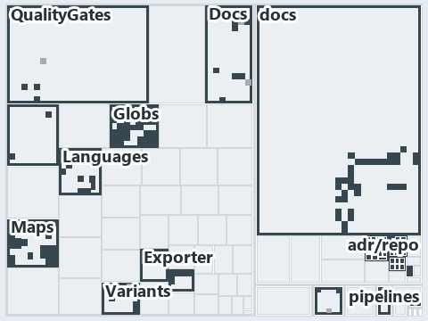

# docs/.assets/explanation/adr-dsgn-track--unit-to-pipeline-rule-is-review-only--governance.tree.md

`Tree minimap: adr-dsgn-track--unit-to-pipeline-rule-is-review-only--governance`

The tree minimap of the slide `adr-dsgn-track--unit-to-pipeline-rule-is-review-only--governance` (governance lens). The slide supports
[ADR-DSGN-TRACK][1], [ADR-FLOW-CD][2], [ADR-FLOW-CD-GLOBS][3] and [ADR-REPO-FOLDERS][4]; the highlight of those ADR codes selects what is
lit, and each reason below names the code that selects it.

## What the minimap shows

The tree draws every file of the world map as a tile, grouped by top-level folder (under `automation/` by module, under `docs/adr/` by ADR
domain), and lights 180 files in 17 groups, filled in ink. A lit ADR file has a white rim; a file lit only by passing mentions is a lighter
ink. Every other tile is idle, a grey box: a file the slide's ADR codes do not select.

- Globs (automation/Catzc.Base.Globs): 38 lit files
- docs (docs/ outside docs/adr/): 34 lit files
- Maps (automation/Catzc.Base.Maps): 29 lit files
- adr/repo (docs/adr/repository): 15 lit files
- Docs (automation/Catzc.Base.Docs): 9 lit files
- Languages (automation/Catzc.Base.Languages): 9 lit files
- adr/dsgn (docs/adr/design): 9 lit files
- QualityGates (automation/Catzc.Base.QualityGates): 7 lit files
- adr/flow (docs/adr/flow): 6 lit files
- pipelines: 6 lit files
- Az.DevOps.BuildValidation (automation/Catzc.Azure.DevOps.BuildValidation): 5 lit files
- Variants (automation/Catzc.Base.Variants): 4 lit files
- .claude: 3 lit files
- ModuleSystem (automation/Catzc.Base.ModuleSystem): 2 lit files
- adr/* (the files directly in docs/adr/): 2 lit files
- .github: 1 lit file
- Exporter (automation/Catzc.Base.Exporter): 1 lit file

## Why each group is lit

### Globs (38 lit files)

The group holds the files of automation/Catzc.Base.Globs; each sits in its world-map cell and is lit by:

- [automation/Catzc.Base.Globs/Get-ChangedGlobSet.ps1][5], in the cell automation × powershell: selected by [ADR-FLOW-CD-GLOBS][3]: the file
  cites it at line 4 (header) and line 8 (header).
- [automation/Catzc.Base.Globs/Get-GlobSet.ps1][6], in the cell automation × powershell: selected by [ADR-FLOW-CD-GLOBS][3]: the file cites
  it at line 6 (header).
- [automation/Catzc.Base.Globs/Get-GlobSetFile.ps1][7], in the cell automation × powershell: selected by [ADR-FLOW-CD-GLOBS][3]: the file
  cites it at line 6 (header) and line 9 (header).
- [automation/Catzc.Base.Globs/Get-GlobSetHash.ps1][8], in the cell automation × powershell: selected by [ADR-FLOW-CD-GLOBS][3]: the file
  cites it at line 4 (header) and line 10 (header).
- [automation/Catzc.Base.Globs/Get-GlobSetTrigger.ps1][9], in the cell automation × powershell: selected by [ADR-FLOW-CD-GLOBS][3]: the file
  cites it at line 4 (header) and line 7 (header).
- [automation/Catzc.Base.Globs/Get-MarkerBlastRadius.ps1][10], in the cell automation × powershell: selected by [ADR-FLOW-CD-GLOBS][3]: the
  file cites it at line 6 (header).
- [automation/Catzc.Base.Globs/Get-ModuleGlobSet.ps1][11], in the cell automation × powershell: selected by [ADR-FLOW-CD-GLOBS][3]: the file
  cites it at line 72 (body comment), line 75 (body comment) and line 163 (body comment) (a passing mention only).
- [automation/Catzc.Base.Globs/Get-TrackedFile.ps1][12], in the cell automation × powershell: selected by [ADR-FLOW-CD-GLOBS][3]: the file
  cites it at line 6 (header).
- [automation/Catzc.Base.Globs/Test-AdoPipelineTriggerGlob.ps1][13], in the cell automation × powershell: selected by
  [ADR-FLOW-CD-GLOBS][3]: the file cites it at line 4 (header).
- [automation/Catzc.Base.Globs/Test-GitHubWorkflowTriggerGlob.ps1][14], in the cell automation × powershell: selected by
  [ADR-FLOW-CD-GLOBS][3]: the file cites it at line 4 (header).
- [automation/Catzc.Base.Globs/Test-GlobSetAffected.ps1][15], in the cell automation × powershell: selected by [ADR-FLOW-CD-GLOBS][3]: the
  file cites it at line 10 (header).
- [automation/Catzc.Base.Globs/Test-GlobSetIndependence.ps1][16], in the cell automation × powershell: selected by [ADR-FLOW-CD-GLOBS][3]:
  the file cites it at line 4 (header), line 13 (header), line 42 (body comment), line 50 (body comment) and line 79 (text).
- [automation/Catzc.Base.Globs/Test-GlobSetTriggerCoverage.ps1][17], in the cell automation × powershell: selected by
  [ADR-FLOW-CD-GLOBS][3]: the file cites it at line 7 (header).
- [automation/Catzc.Base.Globs/configs/globs.yml][18], in the cell automation × yaml: selected by [ADR-DSGN-TRACK][1]: the file cites it at
  line 113 (body comment) (a passing mention only); selected by [ADR-FLOW-CD-GLOBS][3]: the file cites it at line 2 (header), line 7
  (header), line 15 (header), line 17 (header), line 26 (body comment), line 61 (body comment) and line 81 (body comment).
- [automation/Catzc.Base.Globs/private/Get-ChangedFile.ps1][19], in the cell automation × powershell: selected by [ADR-FLOW-CD-GLOBS][3]:
  the file cites it at line 7 (header).
- [automation/Catzc.Base.Globs/private/Get-GlobSetMember.ps1][20], in the cell automation × powershell: selected by [ADR-FLOW-CD-GLOBS][3]:
  the file cites it at line 6 (header).
- [automation/Catzc.Base.Globs/private/Get-PipelineTrigger.ps1][21], in the cell automation × powershell: selected by
  [ADR-FLOW-CD-GLOBS][3]: the file cites it at line 7 (header).
- [automation/Catzc.Base.Globs/private/Test-GlobListEqual.ps1][22], in the cell automation × powershell: selected by [ADR-FLOW-CD-GLOBS][3]:
  the file cites it at line 11 (header).
- [automation/Catzc.Base.Globs/tests/Get-ChangedFile.Tests.ps1][23], in the cell automation × powershell: selected by
  [ADR-FLOW-CD-GLOBS][3]: the file cites it at line 2 (header).
- [automation/Catzc.Base.Globs/tests/Get-ChangedGlobSet.Tests.ps1][24], in the cell automation × powershell: selected by
  [ADR-FLOW-CD-GLOBS][3]: the file cites it at line 2 (header).
- [automation/Catzc.Base.Globs/tests/Get-GlobSetFile.Tests.ps1][25], in the cell automation × powershell: selected by
  [ADR-FLOW-CD-GLOBS][3]: the file cites it at line 2 (header) and line 3 (header).
- [automation/Catzc.Base.Globs/tests/Get-GlobSetHash.Tests.ps1][26], in the cell automation × powershell: selected by
  [ADR-FLOW-CD-GLOBS][3]: the file cites it at line 2 (header).
- [automation/Catzc.Base.Globs/tests/Get-GlobSetMember.Tests.ps1][27], in the cell automation × powershell: selected by
  [ADR-FLOW-CD-GLOBS][3]: the file cites it at line 2 (header).
- [automation/Catzc.Base.Globs/tests/Get-GlobSetTrigger.Tests.ps1][28], in the cell automation × powershell: selected by
  [ADR-FLOW-CD-GLOBS][3]: the file cites it at line 2 (header).
- [automation/Catzc.Base.Globs/tests/Get-PipelineTrigger.Tests.ps1][29], in the cell automation × powershell: selected by
  [ADR-FLOW-CD-GLOBS][3]: the file cites it at line 2 (header).
- [automation/Catzc.Base.Globs/tests/Get-TrackedFile.Tests.ps1][30], in the cell automation × powershell: selected by
  [ADR-FLOW-CD-GLOBS][3]: the file cites it at line 1 (header).
- [automation/Catzc.Base.Globs/tests/GlobSet-Independence.Tests.ps1][31], in the cell automation × powershell: selected by
  [ADR-FLOW-CD-GLOBS][3]: the file cites it at line 2 (header), line 10 (text) and line 12 (text).
- [automation/Catzc.Base.Globs/tests/GlobSetTrigger-Coverage.Tests.ps1][32], in the cell automation × powershell: selected by
  [ADR-FLOW-CD-GLOBS][3]: the file cites it at line 2 (header).
- [automation/Catzc.Base.Globs/tests/PipelineTrigger-Integrity.Tests.ps1][33], in the cell automation × powershell: selected by
  [ADR-FLOW-CD-GLOBS][3]: the file cites it at line 3 (header).
- [automation/Catzc.Base.Globs/tests/Test-GlobSetIndependence.Tests.ps1][34], in the cell automation × powershell: selected by
  [ADR-FLOW-CD-GLOBS][3]: the file cites it at line 3 (header).
- [automation/Catzc.Base.Globs/tests/types/GlobPattern.Tests.ps1][35], in the cell automation × powershell: selected by
  [ADR-FLOW-CD-GLOBS][3]: the file cites it at line 1 (header), line 3 (header) and line 63 (text).
- [automation/Catzc.Base.Globs/tests/types/GlobSet.Tests.ps1][36], in the cell automation × powershell: selected by [ADR-FLOW-CD-GLOBS][3]:
  the file cites it at line 2 (header), line 4 (header) and line 15 (text).
- [automation/Catzc.Base.Globs/tests/types/GlobsConfig.Tests.ps1][37], in the cell automation × powershell: selected by [ADR-DSGN-TRACK][1]:
  the file cites it at line 50 (text); selected by [ADR-FLOW-CD-GLOBS][3]: the file cites it at line 3 (header), line 5 (header), line 13
  (body comment), line 62 (text), line 75 (text), line 86 (text) and line 98 (text).
- [automation/Catzc.Base.Globs/types/Aspect.cs][38], in the cell automation × csharp: selected by [ADR-FLOW-CD-GLOBS][3]: the file cites it
  at line 9 (header).
- [automation/Catzc.Base.Globs/types/DurableHash.cs][39], in the cell automation × csharp: selected by [ADR-FLOW-CD-GLOBS][3]: the file
  cites it at line 1 (header) and line 7 (header).
- [automation/Catzc.Base.Globs/types/GlobPattern.cs][40], in the cell automation × csharp: selected by [ADR-FLOW-CD-GLOBS][3]: the file
  cites it at line 7 (header), line 8 (header), line 9 (header), line 33 (text), line 37 (text), line 41 (text), line 53 (text), line 57
  (text) and line 66 (text).
- [automation/Catzc.Base.Globs/types/GlobSet.cs][41], in the cell automation × csharp: selected by [ADR-FLOW-CD-GLOBS][3]: the file cites it
  at line 3 (header), line 5 (header), line 6 (header), line 12 (header), line 15 (header), line 17 (header), line 20 (header), line 32
  (body comment), line 41 (body comment), line 63 (body comment), line 89 (text), line 122 (body comment), line 135 (body comment), line 158
  (body comment) and line 180 (body comment).
- [automation/Catzc.Base.Globs/types/GlobsConfig.cs][42], in the cell automation × csharp: selected by [ADR-FLOW-CD-GLOBS][3]: the file
  cites it at line 3 (header), line 7 (header), line 10 (header), line 88 (text), line 143 (body comment), line 154 (text), line 158 (text)
  and line 172 (text).

### docs (34 lit files)

The group holds the files of docs/ outside docs/adr/; each sits in its world-map cell and is lit by:

- [docs/explanation/design/a-push-fires-only-touched-pipelines.md][43], in the cell docs × markdown: selected by [ADR-DSGN-TRACK][1]: the
  file cites it at line 16 (text), line 50 (text) and line 51 (text).
- [docs/explanation/design/drop-a-file-the-import-exports-it.md][44], in the cell docs × markdown: selected by [ADR-REPO-FOLDERS][4]: the
  file cites it at line 52 (text).
- [docs/explanation/design/engineer-merges-pipelines-do-the-rest.md][45], in the cell docs × markdown: selected by [ADR-FLOW-CD][2]: the
  file cites it at line 55 (text).
- [docs/explanation/design/every-file-in-exactly-one-aspect.md][46], in the cell docs × markdown: selected by [ADR-FLOW-CD-GLOBS][3]: the
  file cites it at line 51 (text).
- [docs/explanation/design/four-domains-promote-one-artifact.md][47], in the cell docs × markdown: selected by [ADR-FLOW-CD][2]: the file
  cites it at line 54 (text) and line 55 (text).
- [docs/explanation/design/globs-yml-pipeline-field-is-the-binding.md][48], in the cell docs × markdown: selected by [ADR-DSGN-TRACK][1]:
  the file cites it at line 16 (text), line 49 (text) and line 50 (text).
- [docs/explanation/design/integrators-depend-on-an-occupant.md][49], in the cell docs × markdown: selected by [ADR-FLOW-CD][2]: the file
  cites it at line 15 (text), line 50 (text) and line 51 (text).
- [docs/explanation/design/one-folder-two-independent-readers.md][50], in the cell docs × markdown: selected by [ADR-FLOW-CD-GLOBS][3]: the
  file cites it at line 59 (text).
- [docs/explanation/design/one-unit-one-pipeline.md][51], in the cell docs × markdown: selected by [ADR-DSGN-TRACK][1]: the file cites it at
  line 14 (text), line 38 (text), line 39 (text), line 40 (text) and line 43 (text).
- [docs/explanation/design/partition-integrity-runs-only-in-unit-tests.md][52], in the cell docs × markdown: selected by
  [ADR-FLOW-CD-GLOBS][3]: the file cites it at line 49 (text) and line 67 (text); selected by [ADR-REPO-FOLDERS][4]: the file cites it at
  line 38 (text), line 57 (text) and line 71 (text).
- [docs/explanation/design/sync-point-rules-are-adr-only.md][53], in the cell docs × markdown: selected by [ADR-FLOW-CD][2]: the file cites
  it at line 17 (text), line 34 (text), line 36 (text), line 38 (text), line 40 (text), line 54 (text), line 54 (text) and line 55 (text).
- [docs/explanation/design/unit-to-pipeline-rule-is-review-only.md][54], in the cell docs × markdown: selected by [ADR-DSGN-TRACK][1]: the
  file cites it at line 17 (text), line 54 (text), line 56 (text), line 57 (text), line 57 (text), line 58 (text) and line 60 (text);
  selected by [ADR-FLOW-CD-GLOBS][3]: the file cites it at line 59 (text) and line 59 (text); selected by [ADR-REPO-FOLDERS][4]: the file
  cites it at line 54 (text) and line 55 (text).
- [docs/explanation/design/units-not-tracks-own-the-pipelines.md][55], in the cell docs × markdown: selected by [ADR-DSGN-TRACK][1]: the
  file cites it at line 15 (text), line 47 (text), line 48 (text), line 50 (text) and line 51 (text).
- [docs/explanation/design/which-rung-gates-exist-in-code.md][56], in the cell docs × markdown: selected by [ADR-FLOW-CD][2]: the file cites
  it at line 60 (text), line 60 (text), line 60 (text) and line 61 (text).
- [docs/explanation/flow/a-merge-runs-cd-to-prod.md][57], in the cell docs × markdown: selected by [ADR-FLOW-CD][2]: the file cites it at
  line 16 (text), line 48 (text), line 49 (text) and line 50 (text).
- [docs/explanation/flow/cd-builds-once-then-deploys-prod-itself.md][58], in the cell docs × markdown: selected by [ADR-FLOW-CD][2]: the
  file cites it at line 15 (text), line 48 (text), line 49 (text), line 50 (text) and line 51 (text).
- [docs/explanation/flow/ci-budget-is-the-only-quality-gate.md][59], in the cell docs × markdown: selected by [ADR-FLOW-CD][2]: the file
  cites it at line 17 (text), line 47 (text), line 51 (text), line 52 (text), line 53 (text), line 54 (text), line 55 (text), line 57 (text)
  and line 58 (text).
- [docs/explanation/flow/declare-or-add-folder-gate-names-overlaps.md][60], in the cell docs × markdown: selected by [ADR-FLOW-CD-GLOBS][3]:
  the file cites it at line 16 (text), line 47 (text), line 49 (text) and line 53 (text).
- [docs/explanation/flow/edit-globs-yml-then-read-the-output.md][61], in the cell docs × markdown: selected by [ADR-FLOW-CD-GLOBS][3]: the
  file cites it at line 17 (text), line 47 (text), line 49 (text) and line 50 (text).
- [docs/explanation/flow/gates-check-source-and-trigger.md][62], in the cell docs × markdown: selected by [ADR-FLOW-CD-GLOBS][3]: the file
  cites it at line 17 (text), line 52 (text), line 53 (text), line 54 (text), line 55 (text), line 56 (text), line 57 (text), line 57
  (text), line 58 (text), line 59 (text), line 59 (text), line 61 (text) and line 72 (text).
- [docs/explanation/flow/globs-module-owns-config-and-types.md][63], in the cell docs × markdown: selected by [ADR-FLOW-CD-GLOBS][3]: the
  file cites it at line 15 (text), line 48 (text), line 49 (text), line 51 (text) and line 52 (text).
- [docs/explanation/flow/independence-check-groups-by-layer.md][64], in the cell docs × markdown: selected by [ADR-FLOW-CD-GLOBS][3]: the
  file cites it at line 17 (text), line 52 (text), line 54 (text), line 58 (text) and line 58 (text).
- [docs/explanation/flow/one-artifact-climbs-unchanged.md][65], in the cell docs × markdown: selected by [ADR-FLOW-CD][2]: the file cites it
  at line 15 (text), line 43 (text), line 44 (text), line 45 (text), line 46 (text), line 47 (text) and line 47 (text).
- [docs/explanation/flow/one-scan-program-feeds-three-roles.md][66], in the cell docs × markdown: selected by [ADR-FLOW-CD-GLOBS][3]: the
  file cites it at line 18 (text), line 53 (text), line 54 (text), line 55 (text), line 56 (text), line 61 (text) and line 62 (text).
- [docs/explanation/flow/overlap-gated-for-units-and-modules.md][67], in the cell docs × markdown: selected by [ADR-FLOW-CD-GLOBS][3]: the
  file cites it at line 16 (text), line 49 (text) and line 51 (text).
- [docs/explanation/flow/peers-in-a-layer-never-overlap.md][68], in the cell docs × markdown: selected by [ADR-FLOW-CD-GLOBS][3]: the file
  cites it at line 13 (text), line 38 (text) and line 40 (text).
- [docs/explanation/flow/pipeline-kinds-keyed-by-one-artifact.md][69], in the cell docs × markdown: selected by [ADR-FLOW-CD][2]: the file
  cites it at line 17 (text), line 54 (text), line 55 (text), line 57 (text), line 58 (text), line 60 (text) and line 62 (text).
- [docs/explanation/flow/three-views-derived-live-from-one-program.md][70], in the cell docs × markdown: selected by [ADR-FLOW-CD-GLOBS][3]:
  the file cites it at line 14 (text), line 37 (text), line 38 (text), line 39 (text) and line 40 (text).
- [docs/explanation/flow/two-declared-layers-one-derived.md][71], in the cell docs × markdown: selected by [ADR-FLOW-CD-GLOBS][3]: the file
  cites it at line 15 (text), line 47 (text), line 49 (text), line 51 (text) and line 53 (text).
- [docs/how-to/automation/manual-test-plan/pipelines-and-globs.md][72], in the cell docs × markdown: selected by [ADR-FLOW-CD-GLOBS][3]: the
  file cites it at line 18 (text).
- [docs/how-to/automation/manual-test-plan/repository-conventions.md][73], in the cell docs × markdown: selected by [ADR-DSGN-TRACK][1]: the
  file cites it at line 19 (text), line 25 (text), line 25 (text), line 28 (text), line 28 (text), line 30 (text), line 30 (text), line 30
  (text), line 31 (text) and line 32 (text).
- [docs/references/automation/catzc-base-globs.md][74], in the cell docs × markdown: selected by [ADR-FLOW-CD-GLOBS][3]: the file cites it
  at line 29 (text).
- [docs/references/automation/catzc-base-languages.md][75], in the cell docs × markdown: selected by [ADR-REPO-FOLDERS][4]: the file cites
  it at line 47 (text) and line 77 (text).
- [docs/references/automation/catzc-base-maps.md][76], in the cell docs × markdown: selected by [ADR-DSGN-TRACK][1]: the file cites it at
  line 68 (text), line 70 (text) and line 82 (text).

### Maps (29 lit files)

The group holds the files of automation/Catzc.Base.Maps; each sits in its world-map cell and is lit by:

- [automation/Catzc.Base.Maps/Export-WorldMapPdf.ps1][77], in the cell automation × powershell: selected by [ADR-DSGN-TRACK][1]: the file
  cites it at line 10 (header), line 11 (header), line 13 (header) and line 33 (header).
- [automation/Catzc.Base.Maps/Get-ValueChainHighlight.ps1][78], in the cell automation × powershell: selected by [ADR-DSGN-TRACK][1]: the
  file cites it at line 8 (header), line 9 (header) and line 22 (header); selected by [ADR-FLOW-CD][2]: the file cites it at line 20
  (header).
- [automation/Catzc.Base.Maps/Get-ValueChainMap.ps1][79], in the cell automation × powershell: selected by [ADR-DSGN-TRACK][1]: the file
  cites it at line 6 (header), line 8 (header) and line 10 (header).
- [automation/Catzc.Base.Maps/Get-WorldMap.ps1][80], in the cell automation × powershell: selected by [ADR-DSGN-TRACK][1]: the file cites it
  at line 6 (header), line 7 (header) and line 17 (header).
- [automation/Catzc.Base.Maps/Get-WorldMapHighlight.ps1][81], in the cell automation × powershell: selected by [ADR-DSGN-TRACK][1]: the file
  cites it at line 12 (header) and line 33 (header); selected by [ADR-FLOW-CD][2]: the file cites it at line 31 (header).
- [automation/Catzc.Base.Maps/Test-ValueChainMap.ps1][82], in the cell automation × powershell: selected by [ADR-DSGN-TRACK][1]: the file
  cites it at line 14 (header), line 16 (header), line 19 (header), line 23 (header), line 54 (text), line 55 (text), line 65 (text), line
  68 (text) and line 85 (text).
- [automation/Catzc.Base.Maps/Test-WorldMap.ps1][83], in the cell automation × powershell: selected by [ADR-DSGN-TRACK][1]: the file cites
  it at line 11 (header), line 14 (header), line 18 (header), line 22 (header), line 23 (header), line 66 (text), line 85 (text), line 102
  (text), line 106 (text) and line 107 (text).
- [automation/Catzc.Base.Maps/configs/maps.yml][84], in the cell automation × yaml: selected by [ADR-DSGN-TRACK][1]: the file cites it at
  line 26 (header), line 32 (header), line 34 (header) and line 39 (header).
- [automation/Catzc.Base.Maps/private/Resolve-MapLabelTerm.ps1][85], in the cell automation × powershell: selected by [ADR-DSGN-TRACK][1]:
  the file cites it at line 9 (header) and line 10 (header).
- [automation/Catzc.Base.Maps/tests/Get-ValueChainHighlight.Tests.ps1][86], in the cell automation × powershell: selected by
  [ADR-DSGN-TRACK][1]: the file cites it at line 2 (header), line 3 (header), line 21 (text), line 27 (text) and line 46 (text).
- [automation/Catzc.Base.Maps/tests/Get-ValueChainMap.Tests.ps1][87], in the cell automation × powershell: selected by [ADR-DSGN-TRACK][1]:
  the file cites it at line 2 (header), line 21 (text), line 42 (text) and line 42 (body comment).
- [automation/Catzc.Base.Maps/tests/Get-WorldMap.Tests.ps1][88], in the cell automation × powershell: selected by [ADR-DSGN-TRACK][1]: the
  file cites it at line 72 (body comment) and line 88 (text).
- [automation/Catzc.Base.Maps/tests/Get-WorldMapHighlight.Tests.ps1][89], in the cell automation × powershell: selected by [ADR-FLOW-CD][2]:
  the file cites it at line 70 (text) and line 71 (text).
- [automation/Catzc.Base.Maps/tests/Test-ValueChainMap.Tests.ps1][90], in the cell automation × powershell: selected by [ADR-DSGN-TRACK][1]:
  the file cites it at line 2 (header), line 3 (header), line 4 (header), line 57 (text), line 57 (body comment), line 61 (text), line 62
  (text), line 63 (text), line 64 (text), line 68 (text), line 71 (text), line 90 (text), line 90 (body comment) and line 90 (body comment).
- [automation/Catzc.Base.Maps/tests/Test-WorldMap.Tests.ps1][91], in the cell automation × powershell: selected by [ADR-DSGN-TRACK][1]: the
  file cites it at line 2 (header), line 3 (header), line 65 (text), line 69 (text), line 72 (text), line 76 (text), line 77 (text), line 81
  (text), line 90 (text), line 91 (text), line 95 (text), line 99 (text), line 100 (text), line 121 (text), line 121 (body comment) and line
  121 (body comment).
- [automation/Catzc.Base.Maps/tests/types/ValueChainHighlight.Tests.ps1][92], in the cell automation × powershell: selected by
  [ADR-DSGN-TRACK][1]: the file cites it at line 2 (header), line 3 (header), line 19 (text), line 26 (text), line 32 (text), line 49 (text)
  and line 49 (body comment).
- [automation/Catzc.Base.Maps/tests/types/ValueChainMap.Tests.ps1][93], in the cell automation × powershell: selected by
  [ADR-DSGN-TRACK][1]: the file cites it at line 2 (header), line 20 (text), line 29 (text), line 34 (text) and line 42 (text).
- [automation/Catzc.Base.Maps/tests/types/WorldMapHighlight.Tests.ps1][94], in the cell automation × powershell: selected by
  [ADR-DSGN-TRACK][1]: the file cites it at line 104 (text) and line 119 (text).
- [automation/Catzc.Base.Maps/types/MapCell.cs][95], in the cell automation × csharp: selected by [ADR-DSGN-TRACK][1]: the file cites it at
  line 2 (header), line 3 (header) and line 4 (header).
- [automation/Catzc.Base.Maps/types/MapsLabels.cs][96], in the cell automation × csharp: selected by [ADR-DSGN-TRACK][1]: the file cites it
  at line 5 (header), line 6 (header) and line 10 (header).
- [automation/Catzc.Base.Maps/types/ValueChainCell.cs][97], in the cell automation × csharp: selected by [ADR-DSGN-TRACK][1]: the file cites
  it at line 2 (header), line 3 (header), line 15 (body comment) and line 18 (body comment).
- [automation/Catzc.Base.Maps/types/ValueChainHighlight.cs][98], in the cell automation × csharp: selected by [ADR-DSGN-TRACK][1]: the file
  cites it at line 2 (header) and line 3 (header).
- [automation/Catzc.Base.Maps/types/ValueChainMap.cs][99], in the cell automation × csharp: selected by [ADR-DSGN-TRACK][1]: the file cites
  it at line 2 (header), line 3 (header) and line 5 (header).
- [automation/Catzc.Base.Maps/types/ValueChainReason.cs][100], in the cell automation × csharp: selected by [ADR-DSGN-TRACK][1]: the file
  cites it at line 2 (header) and line 4 (header).
- [automation/Catzc.Base.Maps/types/WorldMap.cs][101], in the cell automation × csharp: selected by [ADR-DSGN-TRACK][1]: the file cites it
  at line 3 (header) and line 4 (header).
- [automation/Catzc.Base.Maps/types/WorldMapBuilder.cs][102], in the cell automation × csharp: selected by [ADR-DSGN-TRACK][1]: the file
  cites it at line 7 (header), line 8 (header) and line 11 (header).
- [automation/Catzc.Base.Maps/types/WorldMapGridLayout.cs][103], in the cell automation × csharp: selected by [ADR-DSGN-TRACK][1]: the file
  cites it at line 3 (header) and line 4 (header).
- [automation/Catzc.Base.Maps/types/WorldMapHighlight.cs][104], in the cell automation × csharp: selected by [ADR-DSGN-TRACK][1]: the file
  cites it at line 2 (header).
- [automation/Catzc.Base.Maps/types/WorldMapPdf.cs][105], in the cell automation × csharp: selected by [ADR-DSGN-TRACK][1]: the file cites
  it at line 4 (header), line 5 (header) and line 6 (header).

### adr/repo (15 lit files)

The group holds the files of docs/adr/repository; each sits in its world-map cell and is lit by:

- [docs/adr/repository/agent-definitions.md][106], in the cell docs × markdown: selected by [ADR-REPO-FOLDERS][4]: an ADR file of the
  `repository` ADR domain, the ADR domain of that code.
- [docs/adr/repository/api-contracts.md][107], in the cell docs × markdown: selected by [ADR-REPO-FOLDERS][4]: an ADR file of the
  `repository` ADR domain, the ADR domain of that code.
- [docs/adr/repository/controlled-vocabulary.md][108], in the cell docs × markdown: selected by [ADR-REPO-FOLDERS][4]: an ADR file of the
  `repository` ADR domain, the ADR domain of that code.
- [docs/adr/repository/conventional-folders.md][4], in the cell docs × markdown: selected by [ADR-REPO-FOLDERS][4]: an ADR file of the
  `repository` ADR domain, the ADR domain of that code.
- [docs/adr/repository/dedicated-output-directory.md][109], in the cell docs × markdown: selected by [ADR-REPO-FOLDERS][4]: an ADR file of
  the `repository` ADR domain, the ADR domain of that code.
- [docs/adr/repository/documentation-examples.md][110], in the cell docs × markdown: selected by [ADR-REPO-FOLDERS][4]: an ADR file of the
  `repository` ADR domain, the ADR domain of that code.
- [docs/adr/repository/domain-language-separation.md][111], in the cell docs × markdown: selected by [ADR-REPO-FOLDERS][4]: an ADR file of
  the `repository` ADR domain, the ADR domain of that code.
- [docs/adr/repository/dora-explains.md][112], in the cell docs × markdown: selected by [ADR-REPO-FOLDERS][4]: an ADR file of the
  `repository` ADR domain, the ADR domain of that code.
- [docs/adr/repository/generated-readmes.md][113], in the cell docs × markdown: selected by [ADR-REPO-FOLDERS][4]: an ADR file of the
  `repository` ADR domain, the ADR domain of that code.
- [docs/adr/repository/generated-root-configs.md][114], in the cell docs × markdown: selected by [ADR-REPO-FOLDERS][4]: an ADR file of the
  `repository` ADR domain, the ADR domain of that code.
- [docs/adr/repository/inspiration.md][115], in the cell docs × markdown: selected by [ADR-REPO-FOLDERS][4]: an ADR file of the `repository`
  ADR domain, the ADR domain of that code.
- [docs/adr/repository/markdown-links.md][116], in the cell docs × markdown: selected by [ADR-REPO-FOLDERS][4]: an ADR file of the
  `repository` ADR domain, the ADR domain of that code.
- [docs/adr/repository/output-formats.md][117], in the cell docs × markdown: selected by [ADR-REPO-FOLDERS][4]: an ADR file of the
  `repository` ADR domain, the ADR domain of that code.
- [docs/adr/repository/repo-variants.md][118], in the cell docs × markdown: selected by [ADR-REPO-FOLDERS][4]: an ADR file of the
  `repository` ADR domain, the ADR domain of that code.
- [docs/adr/repository/uniform-formatting.md][119], in the cell docs × markdown: selected by [ADR-REPO-FOLDERS][4]: an ADR file of the
  `repository` ADR domain, the ADR domain of that code.

### Docs (9 lit files)

The group holds the files of automation/Catzc.Base.Docs; each sits in its world-map cell and is lit by:

- [automation/Catzc.Base.Docs/configs/adrs.yml][120], in the cell automation × yaml: selected by [ADR-DSGN-TRACK][1]: the file cites it at
  line 11 (header), line 12 (header) and line 95 (text); selected by [ADR-FLOW-CD][2]: the file cites it at line 105 (body comment) and line
  118 (text); selected by [ADR-FLOW-CD-GLOBS][3]: the file cites it at line 122 (text); selected by [ADR-REPO-FOLDERS][4]: the file cites it
  at line 308 (text).
- [automation/Catzc.Base.Docs/configs/agents.yml][121], in the cell automation × yaml: selected by [ADR-REPO-FOLDERS][4]: the file cites it
  at line 32 (body comment) and line 37 (body comment) (a passing mention only).
- [automation/Catzc.Base.Docs/configs/glossary.yml][122], in the cell automation × yaml: selected by [ADR-REPO-FOLDERS][4]: the file cites
  it at line 17 (text).
- [automation/Catzc.Base.Docs/private/Get-CatsModules.ps1][123], in the cell automation × powershell: selected by [ADR-REPO-FOLDERS][4]: the
  file cites it at line 7 (header).
- [automation/Catzc.Base.Docs/tests/types/AdrsConfig.Tests.ps1][124], in the cell automation × powershell: selected by [ADR-DSGN-TRACK][1]:
  the file cites it at line 99 (text) and line 99 (body comment).
- [automation/Catzc.Base.Docs/types/AdrDomain.cs][125], in the cell automation × csharp: selected by [ADR-DSGN-TRACK][1]: the file cites it
  at line 6 (header) and line 7 (header).
- [automation/Catzc.Base.Docs/types/AdrRuleSet.cs][126], in the cell automation × csharp: selected by [ADR-DSGN-TRACK][1]: the file cites it
  at line 8 (header).
- [automation/Catzc.Base.Docs/types/AdrsConfig.cs][127], in the cell automation × csharp: selected by [ADR-DSGN-TRACK][1]: the file cites it
  at line 21 (header), line 24 (header), line 43 (body comment) and line 47 (body comment); selected by [ADR-FLOW-CD][2]: the file cites it
  at line 17 (header), line 18 (header), line 194 (body comment) and line 195 (body comment).
- [automation/Catzc.Base.Docs/types/GlossaryConcept.cs][128], in the cell automation × csharp: selected by [ADR-FLOW-CD][2]: the file cites
  it at line 41 (body comment) (a passing mention only).

### Languages (9 lit files)

The group holds the files of automation/Catzc.Base.Languages; each sits in its world-map cell and is lit by:

- [automation/Catzc.Base.Languages/Get-FileLanguage.ps1][129], in the cell automation × powershell: selected by [ADR-DSGN-TRACK][1]: the
  file cites it at line 6 (header).
- [automation/Catzc.Base.Languages/configs/glossary.yml][130], in the cell automation × yaml: selected by [ADR-DSGN-TRACK][1]: the file
  cites it at line 10 (text).
- [automation/Catzc.Base.Languages/configs/languages.yml][131], in the cell automation × yaml: selected by [ADR-DSGN-TRACK][1]: the file
  cites it at line 2 (header).
- [automation/Catzc.Base.Languages/tests/Get-FileLanguage.Tests.ps1][132], in the cell automation × powershell: selected by
  [ADR-DSGN-TRACK][1]: the file cites it at line 47 (body comment), line 124 (text), line 136 (text) and line 178 (text).
- [automation/Catzc.Base.Languages/types/BashConfig.cs][133], in the cell automation × csharp: selected by [ADR-REPO-FOLDERS][4]: the file
  cites it at line 12 (header).
- [automation/Catzc.Base.Languages/types/FileLanguage.cs][134], in the cell automation × csharp: selected by [ADR-DSGN-TRACK][1]: the file
  cites it at line 2 (header).
- [automation/Catzc.Base.Languages/types/GoConfig.cs][135], in the cell automation × csharp: selected by [ADR-REPO-FOLDERS][4]: the file
  cites it at line 15 (header).
- [automation/Catzc.Base.Languages/types/LanguagesConfig.cs][136], in the cell automation × csharp: selected by [ADR-DSGN-TRACK][1]: the
  file cites it at line 2 (header).
- [automation/Catzc.Base.Languages/types/PythonConfig.cs][137], in the cell automation × csharp: selected by [ADR-REPO-FOLDERS][4]: the file
  cites it at line 15 (header).

### adr/dsgn (9 lit files)

The group holds the files of docs/adr/design; each sits in its world-map cell and is lit by:

- [docs/adr/design/commit-lifecycle.md][138], in the cell docs × markdown: selected by [ADR-DSGN-TRACK][1]: an ADR file of the `design` ADR
  domain, the ADR domain of that code.
- [docs/adr/design/dora-explains.md][139], in the cell docs × markdown: selected by [ADR-DSGN-TRACK][1]: an ADR file of the `design` ADR
  domain, the ADR domain of that code.
- [docs/adr/design/module-aspects.md][140], in the cell docs × markdown: selected by [ADR-DSGN-TRACK][1]: an ADR file of the `design` ADR
  domain, the ADR domain of that code.
- [docs/adr/design/run-modes.md][141], in the cell docs × markdown: selected by [ADR-DSGN-TRACK][1]: an ADR file of the `design` ADR domain,
  the ADR domain of that code.
- [docs/adr/design/self-service.md][142], in the cell docs × markdown: selected by [ADR-DSGN-TRACK][1]: an ADR file of the `design` ADR
  domain, the ADR domain of that code.
- [docs/adr/design/server-remote-integration.md][143], in the cell docs × markdown: selected by [ADR-DSGN-TRACK][1]: an ADR file of the
  `design` ADR domain, the ADR domain of that code.
- [docs/adr/design/thin-platforms.md][144], in the cell docs × markdown: selected by [ADR-DSGN-TRACK][1]: an ADR file of the `design` ADR
  domain, the ADR domain of that code.
- [docs/adr/design/tracks.md][1], in the cell docs × markdown: selected by [ADR-DSGN-TRACK][1]: an ADR file of the `design` ADR domain, the
  ADR domain of that code.
- [docs/adr/design/visual-design.md][145], in the cell docs × markdown: selected by [ADR-DSGN-TRACK][1]: an ADR file of the `design` ADR
  domain, the ADR domain of that code.

### QualityGates (7 lit files)

The group holds the files of automation/Catzc.Base.QualityGates; each sits in its world-map cell and is lit by:

- [automation/Catzc.Base.QualityGates/Test-Automation.ps1][146], in the cell automation × powershell: selected by [ADR-FLOW-CD-GLOBS][3]:
  the file cites it at line 72 (header).
- [automation/Catzc.Base.QualityGates/configs/glossary.yml][147], in the cell automation × yaml: selected by [ADR-FLOW-CD][2]: the file
  cites it at line 62 (text).
- [automation/Catzc.Base.QualityGates/configs/terminology.yml][148], in the cell automation × yaml: selected by [ADR-DSGN-TRACK][1]: the
  file cites it at line 318 (text) and line 321 (text).
- [automation/Catzc.Base.QualityGates/private/Get-GuidScanFiles.ps1][149], in the cell automation × powershell: selected by
  [ADR-FLOW-CD-GLOBS][3]: the file cites it at line 7 (header).
- [automation/Catzc.Base.QualityGates/private/Get-LanguageTestFolders.ps1][150], in the cell automation × powershell: selected by
  [ADR-DSGN-TRACK][1]: the file cites it at line 7 (header).
- [automation/Catzc.Base.QualityGates/private/Get-ModuleProtectionIdentity.ps1][151], in the cell automation × powershell: selected by
  [ADR-FLOW-CD-GLOBS][3]: the file cites it at line 143 (body comment) (a passing mention only).
- [automation/Catzc.Base.QualityGates/private/Resolve-TestSuite.ps1][152], in the cell automation × powershell: selected by
  [ADR-FLOW-CD-GLOBS][3]: the file cites it at line 9 (header).

### adr/flow (6 lit files)

The group holds the files of docs/adr/flow; each sits in its world-map cell and is lit by:

- [docs/adr/flow/cd-discipline-and-promotion-flow.md][2], in the cell docs × markdown: selected by [ADR-FLOW-CD][2]: an ADR file of the
  `flow` ADR domain, the ADR domain of that code; selected by [ADR-FLOW-CD-GLOBS][3]: an ADR file of the `flow` ADR domain, the ADR domain
  of that code.
- [docs/adr/flow/dora-explains.md][153], in the cell docs × markdown: selected by [ADR-FLOW-CD][2]: an ADR file of the `flow` ADR domain,
  the ADR domain of that code; selected by [ADR-FLOW-CD-GLOBS][3]: an ADR file of the `flow` ADR domain, the ADR domain of that code.
- [docs/adr/flow/durable-sha-globs.md][3], in the cell docs × markdown: selected by [ADR-FLOW-CD][2]: an ADR file of the `flow` ADR domain,
  the ADR domain of that code; selected by [ADR-FLOW-CD-GLOBS][3]: an ADR file of the `flow` ADR domain, the ADR domain of that code.
- [docs/adr/flow/pipeline-detection.md][154], in the cell docs × markdown: selected by [ADR-FLOW-CD][2]: an ADR file of the `flow` ADR
  domain, the ADR domain of that code; selected by [ADR-FLOW-CD-GLOBS][3]: an ADR file of the `flow` ADR domain, the ADR domain of that
  code.
- [docs/adr/flow/pipeline-runner-pattern.md][155], in the cell docs × markdown: selected by [ADR-FLOW-CD][2]: an ADR file of the `flow` ADR
  domain, the ADR domain of that code; selected by [ADR-FLOW-CD-GLOBS][3]: an ADR file of the `flow` ADR domain, the ADR domain of that
  code.
- [docs/adr/flow/pipeline-types.md][156], in the cell docs × markdown: selected by [ADR-FLOW-CD][2]: an ADR file of the `flow` ADR domain,
  the ADR domain of that code; selected by [ADR-FLOW-CD-GLOBS][3]: an ADR file of the `flow` ADR domain, the ADR domain of that code.

### pipelines (6 lit files)

The group holds the files of pipelines; each sits in its world-map cell and is lit by:

- [pipelines/cd-apex.yaml][157], in the cell pipelines × pipeline-yaml: selected by [ADR-FLOW-CD-GLOBS][3]: the file cites it at line 15
  (header).
- [pipelines/cd-flux.yaml][158], in the cell pipelines × pipeline-yaml: selected by [ADR-FLOW-CD-GLOBS][3]: the file cites it at line 14
  (header).
- [pipelines/cd-nova.yaml][159], in the cell pipelines × pipeline-yaml: selected by [ADR-FLOW-CD-GLOBS][3]: the file cites it at line 14
  (header).
- [pipelines/cd-shared.yaml][160], in the cell pipelines × pipeline-yaml: selected by [ADR-FLOW-CD-GLOBS][3]: the file cites it at line 29
  (header).
- [pipelines/ci-automation.yaml][161], in the cell pipelines × pipeline-yaml: selected by [ADR-DSGN-TRACK][1]: the file cites it at line 6
  (header); selected by [ADR-FLOW-CD-GLOBS][3]: the file cites it at line 4 (header).
- [pipelines/ci-infrastructure.yaml][162], in the cell pipelines × pipeline-yaml: selected by [ADR-FLOW-CD-GLOBS][3]: the file cites it at
  line 17 (header).

### Az.DevOps.BuildValidation (5 lit files)

The group holds the files of automation/Catzc.Azure.DevOps.BuildValidation; each sits in its world-map cell and is lit by:

- [automation/Catzc.Azure.DevOps.BuildValidation/Get-AdoBuildValidations.ps1][163], in the cell automation × powershell: selected by
  [ADR-FLOW-CD-GLOBS][3]: the file cites it at line 10 (header).
- [automation/Catzc.Azure.DevOps.BuildValidation/Register-AdoBuildValidation.ps1][164], in the cell automation × powershell: selected by
  [ADR-FLOW-CD-GLOBS][3]: the file cites it at line 6 (header) and line 98 (body comment).
- [automation/Catzc.Azure.DevOps.BuildValidation/Unregister-AdoBuildValidation.ps1][165], in the cell automation × powershell: selected by
  [ADR-FLOW-CD-GLOBS][3]: the file cites it at line 6 (header).
- [automation/Catzc.Azure.DevOps.BuildValidation/configs/build-validation.yml][166], in the cell automation × yaml: selected by
  [ADR-FLOW-CD-GLOBS][3]: the file cites it at line 5 (header).
- [automation/Catzc.Azure.DevOps.BuildValidation/private/Get-BuildValidationPathFilter.ps1][167], in the cell automation × powershell:
  selected by [ADR-FLOW-CD-GLOBS][3]: the file cites it at line 8 (header).

### Variants (4 lit files)

The group holds the files of automation/Catzc.Base.Variants; each sits in its world-map cell and is lit by:

- [automation/Catzc.Base.Variants/Get-Track.ps1][168], in the cell automation × powershell: selected by [ADR-DSGN-TRACK][1]: the file cites
  it at line 5 (header), line 7 (header), line 8 (header) and line 12 (header).
- [automation/Catzc.Base.Variants/configs/variants.yml][169], in the cell automation × yaml: selected by [ADR-DSGN-TRACK][1]: the file cites
  it at line 45 (body comment), line 48 (body comment) and line 50 (body comment) (a passing mention only).
- [automation/Catzc.Base.Variants/types/VariantTrack.cs][170], in the cell automation × csharp: selected by [ADR-DSGN-TRACK][1]: the file
  cites it at line 1 (header), line 3 (header) and line 17 (body comment).
- [automation/Catzc.Base.Variants/types/VariantsConfig.cs][171], in the cell automation × csharp: selected by [ADR-DSGN-TRACK][1]: the file
  cites it at line 22 (header), line 25 (header), line 27 (header) and line 270 (text).

### .claude (3 lit files)

The group holds the files of .claude; each sits in its world-map cell and is lit by:

- [.claude/CLAUDE.md][172], in the cell .claude × markdown: selected by [ADR-FLOW-CD][2]: the file cites it at line 51 (text).
- [.claude/drawio/STYLE.md][173], in the cell .claude × markdown: selected by [ADR-DSGN-TRACK][1]: the file cites it at line 181 (text),
  line 182 (text), line 190 (text), line 191 (text), line 199 (text), line 201 (text), line 201 (text) and line 214 (text); selected by
  [ADR-FLOW-CD][2]: the file cites it at line 28 (text).
- [.claude/drawio/minimaps/highlights.ps1][174], in the cell .claude × powershell: selected by [ADR-DSGN-TRACK][1]: the file cites it at
  line 52 (body comment) (a passing mention only).

### ModuleSystem (2 lit files)

The group holds the files of automation/Catzc.Base.ModuleSystem; each sits in its world-map cell and is lit by:

- [automation/Catzc.Base.ModuleSystem/Test-FolderConventions.ps1][175], in the cell automation × powershell: selected by
  [ADR-REPO-FOLDERS][4]: the file cites it at line 8 (header) and line 89 (body comment).
- [automation/Catzc.Base.ModuleSystem/configs/glossary.yml][176], in the cell automation × yaml: selected by [ADR-DSGN-TRACK][1]: the file
  cites it at line 9 (text), line 65 (text), line 84 (text), line 95 (text), line 110 (text), line 123 (text), line 137 (text), line 152
  (text), line 165 (text), line 177 (text), line 190 (text), line 192 (text) and line 204 (text); selected by [ADR-FLOW-CD][2]: the file
  cites it at line 21 (text).

### adr/* (2 lit files)

The group holds the files of the files directly in docs/adr/; each sits in its world-map cell and is lit by:

- [docs/adr/glossary.md][177], in the cell docs × markdown: selected by [ADR-DSGN-TRACK][1]: the file cites it at line 91 (text), line 107
  (text), line 121 (text), line 137 (text), line 166 (text), line 176 (text), line 178 (text), line 192 (text), line 211 (text), line 225
  (text), line 239 (text), line 252 (text), line 265 (text) and line 277 (text); selected by [ADR-FLOW-CD][2]: the file cites it at line 292
  (text) and line 305 (text); selected by [ADR-REPO-FOLDERS][4]: the file cites it at line 752 (text).
- [docs/adr/index.md][178], in the cell docs × markdown: selected by [ADR-DSGN-TRACK][1]: the file cites it at line 88 (text); selected by
  [ADR-FLOW-CD][2]: the file cites it at line 107 (text); selected by [ADR-FLOW-CD-GLOBS][3]: the file cites it at line 111 (text); selected
  by [ADR-REPO-FOLDERS][4]: the file cites it at line 287 (text).

### .github (1 lit file)

The group holds the files of .github; each sits in its world-map cell and is lit by:

- [.github/workflows/ci-automation.yml][179], in the cell .github × yaml: selected by [ADR-FLOW-CD-GLOBS][3]: the file cites it at line 4
  (body comment) (a passing mention only).

### Exporter (1 lit file)

The group holds the files of automation/Catzc.Base.Exporter; each sits in its world-map cell and is lit by:

- [automation/Catzc.Base.Exporter/Get-CatzcContentHash.ps1][180], in the cell automation × powershell: selected by [ADR-FLOW-CD-GLOBS][3]:
  the file cites it at line 6 (header).

## Keywords

- [world map][181]
- [track][182]
- [file language][183]
- [cell][184]
- [lit cell][185]
- [.claude][169]: a track
- [.github][169]: a track
- [automation][169]: a track
- [docs][169]: a track
- [pipelines][169]: a track
- [csharp][131]: a file language
- [markdown][131]: a file language
- [pipeline-yaml][131]: a file language
- [powershell][131]: a file language
- [yaml][131]: a file language

Terms the cited ADRs define:

- [cell][184], defined by [ADR-DSGN-TRACK#10][186]
- [deployable-unit][187], defined by [ADR-DSGN-TRACK#5][188]
- [domain][189], defined by [ADR-REPO-FOLDERS#5][190]
- [file language][183], defined by [ADR-DSGN-TRACK#6][191]
- [gate][192], defined by [ADR-FLOW-CD#13][193]
- [lit cell][185], defined by [ADR-DSGN-TRACK#12][194]
- [release candidate][195], defined by [ADR-FLOW-CD#14][196]
- [root file][197], defined by [ADR-DSGN-TRACK#7][198]
- [stack violation][199], defined by [ADR-DSGN-TRACK#11][200]
- [track][182], defined by [ADR-DSGN-TRACK#1][201]
- [unlisted file][202], defined by [ADR-DSGN-TRACK#8][203]
- [value-chain concern][204], defined by [ADR-DSGN-TRACK#15][205]
- [value-chain map][206], defined by [ADR-DSGN-TRACK#16][207]
- [value-chain stack][208], defined by [ADR-DSGN-TRACK#14][209]
- [verification track][210], defined by [ADR-DSGN-TRACK#2][211]
- [world map][181], defined by [ADR-DSGN-TRACK#9][212]

[1]: ../../adr/design/tracks.md
[2]: ../../adr/flow/cd-discipline-and-promotion-flow.md
[3]: ../../adr/flow/durable-sha-globs.md
[4]: ../../adr/repository/conventional-folders.md
[5]: ../../../automation/Catzc.Base.Globs/Get-ChangedGlobSet.ps1
[6]: ../../../automation/Catzc.Base.Globs/Get-GlobSet.ps1
[7]: ../../../automation/Catzc.Base.Globs/Get-GlobSetFile.ps1
[8]: ../../../automation/Catzc.Base.Globs/Get-GlobSetHash.ps1
[9]: ../../../automation/Catzc.Base.Globs/Get-GlobSetTrigger.ps1
[10]: ../../../automation/Catzc.Base.Globs/Get-MarkerBlastRadius.ps1
[11]: ../../../automation/Catzc.Base.Globs/Get-ModuleGlobSet.ps1
[12]: ../../../automation/Catzc.Base.Globs/Get-TrackedFile.ps1
[13]: ../../../automation/Catzc.Base.Globs/Test-AdoPipelineTriggerGlob.ps1
[14]: ../../../automation/Catzc.Base.Globs/Test-GitHubWorkflowTriggerGlob.ps1
[15]: ../../../automation/Catzc.Base.Globs/Test-GlobSetAffected.ps1
[16]: ../../../automation/Catzc.Base.Globs/Test-GlobSetIndependence.ps1
[17]: ../../../automation/Catzc.Base.Globs/Test-GlobSetTriggerCoverage.ps1
[18]: ../../../automation/Catzc.Base.Globs/configs/globs.yml
[19]: ../../../automation/Catzc.Base.Globs/private/Get-ChangedFile.ps1
[20]: ../../../automation/Catzc.Base.Globs/private/Get-GlobSetMember.ps1
[21]: ../../../automation/Catzc.Base.Globs/private/Get-PipelineTrigger.ps1
[22]: ../../../automation/Catzc.Base.Globs/private/Test-GlobListEqual.ps1
[23]: ../../../automation/Catzc.Base.Globs/tests/Get-ChangedFile.Tests.ps1
[24]: ../../../automation/Catzc.Base.Globs/tests/Get-ChangedGlobSet.Tests.ps1
[25]: ../../../automation/Catzc.Base.Globs/tests/Get-GlobSetFile.Tests.ps1
[26]: ../../../automation/Catzc.Base.Globs/tests/Get-GlobSetHash.Tests.ps1
[27]: ../../../automation/Catzc.Base.Globs/tests/Get-GlobSetMember.Tests.ps1
[28]: ../../../automation/Catzc.Base.Globs/tests/Get-GlobSetTrigger.Tests.ps1
[29]: ../../../automation/Catzc.Base.Globs/tests/Get-PipelineTrigger.Tests.ps1
[30]: ../../../automation/Catzc.Base.Globs/tests/Get-TrackedFile.Tests.ps1
[31]: ../../../automation/Catzc.Base.Globs/tests/GlobSet-Independence.Tests.ps1
[32]: ../../../automation/Catzc.Base.Globs/tests/GlobSetTrigger-Coverage.Tests.ps1
[33]: ../../../automation/Catzc.Base.Globs/tests/PipelineTrigger-Integrity.Tests.ps1
[34]: ../../../automation/Catzc.Base.Globs/tests/Test-GlobSetIndependence.Tests.ps1
[35]: ../../../automation/Catzc.Base.Globs/tests/types/GlobPattern.Tests.ps1
[36]: ../../../automation/Catzc.Base.Globs/tests/types/GlobSet.Tests.ps1
[37]: ../../../automation/Catzc.Base.Globs/tests/types/GlobsConfig.Tests.ps1
[38]: ../../../automation/Catzc.Base.Globs/types/Aspect.cs
[39]: ../../../automation/Catzc.Base.Globs/types/DurableHash.cs
[40]: ../../../automation/Catzc.Base.Globs/types/GlobPattern.cs
[41]: ../../../automation/Catzc.Base.Globs/types/GlobSet.cs
[42]: ../../../automation/Catzc.Base.Globs/types/GlobsConfig.cs
[43]: ../../explanation/design/a-push-fires-only-touched-pipelines.md
[44]: ../../explanation/design/drop-a-file-the-import-exports-it.md
[45]: ../../explanation/design/engineer-merges-pipelines-do-the-rest.md
[46]: ../../explanation/design/every-file-in-exactly-one-aspect.md
[47]: ../../explanation/design/four-domains-promote-one-artifact.md
[48]: ../../explanation/design/globs-yml-pipeline-field-is-the-binding.md
[49]: ../../explanation/design/integrators-depend-on-an-occupant.md
[50]: ../../explanation/design/one-folder-two-independent-readers.md
[51]: ../../explanation/design/one-unit-one-pipeline.md
[52]: ../../explanation/design/partition-integrity-runs-only-in-unit-tests.md
[53]: ../../explanation/design/sync-point-rules-are-adr-only.md
[54]: ../../explanation/design/unit-to-pipeline-rule-is-review-only.md
[55]: ../../explanation/design/units-not-tracks-own-the-pipelines.md
[56]: ../../explanation/design/which-rung-gates-exist-in-code.md
[57]: ../../explanation/flow/a-merge-runs-cd-to-prod.md
[58]: ../../explanation/flow/cd-builds-once-then-deploys-prod-itself.md
[59]: ../../explanation/flow/ci-budget-is-the-only-quality-gate.md
[60]: ../../explanation/flow/declare-or-add-folder-gate-names-overlaps.md
[61]: ../../explanation/flow/edit-globs-yml-then-read-the-output.md
[62]: ../../explanation/flow/gates-check-source-and-trigger.md
[63]: ../../explanation/flow/globs-module-owns-config-and-types.md
[64]: ../../explanation/flow/independence-check-groups-by-layer.md
[65]: ../../explanation/flow/one-artifact-climbs-unchanged.md
[66]: ../../explanation/flow/one-scan-program-feeds-three-roles.md
[67]: ../../explanation/flow/overlap-gated-for-units-and-modules.md
[68]: ../../explanation/flow/peers-in-a-layer-never-overlap.md
[69]: ../../explanation/flow/pipeline-kinds-keyed-by-one-artifact.md
[70]: ../../explanation/flow/three-views-derived-live-from-one-program.md
[71]: ../../explanation/flow/two-declared-layers-one-derived.md
[72]: ../../how-to/automation/manual-test-plan/pipelines-and-globs.md
[73]: ../../how-to/automation/manual-test-plan/repository-conventions.md
[74]: ../../references/automation/catzc-base-globs.md
[75]: ../../references/automation/catzc-base-languages.md
[76]: ../../references/automation/catzc-base-maps.md
[77]: ../../../automation/Catzc.Base.Maps/Export-WorldMapPdf.ps1
[78]: ../../../automation/Catzc.Base.Maps/Get-ValueChainHighlight.ps1
[79]: ../../../automation/Catzc.Base.Maps/Get-ValueChainMap.ps1
[80]: ../../../automation/Catzc.Base.Maps/Get-WorldMap.ps1
[81]: ../../../automation/Catzc.Base.Maps/Get-WorldMapHighlight.ps1
[82]: ../../../automation/Catzc.Base.Maps/Test-ValueChainMap.ps1
[83]: ../../../automation/Catzc.Base.Maps/Test-WorldMap.ps1
[84]: ../../../automation/Catzc.Base.Maps/configs/maps.yml
[85]: ../../../automation/Catzc.Base.Maps/private/Resolve-MapLabelTerm.ps1
[86]: ../../../automation/Catzc.Base.Maps/tests/Get-ValueChainHighlight.Tests.ps1
[87]: ../../../automation/Catzc.Base.Maps/tests/Get-ValueChainMap.Tests.ps1
[88]: ../../../automation/Catzc.Base.Maps/tests/Get-WorldMap.Tests.ps1
[89]: ../../../automation/Catzc.Base.Maps/tests/Get-WorldMapHighlight.Tests.ps1
[90]: ../../../automation/Catzc.Base.Maps/tests/Test-ValueChainMap.Tests.ps1
[91]: ../../../automation/Catzc.Base.Maps/tests/Test-WorldMap.Tests.ps1
[92]: ../../../automation/Catzc.Base.Maps/tests/types/ValueChainHighlight.Tests.ps1
[93]: ../../../automation/Catzc.Base.Maps/tests/types/ValueChainMap.Tests.ps1
[94]: ../../../automation/Catzc.Base.Maps/tests/types/WorldMapHighlight.Tests.ps1
[95]: ../../../automation/Catzc.Base.Maps/types/MapCell.cs
[96]: ../../../automation/Catzc.Base.Maps/types/MapsLabels.cs
[97]: ../../../automation/Catzc.Base.Maps/types/ValueChainCell.cs
[98]: ../../../automation/Catzc.Base.Maps/types/ValueChainHighlight.cs
[99]: ../../../automation/Catzc.Base.Maps/types/ValueChainMap.cs
[100]: ../../../automation/Catzc.Base.Maps/types/ValueChainReason.cs
[101]: ../../../automation/Catzc.Base.Maps/types/WorldMap.cs
[102]: ../../../automation/Catzc.Base.Maps/types/WorldMapBuilder.cs
[103]: ../../../automation/Catzc.Base.Maps/types/WorldMapGridLayout.cs
[104]: ../../../automation/Catzc.Base.Maps/types/WorldMapHighlight.cs
[105]: ../../../automation/Catzc.Base.Maps/types/WorldMapPdf.cs
[106]: ../../adr/repository/agent-definitions.md
[107]: ../../adr/repository/api-contracts.md
[108]: ../../adr/repository/controlled-vocabulary.md
[109]: ../../adr/repository/dedicated-output-directory.md
[110]: ../../adr/repository/documentation-examples.md
[111]: ../../adr/repository/domain-language-separation.md
[112]: ../../adr/repository/dora-explains.md
[113]: ../../adr/repository/generated-readmes.md
[114]: ../../adr/repository/generated-root-configs.md
[115]: ../../adr/repository/inspiration.md
[116]: ../../adr/repository/markdown-links.md
[117]: ../../adr/repository/output-formats.md
[118]: ../../adr/repository/repo-variants.md
[119]: ../../adr/repository/uniform-formatting.md
[120]: ../../../automation/Catzc.Base.Docs/configs/adrs.yml
[121]: ../../../automation/Catzc.Base.Docs/configs/agents.yml
[122]: ../../../automation/Catzc.Base.Docs/configs/glossary.yml
[123]: ../../../automation/Catzc.Base.Docs/private/Get-CatsModules.ps1
[124]: ../../../automation/Catzc.Base.Docs/tests/types/AdrsConfig.Tests.ps1
[125]: ../../../automation/Catzc.Base.Docs/types/AdrDomain.cs
[126]: ../../../automation/Catzc.Base.Docs/types/AdrRuleSet.cs
[127]: ../../../automation/Catzc.Base.Docs/types/AdrsConfig.cs
[128]: ../../../automation/Catzc.Base.Docs/types/GlossaryConcept.cs
[129]: ../../../automation/Catzc.Base.Languages/Get-FileLanguage.ps1
[130]: ../../../automation/Catzc.Base.Languages/configs/glossary.yml
[131]: ../../../automation/Catzc.Base.Languages/configs/languages.yml
[132]: ../../../automation/Catzc.Base.Languages/tests/Get-FileLanguage.Tests.ps1
[133]: ../../../automation/Catzc.Base.Languages/types/BashConfig.cs
[134]: ../../../automation/Catzc.Base.Languages/types/FileLanguage.cs
[135]: ../../../automation/Catzc.Base.Languages/types/GoConfig.cs
[136]: ../../../automation/Catzc.Base.Languages/types/LanguagesConfig.cs
[137]: ../../../automation/Catzc.Base.Languages/types/PythonConfig.cs
[138]: ../../adr/design/commit-lifecycle.md
[139]: ../../adr/design/dora-explains.md
[140]: ../../adr/design/module-aspects.md
[141]: ../../adr/design/run-modes.md
[142]: ../../adr/design/self-service.md
[143]: ../../adr/design/server-remote-integration.md
[144]: ../../adr/design/thin-platforms.md
[145]: ../../adr/design/visual-design.md
[146]: ../../../automation/Catzc.Base.QualityGates/Test-Automation.ps1
[147]: ../../../automation/Catzc.Base.QualityGates/configs/glossary.yml
[148]: ../../../automation/Catzc.Base.QualityGates/configs/terminology.yml
[149]: ../../../automation/Catzc.Base.QualityGates/private/Get-GuidScanFiles.ps1
[150]: ../../../automation/Catzc.Base.QualityGates/private/Get-LanguageTestFolders.ps1
[151]: ../../../automation/Catzc.Base.QualityGates/private/Get-ModuleProtectionIdentity.ps1
[152]: ../../../automation/Catzc.Base.QualityGates/private/Resolve-TestSuite.ps1
[153]: ../../adr/flow/dora-explains.md
[154]: ../../adr/flow/pipeline-detection.md
[155]: ../../adr/flow/pipeline-runner-pattern.md
[156]: ../../adr/flow/pipeline-types.md
[157]: ../../../pipelines/cd-apex.yaml
[158]: ../../../pipelines/cd-flux.yaml
[159]: ../../../pipelines/cd-nova.yaml
[160]: ../../../pipelines/cd-shared.yaml
[161]: ../../../pipelines/ci-automation.yaml
[162]: ../../../pipelines/ci-infrastructure.yaml
[163]: ../../../automation/Catzc.Azure.DevOps.BuildValidation/Get-AdoBuildValidations.ps1
[164]: ../../../automation/Catzc.Azure.DevOps.BuildValidation/Register-AdoBuildValidation.ps1
[165]: ../../../automation/Catzc.Azure.DevOps.BuildValidation/Unregister-AdoBuildValidation.ps1
[166]: ../../../automation/Catzc.Azure.DevOps.BuildValidation/configs/build-validation.yml
[167]: ../../../automation/Catzc.Azure.DevOps.BuildValidation/private/Get-BuildValidationPathFilter.ps1
[168]: ../../../automation/Catzc.Base.Variants/Get-Track.ps1
[169]: ../../../automation/Catzc.Base.Variants/configs/variants.yml
[170]: ../../../automation/Catzc.Base.Variants/types/VariantTrack.cs
[171]: ../../../automation/Catzc.Base.Variants/types/VariantsConfig.cs
[172]: ../../../.claude/CLAUDE.md
[173]: ../../../.claude/drawio/STYLE.md
[174]: ../../../.claude/drawio/minimaps/highlights.ps1
[175]: ../../../automation/Catzc.Base.ModuleSystem/Test-FolderConventions.ps1
[176]: ../../../automation/Catzc.Base.ModuleSystem/configs/glossary.yml
[177]: ../../adr/glossary.md
[178]: ../../adr/index.md
[179]: ../../../.github/workflows/ci-automation.yml
[180]: ../../../automation/Catzc.Base.Exporter/Get-CatzcContentHash.ps1
[181]: ../../adr/glossary.md#world-map
[182]: ../../adr/glossary.md#track
[183]: ../../adr/glossary.md#file-language
[184]: ../../adr/glossary.md#cell
[185]: ../../adr/glossary.md#lit-cell
[186]: ../../adr/design/tracks.md#rule-adr-dsgn-track10
[187]: ../../adr/glossary.md#deployable-unit
[188]: ../../adr/design/tracks.md#rule-adr-dsgn-track5
[189]: ../../adr/glossary.md#domain
[190]: ../../adr/repository/conventional-folders.md#rule-adr-repo-folders5
[191]: ../../adr/design/tracks.md#rule-adr-dsgn-track6
[192]: ../../adr/glossary.md#gate
[193]: ../../adr/flow/cd-discipline-and-promotion-flow.md#rule-adr-flow-cd13
[194]: ../../adr/design/tracks.md#rule-adr-dsgn-track12
[195]: ../../adr/glossary.md#release-candidate
[196]: ../../adr/flow/cd-discipline-and-promotion-flow.md#rule-adr-flow-cd14
[197]: ../../adr/glossary.md#root-file
[198]: ../../adr/design/tracks.md#rule-adr-dsgn-track7
[199]: ../../adr/glossary.md#stack-violation
[200]: ../../adr/design/tracks.md#rule-adr-dsgn-track11
[201]: ../../adr/design/tracks.md#rule-adr-dsgn-track1
[202]: ../../adr/glossary.md#unlisted-file
[203]: ../../adr/design/tracks.md#rule-adr-dsgn-track8
[204]: ../../adr/glossary.md#value-chain-concern
[205]: ../../adr/design/tracks.md#rule-adr-dsgn-track15
[206]: ../../adr/glossary.md#value-chain-map
[207]: ../../adr/design/tracks.md#rule-adr-dsgn-track16
[208]: ../../adr/glossary.md#value-chain-stack
[209]: ../../adr/design/tracks.md#rule-adr-dsgn-track14
[210]: ../../adr/glossary.md#verification-track
[211]: ../../adr/design/tracks.md#rule-adr-dsgn-track2
[212]: ../../adr/design/tracks.md#rule-adr-dsgn-track9
