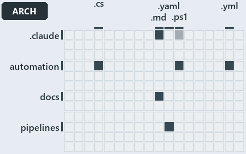

# docs/.assets/explanation/adr-dsgn-track--units-not-tracks-own-the-pipelines--architecture.grid.md

`Grid minimap: adr-dsgn-track--units-not-tracks-own-the-pipelines--architecture`

The grid minimap of the slide `adr-dsgn-track--units-not-tracks-own-the-pipelines--architecture` (architecture lens). The slide supports
[ADR-DSGN-TRACK][1]; the highlight of those ADR codes selects what is lit, and each reason below names the code that selects it.

## What the minimap shows

The grid crosses the 12 tracks (rows) with the 18 file languages (columns) of the world map and lights 7 cells, filled in ink. A cell lit
only by passing mentions (citations in body comments, not in a file's header or text) is touched: a lighter ink. Every other cell is idle, a
grey box: it holds files the slide's ADR codes do not select, or no file at all (174 of the 216 cells hold none). The minimap shows where
the slide sits, not how many files a cell holds; the world-map PDFs show the counts.

- .claude × markdown: 1 lit of 9 files
- .claude × powershell: 1 lit of 1 file, touched
- automation × csharp: 18 lit of 219 files
- automation × powershell: 22 lit of 1400 files
- automation × yaml: 7 lit of 95 files
- docs × markdown: 204 lit of 741 files
- pipelines × pipeline-yaml: 1 lit of 9 files

## Key

A lit row prints its track's name; a lit column prints a short code, the first extension of its file language:

- `.cs`: csharp
- `.md`: markdown
- `.yaml`: pipeline-yaml
- `.ps1`: powershell
- `.yml`: yaml

## Why each cell is lit

### .claude × markdown (1 lit file)

Placed: the root folder `.claude/` names the track .claude ([ADR-DSGN-TRACK#1][2]); the extension `.md` names the file language markdown
([ADR-DSGN-TRACK#6][3]). Lit ([ADR-DSGN-TRACK#12][4]) by:

- [.claude/drawio/STYLE.md][5]: selected by [ADR-DSGN-TRACK][1]: the file cites it at line 181 (text), line 182 (text), line 188 (text),
  line 196 (text), line 198 (text), line 199 (text) and line 210 (text).

### .claude × powershell (1 lit file, touched)

Placed: the root folder `.claude/` names the track .claude ([ADR-DSGN-TRACK#1][2]); the extension `.ps1` names the file language powershell
([ADR-DSGN-TRACK#6][3]). Lit ([ADR-DSGN-TRACK#12][4]) by:

- [.claude/drawio/minimaps/highlights.ps1][6]: selected by [ADR-DSGN-TRACK][1]: the file cites it at line 52 (body comment) (a passing
  mention only).

### automation × csharp (18 lit files)

Placed: the root folder `automation/` names the track automation ([ADR-DSGN-TRACK#1][2]); the extension `.cs` names the file language csharp
([ADR-DSGN-TRACK#6][3]). Lit ([ADR-DSGN-TRACK#12][4]) by:

- [automation/Catzc.Base.Docs/types/AdrDomain.cs][7]: selected by [ADR-DSGN-TRACK][1]: the file cites it at line 6 (header) and line 7
  (header).
- [automation/Catzc.Base.Docs/types/AdrRuleSet.cs][8]: selected by [ADR-DSGN-TRACK][1]: the file cites it at line 8 (header).
- [automation/Catzc.Base.Docs/types/AdrsConfig.cs][9]: selected by [ADR-DSGN-TRACK][1]: the file cites it at line 21 (header), line 24
  (header), line 43 (body comment) and line 47 (body comment).
- [automation/Catzc.Base.Languages/types/FileLanguage.cs][10]: selected by [ADR-DSGN-TRACK][1]: the file cites it at line 2 (header).
- [automation/Catzc.Base.Languages/types/LanguagesConfig.cs][11]: selected by [ADR-DSGN-TRACK][1]: the file cites it at line 2 (header).
- [automation/Catzc.Base.Maps/types/MapCell.cs][12]: selected by [ADR-DSGN-TRACK][1]: the file cites it at line 2 (header), line 3 (header)
  and line 4 (header).
- [automation/Catzc.Base.Maps/types/MapsLabels.cs][13]: selected by [ADR-DSGN-TRACK][1]: the file cites it at line 5 (header), line 6
  (header) and line 10 (header).
- [automation/Catzc.Base.Maps/types/ValueChainCell.cs][14]: selected by [ADR-DSGN-TRACK][1]: the file cites it at line 2 (header), line 3
  (header), line 15 (body comment) and line 18 (body comment).
- [automation/Catzc.Base.Maps/types/ValueChainHighlight.cs][15]: selected by [ADR-DSGN-TRACK][1]: the file cites it at line 2 (header) and
  line 3 (header).
- [automation/Catzc.Base.Maps/types/ValueChainMap.cs][16]: selected by [ADR-DSGN-TRACK][1]: the file cites it at line 2 (header), line 3
  (header) and line 5 (header).
- [automation/Catzc.Base.Maps/types/ValueChainReason.cs][17]: selected by [ADR-DSGN-TRACK][1]: the file cites it at line 2 (header) and line
  4 (header).
- [automation/Catzc.Base.Maps/types/WorldMap.cs][18]: selected by [ADR-DSGN-TRACK][1]: the file cites it at line 3 (header) and line 4
  (header).
- [automation/Catzc.Base.Maps/types/WorldMapBuilder.cs][19]: selected by [ADR-DSGN-TRACK][1]: the file cites it at line 7 (header), line 8
  (header) and line 11 (header).
- [automation/Catzc.Base.Maps/types/WorldMapGridLayout.cs][20]: selected by [ADR-DSGN-TRACK][1]: the file cites it at line 3 (header) and
  line 4 (header).
- [automation/Catzc.Base.Maps/types/WorldMapHighlight.cs][21]: selected by [ADR-DSGN-TRACK][1]: the file cites it at line 2 (header).
- [automation/Catzc.Base.Maps/types/WorldMapPdf.cs][22]: selected by [ADR-DSGN-TRACK][1]: the file cites it at line 4 (header), line 5
  (header) and line 6 (header).
- [automation/Catzc.Base.Variants/types/VariantTrack.cs][23]: selected by [ADR-DSGN-TRACK][1]: the file cites it at line 1 (header), line 3
  (header) and line 17 (body comment).
- [automation/Catzc.Base.Variants/types/VariantsConfig.cs][24]: selected by [ADR-DSGN-TRACK][1]: the file cites it at line 22 (header), line
  25 (header), line 27 (header) and line 270 (text).

### automation × powershell (22 lit files)

Placed: the root folder `automation/` names the track automation ([ADR-DSGN-TRACK#1][2]); the extension `.ps1` names the file language
powershell ([ADR-DSGN-TRACK#6][3]). Lit ([ADR-DSGN-TRACK#12][4]) by:

- [automation/Catzc.Base.Docs/tests/types/AdrsConfig.Tests.ps1][25]: selected by [ADR-DSGN-TRACK][1]: the file cites it at line 99 (text)
  and line 99 (body comment).
- [automation/Catzc.Base.Globs/tests/types/GlobsConfig.Tests.ps1][26]: selected by [ADR-DSGN-TRACK][1]: the file cites it at line 50 (text).
- [automation/Catzc.Base.Languages/Get-FileLanguage.ps1][27]: selected by [ADR-DSGN-TRACK][1]: the file cites it at line 6 (header).
- [automation/Catzc.Base.Languages/tests/Get-FileLanguage.Tests.ps1][28]: selected by [ADR-DSGN-TRACK][1]: the file cites it at line 47
  (body comment), line 124 (text), line 136 (text) and line 178 (text).
- [automation/Catzc.Base.Maps/Export-WorldMapPdf.ps1][29]: selected by [ADR-DSGN-TRACK][1]: the file cites it at line 10 (header), line 11
  (header), line 13 (header) and line 33 (header).
- [automation/Catzc.Base.Maps/Get-ValueChainHighlight.ps1][30]: selected by [ADR-DSGN-TRACK][1]: the file cites it at line 8 (header), line
  9 (header) and line 22 (header).
- [automation/Catzc.Base.Maps/Get-ValueChainMap.ps1][31]: selected by [ADR-DSGN-TRACK][1]: the file cites it at line 6 (header), line 8
  (header) and line 10 (header).
- [automation/Catzc.Base.Maps/Get-WorldMap.ps1][32]: selected by [ADR-DSGN-TRACK][1]: the file cites it at line 6 (header), line 7 (header)
  and line 15 (header).
- [automation/Catzc.Base.Maps/Get-WorldMapHighlight.ps1][33]: selected by [ADR-DSGN-TRACK][1]: the file cites it at line 12 (header) and
  line 33 (header).
- [automation/Catzc.Base.Maps/Test-ValueChainMap.ps1][34]: selected by [ADR-DSGN-TRACK][1]: the file cites it at line 14 (header), line 16
  (header), line 19 (header), line 23 (header), line 54 (text), line 55 (text), line 65 (text), line 68 (text) and line 85 (text).
- [automation/Catzc.Base.Maps/Test-WorldMap.ps1][35]: selected by [ADR-DSGN-TRACK][1]: the file cites it at line 11 (header), line 14
  (header), line 18 (header), line 22 (header), line 23 (header), line 66 (text), line 85 (text), line 102 (text), line 106 (text) and line
  107 (text).
- [automation/Catzc.Base.Maps/private/Resolve-MapLabelTerm.ps1][36]: selected by [ADR-DSGN-TRACK][1]: the file cites it at line 9 (header)
  and line 10 (header).
- [automation/Catzc.Base.Maps/tests/Get-ValueChainHighlight.Tests.ps1][37]: selected by [ADR-DSGN-TRACK][1]: the file cites it at line 2
  (header), line 3 (header), line 21 (text), line 27 (text) and line 46 (text).
- [automation/Catzc.Base.Maps/tests/Get-ValueChainMap.Tests.ps1][38]: selected by [ADR-DSGN-TRACK][1]: the file cites it at line 2 (header),
  line 21 (text), line 42 (text) and line 42 (body comment).
- [automation/Catzc.Base.Maps/tests/Get-WorldMap.Tests.ps1][39]: selected by [ADR-DSGN-TRACK][1]: the file cites it at line 72 (body
  comment) and line 88 (text).
- [automation/Catzc.Base.Maps/tests/Test-ValueChainMap.Tests.ps1][40]: selected by [ADR-DSGN-TRACK][1]: the file cites it at line 2
  (header), line 3 (header), line 4 (header), line 57 (text), line 57 (body comment), line 61 (text), line 62 (text), line 63 (text), line
  64 (text), line 68 (text), line 71 (text), line 90 (text), line 90 (body comment) and line 90 (body comment).
- [automation/Catzc.Base.Maps/tests/Test-WorldMap.Tests.ps1][41]: selected by [ADR-DSGN-TRACK][1]: the file cites it at line 2 (header),
  line 3 (header), line 65 (text), line 69 (text), line 72 (text), line 76 (text), line 77 (text), line 81 (text), line 90 (text), line 91
  (text), line 95 (text), line 99 (text), line 100 (text), line 121 (text), line 121 (body comment) and line 121 (body comment).
- [automation/Catzc.Base.Maps/tests/types/ValueChainHighlight.Tests.ps1][42]: selected by [ADR-DSGN-TRACK][1]: the file cites it at line 2
  (header), line 3 (header), line 19 (text), line 26 (text), line 32 (text), line 49 (text) and line 49 (body comment).
- [automation/Catzc.Base.Maps/tests/types/ValueChainMap.Tests.ps1][43]: selected by [ADR-DSGN-TRACK][1]: the file cites it at line 2
  (header), line 20 (text), line 29 (text), line 34 (text) and line 42 (text).
- [automation/Catzc.Base.Maps/tests/types/WorldMapHighlight.Tests.ps1][44]: selected by [ADR-DSGN-TRACK][1]: the file cites it at line 104
  (text) and line 119 (text).
- [automation/Catzc.Base.QualityGates/private/Get-LanguageTestFolders.ps1][45]: selected by [ADR-DSGN-TRACK][1]: the file cites it at line 7
  (header).
- [automation/Catzc.Base.Variants/Get-Track.ps1][46]: selected by [ADR-DSGN-TRACK][1]: the file cites it at line 5 (header), line 7
  (header), line 8 (header) and line 12 (header).

### automation × yaml (7 lit files)

Placed: the root folder `automation/` names the track automation ([ADR-DSGN-TRACK#1][2]); the extension `.yml` names the file language yaml
([ADR-DSGN-TRACK#6][3]). Lit ([ADR-DSGN-TRACK#12][4]) by:

- [automation/Catzc.Base.Docs/configs/adrs.yml][47]: selected by [ADR-DSGN-TRACK][1]: the file cites it at line 11 (header), line 12
  (header) and line 95 (text).
- [automation/Catzc.Base.Globs/configs/globs.yml][48]: selected by [ADR-DSGN-TRACK][1]: the file cites it at line 113 (body comment) (a
  passing mention only).
- [automation/Catzc.Base.Languages/configs/glossary.yml][49]: selected by [ADR-DSGN-TRACK][1]: the file cites it at line 10 (text).
- [automation/Catzc.Base.Languages/configs/languages.yml][50]: selected by [ADR-DSGN-TRACK][1]: the file cites it at line 2 (header).
- [automation/Catzc.Base.Maps/configs/maps.yml][51]: selected by [ADR-DSGN-TRACK][1]: the file cites it at line 26 (header), line 32
  (header), line 34 (header) and line 39 (header).
- [automation/Catzc.Base.ModuleSystem/configs/glossary.yml][52]: selected by [ADR-DSGN-TRACK][1]: the file cites it at line 9 (text), line
  65 (text), line 84 (text), line 95 (text), line 110 (text), line 123 (text), line 137 (text), line 152 (text), line 165 (text), line 177
  (text), line 190 (text), line 192 (text) and line 204 (text).
- [automation/Catzc.Base.Variants/configs/variants.yml][53]: selected by [ADR-DSGN-TRACK][1]: the file cites it at line 45 (body comment),
  line 48 (body comment) and line 50 (body comment) (a passing mention only).

### docs × markdown (204 lit files)

Placed: the root folder `docs/` names the track docs ([ADR-DSGN-TRACK#1][2]); the extension `.md` names the file language markdown
([ADR-DSGN-TRACK#6][3]). Lit ([ADR-DSGN-TRACK#12][4]) by:

- [docs/.assets/explanation/adr-auto-bundle--build-then-place-with-one-command--operations.chain.md][54]: selected by [ADR-DSGN-TRACK][1]:
  the file cites it at line 23 (text), line 26 (text), line 27 (text), line 31 (text), line 34 (text) and line 35 (text).
- [docs/.assets/explanation/adr-auto-bundle--build-then-place-with-one-command--operations.grid.md][55]: selected by [ADR-DSGN-TRACK][1]:
  the file cites it at line 26 (text), line 27 (text), line 27 (text), line 34 (text), line 35 (text), line 35 (text), line 42 (text), line
  43 (text), line 43 (text), line 59 (text), line 60 (text), line 60 (text), line 67 (text), line 68 (text), line 68 (text), line 192
  (text), line 193 (text) and line 193 (text).
- [docs/.assets/explanation/adr-auto-bundle--build-verify-then-copy-the-folder--implementation.chain.md][56]: selected by
  [ADR-DSGN-TRACK][1]: the file cites it at line 23 (text), line 26 (text), line 27 (text), line 31 (text), line 34 (text) and line 35
  (text).
- [docs/.assets/explanation/adr-auto-bundle--build-verify-then-copy-the-folder--implementation.grid.md][57]: selected by
  [ADR-DSGN-TRACK][1]: the file cites it at line 26 (text), line 27 (text), line 27 (text), line 34 (text), line 35 (text), line 35 (text),
  line 42 (text), line 43 (text), line 43 (text), line 59 (text), line 60 (text), line 60 (text), line 67 (text), line 68 (text), line 68
  (text), line 192 (text), line 193 (text) and line 193 (text).
- [docs/.assets/explanation/adr-auto-bundle--dot-source-one-entry-script--operations.chain.md][58]: selected by [ADR-DSGN-TRACK][1]: the
  file cites it at line 23 (text), line 26 (text), line 27 (text), line 31 (text), line 34 (text) and line 35 (text).
- [docs/.assets/explanation/adr-auto-bundle--dot-source-one-entry-script--operations.grid.md][59]: selected by [ADR-DSGN-TRACK][1]: the file
  cites it at line 26 (text), line 27 (text), line 27 (text), line 34 (text), line 35 (text), line 35 (text), line 42 (text), line 43
  (text), line 43 (text), line 59 (text), line 60 (text), line 60 (text), line 67 (text), line 68 (text), line 68 (text), line 192 (text),
  line 193 (text) and line 193 (text).
- [docs/.assets/explanation/adr-auto-bundle--every-code-root-is-a-copy--architecture.chain.md][60]: selected by [ADR-DSGN-TRACK][1]: the
  file cites it at line 26 (text), line 29 (text), line 30 (text), line 34 (text), line 37 (text), line 38 (text), line 42 (text), line 45
  (text), line 46 (text), line 50 (text), line 53 (text) and line 54 (text).
- [docs/.assets/explanation/adr-auto-bundle--every-code-root-is-a-copy--architecture.grid.md][61]: selected by [ADR-DSGN-TRACK][1]: the file
  cites it at line 28 (text), line 29 (text), line 29 (text), line 36 (text), line 37 (text), line 37 (text), line 44 (text), line 45
  (text), line 45 (text), line 102 (text), line 103 (text), line 103 (text), line 112 (text), line 113 (text), line 113 (text), line 280
  (text), line 281 (text), line 281 (text), line 290 (text), line 291 (text) and line 291 (text).
- [docs/.assets/explanation/adr-auto-bundle--every-entry-runs-one-load-sequence--meta.chain.md][62]: selected by [ADR-DSGN-TRACK][1]: the
  file cites it at line 23 (text), line 26 (text), line 27 (text), line 31 (text), line 34 (text) and line 35 (text).
- [docs/.assets/explanation/adr-auto-bundle--every-entry-runs-one-load-sequence--meta.grid.md][63]: selected by [ADR-DSGN-TRACK][1]: the
  file cites it at line 26 (text), line 27 (text), line 27 (text), line 34 (text), line 35 (text), line 35 (text), line 42 (text), line 43
  (text), line 43 (text), line 59 (text), line 60 (text), line 60 (text), line 67 (text), line 68 (text), line 68 (text), line 192 (text),
  line 193 (text) and line 193 (text).
- [docs/.assets/explanation/adr-auto-bundle--invoke-importer-in-code-order--implementation.chain.md][64]: selected by [ADR-DSGN-TRACK][1]:
  the file cites it at line 23 (text), line 26 (text), line 27 (text), line 31 (text), line 34 (text) and line 35 (text).
- [docs/.assets/explanation/adr-auto-bundle--invoke-importer-in-code-order--implementation.grid.md][65]: selected by [ADR-DSGN-TRACK][1]:
  the file cites it at line 26 (text), line 27 (text), line 27 (text), line 34 (text), line 35 (text), line 35 (text), line 42 (text), line
  43 (text), line 43 (text), line 59 (text), line 60 (text), line 60 (text), line 67 (text), line 68 (text), line 68 (text), line 192
  (text), line 193 (text) and line 193 (text).
- [docs/.assets/explanation/adr-auto-bundle--one-commit-one-immutable-package--meta.chain.md][66]: selected by [ADR-DSGN-TRACK][1]: the file
  cites it at line 26 (text), line 29 (text), line 30 (text), line 34 (text), line 37 (text), line 38 (text), line 42 (text), line 45
  (text), line 46 (text), line 50 (text), line 53 (text) and line 54 (text).
- [docs/.assets/explanation/adr-auto-bundle--one-commit-one-immutable-package--meta.grid.md][67]: selected by [ADR-DSGN-TRACK][1]: the file
  cites it at line 27 (text), line 28 (text), line 28 (text), line 35 (text), line 36 (text), line 36 (text), line 43 (text), line 44
  (text), line 44 (text), line 101 (text), line 102 (text), line 102 (text), line 111 (text), line 112 (text), line 112 (text), line 279
  (text), line 280 (text), line 280 (text), line 289 (text), line 290 (text) and line 290 (text).
- [docs/.assets/explanation/adr-auto-bundle--rule-and-gate-per-load-stage--governance.chain.md][68]: selected by [ADR-DSGN-TRACK][1]: the
  file cites it at line 28 (text), line 31 (text), line 32 (text), line 36 (text), line 39 (text), line 40 (text), line 44 (text), line 47
  (text), line 48 (text), line 52 (text), line 55 (text), line 56 (text), line 58 (text), line 59 (text), line 61 (text), line 62 (text),
  line 66 (text), line 69 (text), line 70 (text), line 72 (text), line 73 (text), line 77 (text), line 80 (text) and line 81 (text).
- [docs/.assets/explanation/adr-auto-bundle--rule-and-gate-per-load-stage--governance.grid.md][69]: selected by [ADR-DSGN-TRACK][1]: the
  file cites it at line 29 (text), line 30 (text), line 30 (text), line 38 (text), line 39 (text), line 39 (text), line 46 (text), line 47
  (text), line 47 (text), line 175 (text), line 176 (text), line 176 (text), line 306 (text), line 307 (text), line 307 (text), line 330
  (text), line 331 (text), line 331 (text), line 613 (text), line 614 (text), line 614 (text), line 629 (text), line 630 (text) and line 630
  (text).
- [docs/.assets/explanation/adr-auto-bundle--two-entries-feed-one-importer--architecture.chain.md][70]: selected by [ADR-DSGN-TRACK][1]: the
  file cites it at line 23 (text), line 26 (text), line 27 (text), line 31 (text), line 34 (text) and line 35 (text).
- [docs/.assets/explanation/adr-auto-bundle--two-entries-feed-one-importer--architecture.grid.md][71]: selected by [ADR-DSGN-TRACK][1]: the
  file cites it at line 26 (text), line 27 (text), line 27 (text), line 34 (text), line 35 (text), line 35 (text), line 42 (text), line 43
  (text), line 43 (text), line 59 (text), line 60 (text), line 60 (text), line 67 (text), line 68 (text), line 68 (text), line 192 (text),
  line 193 (text) and line 193 (text).
- [docs/.assets/explanation/adr-auto-bundle--what-gates-each-bundle-stage--governance.chain.md][72]: selected by [ADR-DSGN-TRACK][1]: the
  file cites it at line 28 (text), line 31 (text), line 32 (text), line 36 (text), line 39 (text), line 40 (text), line 44 (text), line 47
  (text), line 48 (text), line 52 (text), line 55 (text), line 56 (text), line 58 (text), line 59 (text), line 63 (text), line 66 (text),
  line 67 (text), line 71 (text), line 74 (text) and line 75 (text).
- [docs/.assets/explanation/adr-auto-bundle--what-gates-each-bundle-stage--governance.grid.md][73]: selected by [ADR-DSGN-TRACK][1]: the
  file cites it at line 30 (text), line 31 (text), line 31 (text), line 41 (text), line 42 (text), line 42 (text), line 49 (text), line 50
  (text), line 50 (text), line 68 (text), line 69 (text), line 69 (text), line 755 (text), line 756 (text), line 756 (text), line 790
  (text), line 791 (text), line 791 (text), line 1039 (text), line 1040 (text), line 1040 (text), line 1047 (text), line 1048 (text), line
  1048 (text), line 1061 (text), line 1062 (text) and line 1062 (text).
- [docs/.assets/explanation/adr-auto-depm--a-declared-allow-list-of-layers--meta.chain.md][74]: selected by [ADR-DSGN-TRACK][1]: the file
  cites it at line 22 (text), line 25 (text) and line 26 (text).
- [docs/.assets/explanation/adr-auto-depm--a-declared-allow-list-of-layers--meta.grid.md][75]: selected by [ADR-DSGN-TRACK][1]: the file
  cites it at line 24 (text), line 25 (text), line 25 (text), line 31 (text), line 32 (text), line 32 (text), line 40 (text), line 41
  (text), line 41 (text), line 47 (text), line 48 (text) and line 48 (text).
- [docs/.assets/explanation/adr-auto-depm--three-layers-edges-point-down--architecture.chain.md][76]: selected by [ADR-DSGN-TRACK][1]: the
  file cites it at line 22 (text), line 25 (text) and line 26 (text).
- [docs/.assets/explanation/adr-auto-depm--three-layers-edges-point-down--architecture.grid.md][77]: selected by [ADR-DSGN-TRACK][1]: the
  file cites it at line 24 (text), line 25 (text), line 25 (text), line 31 (text), line 32 (text), line 32 (text), line 40 (text), line 41
  (text), line 41 (text), line 47 (text), line 48 (text) and line 48 (text).
- [docs/.assets/explanation/adr-auto-depm--two-gates-check-the-layer-pins--governance.chain.md][78]: selected by [ADR-DSGN-TRACK][1]: the
  file cites it at line 24 (text), line 27 (text), line 28 (text), line 32 (text), line 35 (text) and line 36 (text).
- [docs/.assets/explanation/adr-auto-depm--two-gates-check-the-layer-pins--governance.grid.md][79]: selected by [ADR-DSGN-TRACK][1]: the
  file cites it at line 29 (text), line 30 (text), line 30 (text), line 41 (text), line 42 (text), line 42 (text), line 62 (text), line 63
  (text), line 63 (text), line 672 (text), line 673 (text), line 673 (text), line 703 (text), line 704 (text), line 704 (text), line 844
  (text), line 845 (text), line 845 (text), line 852 (text), line 853 (text), line 853 (text), line 863 (text), line 864 (text) and line 864
  (text).
- [docs/.assets/explanation/adr-auto-depm--two-sections-unioned-into-one-allow-set--implementation.chain.md][80]: selected by
  [ADR-DSGN-TRACK][1]: the file cites it at line 23 (text), line 26 (text) and line 27 (text).
- [docs/.assets/explanation/adr-auto-depm--two-sections-unioned-into-one-allow-set--implementation.grid.md][81]: selected by
  [ADR-DSGN-TRACK][1]: the file cites it at line 24 (text), line 25 (text), line 25 (text), line 31 (text), line 32 (text), line 32 (text),
  line 40 (text), line 41 (text), line 41 (text), line 47 (text), line 48 (text) and line 48 (text).
- [docs/.assets/explanation/adr-auto-depm--undeclared-edge-fails-with-one-line--operations.chain.md][82]: selected by [ADR-DSGN-TRACK][1]:
  the file cites it at line 22 (text), line 25 (text) and line 26 (text).
- [docs/.assets/explanation/adr-auto-depm--undeclared-edge-fails-with-one-line--operations.grid.md][83]: selected by [ADR-DSGN-TRACK][1]:
  the file cites it at line 24 (text), line 25 (text), line 25 (text), line 31 (text), line 32 (text), line 32 (text), line 40 (text), line
  41 (text), line 41 (text), line 47 (text), line 48 (text) and line 48 (text).
- [docs/.assets/explanation/adr-az-naming--how-each-naming-rule-is-held--governance.chain.md][84]: selected by [ADR-DSGN-TRACK][1]: the file
  cites it at line 22 (text), line 25 (text) and line 26 (text).
- [docs/.assets/explanation/adr-az-naming--how-each-naming-rule-is-held--governance.grid.md][85]: selected by [ADR-DSGN-TRACK][1]: the file
  cites it at line 24 (text), line 25 (text), line 25 (text), line 34 (text), line 35 (text), line 35 (text), line 54 (text), line 55
  (text), line 55 (text), line 65 (text), line 66 (text) and line 66 (text).
- [docs/.assets/explanation/adr-az-naming--lookup-form-check-render-in-order--implementation.chain.md][86]: selected by [ADR-DSGN-TRACK][1]:
  the file cites it at line 22 (text), line 25 (text) and line 26 (text).
- [docs/.assets/explanation/adr-az-naming--lookup-form-check-render-in-order--implementation.grid.md][87]: selected by [ADR-DSGN-TRACK][1]:
  the file cites it at line 24 (text), line 25 (text), line 25 (text), line 34 (text), line 35 (text), line 35 (text), line 54 (text), line
  55 (text), line 55 (text), line 65 (text), line 66 (text) and line 66 (text).
- [docs/.assets/explanation/adr-az-naming--names-are-derived-never-typed--operations.chain.md][88]: selected by [ADR-DSGN-TRACK][1]: the
  file cites it at line 22 (text), line 25 (text) and line 26 (text).
- [docs/.assets/explanation/adr-az-naming--names-are-derived-never-typed--operations.grid.md][89]: selected by [ADR-DSGN-TRACK][1]: the file
  cites it at line 24 (text), line 25 (text), line 25 (text), line 34 (text), line 35 (text), line 35 (text), line 54 (text), line 55
  (text), line 55 (text), line 65 (text), line 66 (text) and line 66 (text).
- [docs/.assets/explanation/adr-az-naming--names-are-pure-and-never-truncated--meta.chain.md][90]: selected by [ADR-DSGN-TRACK][1]: the file
  cites it at line 22 (text), line 25 (text) and line 26 (text).
- [docs/.assets/explanation/adr-az-naming--names-are-pure-and-never-truncated--meta.grid.md][91]: selected by [ADR-DSGN-TRACK][1]: the file
  cites it at line 24 (text), line 25 (text), line 25 (text), line 34 (text), line 35 (text), line 35 (text), line 54 (text), line 55
  (text), line 55 (text), line 65 (text), line 66 (text) and line 66 (text).
- [docs/.assets/explanation/adr-az-naming--one-namer-assembles-every-name--architecture.chain.md][92]: selected by [ADR-DSGN-TRACK][1]: the
  file cites it at line 22 (text), line 25 (text) and line 26 (text).
- [docs/.assets/explanation/adr-az-naming--one-namer-assembles-every-name--architecture.grid.md][93]: selected by [ADR-DSGN-TRACK][1]: the
  file cites it at line 24 (text), line 25 (text), line 25 (text), line 34 (text), line 35 (text), line 35 (text), line 54 (text), line 55
  (text), line 55 (text), line 65 (text), line 66 (text) and line 66 (text).
- [docs/.assets/explanation/adr-conf-loading--ask-by-name-get-the-cached-object--operations.chain.md][94]: selected by [ADR-DSGN-TRACK][1]:
  the file cites it at line 22 (text), line 25 (text) and line 26 (text).
- [docs/.assets/explanation/adr-conf-loading--ask-by-name-get-the-cached-object--operations.grid.md][95]: selected by [ADR-DSGN-TRACK][1]:
  the file cites it at line 24 (text), line 25 (text), line 25 (text), line 35 (text), line 36 (text), line 36 (text), line 58 (text), line
  59 (text), line 59 (text), line 65 (text), line 66 (text) and line 66 (text).
- [docs/.assets/explanation/adr-conf-loading--callers-depend-on-one-config-module--architecture.chain.md][96]: selected by
  [ADR-DSGN-TRACK][1]: the file cites it at line 22 (text), line 25 (text) and line 26 (text).
- [docs/.assets/explanation/adr-conf-loading--callers-depend-on-one-config-module--architecture.grid.md][97]: selected by
  [ADR-DSGN-TRACK][1]: the file cites it at line 24 (text), line 25 (text), line 25 (text), line 35 (text), line 36 (text), line 36 (text),
  line 58 (text), line 59 (text), line 59 (text), line 65 (text), line 66 (text) and line 66 (text).
- [docs/.assets/explanation/adr-conf-loading--one-gate-guards-the-read-path--governance.chain.md][98]: selected by [ADR-DSGN-TRACK][1]: the
  file cites it at line 24 (text), line 27 (text), line 28 (text), line 30 (text), line 31 (text), line 35 (text), line 38 (text) and line
  39 (text).
- [docs/.assets/explanation/adr-conf-loading--one-gate-guards-the-read-path--governance.grid.md][99]: selected by [ADR-DSGN-TRACK][1]: the
  file cites it at line 29 (text), line 30 (text), line 30 (text), line 40 (text), line 41 (text), line 41 (text), line 62 (text), line 63
  (text), line 63 (text), line 693 (text), line 694 (text), line 694 (text), line 724 (text), line 725 (text), line 725 (text), line 879
  (text), line 880 (text), line 880 (text), line 887 (text), line 888 (text), line 888 (text), line 898 (text), line 899 (text) and line 899
  (text).
- [docs/.assets/explanation/adr-conf-loading--one-reader-one-cache-per-session--meta.chain.md][100]: selected by [ADR-DSGN-TRACK][1]: the
  file cites it at line 22 (text), line 25 (text) and line 26 (text).
- [docs/.assets/explanation/adr-conf-loading--one-reader-one-cache-per-session--meta.grid.md][101]: selected by [ADR-DSGN-TRACK][1]: the
  file cites it at line 24 (text), line 25 (text), line 25 (text), line 35 (text), line 36 (text), line 36 (text), line 58 (text), line 59
  (text), line 59 (text), line 65 (text), line 66 (text) and line 66 (text).
- [docs/.assets/explanation/adr-conf-loading--three-caches-back-one-reader--implementation.chain.md][102]: selected by [ADR-DSGN-TRACK][1]:
  the file cites it at line 22 (text), line 25 (text) and line 26 (text).
- [docs/.assets/explanation/adr-conf-loading--three-caches-back-one-reader--implementation.grid.md][103]: selected by [ADR-DSGN-TRACK][1]:
  the file cites it at line 24 (text), line 25 (text), line 25 (text), line 35 (text), line 36 (text), line 36 (text), line 58 (text), line
  59 (text), line 59 (text), line 65 (text), line 66 (text) and line 66 (text).
- [docs/.assets/explanation/adr-dsgn-aspect--drop-a-file-the-import-exports-it--operations.chain.md][104]: selected by [ADR-DSGN-TRACK][1]:
  the file cites it at line 23 (text), line 26 (text), line 27 (text), line 31 (text), line 34 (text) and line 35 (text).
- [docs/.assets/explanation/adr-dsgn-aspect--drop-a-file-the-import-exports-it--operations.grid.md][105]: selected by [ADR-DSGN-TRACK][1]:
  the file cites it at line 24 (text), line 25 (text), line 25 (text), line 34 (text), line 35 (text), line 35 (text), line 47 (text), line
  48 (text), line 48 (text), line 56 (text), line 57 (text) and line 57 (text).
- [docs/.assets/explanation/adr-dsgn-aspect--every-file-in-exactly-one-aspect--meta.chain.md][106]: selected by [ADR-DSGN-TRACK][1]: the
  file cites it at line 23 (text), line 26 (text), line 27 (text), line 31 (text), line 34 (text) and line 35 (text).
- [docs/.assets/explanation/adr-dsgn-aspect--every-file-in-exactly-one-aspect--meta.grid.md][107]: selected by [ADR-DSGN-TRACK][1]: the file
  cites it at line 24 (text), line 25 (text), line 25 (text), line 34 (text), line 35 (text), line 35 (text), line 47 (text), line 48
  (text), line 48 (text), line 56 (text), line 57 (text) and line 57 (text).
- [docs/.assets/explanation/adr-dsgn-aspect--manifest-and-aspects-from-one-folder--implementation.chain.md][108]: selected by
  [ADR-DSGN-TRACK][1]: the file cites it at line 24 (text), line 27 (text), line 28 (text), line 32 (text), line 35 (text) and line 36
  (text).
- [docs/.assets/explanation/adr-dsgn-aspect--manifest-and-aspects-from-one-folder--implementation.grid.md][109]: selected by
  [ADR-DSGN-TRACK][1]: the file cites it at line 24 (text), line 25 (text), line 25 (text), line 34 (text), line 35 (text), line 35 (text),
  line 47 (text), line 48 (text), line 48 (text), line 56 (text), line 57 (text) and line 57 (text).
- [docs/.assets/explanation/adr-dsgn-aspect--one-folder-two-independent-readers--architecture.chain.md][110]: selected by
  [ADR-DSGN-TRACK][1]: the file cites it at line 23 (text), line 26 (text), line 27 (text), line 31 (text), line 34 (text) and line 35
  (text).
- [docs/.assets/explanation/adr-dsgn-aspect--one-folder-two-independent-readers--architecture.grid.md][111]: selected by
  [ADR-DSGN-TRACK][1]: the file cites it at line 24 (text), line 25 (text), line 25 (text), line 34 (text), line 35 (text), line 35 (text),
  line 47 (text), line 48 (text), line 48 (text), line 56 (text), line 57 (text) and line 57 (text).
- [docs/.assets/explanation/adr-dsgn-aspect--partition-integrity-runs-only-in-unit-tests--governance.chain.md][112]: selected by
  [ADR-DSGN-TRACK][1]: the file cites it at line 25 (text), line 28 (text), line 29 (text), line 31 (text), line 32 (text), line 36 (text),
  line 39 (text), line 40 (text), line 44 (text), line 47 (text), line 48 (text), line 50 (text), line 51 (text), line 53 (text) and line 54
  (text).
- [docs/.assets/explanation/adr-dsgn-aspect--partition-integrity-runs-only-in-unit-tests--governance.grid.md][113]: selected by
  [ADR-DSGN-TRACK][1]: the file cites it at line 28 (text), line 29 (text), line 29 (text), line 35 (text), line 36 (text), line 36 (text),
  line 43 (text), line 44 (text), line 44 (text), line 66 (text), line 67 (text), line 67 (text), line 157 (text), line 158 (text), line 158
  (text), line 177 (text), line 178 (text), line 178 (text), line 381 (text), line 382 (text) and line 382 (text).
- [docs/.assets/explanation/adr-dsgn-life--code-wires-only-the-first-rungs--implementation.chain.md][114]: selected by [ADR-DSGN-TRACK][1]:
  the file cites it at line 24 (text), line 27 (text), line 28 (text), line 32 (text), line 35 (text), line 36 (text), line 40 (text), line
  43 (text) and line 44 (text).
- [docs/.assets/explanation/adr-dsgn-life--code-wires-only-the-first-rungs--implementation.grid.md][115]: selected by [ADR-DSGN-TRACK][1]:
  the file cites it at line 23 (text), line 24 (text), line 24 (text), line 30 (text), line 31 (text), line 31 (text), line 38 (text), line
  39 (text) and line 39 (text).
- [docs/.assets/explanation/adr-dsgn-life--deploy-and-integrate-share-only-the-topic--architecture.chain.md][116]: selected by
  [ADR-DSGN-TRACK][1]: the file cites it at line 25 (text), line 28 (text), line 29 (text), line 31 (text), line 32 (text), line 36 (text),
  line 39 (text), line 40 (text), line 42 (text), line 43 (text), line 47 (text), line 50 (text), line 51 (text), line 53 (text) and line 54
  (text).
- [docs/.assets/explanation/adr-dsgn-life--deploy-and-integrate-share-only-the-topic--architecture.grid.md][117]: selected by
  [ADR-DSGN-TRACK][1]: the file cites it at line 24 (text), line 25 (text), line 25 (text), line 34 (text), line 35 (text), line 35 (text),
  line 45 (text), line 46 (text) and line 46 (text).
- [docs/.assets/explanation/adr-dsgn-life--deploying-is-not-integrating--meta.chain.md][118]: selected by [ADR-DSGN-TRACK][1]: the file
  cites it at line 24 (text), line 27 (text), line 28 (text), line 30 (text), line 31 (text), line 35 (text), line 38 (text), line 39
  (text), line 41 (text), line 42 (text), line 46 (text), line 49 (text), line 50 (text), line 52 (text) and line 53 (text).
- [docs/.assets/explanation/adr-dsgn-life--deploying-is-not-integrating--meta.grid.md][119]: selected by [ADR-DSGN-TRACK][1]: the file cites
  it at line 23 (text), line 24 (text), line 24 (text), line 33 (text), line 34 (text), line 34 (text), line 44 (text), line 45 (text) and
  line 45 (text).
- [docs/.assets/explanation/adr-dsgn-life--engineer-merges-pipelines-do-the-rest--operations.chain.md][120]: selected by
  [ADR-DSGN-TRACK][1]: the file cites it at line 26 (text), line 29 (text), line 30 (text), line 34 (text), line 37 (text), line 38 (text),
  line 40 (text), line 41 (text), line 45 (text), line 48 (text), line 49 (text), line 51 (text), line 52 (text), line 56 (text), line 59
  (text), line 60 (text), line 62 (text) and line 63 (text).
- [docs/.assets/explanation/adr-dsgn-life--engineer-merges-pipelines-do-the-rest--operations.grid.md][121]: selected by [ADR-DSGN-TRACK][1]:
  the file cites it at line 26 (text), line 27 (text), line 27 (text), line 35 (text), line 36 (text), line 36 (text), line 45 (text), line
  46 (text), line 46 (text), line 55 (text), line 56 (text), line 56 (text), line 66 (text), line 67 (text) and line 67 (text).
- [docs/.assets/explanation/adr-dsgn-life--every-deploy-stage-is-main-only--implementation.chain.md][122]: selected by [ADR-DSGN-TRACK][1]:
  the file cites it at line 25 (text), line 28 (text), line 29 (text), line 31 (text), line 32 (text), line 36 (text), line 39 (text), line
  40 (text), line 42 (text), line 43 (text), line 47 (text), line 50 (text), line 51 (text), line 53 (text) and line 54 (text).
- [docs/.assets/explanation/adr-dsgn-life--every-deploy-stage-is-main-only--implementation.grid.md][123]: selected by [ADR-DSGN-TRACK][1]:
  the file cites it at line 24 (text), line 25 (text), line 25 (text), line 34 (text), line 35 (text), line 35 (text), line 45 (text), line
  46 (text) and line 46 (text).
- [docs/.assets/explanation/adr-dsgn-life--four-domains-promote-one-artifact--architecture.chain.md][124]: selected by [ADR-DSGN-TRACK][1]:
  the file cites it at line 26 (text), line 29 (text), line 30 (text), line 34 (text), line 37 (text), line 38 (text), line 40 (text), line
  41 (text), line 45 (text), line 48 (text), line 49 (text), line 51 (text), line 52 (text), line 56 (text), line 59 (text), line 60 (text),
  line 62 (text) and line 63 (text).
- [docs/.assets/explanation/adr-dsgn-life--four-domains-promote-one-artifact--architecture.grid.md][125]: selected by [ADR-DSGN-TRACK][1]:
  the file cites it at line 26 (text), line 27 (text), line 27 (text), line 35 (text), line 36 (text), line 36 (text), line 45 (text), line
  46 (text), line 46 (text), line 55 (text), line 56 (text), line 56 (text), line 66 (text), line 67 (text) and line 67 (text).
- [docs/.assets/explanation/adr-dsgn-life--integrators-depend-on-an-occupant--architecture.chain.md][126]: selected by [ADR-DSGN-TRACK][1]:
  the file cites it at line 26 (text), line 29 (text), line 30 (text), line 34 (text), line 37 (text), line 38 (text), line 40 (text), line
  41 (text), line 45 (text), line 48 (text), line 49 (text), line 51 (text), line 52 (text), line 56 (text), line 59 (text), line 60 (text),
  line 62 (text) and line 63 (text).
- [docs/.assets/explanation/adr-dsgn-life--integrators-depend-on-an-occupant--architecture.grid.md][127]: selected by [ADR-DSGN-TRACK][1]:
  the file cites it at line 26 (text), line 27 (text), line 27 (text), line 35 (text), line 36 (text), line 36 (text), line 45 (text), line
  46 (text), line 46 (text), line 55 (text), line 56 (text), line 56 (text), line 66 (text), line 67 (text) and line 67 (text).
- [docs/.assets/explanation/adr-dsgn-life--merging-to-main-is-what-deploys--operations.chain.md][128]: selected by [ADR-DSGN-TRACK][1]: the
  file cites it at line 25 (text), line 28 (text), line 29 (text), line 31 (text), line 32 (text), line 36 (text), line 39 (text), line 40
  (text), line 42 (text), line 43 (text), line 47 (text), line 50 (text), line 51 (text), line 53 (text) and line 54 (text).
- [docs/.assets/explanation/adr-dsgn-life--merging-to-main-is-what-deploys--operations.grid.md][129]: selected by [ADR-DSGN-TRACK][1]: the
  file cites it at line 24 (text), line 25 (text), line 25 (text), line 34 (text), line 35 (text), line 35 (text), line 45 (text), line 46
  (text) and line 46 (text).
- [docs/.assets/explanation/adr-dsgn-life--one-way-climb-three-endings--meta.chain.md][130]: selected by [ADR-DSGN-TRACK][1]: the file cites
  it at line 24 (text), line 27 (text), line 28 (text), line 30 (text), line 31 (text), line 35 (text), line 38 (text), line 39 (text), line
  41 (text), line 42 (text), line 46 (text), line 49 (text), line 50 (text), line 52 (text) and line 53 (text).
- [docs/.assets/explanation/adr-dsgn-life--one-way-climb-three-endings--meta.grid.md][131]: selected by [ADR-DSGN-TRACK][1]: the file cites
  it at line 23 (text), line 24 (text), line 24 (text), line 33 (text), line 34 (text), line 34 (text), line 44 (text), line 45 (text) and
  line 45 (text).
- [docs/.assets/explanation/adr-dsgn-life--out-of-band-deploy-is-adr-only--governance.chain.md][132]: selected by [ADR-DSGN-TRACK][1]: the
  file cites it at line 25 (text), line 28 (text), line 29 (text), line 31 (text), line 32 (text), line 36 (text), line 39 (text), line 40
  (text), line 42 (text), line 43 (text), line 47 (text), line 50 (text), line 51 (text), line 53 (text) and line 54 (text).
- [docs/.assets/explanation/adr-dsgn-life--out-of-band-deploy-is-adr-only--governance.grid.md][133]: selected by [ADR-DSGN-TRACK][1]: the
  file cites it at line 24 (text), line 25 (text), line 25 (text), line 34 (text), line 35 (text), line 35 (text), line 45 (text), line 46
  (text) and line 46 (text).
- [docs/.assets/explanation/adr-dsgn-life--sync-from-the-last-certified-commit--meta.chain.md][134]: selected by [ADR-DSGN-TRACK][1]: the
  file cites it at line 24 (text), line 27 (text), line 28 (text), line 32 (text), line 35 (text), line 36 (text), line 40 (text), line 43
  (text) and line 44 (text).
- [docs/.assets/explanation/adr-dsgn-life--sync-from-the-last-certified-commit--meta.grid.md][135]: selected by [ADR-DSGN-TRACK][1]: the
  file cites it at line 23 (text), line 24 (text), line 24 (text), line 30 (text), line 31 (text), line 31 (text), line 38 (text), line 39
  (text) and line 39 (text).
- [docs/.assets/explanation/adr-dsgn-life--sync-point-rules-are-adr-only--governance.chain.md][136]: selected by [ADR-DSGN-TRACK][1]: the
  file cites it at line 26 (text), line 29 (text), line 30 (text), line 34 (text), line 37 (text), line 38 (text), line 40 (text), line 41
  (text), line 45 (text), line 48 (text), line 49 (text), line 51 (text), line 52 (text), line 56 (text), line 59 (text), line 60 (text),
  line 62 (text) and line 63 (text).
- [docs/.assets/explanation/adr-dsgn-life--sync-point-rules-are-adr-only--governance.grid.md][137]: selected by [ADR-DSGN-TRACK][1]: the
  file cites it at line 26 (text), line 27 (text), line 27 (text), line 35 (text), line 36 (text), line 36 (text), line 45 (text), line 46
  (text), line 46 (text), line 55 (text), line 56 (text), line 56 (text), line 66 (text), line 67 (text) and line 67 (text).
- [docs/.assets/explanation/adr-dsgn-life--which-rung-gates-exist-in-code--governance.chain.md][138]: selected by [ADR-DSGN-TRACK][1]: the
  file cites it at line 27 (text), line 30 (text), line 31 (text), line 35 (text), line 38 (text), line 39 (text), line 41 (text), line 42
  (text), line 44 (text), line 45 (text), line 49 (text), line 52 (text), line 53 (text), line 55 (text), line 56 (text), line 58 (text),
  line 59 (text), line 63 (text), line 66 (text), line 67 (text), line 69 (text), line 70 (text), line 72 (text), line 73 (text), line 77
  (text), line 80 (text) and line 81 (text).
- [docs/.assets/explanation/adr-dsgn-life--which-rung-gates-exist-in-code--governance.grid.md][139]: selected by [ADR-DSGN-TRACK][1]: the
  file cites it at line 29 (text), line 30 (text), line 30 (text), line 46 (text), line 47 (text), line 47 (text), line 65 (text), line 66
  (text), line 66 (text), line 679 (text), line 680 (text), line 680 (text), line 714 (text), line 715 (text), line 715 (text), line 959
  (text), line 960 (text), line 960 (text), line 967 (text), line 968 (text), line 968 (text), line 978 (text), line 979 (text) and line 979
  (text).
- [docs/.assets/explanation/adr-dsgn-remote--clients-bridge-to-one-server--architecture.chain.md][140]: selected by [ADR-DSGN-TRACK][1]: the
  file cites it at line 26 (text), line 29 (text), line 30 (text), line 34 (text), line 37 (text), line 38 (text), line 40 (text), line 41
  (text), line 45 (text), line 48 (text), line 49 (text), line 53 (text), line 56 (text) and line 57 (text).
- [docs/.assets/explanation/adr-dsgn-remote--clients-bridge-to-one-server--architecture.grid.md][141]: selected by [ADR-DSGN-TRACK][1]: the
  file cites it at line 24 (text), line 25 (text), line 25 (text), line 31 (text), line 32 (text), line 32 (text), line 40 (text), line 41
  (text) and line 41 (text).
- [docs/.assets/explanation/adr-dsgn-remote--guard-and-policies-by-command--operations.chain.md][142]: selected by [ADR-DSGN-TRACK][1]: the
  file cites it at line 23 (text), line 26 (text), line 27 (text), line 31 (text), line 34 (text) and line 35 (text).
- [docs/.assets/explanation/adr-dsgn-remote--guard-and-policies-by-command--operations.grid.md][143]: selected by [ADR-DSGN-TRACK][1]: the
  file cites it at line 22 (text), line 23 (text), line 23 (text), line 29 (text), line 30 (text) and line 30 (text).
- [docs/.assets/explanation/adr-dsgn-remote--ingress-gated-the-rest-by-review--governance.chain.md][144]: selected by [ADR-DSGN-TRACK][1]:
  the file cites it at line 27 (text), line 30 (text), line 31 (text), line 35 (text), line 38 (text), line 39 (text), line 41 (text), line
  42 (text), line 46 (text), line 49 (text), line 50 (text), line 54 (text), line 57 (text), line 58 (text), line 62 (text), line 65 (text)
  and line 66 (text).
- [docs/.assets/explanation/adr-dsgn-remote--ingress-gated-the-rest-by-review--governance.grid.md][145]: selected by [ADR-DSGN-TRACK][1]:
  the file cites it at line 26 (text), line 27 (text), line 27 (text), line 33 (text), line 34 (text), line 34 (text), line 40 (text), line
  41 (text), line 41 (text), line 48 (text), line 49 (text), line 49 (text), line 58 (text), line 59 (text) and line 59 (text).
- [docs/.assets/explanation/adr-dsgn-remote--local-guard-and-server-policies--implementation.chain.md][146]: selected by
  [ADR-DSGN-TRACK][1]: the file cites it at line 23 (text), line 26 (text), line 27 (text), line 31 (text), line 34 (text) and line 35
  (text).
- [docs/.assets/explanation/adr-dsgn-remote--local-guard-and-server-policies--implementation.grid.md][147]: selected by [ADR-DSGN-TRACK][1]:
  the file cites it at line 22 (text), line 23 (text), line 23 (text), line 29 (text), line 30 (text) and line 30 (text).
- [docs/.assets/explanation/adr-dsgn-remote--one-door-in-one-stable-point-out--meta.chain.md][148]: selected by [ADR-DSGN-TRACK][1]: the
  file cites it at line 23 (text), line 26 (text), line 27 (text), line 31 (text), line 34 (text) and line 35 (text).
- [docs/.assets/explanation/adr-dsgn-remote--one-door-in-one-stable-point-out--meta.grid.md][149]: selected by [ADR-DSGN-TRACK][1]: the file
  cites it at line 22 (text), line 23 (text), line 23 (text), line 29 (text), line 30 (text) and line 30 (text).
- [docs/.assets/explanation/adr-dsgn-runmode--one-entry-script-per-mode--operations.chain.md][150]: selected by [ADR-DSGN-TRACK][1]: the
  file cites it at line 23 (text), line 26 (text), line 27 (text), line 31 (text), line 34 (text) and line 35 (text).
- [docs/.assets/explanation/adr-dsgn-runmode--one-entry-script-per-mode--operations.grid.md][151]: selected by [ADR-DSGN-TRACK][1]: the file
  cites it at line 25 (text), line 26 (text), line 26 (text), line 71 (text), line 72 (text), line 72 (text), line 79 (text), line 80
  (text), line 80 (text), line 140 (text), line 141 (text), line 141 (text), line 149 (text), line 150 (text) and line 150 (text).
- [docs/.assets/explanation/adr-dsgn-runmode--shims-set-roots-mode-read-back--implementation.chain.md][152]: selected by
  [ADR-DSGN-TRACK][1]: the file cites it at line 23 (text), line 26 (text), line 27 (text), line 31 (text), line 34 (text) and line 35
  (text).
- [docs/.assets/explanation/adr-dsgn-runmode--shims-set-roots-mode-read-back--implementation.grid.md][153]: selected by [ADR-DSGN-TRACK][1]:
  the file cites it at line 25 (text), line 26 (text), line 26 (text), line 71 (text), line 72 (text), line 72 (text), line 79 (text), line
  80 (text), line 80 (text), line 140 (text), line 141 (text), line 141 (text), line 149 (text), line 150 (text) and line 150 (text).
- [docs/.assets/explanation/adr-dsgn-runmode--two-roots-one-importer-same-modules--architecture.chain.md][154]: selected by
  [ADR-DSGN-TRACK][1]: the file cites it at line 23 (text), line 26 (text), line 27 (text), line 31 (text), line 34 (text) and line 35
  (text).
- [docs/.assets/explanation/adr-dsgn-runmode--two-roots-one-importer-same-modules--architecture.grid.md][155]: selected by
  [ADR-DSGN-TRACK][1]: the file cites it at line 25 (text), line 26 (text), line 26 (text), line 71 (text), line 72 (text), line 72 (text),
  line 79 (text), line 80 (text), line 80 (text), line 140 (text), line 141 (text), line 141 (text), line 149 (text), line 150 (text) and
  line 150 (text).
- [docs/.assets/explanation/adr-dsgn-runmode--where-code-loads-from-decides-the-mode--meta.chain.md][156]: selected by [ADR-DSGN-TRACK][1]:
  the file cites it at line 23 (text), line 26 (text), line 27 (text), line 31 (text), line 34 (text) and line 35 (text).
- [docs/.assets/explanation/adr-dsgn-runmode--where-code-loads-from-decides-the-mode--meta.grid.md][157]: selected by [ADR-DSGN-TRACK][1]:
  the file cites it at line 25 (text), line 26 (text), line 26 (text), line 71 (text), line 72 (text), line 72 (text), line 79 (text), line
  80 (text), line 80 (text), line 140 (text), line 141 (text), line 141 (text), line 149 (text), line 150 (text) and line 150 (text).
- [docs/.assets/explanation/adr-dsgn-runmode--which-run-mode-rules-have-a-gate--governance.chain.md][158]: selected by [ADR-DSGN-TRACK][1]:
  the file cites it at line 23 (text), line 26 (text), line 27 (text), line 31 (text), line 34 (text) and line 35 (text).
- [docs/.assets/explanation/adr-dsgn-runmode--which-run-mode-rules-have-a-gate--governance.grid.md][159]: selected by [ADR-DSGN-TRACK][1]:
  the file cites it at line 25 (text), line 26 (text), line 26 (text), line 71 (text), line 72 (text), line 72 (text), line 79 (text), line
  80 (text), line 80 (text), line 140 (text), line 141 (text), line 141 (text), line 149 (text), line 150 (text) and line 150 (text).
- [docs/.assets/explanation/adr-dsgn-thinplat--bind-to-one-cli-delegate-the-rest--meta.chain.md][160]: selected by [ADR-DSGN-TRACK][1]: the
  file cites it at line 23 (text), line 26 (text), line 27 (text), line 31 (text), line 34 (text) and line 35 (text).
- [docs/.assets/explanation/adr-dsgn-thinplat--bind-to-one-cli-delegate-the-rest--meta.grid.md][161]: selected by [ADR-DSGN-TRACK][1]: the
  file cites it at line 22 (text), line 23 (text), line 23 (text), line 30 (text), line 31 (text) and line 31 (text).
- [docs/.assets/explanation/adr-dsgn-thinplat--deploy-bicep-delegates-to-az--implementation.chain.md][162]: selected by [ADR-DSGN-TRACK][1]:
  the file cites it at line 23 (text), line 26 (text), line 27 (text), line 31 (text), line 34 (text) and line 35 (text).
- [docs/.assets/explanation/adr-dsgn-thinplat--deploy-bicep-delegates-to-az--implementation.grid.md][163]: selected by [ADR-DSGN-TRACK][1]:
  the file cites it at line 22 (text), line 23 (text), line 23 (text), line 30 (text), line 31 (text) and line 31 (text).
- [docs/.assets/explanation/adr-dsgn-thinplat--every-vendor-call-leaves-through-az--architecture.chain.md][164]: selected by
  [ADR-DSGN-TRACK][1]: the file cites it at line 26 (text), line 29 (text), line 30 (text), line 34 (text), line 37 (text), line 38 (text),
  line 42 (text), line 45 (text), line 46 (text), line 50 (text), line 53 (text) and line 54 (text).
- [docs/.assets/explanation/adr-dsgn-thinplat--every-vendor-call-leaves-through-az--architecture.grid.md][165]: selected by
  [ADR-DSGN-TRACK][1]: the file cites it at line 24 (text), line 25 (text), line 25 (text), line 39 (text), line 40 (text), line 40 (text),
  line 50 (text), line 51 (text) and line 51 (text).
- [docs/.assets/explanation/adr-dsgn-thinplat--same-deploy-bicep-on-both-sides--operations.chain.md][166]: selected by [ADR-DSGN-TRACK][1]:
  the file cites it at line 23 (text), line 26 (text), line 27 (text), line 31 (text), line 34 (text) and line 35 (text).
- [docs/.assets/explanation/adr-dsgn-thinplat--same-deploy-bicep-on-both-sides--operations.grid.md][167]: selected by [ADR-DSGN-TRACK][1]:
  the file cites it at line 22 (text), line 23 (text), line 23 (text), line 30 (text), line 31 (text) and line 31 (text).
- [docs/.assets/explanation/adr-dsgn-thinplat--what-keeps-the-platform-thin--governance.chain.md][168]: selected by [ADR-DSGN-TRACK][1]: the
  file cites it at line 27 (text), line 30 (text), line 31 (text), line 35 (text), line 38 (text), line 39 (text), line 43 (text), line 46
  (text), line 47 (text), line 51 (text), line 54 (text), line 55 (text), line 59 (text), line 62 (text) and line 63 (text).
- [docs/.assets/explanation/adr-dsgn-thinplat--what-keeps-the-platform-thin--governance.grid.md][169]: selected by [ADR-DSGN-TRACK][1]: the
  file cites it at line 25 (text), line 26 (text), line 26 (text), line 41 (text), line 42 (text), line 42 (text), line 52 (text), line 53
  (text), line 53 (text), line 209 (text), line 210 (text) and line 210 (text).
- [docs/.assets/explanation/adr-dsgn-track--a-push-fires-only-touched-pipelines--operations.chain.md][170]: selected by [ADR-DSGN-TRACK][1]:
  the file cites it at line 8 (text), line 22 (text), line 24 (text), line 24 (text), line 25 (text), line 26 (text), line 38 (text), line
  39 (text), line 40 (text), line 41 (text), line 42 (text), line 43 (text), line 44 (text), line 45 (text), line 46 (text), line 47 (text),
  line 48 (text), line 49 (text) and line 50 (text).
- [docs/.assets/explanation/adr-dsgn-track--a-push-fires-only-touched-pipelines--operations.drawio.md][171]: selected by
  [ADR-DSGN-TRACK][1]: the file cites it at line 71 (text).
- [docs/.assets/explanation/adr-dsgn-track--a-push-fires-only-touched-pipelines--operations.grid.md][172]: selected by [ADR-DSGN-TRACK][1]:
  the file cites it at line 8 (text), line 27 (text), line 28 (text), line 28 (text), line 30 (text), line 35 (text), line 36 (text), line
  36 (text), line 38 (text), line 43 (text), line 44 (text), line 44 (text), line 46 (text), line 48 (text), line 49 (text), line 51 (text),
  line 52 (text), line 53 (text), line 55 (text), line 57 (text), line 59 (text), line 61 (text), line 63 (text), line 65 (text), line 67
  (text), line 69 (text), line 71 (text), line 72 (text), line 74 (text), line 76 (text), line 81 (text), line 82 (text), line 82 (text),
  line 84 (text), line 86 (text), line 87 (text), line 88 (text), line 90 (text), line 92 (text), line 94 (text), line 96 (text), line 98
  (text), line 100 (text), line 102 (text), line 105 (text), line 107 (text), line 109 (text), line 111 (text), line 113 (text), line 116
  (text), line 119 (text), line 121 (text), line 123 (text), line 125 (text), line 127 (text), line 132 (text), line 133 (text), line 133
  (text), line 135 (text), line 137 (text), line 139 (text), line 140 (text), line 141 (text), line 143 (text), line 146 (text), line 151
  (text), line 152 (text), line 152 (text), line 154 (text), line 157 (text), line 158 (text), line 161 (text), line 163 (text), line 164
  (text), line 166 (text), line 168 (text), line 170 (text), line 171 (text), line 173 (text), line 175 (text), line 177 (text), line 178
  (text), line 180 (text), line 183 (text), line 184 (text), line 186 (text), line 188 (text), line 190 (text), line 192 (text), line 194
  (text), line 197 (text), line 202 (text), line 203 (text), line 203 (text), line 205 (text), line 226 (text), line 227 (text), line 228
  (text), line 229 (text), line 230 (text), line 231 (text), line 232 (text), line 233 (text), line 234 (text), line 235 (text), line 236
  (text), line 237 (text) and line 238 (text).
- [docs/.assets/explanation/adr-dsgn-track--a-push-fires-only-touched-pipelines--operations.tree.md][173]: selected by [ADR-DSGN-TRACK][1]:
  the file cites it at line 8 (text), line 34 (text), line 36 (text), line 38 (text), line 40 (text), line 42 (text), line 44 (text), line
  47 (text), line 50 (text), line 52 (text), line 55 (text), line 56 (text), line 58 (text), line 60 (text), line 63 (text), line 68 (text),
  line 71 (text), line 73 (text), line 74 (text), line 76 (text), line 78 (text), line 80 (text), line 82 (text), line 84 (text), line 86
  (text), line 88 (text), line 90 (text), line 92 (text), line 94 (text), line 102 (text), line 104 (text), line 106 (text), line 108
  (text), line 110 (text), line 111 (text), line 113 (text), line 115 (text), line 117 (text), line 119 (text), line 121 (text), line 124
  (text), line 131 (text), line 133 (text), line 135 (text), line 137 (text), line 139 (text), line 141 (text), line 143 (text), line 145
  (text), line 147 (text), line 154 (text), line 156 (text), line 158 (text), line 161 (text), line 162 (text), line 164 (text), line 171
  (text), line 173 (text), line 175 (text), line 177 (text), line 179 (text), line 186 (text), line 188 (text), line 190 (text), line 192
  (text), line 199 (text), line 201 (text), line 208 (text), line 210 (text), line 217 (text), line 220 (text), line 226 (text), line 235
  (text), line 241 (text), line 263 (text), line 264 (text), line 265 (text), line 266 (text), line 267 (text), line 268 (text), line 269
  (text), line 270 (text), line 271 (text), line 272 (text), line 273 (text), line 274 (text) and line 275 (text).
- [docs/.assets/explanation/adr-dsgn-track--globs-yml-pipeline-field-is-the-binding--implementation.chain.md][174]: selected by
  [ADR-DSGN-TRACK][1]: the file cites it at line 8 (text), line 23 (text), line 25 (text), line 25 (text), line 26 (text), line 27 (text),
  line 39 (text), line 40 (text), line 41 (text), line 42 (text), line 43 (text), line 44 (text), line 45 (text), line 46 (text), line 47
  (text), line 48 (text), line 49 (text), line 50 (text) and line 51 (text).
- [docs/.assets/explanation/adr-dsgn-track--globs-yml-pipeline-field-is-the-binding--implementation.drawio.md][175]: selected by
  [ADR-DSGN-TRACK][1]: the file cites it at line 68 (text).
- [docs/.assets/explanation/adr-dsgn-track--globs-yml-pipeline-field-is-the-binding--implementation.grid.md][176]: selected by
  [ADR-DSGN-TRACK][1]: the file cites it at line 8 (text), line 27 (text), line 28 (text), line 28 (text), line 30 (text), line 35 (text),
  line 36 (text), line 36 (text), line 38 (text), line 43 (text), line 44 (text), line 44 (text), line 46 (text), line 48 (text), line 49
  (text), line 51 (text), line 52 (text), line 53 (text), line 55 (text), line 57 (text), line 59 (text), line 61 (text), line 63 (text),
  line 65 (text), line 67 (text), line 69 (text), line 71 (text), line 72 (text), line 74 (text), line 76 (text), line 81 (text), line 82
  (text), line 82 (text), line 84 (text), line 86 (text), line 87 (text), line 88 (text), line 90 (text), line 92 (text), line 94 (text),
  line 96 (text), line 98 (text), line 100 (text), line 102 (text), line 105 (text), line 107 (text), line 109 (text), line 111 (text), line
  113 (text), line 116 (text), line 119 (text), line 121 (text), line 123 (text), line 125 (text), line 127 (text), line 132 (text), line
  133 (text), line 133 (text), line 135 (text), line 137 (text), line 139 (text), line 140 (text), line 141 (text), line 143 (text), line
  146 (text), line 151 (text), line 152 (text), line 152 (text), line 154 (text), line 157 (text), line 158 (text), line 161 (text), line
  163 (text), line 164 (text), line 166 (text), line 168 (text), line 170 (text), line 171 (text), line 173 (text), line 175 (text), line
  177 (text), line 178 (text), line 180 (text), line 183 (text), line 184 (text), line 186 (text), line 188 (text), line 190 (text), line
  192 (text), line 194 (text), line 197 (text), line 202 (text), line 203 (text), line 203 (text), line 205 (text), line 226 (text), line
  227 (text), line 228 (text), line 229 (text), line 230 (text), line 231 (text), line 232 (text), line 233 (text), line 234 (text), line
  235 (text), line 236 (text), line 237 (text) and line 238 (text).
- [docs/.assets/explanation/adr-dsgn-track--globs-yml-pipeline-field-is-the-binding--implementation.tree.md][177]: selected by
  [ADR-DSGN-TRACK][1]: the file cites it at line 8 (text), line 34 (text), line 36 (text), line 38 (text), line 40 (text), line 42 (text),
  line 44 (text), line 47 (text), line 50 (text), line 52 (text), line 55 (text), line 56 (text), line 58 (text), line 60 (text), line 63
  (text), line 68 (text), line 71 (text), line 73 (text), line 74 (text), line 76 (text), line 78 (text), line 80 (text), line 82 (text),
  line 84 (text), line 86 (text), line 88 (text), line 90 (text), line 92 (text), line 94 (text), line 102 (text), line 104 (text), line 106
  (text), line 108 (text), line 110 (text), line 111 (text), line 113 (text), line 115 (text), line 117 (text), line 119 (text), line 121
  (text), line 124 (text), line 131 (text), line 133 (text), line 135 (text), line 137 (text), line 139 (text), line 141 (text), line 143
  (text), line 145 (text), line 147 (text), line 154 (text), line 156 (text), line 158 (text), line 161 (text), line 162 (text), line 164
  (text), line 171 (text), line 173 (text), line 175 (text), line 177 (text), line 179 (text), line 186 (text), line 188 (text), line 190
  (text), line 192 (text), line 199 (text), line 201 (text), line 208 (text), line 210 (text), line 217 (text), line 220 (text), line 226
  (text), line 235 (text), line 241 (text), line 263 (text), line 264 (text), line 265 (text), line 266 (text), line 267 (text), line 268
  (text), line 269 (text), line 270 (text), line 271 (text), line 272 (text), line 273 (text), line 274 (text) and line 275 (text).
- [docs/.assets/explanation/adr-dsgn-track--one-unit-one-pipeline--meta.chain.md][178]: selected by [ADR-DSGN-TRACK][1]: the file cites it
  at line 7 (text), line 22 (text), line 24 (text), line 24 (text), line 25 (text), line 26 (text), line 38 (text), line 39 (text), line 40
  (text), line 41 (text), line 42 (text), line 43 (text), line 44 (text), line 45 (text), line 46 (text), line 47 (text), line 48 (text),
  line 49 (text) and line 50 (text).
- [docs/.assets/explanation/adr-dsgn-track--one-unit-one-pipeline--meta.drawio.md][179]: selected by [ADR-DSGN-TRACK][1]: the file cites it
  at line 64 (text).
- [docs/.assets/explanation/adr-dsgn-track--one-unit-one-pipeline--meta.grid.md][180]: selected by [ADR-DSGN-TRACK][1]: the file cites it at
  line 7 (text), line 27 (text), line 28 (text), line 28 (text), line 30 (text), line 35 (text), line 36 (text), line 36 (text), line 38
  (text), line 43 (text), line 44 (text), line 44 (text), line 46 (text), line 48 (text), line 49 (text), line 51 (text), line 52 (text),
  line 53 (text), line 55 (text), line 57 (text), line 59 (text), line 61 (text), line 63 (text), line 65 (text), line 67 (text), line 69
  (text), line 71 (text), line 72 (text), line 74 (text), line 76 (text), line 81 (text), line 82 (text), line 82 (text), line 84 (text),
  line 86 (text), line 87 (text), line 88 (text), line 90 (text), line 92 (text), line 94 (text), line 96 (text), line 98 (text), line 100
  (text), line 102 (text), line 105 (text), line 107 (text), line 109 (text), line 111 (text), line 113 (text), line 116 (text), line 119
  (text), line 121 (text), line 123 (text), line 125 (text), line 127 (text), line 132 (text), line 133 (text), line 133 (text), line 135
  (text), line 137 (text), line 139 (text), line 140 (text), line 141 (text), line 143 (text), line 146 (text), line 151 (text), line 152
  (text), line 152 (text), line 154 (text), line 157 (text), line 158 (text), line 161 (text), line 163 (text), line 164 (text), line 166
  (text), line 168 (text), line 170 (text), line 171 (text), line 173 (text), line 175 (text), line 177 (text), line 178 (text), line 180
  (text), line 183 (text), line 184 (text), line 186 (text), line 188 (text), line 190 (text), line 192 (text), line 194 (text), line 197
  (text), line 202 (text), line 203 (text), line 203 (text), line 205 (text), line 226 (text), line 227 (text), line 228 (text), line 229
  (text), line 230 (text), line 231 (text), line 232 (text), line 233 (text), line 234 (text), line 235 (text), line 236 (text), line 237
  (text) and line 238 (text).
- [docs/.assets/explanation/adr-dsgn-track--one-unit-one-pipeline--meta.tree.md][181]: selected by [ADR-DSGN-TRACK][1]: the file cites it at
  line 7 (text), line 34 (text), line 36 (text), line 38 (text), line 40 (text), line 42 (text), line 44 (text), line 47 (text), line 50
  (text), line 52 (text), line 55 (text), line 56 (text), line 58 (text), line 60 (text), line 63 (text), line 68 (text), line 71 (text),
  line 73 (text), line 74 (text), line 76 (text), line 78 (text), line 80 (text), line 82 (text), line 84 (text), line 86 (text), line 88
  (text), line 90 (text), line 92 (text), line 94 (text), line 102 (text), line 104 (text), line 106 (text), line 108 (text), line 110
  (text), line 111 (text), line 113 (text), line 115 (text), line 117 (text), line 119 (text), line 121 (text), line 124 (text), line 131
  (text), line 133 (text), line 135 (text), line 137 (text), line 139 (text), line 141 (text), line 143 (text), line 145 (text), line 147
  (text), line 154 (text), line 156 (text), line 158 (text), line 161 (text), line 162 (text), line 164 (text), line 171 (text), line 173
  (text), line 175 (text), line 177 (text), line 179 (text), line 186 (text), line 188 (text), line 190 (text), line 192 (text), line 199
  (text), line 201 (text), line 208 (text), line 210 (text), line 217 (text), line 220 (text), line 226 (text), line 235 (text), line 241
  (text), line 263 (text), line 264 (text), line 265 (text), line 266 (text), line 267 (text), line 268 (text), line 269 (text), line 270
  (text), line 271 (text), line 272 (text), line 273 (text), line 274 (text) and line 275 (text).
- [docs/.assets/explanation/adr-dsgn-track--unit-to-pipeline-rule-is-review-only--governance.chain.md][182]: selected by
  [ADR-DSGN-TRACK][1]: the file cites it at line 8 (text), line 28 (text), line 30 (text), line 30 (text), line 31 (text), line 32 (text),
  line 34 (text), line 35 (text), line 39 (text), line 42 (text), line 43 (text), line 47 (text), line 50 (text), line 51 (text), line 55
  (text), line 58 (text), line 59 (text), line 63 (text), line 66 (text), line 67 (text), line 71 (text), line 74 (text), line 75 (text),
  line 87 (text), line 88 (text), line 90 (text), line 92 (text), line 94 (text), line 95 (text), line 96 (text), line 97 (text), line 98
  (text), line 99 (text), line 100 (text), line 101 (text) and line 102 (text).
- [docs/.assets/explanation/adr-dsgn-track--unit-to-pipeline-rule-is-review-only--governance.drawio.md][183]: selected by
  [ADR-DSGN-TRACK][1]: the file cites it at line 60 (text) and line 68 (text).
- [docs/.assets/explanation/adr-dsgn-track--unit-to-pipeline-rule-is-review-only--governance.grid.md][184]: selected by [ADR-DSGN-TRACK][1]:
  the file cites it at line 8 (text), line 29 (text), line 30 (text), line 30 (text), line 33 (text), line 38 (text), line 39 (text), line
  39 (text), line 41 (text), line 46 (text), line 47 (text), line 47 (text), line 54 (text), line 55 (text), line 55 (text), line 57 (text),
  line 59 (text), line 60 (text), line 77 (text), line 79 (text), line 81 (text), line 83 (text), line 85 (text), line 87 (text), line 89
  (text), line 91 (text), line 93 (text), line 95 (text), line 97 (text), line 99 (text), line 100 (text), line 102 (text), line 104 (text),
  line 109 (text), line 110 (text), line 110 (text), line 121 (text), line 180 (text), line 183 (text), line 184 (text), line 186 (text),
  line 188 (text), line 190 (text), line 192 (text), line 194 (text), line 196 (text), line 198 (text), line 201 (text), line 203 (text),
  line 205 (text), line 207 (text), line 211 (text), line 214 (text), line 217 (text), line 219 (text), line 221 (text), line 228 (text),
  line 234 (text), line 239 (text), line 240 (text), line 240 (text), line 244 (text), line 250 (text), line 253 (text), line 254 (text),
  line 255 (text), line 257 (text), line 261 (text), line 266 (text), line 267 (text), line 267 (text), line 283 (text), line 285 (text),
  line 286 (text), line 289 (text), line 292 (text), line 323 (text), line 325 (text), line 327 (text), line 329 (text), line 330 (text),
  line 332 (text), line 334 (text), line 336 (text), line 337 (text), line 351 (text), line 355 (text), line 388 (text), line 398 (text),
  line 404 (text), line 411 (text), line 415 (text), line 452 (text), line 458 (text), line 463 (text), line 464 (text), line 464 (text),
  line 470 (text), line 494 (text), line 495 (text), line 497 (text), line 499 (text), line 501 (text), line 502 (text), line 503 (text),
  line 504 (text), line 505 (text), line 506 (text), line 507 (text), line 508 (text) and line 509 (text).
- [docs/.assets/explanation/adr-dsgn-track--unit-to-pipeline-rule-is-review-only--governance.tree.md][185]: selected by [ADR-DSGN-TRACK][1]:
  the file cites it at line 8 (text), line 54 (text), line 56 (text), line 58 (text), line 60 (text), line 63 (text), line 94 (text), line
  104 (text), line 110 (text), line 117 (text), line 121 (text), line 159 (text), line 166 (text), line 199 (text), line 238 (text), line
  260 (text), line 262 (text), line 265 (text), line 267 (text), line 269 (text), line 271 (text), line 274 (text), line 277 (text), line
  279 (text), line 282 (text), line 283 (text), line 285 (text), line 290 (text), line 293 (text), line 298 (text), line 301 (text), line
  303 (text), line 304 (text), line 306 (text), line 308 (text), line 310 (text), line 312 (text), line 314 (text), line 316 (text), line
  318 (text), line 320 (text), line 322 (text), line 324 (text), line 366 (text), line 376 (text), line 378 (text), line 380 (text), line
  382 (text), line 392 (text), line 394 (text), line 396 (text), line 399 (text), line 402 (text), line 406 (text), line 415 (text), line
  417 (text), line 419 (text), line 421 (text), line 423 (text), line 425 (text), line 427 (text), line 429 (text), line 431 (text), line
  445 (text), line 483 (text), line 507 (text), line 509 (text), line 511 (text), line 513 (text), line 521 (text), line 524 (text), line
  533 (text), line 542 (text), line 546 (text), line 584 (text), line 585 (text), line 587 (text), line 589 (text), line 591 (text), line
  592 (text), line 593 (text), line 594 (text), line 595 (text), line 596 (text), line 597 (text), line 598 (text) and line 599 (text).
- [docs/.assets/explanation/adr-dsgn-track--units-not-tracks-own-the-pipelines--architecture.chain.md][186]: selected by
  [ADR-DSGN-TRACK][1]: the file cites it at line 8 (text), line 22 (text), line 24 (text), line 24 (text), line 25 (text), line 26 (text),
  line 38 (text), line 39 (text), line 40 (text), line 41 (text), line 42 (text), line 43 (text), line 44 (text), line 45 (text), line 46
  (text), line 47 (text), line 48 (text), line 49 (text) and line 50 (text).
- [docs/.assets/explanation/adr-dsgn-track--units-not-tracks-own-the-pipelines--architecture.drawio.md][187]: selected by
  [ADR-DSGN-TRACK][1]: the file cites it at line 68 (text).
- [docs/.assets/explanation/adr-dsgn-track--units-not-tracks-own-the-pipelines--architecture.grid.md][188]: selected by [ADR-DSGN-TRACK][1]:
  the file cites it at line 8 (text), line 27 (text), line 28 (text), line 28 (text), line 30 (text), line 35 (text), line 36 (text), line
  36 (text), line 38 (text), line 43 (text), line 44 (text), line 44 (text), line 46 (text), line 48 (text), line 49 (text), line 51 (text),
  line 52 (text), line 53 (text), line 55 (text), line 57 (text), line 59 (text), line 61 (text), line 63 (text), line 65 (text), line 67
  (text), line 69 (text), line 71 (text), line 72 (text), line 74 (text), line 76 (text), line 81 (text), line 82 (text), line 82 (text),
  line 84 (text), line 86 (text), line 87 (text), line 88 (text), line 90 (text), line 92 (text), line 94 (text), line 96 (text), line 98
  (text), line 100 (text), line 102 (text), line 105 (text), line 107 (text), line 109 (text), line 111 (text), line 113 (text), line 116
  (text), line 119 (text), line 121 (text), line 123 (text), line 125 (text), line 127 (text), line 132 (text), line 133 (text), line 133
  (text), line 135 (text), line 137 (text), line 139 (text), line 140 (text), line 141 (text), line 143 (text), line 146 (text), line 151
  (text), line 152 (text), line 152 (text), line 154 (text), line 157 (text), line 158 (text), line 161 (text), line 163 (text), line 164
  (text), line 166 (text), line 168 (text), line 170 (text), line 171 (text), line 173 (text), line 175 (text), line 177 (text), line 178
  (text), line 180 (text), line 183 (text), line 184 (text), line 186 (text), line 188 (text), line 190 (text), line 192 (text), line 194
  (text), line 197 (text), line 202 (text), line 203 (text), line 203 (text), line 205 (text), line 226 (text), line 227 (text), line 228
  (text), line 229 (text), line 230 (text), line 231 (text), line 232 (text), line 233 (text), line 234 (text), line 235 (text), line 236
  (text), line 237 (text) and line 238 (text).
- [docs/.assets/explanation/adr-dsgn-track--units-not-tracks-own-the-pipelines--architecture.tree.md][189]: selected by [ADR-DSGN-TRACK][1]:
  the file cites it at line 8 (text), line 34 (text), line 36 (text), line 38 (text), line 40 (text), line 42 (text), line 44 (text), line
  47 (text), line 50 (text), line 52 (text), line 55 (text), line 56 (text), line 58 (text), line 60 (text), line 63 (text), line 68 (text),
  line 71 (text), line 73 (text), line 74 (text), line 76 (text), line 78 (text), line 80 (text), line 82 (text), line 84 (text), line 86
  (text), line 88 (text), line 90 (text), line 92 (text), line 94 (text), line 102 (text), line 104 (text), line 106 (text), line 108
  (text), line 110 (text), line 111 (text), line 113 (text), line 115 (text), line 117 (text), line 119 (text), line 121 (text), line 124
  (text), line 131 (text), line 133 (text), line 135 (text), line 137 (text), line 139 (text), line 141 (text), line 143 (text), line 145
  (text), line 147 (text), line 154 (text), line 156 (text), line 158 (text), line 161 (text), line 162 (text), line 164 (text), line 171
  (text), line 173 (text), line 175 (text), line 177 (text), line 179 (text), line 186 (text), line 188 (text), line 190 (text), line 192
  (text), line 199 (text), line 201 (text), line 208 (text), line 210 (text), line 217 (text), line 220 (text), line 226 (text), line 235
  (text), line 241 (text), line 263 (text), line 264 (text), line 265 (text), line 266 (text), line 267 (text), line 268 (text), line 269
  (text), line 270 (text), line 271 (text), line 272 (text), line 273 (text), line 274 (text) and line 275 (text).
- [docs/.assets/explanation/adr-flow-cd--a-merge-runs-cd-to-prod--operations.chain.md][190]: selected by [ADR-DSGN-TRACK][1]: the file cites
  it at line 25 (text), line 28 (text), line 29 (text), line 33 (text), line 36 (text), line 37 (text), line 41 (text), line 44 (text), line
  45 (text), line 49 (text), line 52 (text) and line 53 (text).
- [docs/.assets/explanation/adr-flow-cd--a-merge-runs-cd-to-prod--operations.grid.md][191]: selected by [ADR-DSGN-TRACK][1]: the file cites
  it at line 25 (text), line 26 (text), line 26 (text), line 33 (text), line 34 (text), line 34 (text), line 43 (text), line 44 (text), line
  44 (text), line 53 (text), line 54 (text), line 54 (text), line 63 (text), line 64 (text) and line 64 (text).
- [docs/.assets/explanation/adr-flow-cd--cd-builds-once-then-deploys-prod-itself--implementation.chain.md][192]: selected by
  [ADR-DSGN-TRACK][1]: the file cites it at line 25 (text), line 28 (text), line 29 (text), line 33 (text), line 36 (text), line 37 (text),
  line 41 (text), line 44 (text), line 45 (text), line 49 (text), line 52 (text) and line 53 (text).
- [docs/.assets/explanation/adr-flow-cd--cd-builds-once-then-deploys-prod-itself--implementation.grid.md][193]: selected by
  [ADR-DSGN-TRACK][1]: the file cites it at line 25 (text), line 26 (text), line 26 (text), line 33 (text), line 34 (text), line 34 (text),
  line 43 (text), line 44 (text), line 44 (text), line 53 (text), line 54 (text), line 54 (text), line 63 (text), line 64 (text) and line 64
  (text).
- [docs/.assets/explanation/adr-flow-cd--ci-budget-is-the-only-quality-gate--governance.chain.md][194]: selected by [ADR-DSGN-TRACK][1]: the
  file cites it at line 26 (text), line 29 (text), line 30 (text), line 32 (text), line 33 (text), line 37 (text), line 40 (text), line 41
  (text), line 43 (text), line 44 (text), line 48 (text), line 51 (text), line 52 (text), line 54 (text), line 55 (text), line 59 (text),
  line 62 (text), line 63 (text), line 65 (text) and line 66 (text).
- [docs/.assets/explanation/adr-flow-cd--ci-budget-is-the-only-quality-gate--governance.grid.md][195]: selected by [ADR-DSGN-TRACK][1]: the
  file cites it at line 27 (text), line 28 (text), line 28 (text), line 35 (text), line 36 (text), line 36 (text), line 49 (text), line 50
  (text), line 50 (text), line 68 (text), line 69 (text), line 69 (text), line 80 (text), line 81 (text), line 81 (text), line 141 (text),
  line 142 (text) and line 142 (text).
- [docs/.assets/explanation/adr-flow-cd--one-artifact-climbs-unchanged--meta.chain.md][196]: selected by [ADR-DSGN-TRACK][1]: the file cites
  it at line 25 (text), line 28 (text), line 29 (text), line 33 (text), line 36 (text), line 37 (text), line 41 (text), line 44 (text), line
  45 (text), line 49 (text), line 52 (text) and line 53 (text).
- [docs/.assets/explanation/adr-flow-cd--one-artifact-climbs-unchanged--meta.grid.md][197]: selected by [ADR-DSGN-TRACK][1]: the file cites
  it at line 25 (text), line 26 (text), line 26 (text), line 33 (text), line 34 (text), line 34 (text), line 43 (text), line 44 (text), line
  44 (text), line 53 (text), line 54 (text), line 54 (text), line 63 (text), line 64 (text) and line 64 (text).
- [docs/.assets/explanation/adr-flow-cd--pipeline-kinds-keyed-by-one-artifact--architecture.chain.md][198]: selected by [ADR-DSGN-TRACK][1]:
  the file cites it at line 25 (text), line 28 (text), line 29 (text), line 33 (text), line 36 (text), line 37 (text), line 41 (text), line
  44 (text), line 45 (text), line 49 (text), line 52 (text) and line 53 (text).
- [docs/.assets/explanation/adr-flow-cd--pipeline-kinds-keyed-by-one-artifact--architecture.grid.md][199]: selected by [ADR-DSGN-TRACK][1]:
  the file cites it at line 25 (text), line 26 (text), line 26 (text), line 33 (text), line 34 (text), line 34 (text), line 43 (text), line
  44 (text), line 44 (text), line 53 (text), line 54 (text), line 54 (text), line 63 (text), line 64 (text) and line 64 (text).
- [docs/.assets/explanation/adr-flow-cd-globs--declare-or-add-folder-gate-names-overlaps--operations.chain.md][200]: selected by
  [ADR-DSGN-TRACK][1]: the file cites it at line 22 (text), line 25 (text) and line 26 (text).
- [docs/.assets/explanation/adr-flow-cd-globs--declare-or-add-folder-gate-names-overlaps--operations.grid.md][201]: selected by
  [ADR-DSGN-TRACK][1]: the file cites it at line 26 (text), line 27 (text), line 27 (text), line 34 (text), line 35 (text), line 35 (text),
  line 51 (text), line 52 (text), line 52 (text), line 131 (text), line 132 (text), line 132 (text), line 142 (text), line 143 (text), line
  143 (text), line 217 (text), line 218 (text) and line 218 (text).
- [docs/.assets/explanation/adr-flow-cd-globs--edit-globs-yml-then-read-the-output--operations.chain.md][202]: selected by
  [ADR-DSGN-TRACK][1]: the file cites it at line 22 (text), line 25 (text) and line 26 (text).
- [docs/.assets/explanation/adr-flow-cd-globs--edit-globs-yml-then-read-the-output--operations.grid.md][203]: selected by
  [ADR-DSGN-TRACK][1]: the file cites it at line 26 (text), line 27 (text), line 27 (text), line 34 (text), line 35 (text), line 35 (text),
  line 51 (text), line 52 (text), line 52 (text), line 131 (text), line 132 (text), line 132 (text), line 142 (text), line 143 (text), line
  143 (text), line 217 (text), line 218 (text) and line 218 (text).
- [docs/.assets/explanation/adr-flow-cd-globs--gates-check-source-and-trigger--governance.chain.md][204]: selected by [ADR-DSGN-TRACK][1]:
  the file cites it at line 25 (text), line 28 (text), line 29 (text), line 33 (text), line 36 (text), line 37 (text), line 41 (text), line
  44 (text) and line 45 (text).
- [docs/.assets/explanation/adr-flow-cd-globs--gates-check-source-and-trigger--governance.grid.md][205]: selected by [ADR-DSGN-TRACK][1]:
  the file cites it at line 30 (text), line 31 (text), line 31 (text), line 41 (text), line 42 (text), line 42 (text), line 49 (text), line
  50 (text), line 50 (text), line 78 (text), line 79 (text), line 79 (text), line 774 (text), line 775 (text), line 775 (text), line 811
  (text), line 812 (text), line 812 (text), line 1000 (text), line 1001 (text), line 1001 (text), line 1013 (text), line 1014 (text), line
  1014 (text), line 1024 (text), line 1025 (text) and line 1025 (text).
- [docs/.assets/explanation/adr-flow-cd-globs--globs-module-owns-config-and-types--architecture.chain.md][206]: selected by
  [ADR-DSGN-TRACK][1]: the file cites it at line 22 (text), line 25 (text) and line 26 (text).
- [docs/.assets/explanation/adr-flow-cd-globs--globs-module-owns-config-and-types--architecture.grid.md][207]: selected by
  [ADR-DSGN-TRACK][1]: the file cites it at line 26 (text), line 27 (text), line 27 (text), line 34 (text), line 35 (text), line 35 (text),
  line 51 (text), line 52 (text), line 52 (text), line 131 (text), line 132 (text), line 132 (text), line 142 (text), line 143 (text), line
  143 (text), line 217 (text), line 218 (text) and line 218 (text).
- [docs/.assets/explanation/adr-flow-cd-globs--independence-check-groups-by-layer--implementation.chain.md][208]: selected by
  [ADR-DSGN-TRACK][1]: the file cites it at line 23 (text), line 26 (text) and line 27 (text).
- [docs/.assets/explanation/adr-flow-cd-globs--independence-check-groups-by-layer--implementation.grid.md][209]: selected by
  [ADR-DSGN-TRACK][1]: the file cites it at line 26 (text), line 27 (text), line 27 (text), line 34 (text), line 35 (text), line 35 (text),
  line 51 (text), line 52 (text), line 52 (text), line 131 (text), line 132 (text), line 132 (text), line 142 (text), line 143 (text), line
  143 (text), line 217 (text), line 218 (text) and line 218 (text).
- [docs/.assets/explanation/adr-flow-cd-globs--one-scan-program-feeds-three-roles--implementation.chain.md][210]: selected by
  [ADR-DSGN-TRACK][1]: the file cites it at line 23 (text), line 26 (text) and line 27 (text).
- [docs/.assets/explanation/adr-flow-cd-globs--one-scan-program-feeds-three-roles--implementation.grid.md][211]: selected by
  [ADR-DSGN-TRACK][1]: the file cites it at line 26 (text), line 27 (text), line 27 (text), line 34 (text), line 35 (text), line 35 (text),
  line 51 (text), line 52 (text), line 52 (text), line 131 (text), line 132 (text), line 132 (text), line 142 (text), line 143 (text), line
  143 (text), line 217 (text), line 218 (text) and line 218 (text).
- [docs/.assets/explanation/adr-flow-cd-globs--overlap-gated-for-units-and-modules--governance.chain.md][212]: selected by
  [ADR-DSGN-TRACK][1]: the file cites it at line 26 (text), line 29 (text), line 30 (text), line 34 (text), line 37 (text), line 38 (text),
  line 42 (text), line 45 (text), line 46 (text), line 50 (text), line 53 (text) and line 54 (text).
- [docs/.assets/explanation/adr-flow-cd-globs--overlap-gated-for-units-and-modules--governance.grid.md][213]: selected by
  [ADR-DSGN-TRACK][1]: the file cites it at line 30 (text), line 31 (text), line 31 (text), line 42 (text), line 43 (text), line 43 (text),
  line 50 (text), line 51 (text), line 51 (text), line 79 (text), line 80 (text), line 80 (text), line 776 (text), line 777 (text), line 777
  (text), line 815 (text), line 816 (text), line 816 (text), line 1025 (text), line 1026 (text), line 1026 (text), line 1038 (text), line
  1039 (text), line 1039 (text), line 1049 (text), line 1050 (text) and line 1050 (text).
- [docs/.assets/explanation/adr-flow-cd-globs--peers-in-a-layer-never-overlap--meta.chain.md][214]: selected by [ADR-DSGN-TRACK][1]: the
  file cites it at line 22 (text), line 25 (text) and line 26 (text).
- [docs/.assets/explanation/adr-flow-cd-globs--peers-in-a-layer-never-overlap--meta.grid.md][215]: selected by [ADR-DSGN-TRACK][1]: the file
  cites it at line 26 (text), line 27 (text), line 27 (text), line 34 (text), line 35 (text), line 35 (text), line 51 (text), line 52
  (text), line 52 (text), line 131 (text), line 132 (text), line 132 (text), line 142 (text), line 143 (text), line 143 (text), line 217
  (text), line 218 (text) and line 218 (text).
- [docs/.assets/explanation/adr-flow-cd-globs--three-views-derived-live-from-one-program--meta.chain.md][216]: selected by
  [ADR-DSGN-TRACK][1]: the file cites it at line 22 (text), line 25 (text) and line 26 (text).
- [docs/.assets/explanation/adr-flow-cd-globs--three-views-derived-live-from-one-program--meta.grid.md][217]: selected by
  [ADR-DSGN-TRACK][1]: the file cites it at line 26 (text), line 27 (text), line 27 (text), line 34 (text), line 35 (text), line 35 (text),
  line 51 (text), line 52 (text), line 52 (text), line 131 (text), line 132 (text), line 132 (text), line 142 (text), line 143 (text), line
  143 (text), line 217 (text), line 218 (text) and line 218 (text).
- [docs/.assets/explanation/adr-flow-cd-globs--two-declared-layers-one-derived--architecture.chain.md][218]: selected by
  [ADR-DSGN-TRACK][1]: the file cites it at line 22 (text), line 25 (text) and line 26 (text).
- [docs/.assets/explanation/adr-flow-cd-globs--two-declared-layers-one-derived--architecture.grid.md][219]: selected by [ADR-DSGN-TRACK][1]:
  the file cites it at line 26 (text), line 27 (text), line 27 (text), line 34 (text), line 35 (text), line 35 (text), line 51 (text), line
  52 (text), line 52 (text), line 131 (text), line 132 (text), line 132 (text), line 142 (text), line 143 (text), line 143 (text), line 217
  (text), line 218 (text) and line 218 (text).
- [docs/.assets/explanation/adr-flow-cd-runner--a-step-only-names-a-command--meta.chain.md][220]: selected by [ADR-DSGN-TRACK][1]: the file
  cites it at line 22 (text), line 25 (text) and line 26 (text).
- [docs/.assets/explanation/adr-flow-cd-runner--a-step-only-names-a-command--meta.grid.md][221]: selected by [ADR-DSGN-TRACK][1]: the file
  cites it at line 24 (text), line 25 (text), line 25 (text), line 31 (text), line 32 (text), line 32 (text), line 38 (text), line 39
  (text), line 39 (text), line 77 (text), line 78 (text) and line 78 (text).
- [docs/.assets/explanation/adr-flow-cd-runner--no-gate-checks-rules-one-and-four--governance.chain.md][222]: selected by
  [ADR-DSGN-TRACK][1]: the file cites it at line 27 (text), line 30 (text), line 31 (text), line 35 (text), line 38 (text), line 39 (text),
  line 43 (text), line 46 (text), line 47 (text), line 51 (text), line 54 (text), line 55 (text), line 59 (text), line 62 (text) and line 63
  (text).
- [docs/.assets/explanation/adr-flow-cd-runner--no-gate-checks-rules-one-and-four--governance.grid.md][223]: selected by
  [ADR-DSGN-TRACK][1]: the file cites it at line 26 (text), line 27 (text), line 27 (text), line 33 (text), line 34 (text), line 34 (text),
  line 49 (text), line 50 (text), line 50 (text), line 61 (text), line 62 (text), line 62 (text), line 114 (text), line 115 (text) and line
  115 (text).
- [docs/.assets/explanation/adr-flow-cd-runner--the-runner-is-the-only-seam--architecture.chain.md][224]: selected by [ADR-DSGN-TRACK][1]:
  the file cites it at line 22 (text), line 25 (text) and line 26 (text).
- [docs/.assets/explanation/adr-flow-cd-runner--the-runner-is-the-only-seam--architecture.grid.md][225]: selected by [ADR-DSGN-TRACK][1]:
  the file cites it at line 24 (text), line 25 (text), line 25 (text), line 31 (text), line 32 (text), line 32 (text), line 38 (text), line
  39 (text), line 39 (text), line 77 (text), line 78 (text) and line 78 (text).
- [docs/.assets/explanation/adr-flow-cd-runner--the-step-is-named-after-its-command--operations.chain.md][226]: selected by
  [ADR-DSGN-TRACK][1]: the file cites it at line 23 (text), line 26 (text) and line 27 (text).
- [docs/.assets/explanation/adr-flow-cd-runner--the-step-is-named-after-its-command--operations.grid.md][227]: selected by
  [ADR-DSGN-TRACK][1]: the file cites it at line 24 (text), line 25 (text), line 25 (text), line 31 (text), line 32 (text), line 32 (text),
  line 38 (text), line 39 (text), line 39 (text), line 77 (text), line 78 (text) and line 78 (text).
- [docs/.assets/explanation/adr-flow-cd-runner--three-tasks-one-guard-one-runner--implementation.chain.md][228]: selected by
  [ADR-DSGN-TRACK][1]: the file cites it at line 23 (text), line 26 (text) and line 27 (text).
- [docs/.assets/explanation/adr-flow-cd-runner--three-tasks-one-guard-one-runner--implementation.grid.md][229]: selected by
  [ADR-DSGN-TRACK][1]: the file cites it at line 25 (text), line 26 (text), line 26 (text), line 32 (text), line 33 (text), line 33 (text),
  line 39 (text), line 40 (text), line 40 (text), line 78 (text), line 79 (text) and line 79 (text).
- [docs/.assets/explanation/adr-pipe-auth--configured-credential-proves-its-org--meta.chain.md][230]: selected by [ADR-DSGN-TRACK][1]: the
  file cites it at line 22 (text), line 25 (text) and line 26 (text).
- [docs/.assets/explanation/adr-pipe-auth--configured-credential-proves-its-org--meta.grid.md][231]: selected by [ADR-DSGN-TRACK][1]: the
  file cites it at line 22 (text), line 23 (text), line 23 (text), line 29 (text), line 30 (text) and line 30 (text).
- [docs/.assets/explanation/adr-pipe-auth--one-header-function-owns-precedence--architecture.chain.md][232]: selected by
  [ADR-DSGN-TRACK][1]: the file cites it at line 22 (text), line 25 (text) and line 26 (text).
- [docs/.assets/explanation/adr-pipe-auth--one-header-function-owns-precedence--architecture.grid.md][233]: selected by [ADR-DSGN-TRACK][1]:
  the file cites it at line 22 (text), line 23 (text), line 23 (text), line 29 (text), line 30 (text) and line 30 (text).
- [docs/.assets/explanation/adr-pipe-auth--three-guarded-early-returns--implementation.chain.md][234]: selected by [ADR-DSGN-TRACK][1]: the
  file cites it at line 22 (text), line 25 (text) and line 26 (text).
- [docs/.assets/explanation/adr-pipe-auth--three-guarded-early-returns--implementation.grid.md][235]: selected by [ADR-DSGN-TRACK][1]: the
  file cites it at line 22 (text), line 23 (text), line 23 (text), line 29 (text), line 30 (text) and line 30 (text).
- [docs/.assets/explanation/adr-pipe-auth--what-you-set-decides-the-credential--operations.chain.md][236]: selected by [ADR-DSGN-TRACK][1]:
  the file cites it at line 22 (text), line 25 (text) and line 26 (text).
- [docs/.assets/explanation/adr-pipe-auth--what-you-set-decides-the-credential--operations.grid.md][237]: selected by [ADR-DSGN-TRACK][1]:
  the file cites it at line 22 (text), line 23 (text), line 23 (text), line 29 (text), line 30 (text) and line 30 (text).
- [docs/.assets/explanation/adr-pipe-auth--which-auth-rungs-have-a-gate--governance.chain.md][238]: selected by [ADR-DSGN-TRACK][1]: the
  file cites it at line 22 (text), line 25 (text) and line 26 (text).
- [docs/.assets/explanation/adr-pipe-auth--which-auth-rungs-have-a-gate--governance.grid.md][239]: selected by [ADR-DSGN-TRACK][1]: the file
  cites it at line 22 (text), line 23 (text), line 23 (text), line 29 (text), line 30 (text) and line 30 (text).
- [docs/adr/design/commit-lifecycle.md][240]: selected by [ADR-DSGN-TRACK][1]: an ADR file of the `design` ADR domain, the ADR domain of
  that code.
- [docs/adr/design/dora-explains.md][241]: selected by [ADR-DSGN-TRACK][1]: an ADR file of the `design` ADR domain, the ADR domain of that
  code.
- [docs/adr/design/module-aspects.md][242]: selected by [ADR-DSGN-TRACK][1]: an ADR file of the `design` ADR domain, the ADR domain of that
  code.
- [docs/adr/design/run-modes.md][243]: selected by [ADR-DSGN-TRACK][1]: an ADR file of the `design` ADR domain, the ADR domain of that code.
- [docs/adr/design/self-service.md][244]: selected by [ADR-DSGN-TRACK][1]: an ADR file of the `design` ADR domain, the ADR domain of that
  code.
- [docs/adr/design/server-remote-integration.md][245]: selected by [ADR-DSGN-TRACK][1]: an ADR file of the `design` ADR domain, the ADR
  domain of that code.
- [docs/adr/design/thin-platforms.md][246]: selected by [ADR-DSGN-TRACK][1]: an ADR file of the `design` ADR domain, the ADR domain of that
  code.
- [docs/adr/design/tracks.md][1]: selected by [ADR-DSGN-TRACK][1]: an ADR file of the `design` ADR domain, the ADR domain of that code.
- [docs/adr/design/visual-design.md][247]: selected by [ADR-DSGN-TRACK][1]: an ADR file of the `design` ADR domain, the ADR domain of that
  code.
- [docs/adr/glossary.md][248]: selected by [ADR-DSGN-TRACK][1]: the file cites it at line 91 (text), line 107 (text), line 121 (text), line
  137 (text), line 166 (text), line 176 (text), line 178 (text), line 192 (text), line 211 (text), line 225 (text), line 239 (text), line
  252 (text), line 265 (text) and line 277 (text).
- [docs/adr/index.md][249]: selected by [ADR-DSGN-TRACK][1]: the file cites it at line 88 (text).
- [docs/explanation/design/a-push-fires-only-touched-pipelines.md][250]: selected by [ADR-DSGN-TRACK][1]: the file cites it at line 16
  (text), line 50 (text) and line 51 (text).
- [docs/explanation/design/globs-yml-pipeline-field-is-the-binding.md][251]: selected by [ADR-DSGN-TRACK][1]: the file cites it at line 16
  (text), line 49 (text) and line 50 (text).
- [docs/explanation/design/one-unit-one-pipeline.md][252]: selected by [ADR-DSGN-TRACK][1]: the file cites it at line 14 (text), line 38
  (text), line 39 (text), line 40 (text) and line 43 (text).
- [docs/explanation/design/unit-to-pipeline-rule-is-review-only.md][253]: selected by [ADR-DSGN-TRACK][1]: the file cites it at line 17
  (text), line 54 (text), line 56 (text), line 57 (text), line 57 (text), line 58 (text) and line 60 (text).
- [docs/explanation/design/units-not-tracks-own-the-pipelines.md][254]: selected by [ADR-DSGN-TRACK][1]: the file cites it at line 15
  (text), line 47 (text), line 48 (text), line 50 (text) and line 51 (text).
- [docs/how-to/automation/manual-test-plan/repository-conventions.md][255]: selected by [ADR-DSGN-TRACK][1]: the file cites it at line 19
  (text), line 25 (text), line 25 (text), line 28 (text), line 28 (text), line 30 (text), line 30 (text), line 30 (text), line 31 (text) and
  line 32 (text).
- [docs/references/automation/catzc-base-maps.md][256]: selected by [ADR-DSGN-TRACK][1]: the file cites it at line 68 (text), line 70 (text)
  and line 82 (text).

### pipelines × pipeline-yaml (1 lit file)

Placed: the root folder `pipelines/` names the track pipelines ([ADR-DSGN-TRACK#1][2]); the extension `.yaml` names the file language
pipeline-yaml ([ADR-DSGN-TRACK#6][3]). Lit ([ADR-DSGN-TRACK#12][4]) by:

- [pipelines/ci-automation.yaml][257]: selected by [ADR-DSGN-TRACK][1]: the file cites it at line 6 (header).

## Keywords

- [world map][258]
- [track][259]
- [file language][260]
- [cell][261]
- [lit cell][262]
- [.claude][53]: a track
- [automation][53]: a track
- [docs][53]: a track
- [pipelines][53]: a track
- [csharp][50]: a file language
- [markdown][50]: a file language
- [pipeline-yaml][50]: a file language
- [powershell][50]: a file language
- [yaml][50]: a file language

Terms the cited ADRs define:

- [cell][261], defined by [ADR-DSGN-TRACK#10][263]
- [deployable-unit][264], defined by [ADR-DSGN-TRACK#5][265]
- [file language][260], defined by [ADR-DSGN-TRACK#6][3]
- [lit cell][262], defined by [ADR-DSGN-TRACK#12][4]
- [root file][266], defined by [ADR-DSGN-TRACK#7][267]
- [stack violation][268], defined by [ADR-DSGN-TRACK#11][269]
- [track][259], defined by [ADR-DSGN-TRACK#1][2]
- [unlisted file][270], defined by [ADR-DSGN-TRACK#8][271]
- [value-chain concern][272], defined by [ADR-DSGN-TRACK#15][273]
- [value-chain map][274], defined by [ADR-DSGN-TRACK#16][275]
- [value-chain stack][276], defined by [ADR-DSGN-TRACK#14][277]
- [verification track][278], defined by [ADR-DSGN-TRACK#2][279]
- [world map][258], defined by [ADR-DSGN-TRACK#9][280]

[1]: ../../adr/design/tracks.md
[2]: ../../adr/design/tracks.md#rule-adr-dsgn-track1
[3]: ../../adr/design/tracks.md#rule-adr-dsgn-track6
[4]: ../../adr/design/tracks.md#rule-adr-dsgn-track12
[5]: ../../../.claude/drawio/STYLE.md
[6]: ../../../.claude/drawio/minimaps/highlights.ps1
[7]: ../../../automation/Catzc.Base.Docs/types/AdrDomain.cs
[8]: ../../../automation/Catzc.Base.Docs/types/AdrRuleSet.cs
[9]: ../../../automation/Catzc.Base.Docs/types/AdrsConfig.cs
[10]: ../../../automation/Catzc.Base.Languages/types/FileLanguage.cs
[11]: ../../../automation/Catzc.Base.Languages/types/LanguagesConfig.cs
[12]: ../../../automation/Catzc.Base.Maps/types/MapCell.cs
[13]: ../../../automation/Catzc.Base.Maps/types/MapsLabels.cs
[14]: ../../../automation/Catzc.Base.Maps/types/ValueChainCell.cs
[15]: ../../../automation/Catzc.Base.Maps/types/ValueChainHighlight.cs
[16]: ../../../automation/Catzc.Base.Maps/types/ValueChainMap.cs
[17]: ../../../automation/Catzc.Base.Maps/types/ValueChainReason.cs
[18]: ../../../automation/Catzc.Base.Maps/types/WorldMap.cs
[19]: ../../../automation/Catzc.Base.Maps/types/WorldMapBuilder.cs
[20]: ../../../automation/Catzc.Base.Maps/types/WorldMapGridLayout.cs
[21]: ../../../automation/Catzc.Base.Maps/types/WorldMapHighlight.cs
[22]: ../../../automation/Catzc.Base.Maps/types/WorldMapPdf.cs
[23]: ../../../automation/Catzc.Base.Variants/types/VariantTrack.cs
[24]: ../../../automation/Catzc.Base.Variants/types/VariantsConfig.cs
[25]: ../../../automation/Catzc.Base.Docs/tests/types/AdrsConfig.Tests.ps1
[26]: ../../../automation/Catzc.Base.Globs/tests/types/GlobsConfig.Tests.ps1
[27]: ../../../automation/Catzc.Base.Languages/Get-FileLanguage.ps1
[28]: ../../../automation/Catzc.Base.Languages/tests/Get-FileLanguage.Tests.ps1
[29]: ../../../automation/Catzc.Base.Maps/Export-WorldMapPdf.ps1
[30]: ../../../automation/Catzc.Base.Maps/Get-ValueChainHighlight.ps1
[31]: ../../../automation/Catzc.Base.Maps/Get-ValueChainMap.ps1
[32]: ../../../automation/Catzc.Base.Maps/Get-WorldMap.ps1
[33]: ../../../automation/Catzc.Base.Maps/Get-WorldMapHighlight.ps1
[34]: ../../../automation/Catzc.Base.Maps/Test-ValueChainMap.ps1
[35]: ../../../automation/Catzc.Base.Maps/Test-WorldMap.ps1
[36]: ../../../automation/Catzc.Base.Maps/private/Resolve-MapLabelTerm.ps1
[37]: ../../../automation/Catzc.Base.Maps/tests/Get-ValueChainHighlight.Tests.ps1
[38]: ../../../automation/Catzc.Base.Maps/tests/Get-ValueChainMap.Tests.ps1
[39]: ../../../automation/Catzc.Base.Maps/tests/Get-WorldMap.Tests.ps1
[40]: ../../../automation/Catzc.Base.Maps/tests/Test-ValueChainMap.Tests.ps1
[41]: ../../../automation/Catzc.Base.Maps/tests/Test-WorldMap.Tests.ps1
[42]: ../../../automation/Catzc.Base.Maps/tests/types/ValueChainHighlight.Tests.ps1
[43]: ../../../automation/Catzc.Base.Maps/tests/types/ValueChainMap.Tests.ps1
[44]: ../../../automation/Catzc.Base.Maps/tests/types/WorldMapHighlight.Tests.ps1
[45]: ../../../automation/Catzc.Base.QualityGates/private/Get-LanguageTestFolders.ps1
[46]: ../../../automation/Catzc.Base.Variants/Get-Track.ps1
[47]: ../../../automation/Catzc.Base.Docs/configs/adrs.yml
[48]: ../../../automation/Catzc.Base.Globs/configs/globs.yml
[49]: ../../../automation/Catzc.Base.Languages/configs/glossary.yml
[50]: ../../../automation/Catzc.Base.Languages/configs/languages.yml
[51]: ../../../automation/Catzc.Base.Maps/configs/maps.yml
[52]: ../../../automation/Catzc.Base.ModuleSystem/configs/glossary.yml
[53]: ../../../automation/Catzc.Base.Variants/configs/variants.yml
[54]: adr-auto-bundle--build-then-place-with-one-command--operations.chain.md
[55]: adr-auto-bundle--build-then-place-with-one-command--operations.grid.md
[56]: adr-auto-bundle--build-verify-then-copy-the-folder--implementation.chain.md
[57]: adr-auto-bundle--build-verify-then-copy-the-folder--implementation.grid.md
[58]: adr-auto-bundle--dot-source-one-entry-script--operations.chain.md
[59]: adr-auto-bundle--dot-source-one-entry-script--operations.grid.md
[60]: adr-auto-bundle--every-code-root-is-a-copy--architecture.chain.md
[61]: adr-auto-bundle--every-code-root-is-a-copy--architecture.grid.md
[62]: adr-auto-bundle--every-entry-runs-one-load-sequence--meta.chain.md
[63]: adr-auto-bundle--every-entry-runs-one-load-sequence--meta.grid.md
[64]: adr-auto-bundle--invoke-importer-in-code-order--implementation.chain.md
[65]: adr-auto-bundle--invoke-importer-in-code-order--implementation.grid.md
[66]: adr-auto-bundle--one-commit-one-immutable-package--meta.chain.md
[67]: adr-auto-bundle--one-commit-one-immutable-package--meta.grid.md
[68]: adr-auto-bundle--rule-and-gate-per-load-stage--governance.chain.md
[69]: adr-auto-bundle--rule-and-gate-per-load-stage--governance.grid.md
[70]: adr-auto-bundle--two-entries-feed-one-importer--architecture.chain.md
[71]: adr-auto-bundle--two-entries-feed-one-importer--architecture.grid.md
[72]: adr-auto-bundle--what-gates-each-bundle-stage--governance.chain.md
[73]: adr-auto-bundle--what-gates-each-bundle-stage--governance.grid.md
[74]: adr-auto-depm--a-declared-allow-list-of-layers--meta.chain.md
[75]: adr-auto-depm--a-declared-allow-list-of-layers--meta.grid.md
[76]: adr-auto-depm--three-layers-edges-point-down--architecture.chain.md
[77]: adr-auto-depm--three-layers-edges-point-down--architecture.grid.md
[78]: adr-auto-depm--two-gates-check-the-layer-pins--governance.chain.md
[79]: adr-auto-depm--two-gates-check-the-layer-pins--governance.grid.md
[80]: adr-auto-depm--two-sections-unioned-into-one-allow-set--implementation.chain.md
[81]: adr-auto-depm--two-sections-unioned-into-one-allow-set--implementation.grid.md
[82]: adr-auto-depm--undeclared-edge-fails-with-one-line--operations.chain.md
[83]: adr-auto-depm--undeclared-edge-fails-with-one-line--operations.grid.md
[84]: adr-az-naming--how-each-naming-rule-is-held--governance.chain.md
[85]: adr-az-naming--how-each-naming-rule-is-held--governance.grid.md
[86]: adr-az-naming--lookup-form-check-render-in-order--implementation.chain.md
[87]: adr-az-naming--lookup-form-check-render-in-order--implementation.grid.md
[88]: adr-az-naming--names-are-derived-never-typed--operations.chain.md
[89]: adr-az-naming--names-are-derived-never-typed--operations.grid.md
[90]: adr-az-naming--names-are-pure-and-never-truncated--meta.chain.md
[91]: adr-az-naming--names-are-pure-and-never-truncated--meta.grid.md
[92]: adr-az-naming--one-namer-assembles-every-name--architecture.chain.md
[93]: adr-az-naming--one-namer-assembles-every-name--architecture.grid.md
[94]: adr-conf-loading--ask-by-name-get-the-cached-object--operations.chain.md
[95]: adr-conf-loading--ask-by-name-get-the-cached-object--operations.grid.md
[96]: adr-conf-loading--callers-depend-on-one-config-module--architecture.chain.md
[97]: adr-conf-loading--callers-depend-on-one-config-module--architecture.grid.md
[98]: adr-conf-loading--one-gate-guards-the-read-path--governance.chain.md
[99]: adr-conf-loading--one-gate-guards-the-read-path--governance.grid.md
[100]: adr-conf-loading--one-reader-one-cache-per-session--meta.chain.md
[101]: adr-conf-loading--one-reader-one-cache-per-session--meta.grid.md
[102]: adr-conf-loading--three-caches-back-one-reader--implementation.chain.md
[103]: adr-conf-loading--three-caches-back-one-reader--implementation.grid.md
[104]: adr-dsgn-aspect--drop-a-file-the-import-exports-it--operations.chain.md
[105]: adr-dsgn-aspect--drop-a-file-the-import-exports-it--operations.grid.md
[106]: adr-dsgn-aspect--every-file-in-exactly-one-aspect--meta.chain.md
[107]: adr-dsgn-aspect--every-file-in-exactly-one-aspect--meta.grid.md
[108]: adr-dsgn-aspect--manifest-and-aspects-from-one-folder--implementation.chain.md
[109]: adr-dsgn-aspect--manifest-and-aspects-from-one-folder--implementation.grid.md
[110]: adr-dsgn-aspect--one-folder-two-independent-readers--architecture.chain.md
[111]: adr-dsgn-aspect--one-folder-two-independent-readers--architecture.grid.md
[112]: adr-dsgn-aspect--partition-integrity-runs-only-in-unit-tests--governance.chain.md
[113]: adr-dsgn-aspect--partition-integrity-runs-only-in-unit-tests--governance.grid.md
[114]: adr-dsgn-life--code-wires-only-the-first-rungs--implementation.chain.md
[115]: adr-dsgn-life--code-wires-only-the-first-rungs--implementation.grid.md
[116]: adr-dsgn-life--deploy-and-integrate-share-only-the-topic--architecture.chain.md
[117]: adr-dsgn-life--deploy-and-integrate-share-only-the-topic--architecture.grid.md
[118]: adr-dsgn-life--deploying-is-not-integrating--meta.chain.md
[119]: adr-dsgn-life--deploying-is-not-integrating--meta.grid.md
[120]: adr-dsgn-life--engineer-merges-pipelines-do-the-rest--operations.chain.md
[121]: adr-dsgn-life--engineer-merges-pipelines-do-the-rest--operations.grid.md
[122]: adr-dsgn-life--every-deploy-stage-is-main-only--implementation.chain.md
[123]: adr-dsgn-life--every-deploy-stage-is-main-only--implementation.grid.md
[124]: adr-dsgn-life--four-domains-promote-one-artifact--architecture.chain.md
[125]: adr-dsgn-life--four-domains-promote-one-artifact--architecture.grid.md
[126]: adr-dsgn-life--integrators-depend-on-an-occupant--architecture.chain.md
[127]: adr-dsgn-life--integrators-depend-on-an-occupant--architecture.grid.md
[128]: adr-dsgn-life--merging-to-main-is-what-deploys--operations.chain.md
[129]: adr-dsgn-life--merging-to-main-is-what-deploys--operations.grid.md
[130]: adr-dsgn-life--one-way-climb-three-endings--meta.chain.md
[131]: adr-dsgn-life--one-way-climb-three-endings--meta.grid.md
[132]: adr-dsgn-life--out-of-band-deploy-is-adr-only--governance.chain.md
[133]: adr-dsgn-life--out-of-band-deploy-is-adr-only--governance.grid.md
[134]: adr-dsgn-life--sync-from-the-last-certified-commit--meta.chain.md
[135]: adr-dsgn-life--sync-from-the-last-certified-commit--meta.grid.md
[136]: adr-dsgn-life--sync-point-rules-are-adr-only--governance.chain.md
[137]: adr-dsgn-life--sync-point-rules-are-adr-only--governance.grid.md
[138]: adr-dsgn-life--which-rung-gates-exist-in-code--governance.chain.md
[139]: adr-dsgn-life--which-rung-gates-exist-in-code--governance.grid.md
[140]: adr-dsgn-remote--clients-bridge-to-one-server--architecture.chain.md
[141]: adr-dsgn-remote--clients-bridge-to-one-server--architecture.grid.md
[142]: adr-dsgn-remote--guard-and-policies-by-command--operations.chain.md
[143]: adr-dsgn-remote--guard-and-policies-by-command--operations.grid.md
[144]: adr-dsgn-remote--ingress-gated-the-rest-by-review--governance.chain.md
[145]: adr-dsgn-remote--ingress-gated-the-rest-by-review--governance.grid.md
[146]: adr-dsgn-remote--local-guard-and-server-policies--implementation.chain.md
[147]: adr-dsgn-remote--local-guard-and-server-policies--implementation.grid.md
[148]: adr-dsgn-remote--one-door-in-one-stable-point-out--meta.chain.md
[149]: adr-dsgn-remote--one-door-in-one-stable-point-out--meta.grid.md
[150]: adr-dsgn-runmode--one-entry-script-per-mode--operations.chain.md
[151]: adr-dsgn-runmode--one-entry-script-per-mode--operations.grid.md
[152]: adr-dsgn-runmode--shims-set-roots-mode-read-back--implementation.chain.md
[153]: adr-dsgn-runmode--shims-set-roots-mode-read-back--implementation.grid.md
[154]: adr-dsgn-runmode--two-roots-one-importer-same-modules--architecture.chain.md
[155]: adr-dsgn-runmode--two-roots-one-importer-same-modules--architecture.grid.md
[156]: adr-dsgn-runmode--where-code-loads-from-decides-the-mode--meta.chain.md
[157]: adr-dsgn-runmode--where-code-loads-from-decides-the-mode--meta.grid.md
[158]: adr-dsgn-runmode--which-run-mode-rules-have-a-gate--governance.chain.md
[159]: adr-dsgn-runmode--which-run-mode-rules-have-a-gate--governance.grid.md
[160]: adr-dsgn-thinplat--bind-to-one-cli-delegate-the-rest--meta.chain.md
[161]: adr-dsgn-thinplat--bind-to-one-cli-delegate-the-rest--meta.grid.md
[162]: adr-dsgn-thinplat--deploy-bicep-delegates-to-az--implementation.chain.md
[163]: adr-dsgn-thinplat--deploy-bicep-delegates-to-az--implementation.grid.md
[164]: adr-dsgn-thinplat--every-vendor-call-leaves-through-az--architecture.chain.md
[165]: adr-dsgn-thinplat--every-vendor-call-leaves-through-az--architecture.grid.md
[166]: adr-dsgn-thinplat--same-deploy-bicep-on-both-sides--operations.chain.md
[167]: adr-dsgn-thinplat--same-deploy-bicep-on-both-sides--operations.grid.md
[168]: adr-dsgn-thinplat--what-keeps-the-platform-thin--governance.chain.md
[169]: adr-dsgn-thinplat--what-keeps-the-platform-thin--governance.grid.md
[170]: adr-dsgn-track--a-push-fires-only-touched-pipelines--operations.chain.md
[171]: adr-dsgn-track--a-push-fires-only-touched-pipelines--operations.drawio.md
[172]: adr-dsgn-track--a-push-fires-only-touched-pipelines--operations.grid.md
[173]: adr-dsgn-track--a-push-fires-only-touched-pipelines--operations.tree.md
[174]: adr-dsgn-track--globs-yml-pipeline-field-is-the-binding--implementation.chain.md
[175]: adr-dsgn-track--globs-yml-pipeline-field-is-the-binding--implementation.drawio.md
[176]: adr-dsgn-track--globs-yml-pipeline-field-is-the-binding--implementation.grid.md
[177]: adr-dsgn-track--globs-yml-pipeline-field-is-the-binding--implementation.tree.md
[178]: adr-dsgn-track--one-unit-one-pipeline--meta.chain.md
[179]: adr-dsgn-track--one-unit-one-pipeline--meta.drawio.md
[180]: adr-dsgn-track--one-unit-one-pipeline--meta.grid.md
[181]: adr-dsgn-track--one-unit-one-pipeline--meta.tree.md
[182]: adr-dsgn-track--unit-to-pipeline-rule-is-review-only--governance.chain.md
[183]: adr-dsgn-track--unit-to-pipeline-rule-is-review-only--governance.drawio.md
[184]: adr-dsgn-track--unit-to-pipeline-rule-is-review-only--governance.grid.md
[185]: adr-dsgn-track--unit-to-pipeline-rule-is-review-only--governance.tree.md
[186]: adr-dsgn-track--units-not-tracks-own-the-pipelines--architecture.chain.md
[187]: adr-dsgn-track--units-not-tracks-own-the-pipelines--architecture.drawio.md
[188]: adr-dsgn-track--units-not-tracks-own-the-pipelines--architecture.grid.md
[189]: adr-dsgn-track--units-not-tracks-own-the-pipelines--architecture.tree.md
[190]: adr-flow-cd--a-merge-runs-cd-to-prod--operations.chain.md
[191]: adr-flow-cd--a-merge-runs-cd-to-prod--operations.grid.md
[192]: adr-flow-cd--cd-builds-once-then-deploys-prod-itself--implementation.chain.md
[193]: adr-flow-cd--cd-builds-once-then-deploys-prod-itself--implementation.grid.md
[194]: adr-flow-cd--ci-budget-is-the-only-quality-gate--governance.chain.md
[195]: adr-flow-cd--ci-budget-is-the-only-quality-gate--governance.grid.md
[196]: adr-flow-cd--one-artifact-climbs-unchanged--meta.chain.md
[197]: adr-flow-cd--one-artifact-climbs-unchanged--meta.grid.md
[198]: adr-flow-cd--pipeline-kinds-keyed-by-one-artifact--architecture.chain.md
[199]: adr-flow-cd--pipeline-kinds-keyed-by-one-artifact--architecture.grid.md
[200]: adr-flow-cd-globs--declare-or-add-folder-gate-names-overlaps--operations.chain.md
[201]: adr-flow-cd-globs--declare-or-add-folder-gate-names-overlaps--operations.grid.md
[202]: adr-flow-cd-globs--edit-globs-yml-then-read-the-output--operations.chain.md
[203]: adr-flow-cd-globs--edit-globs-yml-then-read-the-output--operations.grid.md
[204]: adr-flow-cd-globs--gates-check-source-and-trigger--governance.chain.md
[205]: adr-flow-cd-globs--gates-check-source-and-trigger--governance.grid.md
[206]: adr-flow-cd-globs--globs-module-owns-config-and-types--architecture.chain.md
[207]: adr-flow-cd-globs--globs-module-owns-config-and-types--architecture.grid.md
[208]: adr-flow-cd-globs--independence-check-groups-by-layer--implementation.chain.md
[209]: adr-flow-cd-globs--independence-check-groups-by-layer--implementation.grid.md
[210]: adr-flow-cd-globs--one-scan-program-feeds-three-roles--implementation.chain.md
[211]: adr-flow-cd-globs--one-scan-program-feeds-three-roles--implementation.grid.md
[212]: adr-flow-cd-globs--overlap-gated-for-units-and-modules--governance.chain.md
[213]: adr-flow-cd-globs--overlap-gated-for-units-and-modules--governance.grid.md
[214]: adr-flow-cd-globs--peers-in-a-layer-never-overlap--meta.chain.md
[215]: adr-flow-cd-globs--peers-in-a-layer-never-overlap--meta.grid.md
[216]: adr-flow-cd-globs--three-views-derived-live-from-one-program--meta.chain.md
[217]: adr-flow-cd-globs--three-views-derived-live-from-one-program--meta.grid.md
[218]: adr-flow-cd-globs--two-declared-layers-one-derived--architecture.chain.md
[219]: adr-flow-cd-globs--two-declared-layers-one-derived--architecture.grid.md
[220]: adr-flow-cd-runner--a-step-only-names-a-command--meta.chain.md
[221]: adr-flow-cd-runner--a-step-only-names-a-command--meta.grid.md
[222]: adr-flow-cd-runner--no-gate-checks-rules-one-and-four--governance.chain.md
[223]: adr-flow-cd-runner--no-gate-checks-rules-one-and-four--governance.grid.md
[224]: adr-flow-cd-runner--the-runner-is-the-only-seam--architecture.chain.md
[225]: adr-flow-cd-runner--the-runner-is-the-only-seam--architecture.grid.md
[226]: adr-flow-cd-runner--the-step-is-named-after-its-command--operations.chain.md
[227]: adr-flow-cd-runner--the-step-is-named-after-its-command--operations.grid.md
[228]: adr-flow-cd-runner--three-tasks-one-guard-one-runner--implementation.chain.md
[229]: adr-flow-cd-runner--three-tasks-one-guard-one-runner--implementation.grid.md
[230]: adr-pipe-auth--configured-credential-proves-its-org--meta.chain.md
[231]: adr-pipe-auth--configured-credential-proves-its-org--meta.grid.md
[232]: adr-pipe-auth--one-header-function-owns-precedence--architecture.chain.md
[233]: adr-pipe-auth--one-header-function-owns-precedence--architecture.grid.md
[234]: adr-pipe-auth--three-guarded-early-returns--implementation.chain.md
[235]: adr-pipe-auth--three-guarded-early-returns--implementation.grid.md
[236]: adr-pipe-auth--what-you-set-decides-the-credential--operations.chain.md
[237]: adr-pipe-auth--what-you-set-decides-the-credential--operations.grid.md
[238]: adr-pipe-auth--which-auth-rungs-have-a-gate--governance.chain.md
[239]: adr-pipe-auth--which-auth-rungs-have-a-gate--governance.grid.md
[240]: ../../adr/design/commit-lifecycle.md
[241]: ../../adr/design/dora-explains.md
[242]: ../../adr/design/module-aspects.md
[243]: ../../adr/design/run-modes.md
[244]: ../../adr/design/self-service.md
[245]: ../../adr/design/server-remote-integration.md
[246]: ../../adr/design/thin-platforms.md
[247]: ../../adr/design/visual-design.md
[248]: ../../adr/glossary.md
[249]: ../../adr/index.md
[250]: ../../explanation/design/a-push-fires-only-touched-pipelines.md
[251]: ../../explanation/design/globs-yml-pipeline-field-is-the-binding.md
[252]: ../../explanation/design/one-unit-one-pipeline.md
[253]: ../../explanation/design/unit-to-pipeline-rule-is-review-only.md
[254]: ../../explanation/design/units-not-tracks-own-the-pipelines.md
[255]: ../../how-to/automation/manual-test-plan/repository-conventions.md
[256]: ../../references/automation/catzc-base-maps.md
[257]: ../../../pipelines/ci-automation.yaml
[258]: ../../adr/glossary.md#world-map
[259]: ../../adr/glossary.md#track
[260]: ../../adr/glossary.md#file-language
[261]: ../../adr/glossary.md#cell
[262]: ../../adr/glossary.md#lit-cell
[263]: ../../adr/design/tracks.md#rule-adr-dsgn-track10
[264]: ../../adr/glossary.md#deployable-unit
[265]: ../../adr/design/tracks.md#rule-adr-dsgn-track5
[266]: ../../adr/glossary.md#root-file
[267]: ../../adr/design/tracks.md#rule-adr-dsgn-track7
[268]: ../../adr/glossary.md#stack-violation
[269]: ../../adr/design/tracks.md#rule-adr-dsgn-track11
[270]: ../../adr/glossary.md#unlisted-file
[271]: ../../adr/design/tracks.md#rule-adr-dsgn-track8
[272]: ../../adr/glossary.md#value-chain-concern
[273]: ../../adr/design/tracks.md#rule-adr-dsgn-track15
[274]: ../../adr/glossary.md#value-chain-map
[275]: ../../adr/design/tracks.md#rule-adr-dsgn-track16
[276]: ../../adr/glossary.md#value-chain-stack
[277]: ../../adr/design/tracks.md#rule-adr-dsgn-track14
[278]: ../../adr/glossary.md#verification-track
[279]: ../../adr/design/tracks.md#rule-adr-dsgn-track2
[280]: ../../adr/design/tracks.md#rule-adr-dsgn-track9
