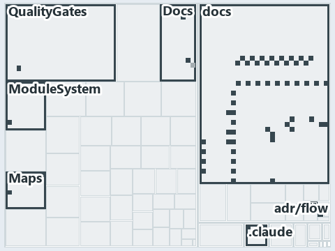

# docs/.assets/explanation/adr-flow-cd--cd-builds-once-then-deploys-prod-itself--implementation.tree.md

`Tree minimap: adr-flow-cd--cd-builds-once-then-deploys-prod-itself--implementation`

The tree minimap of the slide `adr-flow-cd--cd-builds-once-then-deploys-prod-itself--implementation` (implementation lens). The slide
supports [ADR-FLOW-CD][1]; the highlight of those ADR codes selects what is lit, and each reason below names the code that selects it.

## What the minimap shows

The tree draws every file of the world map as a tile, grouped by top-level folder (under `automation/` by module, under `docs/adr/` by ADR
domain), and lights 71 files in 8 groups, filled in ink. A lit ADR file has a white rim; a file lit only by passing mentions is a lighter
ink. Every other tile is idle, a grey box: a file the slide's ADR codes do not select.

- docs (docs/ outside docs/adr/): 53 lit files
- adr/flow (docs/adr/flow): 6 lit files
- Docs (automation/Catzc.Base.Docs): 3 lit files
- Maps (automation/Catzc.Base.Maps): 3 lit files
- .claude: 2 lit files
- adr/* (the files directly in docs/adr/): 2 lit files
- ModuleSystem (automation/Catzc.Base.ModuleSystem): 1 lit file
- QualityGates (automation/Catzc.Base.QualityGates): 1 lit file

## Why each group is lit

### docs (53 lit files)

The group holds the files of docs/ outside docs/adr/; each sits in its world-map cell and is lit by:

- [docs/.assets/explanation/adr-dsgn-life--engineer-merges-pipelines-do-the-rest--operations.chain.md][2], in the cell docs × markdown:
  selected by [ADR-FLOW-CD][1]: the file cites it at line 8 (text), line 28 (text), line 28 (text), line 39 (text), line 39 (text), line 50
  (text), line 50 (text), line 61 (text), line 61 (text), line 75 (text) and line 77 (text).
- [docs/.assets/explanation/adr-dsgn-life--engineer-merges-pipelines-do-the-rest--operations.drawio.md][3], in the cell docs × markdown:
  selected by [ADR-FLOW-CD][1]: the file cites it at line 72 (text).
- [docs/.assets/explanation/adr-dsgn-life--engineer-merges-pipelines-do-the-rest--operations.grid.md][4], in the cell docs × markdown:
  selected by [ADR-FLOW-CD][1]: the file cites it at line 8 (text), line 29 (text), line 31 (text), line 38 (text), line 40 (text), line 48
  (text), line 49 (text), line 50 (text), line 59 (text), line 61 (text), line 62 (text), line 76 (text), line 80 (text), line 82 (text),
  line 92 (text), line 94 (text), line 99 (text), line 102 (text), line 103 (text), line 105 (text), line 107 (text), line 125 (text), line
  127 (text), line 128 (text), line 129 (text), line 131 (text), line 133 (text), line 134 (text), line 136 (text), line 147 (text), line
  151 (text), line 156 (text), line 168 (text), line 172 (text), line 173 (text), line 175 (text), line 177 (text), line 179 (text), line
  181 (text), line 201 (text) and line 203 (text).
- [docs/.assets/explanation/adr-dsgn-life--engineer-merges-pipelines-do-the-rest--operations.tree.md][5], in the cell docs × markdown:
  selected by [ADR-FLOW-CD][1]: the file cites it at line 8 (text), line 39 (text), line 43 (text), line 45 (text), line 55 (text), line 58
  (text), line 65 (text), line 67 (text), line 69 (text), line 71 (text), line 73 (text), line 83 (text), line 87 (text), line 92 (text),
  line 104 (text), line 109 (text), line 110 (text), line 112 (text), line 114 (text), line 117 (text), line 119 (text), line 149 (text),
  line 151 (text), line 153 (text), line 155 (text), line 157 (text), line 159 (text), line 166 (text), line 169 (text), line 176 (text),
  line 177 (text), line 179 (text), line 186 (text), line 188 (text), line 190 (text), line 198 (text), line 200 (text), line 207 (text),
  line 213 (text), line 233 (text) and line 235 (text).
- [docs/.assets/explanation/adr-dsgn-life--four-domains-promote-one-artifact--architecture.chain.md][6], in the cell docs × markdown:
  selected by [ADR-FLOW-CD][1]: the file cites it at line 8 (text), line 28 (text), line 28 (text), line 39 (text), line 39 (text), line 50
  (text), line 50 (text), line 61 (text), line 61 (text), line 75 (text) and line 77 (text).
- [docs/.assets/explanation/adr-dsgn-life--four-domains-promote-one-artifact--architecture.drawio.md][7], in the cell docs × markdown:
  selected by [ADR-FLOW-CD][1]: the file cites it at line 71 (text).
- [docs/.assets/explanation/adr-dsgn-life--four-domains-promote-one-artifact--architecture.grid.md][8], in the cell docs × markdown:
  selected by [ADR-FLOW-CD][1]: the file cites it at line 8 (text), line 29 (text), line 31 (text), line 38 (text), line 40 (text), line 48
  (text), line 49 (text), line 50 (text), line 59 (text), line 61 (text), line 62 (text), line 76 (text), line 80 (text), line 82 (text),
  line 92 (text), line 94 (text), line 99 (text), line 102 (text), line 103 (text), line 105 (text), line 107 (text), line 125 (text), line
  127 (text), line 128 (text), line 129 (text), line 131 (text), line 133 (text), line 134 (text), line 136 (text), line 147 (text), line
  151 (text), line 156 (text), line 168 (text), line 172 (text), line 173 (text), line 175 (text), line 177 (text), line 179 (text), line
  181 (text), line 201 (text) and line 203 (text).
- [docs/.assets/explanation/adr-dsgn-life--four-domains-promote-one-artifact--architecture.tree.md][9], in the cell docs × markdown:
  selected by [ADR-FLOW-CD][1]: the file cites it at line 8 (text), line 39 (text), line 43 (text), line 45 (text), line 55 (text), line 58
  (text), line 65 (text), line 67 (text), line 69 (text), line 71 (text), line 73 (text), line 83 (text), line 87 (text), line 92 (text),
  line 104 (text), line 109 (text), line 110 (text), line 112 (text), line 114 (text), line 117 (text), line 119 (text), line 149 (text),
  line 151 (text), line 153 (text), line 155 (text), line 157 (text), line 159 (text), line 166 (text), line 169 (text), line 176 (text),
  line 177 (text), line 179 (text), line 186 (text), line 188 (text), line 190 (text), line 198 (text), line 200 (text), line 207 (text),
  line 213 (text), line 233 (text) and line 235 (text).
- [docs/.assets/explanation/adr-dsgn-life--integrators-depend-on-an-occupant--architecture.chain.md][10], in the cell docs × markdown:
  selected by [ADR-FLOW-CD][1]: the file cites it at line 8 (text), line 28 (text), line 28 (text), line 39 (text), line 39 (text), line 50
  (text), line 50 (text), line 61 (text), line 61 (text), line 75 (text) and line 77 (text).
- [docs/.assets/explanation/adr-dsgn-life--integrators-depend-on-an-occupant--architecture.drawio.md][11], in the cell docs × markdown:
  selected by [ADR-FLOW-CD][1]: the file cites it at line 67 (text).
- [docs/.assets/explanation/adr-dsgn-life--integrators-depend-on-an-occupant--architecture.grid.md][12], in the cell docs × markdown:
  selected by [ADR-FLOW-CD][1]: the file cites it at line 8 (text), line 29 (text), line 31 (text), line 38 (text), line 40 (text), line 48
  (text), line 49 (text), line 50 (text), line 59 (text), line 61 (text), line 62 (text), line 76 (text), line 80 (text), line 82 (text),
  line 92 (text), line 94 (text), line 99 (text), line 102 (text), line 103 (text), line 105 (text), line 107 (text), line 125 (text), line
  127 (text), line 128 (text), line 129 (text), line 131 (text), line 133 (text), line 134 (text), line 136 (text), line 147 (text), line
  151 (text), line 156 (text), line 168 (text), line 172 (text), line 173 (text), line 175 (text), line 177 (text), line 179 (text), line
  181 (text), line 201 (text) and line 203 (text).
- [docs/.assets/explanation/adr-dsgn-life--integrators-depend-on-an-occupant--architecture.tree.md][13], in the cell docs × markdown:
  selected by [ADR-FLOW-CD][1]: the file cites it at line 8 (text), line 39 (text), line 43 (text), line 45 (text), line 55 (text), line 58
  (text), line 65 (text), line 67 (text), line 69 (text), line 71 (text), line 73 (text), line 83 (text), line 87 (text), line 92 (text),
  line 104 (text), line 109 (text), line 110 (text), line 112 (text), line 114 (text), line 117 (text), line 119 (text), line 149 (text),
  line 151 (text), line 153 (text), line 155 (text), line 157 (text), line 159 (text), line 166 (text), line 169 (text), line 176 (text),
  line 177 (text), line 179 (text), line 186 (text), line 188 (text), line 190 (text), line 198 (text), line 200 (text), line 207 (text),
  line 213 (text), line 233 (text) and line 235 (text).
- [docs/.assets/explanation/adr-dsgn-life--sync-point-rules-are-adr-only--governance.chain.md][14], in the cell docs × markdown: selected by
  [ADR-FLOW-CD][1]: the file cites it at line 8 (text), line 28 (text), line 28 (text), line 39 (text), line 39 (text), line 50 (text), line
  50 (text), line 61 (text), line 61 (text), line 75 (text) and line 77 (text).
- [docs/.assets/explanation/adr-dsgn-life--sync-point-rules-are-adr-only--governance.drawio.md][15], in the cell docs × markdown: selected
  by [ADR-FLOW-CD][1]: the file cites it at line 65 (text) and line 74 (text).
- [docs/.assets/explanation/adr-dsgn-life--sync-point-rules-are-adr-only--governance.grid.md][16], in the cell docs × markdown: selected by
  [ADR-FLOW-CD][1]: the file cites it at line 8 (text), line 29 (text), line 31 (text), line 38 (text), line 40 (text), line 48 (text), line
  49 (text), line 50 (text), line 59 (text), line 61 (text), line 62 (text), line 76 (text), line 80 (text), line 82 (text), line 92 (text),
  line 94 (text), line 99 (text), line 102 (text), line 103 (text), line 105 (text), line 107 (text), line 125 (text), line 127 (text), line
  128 (text), line 129 (text), line 131 (text), line 133 (text), line 134 (text), line 136 (text), line 147 (text), line 151 (text), line
  156 (text), line 168 (text), line 172 (text), line 173 (text), line 175 (text), line 177 (text), line 179 (text), line 181 (text), line
  201 (text) and line 203 (text).
- [docs/.assets/explanation/adr-dsgn-life--sync-point-rules-are-adr-only--governance.tree.md][17], in the cell docs × markdown: selected by
  [ADR-FLOW-CD][1]: the file cites it at line 8 (text), line 39 (text), line 43 (text), line 45 (text), line 55 (text), line 58 (text), line
  65 (text), line 67 (text), line 69 (text), line 71 (text), line 73 (text), line 83 (text), line 87 (text), line 92 (text), line 104
  (text), line 109 (text), line 110 (text), line 112 (text), line 114 (text), line 117 (text), line 119 (text), line 149 (text), line 151
  (text), line 153 (text), line 155 (text), line 157 (text), line 159 (text), line 166 (text), line 169 (text), line 176 (text), line 177
  (text), line 179 (text), line 186 (text), line 188 (text), line 190 (text), line 198 (text), line 200 (text), line 207 (text), line 213
  (text), line 233 (text) and line 235 (text).
- [docs/.assets/explanation/adr-dsgn-life--which-rung-gates-exist-in-code--governance.chain.md][18], in the cell docs × markdown: selected
  by [ADR-FLOW-CD][1]: the file cites it at line 8 (text), line 29 (text), line 29 (text), line 43 (text), line 43 (text), line 57 (text),
  line 57 (text), line 71 (text), line 71 (text), line 96 (text) and line 100 (text).
- [docs/.assets/explanation/adr-dsgn-life--which-rung-gates-exist-in-code--governance.drawio.md][19], in the cell docs × markdown: selected
  by [ADR-FLOW-CD][1]: the file cites it at line 67 (text) and line 76 (text).
- [docs/.assets/explanation/adr-dsgn-life--which-rung-gates-exist-in-code--governance.grid.md][20], in the cell docs × markdown: selected by
  [ADR-FLOW-CD][1]: the file cites it at line 8 (text), line 32 (text), line 42 (text), line 49 (text), line 52 (text), line 309 (text),
  line 310 (text), line 316 (text), line 688 (text), line 700 (text), line 705 (text), line 730 (text), line 734 (text), line 736 (text),
  line 747 (text), line 750 (text), line 756 (text), line 759 (text), line 760 (text), line 762 (text), line 764 (text), line 867 (text),
  line 869 (text), line 870 (text), line 872 (text), line 874 (text), line 876 (text), line 879 (text), line 882 (text), line 901 (text),
  line 905 (text), line 911 (text), line 925 (text), line 930 (text), line 931 (text), line 933 (text), line 935 (text), line 939 (text),
  line 943 (text), line 1012 (text) and line 1016 (text).
- [docs/.assets/explanation/adr-dsgn-life--which-rung-gates-exist-in-code--governance.tree.md][21], in the cell docs × markdown: selected by
  [ADR-FLOW-CD][1]: the file cites it at line 8 (text), line 114 (text), line 343 (text), line 348 (text), line 350 (text), line 362 (text),
  line 366 (text), line 373 (text), line 375 (text), line 377 (text), line 379 (text), line 381 (text), line 405 (text), line 409 (text),
  line 415 (text), line 429 (text), line 435 (text), line 437 (text), line 439 (text), line 441 (text), line 446 (text), line 450 (text),
  line 568 (text), line 632 (text), line 635 (text), line 730 (text), line 846 (text), line 847 (text), line 858 (text), line 1016 (text),
  line 1027 (text), line 1033 (text), line 1035 (text), line 1037 (text), line 1039 (text), line 1041 (text), line 1043 (text), line 1211
  (text), line 1214 (text), line 1296 (text) and line 1300 (text).
- [docs/.assets/explanation/adr-dsgn-track--unit-to-pipeline-rule-is-review-only--governance.chain.md][22], in the cell docs × markdown:
  selected by [ADR-FLOW-CD][1]: the file cites it at line 8 (text), line 41 (text), line 41 (text), line 49 (text), line 49 (text), line 57
  (text), line 57 (text), line 65 (text), line 65 (text), line 91 (text) and line 93 (text).
- [docs/.assets/explanation/adr-dsgn-track--unit-to-pipeline-rule-is-review-only--governance.grid.md][23], in the cell docs × markdown:
  selected by [ADR-FLOW-CD][1]: the file cites it at line 8 (text), line 32 (text), line 34 (text), line 61 (text), line 63 (text), line 189
  (text), line 195 (text), line 209 (text), line 245 (text), line 259 (text), line 260 (text), line 272 (text), line 274 (text), line 276
  (text), line 278 (text), line 280 (text), line 293 (text), line 296 (text), line 297 (text), line 299 (text), line 301 (text), line 339
  (text), line 341 (text), line 343 (text), line 345 (text), line 347 (text), line 349 (text), line 353 (text), line 355 (text), line 392
  (text), line 396 (text), line 400 (text), line 409 (text), line 417 (text), line 419 (text), line 421 (text), line 423 (text), line 436
  (text), line 444 (text), line 498 (text) and line 500 (text).
- [docs/.assets/explanation/adr-dsgn-track--unit-to-pipeline-rule-is-review-only--governance.tree.md][24], in the cell docs × markdown:
  selected by [ADR-FLOW-CD][1]: the file cites it at line 8 (text), line 44 (text), line 46 (text), line 48 (text), line 50 (text), line 52
  (text), line 65 (text), line 67 (text), line 69 (text), line 71 (text), line 73 (text), line 98 (text), line 102 (text), line 106 (text),
  line 115 (text), line 123 (text), line 125 (text), line 127 (text), line 129 (text), line 143 (text), line 151 (text), line 263 (text),
  line 270 (text), line 288 (text), line 367 (text), line 383 (text), line 385 (text), line 440 (text), line 455 (text), line 458 (text),
  line 460 (text), line 462 (text), line 465 (text), line 468 (text), line 520 (text), line 522 (text), line 535 (text), line 544 (text),
  line 547 (text), line 588 (text) and line 590 (text).
- [docs/.assets/explanation/adr-flow-cd--a-merge-runs-cd-to-prod--operations.chain.md][25], in the cell docs × markdown: selected by
  [ADR-FLOW-CD][1]: the file cites it at line 8 (text), line 27 (text), line 27 (text), line 35 (text), line 35 (text), line 43 (text), line
  43 (text), line 51 (text), line 51 (text), line 65 (text) and line 66 (text).
- [docs/.assets/explanation/adr-flow-cd--a-merge-runs-cd-to-prod--operations.drawio.md][26], in the cell docs × markdown: selected by
  [ADR-FLOW-CD][1]: the file cites it at line 72 (text).
- [docs/.assets/explanation/adr-flow-cd--a-merge-runs-cd-to-prod--operations.grid.md][27], in the cell docs × markdown: selected by
  [ADR-FLOW-CD][1]: the file cites it at line 7 (text), line 28 (text), line 29 (text), line 36 (text), line 38 (text), line 46 (text), line
  47 (text), line 48 (text), line 56 (text), line 58 (text), line 59 (text), line 66 (text), line 68 (text), line 70 (text), line 72 (text),
  line 74 (text), line 76 (text), line 79 (text), line 80 (text), line 82 (text), line 84 (text), line 86 (text), line 88 (text), line 89
  (text), line 90 (text), line 92 (text), line 94 (text), line 95 (text), line 96 (text), line 97 (text), line 98 (text), line 100 (text),
  line 102 (text), line 104 (text), line 106 (text), line 108 (text), line 110 (text), line 112 (text), line 114 (text), line 134 (text) and
  line 135 (text).
- [docs/.assets/explanation/adr-flow-cd--a-merge-runs-cd-to-prod--operations.tree.md][28], in the cell docs × markdown: selected by
  [ADR-FLOW-CD][1]: the file cites it at line 7 (text), line 31 (text), line 33 (text), line 35 (text), line 37 (text), line 39 (text), line
  41 (text), line 43 (text), line 45 (text), line 47 (text), line 49 (text), line 50 (text), line 52 (text), line 54 (text), line 56 (text),
  line 58 (text), line 60 (text), line 62 (text), line 64 (text), line 67 (text), line 69 (text), line 76 (text), line 78 (text), line 80
  (text), line 82 (text), line 84 (text), line 86 (text), line 93 (text), line 95 (text), line 97 (text), line 104 (text), line 106 (text),
  line 108 (text), line 115 (text), line 116 (text), line 122 (text), line 124 (text), line 130 (text), line 137 (text), line 157 (text) and
  line 158 (text).
- [docs/.assets/explanation/adr-flow-cd--cd-builds-once-then-deploys-prod-itself--implementation.chain.md][29], in the cell docs × markdown:
  selected by [ADR-FLOW-CD][1]: the file cites it at line 8 (text), line 27 (text), line 27 (text), line 35 (text), line 35 (text), line 43
  (text), line 43 (text), line 51 (text), line 51 (text), line 65 (text) and line 66 (text).
- [docs/.assets/explanation/adr-flow-cd--cd-builds-once-then-deploys-prod-itself--implementation.drawio.md][30], in the cell docs ×
  markdown: selected by [ADR-FLOW-CD][1]: the file cites it at line 67 (text).
- [docs/.assets/explanation/adr-flow-cd--cd-builds-once-then-deploys-prod-itself--implementation.grid.md][31], in the cell docs × markdown:
  selected by [ADR-FLOW-CD][1]: the file cites it at line 8 (text), line 28 (text), line 29 (text), line 36 (text), line 38 (text), line 46
  (text), line 47 (text), line 48 (text), line 56 (text), line 58 (text), line 59 (text), line 66 (text), line 68 (text), line 70 (text),
  line 72 (text), line 74 (text), line 76 (text), line 79 (text), line 80 (text), line 82 (text), line 84 (text), line 86 (text), line 88
  (text), line 89 (text), line 90 (text), line 92 (text), line 94 (text), line 95 (text), line 96 (text), line 97 (text), line 98 (text),
  line 100 (text), line 102 (text), line 104 (text), line 106 (text), line 108 (text), line 110 (text), line 112 (text), line 114 (text),
  line 134 (text) and line 135 (text).
- [docs/.assets/explanation/adr-flow-cd--cd-builds-once-then-deploys-prod-itself--implementation.tree.md][32], in the cell docs × markdown:
  selected by [ADR-FLOW-CD][1]: the file cites it at line 8 (text), line 31 (text), line 33 (text), line 35 (text), line 37 (text), line 39
  (text), line 41 (text), line 43 (text), line 45 (text), line 47 (text), line 49 (text), line 50 (text), line 52 (text), line 54 (text),
  line 56 (text), line 58 (text), line 60 (text), line 62 (text), line 64 (text), line 67 (text), line 69 (text), line 76 (text), line 78
  (text), line 80 (text), line 82 (text), line 84 (text), line 86 (text), line 93 (text), line 95 (text), line 97 (text), line 104 (text),
  line 106 (text), line 108 (text), line 115 (text), line 116 (text), line 122 (text), line 124 (text), line 130 (text), line 137 (text),
  line 157 (text) and line 158 (text).
- [docs/.assets/explanation/adr-flow-cd--ci-budget-is-the-only-quality-gate--governance.chain.md][33], in the cell docs × markdown: selected
  by [ADR-FLOW-CD][1]: the file cites it at line 8 (text), line 28 (text), line 28 (text), line 39 (text), line 39 (text), line 50 (text),
  line 50 (text), line 61 (text), line 61 (text), line 78 (text) and line 79 (text).
- [docs/.assets/explanation/adr-flow-cd--ci-budget-is-the-only-quality-gate--governance.drawio.md][34], in the cell docs × markdown:
  selected by [ADR-FLOW-CD][1]: the file cites it at line 60 (text) and line 71 (text).
- [docs/.assets/explanation/adr-flow-cd--ci-budget-is-the-only-quality-gate--governance.grid.md][35], in the cell docs × markdown: selected
  by [ADR-FLOW-CD][1]: the file cites it at line 8 (text), line 30 (text), line 31 (text), line 42 (text), line 44 (text), line 61 (text),
  line 62 (text), line 63 (text), line 73 (text), line 75 (text), line 76 (text), line 83 (text), line 85 (text), line 87 (text), line 89
  (text), line 91 (text), line 93 (text), line 96 (text), line 97 (text), line 99 (text), line 101 (text), line 103 (text), line 105 (text),
  line 107 (text), line 109 (text), line 111 (text), line 113 (text), line 115 (text), line 116 (text), line 118 (text), line 119 (text),
  line 121 (text), line 123 (text), line 125 (text), line 127 (text), line 129 (text), line 131 (text), line 134 (text), line 136 (text),
  line 166 (text) and line 167 (text).
- [docs/.assets/explanation/adr-flow-cd--ci-budget-is-the-only-quality-gate--governance.tree.md][36], in the cell docs × markdown: selected
  by [ADR-FLOW-CD][1]: the file cites it at line 8 (text), line 36 (text), line 38 (text), line 40 (text), line 42 (text), line 44 (text),
  line 46 (text), line 48 (text), line 50 (text), line 53 (text), line 55 (text), line 56 (text), line 58 (text), line 60 (text), line 62
  (text), line 64 (text), line 66 (text), line 68 (text), line 70 (text), line 74 (text), line 76 (text), line 100 (text), line 103 (text),
  line 105 (text), line 107 (text), line 109 (text), line 111 (text), line 118 (text), line 120 (text), line 122 (text), line 129 (text),
  line 131 (text), line 133 (text), line 140 (text), line 141 (text), line 147 (text), line 149 (text), line 179 (text), line 186 (text),
  line 208 (text) and line 209 (text).
- [docs/.assets/explanation/adr-flow-cd--one-artifact-climbs-unchanged--meta.chain.md][37], in the cell docs × markdown: selected by
  [ADR-FLOW-CD][1]: the file cites it at line 7 (text), line 27 (text), line 27 (text), line 35 (text), line 35 (text), line 43 (text), line
  43 (text), line 51 (text), line 51 (text), line 65 (text) and line 66 (text).
- [docs/.assets/explanation/adr-flow-cd--one-artifact-climbs-unchanged--meta.drawio.md][38], in the cell docs × markdown: selected by
  [ADR-FLOW-CD][1]: the file cites it at line 71 (text).
- [docs/.assets/explanation/adr-flow-cd--one-artifact-climbs-unchanged--meta.grid.md][39], in the cell docs × markdown: selected by
  [ADR-FLOW-CD][1]: the file cites it at line 7 (text), line 28 (text), line 29 (text), line 36 (text), line 38 (text), line 46 (text), line
  47 (text), line 48 (text), line 56 (text), line 58 (text), line 59 (text), line 66 (text), line 68 (text), line 70 (text), line 72 (text),
  line 74 (text), line 76 (text), line 79 (text), line 80 (text), line 82 (text), line 84 (text), line 86 (text), line 88 (text), line 89
  (text), line 90 (text), line 92 (text), line 94 (text), line 95 (text), line 96 (text), line 97 (text), line 98 (text), line 100 (text),
  line 102 (text), line 104 (text), line 106 (text), line 108 (text), line 110 (text), line 112 (text), line 114 (text), line 134 (text) and
  line 135 (text).
- [docs/.assets/explanation/adr-flow-cd--one-artifact-climbs-unchanged--meta.tree.md][40], in the cell docs × markdown: selected by
  [ADR-FLOW-CD][1]: the file cites it at line 7 (text), line 31 (text), line 33 (text), line 35 (text), line 37 (text), line 39 (text), line
  41 (text), line 43 (text), line 45 (text), line 47 (text), line 49 (text), line 50 (text), line 52 (text), line 54 (text), line 56 (text),
  line 58 (text), line 60 (text), line 62 (text), line 64 (text), line 67 (text), line 69 (text), line 76 (text), line 78 (text), line 80
  (text), line 82 (text), line 84 (text), line 86 (text), line 93 (text), line 95 (text), line 97 (text), line 104 (text), line 106 (text),
  line 108 (text), line 115 (text), line 116 (text), line 122 (text), line 124 (text), line 130 (text), line 137 (text), line 157 (text) and
  line 158 (text).
- [docs/.assets/explanation/adr-flow-cd--pipeline-kinds-keyed-by-one-artifact--architecture.chain.md][41], in the cell docs × markdown:
  selected by [ADR-FLOW-CD][1]: the file cites it at line 8 (text), line 27 (text), line 27 (text), line 35 (text), line 35 (text), line 43
  (text), line 43 (text), line 51 (text), line 51 (text), line 65 (text) and line 66 (text).
- [docs/.assets/explanation/adr-flow-cd--pipeline-kinds-keyed-by-one-artifact--architecture.drawio.md][42], in the cell docs × markdown:
  selected by [ADR-FLOW-CD][1]: the file cites it at line 74 (text).
- [docs/.assets/explanation/adr-flow-cd--pipeline-kinds-keyed-by-one-artifact--architecture.grid.md][43], in the cell docs × markdown:
  selected by [ADR-FLOW-CD][1]: the file cites it at line 8 (text), line 28 (text), line 29 (text), line 36 (text), line 38 (text), line 46
  (text), line 47 (text), line 48 (text), line 56 (text), line 58 (text), line 59 (text), line 66 (text), line 68 (text), line 70 (text),
  line 72 (text), line 74 (text), line 76 (text), line 79 (text), line 80 (text), line 82 (text), line 84 (text), line 86 (text), line 88
  (text), line 89 (text), line 90 (text), line 92 (text), line 94 (text), line 95 (text), line 96 (text), line 97 (text), line 98 (text),
  line 100 (text), line 102 (text), line 104 (text), line 106 (text), line 108 (text), line 110 (text), line 112 (text), line 114 (text),
  line 134 (text) and line 135 (text).
- [docs/.assets/explanation/adr-flow-cd--pipeline-kinds-keyed-by-one-artifact--architecture.tree.md][44], in the cell docs × markdown:
  selected by [ADR-FLOW-CD][1]: the file cites it at line 8 (text), line 31 (text), line 33 (text), line 35 (text), line 37 (text), line 39
  (text), line 41 (text), line 43 (text), line 45 (text), line 47 (text), line 49 (text), line 50 (text), line 52 (text), line 54 (text),
  line 56 (text), line 58 (text), line 60 (text), line 62 (text), line 64 (text), line 67 (text), line 69 (text), line 76 (text), line 78
  (text), line 80 (text), line 82 (text), line 84 (text), line 86 (text), line 93 (text), line 95 (text), line 97 (text), line 104 (text),
  line 106 (text), line 108 (text), line 115 (text), line 116 (text), line 122 (text), line 124 (text), line 130 (text), line 137 (text),
  line 157 (text) and line 158 (text).
- [docs/explanation/design/engineer-merges-pipelines-do-the-rest.md][45], in the cell docs × markdown: selected by [ADR-FLOW-CD][1]: the
  file cites it at line 55 (text).
- [docs/explanation/design/four-domains-promote-one-artifact.md][46], in the cell docs × markdown: selected by [ADR-FLOW-CD][1]: the file
  cites it at line 54 (text) and line 55 (text).
- [docs/explanation/design/integrators-depend-on-an-occupant.md][47], in the cell docs × markdown: selected by [ADR-FLOW-CD][1]: the file
  cites it at line 15 (text), line 50 (text) and line 51 (text).
- [docs/explanation/design/sync-point-rules-are-adr-only.md][48], in the cell docs × markdown: selected by [ADR-FLOW-CD][1]: the file cites
  it at line 17 (text), line 34 (text), line 36 (text), line 38 (text), line 40 (text), line 54 (text), line 54 (text) and line 55 (text).
- [docs/explanation/design/which-rung-gates-exist-in-code.md][49], in the cell docs × markdown: selected by [ADR-FLOW-CD][1]: the file cites
  it at line 60 (text), line 60 (text), line 60 (text) and line 61 (text).
- [docs/explanation/flow/a-merge-runs-cd-to-prod.md][50], in the cell docs × markdown: selected by [ADR-FLOW-CD][1]: the file cites it at
  line 16 (text), line 48 (text), line 49 (text) and line 50 (text).
- [docs/explanation/flow/cd-builds-once-then-deploys-prod-itself.md][51], in the cell docs × markdown: selected by [ADR-FLOW-CD][1]: the
  file cites it at line 15 (text), line 48 (text), line 49 (text), line 50 (text) and line 51 (text).
- [docs/explanation/flow/ci-budget-is-the-only-quality-gate.md][52], in the cell docs × markdown: selected by [ADR-FLOW-CD][1]: the file
  cites it at line 17 (text), line 47 (text), line 51 (text), line 52 (text), line 53 (text), line 54 (text), line 55 (text), line 57 (text)
  and line 58 (text).
- [docs/explanation/flow/one-artifact-climbs-unchanged.md][53], in the cell docs × markdown: selected by [ADR-FLOW-CD][1]: the file cites it
  at line 15 (text), line 43 (text), line 44 (text), line 45 (text), line 46 (text), line 47 (text) and line 47 (text).
- [docs/explanation/flow/pipeline-kinds-keyed-by-one-artifact.md][54], in the cell docs × markdown: selected by [ADR-FLOW-CD][1]: the file
  cites it at line 17 (text), line 54 (text), line 55 (text), line 57 (text), line 58 (text), line 60 (text) and line 62 (text).

### adr/flow (6 lit files)

The group holds the files of docs/adr/flow; each sits in its world-map cell and is lit by:

- [docs/adr/flow/cd-discipline-and-promotion-flow.md][1], in the cell docs × markdown: selected by [ADR-FLOW-CD][1]: an ADR file of the
  `flow` ADR domain, the ADR domain of that code.
- [docs/adr/flow/dora-explains.md][55], in the cell docs × markdown: selected by [ADR-FLOW-CD][1]: an ADR file of the `flow` ADR domain, the
  ADR domain of that code.
- [docs/adr/flow/durable-sha-globs.md][56], in the cell docs × markdown: selected by [ADR-FLOW-CD][1]: an ADR file of the `flow` ADR domain,
  the ADR domain of that code.
- [docs/adr/flow/pipeline-detection.md][57], in the cell docs × markdown: selected by [ADR-FLOW-CD][1]: an ADR file of the `flow` ADR
  domain, the ADR domain of that code.
- [docs/adr/flow/pipeline-runner-pattern.md][58], in the cell docs × markdown: selected by [ADR-FLOW-CD][1]: an ADR file of the `flow` ADR
  domain, the ADR domain of that code.
- [docs/adr/flow/pipeline-types.md][59], in the cell docs × markdown: selected by [ADR-FLOW-CD][1]: an ADR file of the `flow` ADR domain,
  the ADR domain of that code.

### Docs (3 lit files)

The group holds the files of automation/Catzc.Base.Docs; each sits in its world-map cell and is lit by:

- [automation/Catzc.Base.Docs/configs/adrs.yml][60], in the cell automation × yaml: selected by [ADR-FLOW-CD][1]: the file cites it at line
  105 (body comment) and line 118 (text).
- [automation/Catzc.Base.Docs/types/AdrsConfig.cs][61], in the cell automation × csharp: selected by [ADR-FLOW-CD][1]: the file cites it at
  line 17 (header), line 18 (header), line 194 (body comment) and line 195 (body comment).
- [automation/Catzc.Base.Docs/types/GlossaryConcept.cs][62], in the cell automation × csharp: selected by [ADR-FLOW-CD][1]: the file cites
  it at line 41 (body comment) (a passing mention only).

### Maps (3 lit files)

The group holds the files of automation/Catzc.Base.Maps; each sits in its world-map cell and is lit by:

- [automation/Catzc.Base.Maps/Get-ValueChainHighlight.ps1][63], in the cell automation × powershell: selected by [ADR-FLOW-CD][1]: the file
  cites it at line 20 (header).
- [automation/Catzc.Base.Maps/Get-WorldMapHighlight.ps1][64], in the cell automation × powershell: selected by [ADR-FLOW-CD][1]: the file
  cites it at line 31 (header).
- [automation/Catzc.Base.Maps/tests/Get-WorldMapHighlight.Tests.ps1][65], in the cell automation × powershell: selected by [ADR-FLOW-CD][1]:
  the file cites it at line 70 (text) and line 71 (text).

### .claude (2 lit files)

The group holds the files of .claude; each sits in its world-map cell and is lit by:

- [.claude/CLAUDE.md][66], in the cell .claude × markdown: selected by [ADR-FLOW-CD][1]: the file cites it at line 51 (text).
- [.claude/drawio/STYLE.md][67], in the cell .claude × markdown: selected by [ADR-FLOW-CD][1]: the file cites it at line 28 (text).

### adr/* (2 lit files)

The group holds the files of the files directly in docs/adr/; each sits in its world-map cell and is lit by:

- [docs/adr/glossary.md][68], in the cell docs × markdown: selected by [ADR-FLOW-CD][1]: the file cites it at line 292 (text) and line 305
  (text).
- [docs/adr/index.md][69], in the cell docs × markdown: selected by [ADR-FLOW-CD][1]: the file cites it at line 107 (text).

### ModuleSystem (1 lit file)

The group holds the files of automation/Catzc.Base.ModuleSystem; each sits in its world-map cell and is lit by:

- [automation/Catzc.Base.ModuleSystem/configs/glossary.yml][70], in the cell automation × yaml: selected by [ADR-FLOW-CD][1]: the file cites
  it at line 21 (text).

### QualityGates (1 lit file)

The group holds the files of automation/Catzc.Base.QualityGates; each sits in its world-map cell and is lit by:

- [automation/Catzc.Base.QualityGates/configs/glossary.yml][71], in the cell automation × yaml: selected by [ADR-FLOW-CD][1]: the file cites
  it at line 62 (text).

## Keywords

- [world map][72]
- [track][73]
- [file language][74]
- [cell][75]
- [lit cell][76]
- [.claude][77]: a track
- [automation][77]: a track
- [docs][77]: a track
- [csharp][78]: a file language
- [markdown][78]: a file language
- [powershell][78]: a file language
- [yaml][78]: a file language

Terms the cited ADRs define:

- [gate][79], defined by [ADR-FLOW-CD#13][80]
- [release candidate][81], defined by [ADR-FLOW-CD#14][82]

[1]: ../../adr/flow/cd-discipline-and-promotion-flow.md
[2]: adr-dsgn-life--engineer-merges-pipelines-do-the-rest--operations.chain.md
[3]: adr-dsgn-life--engineer-merges-pipelines-do-the-rest--operations.drawio.md
[4]: adr-dsgn-life--engineer-merges-pipelines-do-the-rest--operations.grid.md
[5]: adr-dsgn-life--engineer-merges-pipelines-do-the-rest--operations.tree.md
[6]: adr-dsgn-life--four-domains-promote-one-artifact--architecture.chain.md
[7]: adr-dsgn-life--four-domains-promote-one-artifact--architecture.drawio.md
[8]: adr-dsgn-life--four-domains-promote-one-artifact--architecture.grid.md
[9]: adr-dsgn-life--four-domains-promote-one-artifact--architecture.tree.md
[10]: adr-dsgn-life--integrators-depend-on-an-occupant--architecture.chain.md
[11]: adr-dsgn-life--integrators-depend-on-an-occupant--architecture.drawio.md
[12]: adr-dsgn-life--integrators-depend-on-an-occupant--architecture.grid.md
[13]: adr-dsgn-life--integrators-depend-on-an-occupant--architecture.tree.md
[14]: adr-dsgn-life--sync-point-rules-are-adr-only--governance.chain.md
[15]: adr-dsgn-life--sync-point-rules-are-adr-only--governance.drawio.md
[16]: adr-dsgn-life--sync-point-rules-are-adr-only--governance.grid.md
[17]: adr-dsgn-life--sync-point-rules-are-adr-only--governance.tree.md
[18]: adr-dsgn-life--which-rung-gates-exist-in-code--governance.chain.md
[19]: adr-dsgn-life--which-rung-gates-exist-in-code--governance.drawio.md
[20]: adr-dsgn-life--which-rung-gates-exist-in-code--governance.grid.md
[21]: adr-dsgn-life--which-rung-gates-exist-in-code--governance.tree.md
[22]: adr-dsgn-track--unit-to-pipeline-rule-is-review-only--governance.chain.md
[23]: adr-dsgn-track--unit-to-pipeline-rule-is-review-only--governance.grid.md
[24]: adr-dsgn-track--unit-to-pipeline-rule-is-review-only--governance.tree.md
[25]: adr-flow-cd--a-merge-runs-cd-to-prod--operations.chain.md
[26]: adr-flow-cd--a-merge-runs-cd-to-prod--operations.drawio.md
[27]: adr-flow-cd--a-merge-runs-cd-to-prod--operations.grid.md
[28]: adr-flow-cd--a-merge-runs-cd-to-prod--operations.tree.md
[29]: adr-flow-cd--cd-builds-once-then-deploys-prod-itself--implementation.chain.md
[30]: adr-flow-cd--cd-builds-once-then-deploys-prod-itself--implementation.drawio.md
[31]: adr-flow-cd--cd-builds-once-then-deploys-prod-itself--implementation.grid.md
[32]: adr-flow-cd--cd-builds-once-then-deploys-prod-itself--implementation.tree.md
[33]: adr-flow-cd--ci-budget-is-the-only-quality-gate--governance.chain.md
[34]: adr-flow-cd--ci-budget-is-the-only-quality-gate--governance.drawio.md
[35]: adr-flow-cd--ci-budget-is-the-only-quality-gate--governance.grid.md
[36]: adr-flow-cd--ci-budget-is-the-only-quality-gate--governance.tree.md
[37]: adr-flow-cd--one-artifact-climbs-unchanged--meta.chain.md
[38]: adr-flow-cd--one-artifact-climbs-unchanged--meta.drawio.md
[39]: adr-flow-cd--one-artifact-climbs-unchanged--meta.grid.md
[40]: adr-flow-cd--one-artifact-climbs-unchanged--meta.tree.md
[41]: adr-flow-cd--pipeline-kinds-keyed-by-one-artifact--architecture.chain.md
[42]: adr-flow-cd--pipeline-kinds-keyed-by-one-artifact--architecture.drawio.md
[43]: adr-flow-cd--pipeline-kinds-keyed-by-one-artifact--architecture.grid.md
[44]: adr-flow-cd--pipeline-kinds-keyed-by-one-artifact--architecture.tree.md
[45]: ../../explanation/design/engineer-merges-pipelines-do-the-rest.md
[46]: ../../explanation/design/four-domains-promote-one-artifact.md
[47]: ../../explanation/design/integrators-depend-on-an-occupant.md
[48]: ../../explanation/design/sync-point-rules-are-adr-only.md
[49]: ../../explanation/design/which-rung-gates-exist-in-code.md
[50]: ../../explanation/flow/a-merge-runs-cd-to-prod.md
[51]: ../../explanation/flow/cd-builds-once-then-deploys-prod-itself.md
[52]: ../../explanation/flow/ci-budget-is-the-only-quality-gate.md
[53]: ../../explanation/flow/one-artifact-climbs-unchanged.md
[54]: ../../explanation/flow/pipeline-kinds-keyed-by-one-artifact.md
[55]: ../../adr/flow/dora-explains.md
[56]: ../../adr/flow/durable-sha-globs.md
[57]: ../../adr/flow/pipeline-detection.md
[58]: ../../adr/flow/pipeline-runner-pattern.md
[59]: ../../adr/flow/pipeline-types.md
[60]: ../../../automation/Catzc.Base.Docs/configs/adrs.yml
[61]: ../../../automation/Catzc.Base.Docs/types/AdrsConfig.cs
[62]: ../../../automation/Catzc.Base.Docs/types/GlossaryConcept.cs
[63]: ../../../automation/Catzc.Base.Maps/Get-ValueChainHighlight.ps1
[64]: ../../../automation/Catzc.Base.Maps/Get-WorldMapHighlight.ps1
[65]: ../../../automation/Catzc.Base.Maps/tests/Get-WorldMapHighlight.Tests.ps1
[66]: ../../../.claude/CLAUDE.md
[67]: ../../../.claude/drawio/STYLE.md
[68]: ../../adr/glossary.md
[69]: ../../adr/index.md
[70]: ../../../automation/Catzc.Base.ModuleSystem/configs/glossary.yml
[71]: ../../../automation/Catzc.Base.QualityGates/configs/glossary.yml
[72]: ../../adr/glossary.md#world-map
[73]: ../../adr/glossary.md#track
[74]: ../../adr/glossary.md#file-language
[75]: ../../adr/glossary.md#cell
[76]: ../../adr/glossary.md#lit-cell
[77]: ../../../automation/Catzc.Base.Variants/configs/variants.yml
[78]: ../../../automation/Catzc.Base.Languages/configs/languages.yml
[79]: ../../adr/glossary.md#gate
[80]: ../../adr/flow/cd-discipline-and-promotion-flow.md#rule-adr-flow-cd13
[81]: ../../adr/glossary.md#release-candidate
[82]: ../../adr/flow/cd-discipline-and-promotion-flow.md#rule-adr-flow-cd14
