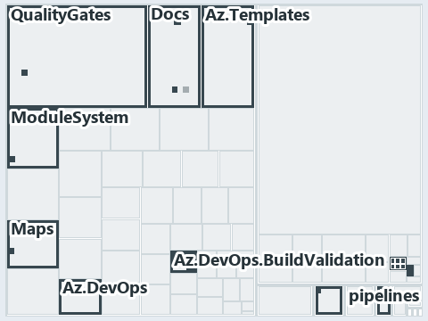

# docs/.assets/explanation/adr-flow-cd--ci-budget-is-the-only-quality-gate--governance.tree.md

`Tree minimap: adr-flow-cd--ci-budget-is-the-only-quality-gate--governance`

The tree minimap of the slide `adr-flow-cd--ci-budget-is-the-only-quality-gate--governance` (governance lens). The slide supports
[ADR-FLOW-CD][1] and [ADR-FLOW-CD-TYPE][2]; the highlight of those ADR codes selects what is lit, and each reason below names the code that
selects it.

## What the minimap shows

The tree draws every file of the world map as a tile, grouped by top-level folder (under `automation/` by module, under `docs/adr/` by ADR
domain), and lights 27 files in 11 groups, filled in ink. A lit ADR file has a white rim; a file lit only by passing mentions is a lighter
ink. Every other tile is idle, a grey box: a file the slide's ADR codes do not select.

- Az.DevOps.BuildValidation (automation/Catzc.Azure.DevOps.BuildValidation): 6 lit files
- adr/flow (docs/adr/flow): 6 lit files
- Docs (automation/Catzc.Base.Docs): 3 lit files
- Maps (automation/Catzc.Base.Maps): 3 lit files
- adr/* (the files directly in docs/adr/): 2 lit files
- pipelines: 2 lit files
- .claude: 1 lit file
- Az.DevOps (automation/Catzc.Azure.DevOps): 1 lit file
- Az.Templates (automation/Catzc.Azure.Templates): 1 lit file
- ModuleSystem (automation/Catzc.Base.ModuleSystem): 1 lit file
- QualityGates (automation/Catzc.Base.QualityGates): 1 lit file

## Why each group is lit

### Az.DevOps.BuildValidation (6 lit files)

The group holds the files of automation/Catzc.Azure.DevOps.BuildValidation; each sits in its world-map cell and is lit by:

- [automation/Catzc.Azure.DevOps.BuildValidation/Get-AdoBuildValidations.ps1][3], in the cell automation × powershell: selected by
  [ADR-FLOW-CD-TYPE][2]: the file cites it at line 7 (header).
- [automation/Catzc.Azure.DevOps.BuildValidation/Register-AdoBuildValidation.ps1][4], in the cell automation × powershell: selected by
  [ADR-FLOW-CD-TYPE][2]: the file cites it at line 9 (header).
- [automation/Catzc.Azure.DevOps.BuildValidation/configs/build-validation.yml][5], in the cell automation × yaml: selected by
  [ADR-FLOW-CD-TYPE][2]: the file cites it at line 2 (header).
- [automation/Catzc.Azure.DevOps.BuildValidation/private/Get-BuildValidationPathFilter.ps1][6], in the cell automation × powershell:
  selected by [ADR-FLOW-CD-TYPE][2]: the file cites it at line 12 (header).
- [automation/Catzc.Azure.DevOps.BuildValidation/types/BuildValidationConfig.cs][7], in the cell automation × csharp: selected by
  [ADR-FLOW-CD-TYPE][2]: the file cites it at line 3 (header).
- [automation/Catzc.Azure.DevOps.BuildValidation/types/BuildValidationEntry.cs][8], in the cell automation × csharp: selected by
  [ADR-FLOW-CD-TYPE][2]: the file cites it at line 2 (header).

### adr/flow (6 lit files)

The group holds the files of docs/adr/flow; each sits in its world-map cell and is lit by:

- [docs/adr/flow/cd-discipline-and-promotion-flow.md][1], in the cell docs × markdown: selected by [ADR-FLOW-CD][1]: an ADR file of the
  `flow` ADR domain, the ADR domain of that code; selected by [ADR-FLOW-CD-TYPE][2]: an ADR file of the `flow` ADR domain, the ADR domain of
  that code.
- [docs/adr/flow/dora-explains.md][9], in the cell docs × markdown: selected by [ADR-FLOW-CD][1]: an ADR file of the `flow` ADR domain, the
  ADR domain of that code; selected by [ADR-FLOW-CD-TYPE][2]: an ADR file of the `flow` ADR domain, the ADR domain of that code.
- [docs/adr/flow/durable-sha-globs.md][10], in the cell docs × markdown: selected by [ADR-FLOW-CD][1]: an ADR file of the `flow` ADR domain,
  the ADR domain of that code; selected by [ADR-FLOW-CD-TYPE][2]: an ADR file of the `flow` ADR domain, the ADR domain of that code.
- [docs/adr/flow/pipeline-detection.md][11], in the cell docs × markdown: selected by [ADR-FLOW-CD][1]: an ADR file of the `flow` ADR
  domain, the ADR domain of that code; selected by [ADR-FLOW-CD-TYPE][2]: an ADR file of the `flow` ADR domain, the ADR domain of that code.
- [docs/adr/flow/pipeline-runner-pattern.md][12], in the cell docs × markdown: selected by [ADR-FLOW-CD][1]: an ADR file of the `flow` ADR
  domain, the ADR domain of that code; selected by [ADR-FLOW-CD-TYPE][2]: an ADR file of the `flow` ADR domain, the ADR domain of that code.
- [docs/adr/flow/pipeline-types.md][2], in the cell docs × markdown: selected by [ADR-FLOW-CD][1]: an ADR file of the `flow` ADR domain, the
  ADR domain of that code; selected by [ADR-FLOW-CD-TYPE][2]: an ADR file of the `flow` ADR domain, the ADR domain of that code.

### Docs (3 lit files)

The group holds the files of automation/Catzc.Base.Docs; each sits in its world-map cell and is lit by:

- [automation/Catzc.Base.Docs/configs/adrs.yml][13], in the cell automation × yaml: selected by [ADR-FLOW-CD][1]: the file cites it at line
  105 (body comment) and line 118 (text); selected by [ADR-FLOW-CD-TYPE][2]: the file cites it at line 121 (text).
- [automation/Catzc.Base.Docs/types/AdrsConfig.cs][14], in the cell automation × csharp: selected by [ADR-FLOW-CD][1]: the file cites it at
  line 17 (header), line 18 (header), line 194 (body comment) and line 195 (body comment).
- [automation/Catzc.Base.Docs/types/GlossaryConcept.cs][15], in the cell automation × csharp: selected by [ADR-FLOW-CD][1]: the file cites
  it at line 41 (body comment) (a passing mention only).

### Maps (3 lit files)

The group holds the files of automation/Catzc.Base.Maps; each sits in its world-map cell and is lit by:

- [automation/Catzc.Base.Maps/Get-ValueChainHighlight.ps1][16], in the cell automation × powershell: selected by [ADR-FLOW-CD][1]: the file
  cites it at line 20 (header).
- [automation/Catzc.Base.Maps/Get-WorldMapHighlight.ps1][17], in the cell automation × powershell: selected by [ADR-FLOW-CD][1]: the file
  cites it at line 31 (header).
- [automation/Catzc.Base.Maps/tests/Get-WorldMapHighlight.Tests.ps1][18], in the cell automation × powershell: selected by [ADR-FLOW-CD][1]:
  the file cites it at line 70 (text) and line 71 (text).

### adr/* (2 lit files)

The group holds the files of the files directly in docs/adr/; each sits in its world-map cell and is lit by:

- [docs/adr/glossary.md][19], in the cell docs × markdown: selected by [ADR-FLOW-CD][1]: the file cites it at line 292 (text) and line 305
  (text).
- [docs/adr/index.md][20], in the cell docs × markdown: selected by [ADR-FLOW-CD][1]: the file cites it at line 107 (text); selected by
  [ADR-FLOW-CD-TYPE][2]: the file cites it at line 110 (text).

### pipelines (2 lit files)

The group holds the files of pipelines; each sits in its world-map cell and is lit by:

- [pipelines/cd-shared.yaml][21], in the cell pipelines × pipeline-yaml: selected by [ADR-FLOW-CD-TYPE][2]: the file cites it at line 3
  (header).
- [pipelines/ci-infrastructure.yaml][22], in the cell pipelines × pipeline-yaml: selected by [ADR-FLOW-CD-TYPE][2]: the file cites it at
  line 4 (header).

### .claude (1 lit file)

The group holds the files of .claude; each sits in its world-map cell and is lit by:

- [.claude/CLAUDE.md][23], in the cell .claude × markdown: selected by [ADR-FLOW-CD][1]: the file cites it at line 51 (text).

### Az.DevOps (1 lit file)

The group holds the files of automation/Catzc.Azure.DevOps; each sits in its world-map cell and is lit by:

- [automation/Catzc.Azure.DevOps/New-AdoPullRequest.ps1][24], in the cell automation × powershell: selected by [ADR-FLOW-CD-TYPE][2]: the
  file cites it at line 5 (header).

### Az.Templates (1 lit file)

The group holds the files of automation/Catzc.Azure.Templates; each sits in its world-map cell and is lit by:

- [automation/Catzc.Azure.Templates/Set-BicepTemplateConfiguration.ps1][25], in the cell automation × powershell: selected by
  [ADR-FLOW-CD-TYPE][2]: the file cites it at line 5 (header).

### ModuleSystem (1 lit file)

The group holds the files of automation/Catzc.Base.ModuleSystem; each sits in its world-map cell and is lit by:

- [automation/Catzc.Base.ModuleSystem/configs/glossary.yml][26], in the cell automation × yaml: selected by [ADR-FLOW-CD][1]: the file cites
  it at line 21 (text).

### QualityGates (1 lit file)

The group holds the files of automation/Catzc.Base.QualityGates; each sits in its world-map cell and is lit by:

- [automation/Catzc.Base.QualityGates/configs/glossary.yml][27], in the cell automation × yaml: selected by [ADR-FLOW-CD][1]: the file cites
  it at line 62 (text).

## Keywords

- [world map][28]
- [track][29]
- [file language][30]
- [cell][31]
- [lit cell][32]
- [.claude][33]: a track
- [automation][33]: a track
- [docs][33]: a track
- [pipelines][33]: a track
- [csharp][34]: a file language
- [markdown][34]: a file language
- [pipeline-yaml][34]: a file language
- [powershell][34]: a file language
- [yaml][34]: a file language

Terms the cited ADRs define:

- [gate][35], defined by [ADR-FLOW-CD#13][36]
- [release candidate][37], defined by [ADR-FLOW-CD#14][38]

[1]: ../../adr/flow/cd-discipline-and-promotion-flow.md
[2]: ../../adr/flow/pipeline-types.md
[3]: ../../../automation/Catzc.Azure.DevOps.BuildValidation/Get-AdoBuildValidations.ps1
[4]: ../../../automation/Catzc.Azure.DevOps.BuildValidation/Register-AdoBuildValidation.ps1
[5]: ../../../automation/Catzc.Azure.DevOps.BuildValidation/configs/build-validation.yml
[6]: ../../../automation/Catzc.Azure.DevOps.BuildValidation/private/Get-BuildValidationPathFilter.ps1
[7]: ../../../automation/Catzc.Azure.DevOps.BuildValidation/types/BuildValidationConfig.cs
[8]: ../../../automation/Catzc.Azure.DevOps.BuildValidation/types/BuildValidationEntry.cs
[9]: ../../adr/flow/dora-explains.md
[10]: ../../adr/flow/durable-sha-globs.md
[11]: ../../adr/flow/pipeline-detection.md
[12]: ../../adr/flow/pipeline-runner-pattern.md
[13]: ../../../automation/Catzc.Base.Docs/configs/adrs.yml
[14]: ../../../automation/Catzc.Base.Docs/types/AdrsConfig.cs
[15]: ../../../automation/Catzc.Base.Docs/types/GlossaryConcept.cs
[16]: ../../../automation/Catzc.Base.Maps/Get-ValueChainHighlight.ps1
[17]: ../../../automation/Catzc.Base.Maps/Get-WorldMapHighlight.ps1
[18]: ../../../automation/Catzc.Base.Maps/tests/Get-WorldMapHighlight.Tests.ps1
[19]: ../../adr/glossary.md
[20]: ../../adr/index.md
[21]: ../../../pipelines/cd-shared.yaml
[22]: ../../../pipelines/ci-infrastructure.yaml
[23]: ../../../.claude/CLAUDE.md
[24]: ../../../automation/Catzc.Azure.DevOps/New-AdoPullRequest.ps1
[25]: ../../../automation/Catzc.Azure.Templates/Set-BicepTemplateConfiguration.ps1
[26]: ../../../automation/Catzc.Base.ModuleSystem/configs/glossary.yml
[27]: ../../../automation/Catzc.Base.QualityGates/configs/glossary.yml
[28]: ../../adr/glossary.md#world-map
[29]: ../../adr/glossary.md#track
[30]: ../../adr/glossary.md#file-language
[31]: ../../adr/glossary.md#cell
[32]: ../../adr/glossary.md#lit-cell
[33]: ../../../automation/Catzc.Base.Variants/configs/variants.yml
[34]: ../../../automation/Catzc.Base.Languages/configs/languages.yml
[35]: ../../adr/glossary.md#gate
[36]: ../../adr/flow/cd-discipline-and-promotion-flow.md#rule-adr-flow-cd13
[37]: ../../adr/glossary.md#release-candidate
[38]: ../../adr/flow/cd-discipline-and-promotion-flow.md#rule-adr-flow-cd14
