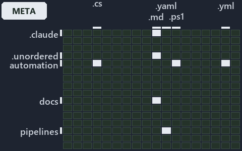

# docs/.assets/explanation/adr-flow-cd--one-artifact-climbs-unchanged--meta.grid.md

`Grid minimap: adr-flow-cd--one-artifact-climbs-unchanged--meta`

The grid minimap of the slide `adr-flow-cd--one-artifact-climbs-unchanged--meta` (meta lens). The slide supports [ADR-FLOW-CD][1]; the
highlight of those ADR codes selects what is lit, and each reason below names the code that selects it.

## What the minimap shows

The grid crosses the 12 tracks (rows) with the 18 file languages (columns) of the world map and lights 5 cells, filled in ink. A cell lit
only by passing mentions (citations in body comments, not in a file's header or text) is touched: a lighter ink. Every other cell is idle, a
grey box: it holds files the slide's ADR codes do not select, or no file at all (174 of the 216 cells hold none). The minimap shows where
the slide sits, not how many files a cell holds; the world-map PDFs show the counts.

- .claude × markdown: 2 lit of 9 files
- automation × csharp: 2 lit of 219 files
- automation × powershell: 3 lit of 1412 files
- automation × yaml: 3 lit of 95 files
- docs × markdown: 18 lit of 742 files

## Key

A lit row prints its track's name; a lit column prints a short code, the first extension of its file language:

- `.cs`: csharp
- `.md`: markdown
- `.ps1`: powershell
- `.yml`: yaml

## Why each cell is lit

### .claude × markdown (2 lit files)

Placed: the root folder `.claude/` names the track .claude ([ADR-DSGN-TRACK#1][2]); the extension `.md` names the file language markdown
([ADR-DSGN-TRACK#6][3]). Lit ([ADR-DSGN-TRACK#12][4]) by:

- [.claude/CLAUDE.md][5]: selected by [ADR-FLOW-CD][1]: the file cites it at line 51 (text).
- [.claude/drawio/STYLE.md][6]: selected by [ADR-FLOW-CD][1]: the file cites it at line 28 (text).

### automation × csharp (2 lit files)

Placed: the root folder `automation/` names the track automation ([ADR-DSGN-TRACK#1][2]); the extension `.cs` names the file language csharp
([ADR-DSGN-TRACK#6][3]). Lit ([ADR-DSGN-TRACK#12][4]) by:

- [automation/Catzc.Base.Docs/types/AdrsConfig.cs][7]: selected by [ADR-FLOW-CD][1]: the file cites it at line 17 (header), line 18
  (header), line 194 (body comment) and line 195 (body comment).
- [automation/Catzc.Base.Docs/types/GlossaryConcept.cs][8]: selected by [ADR-FLOW-CD][1]: the file cites it at line 41 (body comment) (a
  passing mention only).

### automation × powershell (3 lit files)

Placed: the root folder `automation/` names the track automation ([ADR-DSGN-TRACK#1][2]); the extension `.ps1` names the file language
powershell ([ADR-DSGN-TRACK#6][3]). Lit ([ADR-DSGN-TRACK#12][4]) by:

- [automation/Catzc.Base.Maps/Get-ValueChainHighlight.ps1][9]: selected by [ADR-FLOW-CD][1]: the file cites it at line 20 (header).
- [automation/Catzc.Base.Maps/Get-WorldMapHighlight.ps1][10]: selected by [ADR-FLOW-CD][1]: the file cites it at line 31 (header).
- [automation/Catzc.Base.Maps/tests/Get-WorldMapHighlight.Tests.ps1][11]: selected by [ADR-FLOW-CD][1]: the file cites it at line 70 (text)
  and line 71 (text).

### automation × yaml (3 lit files)

Placed: the root folder `automation/` names the track automation ([ADR-DSGN-TRACK#1][2]); the extension `.yml` names the file language yaml
([ADR-DSGN-TRACK#6][3]). Lit ([ADR-DSGN-TRACK#12][4]) by:

- [automation/Catzc.Base.Docs/configs/adrs.yml][12]: selected by [ADR-FLOW-CD][1]: the file cites it at line 105 (body comment) and line 118
  (text).
- [automation/Catzc.Base.ModuleSystem/configs/glossary.yml][13]: selected by [ADR-FLOW-CD][1]: the file cites it at line 21 (text).
- [automation/Catzc.Base.QualityGates/configs/glossary.yml][14]: selected by [ADR-FLOW-CD][1]: the file cites it at line 62 (text).

### docs × markdown (18 lit files)

Placed: the root folder `docs/` names the track docs ([ADR-DSGN-TRACK#1][2]); the extension `.md` names the file language markdown
([ADR-DSGN-TRACK#6][3]). Lit ([ADR-DSGN-TRACK#12][4]) by:

- [docs/adr/flow/cd-discipline-and-promotion-flow.md][1]: selected by [ADR-FLOW-CD][1]: an ADR file of the `flow` ADR domain, the ADR domain
  of that code.
- [docs/adr/flow/dora-explains.md][15]: selected by [ADR-FLOW-CD][1]: an ADR file of the `flow` ADR domain, the ADR domain of that code.
- [docs/adr/flow/durable-sha-globs.md][16]: selected by [ADR-FLOW-CD][1]: an ADR file of the `flow` ADR domain, the ADR domain of that code.
- [docs/adr/flow/pipeline-detection.md][17]: selected by [ADR-FLOW-CD][1]: an ADR file of the `flow` ADR domain, the ADR domain of that
  code.
- [docs/adr/flow/pipeline-runner-pattern.md][18]: selected by [ADR-FLOW-CD][1]: an ADR file of the `flow` ADR domain, the ADR domain of that
  code.
- [docs/adr/flow/pipeline-types.md][19]: selected by [ADR-FLOW-CD][1]: an ADR file of the `flow` ADR domain, the ADR domain of that code.
- [docs/adr/glossary.md][20]: selected by [ADR-FLOW-CD][1]: the file cites it at line 292 (text) and line 305 (text).
- [docs/adr/index.md][21]: selected by [ADR-FLOW-CD][1]: the file cites it at line 107 (text).
- [docs/explanation/design/engineer-merges-pipelines-do-the-rest.md][22]: selected by [ADR-FLOW-CD][1]: the file cites it at line 55 (text).
- [docs/explanation/design/four-domains-promote-one-artifact.md][23]: selected by [ADR-FLOW-CD][1]: the file cites it at line 54 (text) and
  line 55 (text).
- [docs/explanation/design/integrators-depend-on-an-occupant.md][24]: selected by [ADR-FLOW-CD][1]: the file cites it at line 15 (text),
  line 50 (text) and line 51 (text).
- [docs/explanation/design/sync-point-rules-are-adr-only.md][25]: selected by [ADR-FLOW-CD][1]: the file cites it at line 17 (text), line 34
  (text), line 36 (text), line 38 (text), line 40 (text), line 54 (text), line 54 (text) and line 55 (text).
- [docs/explanation/design/which-rung-gates-exist-in-code.md][26]: selected by [ADR-FLOW-CD][1]: the file cites it at line 60 (text), line
  60 (text), line 60 (text) and line 61 (text).
- [docs/explanation/flow/a-merge-runs-cd-to-prod.md][27]: selected by [ADR-FLOW-CD][1]: the file cites it at line 16 (text), line 48 (text),
  line 49 (text) and line 50 (text).
- [docs/explanation/flow/cd-builds-once-then-deploys-prod-itself.md][28]: selected by [ADR-FLOW-CD][1]: the file cites it at line 15 (text),
  line 48 (text), line 49 (text), line 50 (text) and line 51 (text).
- [docs/explanation/flow/ci-budget-is-the-only-quality-gate.md][29]: selected by [ADR-FLOW-CD][1]: the file cites it at line 17 (text), line
  47 (text), line 51 (text), line 52 (text), line 53 (text), line 54 (text), line 55 (text), line 57 (text) and line 58 (text).
- [docs/explanation/flow/one-artifact-climbs-unchanged.md][30]: selected by [ADR-FLOW-CD][1]: the file cites it at line 15 (text), line 43
  (text), line 44 (text), line 45 (text), line 46 (text), line 47 (text) and line 47 (text).
- [docs/explanation/flow/pipeline-kinds-keyed-by-one-artifact.md][31]: selected by [ADR-FLOW-CD][1]: the file cites it at line 17 (text),
  line 54 (text), line 55 (text), line 57 (text), line 58 (text), line 60 (text) and line 62 (text).

## Keywords

- [world map][32]
- [track][33]
- [file language][34]
- [cell][35]
- [lit cell][36]
- [.claude][37]: a track
- [automation][37]: a track
- [docs][37]: a track
- [csharp][38]: a file language
- [markdown][38]: a file language
- [powershell][38]: a file language
- [yaml][38]: a file language

Terms the cited ADRs define:

- [gate][39], defined by [ADR-FLOW-CD#13][40]
- [release candidate][41], defined by [ADR-FLOW-CD#14][42]

[1]: ../../adr/flow/cd-discipline-and-promotion-flow.md
[2]: ../../adr/design/tracks.md#rule-adr-dsgn-track1
[3]: ../../adr/design/tracks.md#rule-adr-dsgn-track6
[4]: ../../adr/design/tracks.md#rule-adr-dsgn-track12
[5]: ../../../.claude/CLAUDE.md
[6]: ../../../.claude/drawio/STYLE.md
[7]: ../../../automation/Catzc.Base.Docs/types/AdrsConfig.cs
[8]: ../../../automation/Catzc.Base.Docs/types/GlossaryConcept.cs
[9]: ../../../automation/Catzc.Base.Maps/Get-ValueChainHighlight.ps1
[10]: ../../../automation/Catzc.Base.Maps/Get-WorldMapHighlight.ps1
[11]: ../../../automation/Catzc.Base.Maps/tests/Get-WorldMapHighlight.Tests.ps1
[12]: ../../../automation/Catzc.Base.Docs/configs/adrs.yml
[13]: ../../../automation/Catzc.Base.ModuleSystem/configs/glossary.yml
[14]: ../../../automation/Catzc.Base.QualityGates/configs/glossary.yml
[15]: ../../adr/flow/dora-explains.md
[16]: ../../adr/flow/durable-sha-globs.md
[17]: ../../adr/flow/pipeline-detection.md
[18]: ../../adr/flow/pipeline-runner-pattern.md
[19]: ../../adr/flow/pipeline-types.md
[20]: ../../adr/glossary.md
[21]: ../../adr/index.md
[22]: ../../explanation/design/engineer-merges-pipelines-do-the-rest.md
[23]: ../../explanation/design/four-domains-promote-one-artifact.md
[24]: ../../explanation/design/integrators-depend-on-an-occupant.md
[25]: ../../explanation/design/sync-point-rules-are-adr-only.md
[26]: ../../explanation/design/which-rung-gates-exist-in-code.md
[27]: ../../explanation/flow/a-merge-runs-cd-to-prod.md
[28]: ../../explanation/flow/cd-builds-once-then-deploys-prod-itself.md
[29]: ../../explanation/flow/ci-budget-is-the-only-quality-gate.md
[30]: ../../explanation/flow/one-artifact-climbs-unchanged.md
[31]: ../../explanation/flow/pipeline-kinds-keyed-by-one-artifact.md
[32]: ../../adr/glossary.md#world-map
[33]: ../../adr/glossary.md#track
[34]: ../../adr/glossary.md#file-language
[35]: ../../adr/glossary.md#cell
[36]: ../../adr/glossary.md#lit-cell
[37]: ../../../automation/Catzc.Base.Variants/configs/variants.yml
[38]: ../../../automation/Catzc.Base.Languages/configs/languages.yml
[39]: ../../adr/glossary.md#gate
[40]: ../../adr/flow/cd-discipline-and-promotion-flow.md#rule-adr-flow-cd13
[41]: ../../adr/glossary.md#release-candidate
[42]: ../../adr/flow/cd-discipline-and-promotion-flow.md#rule-adr-flow-cd14
