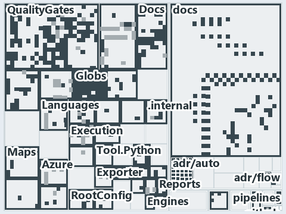

# docs/.assets/explanation/adr-flow-cd-globs--gates-check-source-and-trigger--governance.tree.md

`Tree minimap: adr-flow-cd-globs--gates-check-source-and-trigger--governance`

The tree minimap of the slide `adr-flow-cd-globs--gates-check-source-and-trigger--governance` (governance lens). The slide supports
[ADR-AUTO-TEST][1], [ADR-FLOW-CD-GLOBS][2] and [ADR-REPO-PROTGLOB][3]; the highlight of those ADR codes selects what is lit, and each reason
below names the code that selects it.

## What the minimap shows

The tree draws every file of the world map as a tile, grouped by top-level folder (under `automation/` by module, under `docs/adr/` by ADR
domain), and lights 546 files in 40 groups, filled in ink. A lit ADR file has a white rim; a file lit only by passing mentions is a lighter
ink. Every other tile is idle, a grey box: a file the slide's ADR codes do not select.

- QualityGates (automation/Catzc.Base.QualityGates): 132 lit files
- docs (docs/ outside docs/adr/): 93 lit files
- Globs (automation/Catzc.Base.Globs): 49 lit files
- adr/auto (docs/adr/automation): 39 lit files
- Docs (automation/Catzc.Base.Docs): 37 lit files
- Az.Templates (automation/Catzc.Azure.Templates): 29 lit files
- ModuleSystem (automation/Catzc.Base.ModuleSystem): 19 lit files
- Azure (automation/Catzc.Azure): 11 lit files
- Languages (automation/Catzc.Base.Languages): 11 lit files
- Tool.Core (automation/Catzc.Tooling.Core): 11 lit files
- Execution (automation/Catzc.Base.Execution): 10 lit files
- Maps (automation/Catzc.Base.Maps): 9 lit files
- RootConfig (automation/Catzc.Base.RootConfig): 8 lit files
- Contracts (automation/Catzc.Base.Contracts): 7 lit files
- Tool.Provisioning (automation/Catzc.Tooling.Provisioning): 7 lit files
- Az.DevOps.BuildValidation (automation/Catzc.Azure.DevOps.BuildValidation): 6 lit files
- adr/flow (docs/adr/flow): 6 lit files
- pipelines: 6 lit files
- Reports (automation/Catzc.Base.Reports): 5 lit files
- TypesSystem (automation/Catzc.Base.TypesSystem): 5 lit files
- .internal (automation/.internal): 4 lit files
- Az.DevOps (automation/Catzc.Azure.DevOps): 4 lit files
- Exporter (automation/Catzc.Base.Exporter): 4 lit files
- Tool.Inspiration (automation/Catzc.Tooling.Inspiration): 4 lit files
- Root files: 3 lit files
- .claude: 3 lit files
- Config (automation/Catzc.Base.Config): 3 lit files
- ConfigExtensions (automation/Catzc.Base.ConfigExtensions): 3 lit files
- Tool.KeyHandler (automation/Catzc.Tooling.KeyHandler): 3 lit files
- Objects (automation/Catzc.Base.Objects): 2 lit files
- Repository (automation/Catzc.Base.Repository): 2 lit files
- Tool.Toolchain (automation/Catzc.Tooling.Toolchain): 2 lit files
- adr/* (the files directly in docs/adr/): 2 lit files
- .github: 1 lit file
- .scriptanalyzer (automation/.scriptanalyzer): 1 lit file
- Engines (automation/Catzc.Base.Engines): 1 lit file
- Environment (automation/Catzc.Base.Environment): 1 lit file
- Files (automation/Catzc.Base.Files): 1 lit file
- Timeouts (automation/Catzc.Base.Timeouts): 1 lit file
- Tool.Python (automation/Catzc.Tooling.Python): 1 lit file

## Why each group is lit

### QualityGates (132 lit files)

The group holds the files of automation/Catzc.Base.QualityGates; each sits in its world-map cell and is lit by:

- [automation/Catzc.Base.QualityGates/Get-TestTargetSkipReason.ps1][4], in the cell automation × powershell: selected by [ADR-AUTO-TEST][1]:
  the file cites it at line 6 (header) and line 8 (header).
- [automation/Catzc.Base.QualityGates/Invoke-TestFile.ps1][5], in the cell automation × powershell: selected by [ADR-AUTO-TEST][1]: the file
  cites it at line 13 (header), line 24 (header), line 28 (header), line 34 (header) and line 35 (header).
- [automation/Catzc.Base.QualityGates/Test-AnalyzerAdrMap.ps1][6], in the cell automation × powershell: selected by [ADR-AUTO-TEST][1]: the
  file cites it at line 5 (header).
- [automation/Catzc.Base.QualityGates/Test-Automation.ps1][7], in the cell automation × powershell: selected by [ADR-AUTO-TEST][1]: the file
  cites it at line 13 (header), line 19 (header), line 21 (header), line 71 (header), line 87 (header), line 172 (body comment) and line 184
  (body comment); selected by [ADR-FLOW-CD-GLOBS][2]: the file cites it at line 72 (header).
- [automation/Catzc.Base.QualityGates/Test-BuildArtifact.ps1][8], in the cell automation × powershell: selected by [ADR-AUTO-TEST][1]: the
  file cites it at line 6 (header) and line 7 (header).
- [automation/Catzc.Base.QualityGates/Test-CatzcBuild.ps1][9], in the cell automation × powershell: selected by [ADR-AUTO-TEST][1]: the file
  cites it at line 6 (header), line 16 (header) and line 36 (header).
- [automation/Catzc.Base.QualityGates/Test-Change.ps1][10], in the cell automation × powershell: selected by [ADR-AUTO-TEST][1]: the file
  cites it at line 7 (header).
- [automation/Catzc.Base.QualityGates/Test-ConfigIdentityHygiene.ps1][11], in the cell automation × powershell: selected by
  [ADR-AUTO-TEST][1]: the file cites it at line 20 (header).
- [automation/Catzc.Base.QualityGates/Test-Formatting.ps1][12], in the cell automation × powershell: selected by [ADR-AUTO-TEST][1]: the
  file cites it at line 5 (header).
- [automation/Catzc.Base.QualityGates/Test-GeneratedFiles.ps1][13], in the cell automation × powershell: selected by [ADR-AUTO-TEST][1]: the
  file cites it at line 6 (header).
- [automation/Catzc.Base.QualityGates/Test-Links.ps1][14], in the cell automation × powershell: selected by [ADR-AUTO-TEST][1]: the file
  cites it at line 13 (header).
- [automation/Catzc.Base.QualityGates/Test-LogicTestIdentity.ps1][15], in the cell automation × powershell: selected by [ADR-AUTO-TEST][1]:
  the file cites it at line 6 (header) and line 16 (header).
- [automation/Catzc.Base.QualityGates/Test-ManagedGuids.ps1][16], in the cell automation × powershell: selected by [ADR-AUTO-TEST][1]: the
  file cites it at line 5 (header); selected by [ADR-REPO-PROTGLOB][3]: the file cites it at line 11 (header).
- [automation/Catzc.Base.QualityGates/Test-ManualTestPlan.ps1][17], in the cell automation × powershell: selected by [ADR-AUTO-TEST][1]: the
  file cites it at line 5 (header) and line 10 (header).
- [automation/Catzc.Base.QualityGates/Test-MarkdownTitle.ps1][18], in the cell automation × powershell: selected by [ADR-AUTO-TEST][1]: the
  file cites it at line 12 (header).
- [automation/Catzc.Base.QualityGates/Test-Markdownlint.ps1][19], in the cell automation × powershell: selected by [ADR-AUTO-TEST][1]: the
  file cites it at line 12 (header).
- [automation/Catzc.Base.QualityGates/Test-ParameterConsistency.ps1][20], in the cell automation × powershell: selected by
  [ADR-AUTO-TEST][1]: the file cites it at line 7 (header).
- [automation/Catzc.Base.QualityGates/Test-ScriptAnalyzer.ps1][21], in the cell automation × powershell: selected by [ADR-AUTO-TEST][1]: the
  file cites it at line 16 (header).
- [automation/Catzc.Base.QualityGates/Test-ShippedConfigs.ps1][22], in the cell automation × powershell: selected by [ADR-AUTO-TEST][1]: the
  file cites it at line 5 (header).
- [automation/Catzc.Base.QualityGates/Test-SourceConventions.ps1][23], in the cell automation × powershell: selected by [ADR-AUTO-TEST][1]:
  the file cites it at line 5 (header).
- [automation/Catzc.Base.QualityGates/Test-Spelling.ps1][24], in the cell automation × powershell: selected by [ADR-AUTO-TEST][1]: the file
  cites it at line 8 (header).
- [automation/Catzc.Base.QualityGates/Test-Terminology.ps1][25], in the cell automation × powershell: selected by [ADR-AUTO-TEST][1]: the
  file cites it at line 23 (header).
- [automation/Catzc.Base.QualityGates/Test-TestTitles.ps1][26], in the cell automation × powershell: selected by [ADR-AUTO-TEST][1]: the
  file cites it at line 5 (header) and line 10 (header).
- [automation/Catzc.Base.QualityGates/configs/analyzer-adr-map.yml][27], in the cell automation × yaml: selected by [ADR-AUTO-TEST][1]: the
  file cites it at line 27 (text).
- [automation/Catzc.Base.QualityGates/configs/glossary.yml][28], in the cell automation × yaml: selected by [ADR-AUTO-TEST][1]: the file
  cites it at line 9 (text), line 25 (text), line 34 (text), line 44 (text), line 71 (text), line 86 (text), line 109 (text), line 121
  (text), line 131 (text), line 141 (text), line 156 (text) and line 170 (text).
- [automation/Catzc.Base.QualityGates/configs/terminology.yml][29], in the cell automation × yaml: selected by [ADR-AUTO-TEST][1]: the file
  cites it at line 26 (header); selected by [ADR-REPO-PROTGLOB][3]: the file cites it at line 608 (text) and line 1204 (text).
- [automation/Catzc.Base.QualityGates/configs/test-policy.yml][30], in the cell automation × yaml: selected by [ADR-AUTO-TEST][1]: the file
  cites it at line 1 (header).
- [automation/Catzc.Base.QualityGates/private/Assert-TestTagGate.ps1][31], in the cell automation × powershell: selected by
  [ADR-AUTO-TEST][1]: the file cites it at line 6 (header).
- [automation/Catzc.Base.QualityGates/private/Enter-SystemTestLock.ps1][32], in the cell automation × powershell: selected by
  [ADR-AUTO-TEST][1]: the file cites it at line 7 (header) and line 12 (header).
- [automation/Catzc.Base.QualityGates/private/Enter-TestRunLocation.ps1][33], in the cell automation × powershell: selected by
  [ADR-AUTO-TEST][1]: the file cites it at line 6 (header).
- [automation/Catzc.Base.QualityGates/private/Get-GuidScanFiles.ps1][34], in the cell automation × powershell: selected by
  [ADR-FLOW-CD-GLOBS][2]: the file cites it at line 7 (header).
- [automation/Catzc.Base.QualityGates/private/Get-LanguageTestOutcomes.ps1][35], in the cell automation × powershell: selected by
  [ADR-AUTO-TEST][1]: the file cites it at line 12 (header).
- [automation/Catzc.Base.QualityGates/private/Get-LiveIdentityTokens.ps1][36], in the cell automation × powershell: selected by
  [ADR-AUTO-TEST][1]: the file cites it at line 24 (header).
- [automation/Catzc.Base.QualityGates/private/Get-LogicTestIdentityFinding.ps1][37], in the cell automation × powershell: selected by
  [ADR-AUTO-TEST][1]: the file cites it at line 12 (header).
- [automation/Catzc.Base.QualityGates/private/Get-ModuleProtectionIdentity.ps1][38], in the cell automation × powershell: selected by
  [ADR-FLOW-CD-GLOBS][2]: the file cites it at line 143 (body comment) (a passing mention only); selected by [ADR-REPO-PROTGLOB][3]: the
  file cites it at line 5 (header).
- [automation/Catzc.Base.QualityGates/private/Get-TestFileModule.ps1][39], in the cell automation × powershell: selected by
  [ADR-REPO-PROTGLOB][3]: the file cites it at line 7 (header).
- [automation/Catzc.Base.QualityGates/private/Get-TestOptOutExclusion.ps1][40], in the cell automation × powershell: selected by
  [ADR-AUTO-TEST][1]: the file cites it at line 6 (header).
- [automation/Catzc.Base.QualityGates/private/Get-TestRunLocationEntry.ps1][41], in the cell automation × powershell: selected by
  [ADR-AUTO-TEST][1]: the file cites it at line 5 (header).
- [automation/Catzc.Base.QualityGates/private/Invoke-BuildArtifactProbe.ps1][42], in the cell automation × powershell: selected by
  [ADR-AUTO-TEST][1]: the file cites it at line 6 (header).
- [automation/Catzc.Base.QualityGates/private/Invoke-TestAutomationWorkers.ps1][43], in the cell automation × powershell: selected by
  [ADR-AUTO-TEST][1]: the file cites it at line 7 (header).
- [automation/Catzc.Base.QualityGates/private/Invoke-TestRun.ps1][44], in the cell automation × powershell: selected by [ADR-AUTO-TEST][1]:
  the file cites it at line 5 (header), line 16 (header) and line 185 (body comment); selected by [ADR-REPO-PROTGLOB][3]: the file cites it
  at line 192 (body comment) (a passing mention only).
- [automation/Catzc.Base.QualityGates/private/New-PesterRunConfiguration.ps1][45], in the cell automation × powershell: selected by
  [ADR-AUTO-TEST][1]: the file cites it at line 12 (header).
- [automation/Catzc.Base.QualityGates/private/New-TestAutomationShardScript.ps1][46], in the cell automation × powershell: selected by
  [ADR-AUTO-TEST][1]: the file cites it at line 11 (header), line 39 (header) and line 137 (body comment).
- [automation/Catzc.Base.QualityGates/private/Protect-TestedModule.ps1][47], in the cell automation × powershell: selected by
  [ADR-REPO-PROTGLOB][3]: the file cites it at line 6 (header) and line 14 (header).
- [automation/Catzc.Base.QualityGates/private/Resolve-TestRunMaxLevel.ps1][48], in the cell automation × powershell: selected by
  [ADR-AUTO-TEST][1]: the file cites it at line 7 (header) and line 20 (header).
- [automation/Catzc.Base.QualityGates/private/Resolve-TestSuite.ps1][49], in the cell automation × powershell: selected by
  [ADR-AUTO-TEST][1]: the file cites it at line 7 (header) and line 27 (text); selected by [ADR-FLOW-CD-GLOBS][2]: the file cites it at line
  9 (header).
- [automation/Catzc.Base.QualityGates/private/Select-ProtectedTestFile.ps1][50], in the cell automation × powershell: selected by
  [ADR-REPO-PROTGLOB][3]: the file cites it at line 3 (header).
- [automation/Catzc.Base.QualityGates/private/Select-TestRunFiles.ps1][51], in the cell automation × powershell: selected by
  [ADR-AUTO-TEST][1]: the file cites it at line 15 (header).
- [automation/Catzc.Base.QualityGates/private/Split-TestAutomationFiles.ps1][52], in the cell automation × powershell: selected by
  [ADR-AUTO-TEST][1]: the file cites it at line 20 (header) and line 24 (header).
- [automation/Catzc.Base.QualityGates/private/Write-TestAutomationHeader.ps1][53], in the cell automation × powershell: selected by
  [ADR-AUTO-TEST][1]: the file cites it at line 19 (header).
- [automation/Catzc.Base.QualityGates/private/Write-TestOptOutExclusion.ps1][54], in the cell automation × powershell: selected by
  [ADR-AUTO-TEST][1]: the file cites it at line 4 (header).
- [automation/Catzc.Base.QualityGates/tests/Assert-TestTagGate.Tests.ps1][55], in the cell automation × powershell: selected by
  [ADR-AUTO-TEST][1]: the file cites it at line 1 (text).
- [automation/Catzc.Base.QualityGates/tests/Build-EnglishDictionary.Tests.ps1][56], in the cell automation × powershell: selected by
  [ADR-AUTO-TEST][1]: the file cites it at line 14 (body comment) (a passing mention only).
- [automation/Catzc.Base.QualityGates/tests/ConvertTo-PesterRunTarget.Tests.ps1][57], in the cell automation × powershell: selected by
  [ADR-AUTO-TEST][1]: the file cites it at line 3 (header).
- [automation/Catzc.Base.QualityGates/tests/Enter-SystemTestLock.Tests.ps1][58], in the cell automation × powershell: selected by
  [ADR-AUTO-TEST][1]: the file cites it at line 6 (text).
- [automation/Catzc.Base.QualityGates/tests/Format-Code.Tests.ps1][59], in the cell automation × powershell: selected by [ADR-AUTO-TEST][1]:
  the file cites it at line 1 (header), line 3 (header) and line 231 (body comment).
- [automation/Catzc.Base.QualityGates/tests/Format-Links.Tests.ps1][60], in the cell automation × powershell: selected by
  [ADR-AUTO-TEST][1]: the file cites it at line 4 (header).
- [automation/Catzc.Base.QualityGates/tests/Format-MarkdownTitle.Tests.ps1][61], in the cell automation × powershell: selected by
  [ADR-AUTO-TEST][1]: the file cites it at line 40 (text).
- [automation/Catzc.Base.QualityGates/tests/Format-Types.Tests.ps1][62], in the cell automation × powershell: selected by
  [ADR-AUTO-TEST][1]: the file cites it at line 2 (header) and line 4 (header).
- [automation/Catzc.Base.QualityGates/tests/Get-AnalyzerAdrCoverage.Tests.ps1][63], in the cell automation × powershell: selected by
  [ADR-AUTO-TEST][1]: the file cites it at line 1 (text) and line 23 (body comment).
- [automation/Catzc.Base.QualityGates/tests/Get-BashTestCases.Tests.ps1][64], in the cell automation × powershell: selected by
  [ADR-AUTO-TEST][1]: the file cites it at line 3 (header).
- [automation/Catzc.Base.QualityGates/tests/Get-ChangeCheckPlan.Tests.ps1][65], in the cell automation × powershell: selected by
  [ADR-AUTO-TEST][1]: the file cites it at line 2 (header).
- [automation/Catzc.Base.QualityGates/tests/Get-ChangeTestFile.Tests.ps1][66], in the cell automation × powershell: selected by
  [ADR-AUTO-TEST][1]: the file cites it at line 2 (header).
- [automation/Catzc.Base.QualityGates/tests/Get-FixtureIdentityTokens.Tests.ps1][67], in the cell automation × powershell: selected by
  [ADR-AUTO-TEST][1]: the file cites it at line 4 (header).
- [automation/Catzc.Base.QualityGates/tests/Get-FormatScope.Tests.ps1][68], in the cell automation × powershell: selected by
  [ADR-AUTO-TEST][1]: the file cites it at line 2 (header).
- [automation/Catzc.Base.QualityGates/tests/Get-GoTestCases.Tests.ps1][69], in the cell automation × powershell: selected by
  [ADR-AUTO-TEST][1]: the file cites it at line 4 (header).
- [automation/Catzc.Base.QualityGates/tests/Get-LanguageTestExecutable.Tests.ps1][70], in the cell automation × powershell: selected by
  [ADR-AUTO-TEST][1]: the file cites it at line 3 (header).
- [automation/Catzc.Base.QualityGates/tests/Get-LanguageTestFolders.Tests.ps1][71], in the cell automation × powershell: selected by
  [ADR-AUTO-TEST][1]: the file cites it at line 4 (header).
- [automation/Catzc.Base.QualityGates/tests/Get-LanguageTestOutcomes.Tests.ps1][72], in the cell automation × powershell: selected by
  [ADR-AUTO-TEST][1]: the file cites it at line 3 (header).
- [automation/Catzc.Base.QualityGates/tests/Get-LiveIdentityTokens.Tests.ps1][73], in the cell automation × powershell: selected by
  [ADR-AUTO-TEST][1]: the file cites it at line 10 (body comment) (a passing mention only).
- [automation/Catzc.Base.QualityGates/tests/Get-ModuleProtectionIdentity.Tests.ps1][74], in the cell automation × powershell: selected by
  [ADR-REPO-PROTGLOB][3]: the file cites it at line 2 (header).
- [automation/Catzc.Base.QualityGates/tests/Get-ParameterTypeConflict.Tests.ps1][75], in the cell automation × powershell: selected by
  [ADR-AUTO-TEST][1]: the file cites it at line 2 (header).
- [automation/Catzc.Base.QualityGates/tests/Get-PythonCheckScope.Tests.ps1][76], in the cell automation × powershell: selected by
  [ADR-AUTO-TEST][1]: the file cites it at line 3 (header).
- [automation/Catzc.Base.QualityGates/tests/Get-PythonTestCases.Tests.ps1][77], in the cell automation × powershell: selected by
  [ADR-AUTO-TEST][1]: the file cites it at line 3 (header).
- [automation/Catzc.Base.QualityGates/tests/Get-RepositoryGuids.Tests.ps1][78], in the cell automation × powershell: selected by
  [ADR-AUTO-TEST][1]: the file cites it at line 62 (body comment) (a passing mention only); selected by [ADR-REPO-PROTGLOB][3]: the file
  cites it at line 64 (body comment) and line 66 (text).
- [automation/Catzc.Base.QualityGates/tests/Get-TestAutomationTestPaths.Tests.ps1][79], in the cell automation × powershell: selected by
  [ADR-AUTO-TEST][1]: the file cites it at line 3 (header).
- [automation/Catzc.Base.QualityGates/tests/Get-TestBlockTag.Tests.ps1][80], in the cell automation × powershell: selected by
  [ADR-AUTO-TEST][1]: the file cites it at line 23 (body comment) (a passing mention only).
- [automation/Catzc.Base.QualityGates/tests/Get-TestExcludeTag.Tests.ps1][81], in the cell automation × powershell: selected by
  [ADR-AUTO-TEST][1]: the file cites it at line 21 (text).
- [automation/Catzc.Base.QualityGates/tests/Get-TestFileModule.Tests.ps1][82], in the cell automation × powershell: selected by
  [ADR-AUTO-TEST][1]: the file cites it at line 2 (header).
- [automation/Catzc.Base.QualityGates/tests/Get-TestOptOutExclusion.Tests.ps1][83], in the cell automation × powershell: selected by
  [ADR-AUTO-TEST][1]: the file cites it at line 1 (text).
- [automation/Catzc.Base.QualityGates/tests/Get-TestRuleTags.Tests.ps1][84], in the cell automation × powershell: selected by
  [ADR-AUTO-TEST][1]: the file cites it at line 1 (text).
- [automation/Catzc.Base.QualityGates/tests/Get-TestRunContext.Tests.ps1][85], in the cell automation × powershell: selected by
  [ADR-AUTO-TEST][1]: the file cites it at line 2 (header).
- [automation/Catzc.Base.QualityGates/tests/Get-TestRunFile.Tests.ps1][86], in the cell automation × powershell: selected by
  [ADR-AUTO-TEST][1]: the file cites it at line 2 (header).
- [automation/Catzc.Base.QualityGates/tests/Get-TestTagViolations.Tests.ps1][87], in the cell automation × powershell: selected by
  [ADR-AUTO-TEST][1]: the file cites it at line 2 (text), line 2 (body comment), line 100 (text) and line 104 (body comment).
- [automation/Catzc.Base.QualityGates/tests/Get-TestTargetSkipReason.Tests.ps1][88], in the cell automation × powershell: selected by
  [ADR-AUTO-TEST][1]: the file cites it at line 1 (text).
- [automation/Catzc.Base.QualityGates/tests/Invoke-BicepFormat.Tests.ps1][89], in the cell automation × powershell: selected by
  [ADR-AUTO-TEST][1]: the file cites it at line 1 (header) and line 3 (header).
- [automation/Catzc.Base.QualityGates/tests/Invoke-DotnetFormat.Tests.ps1][90], in the cell automation × powershell: selected by
  [ADR-AUTO-TEST][1]: the file cites it at line 1 (header) and line 3 (header).
- [automation/Catzc.Base.QualityGates/tests/Invoke-Gofmt.Tests.ps1][91], in the cell automation × powershell: selected by
  [ADR-AUTO-TEST][1]: the file cites it at line 1 (header) and line 3 (header).
- [automation/Catzc.Base.QualityGates/tests/Invoke-Prettier.Tests.ps1][92], in the cell automation × powershell: selected by
  [ADR-AUTO-TEST][1]: the file cites it at line 1 (header) and line 3 (header).
- [automation/Catzc.Base.QualityGates/tests/Invoke-PythonWorkspaceTool.Tests.ps1][93], in the cell automation × powershell: selected by
  [ADR-AUTO-TEST][1]: the file cites it at line 2 (header).
- [automation/Catzc.Base.QualityGates/tests/Invoke-RuffFormat.Tests.ps1][94], in the cell automation × powershell: selected by
  [ADR-AUTO-TEST][1]: the file cites it at line 1 (header) and line 3 (header).
- [automation/Catzc.Base.QualityGates/tests/Invoke-TestFile.Tests.ps1][95], in the cell automation × powershell: selected by
  [ADR-AUTO-TEST][1]: the file cites it at line 77 (body comment), line 83 (body comment), line 127 (body comment) and line 132 (body
  comment) (a passing mention only).
- [automation/Catzc.Base.QualityGates/tests/Invoke-TestRun.Tests.ps1][96], in the cell automation × powershell: selected by
  [ADR-AUTO-TEST][1]: the file cites it at line 85 (text), line 110 (text), line 183 (text), line 198 (text), line 198 (body comment) and
  line 238 (text).
- [automation/Catzc.Base.QualityGates/tests/Language.Bridge.ps1][97], in the cell automation × powershell: selected by [ADR-AUTO-TEST][1]:
  the file cites it at line 8 (header), line 13 (header) and line 15 (header).
- [automation/Catzc.Base.QualityGates/tests/ManualTestPlan-Coverage.Tests.ps1][98], in the cell automation × powershell: selected by
  [ADR-AUTO-TEST][1]: the file cites it at line 2 (header) and line 4 (header).
- [automation/Catzc.Base.QualityGates/tests/Measure-QualityGates.Tests.ps1][99], in the cell automation × powershell: selected by
  [ADR-AUTO-TEST][1]: the file cites it at line 3 (header).
- [automation/Catzc.Base.QualityGates/tests/New-TestAutomationShardScript.Tests.ps1][100], in the cell automation × powershell: selected by
  [ADR-AUTO-TEST][1]: the file cites it at line 44 (body comment) (a passing mention only).
- [automation/Catzc.Base.QualityGates/tests/New-TestRunFinalManifest.Tests.ps1][101], in the cell automation × powershell: selected by
  [ADR-AUTO-TEST][1]: the file cites it at line 30 (body comment) (a passing mention only).
- [automation/Catzc.Base.QualityGates/tests/Resolve-TestSuite.Tests.ps1][102], in the cell automation × powershell: selected by
  [ADR-AUTO-TEST][1]: the file cites it at line 2 (text) and line 13 (text).
- [automation/Catzc.Base.QualityGates/tests/Save-TestDurationHistory.Tests.ps1][103], in the cell automation × powershell: selected by
  [ADR-AUTO-TEST][1]: the file cites it at line 2 (header).
- [automation/Catzc.Base.QualityGates/tests/Select-RuleTaggedFiles.Tests.ps1][104], in the cell automation × powershell: selected by
  [ADR-AUTO-TEST][1]: the file cites it at line 1 (text).
- [automation/Catzc.Base.QualityGates/tests/Select-TestShardAssignment.Tests.ps1][105], in the cell automation × powershell: selected by
  [ADR-AUTO-TEST][1]: the file cites it at line 2 (header).
- [automation/Catzc.Base.QualityGates/tests/Split-CachedFile.Tests.ps1][106], in the cell automation × powershell: selected by
  [ADR-AUTO-TEST][1]: the file cites it at line 3 (header).
- [automation/Catzc.Base.QualityGates/tests/Split-TestAutomationFiles.Tests.ps1][107], in the cell automation × powershell: selected by
  [ADR-AUTO-TEST][1]: the file cites it at line 16 (text).
- [automation/Catzc.Base.QualityGates/tests/Test-AnalyzerAdrMap.Tests.ps1][108], in the cell automation × powershell: selected by
  [ADR-AUTO-TEST][1]: the file cites it at line 2 (header).
- [automation/Catzc.Base.QualityGates/tests/Test-Automation.Tests.ps1][109], in the cell automation × powershell: selected by
  [ADR-AUTO-TEST][1]: the file cites it at line 2 (header) and line 18 (body comment).
- [automation/Catzc.Base.QualityGates/tests/Test-BuildArtifact.Tests.ps1][110], in the cell automation × powershell: selected by
  [ADR-AUTO-TEST][1]: the file cites it at line 2 (header), line 57 (text), line 66 (text) and line 81 (text).
- [automation/Catzc.Base.QualityGates/tests/Test-CatzcBuild.Tests.ps1][111], in the cell automation × powershell: selected by
  [ADR-AUTO-TEST][1]: the file cites it at line 1 (text).
- [automation/Catzc.Base.QualityGates/tests/Test-Change.Tests.ps1][112], in the cell automation × powershell: selected by
  [ADR-AUTO-TEST][1]: the file cites it at line 4 (header).
- [automation/Catzc.Base.QualityGates/tests/Test-ConfigIdentityHygiene.Tests.ps1][113], in the cell automation × powershell: selected by
  [ADR-AUTO-TEST][1]: the file cites it at line 3 (header), line 4 (header), line 52 (text), line 56 (text) and line 74 (text).
- [automation/Catzc.Base.QualityGates/tests/Test-Formatting.Tests.ps1][114], in the cell automation × powershell: selected by
  [ADR-AUTO-TEST][1]: the file cites it at line 1 (header), line 3 (header), line 29 (body comment), line 37 (text) and line 79 (body
  comment).
- [automation/Catzc.Base.QualityGates/tests/Test-GeneratedFiles.Tests.ps1][115], in the cell automation × powershell: selected by
  [ADR-AUTO-TEST][1]: the file cites it at line 2 (header), line 23 (text), line 29 (text) and line 43 (text).
- [automation/Catzc.Base.QualityGates/tests/Test-Links.Tests.ps1][116], in the cell automation × powershell: selected by [ADR-AUTO-TEST][1]:
  the file cites it at line 3 (header), line 5 (header), line 24 (body comment), line 29 (body comment) and line 42 (body comment).
- [automation/Catzc.Base.QualityGates/tests/Test-Links.Untracked.Tests.ps1][117], in the cell automation × powershell: selected by
  [ADR-AUTO-TEST][1]: the file cites it at line 4 (header).
- [automation/Catzc.Base.QualityGates/tests/Test-LogicTestIdentity.Tests.ps1][118], in the cell automation × powershell: selected by
  [ADR-AUTO-TEST][1]: the file cites it at line 3 (header), line 6 (header), line 7 (header), line 43 (text), line 47 (text) and line 52
  (text).
- [automation/Catzc.Base.QualityGates/tests/Test-ManagedGuids.Tests.ps1][119], in the cell automation × powershell: selected by
  [ADR-AUTO-TEST][1]: the file cites it at line 2 (header).
- [automation/Catzc.Base.QualityGates/tests/Test-ManualTestPlan.Tests.ps1][120], in the cell automation × powershell: selected by
  [ADR-AUTO-TEST][1]: the file cites it at line 3 (header).
- [automation/Catzc.Base.QualityGates/tests/Test-Markdownlint.Tests.ps1][121], in the cell automation × powershell: selected by
  [ADR-AUTO-TEST][1]: the file cites it at line 19 (text), line 29 (text), line 39 (text), line 103 (body comment) and line 105 (body
  comment); selected by [ADR-REPO-PROTGLOB][3]: the file cites it at line 106 (body comment) (a passing mention only).
- [automation/Catzc.Base.QualityGates/tests/Test-ParameterConsistency.Tests.ps1][122], in the cell automation × powershell: selected by
  [ADR-AUTO-TEST][1]: the file cites it at line 1 (header) and line 4 (header).
- [automation/Catzc.Base.QualityGates/tests/Test-PythonLint.Tests.ps1][123], in the cell automation × powershell: selected by
  [ADR-AUTO-TEST][1]: the file cites it at line 1 (header), line 3 (header), line 29 (text) and line 60 (body comment).
- [automation/Catzc.Base.QualityGates/tests/Test-ScriptAnalyzer.Tests.ps1][124], in the cell automation × powershell: selected by
  [ADR-AUTO-TEST][1]: the file cites it at line 37 (text), line 46 (text) and line 58 (text).
- [automation/Catzc.Base.QualityGates/tests/Test-ShellScripts.Tests.ps1][125], in the cell automation × powershell: selected by
  [ADR-AUTO-TEST][1]: the file cites it at line 1 (header), line 4 (header) and line 162 (body comment).
- [automation/Catzc.Base.QualityGates/tests/Test-ShippedConfigs.Tests.ps1][126], in the cell automation × powershell: selected by
  [ADR-AUTO-TEST][1]: the file cites it at line 2 (header).
- [automation/Catzc.Base.QualityGates/tests/Test-SourceConventions.Tests.ps1][127], in the cell automation × powershell: selected by
  [ADR-AUTO-TEST][1]: the file cites it at line 3 (header).
- [automation/Catzc.Base.QualityGates/tests/Test-Spelling.Tests.ps1][128], in the cell automation × powershell: selected by
  [ADR-AUTO-TEST][1]: the file cites it at line 20 (text), line 29 (text), line 43 (text), line 115 (body comment) and line 117 (body
  comment); selected by [ADR-REPO-PROTGLOB][3]: the file cites it at line 118 (body comment) and line 124 (text).
- [automation/Catzc.Base.QualityGates/tests/Test-TestTitles.Tests.ps1][129], in the cell automation × powershell: selected by
  [ADR-AUTO-TEST][1]: the file cites it at line 3 (header).
- [automation/Catzc.Base.QualityGates/tests/TestTitle-TemplateTokens.Tests.ps1][130], in the cell automation × powershell: selected by
  [ADR-AUTO-TEST][1]: the file cites it at line 2 (header) and line 6 (header).
- [automation/Catzc.Base.QualityGates/tests/Write-TestAutomationRuleCoverage.Tests.ps1][131], in the cell automation × powershell: selected
  by [ADR-AUTO-TEST][1]: the file cites it at line 1 (text).
- [automation/Catzc.Base.QualityGates/tests/Write-TestRunFailures.Tests.ps1][132], in the cell automation × powershell: selected by
  [ADR-AUTO-TEST][1]: the file cites it at line 3 (header).
- [automation/Catzc.Base.QualityGates/tests/types/SpellingOracle.Tests.ps1][133], in the cell automation × powershell: selected by
  [ADR-AUTO-TEST][1]: the file cites it at line 35 (body comment) (a passing mention only).
- [automation/Catzc.Base.QualityGates/types/IdentityTokenRule.cs][134], in the cell automation × csharp: selected by [ADR-AUTO-TEST][1]: the
  file cites it at line 3 (header).
- [automation/Catzc.Base.QualityGates/types/TestPolicyConfig.cs][135], in the cell automation × csharp: selected by [ADR-AUTO-TEST][1]: the
  file cites it at line 2 (header).

### docs (93 lit files)

The group holds the files of docs/ outside docs/adr/; each sits in its world-map cell and is lit by:

- [docs/.assets/explanation/adr-auto-bundle--what-gates-each-bundle-stage--governance.chain.md][136], in the cell docs × markdown: selected
  by [ADR-AUTO-TEST][1]: the file cites it at line 8 (text), line 65 (text), line 65 (text), line 87 (text), line 88 (text), line 89 (text),
  line 90 (text), line 91 (text), line 92 (text), line 93 (text), line 94 (text), line 95 (text), line 96 (text), line 97 (text) and line 98
  (text).
- [docs/.assets/explanation/adr-auto-bundle--what-gates-each-bundle-stage--governance.drawio.md][137], in the cell docs × markdown: selected
  by [ADR-AUTO-TEST][1]: the file cites it at line 67 (text) and line 74 (text).
- [docs/.assets/explanation/adr-auto-bundle--what-gates-each-bundle-stage--governance.grid.md][138], in the cell docs × markdown: selected
  by [ADR-AUTO-TEST][1]: the file cites it at line 8 (text), line 33 (text), line 34 (text), line 35 (text), line 52 (text), line 56 (text),
  line 57 (text), line 58 (text), line 59 (text), line 60 (text), line 61 (text), line 62 (text), line 63 (text), line 73 (text), line 75
  (text), line 78 (text), line 79 (text), line 80 (text), line 84 (text), line 86 (text), line 87 (text), line 89 (text), line 91 (text),
  line 93 (text), line 95 (text), line 97 (text), line 99 (text), line 101 (text), line 103 (text), line 105 (text), line 107 (text), line
  109 (text), line 111 (text), line 113 (text), line 115 (text), line 117 (text), line 119 (text), line 121 (text), line 123 (text), line
  125 (text), line 127 (text), line 129 (text), line 131 (text), line 133 (text), line 135 (text), line 137 (text), line 139 (text), line
  141 (text), line 143 (text), line 145 (text), line 147 (text), line 148 (text), line 150 (text), line 152 (text), line 154 (text), line
  156 (text), line 158 (text), line 160 (text), line 161 (text), line 163 (text), line 167 (text), line 169 (text), line 173 (text), line
  175 (text), line 177 (text), line 179 (text), line 183 (text), line 184 (text), line 186 (text), line 188 (text), line 190 (text), line
  192 (text), line 194 (text), line 196 (text), line 197 (text), line 198 (text), line 199 (text), line 201 (text), line 205 (text), line
  206 (text), line 208 (text), line 209 (text), line 210 (text), line 212 (text), line 216 (text), line 218 (text), line 220 (text), line
  222 (text), line 224 (text), line 226 (text), line 228 (text), line 230 (text), line 232 (text), line 234 (text), line 236 (text), line
  238 (text), line 239 (text), line 241 (text), line 243 (text), line 245 (text), line 247 (text), line 249 (text), line 250 (text), line
  252 (text), line 254 (text), line 256 (text), line 258 (text), line 260 (text), line 262 (text), line 264 (text), line 266 (text), line
  268 (text), line 270 (text), line 272 (text), line 274 (text), line 276 (text), line 287 (text), line 289 (text), line 291 (text), line
  293 (text), line 296 (text), line 297 (text), line 299 (text), line 300 (text), line 301 (text), line 303 (text), line 305 (text), line
  307 (text), line 309 (text), line 311 (text), line 313 (text), line 315 (text), line 317 (text), line 319 (text), line 321 (text), line
  323 (text), line 325 (text), line 327 (text), line 329 (text), line 331 (text), line 333 (text), line 335 (text), line 337 (text), line
  338 (text), line 339 (text), line 340 (text), line 342 (text), line 343 (text), line 345 (text), line 347 (text), line 349 (text), line
  355 (text), line 362 (text), line 364 (text), line 366 (text), line 369 (text), line 370 (text), line 371 (text), line 373 (text), line
  376 (text), line 379 (text), line 381 (text), line 383 (text), line 385 (text), line 387 (text), line 390 (text), line 391 (text), line
  393 (text), line 395 (text), line 397 (text), line 399 (text), line 401 (text), line 403 (text), line 404 (text), line 406 (text), line
  408 (text), line 410 (text), line 411 (text), line 413 (text), line 414 (text), line 415 (text), line 416 (text), line 418 (text), line
  419 (text), line 421 (text), line 422 (text), line 423 (text), line 426 (text), line 427 (text), line 428 (text), line 430 (text), line
  431 (text), line 432 (text), line 434 (text), line 436 (text), line 438 (text), line 440 (text), line 442 (text), line 444 (text), line
  448 (text), line 450 (text), line 454 (text), line 458 (text), line 460 (text), line 462 (text), line 465 (text), line 466 (text), line
  468 (text), line 470 (text), line 472 (text), line 474 (text), line 476 (text), line 478 (text), line 480 (text), line 482 (text), line
  484 (text), line 487 (text), line 489 (text), line 491 (text), line 493 (text), line 495 (text), line 497 (text), line 499 (text), line
  501 (text), line 503 (text), line 505 (text), line 507 (text), line 509 (text), line 511 (text), line 513 (text), line 515 (text), line
  517 (text), line 519 (text), line 521 (text), line 523 (text), line 527 (text), line 529 (text), line 531 (text), line 533 (text), line
  535 (text), line 537 (text), line 539 (text), line 541 (text), line 543 (text), line 545 (text), line 547 (text), line 549 (text), line
  551 (text), line 553 (text), line 555 (text), line 557 (text), line 559 (text), line 561 (text), line 563 (text), line 565 (text), line
  567 (text), line 570 (text), line 572 (text), line 574 (text), line 576 (text), line 578 (text), line 580 (text), line 582 (text), line
  584 (text), line 586 (text), line 589 (text), line 590 (text), line 596 (text), line 598 (text), line 600 (text), line 602 (text), line
  604 (text), line 608 (text), line 610 (text), line 612 (text), line 614 (text), line 616 (text), line 618 (text), line 620 (text), line
  622 (text), line 625 (text), line 627 (text), line 629 (text), line 631 (text), line 633 (text), line 635 (text), line 637 (text), line
  639 (text), line 641 (text), line 643 (text), line 645 (text), line 646 (text), line 648 (text), line 654 (text), line 656 (text), line
  659 (text), line 661 (text), line 662 (text), line 664 (text), line 666 (text), line 668 (text), line 670 (text), line 682 (text), line
  683 (text), line 685 (text), line 687 (text), line 689 (text), line 693 (text), line 694 (text), line 696 (text), line 698 (text), line
  700 (text), line 702 (text), line 704 (text), line 706 (text), line 708 (text), line 710 (text), line 712 (text), line 714 (text), line
  716 (text), line 718 (text), line 720 (text), line 722 (text), line 724 (text), line 726 (text), line 728 (text), line 730 (text), line
  732 (text), line 734 (text), line 736 (text), line 738 (text), line 740 (text), line 742 (text), line 746 (text), line 750 (text), line
  758 (text), line 759 (text), line 761 (text), line 763 (text), line 765 (text), line 767 (text), line 769 (text), line 771 (text), line
  774 (text), line 776 (text), line 777 (text), line 781 (text), line 783 (text), line 784 (text), line 785 (text), line 813 (text), line
  815 (text), line 817 (text), line 819 (text), line 831 (text), line 834 (text), line 837 (text), line 840 (text), line 843 (text), line
  846 (text), line 849 (text), line 852 (text), line 855 (text), line 858 (text), line 861 (text), line 864 (text), line 867 (text), line
  870 (text), line 873 (text), line 876 (text), line 879 (text), line 882 (text), line 885 (text), line 888 (text), line 891 (text), line
  894 (text), line 897 (text), line 900 (text), line 903 (text), line 906 (text), line 909 (text), line 912 (text), line 915 (text), line
  918 (text), line 921 (text), line 924 (text), line 927 (text), line 930 (text), line 933 (text), line 936 (text), line 939 (text), line
  942 (text), line 945 (text), line 948 (text), line 951 (text), line 968 (text), line 972 (text), line 996 (text), line 1000 (text), line
  1003 (text), line 1007 (text), line 1017 (text), line 1018 (text), line 1020 (text), line 1022 (text), line 1023 (text), line 1028 (text),
  line 1029 (text), line 1031 (text), line 1032 (text), line 1033 (text), line 1034 (text), line 1035 (text), line 1042 (text), line 1051
  (text), line 1066 (text), line 1074 (text), line 1103 (text), line 1104 (text), line 1105 (text), line 1106 (text), line 1107 (text), line
  1108 (text), line 1109 (text), line 1110 (text), line 1111 (text), line 1112 (text), line 1113 (text) and line 1114 (text).
- [docs/.assets/explanation/adr-auto-bundle--what-gates-each-bundle-stage--governance.tree.md][139], in the cell docs × markdown: selected
  by [ADR-AUTO-TEST][1]: the file cites it at line 8 (text), line 64 (text), line 66 (text), line 68 (text), line 70 (text), line 73 (text),
  line 75 (text), line 78 (text), line 81 (text), line 82 (text), line 84 (text), line 86 (text), line 88 (text), line 90 (text), line 92
  (text), line 94 (text), line 96 (text), line 99 (text), line 101 (text), line 103 (text), line 105 (text), line 107 (text), line 109
  (text), line 111 (text), line 114 (text), line 115 (text), line 119 (text), line 121 (text), line 124 (text), line 126 (text), line 128
  (text), line 130 (text), line 132 (text), line 134 (text), line 138 (text), line 140 (text), line 144 (text), line 148 (text), line 149
  (text), line 152 (text), line 154 (text), line 157 (text), line 159 (text), line 161 (text), line 163 (text), line 165 (text), line 167
  (text), line 169 (text), line 171 (text), line 173 (text), line 175 (text), line 177 (text), line 180 (text), line 182 (text), line 184
  (text), line 186 (text), line 188 (text), line 190 (text), line 192 (text), line 194 (text), line 196 (text), line 198 (text), line 200
  (text), line 202 (text), line 204 (text), line 206 (text), line 208 (text), line 210 (text), line 212 (text), line 214 (text), line 218
  (text), line 220 (text), line 222 (text), line 224 (text), line 226 (text), line 228 (text), line 230 (text), line 232 (text), line 234
  (text), line 236 (text), line 238 (text), line 240 (text), line 242 (text), line 244 (text), line 246 (text), line 248 (text), line 250
  (text), line 253 (text), line 255 (text), line 258 (text), line 260 (text), line 262 (text), line 265 (text), line 267 (text), line 269
  (text), line 271 (text), line 273 (text), line 275 (text), line 277 (text), line 279 (text), line 281 (text), line 284 (text), line 290
  (text), line 292 (text), line 294 (text), line 296 (text), line 299 (text), line 302 (text), line 305 (text), line 307 (text), line 310
  (text), line 312 (text), line 314 (text), line 317 (text), line 319 (text), line 321 (text), line 324 (text), line 326 (text), line 328
  (text), line 330 (text), line 333 (text), line 335 (text), line 337 (text), line 339 (text), line 341 (text), line 342 (text), line 344
  (text), line 371 (text), line 374 (text), line 376 (text), line 378 (text), line 390 (text), line 392 (text), line 416 (text), line 420
  (text), line 423 (text), line 427 (text), line 438 (text), line 440 (text), line 442 (text), line 444 (text), line 446 (text), line 452
  (text), line 454 (text), line 456 (text), line 458 (text), line 460 (text), line 462 (text), line 464 (text), line 471 (text), line 473
  (text), line 475 (text), line 477 (text), line 480 (text), line 482 (text), line 487 (text), line 490 (text), line 493 (text), line 494
  (text), line 496 (text), line 498 (text), line 501 (text), line 505 (text), line 507 (text), line 508 (text), line 511 (text), line 513
  (text), line 515 (text), line 517 (text), line 519 (text), line 521 (text), line 523 (text), line 525 (text), line 526 (text), line 529
  (text), line 531 (text), line 532 (text), line 534 (text), line 537 (text), line 539 (text), line 541 (text), line 542 (text), line 544
  (text), line 547 (text), line 549 (text), line 550 (text), line 559 (text), line 562 (text), line 565 (text), line 568 (text), line 571
  (text), line 574 (text), line 577 (text), line 581 (text), line 584 (text), line 587 (text), line 590 (text), line 593 (text), line 596
  (text), line 599 (text), line 602 (text), line 605 (text), line 608 (text), line 611 (text), line 614 (text), line 617 (text), line 620
  (text), line 623 (text), line 626 (text), line 629 (text), line 632 (text), line 635 (text), line 638 (text), line 641 (text), line 644
  (text), line 647 (text), line 650 (text), line 653 (text), line 657 (text), line 660 (text), line 663 (text), line 666 (text), line 669
  (text), line 672 (text), line 675 (text), line 682 (text), line 684 (text), line 686 (text), line 688 (text), line 690 (text), line 693
  (text), line 695 (text), line 698 (text), line 701 (text), line 702 (text), line 706 (text), line 708 (text), line 711 (text), line 714
  (text), line 716 (text), line 718 (text), line 720 (text), line 722 (text), line 724 (text), line 726 (text), line 728 (text), line 731
  (text), line 733 (text), line 736 (text), line 738 (text), line 740 (text), line 742 (text), line 744 (text), line 746 (text), line 758
  (text), line 768 (text), line 770 (text), line 773 (text), line 775 (text), line 777 (text), line 779 (text), line 781 (text), line 785
  (text), line 788 (text), line 790 (text), line 794 (text), line 796 (text), line 798 (text), line 800 (text), line 802 (text), line 804
  (text), line 806 (text), line 807 (text), line 816 (text), line 819 (text), line 820 (text), line 822 (text), line 825 (text), line 826
  (text), line 828 (text), line 831 (text), line 833 (text), line 835 (text), line 837 (text), line 839 (text), line 841 (text), line 842
  (text), line 864 (text), line 865 (text), line 868 (text), line 878 (text), line 880 (text), line 883 (text), line 884 (text), line 886
  (text), line 888 (text), line 890 (text), line 893 (text), line 894 (text), line 896 (text), line 898 (text), line 906 (text), line 908
  (text), line 910 (text), line 912 (text), line 913 (text), line 916 (text), line 918 (text), line 920 (text), line 921 (text), line 923
  (text), line 925 (text), line 932 (text), line 934 (text), line 937 (text), line 938 (text), line 941 (text), line 943 (text), line 945
  (text), line 947 (text), line 949 (text), line 951 (text), line 953 (text), line 959 (text), line 962 (text), line 964 (text), line 966
  (text), line 968 (text), line 970 (text), line 972 (text), line 974 (text), line 976 (text), line 978 (text), line 995 (text), line 998
  (text), line 1000 (text), line 1002 (text), line 1004 (text), line 1010 (text), line 1012 (text), line 1014 (text), line 1017 (text), line
  1018 (text), line 1020 (text), line 1022 (text), line 1025 (text), line 1027 (text), line 1036 (text), line 1037 (text), line 1039 (text),
  line 1042 (text), line 1044 (text), line 1046 (text), line 1048 (text), line 1050 (text), line 1081 (text), line 1084 (text), line 1086
  (text), line 1088 (text), line 1090 (text), line 1092 (text), line 1094 (text), line 1102 (text), line 1104 (text), line 1106 (text), line
  1108 (text), line 1110 (text), line 1112 (text), line 1114 (text), line 1122 (text), line 1124 (text), line 1128 (text), line 1130 (text),
  line 1140 (text), line 1141 (text), line 1146 (text), line 1153 (text), line 1155 (text), line 1158 (text), line 1161 (text), line 1162
  (text), line 1176 (text), line 1178 (text), line 1184 (text), line 1186 (text), line 1189 (text), line 1190 (text), line 1198 (text), line
  1200 (text), line 1202 (text), line 1204 (text), line 1213 (text), line 1217 (text), line 1225 (text), line 1233 (text), line 1241 (text),
  line 1253 (text), line 1254 (text), line 1256 (text), line 1265 (text), line 1267 (text), line 1269 (text), line 1276 (text), line 1278
  (text), line 1280 (text), line 1287 (text), line 1296 (text), line 1298 (text), line 1313 (text), line 1317 (text), line 1332 (text), line
  1339 (text), line 1346 (text), line 1353 (text), line 1359 (text), line 1367 (text), line 1373 (text), line 1398 (text), line 1399 (text),
  line 1400 (text), line 1401 (text), line 1402 (text), line 1403 (text), line 1404 (text), line 1405 (text), line 1406 (text), line 1407
  (text), line 1408 (text) and line 1409 (text).
- [docs/.assets/explanation/adr-auto-depm--two-gates-check-the-layer-pins--governance.chain.md][140], in the cell docs × markdown: selected
  by [ADR-AUTO-TEST][1]: the file cites it at line 8 (text), line 34 (text), line 34 (text), line 48 (text), line 49 (text), line 50 (text),
  line 51 (text), line 52 (text), line 53 (text), line 54 (text), line 55 (text), line 56 (text), line 57 (text), line 58 (text) and line 59
  (text).
- [docs/.assets/explanation/adr-auto-depm--two-gates-check-the-layer-pins--governance.drawio.md][141], in the cell docs × markdown: selected
  by [ADR-AUTO-TEST][1]: the file cites it at line 68 (text).
- [docs/.assets/explanation/adr-auto-depm--two-gates-check-the-layer-pins--governance.grid.md][142], in the cell docs × markdown: selected
  by [ADR-AUTO-TEST][1]: the file cites it at line 8 (text), line 32 (text), line 33 (text), line 34 (text), line 44 (text), line 46 (text),
  line 47 (text), line 48 (text), line 49 (text), line 54 (text), line 55 (text), line 56 (text), line 57 (text), line 65 (text), line 67
  (text), line 69 (text), line 70 (text), line 71 (text), line 73 (text), line 75 (text), line 76 (text), line 78 (text), line 80 (text),
  line 82 (text), line 84 (text), line 86 (text), line 88 (text), line 90 (text), line 92 (text), line 94 (text), line 96 (text), line 98
  (text), line 100 (text), line 102 (text), line 104 (text), line 106 (text), line 108 (text), line 110 (text), line 112 (text), line 114
  (text), line 116 (text), line 118 (text), line 120 (text), line 122 (text), line 124 (text), line 126 (text), line 128 (text), line 130
  (text), line 132 (text), line 134 (text), line 136 (text), line 137 (text), line 139 (text), line 141 (text), line 143 (text), line 145
  (text), line 147 (text), line 149 (text), line 150 (text), line 152 (text), line 154 (text), line 156 (text), line 158 (text), line 160
  (text), line 162 (text), line 164 (text), line 166 (text), line 167 (text), line 169 (text), line 171 (text), line 173 (text), line 175
  (text), line 177 (text), line 179 (text), line 180 (text), line 181 (text), line 182 (text), line 183 (text), line 185 (text), line 186
  (text), line 188 (text), line 189 (text), line 190 (text), line 192 (text), line 194 (text), line 196 (text), line 198 (text), line 200
  (text), line 202 (text), line 204 (text), line 206 (text), line 208 (text), line 210 (text), line 212 (text), line 214 (text), line 216
  (text), line 217 (text), line 219 (text), line 221 (text), line 223 (text), line 225 (text), line 227 (text), line 228 (text), line 230
  (text), line 232 (text), line 234 (text), line 236 (text), line 238 (text), line 240 (text), line 242 (text), line 244 (text), line 246
  (text), line 248 (text), line 250 (text), line 252 (text), line 254 (text), line 256 (text), line 258 (text), line 260 (text), line 262
  (text), line 264 (text), line 265 (text), line 267 (text), line 268 (text), line 269 (text), line 271 (text), line 273 (text), line 275
  (text), line 277 (text), line 279 (text), line 281 (text), line 283 (text), line 285 (text), line 287 (text), line 289 (text), line 291
  (text), line 293 (text), line 295 (text), line 297 (text), line 299 (text), line 301 (text), line 303 (text), line 305 (text), line 306
  (text), line 307 (text), line 308 (text), line 310 (text), line 311 (text), line 313 (text), line 315 (text), line 317 (text), line 319
  (text), line 321 (text), line 323 (text), line 325 (text), line 327 (text), line 329 (text), line 330 (text), line 331 (text), line 333
  (text), line 335 (text), line 337 (text), line 339 (text), line 341 (text), line 343 (text), line 345 (text), line 347 (text), line 349
  (text), line 351 (text), line 353 (text), line 355 (text), line 357 (text), line 359 (text), line 360 (text), line 362 (text), line 364
  (text), line 366 (text), line 367 (text), line 369 (text), line 370 (text), line 371 (text), line 372 (text), line 374 (text), line 375
  (text), line 377 (text), line 378 (text), line 379 (text), line 381 (text), line 382 (text), line 383 (text), line 385 (text), line 386
  (text), line 387 (text), line 389 (text), line 391 (text), line 393 (text), line 395 (text), line 397 (text), line 399 (text), line 401
  (text), line 403 (text), line 405 (text), line 407 (text), line 409 (text), line 411 (text), line 413 (text), line 415 (text), line 417
  (text), line 419 (text), line 421 (text), line 423 (text), line 425 (text), line 427 (text), line 429 (text), line 431 (text), line 433
  (text), line 435 (text), line 437 (text), line 439 (text), line 441 (text), line 443 (text), line 445 (text), line 447 (text), line 449
  (text), line 451 (text), line 453 (text), line 455 (text), line 457 (text), line 459 (text), line 461 (text), line 463 (text), line 465
  (text), line 467 (text), line 469 (text), line 471 (text), line 473 (text), line 475 (text), line 477 (text), line 479 (text), line 481
  (text), line 483 (text), line 485 (text), line 487 (text), line 489 (text), line 491 (text), line 493 (text), line 495 (text), line 497
  (text), line 499 (text), line 501 (text), line 503 (text), line 505 (text), line 507 (text), line 509 (text), line 511 (text), line 513
  (text), line 515 (text), line 517 (text), line 519 (text), line 521 (text), line 523 (text), line 525 (text), line 527 (text), line 529
  (text), line 531 (text), line 533 (text), line 535 (text), line 537 (text), line 539 (text), line 541 (text), line 543 (text), line 545
  (text), line 547 (text), line 549 (text), line 551 (text), line 553 (text), line 555 (text), line 557 (text), line 559 (text), line 561
  (text), line 563 (text), line 565 (text), line 567 (text), line 569 (text), line 571 (text), line 573 (text), line 575 (text), line 577
  (text), line 579 (text), line 581 (text), line 583 (text), line 584 (text), line 586 (text), line 588 (text), line 590 (text), line 592
  (text), line 594 (text), line 595 (text), line 597 (text), line 599 (text), line 601 (text), line 603 (text), line 605 (text), line 606
  (text), line 608 (text), line 610 (text), line 612 (text), line 614 (text), line 615 (text), line 617 (text), line 619 (text), line 621
  (text), line 623 (text), line 625 (text), line 627 (text), line 629 (text), line 631 (text), line 633 (text), line 635 (text), line 637
  (text), line 639 (text), line 641 (text), line 643 (text), line 645 (text), line 647 (text), line 649 (text), line 651 (text), line 653
  (text), line 655 (text), line 657 (text), line 659 (text), line 661 (text), line 663 (text), line 665 (text), line 667 (text), line 675
  (text), line 676 (text), line 678 (text), line 680 (text), line 681 (text), line 683 (text), line 685 (text), line 687 (text), line 689
  (text), line 690 (text), line 692 (text), line 695 (text), line 696 (text), line 697 (text), line 698 (text), line 706 (text), line 713
  (text), line 718 (text), line 720 (text), line 722 (text), line 725 (text), line 727 (text), line 729 (text), line 731 (text), line 733
  (text), line 735 (text), line 737 (text), line 739 (text), line 741 (text), line 743 (text), line 745 (text), line 747 (text), line 749
  (text), line 751 (text), line 753 (text), line 755 (text), line 757 (text), line 759 (text), line 761 (text), line 763 (text), line 765
  (text), line 767 (text), line 769 (text), line 771 (text), line 773 (text), line 775 (text), line 777 (text), line 779 (text), line 781
  (text), line 783 (text), line 785 (text), line 787 (text), line 789 (text), line 791 (text), line 793 (text), line 795 (text), line 797
  (text), line 799 (text), line 801 (text), line 803 (text), line 804 (text), line 807 (text), line 814 (text), line 820 (text), line 822
  (text), line 824 (text), line 825 (text), line 826 (text), line 828 (text), line 830 (text), line 831 (text), line 833 (text), line 834
  (text), line 836 (text), line 837 (text), line 838 (text), line 839 (text), line 840 (text), line 847 (text), line 855 (text), line 866
  (text), line 869 (text), line 894 (text), line 895 (text), line 896 (text), line 897 (text), line 898 (text), line 899 (text), line 900
  (text), line 901 (text), line 902 (text), line 903 (text), line 904 (text) and line 905 (text).
- [docs/.assets/explanation/adr-auto-depm--two-gates-check-the-layer-pins--governance.tree.md][143], in the cell docs × markdown: selected
  by [ADR-AUTO-TEST][1]: the file cites it at line 8 (text), line 61 (text), line 63 (text), line 65 (text), line 67 (text), line 70 (text),
  line 72 (text), line 74 (text), line 77 (text), line 78 (text), line 80 (text), line 82 (text), line 84 (text), line 86 (text), line 88
  (text), line 90 (text), line 92 (text), line 95 (text), line 96 (text), line 98 (text), line 100 (text), line 102 (text), line 104 (text),
  line 106 (text), line 108 (text), line 110 (text), line 113 (text), line 115 (text), line 118 (text), line 120 (text), line 122 (text),
  line 124 (text), line 126 (text), line 128 (text), line 130 (text), line 132 (text), line 134 (text), line 136 (text), line 137 (text),
  line 140 (text), line 142 (text), line 144 (text), line 146 (text), line 148 (text), line 150 (text), line 152 (text), line 154 (text),
  line 156 (text), line 158 (text), line 160 (text), line 162 (text), line 163 (text), line 166 (text), line 168 (text), line 170 (text),
  line 172 (text), line 174 (text), line 176 (text), line 178 (text), line 180 (text), line 182 (text), line 184 (text), line 186 (text),
  line 188 (text), line 190 (text), line 192 (text), line 194 (text), line 196 (text), line 198 (text), line 200 (text), line 202 (text),
  line 204 (text), line 206 (text), line 208 (text), line 210 (text), line 212 (text), line 214 (text), line 216 (text), line 218 (text),
  line 220 (text), line 222 (text), line 224 (text), line 226 (text), line 228 (text), line 230 (text), line 232 (text), line 234 (text),
  line 237 (text), line 239 (text), line 242 (text), line 244 (text), line 246 (text), line 248 (text), line 250 (text), line 252 (text),
  line 254 (text), line 256 (text), line 258 (text), line 260 (text), line 262 (text), line 264 (text), line 266 (text), line 268 (text),
  line 270 (text), line 272 (text), line 274 (text), line 277 (text), line 278 (text), line 281 (text), line 283 (text), line 286 (text),
  line 288 (text), line 290 (text), line 293 (text), line 295 (text), line 297 (text), line 299 (text), line 301 (text), line 303 (text),
  line 305 (text), line 308 (text), line 310 (text), line 312 (text), line 314 (text), line 316 (text), line 317 (text), line 319 (text),
  line 327 (text), line 330 (text), line 333 (text), line 336 (text), line 339 (text), line 342 (text), line 345 (text), line 348 (text),
  line 351 (text), line 354 (text), line 357 (text), line 360 (text), line 363 (text), line 366 (text), line 369 (text), line 372 (text),
  line 375 (text), line 378 (text), line 381 (text), line 384 (text), line 387 (text), line 390 (text), line 393 (text), line 396 (text),
  line 399 (text), line 402 (text), line 405 (text), line 408 (text), line 411 (text), line 414 (text), line 417 (text), line 420 (text),
  line 423 (text), line 426 (text), line 429 (text), line 432 (text), line 435 (text), line 438 (text), line 441 (text), line 448 (text),
  line 450 (text), line 452 (text), line 454 (text), line 457 (text), line 458 (text), line 461 (text), line 462 (text), line 465 (text),
  line 466 (text), line 468 (text), line 470 (text), line 473 (text), line 475 (text), line 477 (text), line 478 (text), line 481 (text),
  line 483 (text), line 485 (text), line 487 (text), line 489 (text), line 491 (text), line 493 (text), line 495 (text), line 496 (text),
  line 499 (text), line 501 (text), line 502 (text), line 504 (text), line 507 (text), line 509 (text), line 511 (text), line 512 (text),
  line 514 (text), line 517 (text), line 519 (text), line 520 (text), line 528 (text), line 534 (text), line 540 (text), line 542 (text),
  line 544 (text), line 546 (text), line 553 (text), line 558 (text), line 560 (text), line 562 (text), line 564 (text), line 566 (text),
  line 568 (text), line 570 (text), line 572 (text), line 574 (text), line 576 (text), line 578 (text), line 580 (text), line 582 (text),
  line 584 (text), line 586 (text), line 594 (text), line 596 (text), line 598 (text), line 600 (text), line 602 (text), line 605 (text),
  line 607 (text), line 610 (text), line 613 (text), line 614 (text), line 618 (text), line 620 (text), line 623 (text), line 626 (text),
  line 628 (text), line 630 (text), line 632 (text), line 634 (text), line 636 (text), line 638 (text), line 640 (text), line 643 (text),
  line 645 (text), line 648 (text), line 650 (text), line 652 (text), line 654 (text), line 656 (text), line 658 (text), line 664 (text),
  line 666 (text), line 668 (text), line 671 (text), line 673 (text), line 674 (text), line 676 (text), line 678 (text), line 681 (text),
  line 683 (text), line 685 (text), line 687 (text), line 689 (text), line 691 (text), line 693 (text), line 695 (text), line 697 (text),
  line 699 (text), line 700 (text), line 713 (text), line 716 (text), line 717 (text), line 719 (text), line 722 (text), line 723 (text),
  line 725 (text), line 728 (text), line 730 (text), line 732 (text), line 734 (text), line 736 (text), line 738 (text), line 739 (text),
  line 746 (text), line 748 (text), line 751 (text), line 752 (text), line 754 (text), line 756 (text), line 758 (text), line 761 (text),
  line 762 (text), line 764 (text), line 766 (text), line 774 (text), line 776 (text), line 778 (text), line 780 (text), line 781 (text),
  line 784 (text), line 786 (text), line 788 (text), line 789 (text), line 791 (text), line 793 (text), line 800 (text), line 802 (text),
  line 805 (text), line 806 (text), line 809 (text), line 811 (text), line 813 (text), line 815 (text), line 817 (text), line 819 (text),
  line 821 (text), line 827 (text), line 830 (text), line 832 (text), line 834 (text), line 836 (text), line 838 (text), line 840 (text),
  line 842 (text), line 844 (text), line 846 (text), line 853 (text), line 855 (text), line 857 (text), line 860 (text), line 861 (text),
  line 863 (text), line 865 (text), line 868 (text), line 870 (text), line 877 (text), line 878 (text), line 880 (text), line 883 (text),
  line 885 (text), line 887 (text), line 889 (text), line 891 (text), line 897 (text), line 900 (text), line 902 (text), line 904 (text),
  line 906 (text), line 908 (text), line 910 (text), line 918 (text), line 920 (text), line 922 (text), line 924 (text), line 926 (text),
  line 928 (text), line 930 (text), line 936 (text), line 938 (text), line 941 (text), line 944 (text), line 945 (text), line 952 (text),
  line 955 (text), line 957 (text), line 959 (text), line 961 (text), line 967 (text), line 968 (text), line 970 (text), line 979 (text),
  line 981 (text), line 983 (text), line 985 (text), line 992 (text), line 994 (text), line 997 (text), line 998 (text), line 1006 (text),
  line 1008 (text), line 1010 (text), line 1012 (text), line 1018 (text), line 1021 (text), line 1024 (text), line 1035 (text), line 1036
  (text), line 1039 (text), line 1047 (text), line 1049 (text), line 1051 (text), line 1058 (text), line 1059 (text), line 1062 (text), line
  1069 (text), line 1071 (text), line 1073 (text), line 1080 (text), line 1082 (text), line 1089 (text), line 1091 (text), line 1098 (text),
  line 1100 (text), line 1106 (text), line 1110 (text), line 1117 (text), line 1124 (text), line 1131 (text), line 1138 (text), line 1145
  (text), line 1151 (text), line 1159 (text), line 1165 (text), line 1189 (text), line 1190 (text), line 1191 (text), line 1192 (text), line
  1193 (text), line 1194 (text), line 1195 (text), line 1196 (text), line 1197 (text), line 1198 (text), line 1199 (text) and line 1200
  (text).
- [docs/.assets/explanation/adr-conf-loading--one-gate-guards-the-read-path--governance.chain.md][144], in the cell docs × markdown:
  selected by [ADR-AUTO-TEST][1]: the file cites it at line 8 (text), line 37 (text), line 37 (text), line 51 (text), line 52 (text), line
  53 (text), line 54 (text), line 55 (text), line 56 (text), line 57 (text), line 58 (text), line 59 (text), line 60 (text), line 61 (text)
  and line 62 (text).
- [docs/.assets/explanation/adr-conf-loading--one-gate-guards-the-read-path--governance.drawio.md][145], in the cell docs × markdown:
  selected by [ADR-AUTO-TEST][1]: the file cites it at line 72 (text).
- [docs/.assets/explanation/adr-conf-loading--one-gate-guards-the-read-path--governance.grid.md][146], in the cell docs × markdown: selected
  by [ADR-AUTO-TEST][1]: the file cites it at line 8 (text), line 32 (text), line 33 (text), line 34 (text), line 46 (text), line 49 (text),
  line 50 (text), line 51 (text), line 52 (text), line 53 (text), line 54 (text), line 55 (text), line 57 (text), line 65 (text), line 67
  (text), line 69 (text), line 70 (text), line 71 (text), line 73 (text), line 75 (text), line 76 (text), line 78 (text), line 80 (text),
  line 84 (text), line 86 (text), line 88 (text), line 90 (text), line 92 (text), line 94 (text), line 96 (text), line 98 (text), line 100
  (text), line 102 (text), line 104 (text), line 106 (text), line 108 (text), line 110 (text), line 112 (text), line 114 (text), line 116
  (text), line 118 (text), line 120 (text), line 122 (text), line 124 (text), line 126 (text), line 128 (text), line 130 (text), line 132
  (text), line 134 (text), line 136 (text), line 138 (text), line 139 (text), line 141 (text), line 143 (text), line 145 (text), line 147
  (text), line 149 (text), line 151 (text), line 152 (text), line 154 (text), line 160 (text), line 162 (text), line 164 (text), line 167
  (text), line 169 (text), line 171 (text), line 173 (text), line 174 (text), line 176 (text), line 178 (text), line 180 (text), line 182
  (text), line 184 (text), line 187 (text), line 188 (text), line 189 (text), line 190 (text), line 193 (text), line 196 (text), line 197
  (text), line 199 (text), line 200 (text), line 201 (text), line 203 (text), line 205 (text), line 207 (text), line 209 (text), line 211
  (text), line 213 (text), line 215 (text), line 217 (text), line 219 (text), line 221 (text), line 223 (text), line 225 (text), line 227
  (text), line 228 (text), line 230 (text), line 232 (text), line 234 (text), line 236 (text), line 238 (text), line 239 (text), line 241
  (text), line 243 (text), line 245 (text), line 247 (text), line 251 (text), line 253 (text), line 255 (text), line 257 (text), line 259
  (text), line 261 (text), line 263 (text), line 265 (text), line 267 (text), line 269 (text), line 271 (text), line 273 (text), line 275
  (text), line 279 (text), line 280 (text), line 282 (text), line 283 (text), line 284 (text), line 286 (text), line 288 (text), line 290
  (text), line 292 (text), line 294 (text), line 296 (text), line 298 (text), line 300 (text), line 302 (text), line 308 (text), line 310
  (text), line 312 (text), line 314 (text), line 316 (text), line 318 (text), line 320 (text), line 322 (text), line 324 (text), line 325
  (text), line 326 (text), line 327 (text), line 329 (text), line 330 (text), line 332 (text), line 334 (text), line 336 (text), line 339
  (text), line 341 (text), line 343 (text), line 345 (text), line 347 (text), line 349 (text), line 350 (text), line 351 (text), line 353
  (text), line 355 (text), line 357 (text), line 359 (text), line 361 (text), line 363 (text), line 365 (text), line 367 (text), line 369
  (text), line 371 (text), line 373 (text), line 375 (text), line 377 (text), line 379 (text), line 380 (text), line 382 (text), line 384
  (text), line 386 (text), line 387 (text), line 389 (text), line 390 (text), line 391 (text), line 392 (text), line 394 (text), line 395
  (text), line 397 (text), line 398 (text), line 399 (text), line 401 (text), line 402 (text), line 404 (text), line 406 (text), line 407
  (text), line 408 (text), line 410 (text), line 412 (text), line 414 (text), line 416 (text), line 418 (text), line 420 (text), line 422
  (text), line 424 (text), line 426 (text), line 428 (text), line 430 (text), line 432 (text), line 434 (text), line 436 (text), line 438
  (text), line 440 (text), line 442 (text), line 444 (text), line 446 (text), line 448 (text), line 450 (text), line 452 (text), line 454
  (text), line 456 (text), line 458 (text), line 460 (text), line 462 (text), line 464 (text), line 466 (text), line 468 (text), line 470
  (text), line 472 (text), line 474 (text), line 476 (text), line 478 (text), line 480 (text), line 482 (text), line 484 (text), line 486
  (text), line 488 (text), line 490 (text), line 492 (text), line 494 (text), line 496 (text), line 498 (text), line 500 (text), line 502
  (text), line 504 (text), line 506 (text), line 508 (text), line 510 (text), line 512 (text), line 514 (text), line 516 (text), line 518
  (text), line 520 (text), line 522 (text), line 524 (text), line 526 (text), line 528 (text), line 530 (text), line 532 (text), line 534
  (text), line 536 (text), line 538 (text), line 540 (text), line 542 (text), line 544 (text), line 546 (text), line 548 (text), line 550
  (text), line 552 (text), line 554 (text), line 556 (text), line 558 (text), line 560 (text), line 562 (text), line 564 (text), line 566
  (text), line 568 (text), line 570 (text), line 572 (text), line 574 (text), line 576 (text), line 578 (text), line 580 (text), line 582
  (text), line 584 (text), line 586 (text), line 588 (text), line 590 (text), line 592 (text), line 594 (text), line 596 (text), line 598
  (text), line 600 (text), line 602 (text), line 604 (text), line 605 (text), line 607 (text), line 609 (text), line 611 (text), line 613
  (text), line 615 (text), line 616 (text), line 618 (text), line 620 (text), line 622 (text), line 624 (text), line 626 (text), line 627
  (text), line 629 (text), line 631 (text), line 633 (text), line 635 (text), line 636 (text), line 638 (text), line 640 (text), line 642
  (text), line 644 (text), line 646 (text), line 648 (text), line 650 (text), line 652 (text), line 654 (text), line 656 (text), line 658
  (text), line 660 (text), line 662 (text), line 664 (text), line 666 (text), line 668 (text), line 670 (text), line 672 (text), line 674
  (text), line 676 (text), line 678 (text), line 680 (text), line 682 (text), line 684 (text), line 686 (text), line 688 (text), line 696
  (text), line 697 (text), line 699 (text), line 700 (text), line 702 (text), line 704 (text), line 706 (text), line 708 (text), line 710
  (text), line 711 (text), line 713 (text), line 716 (text), line 717 (text), line 718 (text), line 719 (text), line 727 (text), line 729
  (text), line 735 (text), line 742 (text), line 744 (text), line 747 (text), line 748 (text), line 750 (text), line 752 (text), line 754
  (text), line 756 (text), line 758 (text), line 760 (text), line 762 (text), line 764 (text), line 766 (text), line 768 (text), line 770
  (text), line 772 (text), line 774 (text), line 776 (text), line 778 (text), line 780 (text), line 782 (text), line 784 (text), line 786
  (text), line 788 (text), line 790 (text), line 792 (text), line 794 (text), line 796 (text), line 798 (text), line 800 (text), line 802
  (text), line 804 (text), line 806 (text), line 808 (text), line 810 (text), line 812 (text), line 814 (text), line 816 (text), line 818
  (text), line 820 (text), line 822 (text), line 824 (text), line 834 (text), line 837 (text), line 839 (text), line 841 (text), line 848
  (text), line 856 (text), line 857 (text), line 858 (text), line 860 (text), line 862 (text), line 863 (text), line 867 (text), line 869
  (text), line 871 (text), line 872 (text), line 873 (text), line 874 (text), line 875 (text), line 882 (text), line 890 (text), line 901
  (text), line 904 (text), line 929 (text), line 930 (text), line 931 (text), line 932 (text), line 933 (text), line 934 (text), line 935
  (text), line 936 (text), line 937 (text), line 938 (text), line 939 (text) and line 940 (text).
- [docs/.assets/explanation/adr-conf-loading--one-gate-guards-the-read-path--governance.tree.md][147], in the cell docs × markdown: selected
  by [ADR-AUTO-TEST][1]: the file cites it at line 8 (text), line 63 (text), line 65 (text), line 67 (text), line 69 (text), line 72 (text),
  line 74 (text), line 76 (text), line 79 (text), line 80 (text), line 82 (text), line 84 (text), line 86 (text), line 88 (text), line 90
  (text), line 92 (text), line 94 (text), line 97 (text), line 98 (text), line 100 (text), line 102 (text), line 104 (text), line 106
  (text), line 108 (text), line 110 (text), line 112 (text), line 115 (text), line 117 (text), line 120 (text), line 122 (text), line 124
  (text), line 126 (text), line 128 (text), line 130 (text), line 132 (text), line 134 (text), line 136 (text), line 138 (text), line 139
  (text), line 142 (text), line 144 (text), line 146 (text), line 148 (text), line 150 (text), line 152 (text), line 154 (text), line 156
  (text), line 158 (text), line 160 (text), line 162 (text), line 164 (text), line 165 (text), line 168 (text), line 170 (text), line 172
  (text), line 174 (text), line 176 (text), line 178 (text), line 180 (text), line 182 (text), line 184 (text), line 186 (text), line 188
  (text), line 190 (text), line 192 (text), line 194 (text), line 196 (text), line 198 (text), line 200 (text), line 202 (text), line 204
  (text), line 206 (text), line 208 (text), line 210 (text), line 212 (text), line 214 (text), line 216 (text), line 218 (text), line 220
  (text), line 222 (text), line 224 (text), line 226 (text), line 228 (text), line 230 (text), line 232 (text), line 234 (text), line 236
  (text), line 239 (text), line 241 (text), line 244 (text), line 246 (text), line 248 (text), line 250 (text), line 252 (text), line 254
  (text), line 256 (text), line 258 (text), line 260 (text), line 262 (text), line 264 (text), line 266 (text), line 268 (text), line 270
  (text), line 272 (text), line 274 (text), line 276 (text), line 279 (text), line 280 (text), line 283 (text), line 285 (text), line 288
  (text), line 290 (text), line 292 (text), line 295 (text), line 297 (text), line 299 (text), line 301 (text), line 303 (text), line 305
  (text), line 307 (text), line 310 (text), line 312 (text), line 314 (text), line 316 (text), line 318 (text), line 319 (text), line 321
  (text), line 330 (text), line 332 (text), line 334 (text), line 336 (text), line 338 (text), line 341 (text), line 346 (text), line 349
  (text), line 352 (text), line 353 (text), line 355 (text), line 357 (text), line 360 (text), line 362 (text), line 364 (text), line 365
  (text), line 368 (text), line 370 (text), line 372 (text), line 374 (text), line 376 (text), line 378 (text), line 380 (text), line 382
  (text), line 383 (text), line 386 (text), line 388 (text), line 389 (text), line 391 (text), line 394 (text), line 396 (text), line 398
  (text), line 399 (text), line 401 (text), line 404 (text), line 406 (text), line 413 (text), line 420 (text), line 422 (text), line 424
  (text), line 426 (text), line 428 (text), line 430 (text), line 432 (text), line 434 (text), line 436 (text), line 438 (text), line 440
  (text), line 442 (text), line 444 (text), line 446 (text), line 448 (text), line 450 (text), line 452 (text), line 454 (text), line 456
  (text), line 458 (text), line 460 (text), line 462 (text), line 464 (text), line 466 (text), line 468 (text), line 470 (text), line 472
  (text), line 474 (text), line 476 (text), line 478 (text), line 480 (text), line 482 (text), line 484 (text), line 486 (text), line 488
  (text), line 490 (text), line 492 (text), line 494 (text), line 496 (text), line 504 (text), line 506 (text), line 513 (text), line 520
  (text), line 522 (text), line 524 (text), line 525 (text), line 527 (text), line 535 (text), line 544 (text), line 546 (text), line 548
  (text), line 550 (text), line 552 (text), line 554 (text), line 558 (text), line 562 (text), line 564 (text), line 566 (text), line 568
  (text), line 570 (text), line 572 (text), line 580 (text), line 584 (text), line 586 (text), line 588 (text), line 590 (text), line 593
  (text), line 595 (text), line 598 (text), line 601 (text), line 602 (text), line 606 (text), line 608 (text), line 611 (text), line 614
  (text), line 616 (text), line 618 (text), line 620 (text), line 622 (text), line 624 (text), line 626 (text), line 628 (text), line 631
  (text), line 633 (text), line 636 (text), line 638 (text), line 640 (text), line 642 (text), line 644 (text), line 646 (text), line 654
  (text), line 656 (text), line 658 (text), line 661 (text), line 663 (text), line 664 (text), line 666 (text), line 668 (text), line 671
  (text), line 673 (text), line 675 (text), line 677 (text), line 679 (text), line 681 (text), line 683 (text), line 685 (text), line 687
  (text), line 689 (text), line 690 (text), line 697 (text), line 700 (text), line 701 (text), line 703 (text), line 706 (text), line 707
  (text), line 709 (text), line 712 (text), line 714 (text), line 716 (text), line 718 (text), line 720 (text), line 722 (text), line 723
  (text), line 735 (text), line 737 (text), line 739 (text), line 741 (text), line 742 (text), line 745 (text), line 747 (text), line 749
  (text), line 750 (text), line 752 (text), line 754 (text), line 761 (text), line 763 (text), line 766 (text), line 767 (text), line 769
  (text), line 771 (text), line 773 (text), line 776 (text), line 777 (text), line 779 (text), line 781 (text), line 788 (text), line 793
  (text), line 795 (text), line 797 (text), line 799 (text), line 801 (text), line 803 (text), line 805 (text), line 807 (text), line 809
  (text), line 816 (text), line 818 (text), line 821 (text), line 822 (text), line 825 (text), line 827 (text), line 829 (text), line 831
  (text), line 833 (text), line 835 (text), line 837 (text), line 843 (text), line 845 (text), line 847 (text), line 850 (text), line 851
  (text), line 853 (text), line 855 (text), line 858 (text), line 860 (text), line 867 (text), line 868 (text), line 870 (text), line 873
  (text), line 875 (text), line 877 (text), line 879 (text), line 881 (text), line 889 (text), line 892 (text), line 894 (text), line 896
  (text), line 898 (text), line 900 (text), line 902 (text), line 910 (text), line 912 (text), line 914 (text), line 916 (text), line 918
  (text), line 920 (text), line 922 (text), line 934 (text), line 935 (text), line 938 (text), line 946 (text), line 948 (text), line 951
  (text), line 954 (text), line 955 (text), line 962 (text), line 965 (text), line 967 (text), line 969 (text), line 971 (text), line 977
  (text), line 979 (text), line 981 (text), line 983 (text), line 990 (text), line 992 (text), line 995 (text), line 996 (text), line 1004
  (text), line 1006 (text), line 1008 (text), line 1010 (text), line 1016 (text), line 1019 (text), line 1022 (text), line 1032 (text), line
  1033 (text), line 1035 (text), line 1044 (text), line 1046 (text), line 1048 (text), line 1055 (text), line 1056 (text), line 1059 (text),
  line 1066 (text), line 1068 (text), line 1070 (text), line 1100 (text), line 1102 (text), line 1109 (text), line 1111 (text), line 1118
  (text), line 1120 (text), line 1126 (text), line 1129 (text), line 1137 (text), line 1144 (text), line 1151 (text), line 1158 (text), line
  1165 (text), line 1171 (text), line 1179 (text), line 1185 (text), line 1209 (text), line 1210 (text), line 1211 (text), line 1212 (text),
  line 1213 (text), line 1214 (text), line 1215 (text), line 1216 (text), line 1217 (text), line 1218 (text), line 1219 (text) and line 1220
  (text).
- [docs/.assets/explanation/adr-dsgn-aspect--partition-integrity-runs-only-in-unit-tests--governance.chain.md][148], in the cell docs ×
  markdown: selected by [ADR-FLOW-CD-GLOBS][2]: the file cites it at line 8 (text), line 30 (text) and line 30 (text).
- [docs/.assets/explanation/adr-dsgn-aspect--partition-integrity-runs-only-in-unit-tests--governance.drawio.md][149], in the cell docs ×
  markdown: selected by [ADR-FLOW-CD-GLOBS][2]: the file cites it at line 66 (text) and line 76 (text).
- [docs/.assets/explanation/adr-dsgn-aspect--partition-integrity-runs-only-in-unit-tests--governance.grid.md][150], in the cell docs ×
  markdown: selected by [ADR-FLOW-CD-GLOBS][2]: the file cites it at line 8 (text), line 38 (text), line 47 (text), line 48 (text), line 50
  (text), line 52 (text), line 56 (text), line 69 (text), line 71 (text), line 73 (text), line 75 (text), line 78 (text), line 79 (text),
  line 81 (text), line 82 (text), line 84 (text), line 86 (text), line 88 (text), line 90 (text), line 92 (text), line 93 (text), line 95
  (text), line 97 (text), line 98 (text), line 100 (text), line 102 (text), line 103 (text), line 104 (text), line 106 (text), line 108
  (text), line 110 (text), line 112 (text), line 114 (text), line 116 (text), line 118 (text), line 122 (text), line 124 (text), line 126
  (text), line 128 (text), line 130 (text), line 132 (text), line 135 (text), line 137 (text), line 139 (text), line 143 (text), line 146
  (text), line 149 (text), line 151 (text), line 160 (text), line 163 (text), line 169 (text), line 191 (text), line 196 (text), line 199
  (text), line 201 (text), line 203 (text), line 205 (text), line 207 (text), line 209 (text), line 211 (text), line 212 (text), line 215
  (text), line 217 (text), line 234 (text), line 236 (text), line 238 (text), line 240 (text), line 242 (text), line 244 (text), line 247
  (text), line 338 (text), line 342 (text), line 346 (text), line 350 (text), line 352 (text), line 354 (text), line 356 (text), line 359
  (text), line 361 (text), line 363 (text), line 365 (text), line 367 (text), line 369 (text), line 371 (text), line 373 (text), line 375
  (text), line 384 (text), line 385 (text), line 386 (text), line 387 (text), line 388 (text) and line 389 (text).
- [docs/.assets/explanation/adr-dsgn-aspect--partition-integrity-runs-only-in-unit-tests--governance.tree.md][151], in the cell docs ×
  markdown: selected by [ADR-FLOW-CD-GLOBS][2]: the file cites it at line 8 (text), line 40 (text), line 42 (text), line 44 (text), line 46
  (text), line 48 (text), line 50 (text), line 53 (text), line 55 (text), line 58 (text), line 60 (text), line 61 (text), line 63 (text),
  line 66 (text), line 67 (text), line 70 (text), line 72 (text), line 75 (text), line 76 (text), line 79 (text), line 81 (text), line 83
  (text), line 85 (text), line 87 (text), line 89 (text), line 93 (text), line 95 (text), line 97 (text), line 99 (text), line 101 (text),
  line 103 (text), line 107 (text), line 108 (text), line 111 (text), line 114 (text), line 115 (text), line 117 (text), line 120 (text),
  line 124 (text), line 143 (text), line 148 (text), line 151 (text), line 153 (text), line 155 (text), line 157 (text), line 159 (text),
  line 161 (text), line 163 (text), line 165 (text), line 167 (text), line 169 (text), line 177 (text), line 183 (text), line 186 (text),
  line 190 (text), line 193 (text), line 195 (text), line 197 (text), line 200 (text), line 202 (text), line 204 (text), line 206 (text),
  line 208 (text), line 210 (text), line 212 (text), line 214 (text), line 216 (text), line 356 (text), line 363 (text), line 365 (text),
  line 368 (text), line 374 (text), line 376 (text), line 378 (text), line 380 (text), line 382 (text), line 384 (text), line 391 (text),
  line 393 (text), line 395 (text), line 397 (text), line 399 (text), line 401 (text), line 409 (text), line 411 (text), line 413 (text),
  line 415 (text), line 417 (text), line 424 (text), line 464 (text), line 478 (text) and line 485 (text).
- [docs/.assets/explanation/adr-dsgn-life--which-rung-gates-exist-in-code--governance.chain.md][152], in the cell docs × markdown: selected
  by [ADR-AUTO-TEST][1]: the file cites it at line 8 (text), line 79 (text), line 79 (text), line 93 (text), line 94 (text), line 95 (text),
  line 98 (text), line 99 (text), line 101 (text), line 102 (text), line 103 (text), line 104 (text), line 105 (text), line 106 (text) and
  line 107 (text).
- [docs/.assets/explanation/adr-dsgn-life--which-rung-gates-exist-in-code--governance.drawio.md][153], in the cell docs × markdown: selected
  by [ADR-AUTO-TEST][1]: the file cites it at line 67 (text) and line 76 (text).
- [docs/.assets/explanation/adr-dsgn-life--which-rung-gates-exist-in-code--governance.grid.md][154], in the cell docs × markdown: selected
  by [ADR-AUTO-TEST][1]: the file cites it at line 8 (text), line 32 (text), line 34 (text), line 36 (text), line 51 (text), line 53 (text),
  line 54 (text), line 55 (text), line 56 (text), line 57 (text), line 58 (text), line 59 (text), line 60 (text), line 68 (text), line 70
  (text), line 72 (text), line 73 (text), line 74 (text), line 76 (text), line 78 (text), line 79 (text), line 81 (text), line 83 (text),
  line 85 (text), line 87 (text), line 89 (text), line 91 (text), line 93 (text), line 95 (text), line 97 (text), line 99 (text), line 101
  (text), line 103 (text), line 105 (text), line 107 (text), line 109 (text), line 111 (text), line 113 (text), line 115 (text), line 117
  (text), line 119 (text), line 121 (text), line 123 (text), line 125 (text), line 127 (text), line 129 (text), line 131 (text), line 133
  (text), line 135 (text), line 137 (text), line 139 (text), line 140 (text), line 142 (text), line 144 (text), line 146 (text), line 148
  (text), line 150 (text), line 152 (text), line 153 (text), line 155 (text), line 157 (text), line 159 (text), line 161 (text), line 163
  (text), line 165 (text), line 167 (text), line 169 (text), line 170 (text), line 172 (text), line 174 (text), line 176 (text), line 178
  (text), line 180 (text), line 182 (text), line 183 (text), line 184 (text), line 185 (text), line 186 (text), line 188 (text), line 189
  (text), line 191 (text), line 192 (text), line 193 (text), line 195 (text), line 197 (text), line 199 (text), line 201 (text), line 203
  (text), line 205 (text), line 207 (text), line 209 (text), line 211 (text), line 213 (text), line 215 (text), line 217 (text), line 219
  (text), line 220 (text), line 222 (text), line 224 (text), line 226 (text), line 228 (text), line 230 (text), line 231 (text), line 233
  (text), line 235 (text), line 237 (text), line 239 (text), line 241 (text), line 243 (text), line 245 (text), line 247 (text), line 249
  (text), line 251 (text), line 253 (text), line 255 (text), line 257 (text), line 259 (text), line 261 (text), line 263 (text), line 265
  (text), line 267 (text), line 268 (text), line 270 (text), line 271 (text), line 272 (text), line 274 (text), line 276 (text), line 278
  (text), line 280 (text), line 282 (text), line 284 (text), line 286 (text), line 288 (text), line 290 (text), line 292 (text), line 294
  (text), line 296 (text), line 298 (text), line 300 (text), line 302 (text), line 304 (text), line 306 (text), line 308 (text), line 311
  (text), line 312 (text), line 313 (text), line 315 (text), line 318 (text), line 320 (text), line 322 (text), line 324 (text), line 326
  (text), line 328 (text), line 330 (text), line 332 (text), line 334 (text), line 336 (text), line 337 (text), line 338 (text), line 340
  (text), line 342 (text), line 344 (text), line 346 (text), line 348 (text), line 350 (text), line 352 (text), line 354 (text), line 356
  (text), line 358 (text), line 360 (text), line 362 (text), line 364 (text), line 366 (text), line 367 (text), line 369 (text), line 371
  (text), line 373 (text), line 374 (text), line 376 (text), line 377 (text), line 378 (text), line 379 (text), line 381 (text), line 382
  (text), line 384 (text), line 385 (text), line 386 (text), line 388 (text), line 389 (text), line 390 (text), line 392 (text), line 393
  (text), line 394 (text), line 396 (text), line 398 (text), line 400 (text), line 402 (text), line 404 (text), line 406 (text), line 408
  (text), line 410 (text), line 412 (text), line 414 (text), line 416 (text), line 418 (text), line 420 (text), line 422 (text), line 424
  (text), line 426 (text), line 428 (text), line 430 (text), line 432 (text), line 434 (text), line 436 (text), line 438 (text), line 440
  (text), line 442 (text), line 444 (text), line 446 (text), line 448 (text), line 450 (text), line 452 (text), line 454 (text), line 456
  (text), line 458 (text), line 460 (text), line 462 (text), line 464 (text), line 466 (text), line 468 (text), line 470 (text), line 472
  (text), line 474 (text), line 476 (text), line 478 (text), line 480 (text), line 482 (text), line 484 (text), line 486 (text), line 488
  (text), line 490 (text), line 492 (text), line 494 (text), line 496 (text), line 498 (text), line 500 (text), line 502 (text), line 504
  (text), line 506 (text), line 508 (text), line 510 (text), line 512 (text), line 514 (text), line 516 (text), line 518 (text), line 520
  (text), line 522 (text), line 524 (text), line 526 (text), line 528 (text), line 530 (text), line 532 (text), line 534 (text), line 536
  (text), line 538 (text), line 540 (text), line 542 (text), line 544 (text), line 546 (text), line 548 (text), line 550 (text), line 552
  (text), line 554 (text), line 556 (text), line 558 (text), line 560 (text), line 562 (text), line 564 (text), line 566 (text), line 568
  (text), line 570 (text), line 572 (text), line 574 (text), line 576 (text), line 578 (text), line 580 (text), line 582 (text), line 584
  (text), line 586 (text), line 588 (text), line 590 (text), line 591 (text), line 593 (text), line 595 (text), line 597 (text), line 599
  (text), line 601 (text), line 602 (text), line 604 (text), line 606 (text), line 608 (text), line 610 (text), line 612 (text), line 613
  (text), line 615 (text), line 617 (text), line 619 (text), line 621 (text), line 622 (text), line 624 (text), line 626 (text), line 628
  (text), line 630 (text), line 632 (text), line 634 (text), line 636 (text), line 638 (text), line 640 (text), line 642 (text), line 644
  (text), line 646 (text), line 648 (text), line 650 (text), line 652 (text), line 654 (text), line 656 (text), line 658 (text), line 660
  (text), line 662 (text), line 664 (text), line 666 (text), line 668 (text), line 670 (text), line 672 (text), line 674 (text), line 682
  (text), line 683 (text), line 685 (text), line 686 (text), line 689 (text), line 692 (text), line 694 (text), line 696 (text), line 698
  (text), line 701 (text), line 703 (text), line 706 (text), line 707 (text), line 708 (text), line 709 (text), line 717 (text), line 719
  (text), line 721 (text), line 748 (text), line 766 (text), line 769 (text), line 771 (text), line 773 (text), line 775 (text), line 777
  (text), line 779 (text), line 781 (text), line 783 (text), line 785 (text), line 787 (text), line 789 (text), line 791 (text), line 793
  (text), line 795 (text), line 797 (text), line 799 (text), line 801 (text), line 803 (text), line 805 (text), line 807 (text), line 809
  (text), line 811 (text), line 813 (text), line 815 (text), line 817 (text), line 819 (text), line 821 (text), line 823 (text), line 825
  (text), line 827 (text), line 829 (text), line 831 (text), line 833 (text), line 835 (text), line 837 (text), line 839 (text), line 841
  (text), line 843 (text), line 845 (text), line 847 (text), line 877 (text), line 881 (text), line 884 (text), line 886 (text), line 888
  (text), line 917 (text), line 927 (text), line 937 (text), line 941 (text), line 945 (text), line 946 (text), line 948 (text), line 949
  (text), line 951 (text), line 952 (text), line 953 (text), line 954 (text), line 955 (text), line 962 (text), line 970 (text), line 981
  (text), line 984 (text), line 1009 (text), line 1010 (text), line 1011 (text), line 1014 (text), line 1015 (text), line 1017 (text), line
  1018 (text), line 1019 (text), line 1020 (text), line 1021 (text), line 1022 (text) and line 1023 (text).
- [docs/.assets/explanation/adr-dsgn-life--which-rung-gates-exist-in-code--governance.tree.md][155], in the cell docs × markdown: selected
  by [ADR-AUTO-TEST][1]: the file cites it at line 8 (text), line 63 (text), line 65 (text), line 67 (text), line 69 (text), line 72 (text),
  line 74 (text), line 76 (text), line 79 (text), line 80 (text), line 82 (text), line 84 (text), line 86 (text), line 88 (text), line 90
  (text), line 92 (text), line 94 (text), line 97 (text), line 98 (text), line 100 (text), line 102 (text), line 104 (text), line 106
  (text), line 108 (text), line 110 (text), line 112 (text), line 116 (text), line 118 (text), line 121 (text), line 123 (text), line 125
  (text), line 127 (text), line 129 (text), line 131 (text), line 133 (text), line 135 (text), line 137 (text), line 139 (text), line 140
  (text), line 143 (text), line 145 (text), line 147 (text), line 149 (text), line 151 (text), line 153 (text), line 155 (text), line 157
  (text), line 159 (text), line 161 (text), line 163 (text), line 165 (text), line 166 (text), line 169 (text), line 171 (text), line 173
  (text), line 175 (text), line 177 (text), line 179 (text), line 181 (text), line 183 (text), line 185 (text), line 187 (text), line 189
  (text), line 191 (text), line 193 (text), line 195 (text), line 197 (text), line 199 (text), line 201 (text), line 203 (text), line 205
  (text), line 207 (text), line 209 (text), line 211 (text), line 213 (text), line 215 (text), line 217 (text), line 219 (text), line 221
  (text), line 223 (text), line 225 (text), line 227 (text), line 229 (text), line 231 (text), line 233 (text), line 235 (text), line 237
  (text), line 240 (text), line 242 (text), line 245 (text), line 247 (text), line 249 (text), line 251 (text), line 253 (text), line 255
  (text), line 257 (text), line 259 (text), line 261 (text), line 263 (text), line 265 (text), line 267 (text), line 269 (text), line 271
  (text), line 273 (text), line 275 (text), line 277 (text), line 280 (text), line 281 (text), line 284 (text), line 286 (text), line 289
  (text), line 291 (text), line 293 (text), line 296 (text), line 298 (text), line 300 (text), line 302 (text), line 304 (text), line 306
  (text), line 308 (text), line 311 (text), line 313 (text), line 315 (text), line 317 (text), line 319 (text), line 320 (text), line 322
  (text), line 330 (text), line 332 (text), line 334 (text), line 365 (text), line 383 (text), line 385 (text), line 388 (text), line 390
  (text), line 392 (text), line 421 (text), line 432 (text), line 444 (text), line 448 (text), line 452 (text), line 454 (text), line 456
  (text), line 458 (text), line 460 (text), line 462 (text), line 464 (text), line 466 (text), line 468 (text), line 475 (text), line 477
  (text), line 479 (text), line 481 (text), line 483 (text), line 485 (text), line 487 (text), line 489 (text), line 491 (text), line 493
  (text), line 495 (text), line 497 (text), line 499 (text), line 501 (text), line 503 (text), line 505 (text), line 507 (text), line 509
  (text), line 511 (text), line 513 (text), line 515 (text), line 517 (text), line 519 (text), line 521 (text), line 523 (text), line 525
  (text), line 527 (text), line 529 (text), line 531 (text), line 533 (text), line 535 (text), line 537 (text), line 539 (text), line 541
  (text), line 543 (text), line 545 (text), line 547 (text), line 549 (text), line 551 (text), line 558 (text), line 560 (text), line 562
  (text), line 564 (text), line 566 (text), line 569 (text), line 573 (text), line 574 (text), line 577 (text), line 578 (text), line 580
  (text), line 582 (text), line 585 (text), line 587 (text), line 589 (text), line 590 (text), line 593 (text), line 595 (text), line 597
  (text), line 599 (text), line 601 (text), line 603 (text), line 605 (text), line 607 (text), line 608 (text), line 611 (text), line 613
  (text), line 614 (text), line 616 (text), line 619 (text), line 621 (text), line 623 (text), line 624 (text), line 626 (text), line 629
  (text), line 631 (text), line 634 (text), line 643 (text), line 645 (text), line 647 (text), line 649 (text), line 651 (text), line 654
  (text), line 656 (text), line 659 (text), line 662 (text), line 663 (text), line 667 (text), line 669 (text), line 672 (text), line 675
  (text), line 677 (text), line 679 (text), line 681 (text), line 683 (text), line 685 (text), line 687 (text), line 689 (text), line 692
  (text), line 694 (text), line 697 (text), line 699 (text), line 701 (text), line 703 (text), line 705 (text), line 707 (text), line 713
  (text), line 715 (text), line 717 (text), line 720 (text), line 722 (text), line 723 (text), line 725 (text), line 727 (text), line 732
  (text), line 734 (text), line 736 (text), line 738 (text), line 740 (text), line 742 (text), line 744 (text), line 746 (text), line 748
  (text), line 750 (text), line 751 (text), line 758 (text), line 761 (text), line 762 (text), line 764 (text), line 767 (text), line 768
  (text), line 770 (text), line 773 (text), line 775 (text), line 777 (text), line 779 (text), line 781 (text), line 783 (text), line 784
  (text), line 791 (text), line 793 (text), line 796 (text), line 797 (text), line 799 (text), line 801 (text), line 803 (text), line 806
  (text), line 807 (text), line 809 (text), line 811 (text), line 819 (text), line 821 (text), line 823 (text), line 825 (text), line 826
  (text), line 829 (text), line 831 (text), line 833 (text), line 834 (text), line 836 (text), line 838 (text), line 845 (text), line 849
  (text), line 851 (text), line 854 (text), line 855 (text), line 859 (text), line 861 (text), line 864 (text), line 866 (text), line 872
  (text), line 874 (text), line 877 (text), line 878 (text), line 881 (text), line 883 (text), line 885 (text), line 887 (text), line 889
  (text), line 891 (text), line 893 (text), line 899 (text), line 902 (text), line 904 (text), line 906 (text), line 908 (text), line 910
  (text), line 912 (text), line 914 (text), line 916 (text), line 918 (text), line 956 (text), line 957 (text), line 959 (text), line 962
  (text), line 964 (text), line 966 (text), line 968 (text), line 970 (text), line 976 (text), line 979 (text), line 981 (text), line 983
  (text), line 985 (text), line 987 (text), line 989 (text), line 997 (text), line 999 (text), line 1001 (text), line 1003 (text), line 1005
  (text), line 1007 (text), line 1009 (text), line 1015 (text), line 1017 (text), line 1021 (text), line 1050 (text), line 1052 (text), line
  1055 (text), line 1058 (text), line 1059 (text), line 1066 (text), line 1069 (text), line 1071 (text), line 1073 (text), line 1075 (text),
  line 1081 (text), line 1083 (text), line 1085 (text), line 1087 (text), line 1094 (text), line 1096 (text), line 1099 (text), line 1100
  (text), line 1108 (text), line 1110 (text), line 1112 (text), line 1114 (text), line 1120 (text), line 1123 (text), line 1126 (text), line
  1137 (text), line 1138 (text), line 1141 (text), line 1149 (text), line 1151 (text), line 1153 (text), line 1160 (text), line 1161 (text),
  line 1164 (text), line 1171 (text), line 1173 (text), line 1175 (text), line 1182 (text), line 1184 (text), line 1191 (text), line 1193
  (text), line 1200 (text), line 1202 (text), line 1208 (text), line 1212 (text), line 1221 (text), line 1228 (text), line 1235 (text), line
  1242 (text), line 1249 (text), line 1255 (text), line 1263 (text), line 1269 (text), line 1293 (text), line 1294 (text), line 1295 (text),
  line 1298 (text), line 1299 (text), line 1301 (text), line 1302 (text), line 1303 (text), line 1304 (text), line 1305 (text), line 1306
  (text) and line 1307 (text).
- [docs/.assets/explanation/adr-dsgn-track--unit-to-pipeline-rule-is-review-only--governance.chain.md][156], in the cell docs × markdown:
  selected by [ADR-FLOW-CD-GLOBS][2]: the file cites it at line 8 (text), line 33 (text) and line 33 (text).
- [docs/.assets/explanation/adr-dsgn-track--unit-to-pipeline-rule-is-review-only--governance.drawio.md][157], in the cell docs × markdown:
  selected by [ADR-FLOW-CD-GLOBS][2]: the file cites it at line 60 (text) and line 68 (text).
- [docs/.assets/explanation/adr-dsgn-track--unit-to-pipeline-rule-is-review-only--governance.grid.md][158], in the cell docs × markdown:
  selected by [ADR-FLOW-CD-GLOBS][2]: the file cites it at line 8 (text), line 49 (text), line 65 (text), line 66 (text), line 68 (text),
  line 70 (text), line 74 (text), line 112 (text), line 114 (text), line 116 (text), line 118 (text), line 123 (text), line 124 (text), line
  126 (text), line 127 (text), line 129 (text), line 131 (text), line 133 (text), line 134 (text), line 136 (text), line 137 (text), line
  139 (text), line 141 (text), line 142 (text), line 144 (text), line 146 (text), line 147 (text), line 148 (text), line 150 (text), line
  152 (text), line 154 (text), line 156 (text), line 158 (text), line 160 (text), line 162 (text), line 164 (text), line 166 (text), line
  168 (text), line 170 (text), line 172 (text), line 174 (text), line 176 (text), line 178 (text), line 181 (text), line 225 (text), line
  226 (text), line 230 (text), line 232 (text), line 242 (text), line 246 (text), line 251 (text), line 270 (text), line 289 (text), line
  304 (text), line 306 (text), line 308 (text), line 310 (text), line 312 (text), line 314 (text), line 316 (text), line 317 (text), line
  320 (text), line 322 (text), line 340 (text), line 342 (text), line 344 (text), line 346 (text), line 348 (text), line 350 (text), line
  356 (text), line 394 (text), line 402 (text), line 406 (text), line 413 (text), line 425 (text), line 427 (text), line 429 (text), line
  432 (text), line 434 (text), line 438 (text), line 440 (text), line 442 (text), line 446 (text), line 448 (text), line 450 (text), line
  455 (text), line 466 (text), line 467 (text), line 468 (text), line 469 (text), line 471 (text) and line 472 (text).
- [docs/.assets/explanation/adr-dsgn-track--unit-to-pipeline-rule-is-review-only--governance.tree.md][159], in the cell docs × markdown:
  selected by [ADR-FLOW-CD-GLOBS][2]: the file cites it at line 8 (text), line 41 (text), line 60 (text), line 75 (text), line 77 (text),
  line 79 (text), line 81 (text), line 83 (text), line 85 (text), line 87 (text), line 89 (text), line 91 (text), line 93 (text), line 100
  (text), line 108 (text), line 113 (text), line 119 (text), line 132 (text), line 134 (text), line 136 (text), line 139 (text), line 141
  (text), line 145 (text), line 147 (text), line 149 (text), line 153 (text), line 155 (text), line 157 (text), line 162 (text), line 173
  (text), line 175 (text), line 177 (text), line 179 (text), line 181 (text), line 183 (text), line 185 (text), line 187 (text), line 190
  (text), line 192 (text), line 193 (text), line 195 (text), line 198 (text), line 200 (text), line 202 (text), line 204 (text), line 207
  (text), line 208 (text), line 211 (text), line 213 (text), line 215 (text), line 217 (text), line 219 (text), line 221 (text), line 223
  (text), line 225 (text), line 227 (text), line 229 (text), line 231 (text), line 233 (text), line 235 (text), line 236 (text), line 239
  (text), line 241 (text), line 243 (text), line 245 (text), line 248 (text), line 252 (text), line 368 (text), line 438 (text), line 443
  (text), line 447 (text), line 449 (text), line 456 (text), line 459 (text), line 461 (text), line 463 (text), line 466 (text), line 469
  (text), line 475 (text), line 477 (text), line 479 (text), line 481 (text), line 484 (text), line 485 (text), line 493 (text), line 495
  (text), line 497 (text), line 499 (text), line 501 (text), line 547 (text), line 554 (text) and line 561 (text).
- [docs/.assets/explanation/adr-flow-cd-globs--declare-or-add-folder-gate-names-overlaps--operations.chain.md][160], in the cell docs ×
  markdown: selected by [ADR-FLOW-CD-GLOBS][2]: the file cites it at line 8 (text), line 24 (text) and line 24 (text).
- [docs/.assets/explanation/adr-flow-cd-globs--declare-or-add-folder-gate-names-overlaps--operations.drawio.md][161], in the cell docs ×
  markdown: selected by [ADR-FLOW-CD-GLOBS][2]: the file cites it at line 71 (text).
- [docs/.assets/explanation/adr-flow-cd-globs--declare-or-add-folder-gate-names-overlaps--operations.grid.md][162], in the cell docs ×
  markdown: selected by [ADR-FLOW-CD-GLOBS][2]: the file cites it at line 8 (text), line 29 (text), line 37 (text), line 38 (text), line 40
  (text), line 42 (text), line 46 (text), line 54 (text), line 56 (text), line 58 (text), line 60 (text), line 62 (text), line 63 (text),
  line 65 (text), line 66 (text), line 68 (text), line 70 (text), line 72 (text), line 73 (text), line 75 (text), line 76 (text), line 78
  (text), line 80 (text), line 81 (text), line 83 (text), line 85 (text), line 86 (text), line 87 (text), line 89 (text), line 91 (text),
  line 93 (text), line 95 (text), line 97 (text), line 99 (text), line 101 (text), line 103 (text), line 105 (text), line 107 (text), line
  109 (text), line 111 (text), line 113 (text), line 115 (text), line 117 (text), line 119 (text), line 121 (text), line 122 (text), line
  124 (text), line 126 (text), line 134 (text), line 136 (text), line 137 (text), line 146 (text), line 148 (text), line 150 (text), line
  152 (text), line 154 (text), line 156 (text), line 158 (text), line 160 (text), line 162 (text), line 163 (text), line 166 (text), line
  168 (text), line 169 (text), line 171 (text), line 173 (text), line 175 (text), line 177 (text), line 179 (text), line 181 (text), line
  182 (text), line 184 (text), line 186 (text), line 188 (text), line 190 (text), line 192 (text), line 194 (text), line 197 (text), line
  199 (text), line 201 (text), line 203 (text), line 205 (text), line 207 (text), line 209 (text), line 211 (text), line 213 (text), line
  220 (text), line 221 (text), line 222 (text), line 223 (text), line 224 (text) and line 225 (text).
- [docs/.assets/explanation/adr-flow-cd-globs--declare-or-add-folder-gate-names-overlaps--operations.tree.md][163], in the cell docs ×
  markdown: selected by [ADR-FLOW-CD-GLOBS][2]: the file cites it at line 8 (text), line 32 (text), line 34 (text), line 36 (text), line 38
  (text), line 40 (text), line 42 (text), line 44 (text), line 46 (text), line 49 (text), line 51 (text), line 52 (text), line 54 (text),
  line 57 (text), line 58 (text), line 61 (text), line 63 (text), line 66 (text), line 67 (text), line 70 (text), line 72 (text), line 74
  (text), line 76 (text), line 78 (text), line 80 (text), line 82 (text), line 84 (text), line 86 (text), line 88 (text), line 90 (text),
  line 92 (text), line 94 (text), line 95 (text), line 98 (text), line 100 (text), line 102 (text), line 104 (text), line 107 (text), line
  111 (text), line 120 (text), line 122 (text), line 124 (text), line 126 (text), line 128 (text), line 130 (text), line 132 (text), line
  134 (text), line 136 (text), line 138 (text), line 140 (text), line 142 (text), line 143 (text), line 145 (text), line 148 (text), line
  149 (text), line 151 (text), line 153 (text), line 155 (text), line 158 (text), line 160 (text), line 162 (text), line 164 (text), line
  166 (text), line 168 (text), line 170 (text), line 172 (text), line 174 (text), line 181 (text), line 183 (text), line 185 (text), line
  187 (text), line 189 (text), line 191 (text), line 198 (text), line 200 (text), line 202 (text), line 204 (text), line 206 (text), line
  208 (text), line 216 (text), line 218 (text), line 220 (text), line 222 (text), line 224 (text), line 230 (text), line 233 (text), line
  235 (text), line 237 (text), line 243 (text), line 250 (text), line 257 (text) and line 264 (text).
- [docs/.assets/explanation/adr-flow-cd-globs--edit-globs-yml-then-read-the-output--operations.chain.md][164], in the cell docs × markdown:
  selected by [ADR-FLOW-CD-GLOBS][2]: the file cites it at line 8 (text), line 24 (text) and line 24 (text).
- [docs/.assets/explanation/adr-flow-cd-globs--edit-globs-yml-then-read-the-output--operations.drawio.md][165], in the cell docs × markdown:
  selected by [ADR-FLOW-CD-GLOBS][2]: the file cites it at line 66 (text).
- [docs/.assets/explanation/adr-flow-cd-globs--edit-globs-yml-then-read-the-output--operations.grid.md][166], in the cell docs × markdown:
  selected by [ADR-FLOW-CD-GLOBS][2]: the file cites it at line 8 (text), line 29 (text), line 37 (text), line 38 (text), line 40 (text),
  line 42 (text), line 46 (text), line 54 (text), line 56 (text), line 58 (text), line 60 (text), line 62 (text), line 63 (text), line 65
  (text), line 66 (text), line 68 (text), line 70 (text), line 72 (text), line 73 (text), line 75 (text), line 76 (text), line 78 (text),
  line 80 (text), line 81 (text), line 83 (text), line 85 (text), line 86 (text), line 87 (text), line 89 (text), line 91 (text), line 93
  (text), line 95 (text), line 97 (text), line 99 (text), line 101 (text), line 103 (text), line 105 (text), line 107 (text), line 109
  (text), line 111 (text), line 113 (text), line 115 (text), line 117 (text), line 119 (text), line 121 (text), line 122 (text), line 124
  (text), line 126 (text), line 134 (text), line 136 (text), line 137 (text), line 146 (text), line 148 (text), line 150 (text), line 152
  (text), line 154 (text), line 156 (text), line 158 (text), line 160 (text), line 162 (text), line 163 (text), line 166 (text), line 168
  (text), line 169 (text), line 171 (text), line 173 (text), line 175 (text), line 177 (text), line 179 (text), line 181 (text), line 182
  (text), line 184 (text), line 186 (text), line 188 (text), line 190 (text), line 192 (text), line 194 (text), line 197 (text), line 199
  (text), line 201 (text), line 203 (text), line 205 (text), line 207 (text), line 209 (text), line 211 (text), line 213 (text), line 220
  (text), line 221 (text), line 222 (text), line 223 (text), line 224 (text) and line 225 (text).
- [docs/.assets/explanation/adr-flow-cd-globs--edit-globs-yml-then-read-the-output--operations.tree.md][167], in the cell docs × markdown:
  selected by [ADR-FLOW-CD-GLOBS][2]: the file cites it at line 8 (text), line 32 (text), line 34 (text), line 36 (text), line 38 (text),
  line 40 (text), line 42 (text), line 44 (text), line 46 (text), line 49 (text), line 51 (text), line 52 (text), line 54 (text), line 57
  (text), line 58 (text), line 61 (text), line 63 (text), line 66 (text), line 67 (text), line 70 (text), line 72 (text), line 74 (text),
  line 76 (text), line 78 (text), line 80 (text), line 82 (text), line 84 (text), line 86 (text), line 88 (text), line 90 (text), line 92
  (text), line 94 (text), line 95 (text), line 98 (text), line 100 (text), line 102 (text), line 104 (text), line 107 (text), line 111
  (text), line 120 (text), line 122 (text), line 124 (text), line 126 (text), line 128 (text), line 130 (text), line 132 (text), line 134
  (text), line 136 (text), line 138 (text), line 140 (text), line 142 (text), line 143 (text), line 145 (text), line 148 (text), line 149
  (text), line 151 (text), line 153 (text), line 155 (text), line 158 (text), line 160 (text), line 162 (text), line 164 (text), line 166
  (text), line 168 (text), line 170 (text), line 172 (text), line 174 (text), line 181 (text), line 183 (text), line 185 (text), line 187
  (text), line 189 (text), line 191 (text), line 198 (text), line 200 (text), line 202 (text), line 204 (text), line 206 (text), line 208
  (text), line 216 (text), line 218 (text), line 220 (text), line 222 (text), line 224 (text), line 230 (text), line 233 (text), line 235
  (text), line 237 (text), line 243 (text), line 250 (text), line 257 (text) and line 264 (text).
- [docs/.assets/explanation/adr-flow-cd-globs--gates-check-source-and-trigger--governance.chain.md][168], in the cell docs × markdown:
  selected by [ADR-AUTO-TEST][1]: the file cites it at line 8 (text), line 43 (text), line 43 (text), line 57 (text), line 58 (text), line
  59 (text), line 60 (text), line 61 (text), line 62 (text), line 63 (text), line 64 (text), line 65 (text), line 66 (text), line 67 (text)
  and line 68 (text); selected by [ADR-FLOW-CD-GLOBS][2]: the file cites it at line 8 (text), line 27 (text) and line 27 (text); selected by
  [ADR-REPO-PROTGLOB][3]: the file cites it at line 8 (text), line 35 (text) and line 35 (text).
- [docs/.assets/explanation/adr-flow-cd-globs--gates-check-source-and-trigger--governance.drawio.md][169], in the cell docs × markdown:
  selected by [ADR-AUTO-TEST][1]: the file cites it at line 65 (text) and line 73 (text); selected by [ADR-FLOW-CD-GLOBS][2]: the file cites
  it at line 65 (text) and line 73 (text); selected by [ADR-REPO-PROTGLOB][3]: the file cites it at line 73 (text).
- [docs/.assets/explanation/adr-flow-cd-globs--gates-check-source-and-trigger--governance.grid.md][170], in the cell docs × markdown:
  selected by [ADR-AUTO-TEST][1]: the file cites it at line 8 (text), line 33 (text), line 34 (text), line 35 (text), line 52 (text), line
  66 (text), line 67 (text), line 68 (text), line 69 (text), line 70 (text), line 71 (text), line 72 (text), line 73 (text), line 81 (text),
  line 83 (text), line 85 (text), line 86 (text), line 87 (text), line 97 (text), line 99 (text), line 100 (text), line 102 (text), line 104
  (text), line 106 (text), line 108 (text), line 110 (text), line 112 (text), line 114 (text), line 116 (text), line 118 (text), line 120
  (text), line 122 (text), line 124 (text), line 126 (text), line 128 (text), line 130 (text), line 132 (text), line 134 (text), line 136
  (text), line 138 (text), line 140 (text), line 142 (text), line 144 (text), line 146 (text), line 148 (text), line 150 (text), line 152
  (text), line 154 (text), line 156 (text), line 158 (text), line 160 (text), line 161 (text), line 163 (text), line 165 (text), line 167
  (text), line 169 (text), line 171 (text), line 173 (text), line 174 (text), line 176 (text), line 178 (text), line 180 (text), line 182
  (text), line 184 (text), line 186 (text), line 188 (text), line 190 (text), line 191 (text), line 193 (text), line 195 (text), line 197
  (text), line 199 (text), line 201 (text), line 203 (text), line 204 (text), line 205 (text), line 206 (text), line 207 (text), line 209
  (text), line 210 (text), line 212 (text), line 213 (text), line 214 (text), line 216 (text), line 218 (text), line 220 (text), line 222
  (text), line 224 (text), line 226 (text), line 228 (text), line 230 (text), line 232 (text), line 234 (text), line 236 (text), line 238
  (text), line 240 (text), line 241 (text), line 243 (text), line 245 (text), line 247 (text), line 249 (text), line 251 (text), line 252
  (text), line 254 (text), line 256 (text), line 258 (text), line 260 (text), line 262 (text), line 264 (text), line 266 (text), line 268
  (text), line 270 (text), line 272 (text), line 274 (text), line 276 (text), line 278 (text), line 281 (text), line 283 (text), line 285
  (text), line 287 (text), line 308 (text), line 310 (text), line 314 (text), line 318 (text), line 329 (text), line 331 (text), line 341
  (text), line 349 (text), line 353 (text), line 355 (text), line 357 (text), line 359 (text), line 364 (text), line 370 (text), line 373
  (text), line 375 (text), line 377 (text), line 379 (text), line 381 (text), line 383 (text), line 385 (text), line 387 (text), line 389
  (text), line 390 (text), line 391 (text), line 392 (text), line 394 (text), line 395 (text), line 397 (text), line 399 (text), line 401
  (text), line 403 (text), line 405 (text), line 407 (text), line 409 (text), line 411 (text), line 413 (text), line 414 (text), line 415
  (text), line 417 (text), line 419 (text), line 421 (text), line 423 (text), line 425 (text), line 427 (text), line 429 (text), line 431
  (text), line 433 (text), line 435 (text), line 437 (text), line 439 (text), line 441 (text), line 443 (text), line 444 (text), line 447
  (text), line 449 (text), line 451 (text), line 452 (text), line 454 (text), line 455 (text), line 456 (text), line 457 (text), line 459
  (text), line 461 (text), line 463 (text), line 464 (text), line 465 (text), line 467 (text), line 468 (text), line 469 (text), line 471
  (text), line 472 (text), line 473 (text), line 475 (text), line 477 (text), line 479 (text), line 483 (text), line 485 (text), line 487
  (text), line 493 (text), line 495 (text), line 497 (text), line 499 (text), line 501 (text), line 504 (text), line 506 (text), line 510
  (text), line 512 (text), line 516 (text), line 518 (text), line 520 (text), line 522 (text), line 524 (text), line 526 (text), line 528
  (text), line 530 (text), line 532 (text), line 534 (text), line 536 (text), line 538 (text), line 540 (text), line 542 (text), line 544
  (text), line 546 (text), line 548 (text), line 550 (text), line 552 (text), line 554 (text), line 556 (text), line 558 (text), line 560
  (text), line 564 (text), line 566 (text), line 568 (text), line 570 (text), line 573 (text), line 575 (text), line 577 (text), line 579
  (text), line 581 (text), line 583 (text), line 585 (text), line 587 (text), line 589 (text), line 591 (text), line 593 (text), line 595
  (text), line 597 (text), line 599 (text), line 601 (text), line 603 (text), line 605 (text), line 607 (text), line 609 (text), line 611
  (text), line 613 (text), line 615 (text), line 617 (text), line 619 (text), line 621 (text), line 623 (text), line 625 (text), line 627
  (text), line 629 (text), line 631 (text), line 633 (text), line 635 (text), line 637 (text), line 639 (text), line 641 (text), line 643
  (text), line 645 (text), line 647 (text), line 649 (text), line 651 (text), line 653 (text), line 655 (text), line 657 (text), line 660
  (text), line 662 (text), line 664 (text), line 666 (text), line 668 (text), line 670 (text), line 672 (text), line 675 (text), line 677
  (text), line 679 (text), line 681 (text), line 683 (text), line 685 (text), line 686 (text), line 688 (text), line 690 (text), line 692
  (text), line 694 (text), line 696 (text), line 697 (text), line 699 (text), line 701 (text), line 703 (text), line 705 (text), line 707
  (text), line 708 (text), line 710 (text), line 712 (text), line 714 (text), line 716 (text), line 717 (text), line 719 (text), line 721
  (text), line 723 (text), line 725 (text), line 727 (text), line 729 (text), line 731 (text), line 733 (text), line 735 (text), line 737
  (text), line 739 (text), line 741 (text), line 743 (text), line 745 (text), line 747 (text), line 749 (text), line 751 (text), line 753
  (text), line 755 (text), line 757 (text), line 759 (text), line 761 (text), line 763 (text), line 765 (text), line 767 (text), line 769
  (text), line 779 (text), line 780 (text), line 782 (text), line 783 (text), line 785 (text), line 787 (text), line 789 (text), line 791
  (text), line 796 (text), line 797 (text), line 799 (text), line 802 (text), line 804 (text), line 805 (text), line 806 (text), line 814
  (text), line 816 (text), line 818 (text), line 822 (text), line 830 (text), line 840 (text), line 848 (text), line 850 (text), line 852
  (text), line 854 (text), line 856 (text), line 858 (text), line 860 (text), line 862 (text), line 864 (text), line 866 (text), line 868
  (text), line 870 (text), line 872 (text), line 874 (text), line 876 (text), line 878 (text), line 880 (text), line 882 (text), line 884
  (text), line 886 (text), line 888 (text), line 890 (text), line 892 (text), line 894 (text), line 896 (text), line 898 (text), line 900
  (text), line 902 (text), line 904 (text), line 906 (text), line 908 (text), line 910 (text), line 912 (text), line 914 (text), line 916
  (text), line 918 (text), line 920 (text), line 922 (text), line 924 (text), line 938 (text), line 941 (text), line 943 (text), line 945
  (text), line 947 (text), line 953 (text), line 958 (text), line 963 (text), line 974 (text), line 983 (text), line 984 (text), line 988
  (text), line 989 (text), line 991 (text), line 992 (text), line 994 (text), line 995 (text), line 996 (text), line 1008 (text), line 1016
  (text), line 1027 (text), line 1030 (text), line 1056 (text), line 1057 (text), line 1058 (text), line 1059 (text), line 1060 (text), line
  1061 (text), line 1062 (text), line 1063 (text), line 1064 (text), line 1065 (text), line 1066 (text) and line 1067 (text); selected by
  [ADR-FLOW-CD-GLOBS][2]: the file cites it at line 8 (text), line 44 (text), line 54 (text), line 55 (text), line 57 (text), line 59
  (text), line 63 (text), line 89 (text), line 91 (text), line 93 (text), line 95 (text), line 280 (text), line 290 (text), line 292 (text),
  line 294 (text), line 296 (text), line 298 (text), line 300 (text), line 302 (text), line 305 (text), line 309 (text), line 311 (text),
  line 312 (text), line 315 (text), line 319 (text), line 320 (text), line 321 (text), line 323 (text), line 325 (text), line 327 (text),
  line 330 (text), line 333 (text), line 335 (text), line 337 (text), line 339 (text), line 343 (text), line 345 (text), line 347 (text),
  line 350 (text), line 351 (text), line 360 (text), line 366 (text), line 368 (text), line 371 (text), line 446 (text), line 481 (text),
  line 489 (text), line 513 (text), line 777 (text), line 784 (text), line 793 (text), line 821 (text), line 825 (text), line 827 (text),
  line 829 (text), line 831 (text), line 834 (text), line 836 (text), line 838 (text), line 840 (text), line 842 (text), line 845 (text),
  line 847 (text), line 926 (text), line 928 (text), line 930 (text), line 932 (text), line 934 (text), line 936 (text), line 941 (text),
  line 949 (text), line 951 (text), line 954 (text), line 956 (text), line 959 (text), line 961 (text), line 964 (text), line 967 (text),
  line 969 (text), line 971 (text), line 975 (text), line 977 (text), line 979 (text), line 981 (text), line 986 (text), line 993 (text),
  line 1003 (text), line 1004 (text), line 1005 (text), line 1006 (text), line 1007 (text) and line 1009 (text); selected by
  [ADR-REPO-PROTGLOB][3]: the file cites it at line 8 (text), line 62 (text), line 65 (text), line 289 (text), line 293 (text), line 301
  (text), line 303 (text), line 306 (text), line 313 (text), line 316 (text), line 317 (text), line 342 (text), line 358 (text), line 362
  (text), line 460 (text), line 490 (text), line 491 (text), line 502 (text), line 508 (text), line 514 (text), line 562 (text), line 571
  (text), line 658 (text), line 673 (text), line 784 (text), line 795 (text), line 803 (text), line 832 (text), line 841 (text), line 849
  (text), line 851 (text), line 853 (text), line 855 (text), line 857 (text), line 859 (text), line 861 (text), line 863 (text), line 865
  (text), line 867 (text), line 869 (text), line 871 (text), line 873 (text), line 875 (text), line 877 (text), line 879 (text), line 881
  (text), line 883 (text), line 885 (text), line 887 (text), line 889 (text), line 891 (text), line 893 (text), line 895 (text), line 897
  (text), line 899 (text), line 901 (text), line 903 (text), line 905 (text), line 907 (text), line 909 (text), line 911 (text), line 913
  (text), line 915 (text), line 917 (text), line 919 (text), line 921 (text), line 923 (text), line 925 (text), line 942 (text), line 960
  (text), line 966 (text), line 973 (text) and line 976 (text).
- [docs/.assets/explanation/adr-flow-cd-globs--gates-check-source-and-trigger--governance.tree.md][171], in the cell docs × markdown:
  selected by [ADR-AUTO-TEST][1]: the file cites it at line 8 (text), line 63 (text), line 65 (text), line 67 (text), line 69 (text), line
  72 (text), line 74 (text), line 76 (text), line 79 (text), line 80 (text), line 82 (text), line 84 (text), line 86 (text), line 88 (text),
  line 90 (text), line 92 (text), line 94 (text), line 97 (text), line 98 (text), line 100 (text), line 102 (text), line 104 (text), line
  106 (text), line 108 (text), line 110 (text), line 112 (text), line 115 (text), line 117 (text), line 120 (text), line 122 (text), line
  124 (text), line 128 (text), line 130 (text), line 132 (text), line 139 (text), line 141 (text), line 143 (text), line 145 (text), line
  146 (text), line 150 (text), line 152 (text), line 156 (text), line 158 (text), line 163 (text), line 165 (text), line 167 (text), line
  169 (text), line 171 (text), line 173 (text), line 175 (text), line 177 (text), line 178 (text), line 181 (text), line 183 (text), line
  185 (text), line 187 (text), line 189 (text), line 191 (text), line 193 (text), line 195 (text), line 197 (text), line 199 (text), line
  201 (text), line 203 (text), line 205 (text), line 207 (text), line 211 (text), line 213 (text), line 215 (text), line 217 (text), line
  220 (text), line 222 (text), line 224 (text), line 226 (text), line 228 (text), line 230 (text), line 232 (text), line 234 (text), line
  236 (text), line 238 (text), line 240 (text), line 242 (text), line 244 (text), line 246 (text), line 248 (text), line 250 (text), line
  252 (text), line 255 (text), line 257 (text), line 260 (text), line 262 (text), line 264 (text), line 266 (text), line 268 (text), line
  270 (text), line 272 (text), line 274 (text), line 276 (text), line 278 (text), line 280 (text), line 282 (text), line 284 (text), line
  286 (text), line 288 (text), line 290 (text), line 292 (text), line 295 (text), line 296 (text), line 299 (text), line 301 (text), line
  304 (text), line 306 (text), line 308 (text), line 311 (text), line 313 (text), line 315 (text), line 317 (text), line 319 (text), line
  321 (text), line 323 (text), line 326 (text), line 328 (text), line 330 (text), line 332 (text), line 334 (text), line 335 (text), line
  337 (text), line 368 (text), line 371 (text), line 374 (text), line 379 (text), line 395 (text), line 397 (text), line 407 (text), line
  417 (text), line 421 (text), line 423 (text), line 425 (text), line 428 (text), line 433 (text), line 438 (text), line 463 (text), line
  465 (text), line 467 (text), line 471 (text), line 479 (text), line 488 (text), line 496 (text), line 498 (text), line 500 (text), line
  506 (text), line 512 (text), line 519 (text), line 530 (text), line 539 (text), line 541 (text), line 545 (text), line 547 (text), line
  549 (text), line 551 (text), line 553 (text), line 555 (text), line 557 (text), line 564 (text), line 567 (text), line 570 (text), line
  573 (text), line 576 (text), line 579 (text), line 582 (text), line 585 (text), line 588 (text), line 591 (text), line 594 (text), line
  597 (text), line 600 (text), line 603 (text), line 606 (text), line 609 (text), line 612 (text), line 615 (text), line 618 (text), line
  621 (text), line 624 (text), line 627 (text), line 630 (text), line 633 (text), line 636 (text), line 639 (text), line 642 (text), line
  645 (text), line 648 (text), line 651 (text), line 654 (text), line 657 (text), line 660 (text), line 663 (text), line 666 (text), line
  669 (text), line 672 (text), line 675 (text), line 678 (text), line 686 (text), line 688 (text), line 690 (text), line 692 (text), line
  694 (text), line 697 (text), line 700 (text), line 701 (text), line 704 (text), line 705 (text), line 707 (text), line 709 (text), line
  712 (text), line 714 (text), line 716 (text), line 717 (text), line 720 (text), line 722 (text), line 724 (text), line 726 (text), line
  728 (text), line 730 (text), line 732 (text), line 734 (text), line 735 (text), line 738 (text), line 740 (text), line 741 (text), line
  743 (text), line 746 (text), line 748 (text), line 750 (text), line 751 (text), line 753 (text), line 756 (text), line 758 (text), line
  759 (text), line 767 (text), line 769 (text), line 771 (text), line 773 (text), line 775 (text), line 778 (text), line 780 (text), line
  783 (text), line 786 (text), line 787 (text), line 791 (text), line 793 (text), line 796 (text), line 799 (text), line 801 (text), line
  803 (text), line 805 (text), line 807 (text), line 809 (text), line 811 (text), line 813 (text), line 816 (text), line 818 (text), line
  821 (text), line 823 (text), line 825 (text), line 827 (text), line 829 (text), line 831 (text), line 837 (text), line 839 (text), line
  841 (text), line 844 (text), line 846 (text), line 847 (text), line 849 (text), line 851 (text), line 854 (text), line 856 (text), line
  858 (text), line 860 (text), line 862 (text), line 864 (text), line 866 (text), line 868 (text), line 870 (text), line 872 (text), line
  873 (text), line 880 (text), line 882 (text), line 885 (text), line 886 (text), line 888 (text), line 890 (text), line 892 (text), line
  895 (text), line 896 (text), line 898 (text), line 900 (text), line 908 (text), line 910 (text), line 912 (text), line 914 (text), line
  915 (text), line 918 (text), line 920 (text), line 922 (text), line 923 (text), line 925 (text), line 927 (text), line 934 (text), line
  936 (text), line 939 (text), line 940 (text), line 943 (text), line 945 (text), line 947 (text), line 949 (text), line 951 (text), line
  953 (text), line 955 (text), line 961 (text), line 964 (text), line 966 (text), line 968 (text), line 970 (text), line 972 (text), line
  974 (text), line 976 (text), line 978 (text), line 980 (text), line 987 (text), line 989 (text), line 991 (text), line 994 (text), line
  995 (text), line 997 (text), line 999 (text), line 1002 (text), line 1004 (text), line 1011 (text), line 1012 (text), line 1014 (text),
  line 1017 (text), line 1019 (text), line 1021 (text), line 1023 (text), line 1025 (text), line 1031 (text), line 1034 (text), line 1036
  (text), line 1038 (text), line 1040 (text), line 1042 (text), line 1044 (text), line 1052 (text), line 1054 (text), line 1056 (text), line
  1058 (text), line 1060 (text), line 1062 (text), line 1064 (text), line 1081 (text), line 1114 (text), line 1121 (text), line 1123 (text),
  line 1126 (text), line 1129 (text), line 1130 (text), line 1137 (text), line 1140 (text), line 1142 (text), line 1144 (text), line 1146
  (text), line 1152 (text), line 1154 (text), line 1156 (text), line 1158 (text), line 1165 (text), line 1167 (text), line 1170 (text), line
  1171 (text), line 1181 (text), line 1182 (text), line 1185 (text), line 1192 (text), line 1194 (text), line 1196 (text), line 1198 (text),
  line 1204 (text), line 1207 (text), line 1210 (text), line 1220 (text), line 1221 (text), line 1223 (text), line 1232 (text), line 1233
  (text), line 1236 (text), line 1244 (text), line 1246 (text), line 1248 (text), line 1255 (text), line 1257 (text), line 1259 (text), line
  1266 (text), line 1268 (text), line 1275 (text), line 1277 (text), line 1284 (text), line 1286 (text), line 1292 (text), line 1295 (text),
  line 1310 (text), line 1317 (text), line 1324 (text), line 1331 (text), line 1337 (text), line 1345 (text), line 1369 (text), line 1370
  (text), line 1371 (text), line 1372 (text), line 1373 (text), line 1374 (text), line 1375 (text), line 1376 (text), line 1377 (text), line
  1378 (text), line 1379 (text) and line 1380 (text); selected by [ADR-FLOW-CD-GLOBS][2]: the file cites it at line 8 (text), line 71
  (text), line 126 (text), line 134 (text), line 158 (text), line 346 (text), line 348 (text), line 352 (text), line 354 (text), line 356
  (text), line 358 (text), line 360 (text), line 364 (text), line 369 (text), line 371 (text), line 372 (text), line 375 (text), line 380
  (text), line 381 (text), line 384 (text), line 386 (text), line 389 (text), line 391 (text), line 393 (text), line 395 (text), line 400
  (text), line 402 (text), line 404 (text), line 406 (text), line 411 (text), line 413 (text), line 415 (text), line 417 (text), line 419
  (text), line 429 (text), line 435 (text), line 436 (text), line 439 (text), line 442 (text), line 444 (text), line 446 (text), line 449
  (text), line 454 (text), line 469 (text), line 473 (text), line 475 (text), line 477 (text), line 479 (text), line 482 (text), line 484
  (text), line 486 (text), line 488 (text), line 491 (text), line 493 (text), line 495 (text), line 502 (text), line 504 (text), line 509
  (text), line 510 (text), line 515 (text), line 517 (text), line 520 (text), line 523 (text), line 525 (text), line 527 (text), line 531
  (text), line 533 (text), line 536 (text), line 537 (text), line 543 (text), line 552 (text), line 695 (text), line 1071 (text), line 1073
  (text), line 1075 (text), line 1077 (text), line 1079 (text), line 1087 (text), line 1089 (text), line 1091 (text), line 1093 (text), line
  1095 (text), line 1097 (text), line 1104 (text), line 1106 (text), line 1108 (text), line 1110 (text), line 1112 (text), line 1115 (text),
  line 1178 (text), line 1296 (text) and line 1302 (text); selected by [ADR-REPO-PROTGLOB][3]: the file cites it at line 8 (text), line 89
  (text), line 116 (text), line 134 (text), line 137 (text), line 147 (text), line 154 (text), line 161 (text), line 209 (text), line 217
  (text), line 309 (text), line 324 (text), line 344 (text), line 350 (text), line 359 (text), line 362 (text), line 366 (text), line 373
  (text), line 376 (text), line 377 (text), line 383 (text), line 408 (text), line 425 (text), line 431 (text), line 452 (text), line 456
  (text), line 480 (text), line 489 (text), line 516 (text), line 522 (text), line 529 (text), line 532 (text), line 565 (text), line 568
  (text), line 571 (text), line 574 (text), line 577 (text), line 580 (text), line 583 (text), line 586 (text), line 589 (text), line 592
  (text), line 595 (text), line 598 (text), line 601 (text), line 604 (text), line 607 (text), line 610 (text), line 613 (text), line 616
  (text), line 619 (text), line 622 (text), line 625 (text), line 628 (text), line 631 (text), line 634 (text), line 637 (text), line 640
  (text), line 643 (text), line 646 (text), line 649 (text), line 652 (text), line 655 (text), line 658 (text), line 661 (text), line 664
  (text), line 667 (text), line 670 (text), line 673 (text), line 676 (text), line 679 (text), line 695 (text) and line 1296 (text).
- [docs/.assets/explanation/adr-flow-cd-globs--globs-module-owns-config-and-types--architecture.chain.md][172], in the cell docs × markdown:
  selected by [ADR-FLOW-CD-GLOBS][2]: the file cites it at line 8 (text), line 24 (text) and line 24 (text).
- [docs/.assets/explanation/adr-flow-cd-globs--globs-module-owns-config-and-types--architecture.drawio.md][173], in the cell docs ×
  markdown: selected by [ADR-FLOW-CD-GLOBS][2]: the file cites it at line 70 (text).
- [docs/.assets/explanation/adr-flow-cd-globs--globs-module-owns-config-and-types--architecture.grid.md][174], in the cell docs × markdown:
  selected by [ADR-FLOW-CD-GLOBS][2]: the file cites it at line 8 (text), line 29 (text), line 37 (text), line 38 (text), line 40 (text),
  line 42 (text), line 46 (text), line 54 (text), line 56 (text), line 58 (text), line 60 (text), line 62 (text), line 63 (text), line 65
  (text), line 66 (text), line 68 (text), line 70 (text), line 72 (text), line 73 (text), line 75 (text), line 76 (text), line 78 (text),
  line 80 (text), line 81 (text), line 83 (text), line 85 (text), line 86 (text), line 87 (text), line 89 (text), line 91 (text), line 93
  (text), line 95 (text), line 97 (text), line 99 (text), line 101 (text), line 103 (text), line 105 (text), line 107 (text), line 109
  (text), line 111 (text), line 113 (text), line 115 (text), line 117 (text), line 119 (text), line 121 (text), line 122 (text), line 124
  (text), line 126 (text), line 134 (text), line 136 (text), line 137 (text), line 146 (text), line 148 (text), line 150 (text), line 152
  (text), line 154 (text), line 156 (text), line 158 (text), line 160 (text), line 162 (text), line 163 (text), line 166 (text), line 168
  (text), line 169 (text), line 171 (text), line 173 (text), line 175 (text), line 177 (text), line 179 (text), line 181 (text), line 182
  (text), line 184 (text), line 186 (text), line 188 (text), line 190 (text), line 192 (text), line 194 (text), line 197 (text), line 199
  (text), line 201 (text), line 203 (text), line 205 (text), line 207 (text), line 209 (text), line 211 (text), line 213 (text), line 220
  (text), line 221 (text), line 222 (text), line 223 (text), line 224 (text) and line 225 (text).
- [docs/.assets/explanation/adr-flow-cd-globs--globs-module-owns-config-and-types--architecture.tree.md][175], in the cell docs × markdown:
  selected by [ADR-FLOW-CD-GLOBS][2]: the file cites it at line 8 (text), line 32 (text), line 34 (text), line 36 (text), line 38 (text),
  line 40 (text), line 42 (text), line 44 (text), line 46 (text), line 49 (text), line 51 (text), line 52 (text), line 54 (text), line 57
  (text), line 58 (text), line 61 (text), line 63 (text), line 66 (text), line 67 (text), line 70 (text), line 72 (text), line 74 (text),
  line 76 (text), line 78 (text), line 80 (text), line 82 (text), line 84 (text), line 86 (text), line 88 (text), line 90 (text), line 92
  (text), line 94 (text), line 95 (text), line 98 (text), line 100 (text), line 102 (text), line 104 (text), line 107 (text), line 111
  (text), line 120 (text), line 122 (text), line 124 (text), line 126 (text), line 128 (text), line 130 (text), line 132 (text), line 134
  (text), line 136 (text), line 138 (text), line 140 (text), line 142 (text), line 143 (text), line 145 (text), line 148 (text), line 149
  (text), line 151 (text), line 153 (text), line 155 (text), line 158 (text), line 160 (text), line 162 (text), line 164 (text), line 166
  (text), line 168 (text), line 170 (text), line 172 (text), line 174 (text), line 181 (text), line 183 (text), line 185 (text), line 187
  (text), line 189 (text), line 191 (text), line 198 (text), line 200 (text), line 202 (text), line 204 (text), line 206 (text), line 208
  (text), line 216 (text), line 218 (text), line 220 (text), line 222 (text), line 224 (text), line 230 (text), line 233 (text), line 235
  (text), line 237 (text), line 243 (text), line 250 (text), line 257 (text) and line 264 (text).
- [docs/.assets/explanation/adr-flow-cd-globs--independence-check-groups-by-layer--implementation.chain.md][176], in the cell docs ×
  markdown: selected by [ADR-FLOW-CD-GLOBS][2]: the file cites it at line 8 (text), line 25 (text) and line 25 (text).
- [docs/.assets/explanation/adr-flow-cd-globs--independence-check-groups-by-layer--implementation.drawio.md][177], in the cell docs ×
  markdown: selected by [ADR-FLOW-CD-GLOBS][2]: the file cites it at line 70 (text).
- [docs/.assets/explanation/adr-flow-cd-globs--independence-check-groups-by-layer--implementation.grid.md][178], in the cell docs ×
  markdown: selected by [ADR-FLOW-CD-GLOBS][2]: the file cites it at line 8 (text), line 29 (text), line 37 (text), line 38 (text), line 40
  (text), line 42 (text), line 46 (text), line 54 (text), line 56 (text), line 58 (text), line 60 (text), line 62 (text), line 63 (text),
  line 65 (text), line 66 (text), line 68 (text), line 70 (text), line 72 (text), line 73 (text), line 75 (text), line 76 (text), line 78
  (text), line 80 (text), line 81 (text), line 83 (text), line 85 (text), line 86 (text), line 87 (text), line 89 (text), line 91 (text),
  line 93 (text), line 95 (text), line 97 (text), line 99 (text), line 101 (text), line 103 (text), line 105 (text), line 107 (text), line
  109 (text), line 111 (text), line 113 (text), line 115 (text), line 117 (text), line 119 (text), line 121 (text), line 122 (text), line
  124 (text), line 126 (text), line 134 (text), line 136 (text), line 137 (text), line 146 (text), line 148 (text), line 150 (text), line
  152 (text), line 154 (text), line 156 (text), line 158 (text), line 160 (text), line 162 (text), line 163 (text), line 166 (text), line
  168 (text), line 169 (text), line 171 (text), line 173 (text), line 175 (text), line 177 (text), line 179 (text), line 181 (text), line
  182 (text), line 184 (text), line 186 (text), line 188 (text), line 190 (text), line 192 (text), line 194 (text), line 197 (text), line
  199 (text), line 201 (text), line 203 (text), line 205 (text), line 207 (text), line 209 (text), line 211 (text), line 213 (text), line
  220 (text), line 221 (text), line 222 (text), line 223 (text), line 224 (text) and line 225 (text).
- [docs/.assets/explanation/adr-flow-cd-globs--independence-check-groups-by-layer--implementation.tree.md][179], in the cell docs ×
  markdown: selected by [ADR-FLOW-CD-GLOBS][2]: the file cites it at line 8 (text), line 32 (text), line 34 (text), line 36 (text), line 38
  (text), line 40 (text), line 42 (text), line 44 (text), line 46 (text), line 49 (text), line 51 (text), line 52 (text), line 54 (text),
  line 57 (text), line 58 (text), line 61 (text), line 63 (text), line 66 (text), line 67 (text), line 70 (text), line 72 (text), line 74
  (text), line 76 (text), line 78 (text), line 80 (text), line 82 (text), line 84 (text), line 86 (text), line 88 (text), line 90 (text),
  line 92 (text), line 94 (text), line 95 (text), line 98 (text), line 100 (text), line 102 (text), line 104 (text), line 107 (text), line
  111 (text), line 120 (text), line 122 (text), line 124 (text), line 126 (text), line 128 (text), line 130 (text), line 132 (text), line
  134 (text), line 136 (text), line 138 (text), line 140 (text), line 142 (text), line 143 (text), line 145 (text), line 148 (text), line
  149 (text), line 151 (text), line 153 (text), line 155 (text), line 158 (text), line 160 (text), line 162 (text), line 164 (text), line
  166 (text), line 168 (text), line 170 (text), line 172 (text), line 174 (text), line 181 (text), line 183 (text), line 185 (text), line
  187 (text), line 189 (text), line 191 (text), line 198 (text), line 200 (text), line 202 (text), line 204 (text), line 206 (text), line
  208 (text), line 216 (text), line 218 (text), line 220 (text), line 222 (text), line 224 (text), line 230 (text), line 233 (text), line
  235 (text), line 237 (text), line 243 (text), line 250 (text), line 257 (text) and line 264 (text).
- [docs/.assets/explanation/adr-flow-cd-globs--one-scan-program-feeds-three-roles--implementation.chain.md][180], in the cell docs ×
  markdown: selected by [ADR-FLOW-CD-GLOBS][2]: the file cites it at line 8 (text), line 25 (text) and line 25 (text).
- [docs/.assets/explanation/adr-flow-cd-globs--one-scan-program-feeds-three-roles--implementation.drawio.md][181], in the cell docs ×
  markdown: selected by [ADR-FLOW-CD-GLOBS][2]: the file cites it at line 70 (text).
- [docs/.assets/explanation/adr-flow-cd-globs--one-scan-program-feeds-three-roles--implementation.grid.md][182], in the cell docs ×
  markdown: selected by [ADR-FLOW-CD-GLOBS][2]: the file cites it at line 8 (text), line 29 (text), line 37 (text), line 38 (text), line 40
  (text), line 42 (text), line 46 (text), line 54 (text), line 56 (text), line 58 (text), line 60 (text), line 62 (text), line 63 (text),
  line 65 (text), line 66 (text), line 68 (text), line 70 (text), line 72 (text), line 73 (text), line 75 (text), line 76 (text), line 78
  (text), line 80 (text), line 81 (text), line 83 (text), line 85 (text), line 86 (text), line 87 (text), line 89 (text), line 91 (text),
  line 93 (text), line 95 (text), line 97 (text), line 99 (text), line 101 (text), line 103 (text), line 105 (text), line 107 (text), line
  109 (text), line 111 (text), line 113 (text), line 115 (text), line 117 (text), line 119 (text), line 121 (text), line 122 (text), line
  124 (text), line 126 (text), line 134 (text), line 136 (text), line 137 (text), line 146 (text), line 148 (text), line 150 (text), line
  152 (text), line 154 (text), line 156 (text), line 158 (text), line 160 (text), line 162 (text), line 163 (text), line 166 (text), line
  168 (text), line 169 (text), line 171 (text), line 173 (text), line 175 (text), line 177 (text), line 179 (text), line 181 (text), line
  182 (text), line 184 (text), line 186 (text), line 188 (text), line 190 (text), line 192 (text), line 194 (text), line 197 (text), line
  199 (text), line 201 (text), line 203 (text), line 205 (text), line 207 (text), line 209 (text), line 211 (text), line 213 (text), line
  220 (text), line 221 (text), line 222 (text), line 223 (text), line 224 (text) and line 225 (text).
- [docs/.assets/explanation/adr-flow-cd-globs--one-scan-program-feeds-three-roles--implementation.tree.md][183], in the cell docs ×
  markdown: selected by [ADR-FLOW-CD-GLOBS][2]: the file cites it at line 8 (text), line 32 (text), line 34 (text), line 36 (text), line 38
  (text), line 40 (text), line 42 (text), line 44 (text), line 46 (text), line 49 (text), line 51 (text), line 52 (text), line 54 (text),
  line 57 (text), line 58 (text), line 61 (text), line 63 (text), line 66 (text), line 67 (text), line 70 (text), line 72 (text), line 74
  (text), line 76 (text), line 78 (text), line 80 (text), line 82 (text), line 84 (text), line 86 (text), line 88 (text), line 90 (text),
  line 92 (text), line 94 (text), line 95 (text), line 98 (text), line 100 (text), line 102 (text), line 104 (text), line 107 (text), line
  111 (text), line 120 (text), line 122 (text), line 124 (text), line 126 (text), line 128 (text), line 130 (text), line 132 (text), line
  134 (text), line 136 (text), line 138 (text), line 140 (text), line 142 (text), line 143 (text), line 145 (text), line 148 (text), line
  149 (text), line 151 (text), line 153 (text), line 155 (text), line 158 (text), line 160 (text), line 162 (text), line 164 (text), line
  166 (text), line 168 (text), line 170 (text), line 172 (text), line 174 (text), line 181 (text), line 183 (text), line 185 (text), line
  187 (text), line 189 (text), line 191 (text), line 198 (text), line 200 (text), line 202 (text), line 204 (text), line 206 (text), line
  208 (text), line 216 (text), line 218 (text), line 220 (text), line 222 (text), line 224 (text), line 230 (text), line 233 (text), line
  235 (text), line 237 (text), line 243 (text), line 250 (text), line 257 (text) and line 264 (text).
- [docs/.assets/explanation/adr-flow-cd-globs--overlap-gated-for-units-and-modules--governance.chain.md][184], in the cell docs × markdown:
  selected by [ADR-AUTO-TEST][1]: the file cites it at line 8 (text), line 52 (text), line 52 (text), line 66 (text), line 67 (text), line
  68 (text), line 69 (text), line 70 (text), line 71 (text), line 72 (text), line 73 (text), line 74 (text), line 75 (text), line 76 (text)
  and line 77 (text); selected by [ADR-FLOW-CD-GLOBS][2]: the file cites it at line 8 (text), line 36 (text) and line 36 (text); selected by
  [ADR-REPO-PROTGLOB][3]: the file cites it at line 8 (text), line 44 (text) and line 44 (text).
- [docs/.assets/explanation/adr-flow-cd-globs--overlap-gated-for-units-and-modules--governance.drawio.md][185], in the cell docs × markdown:
  selected by [ADR-AUTO-TEST][1]: the file cites it at line 61 (text) and line 68 (text); selected by [ADR-FLOW-CD-GLOBS][2]: the file cites
  it at line 61 (text) and line 68 (text); selected by [ADR-REPO-PROTGLOB][3]: the file cites it at line 61 (text) and line 68 (text).
- [docs/.assets/explanation/adr-flow-cd-globs--overlap-gated-for-units-and-modules--governance.grid.md][186], in the cell docs × markdown:
  selected by [ADR-AUTO-TEST][1]: the file cites it at line 8 (text), line 33 (text), line 35 (text), line 36 (text), line 53 (text), line
  67 (text), line 68 (text), line 69 (text), line 70 (text), line 71 (text), line 72 (text), line 73 (text), line 74 (text), line 82 (text),
  line 84 (text), line 86 (text), line 87 (text), line 88 (text), line 98 (text), line 100 (text), line 101 (text), line 103 (text), line
  105 (text), line 107 (text), line 109 (text), line 111 (text), line 113 (text), line 115 (text), line 117 (text), line 119 (text), line
  121 (text), line 123 (text), line 125 (text), line 127 (text), line 129 (text), line 131 (text), line 133 (text), line 135 (text), line
  137 (text), line 139 (text), line 141 (text), line 143 (text), line 145 (text), line 147 (text), line 149 (text), line 151 (text), line
  153 (text), line 155 (text), line 157 (text), line 159 (text), line 161 (text), line 162 (text), line 164 (text), line 166 (text), line
  168 (text), line 170 (text), line 172 (text), line 174 (text), line 175 (text), line 177 (text), line 179 (text), line 181 (text), line
  183 (text), line 185 (text), line 187 (text), line 189 (text), line 191 (text), line 192 (text), line 194 (text), line 196 (text), line
  198 (text), line 200 (text), line 202 (text), line 204 (text), line 205 (text), line 206 (text), line 207 (text), line 208 (text), line
  210 (text), line 211 (text), line 213 (text), line 214 (text), line 215 (text), line 217 (text), line 219 (text), line 221 (text), line
  223 (text), line 225 (text), line 227 (text), line 229 (text), line 231 (text), line 233 (text), line 235 (text), line 237 (text), line
  239 (text), line 241 (text), line 242 (text), line 244 (text), line 246 (text), line 248 (text), line 250 (text), line 252 (text), line
  253 (text), line 255 (text), line 257 (text), line 259 (text), line 261 (text), line 263 (text), line 265 (text), line 267 (text), line
  269 (text), line 271 (text), line 273 (text), line 275 (text), line 277 (text), line 279 (text), line 282 (text), line 284 (text), line
  286 (text), line 289 (text), line 310 (text), line 312 (text), line 316 (text), line 320 (text), line 331 (text), line 333 (text), line
  343 (text), line 351 (text), line 355 (text), line 357 (text), line 359 (text), line 361 (text), line 366 (text), line 372 (text), line
  375 (text), line 377 (text), line 379 (text), line 381 (text), line 383 (text), line 385 (text), line 387 (text), line 389 (text), line
  391 (text), line 392 (text), line 393 (text), line 394 (text), line 396 (text), line 397 (text), line 399 (text), line 401 (text), line
  403 (text), line 405 (text), line 407 (text), line 409 (text), line 411 (text), line 413 (text), line 415 (text), line 416 (text), line
  417 (text), line 419 (text), line 421 (text), line 423 (text), line 425 (text), line 427 (text), line 429 (text), line 431 (text), line
  433 (text), line 435 (text), line 437 (text), line 439 (text), line 441 (text), line 443 (text), line 445 (text), line 446 (text), line
  449 (text), line 451 (text), line 453 (text), line 454 (text), line 456 (text), line 457 (text), line 458 (text), line 459 (text), line
  461 (text), line 463 (text), line 465 (text), line 466 (text), line 467 (text), line 469 (text), line 470 (text), line 471 (text), line
  473 (text), line 474 (text), line 475 (text), line 477 (text), line 479 (text), line 481 (text), line 485 (text), line 487 (text), line
  489 (text), line 495 (text), line 497 (text), line 499 (text), line 501 (text), line 503 (text), line 506 (text), line 508 (text), line
  512 (text), line 514 (text), line 518 (text), line 520 (text), line 522 (text), line 524 (text), line 526 (text), line 528 (text), line
  530 (text), line 532 (text), line 534 (text), line 536 (text), line 538 (text), line 540 (text), line 542 (text), line 544 (text), line
  546 (text), line 548 (text), line 550 (text), line 552 (text), line 554 (text), line 556 (text), line 558 (text), line 560 (text), line
  562 (text), line 566 (text), line 568 (text), line 570 (text), line 572 (text), line 575 (text), line 577 (text), line 579 (text), line
  581 (text), line 583 (text), line 585 (text), line 587 (text), line 589 (text), line 591 (text), line 593 (text), line 595 (text), line
  597 (text), line 599 (text), line 601 (text), line 603 (text), line 605 (text), line 607 (text), line 609 (text), line 611 (text), line
  613 (text), line 615 (text), line 617 (text), line 619 (text), line 621 (text), line 623 (text), line 625 (text), line 627 (text), line
  629 (text), line 631 (text), line 633 (text), line 635 (text), line 637 (text), line 639 (text), line 641 (text), line 643 (text), line
  645 (text), line 647 (text), line 649 (text), line 651 (text), line 653 (text), line 655 (text), line 657 (text), line 659 (text), line
  662 (text), line 664 (text), line 666 (text), line 668 (text), line 670 (text), line 672 (text), line 674 (text), line 677 (text), line
  679 (text), line 681 (text), line 683 (text), line 685 (text), line 687 (text), line 688 (text), line 690 (text), line 692 (text), line
  694 (text), line 696 (text), line 698 (text), line 699 (text), line 701 (text), line 703 (text), line 705 (text), line 707 (text), line
  709 (text), line 710 (text), line 712 (text), line 714 (text), line 716 (text), line 718 (text), line 719 (text), line 721 (text), line
  723 (text), line 725 (text), line 727 (text), line 729 (text), line 731 (text), line 733 (text), line 735 (text), line 737 (text), line
  739 (text), line 741 (text), line 743 (text), line 745 (text), line 747 (text), line 749 (text), line 751 (text), line 753 (text), line
  755 (text), line 757 (text), line 759 (text), line 761 (text), line 763 (text), line 765 (text), line 767 (text), line 769 (text), line
  771 (text), line 781 (text), line 782 (text), line 784 (text), line 785 (text), line 788 (text), line 790 (text), line 792 (text), line
  794 (text), line 799 (text), line 800 (text), line 802 (text), line 805 (text), line 808 (text), line 809 (text), line 810 (text), line
  820 (text), line 822 (text), line 824 (text), line 828 (text), line 836 (text), line 846 (text), line 855 (text), line 857 (text), line
  859 (text), line 861 (text), line 863 (text), line 865 (text), line 867 (text), line 869 (text), line 871 (text), line 873 (text), line
  875 (text), line 877 (text), line 879 (text), line 881 (text), line 883 (text), line 885 (text), line 887 (text), line 889 (text), line
  891 (text), line 893 (text), line 895 (text), line 897 (text), line 899 (text), line 901 (text), line 903 (text), line 905 (text), line
  907 (text), line 909 (text), line 911 (text), line 913 (text), line 915 (text), line 917 (text), line 919 (text), line 921 (text), line
  923 (text), line 925 (text), line 927 (text), line 929 (text), line 931 (text), line 945 (text), line 948 (text), line 967 (text), line
  969 (text), line 971 (text), line 977 (text), line 982 (text), line 987 (text), line 998 (text), line 1008 (text), line 1009 (text), line
  1013 (text), line 1014 (text), line 1016 (text), line 1017 (text), line 1019 (text), line 1020 (text), line 1021 (text), line 1033 (text),
  line 1041 (text), line 1052 (text), line 1055 (text), line 1081 (text), line 1082 (text), line 1083 (text), line 1084 (text), line 1085
  (text), line 1086 (text), line 1087 (text), line 1088 (text), line 1089 (text), line 1090 (text), line 1091 (text) and line 1092 (text);
  selected by [ADR-FLOW-CD-GLOBS][2]: the file cites it at line 8 (text), line 45 (text), line 55 (text), line 56 (text), line 58 (text),
  line 60 (text), line 64 (text), line 90 (text), line 92 (text), line 94 (text), line 96 (text), line 281 (text), line 292 (text), line 294
  (text), line 296 (text), line 298 (text), line 300 (text), line 302 (text), line 304 (text), line 307 (text), line 311 (text), line 313
  (text), line 314 (text), line 317 (text), line 321 (text), line 322 (text), line 323 (text), line 325 (text), line 327 (text), line 329
  (text), line 332 (text), line 335 (text), line 337 (text), line 339 (text), line 341 (text), line 345 (text), line 347 (text), line 349
  (text), line 352 (text), line 353 (text), line 362 (text), line 368 (text), line 370 (text), line 373 (text), line 448 (text), line 483
  (text), line 491 (text), line 515 (text), line 779 (text), line 786 (text), line 796 (text), line 827 (text), line 831 (text), line 833
  (text), line 835 (text), line 837 (text), line 840 (text), line 842 (text), line 844 (text), line 846 (text), line 849 (text), line 852
  (text), line 854 (text), line 933 (text), line 935 (text), line 937 (text), line 939 (text), line 941 (text), line 943 (text), line 948
  (text), line 973 (text), line 975 (text), line 978 (text), line 980 (text), line 983 (text), line 985 (text), line 988 (text), line 991
  (text), line 993 (text), line 995 (text), line 999 (text), line 1002 (text), line 1004 (text), line 1006 (text), line 1011 (text), line
  1018 (text), line 1028 (text), line 1029 (text), line 1030 (text), line 1031 (text), line 1032 (text) and line 1034 (text); selected by
  [ADR-REPO-PROTGLOB][3]: the file cites it at line 8 (text), line 63 (text), line 66 (text), line 291 (text), line 295 (text), line 303
  (text), line 305 (text), line 308 (text), line 315 (text), line 318 (text), line 319 (text), line 344 (text), line 360 (text), line 364
  (text), line 462 (text), line 492 (text), line 493 (text), line 504 (text), line 510 (text), line 516 (text), line 564 (text), line 573
  (text), line 660 (text), line 675 (text), line 787 (text), line 798 (text), line 806 (text), line 838 (text), line 847 (text), line 856
  (text), line 858 (text), line 860 (text), line 862 (text), line 864 (text), line 866 (text), line 868 (text), line 870 (text), line 872
  (text), line 874 (text), line 876 (text), line 878 (text), line 880 (text), line 882 (text), line 884 (text), line 886 (text), line 888
  (text), line 890 (text), line 892 (text), line 894 (text), line 896 (text), line 898 (text), line 900 (text), line 902 (text), line 904
  (text), line 906 (text), line 908 (text), line 910 (text), line 912 (text), line 914 (text), line 916 (text), line 918 (text), line 920
  (text), line 922 (text), line 924 (text), line 926 (text), line 928 (text), line 930 (text), line 932 (text), line 950 (text), line 984
  (text), line 990 (text), line 997 (text) and line 1000 (text).
- [docs/.assets/explanation/adr-flow-cd-globs--overlap-gated-for-units-and-modules--governance.tree.md][187], in the cell docs × markdown:
  selected by [ADR-AUTO-TEST][1]: the file cites it at line 8 (text), line 64 (text), line 66 (text), line 68 (text), line 70 (text), line
  73 (text), line 75 (text), line 77 (text), line 80 (text), line 81 (text), line 83 (text), line 85 (text), line 87 (text), line 89 (text),
  line 91 (text), line 93 (text), line 95 (text), line 98 (text), line 99 (text), line 101 (text), line 103 (text), line 105 (text), line
  107 (text), line 109 (text), line 111 (text), line 113 (text), line 116 (text), line 119 (text), line 122 (text), line 124 (text), line
  126 (text), line 130 (text), line 132 (text), line 134 (text), line 141 (text), line 143 (text), line 145 (text), line 147 (text), line
  148 (text), line 152 (text), line 154 (text), line 158 (text), line 160 (text), line 165 (text), line 167 (text), line 169 (text), line
  171 (text), line 173 (text), line 175 (text), line 177 (text), line 179 (text), line 180 (text), line 183 (text), line 185 (text), line
  187 (text), line 189 (text), line 191 (text), line 193 (text), line 195 (text), line 197 (text), line 199 (text), line 201 (text), line
  203 (text), line 205 (text), line 207 (text), line 209 (text), line 213 (text), line 215 (text), line 217 (text), line 219 (text), line
  222 (text), line 224 (text), line 226 (text), line 228 (text), line 230 (text), line 232 (text), line 234 (text), line 236 (text), line
  238 (text), line 240 (text), line 242 (text), line 244 (text), line 246 (text), line 248 (text), line 250 (text), line 252 (text), line
  254 (text), line 257 (text), line 259 (text), line 262 (text), line 264 (text), line 266 (text), line 268 (text), line 270 (text), line
  272 (text), line 274 (text), line 276 (text), line 278 (text), line 280 (text), line 282 (text), line 284 (text), line 286 (text), line
  288 (text), line 290 (text), line 292 (text), line 294 (text), line 297 (text), line 298 (text), line 301 (text), line 303 (text), line
  306 (text), line 308 (text), line 310 (text), line 313 (text), line 315 (text), line 317 (text), line 319 (text), line 321 (text), line
  323 (text), line 325 (text), line 328 (text), line 330 (text), line 332 (text), line 334 (text), line 336 (text), line 337 (text), line
  339 (text), line 370 (text), line 373 (text), line 376 (text), line 381 (text), line 397 (text), line 399 (text), line 409 (text), line
  419 (text), line 423 (text), line 425 (text), line 427 (text), line 430 (text), line 435 (text), line 440 (text), line 467 (text), line
  469 (text), line 471 (text), line 475 (text), line 483 (text), line 492 (text), line 503 (text), line 505 (text), line 507 (text), line
  513 (text), line 519 (text), line 526 (text), line 537 (text), line 547 (text), line 549 (text), line 553 (text), line 555 (text), line
  557 (text), line 559 (text), line 561 (text), line 563 (text), line 565 (text), line 572 (text), line 575 (text), line 578 (text), line
  581 (text), line 584 (text), line 587 (text), line 590 (text), line 593 (text), line 596 (text), line 599 (text), line 602 (text), line
  605 (text), line 608 (text), line 611 (text), line 614 (text), line 617 (text), line 620 (text), line 623 (text), line 626 (text), line
  629 (text), line 632 (text), line 635 (text), line 638 (text), line 641 (text), line 644 (text), line 647 (text), line 650 (text), line
  653 (text), line 656 (text), line 659 (text), line 662 (text), line 665 (text), line 668 (text), line 671 (text), line 674 (text), line
  677 (text), line 680 (text), line 683 (text), line 686 (text), line 694 (text), line 696 (text), line 698 (text), line 700 (text), line
  702 (text), line 705 (text), line 708 (text), line 709 (text), line 712 (text), line 713 (text), line 715 (text), line 717 (text), line
  720 (text), line 722 (text), line 724 (text), line 725 (text), line 728 (text), line 730 (text), line 732 (text), line 734 (text), line
  736 (text), line 738 (text), line 740 (text), line 742 (text), line 743 (text), line 746 (text), line 748 (text), line 749 (text), line
  751 (text), line 754 (text), line 756 (text), line 758 (text), line 759 (text), line 761 (text), line 764 (text), line 766 (text), line
  767 (text), line 775 (text), line 777 (text), line 779 (text), line 781 (text), line 783 (text), line 786 (text), line 788 (text), line
  791 (text), line 794 (text), line 795 (text), line 799 (text), line 801 (text), line 804 (text), line 807 (text), line 809 (text), line
  811 (text), line 813 (text), line 815 (text), line 817 (text), line 819 (text), line 821 (text), line 824 (text), line 826 (text), line
  829 (text), line 831 (text), line 833 (text), line 835 (text), line 837 (text), line 839 (text), line 845 (text), line 847 (text), line
  849 (text), line 852 (text), line 854 (text), line 855 (text), line 857 (text), line 859 (text), line 862 (text), line 864 (text), line
  866 (text), line 868 (text), line 870 (text), line 872 (text), line 874 (text), line 876 (text), line 878 (text), line 880 (text), line
  881 (text), line 888 (text), line 890 (text), line 893 (text), line 894 (text), line 896 (text), line 898 (text), line 900 (text), line
  903 (text), line 904 (text), line 906 (text), line 908 (text), line 916 (text), line 918 (text), line 920 (text), line 922 (text), line
  923 (text), line 926 (text), line 928 (text), line 930 (text), line 931 (text), line 933 (text), line 935 (text), line 942 (text), line
  944 (text), line 947 (text), line 948 (text), line 951 (text), line 953 (text), line 955 (text), line 957 (text), line 959 (text), line
  961 (text), line 963 (text), line 969 (text), line 972 (text), line 974 (text), line 976 (text), line 978 (text), line 980 (text), line
  982 (text), line 984 (text), line 986 (text), line 988 (text), line 995 (text), line 997 (text), line 999 (text), line 1002 (text), line
  1003 (text), line 1005 (text), line 1007 (text), line 1010 (text), line 1012 (text), line 1019 (text), line 1020 (text), line 1022 (text),
  line 1025 (text), line 1027 (text), line 1029 (text), line 1031 (text), line 1033 (text), line 1039 (text), line 1042 (text), line 1044
  (text), line 1046 (text), line 1048 (text), line 1050 (text), line 1052 (text), line 1060 (text), line 1062 (text), line 1064 (text), line
  1066 (text), line 1068 (text), line 1070 (text), line 1072 (text), line 1108 (text), line 1141 (text), line 1148 (text), line 1150 (text),
  line 1153 (text), line 1156 (text), line 1157 (text), line 1164 (text), line 1167 (text), line 1169 (text), line 1171 (text), line 1173
  (text), line 1179 (text), line 1181 (text), line 1183 (text), line 1185 (text), line 1192 (text), line 1194 (text), line 1197 (text), line
  1198 (text), line 1208 (text), line 1209 (text), line 1212 (text), line 1219 (text), line 1221 (text), line 1223 (text), line 1225 (text),
  line 1231 (text), line 1234 (text), line 1237 (text), line 1247 (text), line 1249 (text), line 1251 (text), line 1260 (text), line 1261
  (text), line 1264 (text), line 1272 (text), line 1274 (text), line 1276 (text), line 1283 (text), line 1285 (text), line 1287 (text), line
  1296 (text), line 1303 (text), line 1305 (text), line 1312 (text), line 1314 (text), line 1321 (text), line 1323 (text), line 1329 (text),
  line 1332 (text), line 1348 (text), line 1355 (text), line 1362 (text), line 1368 (text), line 1376 (text), line 1400 (text), line 1401
  (text), line 1402 (text), line 1403 (text), line 1404 (text), line 1405 (text), line 1406 (text), line 1407 (text), line 1408 (text), line
  1409 (text), line 1410 (text) and line 1411 (text); selected by [ADR-FLOW-CD-GLOBS][2]: the file cites it at line 8 (text), line 72
  (text), line 128 (text), line 136 (text), line 160 (text), line 348 (text), line 350 (text), line 354 (text), line 356 (text), line 358
  (text), line 360 (text), line 362 (text), line 366 (text), line 371 (text), line 373 (text), line 374 (text), line 377 (text), line 382
  (text), line 383 (text), line 386 (text), line 388 (text), line 391 (text), line 393 (text), line 395 (text), line 397 (text), line 402
  (text), line 404 (text), line 406 (text), line 408 (text), line 413 (text), line 415 (text), line 417 (text), line 419 (text), line 421
  (text), line 431 (text), line 437 (text), line 438 (text), line 441 (text), line 444 (text), line 446 (text), line 448 (text), line 451
  (text), line 456 (text), line 473 (text), line 477 (text), line 479 (text), line 481 (text), line 483 (text), line 486 (text), line 488
  (text), line 490 (text), line 492 (text), line 496 (text), line 498 (text), line 500 (text), line 509 (text), line 511 (text), line 516
  (text), line 517 (text), line 522 (text), line 524 (text), line 527 (text), line 530 (text), line 532 (text), line 534 (text), line 538
  (text), line 541 (text), line 544 (text), line 545 (text), line 551 (text), line 560 (text), line 703 (text), line 1098 (text), line 1100
  (text), line 1102 (text), line 1104 (text), line 1106 (text), line 1114 (text), line 1116 (text), line 1118 (text), line 1120 (text), line
  1122 (text), line 1124 (text), line 1131 (text), line 1133 (text), line 1135 (text), line 1137 (text), line 1139 (text), line 1142 (text),
  line 1205 (text), line 1333 (text) and line 1340 (text); selected by [ADR-REPO-PROTGLOB][3]: the file cites it at line 8 (text), line 90
  (text), line 117 (text), line 136 (text), line 139 (text), line 149 (text), line 156 (text), line 163 (text), line 211 (text), line 219
  (text), line 311 (text), line 326 (text), line 346 (text), line 352 (text), line 361 (text), line 364 (text), line 368 (text), line 375
  (text), line 378 (text), line 379 (text), line 385 (text), line 410 (text), line 427 (text), line 433 (text), line 454 (text), line 458
  (text), line 484 (text), line 494 (text), line 523 (text), line 529 (text), line 536 (text), line 539 (text), line 573 (text), line 576
  (text), line 579 (text), line 582 (text), line 585 (text), line 588 (text), line 591 (text), line 594 (text), line 597 (text), line 600
  (text), line 603 (text), line 606 (text), line 609 (text), line 612 (text), line 615 (text), line 618 (text), line 621 (text), line 624
  (text), line 627 (text), line 630 (text), line 633 (text), line 636 (text), line 639 (text), line 642 (text), line 645 (text), line 648
  (text), line 651 (text), line 654 (text), line 657 (text), line 660 (text), line 663 (text), line 666 (text), line 669 (text), line 672
  (text), line 675 (text), line 678 (text), line 681 (text), line 684 (text), line 687 (text), line 704 (text) and line 1334 (text).
- [docs/.assets/explanation/adr-flow-cd-globs--peers-in-a-layer-never-overlap--meta.chain.md][188], in the cell docs × markdown: selected by
  [ADR-FLOW-CD-GLOBS][2]: the file cites it at line 8 (text), line 24 (text) and line 24 (text).
- [docs/.assets/explanation/adr-flow-cd-globs--peers-in-a-layer-never-overlap--meta.drawio.md][189], in the cell docs × markdown: selected
  by [ADR-FLOW-CD-GLOBS][2]: the file cites it at line 62 (text).
- [docs/.assets/explanation/adr-flow-cd-globs--peers-in-a-layer-never-overlap--meta.grid.md][190], in the cell docs × markdown: selected by
  [ADR-FLOW-CD-GLOBS][2]: the file cites it at line 8 (text), line 29 (text), line 37 (text), line 38 (text), line 40 (text), line 42
  (text), line 46 (text), line 54 (text), line 56 (text), line 58 (text), line 60 (text), line 62 (text), line 63 (text), line 65 (text),
  line 66 (text), line 68 (text), line 70 (text), line 72 (text), line 73 (text), line 75 (text), line 76 (text), line 78 (text), line 80
  (text), line 81 (text), line 83 (text), line 85 (text), line 86 (text), line 87 (text), line 89 (text), line 91 (text), line 93 (text),
  line 95 (text), line 97 (text), line 99 (text), line 101 (text), line 103 (text), line 105 (text), line 107 (text), line 109 (text), line
  111 (text), line 113 (text), line 115 (text), line 117 (text), line 119 (text), line 121 (text), line 122 (text), line 124 (text), line
  126 (text), line 134 (text), line 136 (text), line 137 (text), line 146 (text), line 148 (text), line 150 (text), line 152 (text), line
  154 (text), line 156 (text), line 158 (text), line 160 (text), line 162 (text), line 163 (text), line 166 (text), line 168 (text), line
  169 (text), line 171 (text), line 173 (text), line 175 (text), line 177 (text), line 179 (text), line 181 (text), line 182 (text), line
  184 (text), line 186 (text), line 188 (text), line 190 (text), line 192 (text), line 194 (text), line 197 (text), line 199 (text), line
  201 (text), line 203 (text), line 205 (text), line 207 (text), line 209 (text), line 211 (text), line 213 (text), line 220 (text), line
  221 (text), line 222 (text), line 223 (text), line 224 (text) and line 225 (text).
- [docs/.assets/explanation/adr-flow-cd-globs--peers-in-a-layer-never-overlap--meta.tree.md][191], in the cell docs × markdown: selected by
  [ADR-FLOW-CD-GLOBS][2]: the file cites it at line 8 (text), line 32 (text), line 34 (text), line 36 (text), line 38 (text), line 40
  (text), line 42 (text), line 44 (text), line 46 (text), line 49 (text), line 51 (text), line 52 (text), line 54 (text), line 57 (text),
  line 58 (text), line 61 (text), line 63 (text), line 66 (text), line 67 (text), line 70 (text), line 72 (text), line 74 (text), line 76
  (text), line 78 (text), line 80 (text), line 82 (text), line 84 (text), line 86 (text), line 88 (text), line 90 (text), line 92 (text),
  line 94 (text), line 95 (text), line 98 (text), line 100 (text), line 102 (text), line 104 (text), line 107 (text), line 111 (text), line
  120 (text), line 122 (text), line 124 (text), line 126 (text), line 128 (text), line 130 (text), line 132 (text), line 134 (text), line
  136 (text), line 138 (text), line 140 (text), line 142 (text), line 143 (text), line 145 (text), line 148 (text), line 149 (text), line
  151 (text), line 153 (text), line 155 (text), line 158 (text), line 160 (text), line 162 (text), line 164 (text), line 166 (text), line
  168 (text), line 170 (text), line 172 (text), line 174 (text), line 181 (text), line 183 (text), line 185 (text), line 187 (text), line
  189 (text), line 191 (text), line 198 (text), line 200 (text), line 202 (text), line 204 (text), line 206 (text), line 208 (text), line
  216 (text), line 218 (text), line 220 (text), line 222 (text), line 224 (text), line 230 (text), line 233 (text), line 235 (text), line
  237 (text), line 243 (text), line 250 (text), line 257 (text) and line 264 (text).
- [docs/.assets/explanation/adr-flow-cd-globs--three-views-derived-live-from-one-program--meta.chain.md][192], in the cell docs × markdown:
  selected by [ADR-FLOW-CD-GLOBS][2]: the file cites it at line 8 (text), line 24 (text) and line 24 (text).
- [docs/.assets/explanation/adr-flow-cd-globs--three-views-derived-live-from-one-program--meta.drawio.md][193], in the cell docs × markdown:
  selected by [ADR-FLOW-CD-GLOBS][2]: the file cites it at line 62 (text).
- [docs/.assets/explanation/adr-flow-cd-globs--three-views-derived-live-from-one-program--meta.grid.md][194], in the cell docs × markdown:
  selected by [ADR-FLOW-CD-GLOBS][2]: the file cites it at line 8 (text), line 29 (text), line 37 (text), line 38 (text), line 40 (text),
  line 42 (text), line 46 (text), line 54 (text), line 56 (text), line 58 (text), line 60 (text), line 62 (text), line 63 (text), line 65
  (text), line 66 (text), line 68 (text), line 70 (text), line 72 (text), line 73 (text), line 75 (text), line 76 (text), line 78 (text),
  line 80 (text), line 81 (text), line 83 (text), line 85 (text), line 86 (text), line 87 (text), line 89 (text), line 91 (text), line 93
  (text), line 95 (text), line 97 (text), line 99 (text), line 101 (text), line 103 (text), line 105 (text), line 107 (text), line 109
  (text), line 111 (text), line 113 (text), line 115 (text), line 117 (text), line 119 (text), line 121 (text), line 122 (text), line 124
  (text), line 126 (text), line 134 (text), line 136 (text), line 137 (text), line 146 (text), line 148 (text), line 150 (text), line 152
  (text), line 154 (text), line 156 (text), line 158 (text), line 160 (text), line 162 (text), line 163 (text), line 166 (text), line 168
  (text), line 169 (text), line 171 (text), line 173 (text), line 175 (text), line 177 (text), line 179 (text), line 181 (text), line 182
  (text), line 184 (text), line 186 (text), line 188 (text), line 190 (text), line 192 (text), line 194 (text), line 197 (text), line 199
  (text), line 201 (text), line 203 (text), line 205 (text), line 207 (text), line 209 (text), line 211 (text), line 213 (text), line 220
  (text), line 221 (text), line 222 (text), line 223 (text), line 224 (text) and line 225 (text).
- [docs/.assets/explanation/adr-flow-cd-globs--three-views-derived-live-from-one-program--meta.tree.md][195], in the cell docs × markdown:
  selected by [ADR-FLOW-CD-GLOBS][2]: the file cites it at line 8 (text), line 32 (text), line 34 (text), line 36 (text), line 38 (text),
  line 40 (text), line 42 (text), line 44 (text), line 46 (text), line 49 (text), line 51 (text), line 52 (text), line 54 (text), line 57
  (text), line 58 (text), line 61 (text), line 63 (text), line 66 (text), line 67 (text), line 70 (text), line 72 (text), line 74 (text),
  line 76 (text), line 78 (text), line 80 (text), line 82 (text), line 84 (text), line 86 (text), line 88 (text), line 90 (text), line 92
  (text), line 94 (text), line 95 (text), line 98 (text), line 100 (text), line 102 (text), line 104 (text), line 107 (text), line 111
  (text), line 120 (text), line 122 (text), line 124 (text), line 126 (text), line 128 (text), line 130 (text), line 132 (text), line 134
  (text), line 136 (text), line 138 (text), line 140 (text), line 142 (text), line 143 (text), line 145 (text), line 148 (text), line 149
  (text), line 151 (text), line 153 (text), line 155 (text), line 158 (text), line 160 (text), line 162 (text), line 164 (text), line 166
  (text), line 168 (text), line 170 (text), line 172 (text), line 174 (text), line 181 (text), line 183 (text), line 185 (text), line 187
  (text), line 189 (text), line 191 (text), line 198 (text), line 200 (text), line 202 (text), line 204 (text), line 206 (text), line 208
  (text), line 216 (text), line 218 (text), line 220 (text), line 222 (text), line 224 (text), line 230 (text), line 233 (text), line 235
  (text), line 237 (text), line 243 (text), line 250 (text), line 257 (text) and line 264 (text).
- [docs/.assets/explanation/adr-flow-cd-globs--two-declared-layers-one-derived--architecture.chain.md][196], in the cell docs × markdown:
  selected by [ADR-FLOW-CD-GLOBS][2]: the file cites it at line 8 (text), line 24 (text) and line 24 (text).
- [docs/.assets/explanation/adr-flow-cd-globs--two-declared-layers-one-derived--architecture.drawio.md][197], in the cell docs × markdown:
  selected by [ADR-FLOW-CD-GLOBS][2]: the file cites it at line 62 (text).
- [docs/.assets/explanation/adr-flow-cd-globs--two-declared-layers-one-derived--architecture.grid.md][198], in the cell docs × markdown:
  selected by [ADR-FLOW-CD-GLOBS][2]: the file cites it at line 8 (text), line 29 (text), line 37 (text), line 38 (text), line 40 (text),
  line 42 (text), line 46 (text), line 54 (text), line 56 (text), line 58 (text), line 60 (text), line 62 (text), line 63 (text), line 65
  (text), line 66 (text), line 68 (text), line 70 (text), line 72 (text), line 73 (text), line 75 (text), line 76 (text), line 78 (text),
  line 80 (text), line 81 (text), line 83 (text), line 85 (text), line 86 (text), line 87 (text), line 89 (text), line 91 (text), line 93
  (text), line 95 (text), line 97 (text), line 99 (text), line 101 (text), line 103 (text), line 105 (text), line 107 (text), line 109
  (text), line 111 (text), line 113 (text), line 115 (text), line 117 (text), line 119 (text), line 121 (text), line 122 (text), line 124
  (text), line 126 (text), line 134 (text), line 136 (text), line 137 (text), line 146 (text), line 148 (text), line 150 (text), line 152
  (text), line 154 (text), line 156 (text), line 158 (text), line 160 (text), line 162 (text), line 163 (text), line 166 (text), line 168
  (text), line 169 (text), line 171 (text), line 173 (text), line 175 (text), line 177 (text), line 179 (text), line 181 (text), line 182
  (text), line 184 (text), line 186 (text), line 188 (text), line 190 (text), line 192 (text), line 194 (text), line 197 (text), line 199
  (text), line 201 (text), line 203 (text), line 205 (text), line 207 (text), line 209 (text), line 211 (text), line 213 (text), line 220
  (text), line 221 (text), line 222 (text), line 223 (text), line 224 (text) and line 225 (text).
- [docs/.assets/explanation/adr-flow-cd-globs--two-declared-layers-one-derived--architecture.tree.md][199], in the cell docs × markdown:
  selected by [ADR-FLOW-CD-GLOBS][2]: the file cites it at line 8 (text), line 32 (text), line 34 (text), line 36 (text), line 38 (text),
  line 40 (text), line 42 (text), line 44 (text), line 46 (text), line 49 (text), line 51 (text), line 52 (text), line 54 (text), line 57
  (text), line 58 (text), line 61 (text), line 63 (text), line 66 (text), line 67 (text), line 70 (text), line 72 (text), line 74 (text),
  line 76 (text), line 78 (text), line 80 (text), line 82 (text), line 84 (text), line 86 (text), line 88 (text), line 90 (text), line 92
  (text), line 94 (text), line 95 (text), line 98 (text), line 100 (text), line 102 (text), line 104 (text), line 107 (text), line 111
  (text), line 120 (text), line 122 (text), line 124 (text), line 126 (text), line 128 (text), line 130 (text), line 132 (text), line 134
  (text), line 136 (text), line 138 (text), line 140 (text), line 142 (text), line 143 (text), line 145 (text), line 148 (text), line 149
  (text), line 151 (text), line 153 (text), line 155 (text), line 158 (text), line 160 (text), line 162 (text), line 164 (text), line 166
  (text), line 168 (text), line 170 (text), line 172 (text), line 174 (text), line 181 (text), line 183 (text), line 185 (text), line 187
  (text), line 189 (text), line 191 (text), line 198 (text), line 200 (text), line 202 (text), line 204 (text), line 206 (text), line 208
  (text), line 216 (text), line 218 (text), line 220 (text), line 222 (text), line 224 (text), line 230 (text), line 233 (text), line 235
  (text), line 237 (text), line 243 (text), line 250 (text), line 257 (text) and line 264 (text).
- [docs/explanation/automation/two-gates-check-the-layer-pins.md][200], in the cell docs × markdown: selected by [ADR-AUTO-TEST][1]: the
  file cites it at line 15 (text), line 53 (text) and line 67 (text).
- [docs/explanation/automation/what-gates-each-bundle-stage.md][201], in the cell docs × markdown: selected by [ADR-AUTO-TEST][1]: the file
  cites it at line 16 (text), line 55 (text) and line 56 (text).
- [docs/explanation/configuration/one-gate-guards-the-read-path.md][202], in the cell docs × markdown: selected by [ADR-AUTO-TEST][1]: the
  file cites it at line 17 (text), line 29 (text) and line 64 (text).
- [docs/explanation/design/every-file-in-exactly-one-aspect.md][203], in the cell docs × markdown: selected by [ADR-FLOW-CD-GLOBS][2]: the
  file cites it at line 51 (text).
- [docs/explanation/design/one-folder-two-independent-readers.md][204], in the cell docs × markdown: selected by [ADR-FLOW-CD-GLOBS][2]: the
  file cites it at line 59 (text).
- [docs/explanation/design/out-of-band-deploy-is-adr-only.md][205], in the cell docs × markdown: selected by [ADR-AUTO-TEST][1]: the file
  cites it at line 56 (text).
- [docs/explanation/design/partition-integrity-runs-only-in-unit-tests.md][206], in the cell docs × markdown: selected by
  [ADR-FLOW-CD-GLOBS][2]: the file cites it at line 49 (text) and line 67 (text).
- [docs/explanation/design/unit-to-pipeline-rule-is-review-only.md][207], in the cell docs × markdown: selected by [ADR-FLOW-CD-GLOBS][2]:
  the file cites it at line 59 (text) and line 59 (text).
- [docs/explanation/design/which-rung-gates-exist-in-code.md][208], in the cell docs × markdown: selected by [ADR-AUTO-TEST][1]: the file
  cites it at line 62 (text).
- [docs/explanation/flow/declare-or-add-folder-gate-names-overlaps.md][209], in the cell docs × markdown: selected by
  [ADR-FLOW-CD-GLOBS][2]: the file cites it at line 16 (text), line 47 (text), line 49 (text) and line 53 (text); selected by
  [ADR-REPO-PROTGLOB][3]: the file cites it at line 55 (text).
- [docs/explanation/flow/edit-globs-yml-then-read-the-output.md][210], in the cell docs × markdown: selected by [ADR-FLOW-CD-GLOBS][2]: the
  file cites it at line 17 (text), line 47 (text), line 49 (text) and line 50 (text).
- [docs/explanation/flow/gates-check-source-and-trigger.md][211], in the cell docs × markdown: selected by [ADR-AUTO-TEST][1]: the file
  cites it at line 17 (text) and line 60 (text); selected by [ADR-FLOW-CD-GLOBS][2]: the file cites it at line 17 (text), line 52 (text),
  line 53 (text), line 54 (text), line 55 (text), line 56 (text), line 57 (text), line 57 (text), line 58 (text), line 59 (text), line 59
  (text), line 61 (text) and line 72 (text); selected by [ADR-REPO-PROTGLOB][3]: the file cites it at line 71 (text).
- [docs/explanation/flow/globs-module-owns-config-and-types.md][212], in the cell docs × markdown: selected by [ADR-FLOW-CD-GLOBS][2]: the
  file cites it at line 15 (text), line 48 (text), line 49 (text), line 51 (text) and line 52 (text).
- [docs/explanation/flow/independence-check-groups-by-layer.md][213], in the cell docs × markdown: selected by [ADR-FLOW-CD-GLOBS][2]: the
  file cites it at line 17 (text), line 52 (text), line 54 (text), line 58 (text) and line 58 (text).
- [docs/explanation/flow/one-scan-program-feeds-three-roles.md][214], in the cell docs × markdown: selected by [ADR-FLOW-CD-GLOBS][2]: the
  file cites it at line 18 (text), line 53 (text), line 54 (text), line 55 (text), line 56 (text), line 61 (text) and line 62 (text);
  selected by [ADR-REPO-PROTGLOB][3]: the file cites it at line 62 (text).
- [docs/explanation/flow/overlap-gated-for-units-and-modules.md][215], in the cell docs × markdown: selected by [ADR-AUTO-TEST][1]: the file
  cites it at line 16 (text) and line 52 (text); selected by [ADR-FLOW-CD-GLOBS][2]: the file cites it at line 16 (text), line 49 (text) and
  line 51 (text); selected by [ADR-REPO-PROTGLOB][3]: the file cites it at line 16 (text), line 53 (text) and line 61 (text).
- [docs/explanation/flow/peers-in-a-layer-never-overlap.md][216], in the cell docs × markdown: selected by [ADR-FLOW-CD-GLOBS][2]: the file
  cites it at line 13 (text), line 38 (text) and line 40 (text).
- [docs/explanation/flow/three-views-derived-live-from-one-program.md][217], in the cell docs × markdown: selected by
  [ADR-FLOW-CD-GLOBS][2]: the file cites it at line 14 (text), line 37 (text), line 38 (text), line 39 (text) and line 40 (text).
- [docs/explanation/flow/two-declared-layers-one-derived.md][218], in the cell docs × markdown: selected by [ADR-FLOW-CD-GLOBS][2]: the file
  cites it at line 15 (text), line 47 (text), line 49 (text), line 51 (text) and line 53 (text).
- [docs/how-to/automation/manual-test-plan.md][219], in the cell docs × markdown: selected by [ADR-AUTO-TEST][1]: the file cites it at line
  56 (text) and line 62 (text).
- [docs/how-to/automation/manual-test-plan/azure.md][220], in the cell docs × markdown: selected by [ADR-AUTO-TEST][1]: the file cites it at
  line 17 (text) and line 69 (text).
- [docs/how-to/automation/manual-test-plan/pipelines-and-globs.md][221], in the cell docs × markdown: selected by [ADR-FLOW-CD-GLOBS][2]:
  the file cites it at line 18 (text).
- [docs/how-to/automation/manual-test-plan/test-harness.md][222], in the cell docs × markdown: selected by [ADR-AUTO-TEST][1]: the file
  cites it at line 17 (text).
- [docs/how-to/getting-started/automation/run-tests-and-checks.md][223], in the cell docs × markdown: selected by [ADR-AUTO-TEST][1]: the
  file cites it at line 33 (text).
- [docs/references/automation/catzc-base-docs.md][224], in the cell docs × markdown: selected by [ADR-AUTO-TEST][1]: the file cites it at
  line 34 (text).
- [docs/references/automation/catzc-base-globs.md][225], in the cell docs × markdown: selected by [ADR-AUTO-TEST][1]: the file cites it at
  line 44 (text); selected by [ADR-FLOW-CD-GLOBS][2]: the file cites it at line 29 (text).
- [docs/references/automation/catzc-base-languages.md][226], in the cell docs × markdown: selected by [ADR-AUTO-TEST][1]: the file cites it
  at line 39 (text).
- [docs/references/automation/catzc-base-modulesystem.md][227], in the cell docs × markdown: selected by [ADR-AUTO-TEST][1]: the file cites
  it at line 36 (text).
- [docs/references/automation/catzc-base-rootconfig.md][228], in the cell docs × markdown: selected by [ADR-AUTO-TEST][1]: the file cites it
  at line 50 (text).

### Globs (49 lit files)

The group holds the files of automation/Catzc.Base.Globs; each sits in its world-map cell and is lit by:

- [automation/Catzc.Base.Globs/Clear-GlobSetProtection.ps1][229], in the cell automation × powershell: selected by [ADR-REPO-PROTGLOB][3]:
  the file cites it at line 6 (header).
- [automation/Catzc.Base.Globs/Get-ChangedGlobSet.ps1][230], in the cell automation × powershell: selected by [ADR-FLOW-CD-GLOBS][2]: the
  file cites it at line 4 (header) and line 8 (header).
- [automation/Catzc.Base.Globs/Get-GlobSet.ps1][231], in the cell automation × powershell: selected by [ADR-FLOW-CD-GLOBS][2]: the file
  cites it at line 6 (header).
- [automation/Catzc.Base.Globs/Get-GlobSetChangeRange.ps1][232], in the cell automation × powershell: selected by [ADR-REPO-PROTGLOB][3]:
  the file cites it at line 20 (header).
- [automation/Catzc.Base.Globs/Get-GlobSetFile.ps1][233], in the cell automation × powershell: selected by [ADR-FLOW-CD-GLOBS][2]: the file
  cites it at line 6 (header) and line 9 (header).
- [automation/Catzc.Base.Globs/Get-GlobSetHash.ps1][234], in the cell automation × powershell: selected by [ADR-FLOW-CD-GLOBS][2]: the file
  cites it at line 4 (header) and line 10 (header).
- [automation/Catzc.Base.Globs/Get-GlobSetTrigger.ps1][235], in the cell automation × powershell: selected by [ADR-FLOW-CD-GLOBS][2]: the
  file cites it at line 4 (header) and line 7 (header).
- [automation/Catzc.Base.Globs/Get-MarkerBlastRadius.ps1][236], in the cell automation × powershell: selected by [ADR-FLOW-CD-GLOBS][2]: the
  file cites it at line 6 (header); selected by [ADR-REPO-PROTGLOB][3]: the file cites it at line 10 (header).
- [automation/Catzc.Base.Globs/Get-ModuleGlobSet.ps1][237], in the cell automation × powershell: selected by [ADR-FLOW-CD-GLOBS][2]: the
  file cites it at line 72 (body comment), line 75 (body comment) and line 163 (body comment) (a passing mention only); selected by
  [ADR-REPO-PROTGLOB][3]: the file cites it at line 5 (header), line 23 (header), line 113 (text), line 120 (text), line 148 (text) and line
  166 (text).
- [automation/Catzc.Base.Globs/Get-TrackedFile.ps1][238], in the cell automation × powershell: selected by [ADR-FLOW-CD-GLOBS][2]: the file
  cites it at line 6 (header).
- [automation/Catzc.Base.Globs/Protect-GlobSet.ps1][239], in the cell automation × powershell: selected by [ADR-REPO-PROTGLOB][3]: the file
  cites it at line 6 (header) and line 19 (header).
- [automation/Catzc.Base.Globs/Test-AdoPipelineTriggerGlob.ps1][240], in the cell automation × powershell: selected by [ADR-AUTO-TEST][1]:
  the file cites it at line 14 (header); selected by [ADR-FLOW-CD-GLOBS][2]: the file cites it at line 4 (header).
- [automation/Catzc.Base.Globs/Test-GitHubWorkflowTriggerGlob.ps1][241], in the cell automation × powershell: selected by
  [ADR-AUTO-TEST][1]: the file cites it at line 14 (header); selected by [ADR-FLOW-CD-GLOBS][2]: the file cites it at line 4 (header).
- [automation/Catzc.Base.Globs/Test-GlobSetAffected.ps1][242], in the cell automation × powershell: selected by [ADR-FLOW-CD-GLOBS][2]: the
  file cites it at line 10 (header); selected by [ADR-REPO-PROTGLOB][3]: the file cites it at line 14 (header).
- [automation/Catzc.Base.Globs/Test-GlobSetIndependence.ps1][243], in the cell automation × powershell: selected by [ADR-AUTO-TEST][1]: the
  file cites it at line 18 (header); selected by [ADR-FLOW-CD-GLOBS][2]: the file cites it at line 4 (header), line 13 (header), line 42
  (body comment), line 50 (body comment) and line 79 (text); selected by [ADR-REPO-PROTGLOB][3]: the file cites it at line 16 (header).
- [automation/Catzc.Base.Globs/Test-GlobSetProtection.ps1][244], in the cell automation × powershell: selected by [ADR-REPO-PROTGLOB][3]:
  the file cites it at line 6 (header).
- [automation/Catzc.Base.Globs/Test-GlobSetTriggerCoverage.ps1][245], in the cell automation × powershell: selected by [ADR-AUTO-TEST][1]:
  the file cites it at line 5 (header); selected by [ADR-FLOW-CD-GLOBS][2]: the file cites it at line 7 (header).
- [automation/Catzc.Base.Globs/configs/globs.yml][246], in the cell automation × yaml: selected by [ADR-FLOW-CD-GLOBS][2]: the file cites it
  at line 2 (header), line 7 (header), line 15 (header), line 17 (header), line 26 (body comment), line 61 (body comment) and line 81 (body
  comment); selected by [ADR-REPO-PROTGLOB][3]: the file cites it at line 13 (header) and line 174 (body comment).
- [automation/Catzc.Base.Globs/private/Get-ChangedFile.ps1][247], in the cell automation × powershell: selected by [ADR-FLOW-CD-GLOBS][2]:
  the file cites it at line 7 (header).
- [automation/Catzc.Base.Globs/private/Get-GlobSetMember.ps1][248], in the cell automation × powershell: selected by [ADR-FLOW-CD-GLOBS][2]:
  the file cites it at line 6 (header).
- [automation/Catzc.Base.Globs/private/Get-PipelineTrigger.ps1][249], in the cell automation × powershell: selected by
  [ADR-FLOW-CD-GLOBS][2]: the file cites it at line 7 (header).
- [automation/Catzc.Base.Globs/private/Test-GlobListEqual.ps1][250], in the cell automation × powershell: selected by
  [ADR-FLOW-CD-GLOBS][2]: the file cites it at line 11 (header).
- [automation/Catzc.Base.Globs/tests/Get-ChangedFile.Tests.ps1][251], in the cell automation × powershell: selected by
  [ADR-FLOW-CD-GLOBS][2]: the file cites it at line 2 (header).
- [automation/Catzc.Base.Globs/tests/Get-ChangedGlobSet.Tests.ps1][252], in the cell automation × powershell: selected by
  [ADR-AUTO-TEST][1]: the file cites it at line 7 (body comment) (a passing mention only); selected by [ADR-FLOW-CD-GLOBS][2]: the file
  cites it at line 2 (header).
- [automation/Catzc.Base.Globs/tests/Get-GlobSet.Tests.ps1][253], in the cell automation × powershell: selected by [ADR-AUTO-TEST][1]: the
  file cites it at line 6 (body comment) (a passing mention only).
- [automation/Catzc.Base.Globs/tests/Get-GlobSetFile.Tests.ps1][254], in the cell automation × powershell: selected by
  [ADR-FLOW-CD-GLOBS][2]: the file cites it at line 2 (header) and line 3 (header).
- [automation/Catzc.Base.Globs/tests/Get-GlobSetHash.Tests.ps1][255], in the cell automation × powershell: selected by
  [ADR-FLOW-CD-GLOBS][2]: the file cites it at line 2 (header).
- [automation/Catzc.Base.Globs/tests/Get-GlobSetMember.Tests.ps1][256], in the cell automation × powershell: selected by
  [ADR-FLOW-CD-GLOBS][2]: the file cites it at line 2 (header).
- [automation/Catzc.Base.Globs/tests/Get-GlobSetTrigger.Tests.ps1][257], in the cell automation × powershell: selected by
  [ADR-FLOW-CD-GLOBS][2]: the file cites it at line 2 (header).
- [automation/Catzc.Base.Globs/tests/Get-ModuleGlobSet.Tests.ps1][258], in the cell automation × powershell: selected by [ADR-AUTO-TEST][1]:
  the file cites it at line 16 (body comment) (a passing mention only); selected by [ADR-REPO-PROTGLOB][3]: the file cites it at line 1
  (header) and line 122 (body comment).
- [automation/Catzc.Base.Globs/tests/Get-PipelineTrigger.Tests.ps1][259], in the cell automation × powershell: selected by
  [ADR-FLOW-CD-GLOBS][2]: the file cites it at line 2 (header).
- [automation/Catzc.Base.Globs/tests/Get-TrackedFile.Tests.ps1][260], in the cell automation × powershell: selected by
  [ADR-FLOW-CD-GLOBS][2]: the file cites it at line 1 (header).
- [automation/Catzc.Base.Globs/tests/GlobSet-Independence.Tests.ps1][261], in the cell automation × powershell: selected by
  [ADR-FLOW-CD-GLOBS][2]: the file cites it at line 2 (header), line 10 (text) and line 12 (text).
- [automation/Catzc.Base.Globs/tests/GlobSetTrigger-Coverage.Tests.ps1][262], in the cell automation × powershell: selected by
  [ADR-AUTO-TEST][1]: the file cites it at line 3 (header); selected by [ADR-FLOW-CD-GLOBS][2]: the file cites it at line 2 (header).
- [automation/Catzc.Base.Globs/tests/PipelineTrigger-Integrity.Tests.ps1][263], in the cell automation × powershell: selected by
  [ADR-FLOW-CD-GLOBS][2]: the file cites it at line 3 (header).
- [automation/Catzc.Base.Globs/tests/Test-AdoPipelineTriggerGlob.Tests.ps1][264], in the cell automation × powershell: selected by
  [ADR-AUTO-TEST][1]: the file cites it at line 2 (header), line 19 (text), line 30 (text) and line 42 (text).
- [automation/Catzc.Base.Globs/tests/Test-GitHubWorkflowTriggerGlob.Tests.ps1][265], in the cell automation × powershell: selected by
  [ADR-AUTO-TEST][1]: the file cites it at line 2 (header), line 4 (header), line 18 (text), line 25 (text) and line 36 (text).
- [automation/Catzc.Base.Globs/tests/Test-GlobSetAffected.Tests.ps1][266], in the cell automation × powershell: selected by
  [ADR-AUTO-TEST][1]: the file cites it at line 7 (body comment) (a passing mention only); selected by [ADR-REPO-PROTGLOB][3]: the file
  cites it at line 3 (header).
- [automation/Catzc.Base.Globs/tests/Test-GlobSetIndependence.Tests.ps1][267], in the cell automation × powershell: selected by
  [ADR-AUTO-TEST][1]: the file cites it at line 2 (header), line 5 (header), line 29 (text), line 37 (text) and line 50 (text); selected by
  [ADR-FLOW-CD-GLOBS][2]: the file cites it at line 3 (header).
- [automation/Catzc.Base.Globs/tests/Test-GlobSetProtection.Tests.ps1][268], in the cell automation × powershell: selected by
  [ADR-REPO-PROTGLOB][3]: the file cites it at line 1 (header) and line 98 (body comment).
- [automation/Catzc.Base.Globs/tests/Test-GlobSetTriggerCoverage.Tests.ps1][269], in the cell automation × powershell: selected by
  [ADR-AUTO-TEST][1]: the file cites it at line 2 (header).
- [automation/Catzc.Base.Globs/tests/types/GlobPattern.Tests.ps1][270], in the cell automation × powershell: selected by
  [ADR-FLOW-CD-GLOBS][2]: the file cites it at line 1 (header), line 3 (header) and line 63 (text).
- [automation/Catzc.Base.Globs/tests/types/GlobSet.Tests.ps1][271], in the cell automation × powershell: selected by [ADR-FLOW-CD-GLOBS][2]:
  the file cites it at line 2 (header), line 4 (header) and line 15 (text).
- [automation/Catzc.Base.Globs/tests/types/GlobsConfig.Tests.ps1][272], in the cell automation × powershell: selected by [ADR-AUTO-TEST][1]:
  the file cites it at line 32 (body comment) and line 50 (body comment) (a passing mention only); selected by [ADR-FLOW-CD-GLOBS][2]: the
  file cites it at line 3 (header), line 5 (header), line 13 (body comment), line 62 (text), line 75 (text), line 86 (text) and line 98
  (text).
- [automation/Catzc.Base.Globs/types/Aspect.cs][273], in the cell automation × csharp: selected by [ADR-FLOW-CD-GLOBS][2]: the file cites it
  at line 9 (header).
- [automation/Catzc.Base.Globs/types/DurableHash.cs][274], in the cell automation × csharp: selected by [ADR-FLOW-CD-GLOBS][2]: the file
  cites it at line 1 (header) and line 7 (header).
- [automation/Catzc.Base.Globs/types/GlobPattern.cs][275], in the cell automation × csharp: selected by [ADR-FLOW-CD-GLOBS][2]: the file
  cites it at line 7 (header), line 8 (header), line 9 (header), line 33 (text), line 37 (text), line 41 (text), line 53 (text), line 57
  (text) and line 66 (text).
- [automation/Catzc.Base.Globs/types/GlobSet.cs][276], in the cell automation × csharp: selected by [ADR-FLOW-CD-GLOBS][2]: the file cites
  it at line 3 (header), line 5 (header), line 6 (header), line 12 (header), line 15 (header), line 17 (header), line 20 (header), line 32
  (body comment), line 41 (body comment), line 63 (body comment), line 89 (text), line 122 (body comment), line 135 (body comment), line 158
  (body comment) and line 180 (body comment); selected by [ADR-REPO-PROTGLOB][3]: the file cites it at line 37 (body comment) (a passing
  mention only).
- [automation/Catzc.Base.Globs/types/GlobsConfig.cs][277], in the cell automation × csharp: selected by [ADR-FLOW-CD-GLOBS][2]: the file
  cites it at line 3 (header), line 7 (header), line 10 (header), line 88 (text), line 143 (body comment), line 154 (text), line 158 (text)
  and line 172 (text); selected by [ADR-REPO-PROTGLOB][3]: the file cites it at line 26 (body comment), line 83 (text) and line 88 (text).

### adr/auto (39 lit files)

The group holds the files of docs/adr/automation; each sits in its world-map cell and is lit by:

- [docs/adr/automation/BCL/index.md][278], in the cell docs × markdown: selected by [ADR-AUTO-TEST][1]: an ADR file of the `automation` ADR
  domain, the ADR domain of that code; selected by [ADR-REPO-PROTGLOB][3]: an ADR file of the `automation` ADR domain, the ADR domain of
  that code.
- [docs/adr/automation/BCL/native-csharp-types.md][279], in the cell docs × markdown: selected by [ADR-AUTO-TEST][1]: an ADR file of the
  `automation` ADR domain, the ADR domain of that code; selected by [ADR-REPO-PROTGLOB][3]: an ADR file of the `automation` ADR domain, the
  ADR domain of that code.
- [docs/adr/automation/avoid-deep-nesting.md][280], in the cell docs × markdown: selected by [ADR-AUTO-TEST][1]: an ADR file of the
  `automation` ADR domain, the ADR domain of that code; selected by [ADR-REPO-PROTGLOB][3]: an ADR file of the `automation` ADR domain, the
  ADR domain of that code.
- [docs/adr/automation/bash/bash-test-artifacts.md][281], in the cell docs × markdown: selected by [ADR-AUTO-TEST][1]: an ADR file of the
  `automation` ADR domain, the ADR domain of that code; selected by [ADR-REPO-PROTGLOB][3]: an ADR file of the `automation` ADR domain, the
  ADR domain of that code.
- [docs/adr/automation/caching.md][282], in the cell docs × markdown: selected by [ADR-AUTO-TEST][1]: an ADR file of the `automation` ADR
  domain, the ADR domain of that code; selected by [ADR-REPO-PROTGLOB][3]: an ADR file of the `automation` ADR domain, the ADR domain of
  that code.
- [docs/adr/automation/console-output-matters.md][283], in the cell docs × markdown: selected by [ADR-AUTO-TEST][1]: an ADR file of the
  `automation` ADR domain, the ADR domain of that code; selected by [ADR-REPO-PROTGLOB][3]: an ADR file of the `automation` ADR domain, the
  ADR domain of that code.
- [docs/adr/automation/controlling-module-dependencies.md][284], in the cell docs × markdown: selected by [ADR-AUTO-TEST][1]: an ADR file of
  the `automation` ADR domain, the ADR domain of that code; selected by [ADR-REPO-PROTGLOB][3]: an ADR file of the `automation` ADR domain,
  the ADR domain of that code.
- [docs/adr/automation/controlling-systemwide-deps.md][285], in the cell docs × markdown: selected by [ADR-AUTO-TEST][1]: an ADR file of the
  `automation` ADR domain, the ADR domain of that code; selected by [ADR-REPO-PROTGLOB][3]: an ADR file of the `automation` ADR domain, the
  ADR domain of that code.
- [docs/adr/automation/cross-platform.md][286], in the cell docs × markdown: selected by [ADR-AUTO-TEST][1]: an ADR file of the `automation`
  ADR domain, the ADR domain of that code; selected by [ADR-REPO-PROTGLOB][3]: an ADR file of the `automation` ADR domain, the ADR domain of
  that code.
- [docs/adr/automation/devbox-pipeline-parity.md][287], in the cell docs × markdown: selected by [ADR-AUTO-TEST][1]: an ADR file of the
  `automation` ADR domain, the ADR domain of that code; selected by [ADR-REPO-PROTGLOB][3]: an ADR file of the `automation` ADR domain, the
  ADR domain of that code.
- [docs/adr/automation/dora-explains.md][288], in the cell docs × markdown: selected by [ADR-AUTO-TEST][1]: an ADR file of the `automation`
  ADR domain, the ADR domain of that code; selected by [ADR-REPO-PROTGLOB][3]: an ADR file of the `automation` ADR domain, the ADR domain of
  that code.
- [docs/adr/automation/dry-run.md][289], in the cell docs × markdown: selected by [ADR-AUTO-TEST][1]: an ADR file of the `automation` ADR
  domain, the ADR domain of that code; selected by [ADR-REPO-PROTGLOB][3]: an ADR file of the `automation` ADR domain, the ADR domain of
  that code.
- [docs/adr/automation/effective-in-enterprises.md][290], in the cell docs × markdown: selected by [ADR-AUTO-TEST][1]: an ADR file of the
  `automation` ADR domain, the ADR domain of that code; selected by [ADR-REPO-PROTGLOB][3]: an ADR file of the `automation` ADR domain, the
  ADR domain of that code.
- [docs/adr/automation/environment-variables.md][291], in the cell docs × markdown: selected by [ADR-AUTO-TEST][1]: an ADR file of the
  `automation` ADR domain, the ADR domain of that code; selected by [ADR-REPO-PROTGLOB][3]: an ADR file of the `automation` ADR domain, the
  ADR domain of that code.
- [docs/adr/automation/execution-engines.md][292], in the cell docs × markdown: selected by [ADR-AUTO-TEST][1]: an ADR file of the
  `automation` ADR domain, the ADR domain of that code; selected by [ADR-REPO-PROTGLOB][3]: an ADR file of the `automation` ADR domain, the
  ADR domain of that code.
- [docs/adr/automation/fail-fast-with-asserts.md][293], in the cell docs × markdown: selected by [ADR-AUTO-TEST][1]: an ADR file of the
  `automation` ADR domain, the ADR domain of that code; selected by [ADR-REPO-PROTGLOB][3]: an ADR file of the `automation` ADR domain, the
  ADR domain of that code.
- [docs/adr/automation/go/index.md][294], in the cell docs × markdown: selected by [ADR-AUTO-TEST][1]: an ADR file of the `automation` ADR
  domain, the ADR domain of that code; selected by [ADR-REPO-PROTGLOB][3]: an ADR file of the `automation` ADR domain, the ADR domain of
  that code.
- [docs/adr/automation/go/test-artifacts.md][295], in the cell docs × markdown: selected by [ADR-AUTO-TEST][1]: an ADR file of the
  `automation` ADR domain, the ADR domain of that code; selected by [ADR-REPO-PROTGLOB][3]: an ADR file of the `automation` ADR domain, the
  ADR domain of that code.
- [docs/adr/automation/idempotent-state-functions.md][296], in the cell docs × markdown: selected by [ADR-AUTO-TEST][1]: an ADR file of the
  `automation` ADR domain, the ADR domain of that code; selected by [ADR-REPO-PROTGLOB][3]: an ADR file of the `automation` ADR domain, the
  ADR domain of that code.
- [docs/adr/automation/internal-asset-dependencies.md][297], in the cell docs × markdown: selected by [ADR-AUTO-TEST][1]: an ADR file of the
  `automation` ADR domain, the ADR domain of that code; selected by [ADR-REPO-PROTGLOB][3]: an ADR file of the `automation` ADR domain, the
  ADR domain of that code.
- [docs/adr/automation/log-before-invoke.md][298], in the cell docs × markdown: selected by [ADR-AUTO-TEST][1]: an ADR file of the
  `automation` ADR domain, the ADR domain of that code; selected by [ADR-REPO-PROTGLOB][3]: an ADR file of the `automation` ADR domain, the
  ADR domain of that code.
- [docs/adr/automation/managed-guids.md][299], in the cell docs × markdown: selected by [ADR-AUTO-TEST][1]: an ADR file of the `automation`
  ADR domain, the ADR domain of that code; selected by [ADR-REPO-PROTGLOB][3]: an ADR file of the `automation` ADR domain, the ADR domain of
  that code.
- [docs/adr/automation/never-depend-on-pwd.md][300], in the cell docs × markdown: selected by [ADR-AUTO-TEST][1]: an ADR file of the
  `automation` ADR domain, the ADR domain of that code; selected by [ADR-REPO-PROTGLOB][3]: an ADR file of the `automation` ADR domain, the
  ADR domain of that code.
- [docs/adr/automation/open-closed-architecture.md][301], in the cell docs × markdown: selected by [ADR-AUTO-TEST][1]: an ADR file of the
  `automation` ADR domain, the ADR domain of that code; selected by [ADR-REPO-PROTGLOB][3]: an ADR file of the `automation` ADR domain, the
  ADR domain of that code.
- [docs/adr/automation/path-representation.md][302], in the cell docs × markdown: selected by [ADR-AUTO-TEST][1]: an ADR file of the
  `automation` ADR domain, the ADR domain of that code; selected by [ADR-REPO-PROTGLOB][3]: an ADR file of the `automation` ADR domain, the
  ADR domain of that code.
- [docs/adr/automation/platform-bundle.md][303], in the cell docs × markdown: selected by [ADR-AUTO-TEST][1]: an ADR file of the
  `automation` ADR domain, the ADR domain of that code; selected by [ADR-REPO-PROTGLOB][3]: an ADR file of the `automation` ADR domain, the
  ADR domain of that code.
- [docs/adr/automation/protected-globs.md][3], in the cell docs × markdown: selected by [ADR-AUTO-TEST][1]: an ADR file of the `automation`
  ADR domain, the ADR domain of that code; selected by [ADR-REPO-PROTGLOB][3]: an ADR file of the `automation` ADR domain, the ADR domain of
  that code.
- [docs/adr/automation/python/index.md][304], in the cell docs × markdown: selected by [ADR-AUTO-TEST][1]: an ADR file of the `automation`
  ADR domain, the ADR domain of that code; selected by [ADR-REPO-PROTGLOB][3]: an ADR file of the `automation` ADR domain, the ADR domain of
  that code.
- [docs/adr/automation/python/python-test-artifacts.md][305], in the cell docs × markdown: selected by [ADR-AUTO-TEST][1]: an ADR file of
  the `automation` ADR domain, the ADR domain of that code; selected by [ADR-REPO-PROTGLOB][3]: an ADR file of the `automation` ADR domain,
  the ADR domain of that code.
- [docs/adr/automation/retry-as-last-resort.md][306], in the cell docs × markdown: selected by [ADR-AUTO-TEST][1]: an ADR file of the
  `automation` ADR domain, the ADR domain of that code; selected by [ADR-REPO-PROTGLOB][3]: an ADR file of the `automation` ADR domain, the
  ADR domain of that code.
- [docs/adr/automation/sensible-defaults.md][307], in the cell docs × markdown: selected by [ADR-AUTO-TEST][1]: an ADR file of the
  `automation` ADR domain, the ADR domain of that code; selected by [ADR-REPO-PROTGLOB][3]: an ADR file of the `automation` ADR domain, the
  ADR domain of that code.
- [docs/adr/automation/single-responsibility-functions.md][308], in the cell docs × markdown: selected by [ADR-AUTO-TEST][1]: an ADR file of
  the `automation` ADR domain, the ADR domain of that code; selected by [ADR-REPO-PROTGLOB][3]: an ADR file of the `automation` ADR domain,
  the ADR domain of that code.
- [docs/adr/automation/spell-out-names.md][309], in the cell docs × markdown: selected by [ADR-AUTO-TEST][1]: an ADR file of the
  `automation` ADR domain, the ADR domain of that code; selected by [ADR-REPO-PROTGLOB][3]: an ADR file of the `automation` ADR domain, the
  ADR domain of that code.
- [docs/adr/automation/test-automation.md][1], in the cell docs × markdown: selected by [ADR-AUTO-TEST][1]: an ADR file of the `automation`
  ADR domain, the ADR domain of that code; selected by [ADR-REPO-PROTGLOB][3]: an ADR file of the `automation` ADR domain, the ADR domain of
  that code.
- [docs/adr/automation/tool-removal-lifecycle.md][310], in the cell docs × markdown: selected by [ADR-AUTO-TEST][1]: an ADR file of the
  `automation` ADR domain, the ADR domain of that code; selected by [ADR-REPO-PROTGLOB][3]: an ADR file of the `automation` ADR domain, the
  ADR domain of that code.
- [docs/adr/automation/tracked-files-from-the-index.md][311], in the cell docs × markdown: selected by [ADR-AUTO-TEST][1]: an ADR file of
  the `automation` ADR domain, the ADR domain of that code; selected by [ADR-REPO-PROTGLOB][3]: an ADR file of the `automation` ADR domain,
  the ADR domain of that code.
- [docs/adr/automation/use-proper-package-managers.md][312], in the cell docs × markdown: selected by [ADR-AUTO-TEST][1]: an ADR file of the
  `automation` ADR domain, the ADR domain of that code; selected by [ADR-REPO-PROTGLOB][3]: an ADR file of the `automation` ADR domain, the
  ADR domain of that code.
- [docs/adr/automation/uv-python-handler.md][313], in the cell docs × markdown: selected by [ADR-AUTO-TEST][1]: an ADR file of the
  `automation` ADR domain, the ADR domain of that code; selected by [ADR-REPO-PROTGLOB][3]: an ADR file of the `automation` ADR domain, the
  ADR domain of that code.
- [docs/adr/automation/zero-ceremony-poka-yoke.md][314], in the cell docs × markdown: selected by [ADR-AUTO-TEST][1]: an ADR file of the
  `automation` ADR domain, the ADR domain of that code; selected by [ADR-REPO-PROTGLOB][3]: an ADR file of the `automation` ADR domain, the
  ADR domain of that code.

### Docs (37 lit files)

The group holds the files of automation/Catzc.Base.Docs; each sits in its world-map cell and is lit by:

- [automation/Catzc.Base.Docs/Test-AdrRegistry.ps1][315], in the cell automation × powershell: selected by [ADR-AUTO-TEST][1]: the file
  cites it at line 5 (header).
- [automation/Catzc.Base.Docs/Test-AgentDefinitions.ps1][316], in the cell automation × powershell: selected by [ADR-AUTO-TEST][1]: the file
  cites it at line 5 (header).
- [automation/Catzc.Base.Docs/Test-GeneratedReadmes.ps1][317], in the cell automation × powershell: selected by [ADR-AUTO-TEST][1]: the file
  cites it at line 5 (header).
- [automation/Catzc.Base.Docs/Test-Glossary.ps1][318], in the cell automation × powershell: selected by [ADR-AUTO-TEST][1]: the file cites
  it at line 17 (header).
- [automation/Catzc.Base.Docs/configs/adrs.yml][319], in the cell automation × yaml: selected by [ADR-AUTO-TEST][1]: the file cites it at
  line 145 (text); selected by [ADR-FLOW-CD-GLOBS][2]: the file cites it at line 122 (text); selected by [ADR-REPO-PROTGLOB][3]: the file
  cites it at line 160 (text).
- [automation/Catzc.Base.Docs/configs/agents.yml][320], in the cell automation × yaml: selected by [ADR-AUTO-TEST][1]: the file cites it at
  line 57 (text), line 57 (body comment) and line 57 (body comment).
- [automation/Catzc.Base.Docs/private/Get-GlossaryRuleStatements.ps1][321], in the cell automation × powershell: selected by
  [ADR-AUTO-TEST][1]: the file cites it at line 18 (header).
- [automation/Catzc.Base.Docs/tests/Build-Glossary.Tests.ps1][322], in the cell automation × powershell: selected by [ADR-AUTO-TEST][1]: the
  file cites it at line 4 (header).
- [automation/Catzc.Base.Docs/tests/ConvertTo-AdrDomainDiagram.Tests.ps1][323], in the cell automation × powershell: selected by
  [ADR-AUTO-TEST][1]: the file cites it at line 2 (header).
- [automation/Catzc.Base.Docs/tests/Get-AdrCitationMap.Tests.ps1][324], in the cell automation × powershell: selected by [ADR-AUTO-TEST][1]:
  the file cites it at line 4 (header).
- [automation/Catzc.Base.Docs/tests/Get-AdrDomainEdges.Tests.ps1][325], in the cell automation × powershell: selected by [ADR-AUTO-TEST][1]:
  the file cites it at line 3 (header).
- [automation/Catzc.Base.Docs/tests/Get-AdrRuleSet.Tests.ps1][326], in the cell automation × powershell: selected by [ADR-AUTO-TEST][1]: the
  file cites it at line 3 (header) and line 42 (body comment).
- [automation/Catzc.Base.Docs/tests/Get-AgentFrontMatter.Tests.ps1][327], in the cell automation × powershell: selected by
  [ADR-AUTO-TEST][1]: the file cites it at line 2 (header).
- [automation/Catzc.Base.Docs/tests/Get-CatsRuleEnforcers.Tests.ps1][328], in the cell automation × powershell: selected by
  [ADR-AUTO-TEST][1]: the file cites it at line 4 (header).
- [automation/Catzc.Base.Docs/tests/Get-ClaudeMdAgentNames.Tests.ps1][329], in the cell automation × powershell: selected by
  [ADR-AUTO-TEST][1]: the file cites it at line 2 (header).
- [automation/Catzc.Base.Docs/tests/Get-Glossary.Tests.ps1][330], in the cell automation × powershell: selected by [ADR-AUTO-TEST][1]: the
  file cites it at line 6 (header), line 22 (text), line 23 (text) and line 27 (text).
- [automation/Catzc.Base.Docs/tests/Get-GlossaryAnchorViolations.Tests.ps1][331], in the cell automation × powershell: selected by
  [ADR-AUTO-TEST][1]: the file cites it at line 6 (header).
- [automation/Catzc.Base.Docs/tests/Get-GlossaryDefinitionViolations.Tests.ps1][332], in the cell automation × powershell: selected by
  [ADR-AUTO-TEST][1]: the file cites it at line 5 (header).
- [automation/Catzc.Base.Docs/tests/Get-GlossaryEnforcementViolations.Tests.ps1][333], in the cell automation × powershell: selected by
  [ADR-AUTO-TEST][1]: the file cites it at line 6 (header).
- [automation/Catzc.Base.Docs/tests/Get-GlossaryFormViolations.Tests.ps1][334], in the cell automation × powershell: selected by
  [ADR-AUTO-TEST][1]: the file cites it at line 5 (header).
- [automation/Catzc.Base.Docs/tests/Get-GlossaryPhrasingViolations.Tests.ps1][335], in the cell automation × powershell: selected by
  [ADR-AUTO-TEST][1]: the file cites it at line 6 (header).
- [automation/Catzc.Base.Docs/tests/Get-GlossaryRuleStatements.Tests.ps1][336], in the cell automation × powershell: selected by
  [ADR-AUTO-TEST][1]: the file cites it at line 4 (header).
- [automation/Catzc.Base.Docs/tests/Get-GlossarySourceViolations.Tests.ps1][337], in the cell automation × powershell: selected by
  [ADR-AUTO-TEST][1]: the file cites it at line 5 (header) and line 17 (text).
- [automation/Catzc.Base.Docs/tests/Get-GlossarySources.Tests.ps1][338], in the cell automation × powershell: selected by
  [ADR-AUTO-TEST][1]: the file cites it at line 6 (header).
- [automation/Catzc.Base.Docs/tests/Test-AdrRegistry.Tests.ps1][339], in the cell automation × powershell: selected by [ADR-AUTO-TEST][1]:
  the file cites it at line 3 (header).
- [automation/Catzc.Base.Docs/tests/Test-AgentDefinitions.Tests.ps1][340], in the cell automation × powershell: selected by
  [ADR-AUTO-TEST][1]: the file cites it at line 3 (header), line 45 (text), line 104 (text) and line 115 (text).
- [automation/Catzc.Base.Docs/tests/Test-GeneratedReadmes.Tests.ps1][341], in the cell automation × powershell: selected by
  [ADR-AUTO-TEST][1]: the file cites it at line 3 (header).
- [automation/Catzc.Base.Docs/tests/Test-Glossary.Tests.ps1][342], in the cell automation × powershell: selected by [ADR-AUTO-TEST][1]: the
  file cites it at line 47 (body comment), line 82 (body comment), line 83 (body comment) and line 96 (text).
- [automation/Catzc.Base.Docs/tests/Update-AdrCitation.Tests.ps1][343], in the cell automation × powershell: selected by [ADR-AUTO-TEST][1]:
  the file cites it at line 3 (header).
- [automation/Catzc.Base.Docs/tests/assets/glossary/gadget/glossary.yml][344], in the cell automation × yaml: selected by
  [ADR-AUTO-TEST][1]: the file cites it at line 1 (header) and line 6 (text).
- [automation/Catzc.Base.Docs/tests/assets/glossary/widget/glossary.yml][345], in the cell automation × yaml: selected by
  [ADR-AUTO-TEST][1]: the file cites it at line 1 (header), line 8 (text) and line 16 (text).
- [automation/Catzc.Base.Docs/tests/types/AdrDomainEdge.Tests.ps1][346], in the cell automation × powershell: selected by
  [ADR-AUTO-TEST][1]: the file cites it at line 2 (header).
- [automation/Catzc.Base.Docs/tests/types/AgentEntry.Tests.ps1][347], in the cell automation × powershell: selected by [ADR-AUTO-TEST][1]:
  the file cites it at line 3 (header).
- [automation/Catzc.Base.Docs/tests/types/AgentsConfig.Tests.ps1][348], in the cell automation × powershell: selected by [ADR-AUTO-TEST][1]:
  the file cites it at line 3 (header).
- [automation/Catzc.Base.Docs/tests/types/GlossaryConfig.Tests.ps1][349], in the cell automation × powershell: selected by
  [ADR-AUTO-TEST][1]: the file cites it at line 5 (header) and line 16 (text).
- [automation/Catzc.Base.Docs/tests/types/GlossaryEntry.Tests.ps1][350], in the cell automation × powershell: selected by
  [ADR-AUTO-TEST][1]: the file cites it at line 3 (header) and line 11 (text).
- [automation/Catzc.Base.Docs/types/GlossaryConcept.cs][351], in the cell automation × csharp: selected by [ADR-AUTO-TEST][1]: the file
  cites it at line 40 (body comment) (a passing mention only).

### Az.Templates (29 lit files)

The group holds the files of automation/Catzc.Azure.Templates; each sits in its world-map cell and is lit by:

- [automation/Catzc.Azure.Templates/Get-BicepTemplatesOutputRoot.ps1][352], in the cell automation × powershell: selected by
  [ADR-AUTO-TEST][1]: the file cites it at line 10 (header).
- [automation/Catzc.Azure.Templates/tests/Assert-BicepTemplate.Tests.ps1][353], in the cell automation × powershell: selected by
  [ADR-AUTO-TEST][1]: the file cites it at line 23 (body comment) (a passing mention only).
- [automation/Catzc.Azure.Templates/tests/Build-Bicep.Integrity.Tests.ps1][354], in the cell automation × powershell: selected by
  [ADR-AUTO-TEST][1]: the file cites it at line 8 (header), line 10 (header) and line 13 (header).
- [automation/Catzc.Azure.Templates/tests/Build-Bicep.L2.Tests.ps1][355], in the cell automation × powershell: selected by
  [ADR-AUTO-TEST][1]: the file cites it at line 18 (header) and line 26 (header).
- [automation/Catzc.Azure.Templates/tests/Build-Bicep.SampleCustomer.Tests.ps1][356], in the cell automation × powershell: selected by
  [ADR-AUTO-TEST][1]: the file cites it at line 5 (body comment), line 5 (body comment), line 11 (body comment) and line 40 (body comment)
  (a passing mention only).
- [automation/Catzc.Azure.Templates/tests/Build-Bicep.SampleIndexed.Tests.ps1][357], in the cell automation × powershell: selected by
  [ADR-AUTO-TEST][1]: the file cites it at line 5 (body comment), line 5 (body comment) and line 36 (body comment) (a passing mention only).
- [automation/Catzc.Azure.Templates/tests/Build-Bicep.SampleSubscription.Tests.ps1][358], in the cell automation × powershell: selected by
  [ADR-AUTO-TEST][1]: the file cites it at line 4 (body comment), line 4 (body comment), line 10 (body comment) and line 39 (body comment)
  (a passing mention only).
- [automation/Catzc.Azure.Templates/tests/Build-Bicep.SampleWithModule.Tests.ps1][359], in the cell automation × powershell: selected by
  [ADR-AUTO-TEST][1]: the file cites it at line 5 (body comment), line 5 (body comment), line 11 (body comment) and line 40 (body comment)
  (a passing mention only).
- [automation/Catzc.Azure.Templates/tests/Build-Bicep.SampleWithPrepost.Tests.ps1][360], in the cell automation × powershell: selected by
  [ADR-AUTO-TEST][1]: the file cites it at line 32 (body comment) and line 37 (body comment) (a passing mention only).
- [automation/Catzc.Azure.Templates/tests/Build-Bicep.Tests.ps1][361], in the cell automation × powershell: selected by [ADR-AUTO-TEST][1]:
  the file cites it at line 5 (body comment), line 5 (body comment), line 9 (body comment) and line 39 (body comment) (a passing mention
  only).
- [automation/Catzc.Azure.Templates/tests/Deploy-Bicep.SampleSubscription.Tests.ps1][362], in the cell automation × powershell: selected by
  [ADR-AUTO-TEST][1]: the file cites it at line 34 (body comment), line 124 (body comment) and line 176 (body comment) (a passing mention
  only).
- [automation/Catzc.Azure.Templates/tests/Deploy-Bicep.Tests.ps1][363], in the cell automation × powershell: selected by [ADR-AUTO-TEST][1]:
  the file cites it at line 46 (body comment), line 46 (body comment) and line 98 (body comment) (a passing mention only).
- [automation/Catzc.Azure.Templates/tests/Get-BicepDeploymentContext.Tests.ps1][364], in the cell automation × powershell: selected by
  [ADR-AUTO-TEST][1]: the file cites it at line 6 (body comment), line 6 (body comment), line 11 (body comment) and line 51 (body comment)
  (a passing mention only).
- [automation/Catzc.Azure.Templates/tests/Get-BicepParameterModel.Shipped.Tests.ps1][365], in the cell automation × powershell: selected by
  [ADR-AUTO-TEST][1]: the file cites it at line 9 (header), line 12 (header), line 15 (header), line 20 (header) and line 25 (body comment).
- [automation/Catzc.Azure.Templates/tests/Get-BicepParameterModel.Tests.ps1][366], in the cell automation × powershell: selected by
  [ADR-AUTO-TEST][1]: the file cites it at line 3 (header).
- [automation/Catzc.Azure.Templates/tests/Get-BicepParameterViolations.Tests.ps1][367], in the cell automation × powershell: selected by
  [ADR-AUTO-TEST][1]: the file cites it at line 3 (header).
- [automation/Catzc.Azure.Templates/tests/Get-BicepResourceGroupName.Tests.ps1][368], in the cell automation × powershell: selected by
  [ADR-AUTO-TEST][1]: the file cites it at line 4 (body comment) and line 4 (body comment) (a passing mention only).
- [automation/Catzc.Azure.Templates/tests/Get-BicepResourceName.Tests.ps1][369], in the cell automation × powershell: selected by
  [ADR-AUTO-TEST][1]: the file cites it at line 7 (body comment) and line 7 (body comment) (a passing mention only).
- [automation/Catzc.Azure.Templates/tests/Get-BicepTemplate.Tests.ps1][370], in the cell automation × powershell: selected by
  [ADR-AUTO-TEST][1]: the file cites it at line 4 (body comment) and line 4 (body comment) (a passing mention only).
- [automation/Catzc.Azure.Templates/tests/Get-BicepTemplateConfiguration.Tests.ps1][371], in the cell automation × powershell: selected by
  [ADR-AUTO-TEST][1]: the file cites it at line 5 (body comment) and line 5 (body comment) (a passing mention only).
- [automation/Catzc.Azure.Templates/tests/Get-BicepTemplateCustomers.Tests.ps1][372], in the cell automation × powershell: selected by
  [ADR-AUTO-TEST][1]: the file cites it at line 4 (body comment), line 4 (body comment), line 42 (body comment) and line 42 (body comment)
  (a passing mention only).
- [automation/Catzc.Azure.Templates/tests/Get-BicepTemplateNames.Tests.ps1][373], in the cell automation × powershell: selected by
  [ADR-AUTO-TEST][1]: the file cites it at line 4 (body comment) and line 4 (body comment) (a passing mention only).
- [automation/Catzc.Azure.Templates/tests/Get-BicepTemplateSlots.Tests.ps1][374], in the cell automation × powershell: selected by
  [ADR-AUTO-TEST][1]: the file cites it at line 4 (body comment), line 4 (body comment), line 57 (body comment) and line 57 (body comment)
  (a passing mention only).
- [automation/Catzc.Azure.Templates/tests/Get-BicepTemplates.Tests.ps1][375], in the cell automation × powershell: selected by
  [ADR-AUTO-TEST][1]: the file cites it at line 7 (body comment) and line 7 (body comment) (a passing mention only).
- [automation/Catzc.Azure.Templates/tests/Get-BicepTrackTagNameSet.Tests.ps1][376], in the cell automation × powershell: selected by
  [ADR-AUTO-TEST][1]: the file cites it at line 4 (body comment) and line 4 (body comment) (a passing mention only).
- [automation/Catzc.Azure.Templates/tests/Resolve-BicepParameterAddresses.Tests.ps1][377], in the cell automation × powershell: selected by
  [ADR-AUTO-TEST][1]: the file cites it at line 4 (body comment) (a passing mention only).
- [automation/Catzc.Azure.Templates/tests/Set-BicepTemplateConfiguration.Tests.ps1][378], in the cell automation × powershell: selected by
  [ADR-AUTO-TEST][1]: the file cites it at line 43 (body comment) (a passing mention only).
- [automation/Catzc.Azure.Templates/tests/assets/Get-AzureResourceName.Content.yml][379], in the cell automation × yaml: selected by
  [ADR-AUTO-TEST][1]: the file cites it at line 7 (header).
- [automation/Catzc.Azure.Templates/tests/types/BicepShortName.Tests.ps1][380], in the cell automation × powershell: selected by
  [ADR-AUTO-TEST][1]: the file cites it at line 6 (body comment) (a passing mention only).

### ModuleSystem (19 lit files)

The group holds the files of automation/Catzc.Base.ModuleSystem; each sits in its world-map cell and is lit by:

- [automation/Catzc.Base.ModuleSystem/Get-FunctionDependency.ps1][381], in the cell automation × powershell: selected by [ADR-AUTO-TEST][1]:
  the file cites it at line 34 (body comment) (a passing mention only).
- [automation/Catzc.Base.ModuleSystem/Test-CheckedInBinaries.ps1][382], in the cell automation × powershell: selected by [ADR-AUTO-TEST][1]:
  the file cites it at line 5 (header).
- [automation/Catzc.Base.ModuleSystem/Test-FolderConventions.ps1][383], in the cell automation × powershell: selected by [ADR-AUTO-TEST][1]:
  the file cites it at line 5 (header).
- [automation/Catzc.Base.ModuleSystem/Test-FunctionDependency.ps1][384], in the cell automation × powershell: selected by
  [ADR-AUTO-TEST][1]: the file cites it at line 15 (header).
- [automation/Catzc.Base.ModuleSystem/Test-InternalAssetDependency.ps1][385], in the cell automation × powershell: selected by
  [ADR-AUTO-TEST][1]: the file cites it at line 5 (header).
- [automation/Catzc.Base.ModuleSystem/Test-ModuleCycles.ps1][386], in the cell automation × powershell: selected by [ADR-AUTO-TEST][1]: the
  file cites it at line 5 (header).
- [automation/Catzc.Base.ModuleSystem/Test-ModuleDependency.ps1][387], in the cell automation × powershell: selected by [ADR-AUTO-TEST][1]:
  the file cites it at line 8 (header).
- [automation/Catzc.Base.ModuleSystem/configs/artifacts.yml][388], in the cell automation × yaml: selected by [ADR-AUTO-TEST][1]: the file
  cites it at line 4 (header).
- [automation/Catzc.Base.ModuleSystem/private/Get-UncoveredInternalAssetDependency.ps1][389], in the cell automation × powershell: selected
  by [ADR-AUTO-TEST][1]: the file cites it at line 13 (header).
- [automation/Catzc.Base.ModuleSystem/tests/Get-InternalAssetDependency.Integrity.Tests.ps1][390], in the cell automation × powershell:
  selected by [ADR-AUTO-TEST][1]: the file cites it at line 3 (header).
- [automation/Catzc.Base.ModuleSystem/tests/Get-InternalAssetDependency.Tests.ps1][391], in the cell automation × powershell: selected by
  [ADR-AUTO-TEST][1]: the file cites it at line 5 (header).
- [automation/Catzc.Base.ModuleSystem/tests/Get-UncoveredInternalAssetDependency.Tests.ps1][392], in the cell automation × powershell:
  selected by [ADR-AUTO-TEST][1]: the file cites it at line 7 (header).
- [automation/Catzc.Base.ModuleSystem/tests/Test-CheckedInBinaries.Tests.ps1][393], in the cell automation × powershell: selected by
  [ADR-AUTO-TEST][1]: the file cites it at line 3 (header) and line 92 (body comment).
- [automation/Catzc.Base.ModuleSystem/tests/Test-FolderConventions.Tests.ps1][394], in the cell automation × powershell: selected by
  [ADR-AUTO-TEST][1]: the file cites it at line 3 (header).
- [automation/Catzc.Base.ModuleSystem/tests/Test-FunctionDependency.Tests.ps1][395], in the cell automation × powershell: selected by
  [ADR-AUTO-TEST][1]: the file cites it at line 3 (header), line 31 (text), line 37 (text) and line 47 (text).
- [automation/Catzc.Base.ModuleSystem/tests/Test-InternalAssetDependency.Tests.ps1][396], in the cell automation × powershell: selected by
  [ADR-AUTO-TEST][1]: the file cites it at line 3 (header).
- [automation/Catzc.Base.ModuleSystem/tests/Test-ModuleCycles.Tests.ps1][397], in the cell automation × powershell: selected by
  [ADR-AUTO-TEST][1]: the file cites it at line 2 (header).
- [automation/Catzc.Base.ModuleSystem/tests/Test-ModuleDependency.Tests.ps1][398], in the cell automation × powershell: selected by
  [ADR-AUTO-TEST][1]: the file cites it at line 3 (header), line 19 (text) and line 31 (text).
- [automation/Catzc.Base.ModuleSystem/types/ArtifactsConfig.cs][399], in the cell automation × csharp: selected by [ADR-AUTO-TEST][1]: the
  file cites it at line 3 (header).

### Azure (11 lit files)

The group holds the files of automation/Catzc.Azure; each sits in its world-map cell and is lit by:

- [automation/Catzc.Azure/Test-AzureNetworkPlan.ps1][400], in the cell automation × powershell: selected by [ADR-AUTO-TEST][1]: the file
  cites it at line 5 (header).
- [automation/Catzc.Azure/configs/identity-tokens.yml][401], in the cell automation × yaml: selected by [ADR-AUTO-TEST][1]: the file cites
  it at line 3 (header).
- [automation/Catzc.Azure/tests/Get-AzureBicepMinVersion.Tests.ps1][402], in the cell automation × powershell: selected by
  [ADR-AUTO-TEST][1]: the file cites it at line 4 (body comment) and line 4 (body comment) (a passing mention only).
- [automation/Catzc.Azure/tests/Get-AzureCustomer.Tests.ps1][403], in the cell automation × powershell: selected by [ADR-AUTO-TEST][1]: the
  file cites it at line 4 (body comment) (a passing mention only).
- [automation/Catzc.Azure/tests/Get-AzureCustomers.Tests.ps1][404], in the cell automation × powershell: selected by [ADR-AUTO-TEST][1]: the
  file cites it at line 4 (body comment) and line 4 (body comment) (a passing mention only).
- [automation/Catzc.Azure/tests/Get-AzureEnvironment.Tests.ps1][405], in the cell automation × powershell: selected by [ADR-AUTO-TEST][1]:
  the file cites it at line 4 (body comment) and line 4 (body comment) (a passing mention only).
- [automation/Catzc.Azure/tests/Get-AzureSubscription.Tests.ps1][406], in the cell automation × powershell: selected by [ADR-AUTO-TEST][1]:
  the file cites it at line 4 (body comment) and line 4 (body comment) (a passing mention only).
- [automation/Catzc.Azure/tests/Get-AzureSubscriptionEnvironment.Tests.ps1][407], in the cell automation × powershell: selected by
  [ADR-AUTO-TEST][1]: the file cites it at line 4 (body comment) and line 4 (body comment) (a passing mention only).
- [automation/Catzc.Azure/tests/Test-AzureNetworkPlan.Tests.ps1][408], in the cell automation × powershell: selected by [ADR-AUTO-TEST][1]:
  the file cites it at line 4 (header).
- [automation/Catzc.Azure/tests/types/AzureConfig.Tests.ps1][409], in the cell automation × powershell: selected by [ADR-AUTO-TEST][1]: the
  file cites it at line 6 (body comment) and line 7 (body comment) (a passing mention only).
- [automation/Catzc.Azure/tests/types/NetworkConfig.Tests.ps1][410], in the cell automation × powershell: selected by [ADR-AUTO-TEST][1]:
  the file cites it at line 6 (body comment) and line 7 (body comment) (a passing mention only).

### Languages (11 lit files)

The group holds the files of automation/Catzc.Base.Languages; each sits in its world-map cell and is lit by:

- [automation/Catzc.Base.Languages/tests/ConvertFrom-BatsJunit.Tests.ps1][411], in the cell automation × powershell: selected by
  [ADR-AUTO-TEST][1]: the file cites it at line 3 (header).
- [automation/Catzc.Base.Languages/tests/ConvertFrom-PytestJunit.Tests.ps1][412], in the cell automation × powershell: selected by
  [ADR-AUTO-TEST][1]: the file cites it at line 2 (header).
- [automation/Catzc.Base.Languages/tests/Get-EngineContract.Tests.ps1][413], in the cell automation × powershell: selected by
  [ADR-AUTO-TEST][1]: the file cites it at line 3 (header).
- [automation/Catzc.Base.Languages/tests/Invoke-BashTest.Tests.ps1][414], in the cell automation × powershell: selected by
  [ADR-AUTO-TEST][1]: the file cites it at line 3 (body comment) (a passing mention only).
- [automation/Catzc.Base.Languages/tests/Invoke-GoTest.Tests.ps1][415], in the cell automation × powershell: selected by [ADR-AUTO-TEST][1]:
  the file cites it at line 3 (body comment) (a passing mention only).
- [automation/Catzc.Base.Languages/tests/Invoke-PythonTest.Tests.ps1][416], in the cell automation × powershell: selected by
  [ADR-AUTO-TEST][1]: the file cites it at line 3 (body comment) (a passing mention only).
- [automation/Catzc.Base.Languages/tests/New-GoWorkspace.Tests.ps1][417], in the cell automation × powershell: selected by
  [ADR-AUTO-TEST][1]: the file cites it at line 17 (body comment) (a passing mention only).
- [automation/Catzc.Base.Languages/tests/New-PythonProject.Tests.ps1][418], in the cell automation × powershell: selected by
  [ADR-AUTO-TEST][1]: the file cites it at line 3 (header).
- [automation/Catzc.Base.Languages/types/BashTestResult.cs][419], in the cell automation × csharp: selected by [ADR-AUTO-TEST][1]: the file
  cites it at line 8 (header).
- [automation/Catzc.Base.Languages/types/GoTestResult.cs][420], in the cell automation × csharp: selected by [ADR-AUTO-TEST][1]: the file
  cites it at line 8 (header).
- [automation/Catzc.Base.Languages/types/PythonTestResult.cs][421], in the cell automation × csharp: selected by [ADR-AUTO-TEST][1]: the
  file cites it at line 9 (header).

### Tool.Core (11 lit files)

The group holds the files of automation/Catzc.Tooling.Core; each sits in its world-map cell and is lit by:

- [automation/Catzc.Tooling.Core/Remove-SystemInstallation.ps1][422], in the cell automation × powershell: selected by [ADR-AUTO-TEST][1]:
  the file cites it at line 13 (header).
- [automation/Catzc.Tooling.Core/tests/Assert-Tool.Tests.ps1][423], in the cell automation × powershell: selected by [ADR-AUTO-TEST][1]: the
  file cites it at line 4 (body comment) (a passing mention only).
- [automation/Catzc.Tooling.Core/tests/Assert-ToolVersion.Tests.ps1][424], in the cell automation × powershell: selected by
  [ADR-AUTO-TEST][1]: the file cites it at line 5 (body comment) (a passing mention only).
- [automation/Catzc.Tooling.Core/tests/Get-ToolConfig.Tests.ps1][425], in the cell automation × powershell: selected by [ADR-AUTO-TEST][1]:
  the file cites it at line 81 (body comment) (a passing mention only).
- [automation/Catzc.Tooling.Core/tests/Get-ToolInstallOrder.Tests.ps1][426], in the cell automation × powershell: selected by
  [ADR-AUTO-TEST][1]: the file cites it at line 7 (body comment) and line 52 (body comment) (a passing mention only).
- [automation/Catzc.Tooling.Core/tests/Remove-LinuxToolInstall.Tests.ps1][427], in the cell automation × powershell: selected by
  [ADR-AUTO-TEST][1]: the file cites it at line 4 (body comment) (a passing mention only).
- [automation/Catzc.Tooling.Core/tests/Remove-MacToolInstall.Tests.ps1][428], in the cell automation × powershell: selected by
  [ADR-AUTO-TEST][1]: the file cites it at line 4 (body comment) (a passing mention only).
- [automation/Catzc.Tooling.Core/tests/Remove-SystemInstallation.Tests.ps1][429], in the cell automation × powershell: selected by
  [ADR-AUTO-TEST][1]: the file cites it at line 4 (text).
- [automation/Catzc.Tooling.Core/tests/Test-ExpectedPackageManager.Tests.ps1][430], in the cell automation × powershell: selected by
  [ADR-AUTO-TEST][1]: the file cites it at line 35 (body comment) (a passing mention only).
- [automation/Catzc.Tooling.Core/tests/Test-ToolLocationManaged.Tests.ps1][431], in the cell automation × powershell: selected by
  [ADR-AUTO-TEST][1]: the file cites it at line 82 (body comment) (a passing mention only).
- [automation/Catzc.Tooling.Core/tests/Write-ToolProbeReport.Tests.ps1][432], in the cell automation × powershell: selected by
  [ADR-AUTO-TEST][1]: the file cites it at line 3 (body comment) (a passing mention only).

### Execution (10 lit files)

The group holds the files of automation/Catzc.Base.Execution; each sits in its world-map cell and is lit by:

- [automation/Catzc.Base.Execution/Invoke-Executable.ps1][433], in the cell automation × powershell: selected by [ADR-AUTO-TEST][1]: the
  file cites it at line 107 (body comment) (a passing mention only).
- [automation/Catzc.Base.Execution/tests/Find-Executable.Tests.ps1][434], in the cell automation × powershell: selected by
  [ADR-AUTO-TEST][1]: the file cites it at line 4 (header).
- [automation/Catzc.Base.Execution/tests/Get-ExecutableVersion.Tests.ps1][435], in the cell automation × powershell: selected by
  [ADR-AUTO-TEST][1]: the file cites it at line 4 (body comment) (a passing mention only).
- [automation/Catzc.Base.Execution/tests/Invoke-Executable.Tests.ps1][436], in the cell automation × powershell: selected by
  [ADR-AUTO-TEST][1]: the file cites it at line 81 (text) and line 81 (body comment).
- [automation/Catzc.Base.Execution/tests/Resolve-EngineExecutable.Tests.ps1][437], in the cell automation × powershell: selected by
  [ADR-AUTO-TEST][1]: the file cites it at line 3 (header).
- [automation/Catzc.Base.Execution/tests/Resolve-ToolExecutable.Tests.ps1][438], in the cell automation × powershell: selected by
  [ADR-AUTO-TEST][1]: the file cites it at line 5 (body comment) (a passing mention only).
- [automation/Catzc.Base.Execution/tests/types/CliRunner.Tests.ps1][439], in the cell automation × powershell: selected by
  [ADR-AUTO-TEST][1]: the file cites it at line 4 (body comment) (a passing mention only).
- [automation/Catzc.Base.Execution/tests/types/ExecutableProbe.Tests.ps1][440], in the cell automation × powershell: selected by
  [ADR-AUTO-TEST][1]: the file cites it at line 3 (body comment) (a passing mention only).
- [automation/Catzc.Base.Execution/tests/types/ToolConfig.Tests.ps1][441], in the cell automation × powershell: selected by
  [ADR-AUTO-TEST][1]: the file cites it at line 4 (body comment) (a passing mention only).
- [automation/Catzc.Base.Execution/tests/types/ToolsConfig.Tests.ps1][442], in the cell automation × powershell: selected by
  [ADR-AUTO-TEST][1]: the file cites it at line 3 (body comment), line 13 (body comment) and line 15 (body comment) (a passing mention
  only).

### Maps (9 lit files)

The group holds the files of automation/Catzc.Base.Maps; each sits in its world-map cell and is lit by:

- [automation/Catzc.Base.Maps/Get-ValueChainHighlight.ps1][443], in the cell automation × powershell: selected by [ADR-AUTO-TEST][1]: the
  file cites it at line 22 (header).
- [automation/Catzc.Base.Maps/Test-ValueChainMap.ps1][444], in the cell automation × powershell: selected by [ADR-AUTO-TEST][1]: the file
  cites it at line 6 (header).
- [automation/Catzc.Base.Maps/Test-WorldMap.ps1][445], in the cell automation × powershell: selected by [ADR-AUTO-TEST][1]: the file cites
  it at line 6 (header).
- [automation/Catzc.Base.Maps/tests/Get-ValueChainHighlight.Tests.ps1][446], in the cell automation × powershell: selected by
  [ADR-AUTO-TEST][1]: the file cites it at line 4 (header).
- [automation/Catzc.Base.Maps/tests/Get-ValueChainMap.Tests.ps1][447], in the cell automation × powershell: selected by [ADR-AUTO-TEST][1]:
  the file cites it at line 3 (header).
- [automation/Catzc.Base.Maps/tests/Test-ValueChainMap.Tests.ps1][448], in the cell automation × powershell: selected by [ADR-AUTO-TEST][1]:
  the file cites it at line 5 (header), line 7 (header), line 45 (text), line 74 (text), line 80 (text) and line 90 (body comment).
- [automation/Catzc.Base.Maps/tests/Test-WorldMap.Tests.ps1][449], in the cell automation × powershell: selected by [ADR-AUTO-TEST][1]: the
  file cites it at line 5 (header), line 7 (header), line 53 (text), line 104 (text), line 111 (text) and line 121 (body comment).
- [automation/Catzc.Base.Maps/tests/types/ValueChainHighlight.Tests.ps1][450], in the cell automation × powershell: selected by
  [ADR-AUTO-TEST][1]: the file cites it at line 4 (header).
- [automation/Catzc.Base.Maps/tests/types/ValueChainMap.Tests.ps1][451], in the cell automation × powershell: selected by
  [ADR-AUTO-TEST][1]: the file cites it at line 3 (header).

### RootConfig (8 lit files)

The group holds the files of automation/Catzc.Base.RootConfig; each sits in its world-map cell and is lit by:

- [automation/Catzc.Base.RootConfig/Test-RootAnalyzerSettings.ps1][452], in the cell automation × powershell: selected by
  [ADR-AUTO-TEST][1]: the file cites it at line 5 (header).
- [automation/Catzc.Base.RootConfig/Test-RootConfigFiles.ps1][453], in the cell automation × powershell: selected by [ADR-AUTO-TEST][1]: the
  file cites it at line 6 (header).
- [automation/Catzc.Base.RootConfig/assets/root/.markdownlint.yml][454], in the cell automation × yaml: selected by [ADR-AUTO-TEST][1]: the
  file cites it at line 120 (body comment) (a passing mention only).
- [automation/Catzc.Base.RootConfig/tests/Build-RootConfig.Tests.ps1][455], in the cell automation × powershell: selected by
  [ADR-AUTO-TEST][1]: the file cites it at line 138 (body comment) and line 228 (body comment) (a passing mention only).
- [automation/Catzc.Base.RootConfig/tests/Get-RootConfigRenderedFile.Tests.ps1][456], in the cell automation × powershell: selected by
  [ADR-AUTO-TEST][1]: the file cites it at line 3 (header).
- [automation/Catzc.Base.RootConfig/tests/Test-RootAnalyzerSettings.Tests.ps1][457], in the cell automation × powershell: selected by
  [ADR-AUTO-TEST][1]: the file cites it at line 2 (header).
- [automation/Catzc.Base.RootConfig/tests/Test-RootConfigFiles.Tests.ps1][458], in the cell automation × powershell: selected by
  [ADR-AUTO-TEST][1]: the file cites it at line 3 (header).
- [automation/Catzc.Base.RootConfig/tests/Test-RootConfigIntegrity.Tests.ps1][459], in the cell automation × powershell: selected by
  [ADR-AUTO-TEST][1]: the file cites it at line 2 (header).

### Contracts (7 lit files)

The group holds the files of automation/Catzc.Base.Contracts; each sits in its world-map cell and is lit by:

- [automation/Catzc.Base.Contracts/Test-Contracts.ps1][460], in the cell automation × powershell: selected by [ADR-AUTO-TEST][1]: the file
  cites it at line 7 (header).
- [automation/Catzc.Base.Contracts/tests/Build-ContractReference.Tests.ps1][461], in the cell automation × powershell: selected by
  [ADR-AUTO-TEST][1]: the file cites it at line 4 (header).
- [automation/Catzc.Base.Contracts/tests/ConvertTo-ContractNoteMarkdown.Tests.ps1][462], in the cell automation × powershell: selected by
  [ADR-AUTO-TEST][1]: the file cites it at line 5 (header).
- [automation/Catzc.Base.Contracts/tests/Get-ContractAssetNote.Tests.ps1][463], in the cell automation × powershell: selected by
  [ADR-AUTO-TEST][1]: the file cites it at line 4 (header).
- [automation/Catzc.Base.Contracts/tests/Get-ContractFreezeFindings.Tests.ps1][464], in the cell automation × powershell: selected by
  [ADR-AUTO-TEST][1]: the file cites it at line 3 (header).
- [automation/Catzc.Base.Contracts/tests/Publish-ContractRelease.Tests.ps1][465], in the cell automation × powershell: selected by
  [ADR-AUTO-TEST][1]: the file cites it at line 4 (header).
- [automation/Catzc.Base.Contracts/tests/Test-Contracts.Tests.ps1][466], in the cell automation × powershell: selected by
  [ADR-AUTO-TEST][1]: the file cites it at line 5 (header), line 7 (header), line 35 (text), line 55 (body comment), line 79 (text) and line
  187 (body comment).

### Tool.Provisioning (7 lit files)

The group holds the files of automation/Catzc.Tooling.Provisioning; each sits in its world-map cell and is lit by:

- [automation/Catzc.Tooling.Provisioning/Uninstall-Chocolatey.ps1][467], in the cell automation × powershell: selected by
  [ADR-AUTO-TEST][1]: the file cites it at line 45 (body comment) (a passing mention only).
- [automation/Catzc.Tooling.Provisioning/tests/Get-PackageTreePlan.Tests.ps1][468], in the cell automation × powershell: selected by
  [ADR-AUTO-TEST][1]: the file cites it at line 2 (header).
- [automation/Catzc.Tooling.Provisioning/tests/Get-ToolsStatus.Tests.ps1][469], in the cell automation × powershell: selected by
  [ADR-AUTO-TEST][1]: the file cites it at line 5 (body comment) (a passing mention only).
- [automation/Catzc.Tooling.Provisioning/tests/Get-ZshInstallLayout.Tests.ps1][470], in the cell automation × powershell: selected by
  [ADR-AUTO-TEST][1]: the file cites it at line 2 (header) and line 3 (header).
- [automation/Catzc.Tooling.Provisioning/tests/Install-Zsh.Tests.ps1][471], in the cell automation × powershell: selected by
  [ADR-AUTO-TEST][1]: the file cites it at line 3 (header) and line 4 (header).
- [automation/Catzc.Tooling.Provisioning/tests/Uninstall-Chocolatey.Tests.ps1][472], in the cell automation × powershell: selected by
  [ADR-AUTO-TEST][1]: the file cites it at line 5 (body comment) (a passing mention only).
- [automation/Catzc.Tooling.Provisioning/tests/Uninstall-Zsh.Tests.ps1][473], in the cell automation × powershell: selected by
  [ADR-AUTO-TEST][1]: the file cites it at line 2 (header) and line 3 (header).

### Az.DevOps.BuildValidation (6 lit files)

The group holds the files of automation/Catzc.Azure.DevOps.BuildValidation; each sits in its world-map cell and is lit by:

- [automation/Catzc.Azure.DevOps.BuildValidation/Get-AdoBuildValidations.ps1][474], in the cell automation × powershell: selected by
  [ADR-FLOW-CD-GLOBS][2]: the file cites it at line 10 (header).
- [automation/Catzc.Azure.DevOps.BuildValidation/Register-AdoBuildValidation.ps1][475], in the cell automation × powershell: selected by
  [ADR-FLOW-CD-GLOBS][2]: the file cites it at line 6 (header) and line 98 (body comment).
- [automation/Catzc.Azure.DevOps.BuildValidation/Unregister-AdoBuildValidation.ps1][476], in the cell automation × powershell: selected by
  [ADR-FLOW-CD-GLOBS][2]: the file cites it at line 6 (header).
- [automation/Catzc.Azure.DevOps.BuildValidation/configs/build-validation.yml][477], in the cell automation × yaml: selected by
  [ADR-FLOW-CD-GLOBS][2]: the file cites it at line 5 (header).
- [automation/Catzc.Azure.DevOps.BuildValidation/private/Get-BuildValidationPathFilter.ps1][478], in the cell automation × powershell:
  selected by [ADR-FLOW-CD-GLOBS][2]: the file cites it at line 8 (header).
- [automation/Catzc.Azure.DevOps.BuildValidation/tests/types/BuildValidationConfig.Tests.ps1][479], in the cell automation × powershell:
  selected by [ADR-AUTO-TEST][1]: the file cites it at line 13 (body comment) (a passing mention only).

### adr/flow (6 lit files)

The group holds the files of docs/adr/flow; each sits in its world-map cell and is lit by:

- [docs/adr/flow/cd-discipline-and-promotion-flow.md][480], in the cell docs × markdown: selected by [ADR-FLOW-CD-GLOBS][2]: an ADR file of
  the `flow` ADR domain, the ADR domain of that code.
- [docs/adr/flow/dora-explains.md][481], in the cell docs × markdown: selected by [ADR-FLOW-CD-GLOBS][2]: an ADR file of the `flow` ADR
  domain, the ADR domain of that code.
- [docs/adr/flow/durable-sha-globs.md][2], in the cell docs × markdown: selected by [ADR-FLOW-CD-GLOBS][2]: an ADR file of the `flow` ADR
  domain, the ADR domain of that code.
- [docs/adr/flow/pipeline-detection.md][482], in the cell docs × markdown: selected by [ADR-FLOW-CD-GLOBS][2]: an ADR file of the `flow` ADR
  domain, the ADR domain of that code.
- [docs/adr/flow/pipeline-runner-pattern.md][483], in the cell docs × markdown: selected by [ADR-FLOW-CD-GLOBS][2]: an ADR file of the
  `flow` ADR domain, the ADR domain of that code.
- [docs/adr/flow/pipeline-types.md][484], in the cell docs × markdown: selected by [ADR-FLOW-CD-GLOBS][2]: an ADR file of the `flow` ADR
  domain, the ADR domain of that code.

### pipelines (6 lit files)

The group holds the files of pipelines; each sits in its world-map cell and is lit by:

- [pipelines/cd-apex.yaml][485], in the cell pipelines × pipeline-yaml: selected by [ADR-FLOW-CD-GLOBS][2]: the file cites it at line 15
  (header).
- [pipelines/cd-flux.yaml][486], in the cell pipelines × pipeline-yaml: selected by [ADR-FLOW-CD-GLOBS][2]: the file cites it at line 14
  (header).
- [pipelines/cd-nova.yaml][487], in the cell pipelines × pipeline-yaml: selected by [ADR-FLOW-CD-GLOBS][2]: the file cites it at line 14
  (header).
- [pipelines/cd-shared.yaml][488], in the cell pipelines × pipeline-yaml: selected by [ADR-FLOW-CD-GLOBS][2]: the file cites it at line 29
  (header).
- [pipelines/ci-automation.yaml][489], in the cell pipelines × pipeline-yaml: selected by [ADR-FLOW-CD-GLOBS][2]: the file cites it at line
  4 (header).
- [pipelines/ci-infrastructure.yaml][490], in the cell pipelines × pipeline-yaml: selected by [ADR-AUTO-TEST][1]: the file cites it at line
  68 (body comment) (a passing mention only); selected by [ADR-FLOW-CD-GLOBS][2]: the file cites it at line 17 (header).

### Reports (5 lit files)

The group holds the files of automation/Catzc.Base.Reports; each sits in its world-map cell and is lit by:

- [automation/Catzc.Base.Reports/Write-QualityGateReport.ps1][491], in the cell automation × powershell: selected by [ADR-AUTO-TEST][1]: the
  file cites it at line 6 (header).
- [automation/Catzc.Base.Reports/configs/reports.yml][492], in the cell automation × yaml: selected by [ADR-AUTO-TEST][1]: the file cites it
  at line 2 (header).
- [automation/Catzc.Base.Reports/tests/Write-QualityGateReport.Tests.ps1][493], in the cell automation × powershell: selected by
  [ADR-AUTO-TEST][1]: the file cites it at line 3 (header), line 4 (header), line 14 (text), line 24 (text), line 32 (text) and line 42
  (text).
- [automation/Catzc.Base.Reports/tests/types/ReportsConfig.Tests.ps1][494], in the cell automation × powershell: selected by
  [ADR-AUTO-TEST][1]: the file cites it at line 2 (text), line 10 (text) and line 17 (text).
- [automation/Catzc.Base.Reports/types/ReportsConfig.cs][495], in the cell automation × csharp: selected by [ADR-AUTO-TEST][1]: the file
  cites it at line 4 (header).

### TypesSystem (5 lit files)

The group holds the files of automation/Catzc.Base.TypesSystem; each sits in its world-map cell and is lit by:

- [automation/Catzc.Base.TypesSystem/Test-ShippedTypes.ps1][496], in the cell automation × powershell: selected by [ADR-AUTO-TEST][1]: the
  file cites it at line 5 (header).
- [automation/Catzc.Base.TypesSystem/tests/Assert-LoadedTypesCurrent.Tests.ps1][497], in the cell automation × powershell: selected by
  [ADR-AUTO-TEST][1]: the file cites it at line 2 (header) and line 3 (header).
- [automation/Catzc.Base.TypesSystem/tests/Test-ConsoleReadyType.Tests.ps1][498], in the cell automation × powershell: selected by
  [ADR-AUTO-TEST][1]: the file cites it at line 3 (header).
- [automation/Catzc.Base.TypesSystem/tests/Test-LoadedTypesCurrent.Tests.ps1][499], in the cell automation × powershell: selected by
  [ADR-AUTO-TEST][1]: the file cites it at line 2 (header) and line 4 (header).
- [automation/Catzc.Base.TypesSystem/tests/Test-ShippedTypes.Tests.ps1][500], in the cell automation × powershell: selected by
  [ADR-AUTO-TEST][1]: the file cites it at line 3 (header).

### .internal (4 lit files)

The group holds the files of automation/.internal; each sits in its world-map cell and is lit by:

- [automation/.internal/tests/Import-AllModules.Tests.ps1][501], in the cell automation × powershell: selected by [ADR-AUTO-TEST][1]: the
  file cites it at line 200 (body comment) (a passing mention only).
- [automation/.internal/tests/New-BuiltCatzcRoot.Tests.ps1][502], in the cell automation × powershell: selected by [ADR-AUTO-TEST][1]: the
  file cites it at line 1 (text) and line 80 (text).
- [automation/.internal/tests/Restart-ImporterSession.Tests.ps1][503], in the cell automation × powershell: selected by [ADR-AUTO-TEST][1]:
  the file cites it at line 5 (header).
- [automation/.internal/tests/Test-FolderConventions.Tests.ps1][504], in the cell automation × powershell: selected by [ADR-AUTO-TEST][1]:
  the file cites it at line 2 (header).

### Az.DevOps (4 lit files)

The group holds the files of automation/Catzc.Azure.DevOps; each sits in its world-map cell and is lit by:

- [automation/Catzc.Azure.DevOps/Test-Pipelines.ps1][505], in the cell automation × powershell: selected by [ADR-AUTO-TEST][1]: the file
  cites it at line 9 (header).
- [automation/Catzc.Azure.DevOps/configs/identity-tokens.yml][506], in the cell automation × yaml: selected by [ADR-AUTO-TEST][1]: the file
  cites it at line 2 (header).
- [automation/Catzc.Azure.DevOps/tests/Get-AdoYamlFiles.Tests.ps1][507], in the cell automation × powershell: selected by
  [ADR-AUTO-TEST][1]: the file cites it at line 207 (body comment) (a passing mention only).
- [automation/Catzc.Azure.DevOps/tests/Test-Pipelines.Tests.ps1][508], in the cell automation × powershell: selected by [ADR-AUTO-TEST][1]:
  the file cites it at line 44 (text) and line 53 (text).

### Exporter (4 lit files)

The group holds the files of automation/Catzc.Base.Exporter; each sits in its world-map cell and is lit by:

- [automation/Catzc.Base.Exporter/Get-CatzcContentHash.ps1][509], in the cell automation × powershell: selected by [ADR-FLOW-CD-GLOBS][2]:
  the file cites it at line 6 (header).
- [automation/Catzc.Base.Exporter/tests/Assert-CatzcBundle.Tests.ps1][510], in the cell automation × powershell: selected by
  [ADR-AUTO-TEST][1]: the file cites it at line 5 (body comment) (a passing mention only).
- [automation/Catzc.Base.Exporter/tests/Install-Catzc.Tests.ps1][511], in the cell automation × powershell: selected by [ADR-AUTO-TEST][1]:
  the file cites it at line 4 (body comment) (a passing mention only).
- [automation/Catzc.Base.Exporter/tests/New-CatzcNuGetPackage.Tests.ps1][512], in the cell automation × powershell: selected by
  [ADR-AUTO-TEST][1]: the file cites it at line 6 (body comment) and line 8 (body comment) (a passing mention only).

### Tool.Inspiration (4 lit files)

The group holds the files of automation/Catzc.Tooling.Inspiration; each sits in its world-map cell and is lit by:

- [automation/Catzc.Tooling.Inspiration/tests/Get-Inspiration.Tests.ps1][513], in the cell automation × powershell: selected by
  [ADR-AUTO-TEST][1]: the file cites it at line 2 (header).
- [automation/Catzc.Tooling.Inspiration/tests/Resolve-InspirationRoot.Tests.ps1][514], in the cell automation × powershell: selected by
  [ADR-AUTO-TEST][1]: the file cites it at line 2 (header).
- [automation/Catzc.Tooling.Inspiration/tests/types/InspirationConfig.Tests.ps1][515], in the cell automation × powershell: selected by
  [ADR-AUTO-TEST][1]: the file cites it at line 2 (header).
- [automation/Catzc.Tooling.Inspiration/tests/types/InspirationRoot.Tests.ps1][516], in the cell automation × powershell: selected by
  [ADR-AUTO-TEST][1]: the file cites it at line 2 (header).

### Root files (3 lit files)

The group holds the files of Root files; each sits in its world-map cell and is lit by:

- [.gitattributes][517], in the cell Root files × Unlisted files: selected by [ADR-AUTO-TEST][1]: a root file carries the citations of its
  owner module's files (files.yml), which cite it at `automation/Catzc.Base.Repository/tests/Get-RepositoryFile.Tests.ps1` line 2 (header)
  and `automation/Catzc.Base.Repository/tests/Get-RepositoryFolder.Tests.ps1` line 2 (header).
- [.gitignore][518], in the cell Root files × Unlisted files: selected by [ADR-AUTO-TEST][1]: a root file carries the citations of its owner
  module's files (files.yml), which cite it at `automation/Catzc.Base.Repository/tests/Get-RepositoryFile.Tests.ps1` line 2 (header) and
  `automation/Catzc.Base.Repository/tests/Get-RepositoryFolder.Tests.ps1` line 2 (header).
- [importer.ps1][519], in the cell Root files × powershell: selected by [ADR-AUTO-TEST][1]: a root file carries the citations of its owner
  module's files (files.yml), which cite it at `automation/.internal/tests/Import-AllModules.Tests.ps1` line 200 (body comment),
  `automation/.internal/tests/New-BuiltCatzcRoot.Tests.ps1` line 1 (text), `automation/.internal/tests/New-BuiltCatzcRoot.Tests.ps1` line 80
  (text), `automation/.internal/tests/Restart-ImporterSession.Tests.ps1` line 5 (header) and
  `automation/.internal/tests/Test-FolderConventions.Tests.ps1` line 2 (header).

### .claude (3 lit files)

The group holds the files of .claude; each sits in its world-map cell and is lit by:

- [.claude/CLAUDE.md][520], in the cell .claude × markdown: selected by [ADR-AUTO-TEST][1]: the file cites it at line 50 (text).
- [.claude/agents/catzc-worker.md][521], in the cell .claude × markdown: selected by [ADR-AUTO-TEST][1]: the file cites it at line 48
  (text).
- [.claude/agents/test-optimization.md][522], in the cell .claude × markdown: selected by [ADR-AUTO-TEST][1]: the file cites it at line 6
  (text), line 21 (text), line 21 (text), line 21 (text), line 22 (text), line 23 (text), line 52 (text), line 57 (text), line 58 (text),
  line 62 (text), line 62 (text), line 67 (text) and line 75 (text).

### Config (3 lit files)

The group holds the files of automation/Catzc.Base.Config; each sits in its world-map cell and is lit by:

- [automation/Catzc.Base.Config/tests/Config-Conventions.Tests.ps1][523], in the cell automation × powershell: selected by
  [ADR-AUTO-TEST][1]: the file cites it at line 8 (body comment) (a passing mention only).
- [automation/Catzc.Base.Config/tests/Get-Config.Tests.ps1][524], in the cell automation × powershell: selected by [ADR-AUTO-TEST][1]: the
  file cites it at line 4 (body comment), line 15 (body comment), line 18 (body comment) and line 133 (body comment) (a passing mention
  only).
- [automation/Catzc.Base.Config/tests/Get-ConfigValue.Tests.ps1][525], in the cell automation × powershell: selected by [ADR-AUTO-TEST][1]:
  the file cites it at line 119 (body comment) (a passing mention only).

### ConfigExtensions (3 lit files)

The group holds the files of automation/Catzc.Base.ConfigExtensions; each sits in its world-map cell and is lit by:

- [automation/Catzc.Base.ConfigExtensions/Test-ConfigValidators.ps1][526], in the cell automation × powershell: selected by
  [ADR-AUTO-TEST][1]: the file cites it at line 5 (header).
- [automation/Catzc.Base.ConfigExtensions/tests/Invoke-ConfigValidator.Tests.ps1][527], in the cell automation × powershell: selected by
  [ADR-AUTO-TEST][1]: the file cites it at line 2 (header).
- [automation/Catzc.Base.ConfigExtensions/tests/Test-ConfigValidators.Tests.ps1][528], in the cell automation × powershell: selected by
  [ADR-AUTO-TEST][1]: the file cites it at line 3 (header).

### Tool.KeyHandler (3 lit files)

The group holds the files of automation/Catzc.Tooling.KeyHandler; each sits in its world-map cell and is lit by:

- [automation/Catzc.Tooling.KeyHandler/private/Select-SupportedKeyHandler.ps1][529], in the cell automation × powershell: selected by
  [ADR-AUTO-TEST][1]: the file cites it at line 7 (header).
- [automation/Catzc.Tooling.KeyHandler/tests/Import-PSReadLineKeyHandlerSet.Tests.ps1][530], in the cell automation × powershell: selected
  by [ADR-AUTO-TEST][1]: the file cites it at line 5 (header).
- [automation/Catzc.Tooling.KeyHandler/tests/Select-SupportedKeyHandler.Tests.ps1][531], in the cell automation × powershell: selected by
  [ADR-AUTO-TEST][1]: the file cites it at line 3 (header) and line 4 (text).

### Objects (2 lit files)

The group holds the files of automation/Catzc.Base.Objects; each sits in its world-map cell and is lit by:

- [automation/Catzc.Base.Objects/tests/types/ConsoleText.Tests.ps1][532], in the cell automation × powershell: selected by
  [ADR-AUTO-TEST][1]: the file cites it at line 4 (header).
- [automation/Catzc.Base.Objects/tests/types/DictionaryRecord.Tests.ps1][533], in the cell automation × powershell: selected by
  [ADR-AUTO-TEST][1]: the file cites it at line 5 (header).

### Repository (2 lit files)

The group holds the files of automation/Catzc.Base.Repository; each sits in its world-map cell and is lit by:

- [automation/Catzc.Base.Repository/tests/Get-RepositoryFile.Tests.ps1][534], in the cell automation × powershell: selected by
  [ADR-AUTO-TEST][1]: the file cites it at line 2 (header).
- [automation/Catzc.Base.Repository/tests/Get-RepositoryFolder.Tests.ps1][535], in the cell automation × powershell: selected by
  [ADR-AUTO-TEST][1]: the file cites it at line 2 (header).

### Tool.Toolchain (2 lit files)

The group holds the files of automation/Catzc.Tooling.Toolchain; each sits in its world-map cell and is lit by:

- [automation/Catzc.Tooling.Toolchain/tests/Install-BicepStandalone.Tests.ps1][536], in the cell automation × powershell: selected by
  [ADR-AUTO-TEST][1]: the file cites it at line 2 (header).
- [automation/Catzc.Tooling.Toolchain/tests/Update-BatsVendor.Tests.ps1][537], in the cell automation × powershell: selected by
  [ADR-AUTO-TEST][1]: the file cites it at line 3 (header).

### adr/* (2 lit files)

The group holds the files of the files directly in docs/adr/; each sits in its world-map cell and is lit by:

- [docs/adr/glossary.md][538], in the cell docs × markdown: selected by [ADR-AUTO-TEST][1]: the file cites it at line 329 (text), line 367
  (text), line 378 (text), line 411 (text), line 446 (text), line 464 (text), line 476 (text), line 490 (text), line 512 (text), line 526
  (text), line 537 (text) and line 557 (text).
- [docs/adr/index.md][539], in the cell docs × markdown: selected by [ADR-AUTO-TEST][1]: the file cites it at line 133 (text); selected by
  [ADR-FLOW-CD-GLOBS][2]: the file cites it at line 111 (text); selected by [ADR-REPO-PROTGLOB][3]: the file cites it at line 148 (text).

### .github (1 lit file)

The group holds the files of .github; each sits in its world-map cell and is lit by:

- [.github/workflows/ci-automation.yml][540], in the cell .github × yaml: selected by [ADR-FLOW-CD-GLOBS][2]: the file cites it at line 4
  (body comment) (a passing mention only).

### .scriptanalyzer (1 lit file)

The group holds the files of automation/.scriptanalyzer; each sits in its world-map cell and is lit by:

- [automation/.scriptanalyzer/tests/AnnounceStateChange.Tests.ps1][541], in the cell automation × powershell: selected by
  [ADR-AUTO-TEST][1]: the file cites it at line 154 (text).

### Engines (1 lit file)

The group holds the files of automation/Catzc.Base.Engines; each sits in its world-map cell and is lit by:

- [automation/Catzc.Base.Engines/tests/assets/engine-cases/engine-start.yml][542], in the cell automation × yaml: selected by
  [ADR-AUTO-TEST][1]: the file cites it at line 5 (header).

### Environment (1 lit file)

The group holds the files of automation/Catzc.Base.Environment; each sits in its world-map cell and is lit by:

- [automation/Catzc.Base.Environment/tests/Set-PermanentEnvironmentVariable.Tests.ps1][543], in the cell automation × powershell: selected
  by [ADR-AUTO-TEST][1]: the file cites it at line 6 (text).

### Files (1 lit file)

The group holds the files of automation/Catzc.Base.Files; each sits in its world-map cell and is lit by:

- [automation/Catzc.Base.Files/tests/Get-GitChangedPath.Tests.ps1][544], in the cell automation × powershell: selected by
  [ADR-AUTO-TEST][1]: the file cites it at line 3 (body comment) (a passing mention only).

### Timeouts (1 lit file)

The group holds the files of automation/Catzc.Base.Timeouts; each sits in its world-map cell and is lit by:

- [automation/Catzc.Base.Timeouts/types/TestTiers.cs][545], in the cell automation × csharp: selected by [ADR-AUTO-TEST][1]: the file cites
  it at line 2 (header) and line 3 (header).

### Tool.Python (1 lit file)

The group holds the files of automation/Catzc.Tooling.Python; each sits in its world-map cell and is lit by:

- [automation/Catzc.Tooling.Python/tests/Install-PipTool.Tests.ps1][546], in the cell automation × powershell: selected by
  [ADR-AUTO-TEST][1]: the file cites it at line 3 (body comment) (a passing mention only).

## Keywords

- [world map][547]
- [track][548]
- [file language][549]
- [cell][550]
- [lit cell][551]
- [root file][552]
- [unlisted file][553]
- [.claude][554]: a track
- [.github][554]: a track
- [automation][554]: a track
- [docs][554]: a track
- [pipelines][554]: a track
- [csharp][555]: a file language
- [markdown][555]: a file language
- [pipeline-yaml][555]: a file language
- [powershell][555]: a file language
- [yaml][555]: a file language

Terms the cited ADRs define:

- [all tests][556], defined by [ADR-AUTO-TEST#36][557]
- [build verification test][558], defined by [ADR-AUTO-TEST#24][559]
- [category][560], defined by [ADR-AUTO-TEST#1][561]
- [phase][562], defined by [ADR-AUTO-TEST#26][563]
- [quality gate][564], defined by [ADR-AUTO-TEST#35][565]
- [test][566], defined by [ADR-AUTO-TEST#42][567]
- [test file][568], defined by [ADR-AUTO-TEST#43][569]
- [test run][570], defined by [ADR-AUTO-TEST#34][571]
- [test suite][572], defined by [ADR-AUTO-TEST#37][573]
- [testing in production][574], defined by [ADR-AUTO-TEST#41][575]
- [tier][576], defined by [ADR-AUTO-TEST#13][577]
- [vertical test][578], defined by [ADR-AUTO-TEST#38][579]

[1]: ../../adr/automation/test-automation.md
[2]: ../../adr/flow/durable-sha-globs.md
[3]: ../../adr/automation/protected-globs.md
[4]: ../../../automation/Catzc.Base.QualityGates/Get-TestTargetSkipReason.ps1
[5]: ../../../automation/Catzc.Base.QualityGates/Invoke-TestFile.ps1
[6]: ../../../automation/Catzc.Base.QualityGates/Test-AnalyzerAdrMap.ps1
[7]: ../../../automation/Catzc.Base.QualityGates/Test-Automation.ps1
[8]: ../../../automation/Catzc.Base.QualityGates/Test-BuildArtifact.ps1
[9]: ../../../automation/Catzc.Base.QualityGates/Test-CatzcBuild.ps1
[10]: ../../../automation/Catzc.Base.QualityGates/Test-Change.ps1
[11]: ../../../automation/Catzc.Base.QualityGates/Test-ConfigIdentityHygiene.ps1
[12]: ../../../automation/Catzc.Base.QualityGates/Test-Formatting.ps1
[13]: ../../../automation/Catzc.Base.QualityGates/Test-GeneratedFiles.ps1
[14]: ../../../automation/Catzc.Base.QualityGates/Test-Links.ps1
[15]: ../../../automation/Catzc.Base.QualityGates/Test-LogicTestIdentity.ps1
[16]: ../../../automation/Catzc.Base.QualityGates/Test-ManagedGuids.ps1
[17]: ../../../automation/Catzc.Base.QualityGates/Test-ManualTestPlan.ps1
[18]: ../../../automation/Catzc.Base.QualityGates/Test-MarkdownTitle.ps1
[19]: ../../../automation/Catzc.Base.QualityGates/Test-Markdownlint.ps1
[20]: ../../../automation/Catzc.Base.QualityGates/Test-ParameterConsistency.ps1
[21]: ../../../automation/Catzc.Base.QualityGates/Test-ScriptAnalyzer.ps1
[22]: ../../../automation/Catzc.Base.QualityGates/Test-ShippedConfigs.ps1
[23]: ../../../automation/Catzc.Base.QualityGates/Test-SourceConventions.ps1
[24]: ../../../automation/Catzc.Base.QualityGates/Test-Spelling.ps1
[25]: ../../../automation/Catzc.Base.QualityGates/Test-Terminology.ps1
[26]: ../../../automation/Catzc.Base.QualityGates/Test-TestTitles.ps1
[27]: ../../../automation/Catzc.Base.QualityGates/configs/analyzer-adr-map.yml
[28]: ../../../automation/Catzc.Base.QualityGates/configs/glossary.yml
[29]: ../../../automation/Catzc.Base.QualityGates/configs/terminology.yml
[30]: ../../../automation/Catzc.Base.QualityGates/configs/test-policy.yml
[31]: ../../../automation/Catzc.Base.QualityGates/private/Assert-TestTagGate.ps1
[32]: ../../../automation/Catzc.Base.QualityGates/private/Enter-SystemTestLock.ps1
[33]: ../../../automation/Catzc.Base.QualityGates/private/Enter-TestRunLocation.ps1
[34]: ../../../automation/Catzc.Base.QualityGates/private/Get-GuidScanFiles.ps1
[35]: ../../../automation/Catzc.Base.QualityGates/private/Get-LanguageTestOutcomes.ps1
[36]: ../../../automation/Catzc.Base.QualityGates/private/Get-LiveIdentityTokens.ps1
[37]: ../../../automation/Catzc.Base.QualityGates/private/Get-LogicTestIdentityFinding.ps1
[38]: ../../../automation/Catzc.Base.QualityGates/private/Get-ModuleProtectionIdentity.ps1
[39]: ../../../automation/Catzc.Base.QualityGates/private/Get-TestFileModule.ps1
[40]: ../../../automation/Catzc.Base.QualityGates/private/Get-TestOptOutExclusion.ps1
[41]: ../../../automation/Catzc.Base.QualityGates/private/Get-TestRunLocationEntry.ps1
[42]: ../../../automation/Catzc.Base.QualityGates/private/Invoke-BuildArtifactProbe.ps1
[43]: ../../../automation/Catzc.Base.QualityGates/private/Invoke-TestAutomationWorkers.ps1
[44]: ../../../automation/Catzc.Base.QualityGates/private/Invoke-TestRun.ps1
[45]: ../../../automation/Catzc.Base.QualityGates/private/New-PesterRunConfiguration.ps1
[46]: ../../../automation/Catzc.Base.QualityGates/private/New-TestAutomationShardScript.ps1
[47]: ../../../automation/Catzc.Base.QualityGates/private/Protect-TestedModule.ps1
[48]: ../../../automation/Catzc.Base.QualityGates/private/Resolve-TestRunMaxLevel.ps1
[49]: ../../../automation/Catzc.Base.QualityGates/private/Resolve-TestSuite.ps1
[50]: ../../../automation/Catzc.Base.QualityGates/private/Select-ProtectedTestFile.ps1
[51]: ../../../automation/Catzc.Base.QualityGates/private/Select-TestRunFiles.ps1
[52]: ../../../automation/Catzc.Base.QualityGates/private/Split-TestAutomationFiles.ps1
[53]: ../../../automation/Catzc.Base.QualityGates/private/Write-TestAutomationHeader.ps1
[54]: ../../../automation/Catzc.Base.QualityGates/private/Write-TestOptOutExclusion.ps1
[55]: ../../../automation/Catzc.Base.QualityGates/tests/Assert-TestTagGate.Tests.ps1
[56]: ../../../automation/Catzc.Base.QualityGates/tests/Build-EnglishDictionary.Tests.ps1
[57]: ../../../automation/Catzc.Base.QualityGates/tests/ConvertTo-PesterRunTarget.Tests.ps1
[58]: ../../../automation/Catzc.Base.QualityGates/tests/Enter-SystemTestLock.Tests.ps1
[59]: ../../../automation/Catzc.Base.QualityGates/tests/Format-Code.Tests.ps1
[60]: ../../../automation/Catzc.Base.QualityGates/tests/Format-Links.Tests.ps1
[61]: ../../../automation/Catzc.Base.QualityGates/tests/Format-MarkdownTitle.Tests.ps1
[62]: ../../../automation/Catzc.Base.QualityGates/tests/Format-Types.Tests.ps1
[63]: ../../../automation/Catzc.Base.QualityGates/tests/Get-AnalyzerAdrCoverage.Tests.ps1
[64]: ../../../automation/Catzc.Base.QualityGates/tests/Get-BashTestCases.Tests.ps1
[65]: ../../../automation/Catzc.Base.QualityGates/tests/Get-ChangeCheckPlan.Tests.ps1
[66]: ../../../automation/Catzc.Base.QualityGates/tests/Get-ChangeTestFile.Tests.ps1
[67]: ../../../automation/Catzc.Base.QualityGates/tests/Get-FixtureIdentityTokens.Tests.ps1
[68]: ../../../automation/Catzc.Base.QualityGates/tests/Get-FormatScope.Tests.ps1
[69]: ../../../automation/Catzc.Base.QualityGates/tests/Get-GoTestCases.Tests.ps1
[70]: ../../../automation/Catzc.Base.QualityGates/tests/Get-LanguageTestExecutable.Tests.ps1
[71]: ../../../automation/Catzc.Base.QualityGates/tests/Get-LanguageTestFolders.Tests.ps1
[72]: ../../../automation/Catzc.Base.QualityGates/tests/Get-LanguageTestOutcomes.Tests.ps1
[73]: ../../../automation/Catzc.Base.QualityGates/tests/Get-LiveIdentityTokens.Tests.ps1
[74]: ../../../automation/Catzc.Base.QualityGates/tests/Get-ModuleProtectionIdentity.Tests.ps1
[75]: ../../../automation/Catzc.Base.QualityGates/tests/Get-ParameterTypeConflict.Tests.ps1
[76]: ../../../automation/Catzc.Base.QualityGates/tests/Get-PythonCheckScope.Tests.ps1
[77]: ../../../automation/Catzc.Base.QualityGates/tests/Get-PythonTestCases.Tests.ps1
[78]: ../../../automation/Catzc.Base.QualityGates/tests/Get-RepositoryGuids.Tests.ps1
[79]: ../../../automation/Catzc.Base.QualityGates/tests/Get-TestAutomationTestPaths.Tests.ps1
[80]: ../../../automation/Catzc.Base.QualityGates/tests/Get-TestBlockTag.Tests.ps1
[81]: ../../../automation/Catzc.Base.QualityGates/tests/Get-TestExcludeTag.Tests.ps1
[82]: ../../../automation/Catzc.Base.QualityGates/tests/Get-TestFileModule.Tests.ps1
[83]: ../../../automation/Catzc.Base.QualityGates/tests/Get-TestOptOutExclusion.Tests.ps1
[84]: ../../../automation/Catzc.Base.QualityGates/tests/Get-TestRuleTags.Tests.ps1
[85]: ../../../automation/Catzc.Base.QualityGates/tests/Get-TestRunContext.Tests.ps1
[86]: ../../../automation/Catzc.Base.QualityGates/tests/Get-TestRunFile.Tests.ps1
[87]: ../../../automation/Catzc.Base.QualityGates/tests/Get-TestTagViolations.Tests.ps1
[88]: ../../../automation/Catzc.Base.QualityGates/tests/Get-TestTargetSkipReason.Tests.ps1
[89]: ../../../automation/Catzc.Base.QualityGates/tests/Invoke-BicepFormat.Tests.ps1
[90]: ../../../automation/Catzc.Base.QualityGates/tests/Invoke-DotnetFormat.Tests.ps1
[91]: ../../../automation/Catzc.Base.QualityGates/tests/Invoke-Gofmt.Tests.ps1
[92]: ../../../automation/Catzc.Base.QualityGates/tests/Invoke-Prettier.Tests.ps1
[93]: ../../../automation/Catzc.Base.QualityGates/tests/Invoke-PythonWorkspaceTool.Tests.ps1
[94]: ../../../automation/Catzc.Base.QualityGates/tests/Invoke-RuffFormat.Tests.ps1
[95]: ../../../automation/Catzc.Base.QualityGates/tests/Invoke-TestFile.Tests.ps1
[96]: ../../../automation/Catzc.Base.QualityGates/tests/Invoke-TestRun.Tests.ps1
[97]: ../../../automation/Catzc.Base.QualityGates/tests/Language.Bridge.ps1
[98]: ../../../automation/Catzc.Base.QualityGates/tests/ManualTestPlan-Coverage.Tests.ps1
[99]: ../../../automation/Catzc.Base.QualityGates/tests/Measure-QualityGates.Tests.ps1
[100]: ../../../automation/Catzc.Base.QualityGates/tests/New-TestAutomationShardScript.Tests.ps1
[101]: ../../../automation/Catzc.Base.QualityGates/tests/New-TestRunFinalManifest.Tests.ps1
[102]: ../../../automation/Catzc.Base.QualityGates/tests/Resolve-TestSuite.Tests.ps1
[103]: ../../../automation/Catzc.Base.QualityGates/tests/Save-TestDurationHistory.Tests.ps1
[104]: ../../../automation/Catzc.Base.QualityGates/tests/Select-RuleTaggedFiles.Tests.ps1
[105]: ../../../automation/Catzc.Base.QualityGates/tests/Select-TestShardAssignment.Tests.ps1
[106]: ../../../automation/Catzc.Base.QualityGates/tests/Split-CachedFile.Tests.ps1
[107]: ../../../automation/Catzc.Base.QualityGates/tests/Split-TestAutomationFiles.Tests.ps1
[108]: ../../../automation/Catzc.Base.QualityGates/tests/Test-AnalyzerAdrMap.Tests.ps1
[109]: ../../../automation/Catzc.Base.QualityGates/tests/Test-Automation.Tests.ps1
[110]: ../../../automation/Catzc.Base.QualityGates/tests/Test-BuildArtifact.Tests.ps1
[111]: ../../../automation/Catzc.Base.QualityGates/tests/Test-CatzcBuild.Tests.ps1
[112]: ../../../automation/Catzc.Base.QualityGates/tests/Test-Change.Tests.ps1
[113]: ../../../automation/Catzc.Base.QualityGates/tests/Test-ConfigIdentityHygiene.Tests.ps1
[114]: ../../../automation/Catzc.Base.QualityGates/tests/Test-Formatting.Tests.ps1
[115]: ../../../automation/Catzc.Base.QualityGates/tests/Test-GeneratedFiles.Tests.ps1
[116]: ../../../automation/Catzc.Base.QualityGates/tests/Test-Links.Tests.ps1
[117]: ../../../automation/Catzc.Base.QualityGates/tests/Test-Links.Untracked.Tests.ps1
[118]: ../../../automation/Catzc.Base.QualityGates/tests/Test-LogicTestIdentity.Tests.ps1
[119]: ../../../automation/Catzc.Base.QualityGates/tests/Test-ManagedGuids.Tests.ps1
[120]: ../../../automation/Catzc.Base.QualityGates/tests/Test-ManualTestPlan.Tests.ps1
[121]: ../../../automation/Catzc.Base.QualityGates/tests/Test-Markdownlint.Tests.ps1
[122]: ../../../automation/Catzc.Base.QualityGates/tests/Test-ParameterConsistency.Tests.ps1
[123]: ../../../automation/Catzc.Base.QualityGates/tests/Test-PythonLint.Tests.ps1
[124]: ../../../automation/Catzc.Base.QualityGates/tests/Test-ScriptAnalyzer.Tests.ps1
[125]: ../../../automation/Catzc.Base.QualityGates/tests/Test-ShellScripts.Tests.ps1
[126]: ../../../automation/Catzc.Base.QualityGates/tests/Test-ShippedConfigs.Tests.ps1
[127]: ../../../automation/Catzc.Base.QualityGates/tests/Test-SourceConventions.Tests.ps1
[128]: ../../../automation/Catzc.Base.QualityGates/tests/Test-Spelling.Tests.ps1
[129]: ../../../automation/Catzc.Base.QualityGates/tests/Test-TestTitles.Tests.ps1
[130]: ../../../automation/Catzc.Base.QualityGates/tests/TestTitle-TemplateTokens.Tests.ps1
[131]: ../../../automation/Catzc.Base.QualityGates/tests/Write-TestAutomationRuleCoverage.Tests.ps1
[132]: ../../../automation/Catzc.Base.QualityGates/tests/Write-TestRunFailures.Tests.ps1
[133]: ../../../automation/Catzc.Base.QualityGates/tests/types/SpellingOracle.Tests.ps1
[134]: ../../../automation/Catzc.Base.QualityGates/types/IdentityTokenRule.cs
[135]: ../../../automation/Catzc.Base.QualityGates/types/TestPolicyConfig.cs
[136]: adr-auto-bundle--what-gates-each-bundle-stage--governance.chain.md
[137]: adr-auto-bundle--what-gates-each-bundle-stage--governance.drawio.md
[138]: adr-auto-bundle--what-gates-each-bundle-stage--governance.grid.md
[139]: adr-auto-bundle--what-gates-each-bundle-stage--governance.tree.md
[140]: adr-auto-depm--two-gates-check-the-layer-pins--governance.chain.md
[141]: adr-auto-depm--two-gates-check-the-layer-pins--governance.drawio.md
[142]: adr-auto-depm--two-gates-check-the-layer-pins--governance.grid.md
[143]: adr-auto-depm--two-gates-check-the-layer-pins--governance.tree.md
[144]: adr-conf-loading--one-gate-guards-the-read-path--governance.chain.md
[145]: adr-conf-loading--one-gate-guards-the-read-path--governance.drawio.md
[146]: adr-conf-loading--one-gate-guards-the-read-path--governance.grid.md
[147]: adr-conf-loading--one-gate-guards-the-read-path--governance.tree.md
[148]: adr-dsgn-aspect--partition-integrity-runs-only-in-unit-tests--governance.chain.md
[149]: adr-dsgn-aspect--partition-integrity-runs-only-in-unit-tests--governance.drawio.md
[150]: adr-dsgn-aspect--partition-integrity-runs-only-in-unit-tests--governance.grid.md
[151]: adr-dsgn-aspect--partition-integrity-runs-only-in-unit-tests--governance.tree.md
[152]: adr-dsgn-life--which-rung-gates-exist-in-code--governance.chain.md
[153]: adr-dsgn-life--which-rung-gates-exist-in-code--governance.drawio.md
[154]: adr-dsgn-life--which-rung-gates-exist-in-code--governance.grid.md
[155]: adr-dsgn-life--which-rung-gates-exist-in-code--governance.tree.md
[156]: adr-dsgn-track--unit-to-pipeline-rule-is-review-only--governance.chain.md
[157]: adr-dsgn-track--unit-to-pipeline-rule-is-review-only--governance.drawio.md
[158]: adr-dsgn-track--unit-to-pipeline-rule-is-review-only--governance.grid.md
[159]: adr-dsgn-track--unit-to-pipeline-rule-is-review-only--governance.tree.md
[160]: adr-flow-cd-globs--declare-or-add-folder-gate-names-overlaps--operations.chain.md
[161]: adr-flow-cd-globs--declare-or-add-folder-gate-names-overlaps--operations.drawio.md
[162]: adr-flow-cd-globs--declare-or-add-folder-gate-names-overlaps--operations.grid.md
[163]: adr-flow-cd-globs--declare-or-add-folder-gate-names-overlaps--operations.tree.md
[164]: adr-flow-cd-globs--edit-globs-yml-then-read-the-output--operations.chain.md
[165]: adr-flow-cd-globs--edit-globs-yml-then-read-the-output--operations.drawio.md
[166]: adr-flow-cd-globs--edit-globs-yml-then-read-the-output--operations.grid.md
[167]: adr-flow-cd-globs--edit-globs-yml-then-read-the-output--operations.tree.md
[168]: adr-flow-cd-globs--gates-check-source-and-trigger--governance.chain.md
[169]: adr-flow-cd-globs--gates-check-source-and-trigger--governance.drawio.md
[170]: adr-flow-cd-globs--gates-check-source-and-trigger--governance.grid.md
[171]: adr-flow-cd-globs--gates-check-source-and-trigger--governance.tree.md
[172]: adr-flow-cd-globs--globs-module-owns-config-and-types--architecture.chain.md
[173]: adr-flow-cd-globs--globs-module-owns-config-and-types--architecture.drawio.md
[174]: adr-flow-cd-globs--globs-module-owns-config-and-types--architecture.grid.md
[175]: adr-flow-cd-globs--globs-module-owns-config-and-types--architecture.tree.md
[176]: adr-flow-cd-globs--independence-check-groups-by-layer--implementation.chain.md
[177]: adr-flow-cd-globs--independence-check-groups-by-layer--implementation.drawio.md
[178]: adr-flow-cd-globs--independence-check-groups-by-layer--implementation.grid.md
[179]: adr-flow-cd-globs--independence-check-groups-by-layer--implementation.tree.md
[180]: adr-flow-cd-globs--one-scan-program-feeds-three-roles--implementation.chain.md
[181]: adr-flow-cd-globs--one-scan-program-feeds-three-roles--implementation.drawio.md
[182]: adr-flow-cd-globs--one-scan-program-feeds-three-roles--implementation.grid.md
[183]: adr-flow-cd-globs--one-scan-program-feeds-three-roles--implementation.tree.md
[184]: adr-flow-cd-globs--overlap-gated-for-units-and-modules--governance.chain.md
[185]: adr-flow-cd-globs--overlap-gated-for-units-and-modules--governance.drawio.md
[186]: adr-flow-cd-globs--overlap-gated-for-units-and-modules--governance.grid.md
[187]: adr-flow-cd-globs--overlap-gated-for-units-and-modules--governance.tree.md
[188]: adr-flow-cd-globs--peers-in-a-layer-never-overlap--meta.chain.md
[189]: adr-flow-cd-globs--peers-in-a-layer-never-overlap--meta.drawio.md
[190]: adr-flow-cd-globs--peers-in-a-layer-never-overlap--meta.grid.md
[191]: adr-flow-cd-globs--peers-in-a-layer-never-overlap--meta.tree.md
[192]: adr-flow-cd-globs--three-views-derived-live-from-one-program--meta.chain.md
[193]: adr-flow-cd-globs--three-views-derived-live-from-one-program--meta.drawio.md
[194]: adr-flow-cd-globs--three-views-derived-live-from-one-program--meta.grid.md
[195]: adr-flow-cd-globs--three-views-derived-live-from-one-program--meta.tree.md
[196]: adr-flow-cd-globs--two-declared-layers-one-derived--architecture.chain.md
[197]: adr-flow-cd-globs--two-declared-layers-one-derived--architecture.drawio.md
[198]: adr-flow-cd-globs--two-declared-layers-one-derived--architecture.grid.md
[199]: adr-flow-cd-globs--two-declared-layers-one-derived--architecture.tree.md
[200]: ../../explanation/automation/two-gates-check-the-layer-pins.md
[201]: ../../explanation/automation/what-gates-each-bundle-stage.md
[202]: ../../explanation/configuration/one-gate-guards-the-read-path.md
[203]: ../../explanation/design/every-file-in-exactly-one-aspect.md
[204]: ../../explanation/design/one-folder-two-independent-readers.md
[205]: ../../explanation/design/out-of-band-deploy-is-adr-only.md
[206]: ../../explanation/design/partition-integrity-runs-only-in-unit-tests.md
[207]: ../../explanation/design/unit-to-pipeline-rule-is-review-only.md
[208]: ../../explanation/design/which-rung-gates-exist-in-code.md
[209]: ../../explanation/flow/declare-or-add-folder-gate-names-overlaps.md
[210]: ../../explanation/flow/edit-globs-yml-then-read-the-output.md
[211]: ../../explanation/flow/gates-check-source-and-trigger.md
[212]: ../../explanation/flow/globs-module-owns-config-and-types.md
[213]: ../../explanation/flow/independence-check-groups-by-layer.md
[214]: ../../explanation/flow/one-scan-program-feeds-three-roles.md
[215]: ../../explanation/flow/overlap-gated-for-units-and-modules.md
[216]: ../../explanation/flow/peers-in-a-layer-never-overlap.md
[217]: ../../explanation/flow/three-views-derived-live-from-one-program.md
[218]: ../../explanation/flow/two-declared-layers-one-derived.md
[219]: ../../how-to/automation/manual-test-plan.md
[220]: ../../how-to/automation/manual-test-plan/azure.md
[221]: ../../how-to/automation/manual-test-plan/pipelines-and-globs.md
[222]: ../../how-to/automation/manual-test-plan/test-harness.md
[223]: ../../how-to/getting-started/automation/run-tests-and-checks.md
[224]: ../../references/automation/catzc-base-docs.md
[225]: ../../references/automation/catzc-base-globs.md
[226]: ../../references/automation/catzc-base-languages.md
[227]: ../../references/automation/catzc-base-modulesystem.md
[228]: ../../references/automation/catzc-base-rootconfig.md
[229]: ../../../automation/Catzc.Base.Globs/Clear-GlobSetProtection.ps1
[230]: ../../../automation/Catzc.Base.Globs/Get-ChangedGlobSet.ps1
[231]: ../../../automation/Catzc.Base.Globs/Get-GlobSet.ps1
[232]: ../../../automation/Catzc.Base.Globs/Get-GlobSetChangeRange.ps1
[233]: ../../../automation/Catzc.Base.Globs/Get-GlobSetFile.ps1
[234]: ../../../automation/Catzc.Base.Globs/Get-GlobSetHash.ps1
[235]: ../../../automation/Catzc.Base.Globs/Get-GlobSetTrigger.ps1
[236]: ../../../automation/Catzc.Base.Globs/Get-MarkerBlastRadius.ps1
[237]: ../../../automation/Catzc.Base.Globs/Get-ModuleGlobSet.ps1
[238]: ../../../automation/Catzc.Base.Globs/Get-TrackedFile.ps1
[239]: ../../../automation/Catzc.Base.Globs/Protect-GlobSet.ps1
[240]: ../../../automation/Catzc.Base.Globs/Test-AdoPipelineTriggerGlob.ps1
[241]: ../../../automation/Catzc.Base.Globs/Test-GitHubWorkflowTriggerGlob.ps1
[242]: ../../../automation/Catzc.Base.Globs/Test-GlobSetAffected.ps1
[243]: ../../../automation/Catzc.Base.Globs/Test-GlobSetIndependence.ps1
[244]: ../../../automation/Catzc.Base.Globs/Test-GlobSetProtection.ps1
[245]: ../../../automation/Catzc.Base.Globs/Test-GlobSetTriggerCoverage.ps1
[246]: ../../../automation/Catzc.Base.Globs/configs/globs.yml
[247]: ../../../automation/Catzc.Base.Globs/private/Get-ChangedFile.ps1
[248]: ../../../automation/Catzc.Base.Globs/private/Get-GlobSetMember.ps1
[249]: ../../../automation/Catzc.Base.Globs/private/Get-PipelineTrigger.ps1
[250]: ../../../automation/Catzc.Base.Globs/private/Test-GlobListEqual.ps1
[251]: ../../../automation/Catzc.Base.Globs/tests/Get-ChangedFile.Tests.ps1
[252]: ../../../automation/Catzc.Base.Globs/tests/Get-ChangedGlobSet.Tests.ps1
[253]: ../../../automation/Catzc.Base.Globs/tests/Get-GlobSet.Tests.ps1
[254]: ../../../automation/Catzc.Base.Globs/tests/Get-GlobSetFile.Tests.ps1
[255]: ../../../automation/Catzc.Base.Globs/tests/Get-GlobSetHash.Tests.ps1
[256]: ../../../automation/Catzc.Base.Globs/tests/Get-GlobSetMember.Tests.ps1
[257]: ../../../automation/Catzc.Base.Globs/tests/Get-GlobSetTrigger.Tests.ps1
[258]: ../../../automation/Catzc.Base.Globs/tests/Get-ModuleGlobSet.Tests.ps1
[259]: ../../../automation/Catzc.Base.Globs/tests/Get-PipelineTrigger.Tests.ps1
[260]: ../../../automation/Catzc.Base.Globs/tests/Get-TrackedFile.Tests.ps1
[261]: ../../../automation/Catzc.Base.Globs/tests/GlobSet-Independence.Tests.ps1
[262]: ../../../automation/Catzc.Base.Globs/tests/GlobSetTrigger-Coverage.Tests.ps1
[263]: ../../../automation/Catzc.Base.Globs/tests/PipelineTrigger-Integrity.Tests.ps1
[264]: ../../../automation/Catzc.Base.Globs/tests/Test-AdoPipelineTriggerGlob.Tests.ps1
[265]: ../../../automation/Catzc.Base.Globs/tests/Test-GitHubWorkflowTriggerGlob.Tests.ps1
[266]: ../../../automation/Catzc.Base.Globs/tests/Test-GlobSetAffected.Tests.ps1
[267]: ../../../automation/Catzc.Base.Globs/tests/Test-GlobSetIndependence.Tests.ps1
[268]: ../../../automation/Catzc.Base.Globs/tests/Test-GlobSetProtection.Tests.ps1
[269]: ../../../automation/Catzc.Base.Globs/tests/Test-GlobSetTriggerCoverage.Tests.ps1
[270]: ../../../automation/Catzc.Base.Globs/tests/types/GlobPattern.Tests.ps1
[271]: ../../../automation/Catzc.Base.Globs/tests/types/GlobSet.Tests.ps1
[272]: ../../../automation/Catzc.Base.Globs/tests/types/GlobsConfig.Tests.ps1
[273]: ../../../automation/Catzc.Base.Globs/types/Aspect.cs
[274]: ../../../automation/Catzc.Base.Globs/types/DurableHash.cs
[275]: ../../../automation/Catzc.Base.Globs/types/GlobPattern.cs
[276]: ../../../automation/Catzc.Base.Globs/types/GlobSet.cs
[277]: ../../../automation/Catzc.Base.Globs/types/GlobsConfig.cs
[278]: ../../adr/automation/BCL/index.md
[279]: ../../adr/automation/BCL/native-csharp-types.md
[280]: ../../adr/automation/avoid-deep-nesting.md
[281]: ../../adr/automation/bash/bash-test-artifacts.md
[282]: ../../adr/automation/caching.md
[283]: ../../adr/automation/console-output-matters.md
[284]: ../../adr/automation/controlling-module-dependencies.md
[285]: ../../adr/automation/controlling-systemwide-deps.md
[286]: ../../adr/automation/cross-platform.md
[287]: ../../adr/automation/devbox-pipeline-parity.md
[288]: ../../adr/automation/dora-explains.md
[289]: ../../adr/automation/dry-run.md
[290]: ../../adr/automation/effective-in-enterprises.md
[291]: ../../adr/automation/environment-variables.md
[292]: ../../adr/automation/execution-engines.md
[293]: ../../adr/automation/fail-fast-with-asserts.md
[294]: ../../adr/automation/go/index.md
[295]: ../../adr/automation/go/test-artifacts.md
[296]: ../../adr/automation/idempotent-state-functions.md
[297]: ../../adr/automation/internal-asset-dependencies.md
[298]: ../../adr/automation/log-before-invoke.md
[299]: ../../adr/automation/managed-guids.md
[300]: ../../adr/automation/never-depend-on-pwd.md
[301]: ../../adr/automation/open-closed-architecture.md
[302]: ../../adr/automation/path-representation.md
[303]: ../../adr/automation/platform-bundle.md
[304]: ../../adr/automation/python/index.md
[305]: ../../adr/automation/python/python-test-artifacts.md
[306]: ../../adr/automation/retry-as-last-resort.md
[307]: ../../adr/automation/sensible-defaults.md
[308]: ../../adr/automation/single-responsibility-functions.md
[309]: ../../adr/automation/spell-out-names.md
[310]: ../../adr/automation/tool-removal-lifecycle.md
[311]: ../../adr/automation/tracked-files-from-the-index.md
[312]: ../../adr/automation/use-proper-package-managers.md
[313]: ../../adr/automation/uv-python-handler.md
[314]: ../../adr/automation/zero-ceremony-poka-yoke.md
[315]: ../../../automation/Catzc.Base.Docs/Test-AdrRegistry.ps1
[316]: ../../../automation/Catzc.Base.Docs/Test-AgentDefinitions.ps1
[317]: ../../../automation/Catzc.Base.Docs/Test-GeneratedReadmes.ps1
[318]: ../../../automation/Catzc.Base.Docs/Test-Glossary.ps1
[319]: ../../../automation/Catzc.Base.Docs/configs/adrs.yml
[320]: ../../../automation/Catzc.Base.Docs/configs/agents.yml
[321]: ../../../automation/Catzc.Base.Docs/private/Get-GlossaryRuleStatements.ps1
[322]: ../../../automation/Catzc.Base.Docs/tests/Build-Glossary.Tests.ps1
[323]: ../../../automation/Catzc.Base.Docs/tests/ConvertTo-AdrDomainDiagram.Tests.ps1
[324]: ../../../automation/Catzc.Base.Docs/tests/Get-AdrCitationMap.Tests.ps1
[325]: ../../../automation/Catzc.Base.Docs/tests/Get-AdrDomainEdges.Tests.ps1
[326]: ../../../automation/Catzc.Base.Docs/tests/Get-AdrRuleSet.Tests.ps1
[327]: ../../../automation/Catzc.Base.Docs/tests/Get-AgentFrontMatter.Tests.ps1
[328]: ../../../automation/Catzc.Base.Docs/tests/Get-CatsRuleEnforcers.Tests.ps1
[329]: ../../../automation/Catzc.Base.Docs/tests/Get-ClaudeMdAgentNames.Tests.ps1
[330]: ../../../automation/Catzc.Base.Docs/tests/Get-Glossary.Tests.ps1
[331]: ../../../automation/Catzc.Base.Docs/tests/Get-GlossaryAnchorViolations.Tests.ps1
[332]: ../../../automation/Catzc.Base.Docs/tests/Get-GlossaryDefinitionViolations.Tests.ps1
[333]: ../../../automation/Catzc.Base.Docs/tests/Get-GlossaryEnforcementViolations.Tests.ps1
[334]: ../../../automation/Catzc.Base.Docs/tests/Get-GlossaryFormViolations.Tests.ps1
[335]: ../../../automation/Catzc.Base.Docs/tests/Get-GlossaryPhrasingViolations.Tests.ps1
[336]: ../../../automation/Catzc.Base.Docs/tests/Get-GlossaryRuleStatements.Tests.ps1
[337]: ../../../automation/Catzc.Base.Docs/tests/Get-GlossarySourceViolations.Tests.ps1
[338]: ../../../automation/Catzc.Base.Docs/tests/Get-GlossarySources.Tests.ps1
[339]: ../../../automation/Catzc.Base.Docs/tests/Test-AdrRegistry.Tests.ps1
[340]: ../../../automation/Catzc.Base.Docs/tests/Test-AgentDefinitions.Tests.ps1
[341]: ../../../automation/Catzc.Base.Docs/tests/Test-GeneratedReadmes.Tests.ps1
[342]: ../../../automation/Catzc.Base.Docs/tests/Test-Glossary.Tests.ps1
[343]: ../../../automation/Catzc.Base.Docs/tests/Update-AdrCitation.Tests.ps1
[344]: ../../../automation/Catzc.Base.Docs/tests/assets/glossary/gadget/glossary.yml
[345]: ../../../automation/Catzc.Base.Docs/tests/assets/glossary/widget/glossary.yml
[346]: ../../../automation/Catzc.Base.Docs/tests/types/AdrDomainEdge.Tests.ps1
[347]: ../../../automation/Catzc.Base.Docs/tests/types/AgentEntry.Tests.ps1
[348]: ../../../automation/Catzc.Base.Docs/tests/types/AgentsConfig.Tests.ps1
[349]: ../../../automation/Catzc.Base.Docs/tests/types/GlossaryConfig.Tests.ps1
[350]: ../../../automation/Catzc.Base.Docs/tests/types/GlossaryEntry.Tests.ps1
[351]: ../../../automation/Catzc.Base.Docs/types/GlossaryConcept.cs
[352]: ../../../automation/Catzc.Azure.Templates/Get-BicepTemplatesOutputRoot.ps1
[353]: ../../../automation/Catzc.Azure.Templates/tests/Assert-BicepTemplate.Tests.ps1
[354]: ../../../automation/Catzc.Azure.Templates/tests/Build-Bicep.Integrity.Tests.ps1
[355]: ../../../automation/Catzc.Azure.Templates/tests/Build-Bicep.L2.Tests.ps1
[356]: ../../../automation/Catzc.Azure.Templates/tests/Build-Bicep.SampleCustomer.Tests.ps1
[357]: ../../../automation/Catzc.Azure.Templates/tests/Build-Bicep.SampleIndexed.Tests.ps1
[358]: ../../../automation/Catzc.Azure.Templates/tests/Build-Bicep.SampleSubscription.Tests.ps1
[359]: ../../../automation/Catzc.Azure.Templates/tests/Build-Bicep.SampleWithModule.Tests.ps1
[360]: ../../../automation/Catzc.Azure.Templates/tests/Build-Bicep.SampleWithPrepost.Tests.ps1
[361]: ../../../automation/Catzc.Azure.Templates/tests/Build-Bicep.Tests.ps1
[362]: ../../../automation/Catzc.Azure.Templates/tests/Deploy-Bicep.SampleSubscription.Tests.ps1
[363]: ../../../automation/Catzc.Azure.Templates/tests/Deploy-Bicep.Tests.ps1
[364]: ../../../automation/Catzc.Azure.Templates/tests/Get-BicepDeploymentContext.Tests.ps1
[365]: ../../../automation/Catzc.Azure.Templates/tests/Get-BicepParameterModel.Shipped.Tests.ps1
[366]: ../../../automation/Catzc.Azure.Templates/tests/Get-BicepParameterModel.Tests.ps1
[367]: ../../../automation/Catzc.Azure.Templates/tests/Get-BicepParameterViolations.Tests.ps1
[368]: ../../../automation/Catzc.Azure.Templates/tests/Get-BicepResourceGroupName.Tests.ps1
[369]: ../../../automation/Catzc.Azure.Templates/tests/Get-BicepResourceName.Tests.ps1
[370]: ../../../automation/Catzc.Azure.Templates/tests/Get-BicepTemplate.Tests.ps1
[371]: ../../../automation/Catzc.Azure.Templates/tests/Get-BicepTemplateConfiguration.Tests.ps1
[372]: ../../../automation/Catzc.Azure.Templates/tests/Get-BicepTemplateCustomers.Tests.ps1
[373]: ../../../automation/Catzc.Azure.Templates/tests/Get-BicepTemplateNames.Tests.ps1
[374]: ../../../automation/Catzc.Azure.Templates/tests/Get-BicepTemplateSlots.Tests.ps1
[375]: ../../../automation/Catzc.Azure.Templates/tests/Get-BicepTemplates.Tests.ps1
[376]: ../../../automation/Catzc.Azure.Templates/tests/Get-BicepTrackTagNameSet.Tests.ps1
[377]: ../../../automation/Catzc.Azure.Templates/tests/Resolve-BicepParameterAddresses.Tests.ps1
[378]: ../../../automation/Catzc.Azure.Templates/tests/Set-BicepTemplateConfiguration.Tests.ps1
[379]: ../../../automation/Catzc.Azure.Templates/tests/assets/Get-AzureResourceName.Content.yml
[380]: ../../../automation/Catzc.Azure.Templates/tests/types/BicepShortName.Tests.ps1
[381]: ../../../automation/Catzc.Base.ModuleSystem/Get-FunctionDependency.ps1
[382]: ../../../automation/Catzc.Base.ModuleSystem/Test-CheckedInBinaries.ps1
[383]: ../../../automation/Catzc.Base.ModuleSystem/Test-FolderConventions.ps1
[384]: ../../../automation/Catzc.Base.ModuleSystem/Test-FunctionDependency.ps1
[385]: ../../../automation/Catzc.Base.ModuleSystem/Test-InternalAssetDependency.ps1
[386]: ../../../automation/Catzc.Base.ModuleSystem/Test-ModuleCycles.ps1
[387]: ../../../automation/Catzc.Base.ModuleSystem/Test-ModuleDependency.ps1
[388]: ../../../automation/Catzc.Base.ModuleSystem/configs/artifacts.yml
[389]: ../../../automation/Catzc.Base.ModuleSystem/private/Get-UncoveredInternalAssetDependency.ps1
[390]: ../../../automation/Catzc.Base.ModuleSystem/tests/Get-InternalAssetDependency.Integrity.Tests.ps1
[391]: ../../../automation/Catzc.Base.ModuleSystem/tests/Get-InternalAssetDependency.Tests.ps1
[392]: ../../../automation/Catzc.Base.ModuleSystem/tests/Get-UncoveredInternalAssetDependency.Tests.ps1
[393]: ../../../automation/Catzc.Base.ModuleSystem/tests/Test-CheckedInBinaries.Tests.ps1
[394]: ../../../automation/Catzc.Base.ModuleSystem/tests/Test-FolderConventions.Tests.ps1
[395]: ../../../automation/Catzc.Base.ModuleSystem/tests/Test-FunctionDependency.Tests.ps1
[396]: ../../../automation/Catzc.Base.ModuleSystem/tests/Test-InternalAssetDependency.Tests.ps1
[397]: ../../../automation/Catzc.Base.ModuleSystem/tests/Test-ModuleCycles.Tests.ps1
[398]: ../../../automation/Catzc.Base.ModuleSystem/tests/Test-ModuleDependency.Tests.ps1
[399]: ../../../automation/Catzc.Base.ModuleSystem/types/ArtifactsConfig.cs
[400]: ../../../automation/Catzc.Azure/Test-AzureNetworkPlan.ps1
[401]: ../../../automation/Catzc.Azure/configs/identity-tokens.yml
[402]: ../../../automation/Catzc.Azure/tests/Get-AzureBicepMinVersion.Tests.ps1
[403]: ../../../automation/Catzc.Azure/tests/Get-AzureCustomer.Tests.ps1
[404]: ../../../automation/Catzc.Azure/tests/Get-AzureCustomers.Tests.ps1
[405]: ../../../automation/Catzc.Azure/tests/Get-AzureEnvironment.Tests.ps1
[406]: ../../../automation/Catzc.Azure/tests/Get-AzureSubscription.Tests.ps1
[407]: ../../../automation/Catzc.Azure/tests/Get-AzureSubscriptionEnvironment.Tests.ps1
[408]: ../../../automation/Catzc.Azure/tests/Test-AzureNetworkPlan.Tests.ps1
[409]: ../../../automation/Catzc.Azure/tests/types/AzureConfig.Tests.ps1
[410]: ../../../automation/Catzc.Azure/tests/types/NetworkConfig.Tests.ps1
[411]: ../../../automation/Catzc.Base.Languages/tests/ConvertFrom-BatsJunit.Tests.ps1
[412]: ../../../automation/Catzc.Base.Languages/tests/ConvertFrom-PytestJunit.Tests.ps1
[413]: ../../../automation/Catzc.Base.Languages/tests/Get-EngineContract.Tests.ps1
[414]: ../../../automation/Catzc.Base.Languages/tests/Invoke-BashTest.Tests.ps1
[415]: ../../../automation/Catzc.Base.Languages/tests/Invoke-GoTest.Tests.ps1
[416]: ../../../automation/Catzc.Base.Languages/tests/Invoke-PythonTest.Tests.ps1
[417]: ../../../automation/Catzc.Base.Languages/tests/New-GoWorkspace.Tests.ps1
[418]: ../../../automation/Catzc.Base.Languages/tests/New-PythonProject.Tests.ps1
[419]: ../../../automation/Catzc.Base.Languages/types/BashTestResult.cs
[420]: ../../../automation/Catzc.Base.Languages/types/GoTestResult.cs
[421]: ../../../automation/Catzc.Base.Languages/types/PythonTestResult.cs
[422]: ../../../automation/Catzc.Tooling.Core/Remove-SystemInstallation.ps1
[423]: ../../../automation/Catzc.Tooling.Core/tests/Assert-Tool.Tests.ps1
[424]: ../../../automation/Catzc.Tooling.Core/tests/Assert-ToolVersion.Tests.ps1
[425]: ../../../automation/Catzc.Tooling.Core/tests/Get-ToolConfig.Tests.ps1
[426]: ../../../automation/Catzc.Tooling.Core/tests/Get-ToolInstallOrder.Tests.ps1
[427]: ../../../automation/Catzc.Tooling.Core/tests/Remove-LinuxToolInstall.Tests.ps1
[428]: ../../../automation/Catzc.Tooling.Core/tests/Remove-MacToolInstall.Tests.ps1
[429]: ../../../automation/Catzc.Tooling.Core/tests/Remove-SystemInstallation.Tests.ps1
[430]: ../../../automation/Catzc.Tooling.Core/tests/Test-ExpectedPackageManager.Tests.ps1
[431]: ../../../automation/Catzc.Tooling.Core/tests/Test-ToolLocationManaged.Tests.ps1
[432]: ../../../automation/Catzc.Tooling.Core/tests/Write-ToolProbeReport.Tests.ps1
[433]: ../../../automation/Catzc.Base.Execution/Invoke-Executable.ps1
[434]: ../../../automation/Catzc.Base.Execution/tests/Find-Executable.Tests.ps1
[435]: ../../../automation/Catzc.Base.Execution/tests/Get-ExecutableVersion.Tests.ps1
[436]: ../../../automation/Catzc.Base.Execution/tests/Invoke-Executable.Tests.ps1
[437]: ../../../automation/Catzc.Base.Execution/tests/Resolve-EngineExecutable.Tests.ps1
[438]: ../../../automation/Catzc.Base.Execution/tests/Resolve-ToolExecutable.Tests.ps1
[439]: ../../../automation/Catzc.Base.Execution/tests/types/CliRunner.Tests.ps1
[440]: ../../../automation/Catzc.Base.Execution/tests/types/ExecutableProbe.Tests.ps1
[441]: ../../../automation/Catzc.Base.Execution/tests/types/ToolConfig.Tests.ps1
[442]: ../../../automation/Catzc.Base.Execution/tests/types/ToolsConfig.Tests.ps1
[443]: ../../../automation/Catzc.Base.Maps/Get-ValueChainHighlight.ps1
[444]: ../../../automation/Catzc.Base.Maps/Test-ValueChainMap.ps1
[445]: ../../../automation/Catzc.Base.Maps/Test-WorldMap.ps1
[446]: ../../../automation/Catzc.Base.Maps/tests/Get-ValueChainHighlight.Tests.ps1
[447]: ../../../automation/Catzc.Base.Maps/tests/Get-ValueChainMap.Tests.ps1
[448]: ../../../automation/Catzc.Base.Maps/tests/Test-ValueChainMap.Tests.ps1
[449]: ../../../automation/Catzc.Base.Maps/tests/Test-WorldMap.Tests.ps1
[450]: ../../../automation/Catzc.Base.Maps/tests/types/ValueChainHighlight.Tests.ps1
[451]: ../../../automation/Catzc.Base.Maps/tests/types/ValueChainMap.Tests.ps1
[452]: ../../../automation/Catzc.Base.RootConfig/Test-RootAnalyzerSettings.ps1
[453]: ../../../automation/Catzc.Base.RootConfig/Test-RootConfigFiles.ps1
[454]: ../../../automation/Catzc.Base.RootConfig/assets/root/.markdownlint.yml
[455]: ../../../automation/Catzc.Base.RootConfig/tests/Build-RootConfig.Tests.ps1
[456]: ../../../automation/Catzc.Base.RootConfig/tests/Get-RootConfigRenderedFile.Tests.ps1
[457]: ../../../automation/Catzc.Base.RootConfig/tests/Test-RootAnalyzerSettings.Tests.ps1
[458]: ../../../automation/Catzc.Base.RootConfig/tests/Test-RootConfigFiles.Tests.ps1
[459]: ../../../automation/Catzc.Base.RootConfig/tests/Test-RootConfigIntegrity.Tests.ps1
[460]: ../../../automation/Catzc.Base.Contracts/Test-Contracts.ps1
[461]: ../../../automation/Catzc.Base.Contracts/tests/Build-ContractReference.Tests.ps1
[462]: ../../../automation/Catzc.Base.Contracts/tests/ConvertTo-ContractNoteMarkdown.Tests.ps1
[463]: ../../../automation/Catzc.Base.Contracts/tests/Get-ContractAssetNote.Tests.ps1
[464]: ../../../automation/Catzc.Base.Contracts/tests/Get-ContractFreezeFindings.Tests.ps1
[465]: ../../../automation/Catzc.Base.Contracts/tests/Publish-ContractRelease.Tests.ps1
[466]: ../../../automation/Catzc.Base.Contracts/tests/Test-Contracts.Tests.ps1
[467]: ../../../automation/Catzc.Tooling.Provisioning/Uninstall-Chocolatey.ps1
[468]: ../../../automation/Catzc.Tooling.Provisioning/tests/Get-PackageTreePlan.Tests.ps1
[469]: ../../../automation/Catzc.Tooling.Provisioning/tests/Get-ToolsStatus.Tests.ps1
[470]: ../../../automation/Catzc.Tooling.Provisioning/tests/Get-ZshInstallLayout.Tests.ps1
[471]: ../../../automation/Catzc.Tooling.Provisioning/tests/Install-Zsh.Tests.ps1
[472]: ../../../automation/Catzc.Tooling.Provisioning/tests/Uninstall-Chocolatey.Tests.ps1
[473]: ../../../automation/Catzc.Tooling.Provisioning/tests/Uninstall-Zsh.Tests.ps1
[474]: ../../../automation/Catzc.Azure.DevOps.BuildValidation/Get-AdoBuildValidations.ps1
[475]: ../../../automation/Catzc.Azure.DevOps.BuildValidation/Register-AdoBuildValidation.ps1
[476]: ../../../automation/Catzc.Azure.DevOps.BuildValidation/Unregister-AdoBuildValidation.ps1
[477]: ../../../automation/Catzc.Azure.DevOps.BuildValidation/configs/build-validation.yml
[478]: ../../../automation/Catzc.Azure.DevOps.BuildValidation/private/Get-BuildValidationPathFilter.ps1
[479]: ../../../automation/Catzc.Azure.DevOps.BuildValidation/tests/types/BuildValidationConfig.Tests.ps1
[480]: ../../adr/flow/cd-discipline-and-promotion-flow.md
[481]: ../../adr/flow/dora-explains.md
[482]: ../../adr/flow/pipeline-detection.md
[483]: ../../adr/flow/pipeline-runner-pattern.md
[484]: ../../adr/flow/pipeline-types.md
[485]: ../../../pipelines/cd-apex.yaml
[486]: ../../../pipelines/cd-flux.yaml
[487]: ../../../pipelines/cd-nova.yaml
[488]: ../../../pipelines/cd-shared.yaml
[489]: ../../../pipelines/ci-automation.yaml
[490]: ../../../pipelines/ci-infrastructure.yaml
[491]: ../../../automation/Catzc.Base.Reports/Write-QualityGateReport.ps1
[492]: ../../../automation/Catzc.Base.Reports/configs/reports.yml
[493]: ../../../automation/Catzc.Base.Reports/tests/Write-QualityGateReport.Tests.ps1
[494]: ../../../automation/Catzc.Base.Reports/tests/types/ReportsConfig.Tests.ps1
[495]: ../../../automation/Catzc.Base.Reports/types/ReportsConfig.cs
[496]: ../../../automation/Catzc.Base.TypesSystem/Test-ShippedTypes.ps1
[497]: ../../../automation/Catzc.Base.TypesSystem/tests/Assert-LoadedTypesCurrent.Tests.ps1
[498]: ../../../automation/Catzc.Base.TypesSystem/tests/Test-ConsoleReadyType.Tests.ps1
[499]: ../../../automation/Catzc.Base.TypesSystem/tests/Test-LoadedTypesCurrent.Tests.ps1
[500]: ../../../automation/Catzc.Base.TypesSystem/tests/Test-ShippedTypes.Tests.ps1
[501]: ../../../automation/.internal/tests/Import-AllModules.Tests.ps1
[502]: ../../../automation/.internal/tests/New-BuiltCatzcRoot.Tests.ps1
[503]: ../../../automation/.internal/tests/Restart-ImporterSession.Tests.ps1
[504]: ../../../automation/.internal/tests/Test-FolderConventions.Tests.ps1
[505]: ../../../automation/Catzc.Azure.DevOps/Test-Pipelines.ps1
[506]: ../../../automation/Catzc.Azure.DevOps/configs/identity-tokens.yml
[507]: ../../../automation/Catzc.Azure.DevOps/tests/Get-AdoYamlFiles.Tests.ps1
[508]: ../../../automation/Catzc.Azure.DevOps/tests/Test-Pipelines.Tests.ps1
[509]: ../../../automation/Catzc.Base.Exporter/Get-CatzcContentHash.ps1
[510]: ../../../automation/Catzc.Base.Exporter/tests/Assert-CatzcBundle.Tests.ps1
[511]: ../../../automation/Catzc.Base.Exporter/tests/Install-Catzc.Tests.ps1
[512]: ../../../automation/Catzc.Base.Exporter/tests/New-CatzcNuGetPackage.Tests.ps1
[513]: ../../../automation/Catzc.Tooling.Inspiration/tests/Get-Inspiration.Tests.ps1
[514]: ../../../automation/Catzc.Tooling.Inspiration/tests/Resolve-InspirationRoot.Tests.ps1
[515]: ../../../automation/Catzc.Tooling.Inspiration/tests/types/InspirationConfig.Tests.ps1
[516]: ../../../automation/Catzc.Tooling.Inspiration/tests/types/InspirationRoot.Tests.ps1
[517]: ../../../.gitattributes
[518]: ../../../.gitignore
[519]: ../../../importer.ps1
[520]: ../../../.claude/CLAUDE.md
[521]: ../../../.claude/agents/catzc-worker.md
[522]: ../../../.claude/agents/test-optimization.md
[523]: ../../../automation/Catzc.Base.Config/tests/Config-Conventions.Tests.ps1
[524]: ../../../automation/Catzc.Base.Config/tests/Get-Config.Tests.ps1
[525]: ../../../automation/Catzc.Base.Config/tests/Get-ConfigValue.Tests.ps1
[526]: ../../../automation/Catzc.Base.ConfigExtensions/Test-ConfigValidators.ps1
[527]: ../../../automation/Catzc.Base.ConfigExtensions/tests/Invoke-ConfigValidator.Tests.ps1
[528]: ../../../automation/Catzc.Base.ConfigExtensions/tests/Test-ConfigValidators.Tests.ps1
[529]: ../../../automation/Catzc.Tooling.KeyHandler/private/Select-SupportedKeyHandler.ps1
[530]: ../../../automation/Catzc.Tooling.KeyHandler/tests/Import-PSReadLineKeyHandlerSet.Tests.ps1
[531]: ../../../automation/Catzc.Tooling.KeyHandler/tests/Select-SupportedKeyHandler.Tests.ps1
[532]: ../../../automation/Catzc.Base.Objects/tests/types/ConsoleText.Tests.ps1
[533]: ../../../automation/Catzc.Base.Objects/tests/types/DictionaryRecord.Tests.ps1
[534]: ../../../automation/Catzc.Base.Repository/tests/Get-RepositoryFile.Tests.ps1
[535]: ../../../automation/Catzc.Base.Repository/tests/Get-RepositoryFolder.Tests.ps1
[536]: ../../../automation/Catzc.Tooling.Toolchain/tests/Install-BicepStandalone.Tests.ps1
[537]: ../../../automation/Catzc.Tooling.Toolchain/tests/Update-BatsVendor.Tests.ps1
[538]: ../../adr/glossary.md
[539]: ../../adr/index.md
[540]: ../../../.github/workflows/ci-automation.yml
[541]: ../../../automation/.scriptanalyzer/tests/AnnounceStateChange.Tests.ps1
[542]: ../../../automation/Catzc.Base.Engines/tests/assets/engine-cases/engine-start.yml
[543]: ../../../automation/Catzc.Base.Environment/tests/Set-PermanentEnvironmentVariable.Tests.ps1
[544]: ../../../automation/Catzc.Base.Files/tests/Get-GitChangedPath.Tests.ps1
[545]: ../../../automation/Catzc.Base.Timeouts/types/TestTiers.cs
[546]: ../../../automation/Catzc.Tooling.Python/tests/Install-PipTool.Tests.ps1
[547]: ../../adr/glossary.md#world-map
[548]: ../../adr/glossary.md#track
[549]: ../../adr/glossary.md#file-language
[550]: ../../adr/glossary.md#cell
[551]: ../../adr/glossary.md#lit-cell
[552]: ../../adr/glossary.md#root-file
[553]: ../../adr/glossary.md#unlisted-file
[554]: ../../../automation/Catzc.Base.Variants/configs/variants.yml
[555]: ../../../automation/Catzc.Base.Languages/configs/languages.yml
[556]: ../../adr/glossary.md#all-tests
[557]: ../../adr/automation/test-automation.md#rule-adr-auto-test36
[558]: ../../adr/glossary.md#build-verification-test
[559]: ../../adr/automation/test-automation.md#rule-adr-auto-test24
[560]: ../../adr/glossary.md#category
[561]: ../../adr/automation/test-automation.md#rule-adr-auto-test1
[562]: ../../adr/glossary.md#phase
[563]: ../../adr/automation/test-automation.md#rule-adr-auto-test26
[564]: ../../adr/glossary.md#quality-gate
[565]: ../../adr/automation/test-automation.md#rule-adr-auto-test35
[566]: ../../adr/glossary.md#test
[567]: ../../adr/automation/test-automation.md#rule-adr-auto-test42
[568]: ../../adr/glossary.md#test-file
[569]: ../../adr/automation/test-automation.md#rule-adr-auto-test43
[570]: ../../adr/glossary.md#test-run
[571]: ../../adr/automation/test-automation.md#rule-adr-auto-test34
[572]: ../../adr/glossary.md#test-suite
[573]: ../../adr/automation/test-automation.md#rule-adr-auto-test37
[574]: ../../adr/glossary.md#testing-in-production
[575]: ../../adr/automation/test-automation.md#rule-adr-auto-test41
[576]: ../../adr/glossary.md#tier
[577]: ../../adr/automation/test-automation.md#rule-adr-auto-test13
[578]: ../../adr/glossary.md#vertical-test
[579]: ../../adr/automation/test-automation.md#rule-adr-auto-test38
